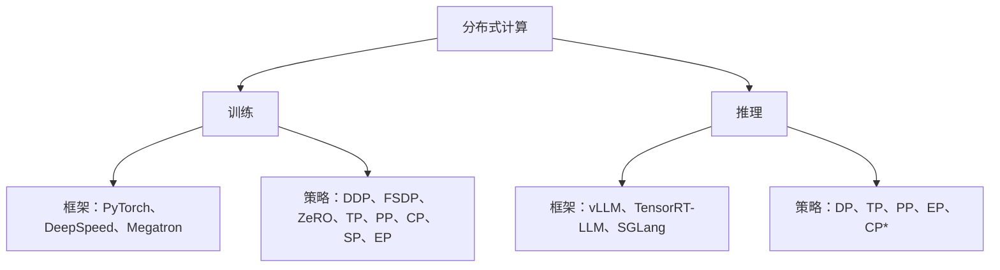

训练和推理用的是同一套并行概念。训练多出 DDP、FSDP 和 ZeRO，它们切分的是梯度和优化器状态，而推理没有这些东西。

## 总览



某个策略能不能用，取决于框架和版本。

- **两边的 TP 是同一个 TP。** PyTorch 里的 TP 和 vLLM 里的 TP 切权重矩阵的方式完全一样。区别在切分之外：训练还有反向传播、梯度和优化器。

## 对比

| 概念 | 通用含义 | 训练 | 推理 |
|---|---|---|---|
| **DP** | 每张 GPU 存一份完整模型，处理不同的数据。 | 不同的训练数据 | 不同的推理请求 |
| **DDP** | 属于 DP。每张 GPU 用不同数据训练，再用 All-Reduce 同步梯度。 | 常用 | 不需要 |
| **FSDP** | 把参数、梯度和优化器状态切分到各 GPU，每层的权重在用之前才聚合。 | 常用 | 一般不用 |
| **ZeRO** | 去掉数据并行各 GPU 之间重复存放的优化器状态、梯度和参数。 | 常用 | 一般不用 |
| **TP** | 切分张量，把计算分到不同 GPU 上。 | 常用 | 常用 |
| **PP** | 不同的层放在不同 GPU 上，micro-batch 像流水线一样流过。 | 常用 | 常用 |
| **CP** | 把一条长序列切到多张 GPU 上，attention 也一起切。 | 可用 | 看框架 |
| **SP** | 切分 TP 没切、仍在每张卡上重复的序列维激活，比如 LayerNorm 和 dropout。 | 可用 | 看框架 |
| **EP** | MoE 的不同 expert 放在不同 GPU 上，每个 token 路由到它的 expert。 | 常用 | 常用 |

## 各策略的代价

Ψ = 参数量，N = 该并行的并行度。模型状态显存按混合精度 Adam 计算（2Ψ fp16 参数 + 2Ψ fp16 梯度 + 12Ψ fp32 优化器 = 16Ψ 字节）[[2]](https://arxiv.org/abs/1910.02054)。

| 策略 | 切什么 | 每卡模型状态 | 主要通信 | 典型放置 |
|---|---|---|---|---|
| **DP / DDP** | Batch | 16Ψ（完整一份） | 梯度 all-reduce，每步 2Ψ | 任意 |
| **ZeRO-1** | Batch + 优化器状态 | 4Ψ + 12Ψ/N | 同 DP | 任意 |
| **ZeRO-2** | + 梯度 | 2Ψ + 14Ψ/N | 同 DP | 任意 |
| **ZeRO-3 / FSDP** | + 参数 | 16Ψ/N | 3Ψ（DP 的 1.5 倍） | 跨节点 |
| **TP** | 层内的权重矩阵 | ≈16Ψ/N | 每层 4 次 all-reduce（前向 + 反向） | 节点内（NVLink） |
| **SP**（Megatron） | LayerNorm/dropout 激活，按序列维 | 同 TP | 用 all-gather + reduce-scatter 代替 all-reduce，带宽不变 | 总是和 TP 一起 |
| **PP** | 层 | ≈16Ψ/N | stage 之间点对点传激活 | 跨节点 |
| **CP** | 整条序列，含 attention | 不变 | Ring：点对点传 KV 块；Ulysses：all-to-all | 长上下文 |
| **EP** | MoE expert | Expert 数 / N | all-to-all 分发 + 合并 | MoE 层 |

## 原理

常见布局按带宽嵌套：DP/FSDP 副本跨整个集群，PP stage 跨节点，TP + SP 在节点内走 NVLink。CP 和 EP 复用这个网格里的 rank [[5]](https://arxiv.org/abs/2104.04473)。

### DP 和 DDP

- **做什么：** 每个 rank 在自己的 micro-batch 上做前向和反向，然后 all-reduce 梯度，让每个副本走同样的优化器步。
- **为什么快：** PyTorch DDP 把梯度分成若干 **bucket**，反向还在跑的时候就开始某个 bucket 的 all-reduce。它能近乎线性地扩展到 256 张 GPU [[1]](https://arxiv.org/abs/2006.15704)。
- **局限：** 每张 GPU 仍要存 16Ψ 字节。7.5B 的模型每张卡需要 120 GB [[2]](https://arxiv.org/abs/1910.02054)。

### ZeRO 和 FSDP

- **ZeRO-1** 切分优化器状态：显存降为 1/4，没有额外通信。
- **ZeRO-2** 再切分梯度：显存降为 1/8，通信仍和 DP 一样，因为 all-reduce 变成了 reduce-scatter。
- **ZeRO-3** 再切分参数：显存随 N 线性下降。每层权重在使用前 all-gather 一次，前向一次、反向再一次，所以通信是 DP 的 1.5 倍 [[2]](https://arxiv.org/abs/1910.02054)。
- **FSDP** 是 PyTorch 内置的 ZeRO-3，速度和 DDP 差不多，但能装下大得多的模型 [[6]](https://arxiv.org/abs/2304.11277)。

### TP（张量并行）

- **Megatron 式切法：** MLP 的第一个线性层（以及 QKV 投影）按列切，输出投影按行切。每张 GPU 计算自己那一片，中间不需要通信，最后一次 all-reduce 合并结果 [[7]](https://arxiv.org/abs/1909.08053)。
- **代价：** 每层前向 2 次 all-reduce、反向 2 次，全部在关键路径上。所以 TP 只放在节点内：TP 开到每台服务器的 GPU 数为止，跨服务器用 PP [[5]](https://arxiv.org/abs/2104.04473)。

### SP（序列并行）

- **问题：** TP 让 LayerNorm 和 dropout 在每个 TP rank 上重复计算。这就是 TP 激活显存公式 `sbh(10 + 24/t + 5as/(ht))` 中的 `10sbh` 那一项 [[3]](https://arxiv.org/abs/2205.05198)。
- **解决：** 这些操作在每个 token 上相互独立，所以 SP 沿序列维切分它们。每次 TP all-reduce 变成一次 all-gather 加一次 reduce-scatter。ring all-reduce 本来就是这两步，所以带宽不变。
- **结果：** 激活显存变成 `sbh(34 + 5as/h)/t`，也就是完全被 `t` 除掉。

### PP（流水线并行）

- **做什么：** 每个 stage 负责 L/p 层。batch 被切成 m 个 micro-batch，依次流过各 stage。
- **气泡：** 流水线填充和排空时，stage 会空闲。GPipe 和 1F1B 的空闲比例是 `(p−1)/m`，所以需要 m ≫ p。交错调度（每张 GPU 放 v 个块）把它降到 `(p−1)/(v·m)`，但通信更多 [[5]](https://arxiv.org/abs/2104.04473)。
- **显存不均：** 1F1B 下第一个 stage 要存 p 个 micro-batch 的激活，所以显存不是平均分的 [[3]](https://arxiv.org/abs/2205.05198)。

### CP（上下文并行）

- **Ring Attention：** 每张 GPU 持有序列的一段。KV 块沿环传递，传输和分块 attention 计算重叠进行。最大上下文长度随设备数增长 [[4]](https://arxiv.org/abs/2310.01889)。
- **DeepSpeed-Ulysses：** 一次 all-to-all 把切分方式从按序列切换成按 attention head 切，attention 在本地算完，再用一次 all-to-all 切回来。序列长度和设备数同比例增长时通信量不变，但并行度上限是 head 数 [[8]](https://arxiv.org/abs/2309.14509)。

### EP（专家并行）

- **做什么：** 每个 rank 持有一部分 expert。token 通过一次 all-to-all 发到对应的 expert，再通过第二次 all-to-all 送回 [[9]](https://arxiv.org/abs/2006.16668)。
- **为什么用：** 每个 token 的计算量不变，总参数量却随 expert 数增长。GShard 就是这样在 2048 个 TPU v3 核上训练了 600B 参数的 MoE。

## 用法

PyTorch 二维并行：节点内 TP，跨节点 FSDP [[10]](https://docs.pytorch.org/tutorials/intermediate/TP_tutorial.html)。

```python
from torch.distributed.device_mesh import init_device_mesh
from torch.distributed.fsdp import fully_shard
from torch.distributed.tensor.parallel import (
    ColwiseParallel,
    RowwiseParallel,
    parallelize_module,
)

# 64 张 GPU：8 个节点 (dp) x 每节点 8 张 GPU (tp)
mesh = init_device_mesh("cuda", (8, 8), mesh_dim_names=("dp", "tp"))

for block in model.layers:
    parallelize_module(block.feed_forward, mesh["tp"], {
        "w1": ColwiseParallel(),
        "w3": ColwiseParallel(),
        "w2": RowwiseParallel(),
    })
    fully_shard(block, mesh=mesh["dp"])
fully_shard(model, mesh=mesh["dp"])
```

Megatron-LM 把每种策略做成一个参数 [[11]](https://github.com/NVIDIA/Megatron-LM)。DP 的大小是剩下的部分：`world_size / (TP × PP × CP)`。

```bash
torchrun --nproc-per-node 8 --nnodes 16 pretrain_gpt.py \
    --tensor-model-parallel-size 8 --sequence-parallel \
    --pipeline-model-parallel-size 4 \
    --context-parallel-size 2 \
    --expert-model-parallel-size 8 \
    --use-distributed-optimizer
```

## 数据

7.5B 模型在 ZeRO 下的每卡模型状态显存（GB），混合精度 Adam（K = 12），取自 ZeRO 论文表 1 [[2]](https://arxiv.org/abs/1910.02054)。

| DP 并行度 | DP（基线） | ZeRO-1 | ZeRO-2 | ZeRO-3 |
|---|---|---|---|---|
| 1 | 120 | 120 | 120 | 120 |
| 4 | 120 | 52.5 | 41.3 | 30 |
| 16 | 120 | 35.6 | 21.6 | 7.5 |
| 64 | 120 | 31.4 | 16.6 | 1.88 |
| 1024 | 120 | 30.1 | 15.1 | 0.12 |

规模参考：Megatron-LM 在 3072 张 A100 上用 TP = 8、PP = 64 训练了 1T 参数的 GPT，达到 502 PFLOP/s，为峰值的 52% [[5]](https://arxiv.org/abs/2104.04473)。

## vLLM 支持情况

凡是切分权重、KV cache 或请求的策略，vLLM 都支持。只用于训练的策略，在推理时没有东西可切。

| 策略 | vLLM | 参数 / 说明 |
|---|---|---|
| DP | 支持 | `-dp N`。每个 rank 是一个完整的 engine 副本。MoE 模型里 DP attention 和 EP expert 配合使用 [[12]](https://github.com/vllm-project/vllm/blob/main/docs/serving/data_parallel_deployment.md) |
| DDP | 不适用 | 没有梯度要同步 |
| ZeRO / FSDP | 不适用 | 没有梯度和优化器状态；TP 切分权重，不需要每步 all-gather |
| TP | 支持 | `-tp N`，Megatron 式 [[13]](https://github.com/vllm-project/vllm/blob/main/docs/serving/parallelism_scaling.md) |
| PP | 支持 | `-pp N`，通常跨节点 |
| EP | 支持 | `--enable-expert-parallel`。MoE 层使用大小为 TP × DP 的 EP 组 [[14]](https://github.com/vllm-project/vllm/blob/main/docs/serving/expert_parallel_deployment.md) |
| CP | 支持，两种 | `-dcp N` 沿 token 切分 decode 阶段的 KV cache（MLA 和 GQA）。`-pcp N` 切分 prefill，仍在开发中 [[15]](https://github.com/vllm-project/vllm/blob/main/docs/serving/context_parallel_deployment.md) |
| SP | 仅内部使用 | 在 EP、TP > 1 且 DP > 1 时，序列并行 MoE 会自动开启。基于 torch.compile 的 SP pass（`pass_config.enable_sp`）已于 2026-10-08 从 `main` 移除 [[16]](https://github.com/vllm-project/vllm/pull/60517) |

```bash
# 2 个节点 x 8 张 GPU：节点内 TP，跨节点 PP
vllm serve $MODEL -tp 8 -pp 2 --distributed-executor-backend ray

# MoE：8 张 GPU 上 DP attention + EP expert
vllm serve $MODEL -dp 8 --enable-expert-parallel

# MLA 模型只有 1 个 KV head：TP=8 会把 KV cache 复制 8 份；DCP=8 去掉这些副本
vllm serve deepseek-ai/DeepSeek-R1 -tp 8 -dcp 8
```

## 注意事项

- **跨节点 TP 很慢：** 它的 all-reduce 都在关键路径上。TP 不要超过每节点的 GPU 数 [[5]](https://arxiv.org/abs/2104.04473)。
- **PP 需要足够多的 micro-batch：** m 接近 p 时，气泡占主导。加大 m，或者用交错调度。
- **ZeRO-3/FSDP 的通信比 DP 多 50%。** 网络慢时，ZeRO-2 或 HSDP（节点内切分、节点间复制）往往更快。
- **Megatron 的 SP 只能和 TP 一起用。** 它既不改变 TP 并行度，也不改变带宽。
- **Ulysses 的并行度上限是 attention head 数。** 用 GQA 时上限是 KV head 数；超过它就用 Ring Attention。
- **EP 需要负载均衡：** 热门 expert 会压垮它所在的 rank。训练时加辅助的均衡 loss，vLLM 里用 EPLB（`--enable-eplb`）。

## 参考资料

1. [Li et al., PyTorch Distributed: Experiences on Accelerating Data Parallel Training](https://arxiv.org/abs/2006.15704)
2. [Rajbhandari et al., ZeRO: Memory Optimizations Toward Training Trillion Parameter Models](https://arxiv.org/abs/1910.02054)
3. [Korthikanti et al., Reducing Activation Recomputation in Large Transformer Models](https://arxiv.org/abs/2205.05198)
4. [Liu et al., Ring Attention with Blockwise Transformers for Near-Infinite Context](https://arxiv.org/abs/2310.01889)
5. [Narayanan et al., Efficient Large-Scale Language Model Training on GPU Clusters Using Megatron-LM](https://arxiv.org/abs/2104.04473)
6. [Zhao et al., PyTorch FSDP: Experiences on Scaling Fully Sharded Data Parallel](https://arxiv.org/abs/2304.11277)
7. [Shoeybi et al., Megatron-LM: Training Multi-Billion Parameter Language Models Using Model Parallelism](https://arxiv.org/abs/1909.08053)
8. [Jacobs et al., DeepSpeed Ulysses: System Optimizations for Enabling Training of Extreme Long Sequence Transformer Models](https://arxiv.org/abs/2309.14509)
9. [Lepikhin et al., GShard: Scaling Giant Models with Conditional Computation and Automatic Sharding](https://arxiv.org/abs/2006.16668)
10. [PyTorch tutorial: Large Scale Transformer Model Training with Tensor Parallel](https://docs.pytorch.org/tutorials/intermediate/TP_tutorial.html)
11. [NVIDIA Megatron-LM repository](https://github.com/NVIDIA/Megatron-LM)
12. [vLLM docs: Data Parallel Deployment](https://github.com/vllm-project/vllm/blob/main/docs/serving/data_parallel_deployment.md)
13. [vLLM docs: Parallelism and Scaling](https://github.com/vllm-project/vllm/blob/main/docs/serving/parallelism_scaling.md)
14. [vLLM docs: Expert Parallel Deployment](https://github.com/vllm-project/vllm/blob/main/docs/serving/expert_parallel_deployment.md)
15. [vLLM docs: Context Parallel Deployment](https://github.com/vllm-project/vllm/blob/main/docs/serving/context_parallel_deployment.md)
16. [vLLM PR #60517: Remove torch.compile-based sequence parallelism and AsyncTP](https://github.com/vllm-project/vllm/pull/60517)
