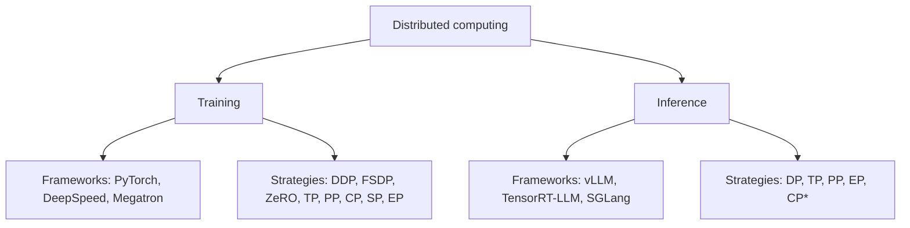

Training and inference use the same parallelism concepts. Training adds DDP, FSDP and ZeRO, which shard gradients and optimizer states that inference doesn't have.

## Overview



\*Whether a strategy is available depends on the framework and its version. 

- **It's the same TP in both.** TP in PyTorch and TP in vLLM split the weight matrices the same way. What differs is what runs around the split: training also has a backward pass, gradients and an optimizer.

## Unified comparison

| Concept | General meaning | Training | Inference |
|---|---|---|---|
| **DP** | Each GPU keeps a full copy of the model and processes different data. | Different training data | Different inference requests |
| **DDP** | Data parallelism that all-reduces gradients after every backward pass. | Common | Not needed |
| **FSDP** | Shards parameters, gradients and optimizer states across GPUs, and gathers each layer's weights just before use. | Common | Usually not used |
| **ZeRO** | Removes duplicate copies of optimizer states, gradients and parameters across data-parallel GPUs. | Common | Usually not used |
| **TP** | Splits each weight matrix across GPUs, so every GPU computes a slice of every layer. | Common | Common |
| **PP** | Puts different layers on different GPUs and streams micro-batches through them. | Common | Common |
| **CP** | Splits a long sequence across GPUs, attention included. | Available | Depends on framework |
| **SP** | Splits the sequence-dimension activations that TP leaves replicated, such as LayerNorm and dropout. | Available | Depends on framework |
| **EP** | Puts different MoE experts on different GPUs and routes each token to its experts. | Common | Common |

## Cost per strategy

Ψ = parameter count, N = degree of that parallelism. Model-state memory assumes mixed-precision Adam (2Ψ fp16 params + 2Ψ fp16 grads + 12Ψ fp32 optimizer = 16Ψ bytes) [[2]](https://arxiv.org/abs/1910.02054).

| Strategy | Splits | Per-GPU model states | Main communication | Typical placement |
|---|---|---|---|---|
| **DP / DDP** | Batch | 16Ψ (full copy) | Gradient all-reduce, 2Ψ per step | Any |
| **ZeRO-1** | Batch + optimizer states | 4Ψ + 12Ψ/N | Same as DP | Any |
| **ZeRO-2** | + gradients | 2Ψ + 14Ψ/N | Same as DP | Any |
| **ZeRO-3 / FSDP** | + parameters | 16Ψ/N | 3Ψ (1.5× DP) | Across nodes |
| **TP** | Weight matrices inside a layer | ≈16Ψ/N | 4 all-reduces per layer (fwd + bwd) | Inside a node (NVLink) |
| **SP** (Megatron) | LayerNorm/dropout activations, sequence dim | Same as TP | All-gather + reduce-scatter in place of all-reduce, same bandwidth | Always with TP |
| **PP** | Layers | ≈16Ψ/N | P2P activations between stages | Across nodes |
| **CP** | Full sequence, attention included | Unchanged | Ring: P2P KV blocks; Ulysses: all-to-all | Long context |
| **EP** | MoE experts | Experts / N | All-to-all dispatch + combine | MoE layers |

## How it works

The usual layout is nested by bandwidth: DP/FSDP replicas across the cluster, PP stages across nodes, and TP + SP inside a node on NVLink. CP and EP reuse ranks inside that grid [[5]](https://arxiv.org/abs/2104.04473).

### DP and DDP

- **What it does:** each rank runs forward and backward on its own micro-batch, then all-reduces gradients so every replica takes the same optimizer step.
- **Why it's fast:** PyTorch DDP groups gradients into **buckets** and starts each bucket's all-reduce while backward is still running. It scales near-linearly to 256 GPUs [[1]](https://arxiv.org/abs/2006.15704).
- **Limit:** every GPU still holds 16Ψ bytes. A 7.5B model needs 120 GB per GPU [[2]](https://arxiv.org/abs/1910.02054).

### ZeRO and FSDP

- **ZeRO-1** shards optimizer states: 4× less memory, no extra communication.
- **ZeRO-2** also shards gradients: 8× less, still the same communication as DP, because the all-reduce becomes a reduce-scatter.
- **ZeRO-3** also shards parameters: memory falls linearly with N. Each layer's weights are all-gathered just before use, in forward and again in backward, so communication is 1.5× DP [[2]](https://arxiv.org/abs/1910.02054).
- **FSDP** is PyTorch's built-in version of ZeRO-3, about as fast as DDP while fitting much larger models [[6]](https://arxiv.org/abs/2304.11277).

### TP (tensor parallelism)

- **Megatron-style split:** the first linear layer of the MLP (and the QKV projection) is split by columns, and the output projection by rows. Each GPU computes its slice with no communication in between, and one all-reduce combines the result [[7]](https://arxiv.org/abs/1909.08053).
- **Cost:** 2 all-reduces per layer in forward and 2 in backward, all on the critical path. So TP is kept inside a node: use TP up to the GPUs per server, then PP across servers [[5]](https://arxiv.org/abs/2104.04473).

### SP (sequence parallelism)

- **Problem:** TP leaves LayerNorm and dropout replicated on every TP rank. That's the `10sbh` term in TP activation memory, `sbh(10 + 24/t + 5as/(ht))` [[3]](https://arxiv.org/abs/2205.05198).
- **Fix:** those ops are independent per token, so SP splits them along the sequence. Each TP all-reduce becomes an all-gather plus a reduce-scatter. A ring all-reduce is exactly those two steps, so bandwidth is unchanged.
- **Result:** activation memory becomes `sbh(34 + 5as/h)/t`, i.e. fully divided by `t`.

### PP (pipeline parallelism)

- **What it does:** each stage owns L/p layers. The batch is cut into m micro-batches that flow through the stages.
- **Bubble:** stages sit idle while the pipeline fills and drains. The idle fraction is `(p−1)/m` for GPipe and 1F1B, so you need m ≫ p. The interleaved schedule (v blocks per GPU) cuts it to `(p−1)/(v·m)` but adds communication [[5]](https://arxiv.org/abs/2104.04473).
- **Memory skew:** under 1F1B the first stage holds activations for p micro-batches, so memory isn't split evenly [[3]](https://arxiv.org/abs/2205.05198).

### CP (context parallelism)

- **Ring Attention:** each GPU holds one chunk of the sequence. KV blocks are passed around a ring, and the transfer overlaps with blockwise attention compute. Maximum context grows with the device count [[4]](https://arxiv.org/abs/2310.01889).
- **DeepSpeed-Ulysses:** an all-to-all switches the split from sequence to attention heads, attention runs locally, and a second all-to-all switches back. Communication volume stays constant when sequence length and devices grow together, but the degree is capped by the head count [[8]](https://arxiv.org/abs/2309.14509).

### EP (expert parallelism)

- **What it does:** each rank holds a subset of the experts. Tokens are sent to their experts with an all-to-all and returned with a second all-to-all [[9]](https://arxiv.org/abs/2006.16668).
- **Why it's used:** compute per token stays fixed while total parameters grow with the expert count. GShard trained a 600B-parameter MoE on 2048 TPU v3 cores this way.

## Usage

PyTorch 2D parallelism: TP inside a node, FSDP across nodes [[10]](https://docs.pytorch.org/tutorials/intermediate/TP_tutorial.html).

```python
from torch.distributed.device_mesh import init_device_mesh
from torch.distributed.fsdp import fully_shard
from torch.distributed.tensor.parallel import (
    ColwiseParallel,
    RowwiseParallel,
    parallelize_module,
)

# 64 GPUs: 8 nodes (dp) x 8 GPUs per node (tp)
mesh = init_device_mesh("cuda", (8, 8), mesh_dim_names=("dp", "tp"))

for block in model.layers:
    parallelize_module(block.feed_forward, mesh["tp"], {
        "w1": ColwiseParallel(),
        "w3": ColwiseParallel(),
        "w2": RowwiseParallel(),
    })
    fully_shard(block, mesh=mesh["dp"])
fully_shard(model, mesh=mesh["dp"])
```

Megatron-LM exposes each strategy as a flag [[11]](https://github.com/NVIDIA/Megatron-LM). DP size is whatever is left: `world_size / (TP × PP × CP)`.

```bash
torchrun --nproc-per-node 8 --nnodes 16 pretrain_gpt.py \
    --tensor-model-parallel-size 8 --sequence-parallel \
    --pipeline-model-parallel-size 4 \
    --context-parallel-size 2 \
    --expert-model-parallel-size 8 \
    --use-distributed-optimizer
```

## Numbers

Per-GPU model-state memory (GB) for a 7.5B model under ZeRO, mixed-precision Adam (K = 12), from ZeRO Table 1 [[2]](https://arxiv.org/abs/1910.02054).

| DP degree | DP (baseline) | ZeRO-1 | ZeRO-2 | ZeRO-3 |
|---|---|---|---|---|
| 1 | 120 | 120 | 120 | 120 |
| 4 | 120 | 52.5 | 41.3 | 30 |
| 16 | 120 | 35.6 | 21.6 | 7.5 |
| 64 | 120 | 31.4 | 16.6 | 1.88 |
| 1024 | 120 | 30.1 | 15.1 | 0.12 |

For scale: Megatron-LM trained a 1T-parameter GPT on 3072 A100s with TP = 8 and PP = 64, reaching 502 PFLOP/s, 52% of peak [[5]](https://arxiv.org/abs/2104.04473).

## Which ones vLLM supports

vLLM supports every strategy that splits weights, KV cache or requests. The training-only ones have nothing to shard at inference time.

| Strategy | vLLM | Flag / note |
|---|---|---|
| DP | Yes | `-dp N`. Each rank is a full engine replica. For MoE, DP attention pairs with EP experts [[12]](https://github.com/vllm-project/vllm/blob/main/docs/serving/data_parallel_deployment.md) |
| DDP | Not applicable | No gradients to sync |
| ZeRO / FSDP | Not applicable | No gradients or optimizer states; TP shards the weights without a per-step all-gather |
| TP | Yes | `-tp N`, Megatron-style [[13]](https://github.com/vllm-project/vllm/blob/main/docs/serving/parallelism_scaling.md) |
| PP | Yes | `-pp N`, usually across nodes |
| EP | Yes | `--enable-expert-parallel`. MoE layers use an EP group of size TP × DP [[14]](https://github.com/vllm-project/vllm/blob/main/docs/serving/expert_parallel_deployment.md) |
| CP | Yes, two kinds | `-dcp N` shards the decode KV cache along tokens (MLA and GQA). `-pcp N` splits prefill and is still under development [[15]](https://github.com/vllm-project/vllm/blob/main/docs/serving/context_parallel_deployment.md) |
| SP | Internal only | Sequence-parallel MoE turns on automatically with EP, TP > 1 and DP > 1. The torch.compile SP pass (`pass_config.enable_sp`) was removed on `main` on 2026-10-08 [[16]](https://github.com/vllm-project/vllm/pull/60517) |

```bash
# 2 nodes x 8 GPUs: TP inside a node, PP across nodes
vllm serve $MODEL -tp 8 -pp 2 --distributed-executor-backend ray

# MoE: DP attention + EP experts on 8 GPUs
vllm serve $MODEL -dp 8 --enable-expert-parallel

# MLA model, 1 KV head: TP=8 copies the KV cache 8x; DCP=8 removes the copies
vllm serve deepseek-ai/DeepSeek-R1 -tp 8 -dcp 8
```

## Pitfalls

- **TP across nodes is slow:** its all-reduces sit on the critical path. Keep TP ≤ the GPUs per node [[5]](https://arxiv.org/abs/2104.04473).
- **PP needs many micro-batches:** with m close to p, the bubble dominates. Raise m or use the interleaved schedule.
- **ZeRO-3/FSDP adds 50% communication** over DP. On slow networks, ZeRO-2, or HSDP (shard inside a node, replicate across nodes), is often faster.
- **Megatron SP is only defined together with TP.** It changes neither the TP degree nor the bandwidth.
- **The Ulysses degree is capped by the attention head count.** With GQA, the cap is the KV head count; use Ring Attention beyond it.
- **EP needs load balancing:** hot experts overload their rank. Use an auxiliary balancing loss in training, and EPLB in vLLM (`--enable-eplb`).


## References

1. [Li et al., PyTorch Distributed: Experiences on Accelerating Data Parallel Training](https://arxiv.org/abs/2006.15704)
2. [Rajbhandari et al., ZeRO: Memory Optimizations Toward Training Trillion Parameter Models](https://arxiv.org/abs/1910.02054)
3. [Korthikanti et al., Reducing Activation Recomputation in Large Transformer Models](https://arxiv.org/abs/2205.05198)
4. [Liu et al., Ring Attention with Blockwise Transformers for Near-Infinite Context](https://arxiv.org/abs/2310.01889)
5. [Narayanan et al., Efficient Large-Scale Language Model Training on GPU Clusters Using Megatron-LM](https://arxiv.org/abs/2104.04473)
6. [Zhao et al., PyTorch FSDP: Experiences on Scaling Fully Sharded Data Parallel](https://arxiv.org/abs/2304.11277)
7. [Shoeybi et al., Megatron-LM: Training Multi-Billion Parameter Language Models Using Model Parallelism](https://arxiv.org/abs/1909.08053)
8. [Jacobs et al., DeepSpeed Ulysses: System Optimizations for Enabling Training of Extreme Long Sequence Transformer Models](https://arxiv.org/abs/2309.14509)
9. [Lepikhin et al., GShard: Scaling Giant Models with Conditional Computation and Automatic Sharding](https://arxiv.org/abs/2006.16668)
10. [PyTorch tutorial: Large Scale Transformer Model Training with Tensor Parallel](https://docs.pytorch.org/tutorials/intermediate/TP_tutorial.html)
11. [NVIDIA Megatron-LM repository](https://github.com/NVIDIA/Megatron-LM)
12. [vLLM docs: Data Parallel Deployment](https://github.com/vllm-project/vllm/blob/main/docs/serving/data_parallel_deployment.md)
13. [vLLM docs: Parallelism and Scaling](https://github.com/vllm-project/vllm/blob/main/docs/serving/parallelism_scaling.md)
14. [vLLM docs: Expert Parallel Deployment](https://github.com/vllm-project/vllm/blob/main/docs/serving/expert_parallel_deployment.md)
15. [vLLM docs: Context Parallel Deployment](https://github.com/vllm-project/vllm/blob/main/docs/serving/context_parallel_deployment.md)
16. [vLLM PR #60517: Remove torch.compile-based sequence parallelism and AsyncTP](https://github.com/vllm-project/vllm/pull/60517)
