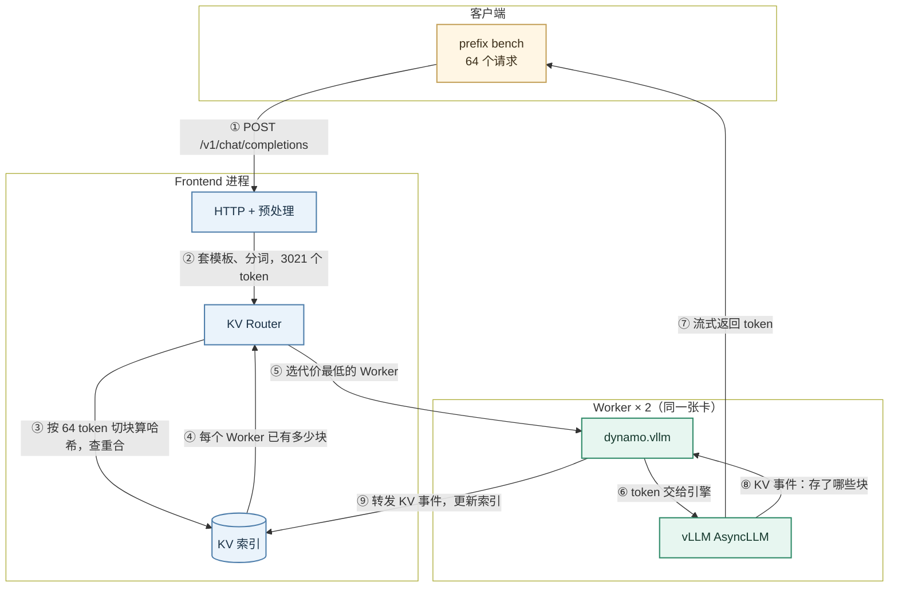
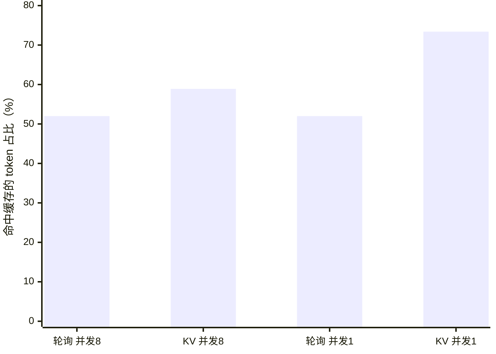
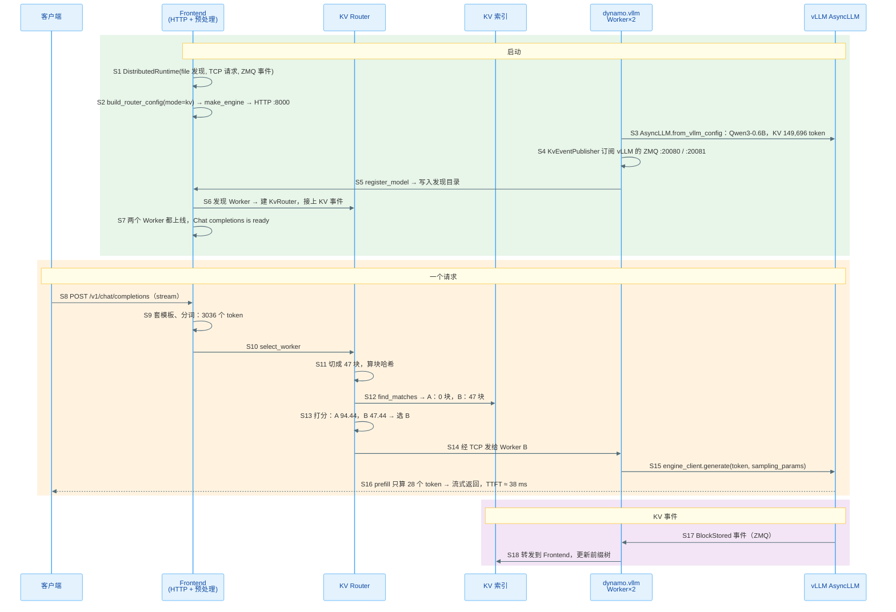

>   代码版本：`dynamo@27f6052c`（2026-11-08，`pyproject.toml` 里是 1.7.0）。运行环境：1 × A40 46GB（Slurm 只分到这一张卡，两个 Worker 共用），从源码装的 `ai-dynamo 1.7.0` / `ai-dynamo-runtime 1.7.0`（`maturin develop --release`），`vllm 0.33.0`、`torch 2.14.0`、`flashinfer 0.7.2.post1`、`nixl 1.5.0`。文中数值都来自本机跑通的例子，代码行号对应上述 commit。

## Dynamo Overview

Dynamo 是 NVIDIA 开源的推理编排层：它不替代 vLLM、SGLang、TensorRT-LLM，而是把多个引擎实例组织成一个服务，在它们前面做分词、按 KV cache 选实例、prefill/decode 分离和扩缩容。

入门时先记住三个角色：

| 角色     | 代码里的名字                         | 职责                                             |
| -------- | ------------------------------------ | ------------------------------------------------ |
| 入口     | `dynamo.frontend`（Rust 为主）        | OpenAI 兼容的 HTTP 接口，套模板、分词            |
| 路由     | Frontend 进程里的 KV Router          | 按"缓存能省多少 prefill"和"各 Worker 有多忙"选 Worker |
| Worker   | 2 个 `dynamo.vllm`                   | 包住 vLLM 的 `AsyncLLM` 生成，并把 KV cache 的变化报给路由 |

它们之间有三个独立的通道：

| 通道 | 本例用的实现 | 传什么 |
| ---- | ------------ | ------ |
| 发现（discovery） | `file`：`DYN_FILE_KV` 目录下的文件 | Worker 上线、下线，各自的地址 |
| 请求（request plane） | TCP | Frontend 发给 Worker 的 token，Worker 流式回传的 token |
| 事件（event plane） | ZMQ | KV 事件：哪个 Worker 存了、删了哪些 block |

本例不需要 etcd 和 NATS：发现走文件，请求走 TCP，事件走 ZMQ，都是默认之外最省事的组合。



下面解释图中 9 个步骤，数值取自后文例子：16 篇约 3000 token 的"文档"，每篇问 4 个问题，共 64 个请求。

- **① POST /v1/chat/completions**：客户端发一个普通的 OpenAI 请求，`stream=true`，`max_tokens=32`。

    - 请求内容：一篇文档加一个问题。同一篇文档的 4 个问题，前约 2950 个 token 完全相同，只有结尾的问题不同。

        ```text
        Document 3.
        policy reward rollout gradient token batch ...（2900 个随机词）

        Question 2: list three words that appear in document 3. /no_think
        ```

    - 为什么这样设计：这就是 KV 路由要解决的场景。同一前缀的请求落到同一个 Worker，第二次起就能复用 prefill 算好的 KV cache。RL 里同一个 prompt 采样 n 条回答，也是这种形状。

- **② 套模板、分词，3021 个 token**：Frontend 用 Qwen3 的聊天模板把消息拼成文本，再用 Rust 的 tokenizer 转成 token。64 个请求的 prompt 长 3003–3036 个 token。

    - 分词在 Frontend 做：Worker 收到的是 token id，所以路由在转发之前就知道每个请求的完整 token 序列。

- **③ 按 64 token 切块算哈希，查重合**：路由把 token 序列每 64 个切成一块（和 vLLM 的 `--block-size 64` 一致），对每块算哈希，前一块的哈希会影响后一块，所以哈希相同就意味着从开头到这一块都相同。

    ```text
    3021 个 token → 47 个完整块（47 × 64 = 3008），最后 13 个 token 不成块，不参与匹配
    块 0 的哈希 = h(token 0–63)
    块 1 的哈希 = h(块 0 的哈希, token 64–127)
    ...
    ```

- **④ 每个 Worker 已有多少块**：索引是一棵按块哈希组织的前缀树，记录每个 Worker 的 KV cache 里有哪些块。查一次就得到"Worker A 有前 46 块，Worker B 有 0 块"这样的结果。

- **⑤ 选代价最低的 Worker**：每个 Worker 算一个代价，单位是"块"：

    ```text
    代价 = 还要 prefill 的块数 + 这个 Worker 上所有在跑请求占的块数

    还要 prefill 的块数 = prompt 块数 − 已缓存的块数
    ```

    - 例子（并发 1，第 2 个请求，prompt 3036 个 token = 47.44 块）：

        ```text
        Worker A：没有这篇文档    → 47.44 + 47 = 94.44
        Worker B：已缓存 47 块    → (47.44 − 47) + 47 = 47.44   ← 选 B
        ```

    - 负载也算进代价：一个 Worker 上每多一个在跑的请求，代价就多约 47 块。所以缓存省下的 46–47 块，只要那个 Worker 多排了一个请求就抵消了。后面的实验会看到这一点。

- **⑥ token 交给引擎**：Frontend 经 TCP 把 token 发给选中的 Worker，Worker 调用 vLLM 的 `AsyncLLM.generate`。

    - vLLM 的 prefix caching 自己会发现前 46–47 块已经算过，只 prefill 剩下的 13–80 个 token。

- **⑦ 流式返回 token**：vLLM 每生成一个 token 就沿原路返回，Frontend 转成 SSE 发给客户端。

    - TTFT（首 token 时间）：命中缓存的请求中位数约 38 ms，没命中的约 64 ms（并发 1）。

- **⑧ KV 事件：存了哪些块**：vLLM 每存下或删掉一个 KV 块，就在 ZMQ 端口（Worker 1 是 20080，Worker 2 是 20081）上发一个事件。

- **⑨ 转发 KV 事件，更新索引**：Worker 里的 `KvEventPublisher` 读这些事件，经事件通道发给 Frontend，Frontend 更新前缀树。下一个同文档的请求查索引时，就能看到这个 Worker 有这些块。

    - 时间差：事件要等 prefill 做完才发出。同一篇文档的两个请求如果几乎同时到达，第二个查索引时还看不到第一个的块。

<br />
<br />

## 代码在哪里

```text
dynamo/
├── components/src/dynamo/
│   ├── frontend/main.py                    # Frontend 入口：DistributedRuntime、路由配置、启动 HTTP
│   ├── common/configuration/groups/kv_router_args.py   # 所有 --router-* 参数和默认值
│   └── vllm/
│       ├── main.py                         # Worker 入口：启动 AsyncLLM、KV 事件、注册模型
│       └── handlers.py                     # 收到请求后调用 engine_client.generate
├── lib/runtime/                            # DistributedRuntime：发现、请求、事件三个通道
├── lib/llm/src/
│   ├── http/service/openai.rs              # /v1/chat/completions
│   ├── preprocessor.rs                     # 套模板、分词
│   ├── kv_router.rs                        # KvRouter
│   └── kv_router/routing_host/kv.rs        # 每个请求选 Worker 的入口
├── lib/kv-router/src/
│   ├── protocols.rs                        # 块哈希
│   ├── indexer/radix_tree.rs               # 前缀树索引
│   ├── services/selection/core/run.rs      # 切块 → 查索引 → 打分
│   └── scheduling/selector/                # 代价公式、选最小
├── lib/bindings/python/                    # PyO3 扩展 dynamo._core，用 maturin 构建
└── examples/backends/vllm/launch/agg_router.sh   # 本例参照的官方脚本
```

<br />
<br />

## 安装

### 更新代码

`origin` 是自己的 fork，最新代码在官方仓库，所以先把官方仓库加成 `upstream`：

```bash
git remote add upstream https://github.com/ai-dynamo/dynamo.git   # 只需第一次
git fetch upstream
git checkout main
git rebase --autostash upstream/main     # 未提交的改动自动收起，做完再放回
```

- 先装 `git-lfs`：仓库里的测试媒体和性能 trace 是 LFS 文件，配置了 LFS 过滤器却没装 `git-lfs` 时，检出会做到一半失败，工作区停在新旧两个版本混在一起的状态。
- 本机没有 `git-lfs`：在旁边新建一个 worktree，检出时临时关掉过滤器，LFS 文件留成指针文件，不影响编译和运行：

    ```bash
    git -c filter.lfs.smudge= -c filter.lfs.process= -c filter.lfs.required=false \
        worktree add --detach ../dynamo-main upstream/main
    ```

### 安装

官方的 Python 开发构建（`AGENTS.md`）：

```bash
uv venv .venv && source .venv/bin/activate
uv pip install pip 'maturin[patchelf]'
cd lib/bindings/python
maturin develop --uv --release --features kv-indexer,slot-tracker,select-service,mm-routing,ais-forward-pass,request-trace-s3
cd -
uv pip install -e lib/gpu_memory_service
uv pip install -e '.[vllm]'          # 装 vllm 0.33.0 等引擎依赖
```

| 步骤 | 做什么 | 本机耗时 |
| ---- | ------ | -------- |
| `maturin develop` | 编 Rust 写的 `dynamo._core`（约 820 个 crate），装进 venv | release 14 分 22 秒（8 个 CPU） |
| `uv pip install -e lib/gpu_memory_service` | 显存管理的小扩展 | 几秒 |
| `uv pip install -e '.[vllm]'` | 可编辑安装 `components/src/dynamo`，并装 vLLM | 39 s（包都在缓存里） |

- `--release`：官方命令里没有，默认是 debug 构建，Rust 部分不优化。分词、路由都在 Rust 里，测延迟一定要加。
- `--features`：和 CI 发布的 wheel 一致。少了 `kv-indexer`，起独立 indexer 的测试会失败。
- 改了 `components/src/` 下的 Python 代码立即生效；改了 Rust 代码要重新跑 `maturin develop`。

本机没有 sudo，官方要求的系统包（`build-essential libclang-dev protobuf-compiler ...`）一个也装不了，换成下面这些：

| 缺什么 | 报错 | 本机的解决办法 |
| ------ | ---- | -------------- |
| C++ 编译器 | `failed to find tool "c++"` | 借用 conda 环境里的 gcc/g++ 13（激活后有 `CC`、`CXX`），并 `unset CONDA_PREFIX`，否则 maturin 报 `Both VIRTUAL_ENV and CONDA_PREFIX are set` |
| protoc ≥ 3.15 | 编 gRPC 相关 crate 时找不到 protoc | 下载 protoc 30.2 的 zip 解压到 `~/.local/protoc30`，设 `PROTOC` |
| libclang | `nixl-sys` 的 bindgen：`Unable to find libclang` | `uv pip install libclang`，设 `LIBCLANG_PATH` 指向它的 `native/` 目录 |
| C++ 头文件（给 libclang 用） | `'cstdint' file not found` | 把 `g++ -E -v` 打印的头文件目录逐个加进 `BINDGEN_EXTRA_CLANG_ARGS="-isystem ..."` |
| 新版 libstdc++ | 运行时 `GLIBCXX_3.4.30 not found` | 运行前 `export LD_LIBRARY_PATH=<conda 环境>/lib` |
| FlashInfer JIT 的编译器 | 第一次起 vLLM 时 `cannot execute 'cc1plus'` | 运行前设 `CC=<conda>/bin/gcc CXX=<conda>/bin/g++`，FlashInfer 用 `CC` 作为 nvcc 的 `-ccbin` |

完整脚本：`rl_study/scripts/dynamo_build.sh`（debug）和 `dynamo_build_release.sh`（release）。

### 检查安装

```bash
python -m dynamo.frontend --help | head -3
LD_LIBRARY_PATH=<conda 环境>/lib python -c "import vllm, dynamo._core; print(vllm.__version__)"
# 0.33.0
```

<br />
<br />

# 提PR

<br />
<br />

## 提 PR 流程

规则以官方的 `CONTRIBUTING.md`、`docs/fern/pages/community/contributing/`（contribution-flow、code-quality）和 `.github/pull_request_template.md` 为准。

### 1. 建分支

小改动（错别字、文档、小 bug）可以直接开 PR；大改动、新功能、跨多个组件的改动，先开 Contribution Request issue，等维护者同意；改公共 API 或通信架构要写 DEP（Dynamo Enhancement Proposal）。

```bash
git fetch upstream
git switch main
git rebase upstream/main
git switch -c <你的名字>/fix-router-timeout     # 一个分支只做一件事
```

动手前先查重：

```text
https://github.com/ai-dynamo/dynamo/pulls?q=is%3Apr+<关键词>
```

### 2. 测试

```bash
pre-commit install                       # 只需第一次
pre-commit run                           # 只查改动的文件
cargo fmt && cargo clippy                # 改了 Rust 代码
cargo test --locked --all-targets        # Rust 测试
pytest tests/<目录>                      # Python 测试，挑和改动相关的
```

- 测试命令和结果要写进 PR 的 **Validation** 一节。
- 修复前后各跑一次：修复前失败、修复后通过，才能证明测试有效。

### 3. 提交

```bash
git add <文件>
git commit -s -m "fix(router): handle streaming timeout"    # -s 加 DCO 的 Signed-off-by
git push -u origin <你的名字>/fix-router-timeout
```

- 标题用 Conventional Commits，可以加范围：`feat(router): ...`、`fix(frontend): ...`、`docs: ...`。
- 类型：`feat`、`fix`、`docs`、`test`、`ci`、`refactor`、`perf`、`chore`、`build`、`style`、`revert`。
- DCO 和签名是两回事：`-s` 只加 `Signed-off-by`。fork 来的 PR 想自动触发 CI，每个提交还要有 GitHub 显示为 `Verified` 的签名。

### 4. 开 PR

目标选 `ai-dynamo/dynamo:main`，正文照模板的各节写：

```markdown
### Overview

<一两句话：问题是什么、怎么修。>

### Key Changes

- `lib/kv-router/src/...`: <改了什么、为什么>

### Validation

<测试命令和结果：修复前失败，修复后通过>

### Issues and Ongoing Work

- Closes #<issue>

<details>
<summary>Pull Request Checklist</summary>

- [x] I used Dynamo's `/pr-checklist` skill.

</details>
```

- `Closes #`：`PR Issue Link` 检查会看这一行。
- `/pr-checklist`：仓库自带的 agent skill（`.agents/skills/pr-checklist`），检查设计、测试、代码质量和 PR 描述。
- 跑 CI：满足条件的 fork PR 会自动收到 `/ok to test`；否则等维护者看过当前提交后评论 `/ok to test <sha>`，不要反复推送没改动的提交。
- review 的人：按改动的目录自动指定，`codeowners` 检查失败时看 `.github/codeowners/README.md`。

### 5. 更新 PR

**情况 1：改代码或回应 review**

```bash
git switch <你的名字>/fix-router-timeout
# 修改代码
pre-commit run
git add <文件>
git commit -s -m "fix(router): address review comments"
git push
```

**情况 2：上游 main 更新了，需要同步或解决冲突**

```bash
git fetch upstream
git rebase upstream/main
git push --force-with-lease
```

- 有冲突：编辑冲突文件，`git add <文件>`，再 `git rebase --continue`。
- 想放弃：`git rebase --abort`。

<br />
<br />

## 跑通第一个例子：KV 路由 vs 轮询

参照官方的 `examples/backends/vllm/launch/agg_router.sh`：1 个 Frontend 加 2 个 vLLM Worker，模型 Qwen3-0.6B。官方脚本给每个 Worker 一张卡；这里只有一张卡，两个 Worker 各占 40% 显存。

### 1. 准备请求

`rl_study/scripts/dynamo_prefix_bench.py` 生成 16 篇随机词组成的文档（每篇约 2950 个 token），每篇问 4 个问题，共 64 个请求，打乱顺序后以固定并发发出，流式接收，记录每个请求的 TTFT 和 vLLM 报告的 `cached_tokens`。

### 2. 启动服务

```bash
# 参数写成 bash 数组，每个参数后面都能加注释（反斜杠续行的写法里不能在行尾加注释）
export CUDA_VISIBLE_DEVICES=2                        # 只用 Slurm 分给本作业的那张卡
export DYN_DISCOVERY_BACKEND=file DYN_FILE_KV=/tmp/dyn_kv   # 发现走本地文件，不需要 etcd
export PYTHONHASHSEED=0                              # 和官方脚本一样，固定 Python 侧的哈希

python -m dynamo.frontend --http-port 8000 --router-mode kv &   # 对比时改成 round-robin

worker() {   # $1 = 1 或 2
    ARGS=(
        --model Qwen/Qwen3-0.6B
        --block-size 64                              # KV 块 64 个 token，路由按同样的大小切块
        --enforce-eager                              # 官方脚本也加了：不捕获 CUDA graph，启动快
        --gpu-memory-utilization 0.4                 # 两个 Worker 共用一张 46 GB 的卡
        --kv-events-config "{\"publisher\":\"zmq\",\"topic\":\"kv-events\",\"endpoint\":\"tcp://*:$((20079+$1))\",\"enable_kv_cache_events\":true}"
                                                     # vLLM 在 20080 / 20081 上发 KV 事件
    )
    DYN_SYSTEM_PORT=$((8080+$1)) \
    VLLM_NIXL_SIDE_CHANNEL_PORT=$((20095+$1)) \
        python -m dynamo.vllm "${ARGS[@]}" &         # 每个 Worker 的状态/指标端口不能重复
}
worker 1     # 等日志出现 "has been initialized" 再起第二个，两者不要同时测显存
worker 2

python rl_study/scripts/dynamo_prefix_bench.py --concurrency 8 --tag kv --out kv.jsonl
```

完整脚本见 `rl_study/scripts/dynamo_ex1_router.sh`，每种配置都重新启动三个进程，避免上一轮的缓存留到下一轮。

### 3. 关键配置

| 配置 | 含义 | 取值 |
| ---- | ---- | ---- |
| `--router-mode` | 路由方式 | `kv` 或 `round-robin` |
| `--block-size` | KV 块大小，路由切块也用它 | 64 |
| `--kv-events-config` | vLLM 发 KV 事件的方式 | ZMQ，`enable_kv_cache_events=true` |
| `--router-kv-overlap-score-credit` | 每个已缓存的块抵多少代价 | 1.0（默认） |
| `--router-prefill-load-scale` | 还要 prefill 的块数的权重 | 1.0（默认） |
| `--router-temperature` | 0 表示总选代价最低的 | 0（默认） |
| `--router-predicted-ttl-secs` | 路由一决定就先把块记到这个 Worker 名下 | 默认不开，对比时设 30 |

### 4. 结果分析

每个 Worker 的 KV cache 能放 149,696 个 token，16 篇文档一共约 48k 个 token，两个 Worker 都放得下全部文档，不会有淘汰，差别全来自路由。

理想情况：KV 路由下每篇文档只算 1 次，64 个请求里 48 个命中，命中缓存的 token 约占 73%；轮询下同一篇文档的 4 个问题轮流落到两个 Worker，各算 1 次，约占 49%。

| 路由 | 并发 | 命中缓存的 token 占比 | TTFT p50（ms） | TTFT 平均（ms） | 64 个请求总耗时 |
| ---- | ---- | --------------------- | -------------- | --------------- | --------------- |
| round-robin | 8 | 53.5% / 50.5% | 69.5 / 125.6 | 127.8 / 147.1 | 5.25 s / 5.42 s |
| kv | 8 | 55.1% / 62.7% | 126.3 / 104.1 | 135.1 / 132.8 | 5.14 s / 4.88 s |
| kv + predict-on-route | 8 | 61.2% / 56.6% | 58.2 / 127.9 | 124.7 / 137.6 | 4.97 s / 5.00 s |
| round-robin | 1 | 52.0% | 54.1 | 55.0 | 28.0 s |
| kv | 1 | 73.4% | 38.5 | 48.1 | 28.2 s |

（并发 8 的每种配置跑了两次，用 `/` 分开。）



- 并发 1 时 KV 路由做到了理想值：48 个请求命中，73.4%；TTFT 中位数从 54.1 ms 降到 38.5 ms。
- 并发 8 时 KV 路由只比轮询多一点：负载也算在代价里，一个 Worker 每多一个在跑的请求，代价多约 47 块，正好抵掉缓存省下的 46–47 块，所以同一篇文档的问题常被分到另一个 Worker。
- predict-on-route 没有改变结果：它解决的是"KV 事件还没回来，索引里看不到"，这里的主因不是这个，而是负载项。
- 命中和不命中差多少：并发 1 时命中 37.9 ms、不命中 64.4 ms；并发 8 时命中约 47 ms、不命中 157–216 ms（不命中还要在 GPU 上排队）。两个 Worker 在同一张卡上，算力是共享的，所以这里总耗时差别不大；Worker 在不同卡上时，少算的 prefill 才会变成更高的吞吐。
- 想更偏向缓存：调大 `--router-kv-overlap-score-credit`，让每个缓存块抵更多代价；它的代价是负载更不均衡。

<br />
<br />

## 一次请求的时序图

整个过程分成两段：

- 启动（S1–S7，只执行一次）：Frontend 建运行时、路由配置和 HTTP 服务；Worker 启动 vLLM、接上 KV 事件、注册到发现目录；Frontend 发现 Worker，建好 KV Router。
- 每个请求（S8–S18）：HTTP 进来 → 套模板、分词 → 切块算哈希 → 查索引 → 每个 Worker 打分、选最低 → 经 TCP 发给 Worker → vLLM 生成、流式返回 → vLLM 发 KV 事件，索引更新。

图中编号 S1–S18 和下一节的代码一一对应。



<br />
<br />

## 代码逐步详解（带入数值）

每一步都按同样的顺序讲：**做什么 → 代码 → 带入数值 → 这一步的结果**。编号和上面的时序图一一对应。

例子的配置：

- 1 个 Frontend（`--router-mode kv`），2 个 Worker，同在 GPU 2 上。
- `--block-size 64`，`gpu_memory_utilization=0.4`。
- 64 个请求：16 篇文档 × 4 个问题，prompt 3003–3036 个 token，`max_tokens=32`。
- S9–S16 的数值来自并发 1 的第 2 个请求（打开了 TRACE 日志的那一轮）。

### 第一阶段：启动（S1–S7，只执行一次）

#### S1: 建运行时

**目的**：Frontend 建 `DistributedRuntime`，决定三个通道用什么实现。

代码位置：`components/src/dynamo/frontend/main.py:428`

```python
runtime = DistributedRuntime(
    loop,
    config.discovery_backend,  # 来自 DYN_DISCOVERY_BACKEND=file
    config.request_plane,  # 默认 tcp
    event_plane=config.event_plane,  # 默认 zmq
    response_plane=config.response_plane,
)
```

**带入数值**：日志里依次出现：

```text
Initializing KV store discovery backend: File(/.../kv1/discovery)
Initializing NetworkManager with TCP request plane mode=tcp host="auto" port=OS-assigned
```

**结果**：运行时就绪，还没有任何 Worker。

<br />

#### S2: 路由配置，启动 HTTP

**目的**：把 `--router-*` 参数收成路由配置，建引擎，开 HTTP 端口。

代码位置：`components/src/dynamo/frontend/main.py:449`、`:513`、`:525`

```python
router_config = build_router_config(config)  # mode=kv，其余参数取默认

e = EntrypointArgs(EngineType.Dynamic, **kwargs)  # Dynamic：模型和 Worker 都靠发现动态加入
engine = await make_engine(runtime, e)

await run_input(runtime, "http", engine, frontend_route_extensions)  # 开 HTTP，一直运行
```

**带入数值**：

- 默认值（`kv_router_args.py`）：`overlap_score_credit=1.0`、`prefill_load_scale=1.0`、`decode_active_request_weight=0.0`、`router_temperature=0.0`、`track_prefill_tokens=True`。
- 启动时有一条提示：从 Dynamo 1.8 起，`--router-mode kv` 的默认代价函数会换成 `dynamo-two-tier-cost-fn`；本文用的仍是当前默认的。
- `HTTP server listening address=0.0.0.0:8000`。

**结果**：Frontend 在 8000 端口等请求和 Worker。

<br />

#### S3: Worker 启动 vLLM

**目的**：每个 Worker 进程里启动一个 vLLM `AsyncLLM`。

代码位置：`components/src/dynamo/vllm/main.py:836`、`:852`

```python
engine_client = AsyncLLM.from_vllm_config(vllm_config, ...)  # 普通的 vLLM 引擎，参数来自命令行

logger.info(f"worker for {config.served_model_name} has been initialized")
```

**带入数值**：

- `Model loading took 1.12 GiB memory and 5.37 seconds`。
- `GPU KV cache size: 149,696 tokens`：显存的 40% 减去权重和激活后剩下的部分。
- `--enforce-eager`：`init engine ... took 2.86 s`，不捕获 CUDA graph。

**结果**：引擎可以生成了，但 Frontend 还不知道它。

<br />

#### S4: 接上 KV 事件

**目的**：vLLM 自己会把 KV 块的变化发到 ZMQ 端口；Worker 建一个 `KvEventPublisher` 读这些事件，转发给路由。

代码位置：`components/src/dynamo/vllm/main.py:581`

```python
zmq_endpoint = ZmqEventPublisher.offset_endpoint_port(config.engine_args.kv_events_config.endpoint, data_parallel_rank=dp_rank).replace("*", "127.0.0.1")  # tcp://*:20080 → tcp://127.0.0.1:20080

kv_publisher = KvEventPublisher(endpoint=generate_endpoint, kv_block_size=kv_event_block_size, zmq_endpoint=zmq_endpoint, ...)  # 订阅 vLLM，转发到事件通道
```

**带入数值**：

```text
Worker 1: Worker reading KV events for dp_rank=0 from tcp://127.0.0.1:20080
Worker 2: Worker reading KV events for dp_rank=0 from tcp://127.0.0.1:20081
```

前提是 vLLM 开了 prefix caching（默认开）且 `enable_kv_cache_events=true`，否则这一步直接返回，KV 路由只能看负载。

**结果**：KV 事件链路接通。

<br />

#### S5: 注册到发现目录

**目的**：把"我是谁、在哪、服务哪个模型"写进发现后端，Frontend 才能找到它。

代码位置：`components/src/dynamo/vllm/main.py:1052`

```python
await register_model(model_input, model_type, generate_endpoint, _register_model_source_path(config, vllm_config), ...)  # 写入 DYN_FILE_KV 目录
```

**带入数值**：

- 注册的端点：`namespace/dynamo/component/backend/endpoint/generate`，另外登记了 `kv-events`、`kv_metrics` 两个事件通道。
- 同时注册了一组控制接口，其中有给 RL 用的：`pause_generation`、`resume_generation`、`update_weights_from_tensor`、`update_weights_from_distributed`、`set_weight_version` 等。

**结果**：发现目录里多了这个 Worker 的记录。

<br />

#### S6: Frontend 发现 Worker，建 KV Router

**目的**：Frontend 盯着发现目录，看到新模型就为它建路由。

代码位置：`lib/llm/src/discovery/model.rs:209`、`lib/llm/src/kv_router.rs:918`、`lib/llm/src/kv_router/indexer/recovery/subscriber.rs:533`

**带入数值**：日志顺序：

```text
Using direct-ZMQ KV event ingress on the application runtime
Activated KV event source worker_id=9128057735468013713 dp_rank=0 ...
KvRouter scheduling on embedded selection partition worker_type=aggregated
KV Routing initialized
KV recovery query answered worker_id=... attempts=1 elapsed_ms=3
Adding worker set to model model=Qwen/Qwen3-0.6B ...
```

- `worker_type=aggregated`：没有做 prefill/decode 分离，一个 Worker 既做 prefill 也做 decode。
- `KV recovery query`：路由向新接上的 Worker 查询它已有的块，3 ms 就答复了（刚启动，还没有块）。

**结果**：路由能看到 Worker 1 了。

<br />

#### S7: 两个 Worker 都上线

**目的**：等第二个 Worker 也注册上，开始接请求。

**带入数值**：脚本等 Worker 1 就绪后才启动 Worker 2（两个 vLLM 同时测显存会互相干扰），Worker 2 约 70 s 后上线。日志 `Chat completions is ready`。

**结果**：路由里有 2 个候选 Worker。

### 第二阶段：一个请求（S8–S16）

<br />

#### S8: HTTP 请求进来

**目的**：接收 OpenAI 格式的请求。

代码位置：`lib/llm/src/http/service/openai.rs:3696`

```rust
async fn chat_completions(...) {
    check_ready(&state)?;  // 服务还没就绪就直接返回错误
    let streaming = request.inner.stream.unwrap_or(false);  // 本例 stream=true
    ...  // 套模板、交给引擎、把结果写成 SSE
}
```

**带入数值**：`messages=[{"role": "user", "content": <文档 + 问题>}]`，`max_tokens=32`，`temperature=0`。

**结果**：请求交给预处理。

<br />

#### S9: 套模板、分词

**目的**：把消息变成 token 序列，后面的路由和 Worker 都用它。

代码位置：`lib/llm/src/preprocessor.rs:3463`

```rust
pub async fn preprocess_request(...)  // 套聊天模板 → tokenizer.encode → PreprocessedRequest { token_ids, sampling ... }
```

**带入数值**：第 2 个请求套模板后 3036 个 token。启动日志里 tokenizer 外面包了一层 64 MB 的缓存（`wrapping tokenizer in L1 prefix cache cache_bytes=67108864`）。

**结果**：`PreprocessedRequest`，里面是 3036 个 token id。

<br />

#### S10: 进入选 Worker

**目的**：为这个请求选一个 Worker。

代码位置：`lib/llm/src/kv_router/routing_host/kv.rs:53`

```rust
let selection_future = self
    .select_worker_outcome(&context_id, request, routing_parts, phase, is_query_only, SelectionOptions { ... })
    .instrument(tracing::info_span!("kv_router.select_worker"));  // 日志里的 kv_router.select_worker
```

**结果**：进入 S11–S13。

<br />

#### S11: 切块，算哈希

**目的**：把 token 序列变成一串块哈希，作为查索引的键。

代码位置：`lib/kv-router/src/services/selection/core/run.rs:721`、`lib/kv-router/src/protocols.rs:108`

```rust
let normalized = prompt.normalize_for_selection(entry.block_size, entry.is_eagle, ...)?;  // 按 64 切块

pub fn compute_block_hash_for_seq(tokens: &[u32], kv_block_size: u32, options: BlockHashOptions<'_>) -> Vec<LocalBlockHash>  // 每块 XXH3，种子 1337；LoRA 名、cache namespace 会混进种子
```

**带入数值**：3036 // 64 = 47 个完整块，最后 28 个 token 不成块。

**结果**：47 个块哈希。

<br />

#### S12: 查索引

**目的**：问前缀树：每个 Worker 从开头起连续有多少块。

代码位置：`lib/kv-router/src/services/selection/core/run.rs:743`、`lib/kv-router/src/indexer/radix_tree.rs:278`

```rust
entry.indexer.find_tiered_matches_ref_with_options(&normalized.block_hashes, ...)
    .instrument(tracing::info_span!("kv_router.find_matches"))  // 按块哈希逐层往下走，记录每个 Worker 走到第几块
```

**带入数值**：这篇文档的第 1 个问题刚才落在 Worker B 上，已经存下 47 块，KV 事件已经回来：Worker A 0 块，Worker B 47 块。

**结果**：每个 Worker 的重合块数。

<br />

#### S13: 打分，选最低

**目的**：把"能省多少 prefill"和"现在有多忙"合成一个代价，选最低的。

代码位置：`lib/kv-router/src/services/selection/core/run.rs:456`、`lib/kv-router/src/scheduling/selector/reference.rs:369`、`:422`、`:425`

```rust
let overlap_credit_blocks = effective_overlap_score_credit * device_overlap_blocks + ...;  // 1.0 × 已缓存的块数

let raw_prefill_blocks = raw_prefill_tokens as f64 / context.block_size as f64;  // (在跑请求的 prefill token + 本请求的 token) / 64
let adjusted_prefill_blocks = (raw_prefill_blocks - overlap_credit_blocks).max(0.0);  // 减去缓存
let prefill_cost_blocks = weights.prefill_load_scale * adjusted_prefill_blocks;
let logit = prefill_cost_blocks + decode_cost_blocks + active_request_cost_blocks;  // decode_cost_blocks：这个 Worker 上所有在跑请求占的块
```

`reference.rs` 是默认代价的参考实现，生产路径由可组合的策略算，单测 `default_policy_matches_default_selector`（`scheduling/selector/policy.rs:829`）保证两者选出同一个 Worker。

**带入数值**：TRACE 日志里这一个请求的两行：

```text
Scored worker candidate worker_id=699621931784941711  cost=94.4375 selected=false
Scored worker candidate worker_id=5534974307607953906 cost=47.4375 selected=true
Worker A：prefill 3036 / 64 = 47.44 块，没有缓存      → 47.44 + 47 = 94.44
Worker B：47.44 − 47（缓存）= 0.44 块                  → 0.44 + 47 = 47.44
（47 是本请求自己会占的块；并发 1，两边都没有别的在跑的请求）
```

`router_temperature=0`，直接选最低的 Worker B。

再看并发 8 的一个反例（TRACE 日志里的第 2 个请求）：Worker A 正在跑第 1 个请求，代价 188.31；Worker B 空闲，94.25，选 B。如果这个请求和第 1 个是同一篇文档，A 的缓存也来不及用上：既没有 KV 事件，A 的负载也多了约 94 块。

**结果**：选中 Worker B，日志 `Selected worker router_mode="kv" ... logit=47.4375 selection="kv"`。

<br />

#### S14: 发给 Worker

**目的**：把预处理好的请求经请求通道（TCP）发给 Worker B。

**带入数值**：Worker 的 TCP 端口是启动时由系统分配的（`port=OS-assigned`），地址在 S5 写进了发现目录。发出的是 token id 和采样参数，不是原始文本。

**结果**：Worker B 的 handler 收到请求。

<br />

#### S15: Worker 调用 vLLM

**目的**：把 token 交给 vLLM 生成。

代码位置：`components/src/dynamo/vllm/handlers.py:3814`、`:3545`

```python
async def generate(self, request, context):  # DecodeWorkerHandler：聚合模式下也是它
    request_id = context.id()
    ...

gen = self._generate_with_lora_admission_lock(lora_request, lambda admitted_lora_request: self.engine_client.generate(prompt, sampling_params, request_id, lora_request=admitted_lora_request, data_parallel_rank=data_parallel_rank, ...))
```

**带入数值**：`prompt` 是 3036 个 token id，`max_tokens=32`，`temperature=0`。

**结果**：vLLM 开始 prefill。

<br />

#### S16: prefill 和流式返回

**目的**：vLLM 只算没缓存的部分，然后每生成一个 token 就回传。

**带入数值**：

- vLLM 的 prefix caching 命中 47 块 = 3008 个 token（`cached_tokens=3008`），只 prefill 28 个 token。
- 这一轮（并发 1）命中的请求 TTFT 中位数 37.9 ms，没命中的 64.4 ms。
- token 经 TCP 回到 Frontend，Frontend 解码、拼成 SSE 的 `data: {...}` 行发给客户端。

**结果**：客户端收到 32 个 token 和 `usage.prompt_tokens_details.cached_tokens`。

### 第三阶段：KV 事件（S17–S18）

<br />

#### S17: vLLM 发 KV 事件

**目的**：告诉路由"我存了哪些块"。

**带入数值**：vLLM 在 `tcp://*:20080`（Worker 1）/ `:20081`（Worker 2）上发 `BlockStored` / `BlockRemoved` 事件；S4 建的 `KvEventPublisher` 订阅它，转发到事件通道的 `kv-events` 主题。

**结果**：事件发往 Frontend。

<br />

#### S18: 更新索引

**目的**：Frontend 把事件应用到前缀树。

代码位置：`lib/kv-router/src/indexer/kv_indexer.rs:844`、`lib/kv-router/src/indexer/radix_tree.rs:282`

```rust
async fn apply_event(&self, event: RouterEvent)  // BlockStored：在这个 Worker 名下挂上这些块；BlockRemoved：摘掉
```

**带入数值**：一篇新文档第一次被某个 Worker 算完，这个 Worker 名下就多了 46–47 块；之后同一篇文档的请求在 S12 能查到它们。

**结果**：索引更新，下一个请求从 S8 开始。

<br />
<br />

## 常见问题

- **`--router-mode kv` 为什么没比轮询好多少？** 代价里有负载项。并发高、请求又都很长时，多一个在跑的请求就抵掉一篇文档的缓存。可以调大 `--router-kv-overlap-score-credit`，或者用并发 1 先确认路由本身是对的。
- **KV 路由完全没看缓存？** 先看 Worker 日志有没有 `Worker reading KV events`。没开 `enable_kv_cache_events` 或关了 prefix caching，就没有事件，路由只能看负载。
- **两个 Worker 能共用一张卡吗？** 能，各设 `--gpu-memory-utilization`，等第一个起好再起第二个；`DYN_SYSTEM_PORT`、KV 事件端口、`VLLM_NIXL_SIDE_CHANNEL_PORT` 都不能重复。
- **不想装 etcd 和 NATS？** 单机用 `DYN_DISCOVERY_BACKEND=file`，请求默认走 TCP，事件默认走 ZMQ。
- **测出来的延迟偏高？** 先确认 `maturin develop` 加了 `--release`，再看 Frontend 启动时的 NUMA 警告：Frontend 跨两个 NUMA 节点运行会明显变慢。

<br />
<br />

## 后续

1. 把两个 Worker 放到两张卡上，看少算的 prefill 变成多少吞吐。
2. 试 prefill/decode 分离：`examples/backends/vllm/launch/disagg_router.sh`，KV 经 NIXL 从 prefill Worker 传给 decode Worker。
3. 在 RL 里用：NeMo RL 的 `grpo_math_1B_dynamo.yaml` 让 Dynamo 托管生成，见 [NeMo RL 入门笔记](09_nemo-rl.md)。
4. KV cache 放不下时，用 KVBM 把块下放到 CPU 内存和磁盘，或者用 [Mooncake](08_mooncake.md) 做跨实例共享的 KV 存储。