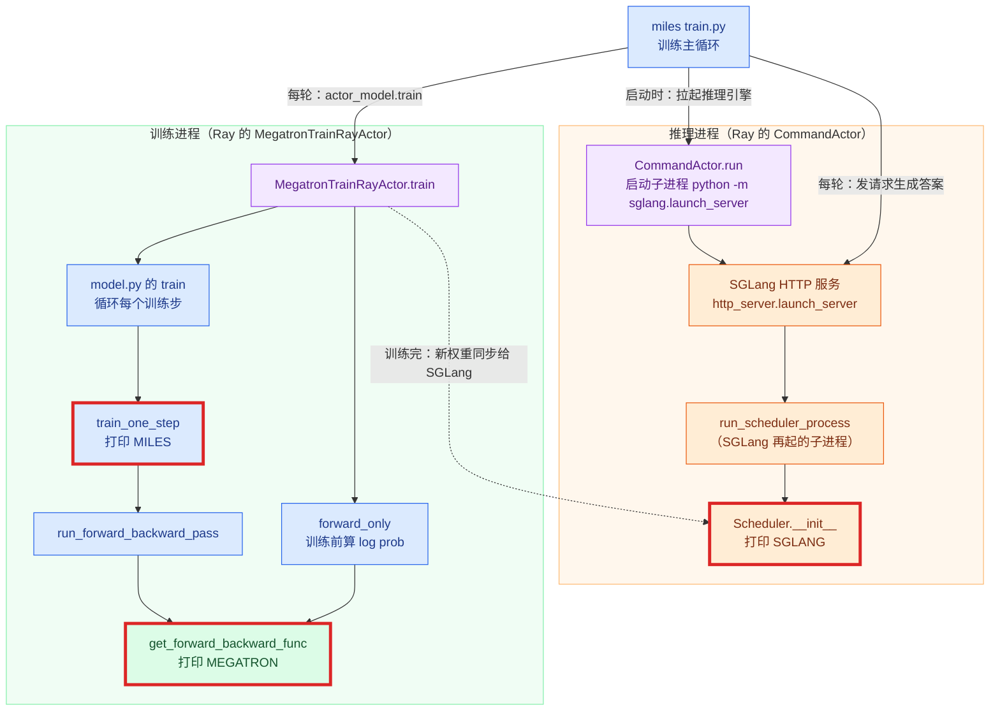

# vllm

### vllm编译安装

vLLM 由 Python 代码和二进制（`.so`、`vllm-rs`）组成，安装方式的区别在于两者从哪来：

| 方式                  | Python 代码 | 二进制                                 | 适合                          | 状态   |
| --------------------- | ----------- | -------------------------------------- | ----------------------------- | ------ |
| 官方包                | 官方 wheel  | 官方 wheel                             | 只用 vLLM，不改代码           | 未跑过 |
| A 预编译 + editable   | 你的源码    | 官方 wheel                             | 改 Python（目前用的）         | 已跑通 |
| B 源码编译 + editable | 你的源码    | 本地全部编译                           | 改 `csrc/`、`cmake/`、`rust/` | 未跑过 |
| C 增量编译            | 你的源码    | 在 A 或 B 上只重编改动的 C++/CUDA 文件 | 反复改 `csrc/`                | 未跑过 |

- C 不是单独的安装方式，要先装好 A 或 B。
- 只改 Rust 时不用重装：`./tools/build_rust.sh`。
- 官方包用 `uv pip install vllm --torch-backend=auto`，装在另外的环境里，不要装进 `vllmsrc`。

#### 1. 建环境

```bash
source ~/miniconda3/etc/profile.d/conda.sh
conda create -n vllmsrc -c conda-forge --override-channels -y \
  python=3.12 uv "gxx_linux-64=13" cmake ninja
conda activate vllmsrc
unset LD_LIBRARY_PATH

ln -sf $CONDA_PREFIX/bin/x86_64-conda-linux-gnu-g++ $CONDA_PREFIX/bin/g++
ln -sf $CONDA_PREFIX/bin/x86_64-conda-linux-gnu-gcc $CONDA_PREFIX/bin/gcc
hash -r
```

已有 `vllmsrc` 时跳过，`conda create` 会删掉同名环境。

#### 2. 装依赖

```bash
cd /data/home/xli49/lxy/vllm
git fetch upstream --tags
uv pip install -r requirements/cuda.txt --torch-backend=cu132
```

#### 3. 编译安装

**方式 A：预编译**

```bash
VLLM_USE_PRECOMPILED=1 VLLM_TARGET_DEVICE=cuda VLLM_MAIN_CUDA_VERSION=13.2 \
  uv pip install -e . --torch-backend=cu132
vllm download-kernels
```

**方式 B：源码编译**

```bash
# 编译工具和依赖，只需装一次
conda install -n vllmsrc -c conda-forge --override-channels -y ccache "cuda-toolkit=13.2"
export CUDA_HOME=$CONDA_PREFIX
grep -v '^torch==' requirements/build/cuda.txt | uv pip install -r -

# 编译
rm -f vllm/vllm-rs vllm/*.so
TORCH_CUDA_ARCH_LIST="8.6;9.0" MAX_JOBS=8 CCACHE_NOHASHDIR=true \
VLLM_TARGET_DEVICE=cuda VLLM_REQUIRE_RUST_FRONTEND=1 \
  uv pip install -v -e . --no-build-isolation --torch-backend=cu132
vllm download-kernels
```

**方式 C：增量编译**（先做完 A 或 B，并装好 B 的编译工具和依赖）

```bash
export CUDA_HOME=$CONDA_PREFIX
python tools/generate_cmake_presets.py
TORCH_CUDA_ARCH_LIST="8.6;9.0" cmake --preset release
cmake --build --preset release --target install -j 2   # 每次改完重跑这一行
```

#### 4. 检查

```bash
python -c "import torch, vllm; print(torch.__version__, torch.version.cuda, vllm.__version__)"
python -c "import vllm._C_stable_libtorch; print('ext ok')"
uv pip check
```

#### 5. 推理

```bash
# 查分到的 GPU，IDX:0 就填 0
scontrol show job -d $SLURM_JOB_ID | grep IDX

# 终端 1
CUDA_VISIBLE_DEVICES=0 vllm serve Qwen/Qwen2.5-0.5B-Instruct \
  --gpu-memory-utilization 0.3 --host 127.0.0.1 --port 18000

# 终端 2（同一节点）
curl http://127.0.0.1:18000/v1/chat/completions -H "Content-Type: application/json" \
  -d '{"model":"Qwen/Qwen2.5-0.5B-Instruct","messages":[{"role":"user","content":"你好"}],"max_tokens":32}'
```

#### 6. 新终端

```bash
conda activate vllmsrc
unset LD_LIBRARY_PATH
export CUDA_HOME=$CONDA_PREFIX   # 只有方式 B、C 需要
cd /data/home/xli49/lxy/vllm
```

#### 7. 更新

```bash
git fetch upstream --tags
git checkout main          # 或开发分支
git rebase upstream/main
git push --force-with-lease origin HEAD   # 可选
```

然后重做第 2 到 4 步。  

### vllm提pr流程

#### 1. 查重

在 [vLLM PR 列表](https://github.com/vllm-project/vllm/pulls) 搜 issue 编号和关键词。已有人在修就不要重复提。超过 500 行的架构改动要先提 RFC issue。

#### 2. 建分支

```bash
cd /data/home/xli49/lxy/vllm
git fetch upstream --tags
git checkout -b <分支名> upstream/main
```

然后按“编译安装”的第 2、3 步重装，再改代码。

#### 3. 检查和测试

```bash
uv pip install -r requirements/lint.txt
pre-commit install
git add <改动的文件>
pre-commit run

uv pip install -r requirements/test/cuda.txt --torch-backend=cu132
python -m pytest -s -v tests/<测试文件>.py
```

记下测试命令和 pytest 最后一行结果，PR 里要贴。改了用户能看到的功能，要同时更新 `docs/`。

#### 4. 提交和推送

```bash
git commit -s -m "[Bugfix][Scheduler] Fix priority handling" \
              -m "<为什么改：问题是什么、原因在哪>"
git push -u origin HEAD
```

**提交信息格式**：合并时 PR 会压成一个提交，标题就用 PR 标题，所以提交信息和 PR 标题写成一样。

```text
[Bugfix][Scheduler] Fix priority handling          ← 标题：标签 + 英文祈使句，首字母大写，不加句号

Requests with equal priority were reordered by     ← 正文（可选）：空一行，写为什么改
arrival time after preemption, ...

Signed-off-by: lxy-alexander <邮箱>                ← -s 自动加，必须有（DCO）
Co-authored-by: <AI 工具名>                         ← 用了 AI 生成代码时加
```

- 第二个 `-m` 是正文，会自动和标题空一行。
- 标签和 PR 标题的规则一样，见第 5 步。

#### 5. 开 PR

在 GitHub 上从自己的 fork 向 `vllm-project/vllm` 的 `main` 开 PR。标题、提交、正文的格式都以[官网 Contributing](https://docs.vllm.ai/en/latest/contributing) 的最新要求为准，提之前先看一遍：

- **标题**：`[类型][模块] 说明`，标签可以叠加，标签之间不加空格。
  - 类型：`[Bugfix]`、`[Feature]`、`[Perf]`、`[Refactor]`、`[CI]`/`[CI/Build]`、`[Test]`、`[Doc]`、`[Misc]`。
  - 模块：`[Model]`、`[Frontend]`、`[Core]`、`[Kernel]`、`[Attention]`、`[Multimodal]`、`[Quantization]`、`[MoE]`、`[Spec Decode]`、`[LoRA]`、`[KV Connector]`、`[ROCm]` 等。
  - 例子：`[Bugfix][Scheduler] Fix priority handling`、`[Perf][ROCm][Kernel] Optimize fused MoE`。
- **正文**：GitHub 会自动填入模板，按下面填写（英文）：

```markdown
## Overview

Fix priority handling in the scheduler after preemption. Fixes #<issue 编号>.

## Claims

- Requests with equal priority keep arrival order after preemption.

## Validation

`python -m pytest -s -v tests/v1/core/test_scheduler.py`
<贴 pytest 最后一行，如 12 passed in 34.5s>，tested on commit <git rev-parse --short HEAD 的结果>

## Details

<根因、设计取舍、局限>

<details>
<summary> Pull Request Checklist </summary>

- [ ] I used vLLM's `/pr-checklist` skill. (Mandatory for agents, optional for humans).
- [x] AI assistance was used during the creation of this PR.     ← 用了 AI 才勾
- [x] **Design Fit:** ...
- [x] **Testing and Validation:** ...
- [x] **Code Quality and Style:** ...
- [x] **Pull Request Contents:** ...
</details>
```

- Overview 一两句话，链接相关 issue、PR。
- Claims 列出具体成果：修了什么、快了多少。
- Validation 贴测试命令、pytest 结果和测试时的提交号；新加的测试要写耗时。
- **AI 辅助**：必须写明用了 AI、为什么不重复，并亲自看过每一行、跑过测试。纯 AI 代理的 PR 不允许；用 AI 代理时还要先跑 `.agents/skills/pr-checklist`。
- **勾选** Allow edits by maintainers。

#### 6. 评审和 CI

```bash
# 按意见修改后
git add <改动的文件>
git commit -s -m "<说明>"
git fetch upstream
git rebase upstream/main
git push --force-with-lease origin HEAD
```

- 每条评论都要修改或回复；7 天没人评审可以提醒。
- PR 获批或有 `ready` 标签后，评论 `/ci run` 启动 CI，`/ci retry` 重跑失败项。新提交不会自动触发上游 CI。
- 分支落后时，机器人会先把上游合并进来；再推送前先 `git pull`。

### vllm提issue格式

在 [vLLM issues](https://github.com/vllm-project/vllm/issues/new/choose) 选模板，先搜有没有重复。标题前缀模板会自动带上：

| 类型               | 标题前缀          | 必填                                       |
| ------------------ | ----------------- | ------------------------------------------ |
| Bug                | `[Bug]:`          | Your current environment、Describe the bug |
| 功能请求           | `[Feature]:`      | The feature, motivation and pitch          |
| 设计提案（大改动） | `[RFC]:`          | Motivation、Proposed Change                |
| 性能问题           | `[Performance]:`  | 按模板填                                   |
| CI 失败            | `[CI Failure]:`   | 按模板填                                   |
| 安装问题           | `[Installation]:` | 按模板填                                   |
| 用法问题           | `[Usage]:`        | 按模板填                                   |
| 文档问题           | `[Doc]:`          | 按模板填                                   |

Bug 的环境信息用官方脚本生成，整段贴进去：

```bash
wget https://raw.githubusercontent.com/vllm-project/vllm/main/vllm/collect_env.py
python collect_env.py
```

Describe the bug 写清：最小复现代码或命令、完整报错（放在 ````` 里）、期望的结果。

### 命令解释

#### 建环境

- `source .../conda.sh`：让当前 shell 能用 conda，`.bashrc` 已初始化时可省略。
- `-c conda-forge --override-channels`：只从 conda-forge 下载。
- `gxx_linux-64=13`：GCC/G++ 13，vLLM 编译要求 13 以上。
- `cmake ninja`：生成并执行编译任务。
- `unset LD_LIBRARY_PATH`：避免程序加载到 `~/cuda-13.0` 的库，预防用。
- `ln -sf`：让 `g++`、`gcc` 指向 conda 的编译器。
- `hash -r`：清除 shell 记住的旧命令路径。

#### 装依赖

- `git fetch upstream --tags`：取上游提交和标签，vLLM 用标签生成版本号。
- `requirements/cuda.txt`：运行依赖，包括 torch。
- `--torch-backend=cu132`：安装 CUDA 13.2 版的 torch，与官方 wheel 一致。

#### 编译安装

- `-e .`：editable 安装，Python 直接从源码目录加载。
- `-v`：显示详细日志。方式 A 加上它可以查 `Using precompiled wheel commit`；如果是 `nightly`，设置 `GH_TOKEN` 后重装。
- `VLLM_TARGET_DEVICE=cuda`：安装 CUDA 版。
- `vllm download-kernels`：下载 FlashInfer 预编译内核，减少启动时编译。
- 方式 A
  - `VLLM_USE_PRECOMPILED=1`：下载预编译 wheel，不编译。
  - `VLLM_MAIN_CUDA_VERSION=13.2`：选 cu132 的 wheel。
- 方式 B
  - `ccache`：缓存编译结果，再次编译更快。
  - `cuda-toolkit=13.2`：环境自带 nvcc 13.2，不依赖 `~/cuda-13.0`。
  - `CUDA_HOME=$CONDA_PREFIX`：setup.py 用 `$CUDA_HOME/bin/nvcc` 编译。
  - `grep -v '^torch=='`：编译依赖里去掉 torch，已装 cu132 版。
  - `rm -f vllm/vllm-rs vllm/*.so`：删旧二进制。`vllm-rs` 存在时会跳过 Rust 编译；删后编译失败则 vLLM 暂不可用，可用方式 A 装回。
  - `TORCH_CUDA_ARCH_LIST="8.6;9.0"`：只编译 A40/A5000（8.6）和 H100（9.0），换 GPU 要改。
  - `MAX_JOBS=8`：并行 8 个任务，不超过作业的 CPU 数。
  - `CCACHE_NOHASHDIR=true`：编译目录变化时 ccache 仍能命中。
  - `VLLM_REQUIRE_RUST_FRONTEND=1`：Rust 编译失败时直接报错。
  - `--no-build-isolation`：用当前环境的 torch 编译。
- 方式 C
  - `generate_cmake_presets.py`：生成 `CMakeUserPresets.json`，已被 git 忽略。
  - `cmake --preset release`：配置编译，只需一次。
  - `cmake --build ... --target install`：编译改动的文件，并把 `.so` 装回源码目录。
  - `-j 2`：同时 2 个任务，每个 nvcc 最多 4 线程，约占 8 核。

#### 推理

- `scontrol show job -d`：查看作业分到的 GPU 编号（IDX）。
- `CUDA_VISIBLE_DEVICES=0`：只用 GPU 0。
- `--gpu-memory-utilization 0.3`：最多用 30% 显存。
- `--host 127.0.0.1 --port 18000`：只在本机监听；端口被占用时换一个。

#### git 和 PR

- `git rebase upstream/main`：把自己的提交接到上游最新代码之后。
- `git push --force-with-lease`：推送到自己的 fork；远端有未取回的新提交时会拒绝。
- `git checkout -b <分支名> upstream/main`：从上游最新代码建分支。
- `pre-commit install`：以后每次提交自动检查格式。
- `pre-commit run`：检查已 `git add` 的文件。
- `git commit -s`：添加 `Signed-off-by`，表示同意 DCO，必须有。

# miles

### miles编译安装

用**官方镜像 + 本地源码**：依赖和编译好的扩展用镜像里的，miles、SGLang、Megatron-LM 三份源码放本地，挂载进容器。在外面改代码，在容器里运行，不用 conda。本机没有 docker，用 apptainer。

已验证（2026-11-26，H100 NVL 单卡）：第 1 到 5 步，三个库的改动在推理引擎和训练进程里都生效，2 轮训练跑完。提交流程未跑过。

| 库          | 本地目录                                     | 容器里的位置            | 官方分支                               | 你的 fork                   |
| ----------- | -------------------------------------------- | ----------------------- | -------------------------------------- | --------------------------- |
| miles       | `/data/home/xli49/lxy/miles-dev/miles`       | `/root/miles`           | `radixark/miles` 的 `main`             | `lxy-alexander/miles`       |
| SGLang      | `/data/home/xli49/lxy/miles-dev/sglang`      | `/sgl-workspace/sglang` | `sgl-project/sglang` 的 `sglang-miles` | `lxy-alexander/sglang`      |
| Megatron-LM | `/data/home/xli49/lxy/miles-dev/Megatron-LM` | `/root/Megatron-LM`     | `radixark/Megatron-LM` 的 `miles-main` | `lxy-alexander/Megatron-LM` |

SGLang 的 `sglang-miles`、Megatron-LM 的 `miles-main` 是给 miles 用的分支，带着还没合进上游的补丁，不能用普通版。

#### 1. 拉镜像

在计算节点执行，登录节点没有 `/local`。在登录节点时先进入作业所在节点：`srun --jobid=<作业号> --overlap --pty bash`。

```bash
mkdir -p /data/home/xli49/sif /local/$USER/apptainer/{cache,tmp}
export APPTAINER_CACHEDIR=/local/$USER/apptainer/cache
export APPTAINER_TMPDIR=/local/$USER/apptainer/tmp

apptainer pull /data/home/xli49/sif/miles-latest.sif docker://radixark/miles:latest
```

生成的 `.sif` 约 18 GB，先确认 home 配额够用。

#### 2. 准备源码

**下载三个库**（你的 fork），并加上官方仓库：

```bash
mkdir -p /data/home/xli49/lxy/miles-dev && cd /data/home/xli49/lxy/miles-dev
git clone https://github.com/lxy-alexander/miles.git
git clone --filter=blob:none https://github.com/lxy-alexander/sglang.git #先不下载旧版本的文件内容
git clone --filter=blob:none https://github.com/lxy-alexander/Megatron-LM.git

git -C miles remote add upstream https://github.com/radixark/miles.git
git -C sglang remote add upstream https://github.com/sgl-project/sglang.git
git -C Megatron-LM remote add upstream https://github.com/radixark/Megatron-LM.git
```

**查镜像用的版本**，SGLang 和 Megatron-LM 要对齐它，直接存进变量：

```bash
SIF=/data/home/xli49/sif/miles-latest.sif
SGLANG_COMMIT=$(apptainer exec $SIF git -c safe.directory='*' -C /sgl-workspace/sglang rev-parse HEAD)
MEGATRON_COMMIT=$(apptainer exec $SIF git -c safe.directory='*' -C /root/Megatron-LM rev-parse HEAD)
echo $SGLANG_COMMIT $MEGATRON_COMMIT
```

**切到对应的官方分支**，跟踪 upstream，停在镜像的版本上（和上面在同一个终端执行）：

```bash
cd /data/home/xli49/lxy/miles-dev
git -C sglang fetch upstream +refs/heads/sglang-miles:refs/remotes/upstream/sglang-miles
git -C sglang switch -c sglang-miles $SGLANG_COMMIT
git -C sglang branch -u upstream/sglang-miles

git -C Megatron-LM fetch upstream +refs/heads/miles-main:refs/remotes/upstream/miles-main
git -C Megatron-LM switch -c miles-main $MEGATRON_COMMIT
git -C Megatron-LM branch -u upstream/miles-main

git -C miles fetch upstream
git -C miles switch main
git -C miles branch -u upstream/main

git -C sglang branch -vv          # 检查：当前分支后面显示 [upstream/...]
```

结果：

| 库          | 分支           | 跟踪                    |
| ----------- | -------------- | ----------------------- |
| miles       | `main`         | `upstream/main`         |
| SGLang      | `sglang-miles` | `upstream/sglang-miles` |
| Megatron-LM | `miles-main`   | `upstream/miles-main`   |

这三个分支只用来对齐官方，不在上面直接改；开发时从它们切功能分支（见“miles提pr流程”第 2 步）。

**从镜像拷编译好的so文件**：clone 下来的源码没有这些，挂载后会盖住镜像里的。它们被 git 忽略，不会提交。

```bash
cd /data/home/xli49/lxy/miles-dev
apptainer exec $SIF bash -c '
  cd /sgl-workspace/sglang
  for f in python/sglang/_version.py python/sglang/srt/rust_extensions/*.so python/sglang/srt/mem_cache/rust_tree_core/*.so; do
    cp -a "$f" "/data/home/xli49/lxy/miles-dev/sglang/$f"
  done
  cp -a /root/Megatron-LM/megatron/core/datasets/helpers_cpp*.so /data/home/xli49/lxy/miles-dev/Megatron-LM/megatron/core/datasets/
'
```

#### 3. 进入容器

```bash
# 查分到的 GPU，IDX:0 就填 0
scontrol show job -d $SLURM_JOB_ID | grep IDX

apptainer shell --nv --cleanenv \
  --env CUDA_VISIBLE_DEVICES=3 \
  --env PYTHONNOUSERSITE=1 \
  --bind /data/home/xli49/lxy/miles-dev/miles:/root/miles \
  --bind /data/home/xli49/lxy/miles-dev/Megatron-LM:/root/Megatron-LM \
  --bind /data/home/xli49/lxy/miles-dev/sglang:/sgl-workspace/sglang \
  /data/home/xli49/sif/miles-latest.sif
```

每次使用都从这一步进入，`exit` 退出。容器里 `/root` 是只读的，模型、数据和输出放在 home 下（如 `~/miles-data`），home 会自动带进容器。

#### 4. 检查

在容器里执行：

```bash
cd /root/miles
python3 -c "import torch; print(torch.__version__, torch.version.cuda, torch.cuda.is_available())"
python3 -c "import miles, sglang, megatron.core as m; print(miles.__file__, sglang.__file__, m.__file__, sep='\n')"
```

三个路径应在上表“容器里的位置”下面。

#### 5. 三个库怎么联动

镜像里三个库都是 editable 安装，Python 固定到上表“容器里的位置”找代码。`--bind` 用本地源码盖住这三个位置，所以：

- miles `import sglang`、`import megatron`，拿到的是你本地的代码。
- 训练时 Ray 在同一个容器里启动 SGLang 推理引擎和 Megatron 训练进程，它们也用这三份本地代码。
- 改完 Python 不用重装，重启任务就生效（`ray stop` 停掉旧进程）。

| 角色 | 谁          | 做什么                                              |
| ---- | ----------- | --------------------------------------------------- |
| 生成 | SGLang      | 用当前模型写答案                                    |
| 训练 | Megatron-LM | 根据奖励更新模型                                    |
| 调度 | miles       | 发题、打分，安排两者轮流工作，把新权重同步给 SGLang |

**验证联动**：在三个库各加一行打印，跑一次训练（官方 0.5B 模型 + gsm8k 数据），在输出里找这三行，看是否都执行了、用的是不是本地源码。直接在当前分支上改，验证完撤销。

1. 在下面三个函数体的第一行加一行打印（容器外执行，改的是本地源码）：

| 库          | 文件                                                       | 函数                        | 何时执行     |
| ----------- | ---------------------------------------------------------- | --------------------------- | ------------ |
| SGLang      | `sglang/python/sglang/srt/managers/scheduler.py`           | `Scheduler.__init__`        | 推理引擎启动 |
| Megatron-LM | `Megatron-LM/megatron/core/pipeline_parallel/schedules.py` | `get_forward_backward_func` | 每个训练步   |
| miles       | `miles/miles/backends/megatron_utils/model.py`             | `train_one_step`            | 每个训练步   |

直接复制执行，三处一起加：

```bash
cd /data/home/xli49/lxy/miles-dev
python3 - <<'EOF'
import re

def add(path, pattern, line):
    s = open(path).read()
    if line in s:
        return print("已有，跳过:", path)
    m = re.search(pattern, s, re.S)
    open(path, "w").write(s[:m.end()] + line + s[m.end():])
    print("已加:", path)

add("sglang/python/sglang/srt/managers/scheduler.py",
    r"    def __init__\(\n        self,\n        server_args: ServerArgs,\n        port_args: PortArgs,\n    \):\n",
    '        print("[DEV-LINK] SGLANG", __file__, flush=True)\n')
add("Megatron-LM/megatron/core/pipeline_parallel/schedules.py",
    r'def get_forward_backward_func\(.*?""".*?"""\n',
    '    print("[DEV-LINK] MEGATRON", __file__, flush=True)\n')
add("miles/miles/backends/megatron_utils/model.py",
    r'def train_one_step\(.*?""".*?"""\n',
    '    print("[DEV-LINK] MILES", __file__, flush=True)\n')
EOF
git -C sglang diff; git -C Megatron-LM diff; git -C miles diff     # 看加进去的三行
```

- 每处加的是 `print("[DEV-LINK] 库名", __file__, flush=True)`：打印标记和当前文件路径；`flush=True` 让它马上输出，不被缓存。
- 位置：SGLang 加在 `__init__` 参数列表的 `):` 后面；另两处函数开头有文档字符串（三引号那段），加在它后面。缩进自动对齐。
- 重复执行不会加两遍，已有就跳过。

这三个函数在一次训练里怎么被调用（红框是加打印的地方）：



颜色：蓝色 miles，橙色 SGLang，绿色 Megatron-LM，紫色 Ray 进程。`forward_only`（训练前算 log prob）也会调 `get_forward_backward_func`，所以 MEGATRON 会比 MILES 先打出来。

2. 跑训练并看结果：进容器（第 3 步），用官方 0.5B 短测试临时生成一个单卡版，跑完马上删掉，不留在仓库里：

```bash
cd /root/miles
T=$(mktemp /tmp/tmp_test_qwen2.5_0.5B_gsm8k_short_XXXX.py)
sed -e 's#get_test_model_dir()#"/data/home/xli49/miles-data/models"#' \
    -e 's#get_test_data_dir()#"/data/home/xli49/miles-data/data"#' \
    -e 's#^NUM_GPUS = 2#NUM_GPUS = 1#' \
    -e '/f"{eval_args} "/d' \
    -e 's#comm_backend=WorkerCommBackend.RAY, test_file=__file__#&, object_store_backend=ObjectStoreBackend.RAY#' \
    tests/e2e/short/test_qwen2.5_0.5B_gsm8k_short.py > $T
PYTHONPATH=/root/miles python3 $T 2>&1 | tee /data/home/xli49/miles-dev-run.log
rm -f $T                          # 用完即删，跑失败或 Ctrl+C 后也要执行
ray stop --force                  # 清掉 Ray 进程
grep "DEV-LINK" /data/home/xli49/miles-dev-run.log

# 恢复加入的三行打印
git -C /sgl-workspace/sglang restore python/sglang/srt/managers/scheduler.py
git -C /root/Megatron-LM restore megatron/core/pipeline_parallel/schedules.py
git -C /root/miles restore miles/backends/megatron_utils/model.py
git -C /sgl-workspace/sglang status --short; git -C /root/Megatron-LM status --short; git -C /root/miles status --short   # 都应为空
```

最后几行在容器里把三处打印还原：容器里的这三个目录就是挂载的本地源码，改的是同一份文件。`git restore` 会丢掉这三个文件里所有未提交的改动，文件里有你自己的改动时先提交或别用这几行。

`sed` 改的四处：

| 原来                                          | 改成                                                         | 原因                        |
| --------------------------------------------- | ------------------------------------------------------------ | --------------------------- |
| `get_test_model_dir()`、`get_test_data_dir()` | `"/data/home/xli49/miles-data/models"`、`"/data/home/xli49/miles-data/data"` | 默认目录在只读的 `/root` 下 |
| `NUM_GPUS = 2`                                | `NUM_GPUS = 1`                                               | 只分到一张卡                |
| `train_args` 里的 `f"{eval_args} "`           | 删掉这行                                                     | 省时间                      |
| 最后一行 `entrypoint(...)`                    | 加上 `object_store_backend=ObjectStoreBackend.RAY`           | 不用 Mooncake               |

- `mktemp`：在 `/tmp` 建一个随机名的临时文件，不放进 miles 仓库，`git status` 不会出现它。
- `PYTHONPATH=/root/miles`：脚本不在仓库里了，要告诉 Python 去 `/root/miles` 找 `tests.*`、`miles.*`。

`tee` 一边在屏幕显示一边存到日志文件。三个进程的输出都经 Ray 转发到这里，每行前面带 `(进程名 pid=...)`，所以能看出是哪个进程打的。期望看到：

```text
(CommandActor pid=...) [DEV-LINK] SGLANG /sgl-workspace/sglang/python/sglang/srt/managers/scheduler.py
(MegatronTrainRayActor pid=...) [DEV-LINK] MEGATRON /root/Megatron-LM/megatron/core/pipeline_parallel/schedules.py
(MegatronTrainRayActor pid=...) [DEV-LINK] MILES /root/miles/miles/backends/megatron_utils/model.py
```

三行都出现、路径都是挂载的本地源码，就说明生效：SGLANG 来自推理进程（SGLang 是 CommandActor 起的子进程，输出算在它名下），另两行来自训练进程。MEGATRON、MILES 每个训练步打一次，会重复出现（2026-11-26 实测：SGLANG 1 次，MEGATRON 6 次，MILES 2 次）。

要在 H100 上跑（Slurm 分区 `gpucompute-h100` 或 `gpucompute-h100-preempt`）：官方测试用的 `--attention-backend flash` 只支持 H100 及更新的 GPU，A40 会在第一次反向传播时报 `Unsupported compute capability. Supported: 9.x ...`。进容器时 `CUDA_VISIBLE_DEVICES` 设成作业分到的那张卡（`scontrol show job -d <作业号>` 里 `GRES=gpu:1(IDX:N)` 的 N）。

启动时 SGLang 会打一段 `post-warmup freeze_gc failed ... Connection refused` 的报错，紧接着出现 `The server is fired up and ready to roll!`，不影响运行。

3. 不需要日志了就删掉：`rm -f /data/home/xli49/miles-dev-run.log`。

#### 6. 日常开发

在容器外改代码，在容器里测试：

```bash
cd /root/miles
python3 -m pytest tests/fast/<测试文件>.py     # tests/fast 不需要 GPU
```

| 改动                               | 操作                             |
| ---------------------------------- | -------------------------------- |
| 三个库的 Python                    | 重启任务和 SGLang 服务，不用重装 |
| SGLang 的 Rust、Megatron-LM 的 C++ | 在容器里重新编译                 |
| `requirements.txt`、CUDA 扩展包    | 换新镜像                         |

#### 7. 更新

miles 跟官方 `main`：

```bash
cd /data/home/xli49/lxy/miles-dev/miles
git fetch upstream main                                            # 只下载官方 main，不动你的分支
DEPS="requirements.txt docker/Dockerfile docker/patch/"            # 镜像构建用到的依赖文件
if git diff --quiet HEAD...upstream/main -- $DEPS; then            # 官方新增的改动里有没有依赖文件
  echo "No dependency changes, no need to update the image."
else
  echo "Dependencies changed, update the image:"
  git diff --stat HEAD...upstream/main -- $DEPS                    # 列出变了哪些依赖文件
fi
git rebase upstream/main                                           # 在 main 或功能分支上都能用
```

- `git fetch upstream main`：只下载官方 `main` 的新提交，不动你的分支和文件。
- `git rebase upstream/main`：把当前分支挪到官方最新代码上；在功能分支上执行，你的提交会接在官方最新代码后面。
- `HEAD...upstream/main`（三个点）：只看官方这边新增的改动，不含你功能分支上的改动；放在 rebase 前执行，已经是最新时也不会报错。
- `DEPS`：`radixark/miles:latest` 由 `docker/Dockerfile` 构建，只用到 `requirements.txt` 和 `docker/patch/`；ROCm、TPU 等其他 Dockerfile 的改动不影响你的镜像，不算。
- 打印 `No dependency changes`：上面的 rebase 就够了，SIF、SGLang、Megatron-LM 都不用动。
- 打印 `Dependencies changed`：按下面换镜像。只覆盖 `.sif` 不够，进容器的 `--bind` 仍盖住镜像里的源码，本地的 `.so` 还是从旧镜像拷的。
- 先提交或 `git stash` 未提交的改动，否则 rebase 会拒绝执行。

依赖变了时，在计算节点执行。先停掉 Ray、退出所有用这个 `.sif` 的容器（`--force` 会覆盖正在用的镜像），并确认 SGLang、Megatron-LM 没有未提交的改动（下面的 `reset --hard` 会丢掉它们）：

```bash
ray stop --force                                   # 在容器里执行，然后 exit 退出容器
cd /data/home/xli49/lxy/miles-dev
git -C sglang status --short; git -C Megatron-LM status --short   # 都应为空，否则先提交或 git stash
```

覆盖镜像，再读出新镜像里 SGLang、Megatron-LM 的版本：

```bash
mkdir -p /local/$USER/apptainer/{cache,tmp}        # /local 作业结束会清空，每次都要建
export APPTAINER_CACHEDIR=/local/$USER/apptainer/cache     # 下载缓存放本地盘，不占 home 配额
export APPTAINER_TMPDIR=/local/$USER/apptainer/tmp         # 转换镜像的临时文件
apptainer pull --force /data/home/xli49/sif/miles-latest.sif docker://radixark/miles:latest   # 覆盖旧的 .sif

SIF=/data/home/xli49/sif/miles-latest.sif
SGLANG_COMMIT=$(apptainer exec $SIF git -c safe.directory='*' -C /sgl-workspace/sglang rev-parse HEAD)   # 新镜像里 SGLang 的版本
MEGATRON_COMMIT=$(apptainer exec $SIF git -c safe.directory='*' -C /root/Megatron-LM rev-parse HEAD)    # 新镜像里 Megatron-LM 的版本
echo $SGLANG_COMMIT $MEGATRON_COMMIT                                     # 新版本
git -C /data/home/xli49/lxy/miles-dev/sglang rev-parse sglang-miles       # 旧版本，用来对比
git -C /data/home/xli49/lxy/miles-dev/Megatron-LM rev-parse miles-main
```

新旧版本一样，说明官方镜像还没跟着 miles 的依赖改动重新构建，后面几步先不做，过一两天再拉。

把对齐用的分支移到这两个版本上，功能分支再接上去。没有功能分支就跳过 `git switch <功能分支>` 那一行：

```bash
cd /data/home/xli49/lxy/miles-dev/sglang
git fetch upstream +refs/heads/sglang-miles:refs/remotes/upstream/sglang-miles   # 只拉这一个分支
git switch sglang-miles && git reset --hard $SGLANG_COMMIT      # 对齐分支移到新镜像的版本
git switch <功能分支> && git rebase sglang-miles                 # 你的提交接到新版本后面；没有功能分支就跳过

cd /data/home/xli49/lxy/miles-dev/Megatron-LM
git fetch upstream +refs/heads/miles-main:refs/remotes/upstream/miles-main      # 只拉这一个分支
git switch miles-main && git reset --hard $MEGATRON_COMMIT       # 对齐分支移到新镜像的版本
git switch <功能分支> && git rebase miles-main                   # 你的提交接到新版本后面；没有功能分支就跳过
```

最后把新镜像里编译好的文件重新拷到本地源码上，盖掉旧的。只有换了镜像才拷：平时更新代码、只改 Python 都不用拷。这些 `.so` 和 `_version.py` 在 `.gitignore` 里，`fetch`、`rebase`、`switch`、`reset --hard` 都不会动它们；只有 `git clean -x` 会删掉，删了按第 2 步重拷。

```bash
cd /data/home/xli49/lxy/miles-dev
apptainer exec $SIF bash -c '      # 在新镜像里执行，不加 --bind，看到的是镜像自带的文件
  cd /sgl-workspace/sglang
  # SGLang：版本号文件 + 5 个 Rust 扩展，拷到本地源码的同一位置
  for f in python/sglang/_version.py python/sglang/srt/rust_extensions/*.so python/sglang/srt/mem_cache/rust_tree_core/*.so; do
    cp -a "$f" "/data/home/xli49/lxy/miles-dev/sglang/$f"
  done
  # Megatron-LM：数据集的 C++ 扩展
  cp -a /root/Megatron-LM/megatron/core/datasets/helpers_cpp*.so /data/home/xli49/lxy/miles-dev/Megatron-LM/megatron/core/datasets/
'
```

- `--force`：同名 `.sif` 已存在时覆盖它；不加的话 `apptainer pull` 会拒绝写入。
- `git reset --hard` 只作用于 `sglang-miles`、`miles-main`。这两个分支没有你的提交，移到新镜像的版本不会丢东西。
- `git fetch upstream +refs/heads/...`：只拉对应的一个分支。`sgl-project/sglang` 有几千个分支，直接 `git fetch upstream` 会拉全部，很慢。
- 仓库、remote、第 3 步的 `--bind` 路径都不变。

换完验证（进容器执行）：

```bash
cd /tmp                                                          # 别在 miles-dev 下跑，同名文件夹会被误当成库
python3 -c "import sglang, megatron.core, miles; print(sglang.__file__, megatron.core.__file__, miles.__file__, sep='\n')"
python3 -c "import sglang.srt.rust_extensions._server, sglang.srt.mem_cache.rust_tree_core.mem_cache; from megatron.core.datasets import helpers_cpp; print('compiled parts ok')"
```

- 第一行：三个路径都是 `/sgl-workspace/sglang`、`/root/Megatron-LM`、`/root/miles` 下的。
- 第二行：打印 `compiled parts ok`。报 `ImportError` 说明新镜像的编译文件变了（多了、改名了），对照镜像里 `/sgl-workspace/sglang`、`/root/Megatron-LM` 的 `.so` 补拷。
- 最稳妥的是按第 5 步再跑一次单卡训练。

### miles提pr流程

一个改动涉及几个库，就在每个库各提一个 PR；只改一个库就只提一个。三个库的规则不同：

| 库          | 功能分支基于   | PR 提到                                | PR 标题                                                      |
| ----------- | -------------- | -------------------------------------- | ------------------------------------------------------------ |
| SGLang      | `sglang-miles` | `sgl-project/sglang` 的 `sglang-miles` | `[类型] 模块: [sglang-miles] 说明`，如 `[Fix] lora: [sglang-miles] Keep kv_b_proj adapters off the MHA cached-prefix paths` |
| Megatron-LM | `miles-main`   | `radixark/Megatron-LM` 的 `miles-main` | 英文祈使句，如 `Skip activation checkpointing when grad is disabled`；移植 NVIDIA 上游的改动加 `[port]` |
| miles       | `main`         | `radixark/miles` 的 `main`             | `类型(模块): 说明`，70 字符内，如 `fix(rollout): put the train data into the object store off the executor loop` |

- SGLang 的类型只能是 `Feat`、`Fix`、`Refactor`、`Perf`、`Doc`、`Test`、`CI`、`Chore`、`Misc`，CI 会检查标题格式。硬件相关的改动在类型后加硬件标签，如 `[Perf] [AMD] attention: ...`；回滚用 GitHub 默认的 `Revert "原标题"`。
- miles 的类型用 `feat`、`fix`、`docs`、`test`、`ci`、`refactor` 等（conventional commits）。
- **标题、提交、正文的格式都以各库官网的最新要求为准**，规则会变，提之前先看一遍：[miles Contributing](https://github.com/radixark/miles/blob/main/docs/developer/contributor-guide.md)、[SGLang Contribution Guide](https://docs.sglang.io/developer_guide/contribution_guide.html#pull-request-titles)、[Megatron-LM PR 模板](https://github.com/radixark/Megatron-LM/blob/miles-main/.github/pull_request_template.md)。
- 以上来自各库的贡献指南和已合并的 PR：miles 的 `docs/developer/contributor-guide.md`，SGLang 的 `docs/docs/developer_guide/contribution_guide.mdx` 和 `.github/pull_request_template.md`，Megatron-LM 的 `.github/pull_request_template.md`。

#### 1. 查重

在 [miles PR](https://github.com/radixark/miles/pulls)、[SGLang 的 sglang-miles PR](https://github.com/sgl-project/sglang/pulls?q=is%3Apr+base%3Asglang-miles)、[Megatron-LM 的 miles-main PR](https://github.com/radixark/Megatron-LM/pulls?q=is%3Apr+base%3Amiles-main) 搜关键词，已有人在做就不要重复提。修 miles 的 issue 先在 issue 下评论认领。大改动先开 issue 讨论（miles 用 `discussion` 标签）。

#### 2. 建分支

容器外执行，从对应分支切功能分支，改代码前就切：

```bash
cd /data/home/xli49/lxy/miles-dev
git -C sglang switch -c <功能分支> sglang-miles
git -C Megatron-LM switch -c <功能分支> miles-main
git -C miles fetch upstream main && git -C miles switch -c <功能分支> upstream/main
```

只改一个库就只切那一个。功能分支名用英文短横线，如 `fix-weight-sync`。不要直接在 `sglang-miles`、`miles-main`、`main` 上提交。

#### 3. 检查和测试

在容器里执行（第 3 步进容器），容器里有 `pre-commit`：

```bash
cd /root/miles
pre-commit run --all-files                 # 和 miles 的 pre-commit CI 一样
python3 -m pytest tests/fast               # CPU 测试

cd /sgl-workspace/sglang
pre-commit run --all-files                 # 第一次失败就再跑一次
python3 test/registered/unit/<对应目录>/<测试文件>.py

cd /root/Megatron-LM
pre-commit run --files $(git diff --name-only miles-main)
```

- 不要执行 `pre-commit install`：它装的钩子指向容器里的 Python，在容器外 `git commit` 会失败。每次提交前手动跑上面的命令。
- Megatron-LM 不用 `tools/autoformat.sh`：它和 NVIDIA 的 `main` 比，不和 `miles-main` 比。
- 改了三个库之间怎么配合的代码，按第 5 步跑一次单卡训练，确认生成和训练都正常。
- 加测试：miles 的新行为要有测试（`tests/fast` 不要 GPU）；SGLang 改了 `python/sglang/srt/` 下的文件，在 `test/registered/unit/` 的对应目录补测试。
- 改了模型输出（SGLang 的 kernel、模型前向），要跑精度评测，结果贴进 PR。
- miles 加了新参数，要写进 CLI Reference，并确认 `python3 train.py --help` 还能正常解析。

#### 4. 提交和推送

先按第 3 步在容器里跑过 `pre-commit run`，再在容器外执行：

```bash
cd /data/home/xli49/lxy/miles-dev/sglang
git add <改动的文件>
git commit -s -m "[Fix] lora: [sglang-miles] <说明>" -m "<为什么改>"
git fetch upstream +refs/heads/sglang-miles:refs/remotes/upstream/sglang-miles
git rebase upstream/sglang-miles           # 接到官方最新，冲突在本地解决
git push -u origin <功能分支>

cd /data/home/xli49/lxy/miles-dev/Megatron-LM
git add <改动的文件>
git commit -s -m "Skip activation checkpointing when grad is disabled" -m "<为什么改>"
git fetch upstream +refs/heads/miles-main:refs/remotes/upstream/miles-main
git rebase upstream/miles-main
git push -u origin <功能分支>

cd /data/home/xli49/lxy/miles-dev/miles
git add <改动的文件>
git commit -s -m "fix(rollout): <说明>" -m "<为什么改>"
git fetch upstream main && git rebase upstream/main
git push -u origin <功能分支>
```

**提交信息格式**：三个库合并时都把 PR 压成一个提交，标题就是 PR 标题，所以提交标题直接按 PR 标题的格式写（见开头的表）。

| 库          | 提交标题                                    | 例子（来自已合并的提交）                                     |
| ----------- | ------------------------------------------- | ------------------------------------------------------------ |
| SGLang      | `[类型] 模块: [sglang-miles] 英文祈使句`    | `[Fix] muse_spark: [sglang-miles] Refresh derived weight caches after a weight sync` |
| Megatron-LM | 英文祈使句，首字母大写；移植上游加 `[port]` | `Release MoE dispatcher routing tensors after combine`       |
| miles       | `类型(模块): 小写开头的英文`，70 字符内     | `fix(data): skip vision processing for text-only prompts`    |

```text
fix(data): skip vision processing for text-only prompts     ← 标题，不加句号

Text-only prompts went through the image processor and ...  ← 正文：空一行，写为什么改（miles 官方要求）

Signed-off-by: lxy-alexander <邮箱>                         ← -s 自动加
Co-authored-by: <AI 工具名>                                  ← 用了 AI 生成代码时加
```

- 第二个 `-m` 是正文，会自动和标题空一行。
- Megatron-LM 的 PR 要勾选“PR 作者亲自看过每一行”。
- `-s`：在提交信息末尾加 `Signed-off-by: 名字 <邮箱>`，三个库都加。Megatron-LM 的 `miles-main` 提交基本都带；SGLang、miles 没有强制检查，加上更规范。
- rebase 时解决过冲突，或官方分支比镜像新很多，再跑一次第 3 步的 `pre-commit run` 和测试，用 `git commit --amend` 补进去再推。

#### 5. 开 PR

按 SGLang、Megatron-LM、miles 的顺序开，miles 的 PR 要引用前两个的编号。用下面的链接开，目标分支已经选好（把 `<功能分支>` 换掉）：

- SGLang：`https://github.com/sgl-project/sglang/compare/sglang-miles...lxy-alexander:sglang:<功能分支>`
- Megatron-LM：`https://github.com/radixark/Megatron-LM/compare/miles-main...lxy-alexander:Megatron-LM:<功能分支>`
- miles：`https://github.com/radixark/miles/compare/main...lxy-alexander:miles:<功能分支>`

不用链接时，在 GitHub 上手动改目标：SGLang 默认是 `main`，要改成 `sglang-miles`；Megatron-LM 的 fork 来自 NVIDIA，默认目标是 `NVIDIA/Megatron-LM`，要改成 `radixark/Megatron-LM` 的 `miles-main`。

**标题**：和提交标题一样，见第 4 步的表。

**正文**：英文写。SGLang、Megatron-LM 开 PR 时 GitHub 会自动填入模板，按下面填；miles 没有模板，照下面的结构写。

SGLang：

```markdown
## Motivation

<为什么改。配套的 miles PR：Paired with radixark/miles#<编号>.>

## Modifications

<改了哪些文件、怎么改的>

## Accuracy Tests

<改了模型输出（kernel、模型前向）才填，贴精度评测结果；否则写 N/A>

## Speed Tests and Profiling

<影响推理速度才填，贴 benchmark；否则写 N/A>

## Checklist

- [x] Format your code according to the Format code with pre-commit.
- [x] Add unit tests according to the Run and add unit tests.
- [ ] Update documentation according to Write documentations.        ← 做了才勾
- [ ] Provide accuracy and speed benchmark results ...
- [x] Follow the SGLang code style guidance.
```

Megatron-LM：

```markdown
- [x] I, the PR author, have personally reviewed every line of this PR.

# What does this PR do?

<一句话概括>. Paired with Miles PR radixark/miles#<编号>.

<细节：改了哪里、为什么>

## Contribution process

### Pre-checks

- [x] I have added relevant unit tests
- [ ] I have added relevant functional tests                          ← 做了才勾
- [x] I have added proper typing to my code
- [ ] I have added relevant documentation
```

- 模板里的 Issue tracking、Code review、Merge 几节是 NVIDIA 的流程，`radixark/Megatron-LM` 已合并的 PR 一般删掉或不管。

miles：

```markdown
ci-sglang-pr: #<SGLang 的 PR 编号>
ci-megatron-pr: #<Megatron-LM 的 PR 编号>

Pair with sgl-project/sglang#<编号>: <这个 PR 依赖它的什么>, merges once sglang-miles carries it.

## What

- <改了什么，一条一个>

## Why

<为什么改，问题现象和原因>

## Validation

- `pre-commit run --all-files`: passed
- `pytest tests/fast`: <结果>
- <单卡训练或其他验证：命令和结果>

## Checklist

- [x] `pre-commit run --all-files` is clean.
- [x] `pytest tests/fast` passes.
- [x] New behavior has a test.
- [ ] A new flag appears in CLI Reference, and `python3 train.py --help` still parses.
- [x] The PR description carries the CI directives your change needs.
```

- `ci-*` 两行必须在行首，CI 才能读到；只依赖一个就只写一行，不依赖就连同 Pair with 那行都删掉。`#编号` 指那个仓库的 PR。
- miles 标记 ready 前对照官方清单：`pre-commit run --all-files` 通过；`tests/fast` 通过；新行为有测试；新参数进了 CLI Reference；PR 正文带上需要的 `ci-*` 行。
- 三个 PR 都勾选 Allow edits by maintainers。

#### 6. 评审和 CI

```bash
# 按意见修改后（在对应的库里）
git add <改动的文件>
git commit -s -m "<说明>"
git fetch upstream <官方分支> && git rebase upstream/<官方分支>
git push --force-with-lease origin HEAD
```

| 库          | CI 怎么跑                                                    | 你能做的                                                     |
| ----------- | ------------------------------------------------------------ | ------------------------------------------------------------ |
| miles       | 开 PR 自动跑 `pre-commit` 和 `PR Test`；fork 第一次提交要等维护者批准，维护者加 `run-ci-*` 标签也算批准 | pre-commit 失败评论 `/run-lint`，自动修好并推回你的分支；失败先看日志，按 `.claude/rules/ci-failure-triage.md` 判断是自己的问题还是环境问题 |
| SGLang      | 要有 `run-ci` 标签，只有 `CI_PERMISSIONS.json` 里的人能加    | 请维护者评论 `/tag-and-rerun-ci`；作者自己可以评论 `/rerun-failed-ci` 重跑失败项；按 `.github/MAINTAINER.md` 找 Merge Oncall 合并 |
| Megatron-LM | `radixark/Megatron-LM` 没有单独的贡献文档                    | 靠 miles PR 里的 `ci-megatron-pr` 让 miles CI 测它           |

- 每条评论都要修改或回复。
- 合并顺序：先合 SGLang 和 Megatron-LM，紧接着合 miles。SGLang、Megatron-LM 的改动最好只新增、不改旧行为（新参数给默认值），这样哪边先合都不会坏。
- SGLang、Megatron-LM 合并后，miles 的 CI 默认就会用到它们，PR 正文里的 `ci-*` 行可以删掉再跑一次 CI 确认。

### miles提issue格式

在 [miles issues](https://github.com/radixark/miles/issues/new) 提，没有模板，照已有的 issue 写（英文）。先搜有没有重复；想自己修，在 issue 下评论认领。

| 类型               | 标题                         | 正文几节（来自已有的 issue）                                |
| ------------------ | ---------------------------- | ----------------------------------------------------------- |
| Bug                | `[Bug] <模型或模块>: <现象>` | Summary、Reproduction、Environment；查到原因再加 Cause、Fix |
| 功能请求           | `[Feature] <想要什么>`       | The limit today、Proposal                                   |
| 设计提案（大改动） | `[RFC] <方案名>: <一句话>`   | Motivation、Proposal、Results、Draft PRs、Questions         |

Bug 的例子：

```markdown
[Bug] GLM-5.3 KDA: int32 row offsets overflow at 87,382 tokens

## Summary

<现象：什么配置下、出了什么错>

## Reproduction

<最小复现命令，完整报错放在 ``` 里>

## Environment

Miles image radixark/miles:<tag>, SGLang <提交号>, Megatron-LM <提交号>, <GPU 型号和数量>, <TP/PP/EP 等并行配置>, <模型>.
```

- 环境里的版本用第 2 步的命令查：`apptainer exec $SIF git -c safe.directory='*' -C /sgl-workspace/sglang rev-parse --short HEAD`（Megatron-LM 换成 `/root/Megatron-LM`）。
- 复现不了的 issue 会被打上 `needs-repro`，要补最小例子。
- CI 机器的问题（排队不动、GPU 没就绪、磁盘满）要写：失败的 job 链接、runner 名字（job 日志开头的 `runner_name`）、哪个 suite 和步骤、带报错的那行日志、已经试过什么（如“重跑两次都是 ENOSPC”）。
- 反复随机失败的测试要写：测试文件路径、失败的 `AssertionError` 那行、成功和失败各一次运行的链接。
- 问问题可以先去 SGLang Slack 的 `#miles-rl` 频道。

### miles命令解释

- `apptainer pull ... docker://`：把 Docker 镜像转成单个 `.sif` 文件。
- `APPTAINER_CACHEDIR`、`APPTAINER_TMPDIR`：下载缓存和临时文件放本地盘，不占 home 配额；`/local` 在作业结束后会被清空。
- `git remote add upstream`：加官方仓库，用来取 `sglang-miles`、`miles-main` 和 miles 的更新；`origin` 是你的 fork，用来推送。
- `apptainer exec $SIF git ... rev-parse HEAD`：查镜像里源码的版本。
- `git clone --filter=blob:none`：先不下载历史文件内容，用到时再补，SGLang 只占约 430M，省 home 配额。
- `git switch -c sglang-miles <版本>`：在镜像的版本上建同名分支；`git branch -u upstream/...` 让它跟踪官方分支，之后 `git pull`、`git status` 都对比官方。
- `git reset --hard <新版本>`：把对齐用的分支直接移到新镜像的版本；这个分支上没有你的提交，不会丢东西。
- `apptainer exec $SIF bash -c 'cp ...'`：把镜像里编译好的 `.so` 和 `_version.py` 拷到本地源码。
- `apptainer shell`：进入容器。
- `--nv`：把宿主机的 NVIDIA 驱动带进容器。
- `--cleanenv`：不带入宿主机变量，避免 `CUDA_HOME`、`LD_LIBRARY_PATH` 指到 `cuda-13.0`。
- `--env CUDA_VISIBLE_DEVICES=0`：只用分到的 GPU。
- `--env PYTHONNOUSERSITE=1`：不加载 home 里 `~/.local` 的 Python 包。
- `--bind 本地:容器`：用本地目录盖住镜像里的同名目录；三个库在镜像里都是 editable，盖住后就用本地源码。
- `ray stop`：停掉 Ray 和它启动的进程，改代码后重跑前执行。
- `ci-sglang-pr`、`ci-megatron-pr`：miles CI 读取 PR 正文里的这两行，用指定版本的 SGLang、Megatron-LM 测试；`#编号` 表示那个仓库的 PR。

# vime

### vime编译安装

用**官方镜像 + 本地源码**：vLLM、Megatron-LM 和打好的补丁都用镜像里的，只把 vime 源码放本地，挂载进容器。在外面改代码，在容器里运行。官方用 docker，本机用 apptainer。

已验证（2026-11-27，H100 NVL 单卡，镜像 `vllm/vime:latest` = `nightly-dev-20261027a`，vime `main` @ `8707a5a7`）：第 1 到 5 步，3 轮训练跑完，改动在训练进程里生效；第 8 步“改 Megatron-LM”的拷出和生成补丁验证过。提交流程、改 vLLM 未跑过。

| 库          | 本地目录                             | 容器里的位置                                                 | 官方分支                      | 你的 fork            |
| ----------- | ------------------------------------ | ------------------------------------------------------------ | ----------------------------- | -------------------- |
| vime        | `/data/home/xli49/lxy/vime-dev/vime` | `/root/vime`                                                 | `vllm-project/vime` 的 `main` | `lxy-alexander/vime` |
| vLLM        | 不放本地                             | `/usr/local/lib/python3.12/dist-packages/vllm`（pip 包，已打补丁） | —                             | —                    |
| Megatron-LM | 不放本地（要改时见第 8 步）          | `/root/Megatron-LM`（NVIDIA 固定提交 + `megatron.patch`）    | —                             | —                    |

和 miles 的区别：vime 对 vLLM、Megatron-LM 的改动放在 vime 仓库的 `docker/patch/latest/` 里，构建镜像时打上去，所以平时只挂载 vime 一个库，也不用从镜像拷 `.so`（`/root/vime` 里没有编译文件）。

#### 1. 拉镜像

在计算节点执行，登录节点没有 `/local`。在登录节点时先进入作业所在节点：`srun --jobid=<作业号> --overlap --pty bash`。

```bash
mkdir -p /data/home/xli49/sif /local/$USER/apptainer/{cache,tmp}
export APPTAINER_CACHEDIR=/local/$USER/apptainer/cache     # 下载缓存放本地盘，不占 home 配额
export APPTAINER_TMPDIR=/local/$USER/apptainer/tmp         # 转换镜像的临时文件

apptainer pull /data/home/xli49/sif/vime-latest.sif docker://vllm/vime:latest
```

生成的 `.sif` 约 12 GB，拉取加转换约 10 分钟。

#### 2. 准备源码

**下载 vime**（你的 fork），加上官方仓库，`main` 跟踪官方：

```bash
mkdir -p /data/home/xli49/lxy/vime-dev && cd /data/home/xli49/lxy/vime-dev
git clone https://github.com/lxy-alexander/vime.git
git -C vime remote add upstream https://github.com/vllm-project/vime.git
git -C vime fetch upstream main
git -C vime branch -u upstream/main main              # main 跟踪官方，不跟踪 fork
git -C vime merge --ff-only upstream/main             # fork 落后时追上官方
git -C vime branch -vv                                # 检查：main 后面显示 [upstream/main]
```

**查镜像里 vime 的版本**，看本地 `main` 比镜像新多少、依赖有没有变：

```bash
SIF=/data/home/xli49/sif/vime-latest.sif
apptainer exec $SIF git -c safe.directory='*' -C /root/vime log --oneline -1
```

镜像里的 vime 常是某个 PR 合并前的提交，不在 `main` 上（2026-11-27 是 `74ac164`，对应 `main` 上的 `[Sync] ... (#518)`）。用标题在 `main` 里找到对应提交，再按第 7 步比依赖文件：没变就能直接用最新的 `main`。

**准备模型和数据的目录**：官方测试从 `/root/models`、`/root/datasets` 读写，容器里 `/root` 是只读的，用 home 下的目录挂上去（官方 docker 用 `-v vime-data:/data`，同一个意思）：

```bash
mkdir -p /data/home/xli49/vime-data/{models,datasets}
```

#### 3. 进入容器

```bash
# 查分到的 GPU，IDX:3 就填 3
scontrol show job -d $SLURM_JOB_ID | grep IDX

apptainer shell --nv --cleanenv \
  --env CUDA_VISIBLE_DEVICES=3 \
  --env PYTHONNOUSERSITE=1 \
  --env RAY_AUTH_MODE=token \
  --bind /data/home/xli49/lxy/vime-dev/vime:/root/vime \
  --bind /data/home/xli49/vime-data/models:/root/models \
  --bind /data/home/xli49/vime-data/datasets:/root/datasets \
  /data/home/xli49/sif/vime-latest.sif
```

- `RAY_AUTH_MODE=token`：home 里有 `~/.ray/auth_token` 时，`ray start` 会自动开启 token 认证，但 `ray job submit` 默认不带 token，会报 `AuthenticationError: Missing authentication token`。设成 `token` 让两边都用这个 token；节点是多人共用的，开着认证也更安全。
- 不用执行官方的 `pip install -e . --no-deps`：镜像里 `/root/vime` 已经是 editable 安装，挂载后直接用本地源码；容器里的 `site-packages` 也是只读的。
- 镜像的 docker 入口脚本会加载 CUDA 兼容库，apptainer 不执行它；本机驱动 590 直接支持 CUDA 13，不需要。

每次使用都从这一步进入，`exit` 退出。

#### 4. 检查

在容器里执行：

```bash
cd /root/vime
python3 -c "import torch; print(torch.__version__, torch.version.cuda, torch.cuda.is_available())"
python3 -c "import vime, vllm, megatron.core as m; print(vime.__file__, vllm.__file__, m.__file__, sep='\n')"
```

`vime` 应在 `/root/vime` 下（本地源码），`vllm`、`megatron.core` 在镜像里（`/usr/local/lib/...`、`/root/Megatron-LM`）。

#### 5. 验证改动生效

在 vime 的训练步加一行打印，跑一次单卡训练（官方 Qwen3.5-0.8B + gsm8k 短测试），在输出里找这一行。直接在当前分支上改，验证完撤销。

1. 加打印（容器外执行）：

```bash
cd /data/home/xli49/lxy/vime-dev/vime
python3 - <<'EOF'
import re
path = "vime/backends/megatron_utils/model.py"
line = '    print("[DEV-LINK] VIME", __file__, flush=True)\n'
s = open(path).read()
if line in s:
    print("已有，跳过:", path)
else:
    m = re.search(r'def train_one_step\(.*?""".*?"""\n', s, re.S)   # 加在 train_one_step 的文档字符串后面
    open(path, "w").write(s[:m.end()] + line + s[m.end():])
    print("已加:", path)
EOF
git diff                                              # 看加进去的一行
```

2. 下载模型和数据（容器外，用有 `hf` 命令的环境，如 `conda activate vllmsrc`；数据也可以从 `~/miles-data/data/gsm8k` 拷）：

```bash
hf download Qwen/Qwen3.5-0.8B --local-dir /data/home/xli49/vime-data/models/Qwen3.5-0.8B
hf download --repo-type dataset zhuzilin/gsm8k --local-dir /data/home/xli49/vime-data/datasets/gsm8k
```

3. 跑训练并看结果（进容器，第 3 步）：用官方测试临时生成一个单卡版，跑完删掉：

```bash
cd /root/vime
T=/tmp/tmp_test_qwen3.5_0.8B_gsm8k_short.py
sed -e 's#^NUM_GPUS = 4#NUM_GPUS = 1#' \
    -e 's#--actor-num-gpus-per-node 4 #--actor-num-gpus-per-node 1 #' \
    -e '/f"{eval_args} "/d' \
    -e '/f"{fault_tolerance_args} "/d' \
    tests/test_qwen3.5_0.8B_gsm8k_short.py > $T
PYTHONPATH=/root/vime python3 $T 2>&1 | tee /data/home/xli49/vime-dev-run.log
rm -f $T                          # 用完即删
ray stop --force                  # 清掉 Ray 进程
grep "DEV-LINK" /data/home/xli49/vime-dev-run.log

# 恢复加入的打印
git -C /root/vime restore vime/backends/megatron_utils/model.py
git -C /root/vime status --short  # 应为空
```

`sed` 改的地方：

| 原来                                           | 改成       | 原因                                 |
| ---------------------------------------------- | ---------- | ------------------------------------ |
| `NUM_GPUS = 4`、`--actor-num-gpus-per-node 4`  | 都改成 `1` | 只分到一张卡                         |
| `train_args` 里的 `f"{eval_args} "`            | 删掉       | 省时间                               |
| `train_args` 里的 `f"{fault_tolerance_args} "` | 删掉       | 单卡时健康检查会误杀推理引擎，见下面 |

期望看到（每个训练步一行）：

```text
(MegatronTrainRayActor pid=...) [DEV-LINK] VIME /root/vime/vime/backends/megatron_utils/model.py
```

路径是挂载的本地源码就说明生效（2026-11-27 实测 3 轮出现 3 次）。测试第一次会把模型转成 Megatron 格式存到 `/dev/shm`（内存盘，约 2 GB），以后复用，不需要了用 `rm -rf /dev/shm/Qwen3.5-0.8B_torch_dist` 删掉。

**为什么删掉容错参数**：保留 `--use-fault-tolerance` 和健康检查时，2026-11-27 单卡跑了一次：第 1 轮训练完、权重同步后，健康检查访问 vLLM 时连接被拒（`Connection refused`），vime 判定引擎不健康，自己把 vLLM 杀掉，第 2 轮生成 60 次重试都返回 503 后失败。日志里是 `Health check failed for engine 0` 和 `Max retries (60) reached`。只验证开发流程用不到容错，删掉就能跑完；要研究这个问题时再加回来。

#### 6. 日常开发

| 改动                          | 操作                     |
| ----------------------------- | ------------------------ |
| vime 的 Python                | 重跑任务就生效，不用重装 |
| vLLM、Megatron-LM             | 改补丁文件，见第 8 步    |
| `requirements.txt`、`docker/` | 换新镜像（第 7 步）      |

提交前在容器外跑 `uvx pre-commit run --all-files`，在容器里跑相关的 `pytest tests/...`（见“vime提pr流程”第 3 步）。

#### 7. 更新

```bash
cd /data/home/xli49/lxy/vime-dev/vime
git fetch upstream main                                            # 只下载官方 main，不动你的分支
DEPS="requirements.txt docker/Dockerfile docker/patch/"            # 镜像构建用到的依赖和补丁
if git diff --quiet HEAD...upstream/main -- $DEPS; then            # 官方新增的改动里有没有这些文件
  echo "No dependency changes, no need to update the image."
else
  echo "Dependencies changed, update the image:"
  git diff --stat HEAD...upstream/main -- $DEPS                    # 列出变了哪些
fi
git rebase upstream/main                                           # 在 main 或功能分支上都能用
```

- 打印 `No dependency changes`：rebase 就够了。
- 打印 `Dependencies changed`：先退出所有容器，再重新拉镜像（第 1 步的 `apptainer pull` 加 `--force`）。vime 没有要拷的编译文件，换完按第 4 步检查即可。
- `docker/patch/` 变了也要换镜像：vLLM、Megatron 的补丁是构建镜像时打的，只更新源码不会生效。
- 官方镜像 `vllm/vime:latest` 不一定马上跟上 `main`；拉完查一下镜像里 vime 的版本（第 2 步的命令），没变就过一两天再拉。

#### 8. 修改 vLLM 或 Megatron-LM

vime 不给 vLLM、Megatron-LM 提 PR，改动以补丁文件提交到 vime 仓库：

| 补丁                                         | 打在哪                                                       |
| -------------------------------------------- | ------------------------------------------------------------ |
| `docker/patch/latest/megatron.patch`         | `/root/Megatron-LM`（NVIDIA 的固定提交，见 `docker/Dockerfile` 的 `MEGATRON_COMMIT`） |
| `docker/patch/latest/vllm-*.patch`（十几个） | pip 装的 vLLM 目录 `/usr/local/lib/python3.12/dist-packages`，按 `docker/Dockerfile` 里的顺序打 |

**改 Megatron-LM**：把镜像里打好补丁的 Megatron-LM 拷出来，挂载进去改，最后重新生成补丁：

```bash
# 容器外
cd /data/home/xli49/lxy/vime-dev
SIF=/data/home/xli49/sif/vime-latest.sif
apptainer exec $SIF cp -a /root/Megatron-LM /data/home/xli49/lxy/vime-dev/Megatron-LM   # 约 100 MB，带 .git 和编译好的 .so
git -C Megatron-LM status --short     # 显示的修改就是 megatron.patch 的内容
```

进容器时多加一行 `--bind /data/home/xli49/lxy/vime-dev/Megatron-LM:/root/Megatron-LM`，改代码、跑测试。改完生成新补丁：

```bash
cd /data/home/xli49/lxy/vime-dev
git -C Megatron-LM diff > vime/docker/patch/latest/megatron.patch
git -C vime diff --stat               # 补丁文件和 vime 的改动一起提交
```

- 拷出来的目录就是“固定提交 + 官方补丁”，`git diff` 生成的就是完整的新补丁。2026-11-27 验证过：不改代码直接生成，和仓库里的 `megatron.patch` 除行尾空格外完全一致。
- 新建的文件 `git diff` 不包含，先 `git -C Megatron-LM add -N <新文件>` 再生成。
- 补丁文件不要用编辑器打开再保存，行尾空格被删会导致打不上。

**改 vLLM**：vLLM 不是 git 仓库，补丁直接打在 `site-packages` 上，改起来比 Megatron 麻烦，官方文档没写给贡献者的流程。要改先开 issue 和维护者确认，再在镜像对应的 vLLM 版本（`python3 -c "import vllm; print(vllm.__version__)"`）的源码上改、生成补丁。

改了补丁要重新构建镜像才能完整验证，本机没有 docker 构建不了；在 PR 里写清楚，CI 会用 `docker/patch/` 改动后的镜像跑（见“vime提pr流程”第 6 步）。

### vime提pr流程

vime 沿用 vLLM 的规则（PR 标题、`Signed-off-by`、AI 辅助），**以官网 [CONTRIBUTING.md](https://github.com/vllm-project/vime/blob/main/CONTRIBUTING.md) 的最新要求为准**，提之前先看一遍。

| 项           | 要求                                                      |
| ------------ | --------------------------------------------------------- |
| 功能分支基于 | `main`                                                    |
| PR 提到      | `vllm-project/vime` 的 `main`                             |
| PR 标题      | `[标签] 英文说明`，可叠加，如 `[Bugfix][Rollout] Fix ...` |
| 提交         | 必须 `git commit -s`；用了 AI 加 `Co-authored-by:`        |

标签：`[Bugfix]`、`[CI/Build]`、`[Doc]`、`[Training]`（Megatron 训练、权重同步）、`[Rollout]`（vLLM 推理、router）、`[Core]`（调度、Ray actor、参数）、`[Example]`、`[Hardware][Vendor]`（如 `[Hardware][AMD]`）、`[Misc]`。已合并的 PR 里还常见 `[Sync]`、`[NPU]`、`[CI]`。

#### 1. 查重

在 [vime PR](https://github.com/vllm-project/vime/pulls) 和 [issues](https://github.com/vllm-project/vime/issues) 搜关键词。**新功能必须先开 issue 讨论**，和维护者对齐范围再写；超过 500 行（不算测试和配置）的架构改动也要先开 issue。

#### 2. 建分支

```bash
cd /data/home/xli49/lxy/vime-dev/vime
git fetch upstream main
git switch -c fix/<简短说明> upstream/main     # 新功能用 feature/...，文档用 docs/...
```

不要直接在 `main` 上提交。

#### 3. 检查和测试

vime 镜像里没有 `pre-commit`，格式检查在容器外用 `uvx` 跑（不用安装，第一次会自动下载各检查工具，之后复用）：

```bash
cd /data/home/xli49/lxy/vime-dev/vime
uvx pre-commit run --all-files --show-diff-on-failure --color=always   # 和 CI 的 pre-commit 一样
```

测试在容器里跑（第 3 步进容器）：

```bash
cd /root/vime
python3 -m pytest tests/<相关测试>.py                              # 如 tests/utils、tests/test_policy_loss.py
```

- `uvx pre-commit run` 会直接改格式不对的文件，改完再 `git add`。
- 改了训练或推理的行为，按第 5 步跑一次单卡训练。
- 行为变了要加或改测试；用户能看到的行为、参数变了，同时更新 `docs/en` 和 `docs/zh`。

#### 4. 提交和推送

先按第 3 步跑过 `uvx pre-commit run` 和测试，再在容器外执行：

```bash
cd /data/home/xli49/lxy/vime-dev/vime
git add <改动的文件>
git commit -s -m "[Bugfix][Rollout] Fix <说明>" -m "<为什么改>"
git fetch upstream main && git rebase upstream/main
git push -u origin <功能分支>
```

**提交信息格式**：合并时 PR 压成一个提交，标题就是 PR 标题，所以提交标题按 PR 标题写。

```text
[Bugfix][Rollout] Fix abort handling for streaming requests   ← 标题：标签 + 英文祈使句

Streaming requests kept running after the client aborted ...  ← 正文：空一行，写为什么改

Signed-off-by: lxy-alexander <邮箱>                           ← -s 自动加，必须有（DCO）
Co-authored-by: <AI 工具名>                                    ← 用了 AI 生成代码时加
```

#### 5. 开 PR

用这个链接开，目标已经选好（把 `<功能分支>` 换掉）：`https://github.com/vllm-project/vime/compare/main...lxy-alexander:vime:<功能分支>`

没有 PR 模板，已合并的 PR 常用下面的结构（英文）：

```markdown
## Motivation

<为什么改。Fixes #<issue 编号>>

## Modifications

- <改了什么，一条一个>

## Validation

- `pre-commit run --all-files`: passed
- `pytest tests/<...>.py`: <结果>
- <训练验证：GPU 型号和数量、vLLM 版本、命令和结果>

<用了 AI：写明哪些部分用了 AI，你已亲自审过每一行并跑过测试>
```

- 训练或推理相关的改动要写 GPU/NPU 型号、vLLM 版本、怎么验证的；修 bug 要附日志和最小复现命令。
- 提交前对照官方清单：`pre-commit` 通过；相关测试通过；行为或参数变了更新了文档；标题前缀正确、提交带 `Signed-off-by`；新功能有维护者认可的 issue；用了 AI 已在正文说明。
- 勾选 Allow edits by maintainers。

#### 6. 评审和 CI

```bash
# 按意见修改后
git add <改动的文件>
git commit -s -m "<说明>"
git fetch upstream main && git rebase upstream/main
git push --force-with-lease origin HEAD
```

| CI                    | 怎么跑                                                       |
| --------------------- | ------------------------------------------------------------ |
| pre-commit            | pre-commit.ci 自动跑，失败按日志改                           |
| CPU 测试（Buildkite） | `pre-commit`、`plugin-contracts`、`agent-adapter`、`upstream-sync-cpu`、`utils`，每个构建都跑 |
| GPU 测试（Buildkite） | 在 Buildkite 里点 `Run GPU test suites?` 选套件（`short`、`vllm-config`、`megatron`、`vime-customized`、`precision`、`ckpt`）才跑，由维护者操作；改了 `docker/` 或补丁时，用 `VIME_CI_IMAGE` 指向新构建的镜像 |

- Buildkite 配置的是只自动构建同仓库的 PR，从 fork 提的 PR 一般要维护者触发。
- 每条评论都要修改或回复，改完重新请求评审；批准后由维护者合并。

### vime提issue格式

在 [vime issues](https://github.com/vllm-project/vime/issues/new/choose) 选模板，不能开空白 issue。**目前只收 bug 报告和通用的 RL 优化，功能请求暂时不在协作范围内**；一般问题去 [Discussions](https://github.com/vllm-project/vime/discussions)。提之前先看[文档](https://vllm-project.github.io/vime/)和 [FAQ](https://vllm-project.github.io/vime/en/get_started/qa.html)，搜有没有重复，尽量在最新 `main` 上复现。

| 类型 | 标题前缀      | 必填                                                         |
| ---- | ------------- | ------------------------------------------------------------ |
| Bug  | `[Bug] `      | Bug Description、Steps to Reproduce、Expected Behavior、Actual Behavior、Environment |
| 问题 | `[Question] ` | Your Question、What I've Tried                               |

Bug 的 Environment 写：OS、Python、PyTorch、CUDA（NPU 写 CANN、`torch_npu`）、GPU 型号和数量、vLLM 和 Megatron 版本、镜像 tag；另外写清：

- 复现步骤：最小命令或脚本，问题出在训练、推理还是两者。
- 日志：完整报错和相关的 Ray、vLLM、Megatron 输出，放在 ```` ``` ```` 里。
- 配置：启动脚本、命令行参数（去掉密钥）；GPU 还是 NPU；colocate 还是分离部署。

版本用这些命令查（容器里）：

```bash
python3 -c "import torch, vllm; print(torch.__version__, torch.version.cuda, vllm.__version__)"
git -c safe.directory='*' -C /root/Megatron-LM log --oneline -1
```

### vime命令解释

- `apptainer pull ... docker://vllm/vime:latest`：把官方 Docker 镜像转成单个 `.sif` 文件。
- `git branch -u upstream/main main`：让本地 `main` 跟踪官方，`git status`、`git pull` 都对比官方。
- `git merge --ff-only upstream/main`：fork 落后时把本地 `main` 快进到官方最新；有分叉时会拒绝，不会产生合并提交。
- `--env RAY_AUTH_MODE=token`：Ray 的启动和提交任务都用 `~/.ray/auth_token` 认证。
- `--bind 本地:/root/vime`：用本地源码盖住镜像里的 vime；镜像里是 editable 安装，盖住后就用本地代码。
- `--bind .../models:/root/models`、`--bind .../datasets:/root/datasets`：把可写的 home 目录挂到官方测试用的路径上。
- `uvx pre-commit`：用 uv 临时运行 pre-commit，不用装进任何环境。
- `ray stop --force`：停掉 Ray 和它启动的进程，改代码后重跑前执行。
- `git -C Megatron-LM diff > .../megatron.patch`：把 Megatron-LM 相对固定提交的全部修改导出成补丁。
- `git add -N <文件>`：把新文件登记为“待添加”，让 `git diff` 包含它，但不真正暂存内容。

# verl

### verl编译安装

官方用 **uv**：一份 `uv.lock` 管所有后端，按需选 extra（推理 `vllm` 或 `sglang`，训练 `fsdp` 或 `megatron`），原生包都用预编译 wheel，没有单独的编译步骤。本机的问题是系统 C++ 运行库太老（`/lib64/libstdc++.so.6` 没有 `GLIBCXX_3.4.32`），`transformer_engine` 加载失败；所以环境在本机装，**运行放进官方推荐的基础镜像** `nvidia/cuda:13.0.2-devel-ubuntu24.04`（和 `docker/Dockerfile.uv.cu130` 同一个基础）。

已验证（2026-11-27，H100 NVL 单卡）：官方 quickstart 的 PPO（Qwen2.5-0.5B-Instruct + gsm8k）跑完 3 步，每步约 19 秒。

| 项                   | 值                                                           |
| -------------------- | ------------------------------------------------------------ |
| 本地源码             | `/data/home/xli49/lxy/verl-dev/verl`                         |
| 官方仓库 / 你的 fork | `verl-project/verl` 的 `main` / `lxy-alexander/verl`         |
| 环境                 | 仓库里的 `.venv`（约 12 GB），由 `uv` 按 `uv.lock` 生成      |
| 运行镜像             | `/data/home/xli49/sif/cuda-13.0.2-devel-ubuntu24.04.sif`（约 4 GB） |

#### 1. 准备源码

```bash
mkdir -p /data/home/xli49/lxy/verl-dev && cd /data/home/xli49/lxy/verl-dev
git clone https://github.com/lxy-alexander/verl.git
git -C verl remote add upstream https://github.com/verl-project/verl.git
git -C verl fetch upstream main
git -C verl branch -u upstream/main main              # main 跟踪官方
git -C verl merge --ff-only upstream/main             # fork 落后时追上官方
git -C verl submodule update --init --depth 1         # recipe 子模块
```

#### 2. 装环境

在计算节点执行（`/local` 只有计算节点有）：

```bash
cd /data/home/xli49/lxy/verl-dev/verl
UV_CACHE_DIR=/local/$USER/uv-cache uv sync --frozen --extra vllm --extra fsdp
```

- `--frozen`：严格按 `uv.lock` 装，不重新解析版本。
- `--extra vllm --extra fsdp`：推理用 vLLM，训练用 FSDP；用 Megatron 换成 `--extra megatron`。
- `UV_CACHE_DIR`：下载缓存放本地盘，不占 home 配额；`/local` 作业结束会清空，下次重新下载即可。
- 约 2 分钟。

#### 3. 拉运行镜像

```bash
mkdir -p /local/$USER/apptainer/{cache,tmp}
export APPTAINER_CACHEDIR=/local/$USER/apptainer/cache
export APPTAINER_TMPDIR=/local/$USER/apptainer/tmp
apptainer pull /data/home/xli49/sif/cuda-13.0.2-devel-ubuntu24.04.sif docker://nvidia/cuda:13.0.2-devel-ubuntu24.04
```

#### 4. 进入容器

```bash
apptainer shell --nv --cleanenv \
  --env CUDA_VISIBLE_DEVICES=3 \
  --env PYTHONNOUSERSITE=1 \
  --env RAY_AUTH_MODE=token \
  --bind /local:/local \
  /data/home/xli49/sif/cuda-13.0.2-devel-ubuntu24.04.sif
```

进去后（每次都要）：

```bash
export PATH=/data/home/xli49/.local/bin:$PATH        # 用本机装的 uv
export UV_CACHE_DIR=/local/xli49/uv-cache
cd /data/home/xli49/lxy/verl-dev/verl
```

- 不用挂载源码：home 会自动带进容器，`.venv` 和源码在原路径。
- `CUDA_VISIBLE_DEVICES` 填 `scontrol show job -d $SLURM_JOB_ID | grep IDX` 查到的卡号。
- `RAY_AUTH_MODE=token`：home 里有 `~/.ray/auth_token` 时 Ray 自动开 token 认证，设成 `token` 让启动和提交都带上它。

#### 5. 检查

```bash
uv run --frozen --extra vllm --extra fsdp python -c "import torch, vllm, verl; print(torch.__version__, torch.cuda.is_available(), vllm.__version__, verl.__file__)"
```

`verl` 应在 `/data/home/xli49/lxy/verl-dev/verl/verl/` 下。2026-11-27：torch `2.14.0+cu130`、vLLM `0.34.0`。

#### 6. 验证训练（官方 quickstart）

准备数据（官方脚本，第一次执行）：

```bash
uv run --frozen --all-packages --extra vllm --extra fsdp python3 examples/data_preprocess/gsm8k.py --local_save_dir /data/home/xli49/verl-data/gsm8k
```

跑 3 步：

```bash
PYTHONUNBUFFERED=1 uv run --frozen --all-packages --extra vllm --extra fsdp python3 -m verl.trainer.main_ppo \
  data.train_files=/data/home/xli49/verl-data/gsm8k/train.parquet \
  data.val_files=/data/home/xli49/verl-data/gsm8k/test.parquet \
  data.train_batch_size=256 \
  data.max_prompt_length=512 \
  data.max_response_length=512 \
  actor_rollout_ref.model.path=/data/home/xli49/miles-data/models/Qwen2.5-0.5B-Instruct \
  actor_rollout_ref.actor.optim.lr=1e-6 \
  actor_rollout_ref.actor.ppo_mini_batch_size=64 \
  actor_rollout_ref.actor.ppo_micro_batch_size_per_gpu=4 \
  actor_rollout_ref.rollout.name=vllm \
  actor_rollout_ref.rollout.log_prob_micro_batch_size_per_gpu=8 \
  actor_rollout_ref.rollout.tensor_model_parallel_size=1 \
  actor_rollout_ref.rollout.gpu_memory_utilization=0.4 \
  actor_rollout_ref.ref.log_prob_micro_batch_size_per_gpu=4 \
  critic.optim.lr=1e-5 \
  critic.model.path=/data/home/xli49/miles-data/models/Qwen2.5-0.5B-Instruct \
  critic.ppo_micro_batch_size_per_gpu=4 \
  algorithm.kl_ctrl.kl_coef=0.001 \
  trainer.logger=console \
  trainer.val_before_train=False \
  trainer.n_gpus_per_node=1 \
  trainer.nnodes=1 \
  trainer.save_freq=-1 \
  trainer.test_freq=-1 \
  trainer.total_training_steps=3
```

和官方 quickstart 的区别：

- `actor_rollout_ref.model.path`、`critic.model.path`：用本地模型，官方写的是 `Qwen/Qwen2.5-0.5B-Instruct`（会自动下载）。
- `trainer.total_training_steps=3`：只跑 3 步；官方是 `trainer.total_epochs=15`。
- `trainer.save_freq=-1`、`trainer.test_freq=-1`：不存 checkpoint、不做验证，省时间和磁盘。

输出里每步有 `step:N - ...`，看 `actor/pg_loss`、`actor/grad_norm`、`timing_s/step`。0.5B 模型开始时 `critic/score/mean` 接近 0（答案格式对不上），是正常的。

#### 7. 日常开发和更新

- 改 verl 的 Python：直接重跑，`.venv` 里 verl 是 editable 安装。
- 更新：`git fetch upstream main && git rebase upstream/main`，`uv.lock` 变了下次 `uv run` 会自动补装。

### verl提pr流程

规则来自官方 [CONTRIBUTING.md](https://github.com/verl-project/verl/blob/main/CONTRIBUTING.md)、[AGENTS.md](https://github.com/verl-project/verl/blob/main/AGENTS.md) 和 [PR 模板](https://github.com/verl-project/verl/blob/main/.github/PULL_REQUEST_TEMPLATE.md)，**以官网最新要求为准**，提之前先看一遍。

| 项           | 要求                                                         |
| ------------ | ------------------------------------------------------------ |
| 功能分支基于 | `main`                                                       |
| PR 提到      | `verl-project/verl` 的 `main`                                |
| PR 标题      | `[模块] 类型: 英文说明`，CI 会检查（`tests/special_sanity/check_pr_title.py`），如 `[trainer, fsdp] fix: handle empty batch` |
| PR 正文      | 必须用模板，`### What does this PR do?` 下面要改写，原样留着 CI 会失败 |
| 提交         | `git commit -s`；用了 AI 加 `Co-authored-by:`（AGENTS.md）   |

- 模块（可多个，用 `,` 隔开）：`fsdp`、`megatron`、`veomni`、`sglang`、`vllm`、`trtllm`、`rollout`、`trainer`、`tests`、`training_utils`、`recipe`、`hardware`、`deployment`、`ray`、`worker`、`single_controller`、`misc`、`docker`、`ci`、`perf`、`model`、`algo`、`env`、`tool`、`ckpt`、`doc`、`data`、`cfg`、`reward`、`fully_async`、`one_step_off`。
- 类型：`feat`、`fix`、`refactor`、`chore`、`test`。
- 改了 API（命令行参数、配置、函数签名）在最前面加 `[BREAKING]`，如 `[BREAKING][fsdp, megatron] feat: dynamic batching`；一组 PR 可加 `[1/N]` 前缀。

#### 1. 查重

AGENTS.md 规定提 PR 前必须查重（官方给的是 `gh` 命令，本机没装 `gh`，在网页上搜同样的关键词）：

- 有对应 issue 时，看 issue 和评论：`https://github.com/verl-project/verl/issues/<编号>`。
- 在 [open PR](https://github.com/verl-project/verl/pulls) 里搜 issue 编号和改动区域的关键词；已有 PR 在修同一个问题就不要再提，做法明显不同时先在 issue 里说明区别。
- 不要单独提很小的改动（一个错别字、单纯改格式），这类改动只能附在实质性的 PR 里。
- 搜索链接要贴进 PR 模板的 `Checklist Before Starting`。
- 想找可做的事：[good first issue](https://github.com/verl-project/verl/issues?q=is%3Aissue%20state%3Aopen%20label%3A%22good%20first%20issue%22)、[call for contribution](https://github.com/verl-project/verl/issues?q=is%3Aissue%20state%3Aopen%20label%3A%22call%20for%20contribution%22)、[RFC](https://github.com/verl-project/verl/issues?q=is%3Aissue%20state%3Aopen%20label%3ARFC)。

#### 2. 建分支

```bash
cd /data/home/xli49/lxy/verl-dev/verl
git fetch upstream main
git switch -c fix/<简短说明> upstream/main     # 新功能用 feature/...，文档用 docs/...
```

不要直接在 `main` 上提交。

#### 3. 检查和测试

格式检查在容器外用 `uvx` 跑（和 CI 的 pre-commit 相同；2026-11-27 在干净的 `main` 上全部 Passed）：

```bash
cd /data/home/xli49/lxy/verl-dev/verl
UV_CACHE_DIR=/local/$USER/uv-cache uvx --with hydra-core pre-commit run --all-files --show-diff-on-failure --color=always
```

- `--with hydra-core`：`autogen-trainer-cfg` 这一项要用 hydra 重新生成 `verl/trainer/config/_generated_*.yaml`；改了 `verl/trainer/config/` 下的配置，它会更新这些文件，记得一起 `git add`。
- pre-commit 会直接改格式不对的文件，改完再 `git add`。

本地检查 PR 标题（和 CI 用的同一个脚本）：

```bash
PR_TITLE='[trainer] fix: <说明>' python3 tests/special_sanity/check_pr_title.py
```

输出 `✅ PR title is valid` 才行。

测试在容器里跑（第 4 步进容器）：

```bash
uv run --frozen --all-packages --extra vllm --extra fsdp pytest -s tests/<相关目录>/test_<...>_on_cpu.py
```

- 测试目录和源码对应：`tests/trainer` 测 `verl/trainer`，`tests/workers` 测 `verl/workers`，以此类推。
- 文件名以 `_on_cpu.py` 结尾的进 CPU CI，其余的进 GPU CI；多卡测试放 `tests/special_distributed`，端到端放 `tests/special_e2e`。
- 新功能尽量加 CI 测试：找最相关的 `.github/workflows/*.yml`，把改动路径加进 `paths`，测试的工作量尽量小。
- 改了训练行为，按第 6 步跑一次 quickstart。
- 用户能看到的改动要更新 `docs/`。
- 2026-11-27 验证：`tests/trainer/test_constants_ppo_on_cpu.py` 和 `tests/test_protocol_on_cpu.py` 46 passed。

#### 4. 提交和推送

先按第 3 步跑过 pre-commit 和测试，再在容器外执行：

```bash
cd /data/home/xli49/lxy/verl-dev/verl
git add <改动的文件>
git commit -s -m "[trainer] fix: <说明>" -m "<为什么改>"
git fetch upstream main && git rebase upstream/main
git push -u origin <功能分支>
```

**提交信息格式**：合并时压成一个提交，标题用 PR 标题，所以提交标题也按 PR 标题写。

```text
[trainer] fix: handle empty batch in compute_advantage   ← 标题：[模块] 类型: 英文说明

compute_advantage divided by zero when ...               ← 正文：空一行，写为什么改

Co-authored-by: <AI 工具名>                               ← 用了 AI 时加
Signed-off-by: lxy-alexander <邮箱>                       ← -s 自动加
```

改了 `recipe` 子模块的内容，还要更新子模块引用：`git submodule update --remote recipe`，再 `git add recipe`。

#### 5. 开 PR

用这个链接开（把 `<功能分支>` 换掉）：`https://github.com/verl-project/verl/compare/main...lxy-alexander:verl:<功能分支>`

打开后正文自动填入模板，逐项改写（英文）：

```markdown
### What does this PR do?

<一两句话说明做了什么。Fixes #<issue 编号>>

### Checklist Before Starting

- [x] Search for similar PRs. Paste at least one query link here: <搜索链接>
- [x] Format the PR title as `[{modules}] {type}: {description}` (This will be checked by the CI)

### Test

<CI 测不到的改动（算法、新模型）写实验结果：训练曲线、评测结果>
- `pre-commit run --all-files`: passed
- `pytest tests/<...>_on_cpu.py`: <结果>
- <GPU 型号和数量、命令、结果>

### API and Usage Example

<API 有变化时写用法；没有写 N/A>

### Design & Code Changes

- <改了什么，一条一个>

### Checklist Before Submitting

- [x] Read the Contribute Guide.
- [x] Apply pre-commit checks.
- [x] Add / Update the documentation.
- [x] Add unit or end-to-end test(s) to the CI workflow. If not feasible, explain why: ...
- [ ] Once your PR is ready for CI, send a message in the `ci-request` channel.
- [ ] If your PR is related to the `recipe` submodule, update the submodule reference.

<用了 AI：写明用了 AI；为什么不和已有 PR 重复；跑过的测试命令和结果>
```

- 模板前 5 行不能原样保留：CI 的 `check_pr_description.py` 会比对，没改就失败。
- 用了 AI 的 PR，正文**必须**写三件事（AGENTS.md）：为什么不和已有 PR 重复、跑了哪些测试和结果、明确说明用了 AI。纯 AI 提的 PR 不接受，提交人要看过每一行、能解释整个改动。
- 勾选 Allow edits by maintainers。

#### 6. 评审和 CI

```bash
# 按意见修改后
git add <改动的文件>
git commit -s -m "<说明>"
git fetch upstream main && git rebase upstream/main
git push --force-with-lease origin HEAD
```

| CI                                                    | 怎么跑                                               |
| ----------------------------------------------------- | ---------------------------------------------------- |
| `check-pr-title`、`pre-commit`、`secrets_scan`、`doc` | 每个 PR 都跑；标题或正文改了会重跑标题检查           |
| `sanity`、`cpu_unit_tests`                            | 改了 `.py`、`pyproject.toml`、`uv.lock` 时跑         |
| GPU 单测、`vllm`、`sgl`、`model`、`e2e_*`             | 按 `paths` 触发，改了哪部分跑哪部分；在 GPU 机器上跑 |

- PR 准备好跑 CI 后，到 verl Slack 的 `ci-request` 频道（进不去用飞书群，链接在模板里）发消息请维护者触发。
- 第一次给这个仓库提 PR，GitHub 要维护者点批准后 workflow 才会跑。
- bot 的评审意见（如 `gemini-code-assist`）可能过时或不对，按当前代码核实后再改。
- 每条评论都要修改或回复，改完重新请求评审；批准后由维护者合并。

### verl提issue格式

在 [verl issues](https://github.com/verl-project/verl/issues/new/choose) 选模板（也可以开空白 issue，但 bug 和功能请求要用模板）。提之前先搜有没有重复，尽量在最新 `main` 上复现。标题没有强制前缀。

| 类型            | 必填                                                         |
| --------------- | ------------------------------------------------------------ |
| Bug Report      | System Info、Reproduction、Expected behavior；勾选 Information（官方脚本还是自己改的脚本）和 Tasks（官方 `examples` 里的任务还是自己的数据） |
| Feature request | Feature request、Motivation、Your contribution               |

- System Info：贴 `scripts/diagnose.py` 的输出（Python、vLLM/SGLang、Ray、torch、verl 版本和提交、CUDA、GPU）。
- Reproduction：最小可复现的命令或代码，带上相关配置；报错和 traceback 放在 ```` ``` ```` 里，不要截图。
- Your contribution：说明你能不能自己提 PR。

System Info 在容器里生成（第 4 步进容器）：

```bash
uv run --frozen --all-packages --extra vllm --extra fsdp python3 scripts/diagnose.py
```

容器里没有 `git`，输出里 `Commit Hash : None`，提交号在容器外用 `git -C /data/home/xli49/lxy/verl-dev/verl log --oneline -1` 查了补上。

### verl命令解释

- `uv sync --frozen --extra ...`：按锁文件建 `.venv`，只装选中的 extra。
- `uv run --frozen --all-packages --extra ...`：在 `.venv` 里运行命令；环境缺包时先补装。
- `--all-packages`：连同工作区里的子包一起装（官方命令都带）。
- `uvx --with hydra-core pre-commit`：临时运行 pre-commit，并把 hydra-core 装进同一个临时环境；hook 里的 `python3` 用的是这个环境，所以要在这里带上 hydra。
- `PR_TITLE=... python3 tests/special_sanity/check_pr_title.py`：用 CI 的脚本在本地检查 PR 标题格式。
- `nvidia/cuda:13.0.2-devel-ubuntu24.04`：只提供 CUDA 13 和新版 C++ 运行库、gcc，Python 包都来自本机 `.venv`。

# SkyRL

### SkyRL编译安装

官方推荐 **Docker 镜像 + uv**：镜像 `novaskyai/skyrl-train-ray-2.57.0-py3.12-cu13.0` 提供 CUDA 13、Ray 2.57、Python 3.12、libnuma 等基础依赖，Python 包由 `uv run --isolated --extra fsdp` 在运行时按 `uv.lock` 装（每次隔离环境，有缓存）。本机直接装不了：依赖 `vllm-router` 只有 `manylinux_2_35` 的 wheel，本机 glibc 是 2.34。

已验证（2026-11-27，H100 NVL 单卡）：官方 `examples/train/gsm8k/run_gsm8k.sh` 的 GRPO（换成 Qwen2.5-0.5B-Instruct，192 条数据）跑完 3 步，reward 从 0.009 升到 0.028。

| 项                   | 值                                                       |
| -------------------- | -------------------------------------------------------- |
| 本地源码             | `/data/home/xli49/lxy/skyrl-dev/SkyRL`                   |
| 官方仓库 / 你的 fork | `skyrl-project/SkyRL` 的 `main` / `lxy-alexander/SkyRL`  |
| 镜像                 | `/data/home/xli49/sif/skyrl-train-cu13.0.sif`（约 6 GB） |

#### 1. 准备源码

```bash
mkdir -p /data/home/xli49/lxy/skyrl-dev && cd /data/home/xli49/lxy/skyrl-dev
git clone https://github.com/lxy-alexander/SkyRL.git
git -C SkyRL remote add upstream https://github.com/skyrl-project/SkyRL.git
git -C SkyRL fetch upstream main
git -C SkyRL branch -u upstream/main main
git -C SkyRL merge --ff-only upstream/main
```

#### 2. 拉镜像

```bash
mkdir -p /local/$USER/apptainer/{cache,tmp}
export APPTAINER_CACHEDIR=/local/$USER/apptainer/cache
export APPTAINER_TMPDIR=/local/$USER/apptainer/tmp
apptainer pull /data/home/xli49/sif/skyrl-train-cu13.0.sif docker://novaskyai/skyrl-train-ray-2.57.0-py3.12-cu13.0
```

`.sif` 文件名里**不要带 `ray`**：`ray stop --force` 按名字杀进程，会把命令行里带 `ray` 的 apptainer 也杀掉。

#### 3. 进入容器

```bash
apptainer shell --nv --cleanenv \
  --env CUDA_VISIBLE_DEVICES=3 \
  --env RAY_AUTH_MODE=token \
  --env UV_CACHE_DIR=/local/xli49/uv-cache-skyrl \
  --bind /local:/local \
  /data/home/xli49/sif/skyrl-train-cu13.0.sif
```

进去后（每次都要）：

```bash
export PATH=/home/ray/.local/bin:/home/ray/anaconda3/bin:$PATH
export UV_PYTHON=/home/ray/anaconda3/bin/python3
export RAY_RUNTIME_ENV_HOOK=ray._private.runtime_env.uv_runtime_env_hook.hook
cd /data/home/xli49/lxy/skyrl-dev/SkyRL
```

- `PATH`：`--cleanenv` 去掉了镜像的 PATH，手动加上镜像里的 `uv` 和 Python。
- `UV_PYTHON`：让 `uv` 用镜像里的 Python 3.12.13。不设的话 `uv` 会用 home 里 uv 自带的 3.12.12，和 `ray start` 的 Python 版本不同，训练启动时报 `Version mismatch`。
- `RAY_RUNTIME_ENV_HOOK`：官方要求，让 Ray worker 也用 `uv` 的环境。

#### 4. 检查

```bash
uv run --isolated --extra fsdp python -c "import torch, vllm, ray, skyrl; print(torch.__version__, vllm.__version__, ray.__version__, skyrl.__file__)"
```

第一次约 2 分钟装包。2026-11-27：torch `2.14.0+cu130`、vLLM `0.33.0`、Ray `2.57.0`，`skyrl` 在本地源码下。

#### 5. 验证训练（官方 gsm8k 示例）

准备数据，再取前 192 条，让 1 个 epoch 正好 3 步（RL 训练没有“最多几步”的参数）：

```bash
uv run --isolated examples/train/gsm8k/gsm8k_dataset.py --output_dir /data/home/xli49/skyrl-data/gsm8k
uv run --isolated --with pandas --with pyarrow python -c "import pandas as pd; d='/data/home/xli49/skyrl-data/gsm8k'; pd.read_parquet(f'{d}/train.parquet').head(192).to_parquet(f'{d}/train_192.parquet')"
```

启动 Ray 并训练：

```bash
ray start --head --num-gpus 1 --disable-usage-stats
NUM_GPUS=1 LOGGER=console DATA_DIR=/data/home/xli49/skyrl-data/gsm8k bash examples/train/gsm8k/run_gsm8k.sh \
  data.train_data="['/data/home/xli49/skyrl-data/gsm8k/train_192.parquet']" \
  trainer.policy.model.path=/data/home/xli49/miles-data/models/Qwen2.5-0.5B-Instruct \
  trainer.epochs=1 \
  trainer.train_batch_size=64 \
  trainer.policy_mini_batch_size=32 \
  trainer.micro_forward_batch_size_per_gpu=8 \
  trainer.micro_train_batch_size_per_gpu=8 \
  trainer.eval_before_train=false \
  trainer.eval_interval=100 \
  trainer.eval_batch_size=64 \
  trainer.ckpt_interval=100 \
  trainer.ckpt_path=/tmp/skyrl-ckpt \
  generator.inference_engine.gpu_memory_utilization=0.5
ray stop --force
rm -rf /tmp/skyrl-ckpt /tmp/skyrl-logs       # 结束时会存一次 checkpoint，不需要就删
```

- `NUM_GPUS=1`、`LOGGER=console`、`DATA_DIR`：脚本自带的环境变量，默认 4 卡、wandb。
- 脚本末尾有 `$@`，后面的参数覆盖脚本里的值：本地 0.5B 模型（官方 1.5B）、192 条数据、每步 64 条、不做评估。
- `gpu_memory_utilization=0.5`：单卡上 vLLM 和训练共用显存，官方 0.8 是多卡的值。

每步日志里看 `global_step`、`policy/grad_norm`、`policy/policy_loss`、`reward/avg_raw_reward`。

#### 6. 日常开发和更新

- 改 SkyRL 的 Python：直接重跑；`uv run --isolated` 每次用本地源码建环境。
- 按官方规则：只用 `uv run --isolated`，不直接 `pip install`；`fsdp`、`megatron`、`jax` 三个 extra 互相冲突，不能同时用。
- 更新：`git fetch upstream main && git rebase upstream/main`。镜像只提供基础依赖，Python 包跟着 `uv.lock` 走，一般不用换镜像；官方发新镜像（Ray 或 CUDA 升级）时再重新拉。

### SkyRL提pr流程

规则来自仓库里的 [.agents/docs/contributing.md](https://github.com/skyrl-project/SkyRL/blob/main/.agents/docs/contributing.md)、[.agents/docs/development.md](https://github.com/skyrl-project/SkyRL/blob/main/.agents/docs/development.md)、[.agents/docs/ci.md](https://github.com/skyrl-project/SkyRL/blob/main/.agents/docs/ci.md) 和[官网开发指南](https://docs.skyrl.ai/docs/getting-started/development)，**以官网最新要求为准**，提之前先看一遍。

| 项           | 要求                                                         |
| ------------ | ------------------------------------------------------------ |
| 功能分支基于 | `main`                                                       |
| PR 提到      | `skyrl-project/SkyRL` 的 `main`                              |
| PR 标题      | 没有 CI 检查；已合并的 PR 都是 `[领域] 英文说明`，如 `[megatron] Reject transformer_config_kwargs keys ...` |
| PR 正文      | 没有模板，开头必须是 `# What does this PR do?`（contributing.md） |
| 提交         | 每个提交都要 `git commit -s`（development.md）               |

已合并 PR 常用的领域标签：`[train]`、`[trainer]`、`[megatron]`、`[inference]`、`[weight sync]`、`[fix]`、`[test]`、`[CI]`、`[docs]`、`[chore]`、`[integration]`、`[skycap]`、`[harbor]`；可叠加，如 `[megatron][vllm]`。一组相关的 PR 在标题末尾写 `(MTP stack 3/6)` 这样的序号。

#### 1. 查重

在 [SkyRL PR](https://github.com/skyrl-project/SkyRL/pulls) 和 [issues](https://github.com/skyrl-project/SkyRL/issues) 搜关键词。官方欢迎 bug 报告、功能请求、文档和代码贡献；大的改动先开 issue 和维护者对齐。

#### 2. 建分支

```bash
cd /data/home/xli49/lxy/skyrl-dev/SkyRL
git fetch upstream main
git switch -c fix/<简短说明> upstream/main     # 新功能用 feature/...，文档用 docs/...
```

不要直接在 `main` 上提交。

#### 3. 检查和测试

格式检查在容器外用 `uvx` 跑（和 CI、官方 `format.sh` 相同；2026-11-27 在干净的 `main` 上全部 Passed）：

```bash
cd /data/home/xli49/lxy/skyrl-dev/SkyRL
UV_CACHE_DIR=/local/$USER/uv-cache uvx pre-commit run --all-files --config .pre-commit-config.yaml
```

检查项是 `ruff`、`black` 和 `gitleaks`（查硬编码的密钥）。会直接改格式不对的文件，改完再 `git add`。

测试在容器里跑（第 3 步进容器），命令和 CI 一致（CLAUDE.md）：

```bash
# CPU 测试：不需要 vllm 的部分
RAY_ADDRESS=local uv run --isolated --extra skyrl-train --extra dev pytest tests/train/ tests/backends/skyrl_train/ --ignore=tests/backends/skyrl_train/gpu -m "not vllm"
# CPU 测试：需要 vllm 的部分
RAY_ADDRESS=local uv run --isolated --extra fsdp --extra dev pytest tests/train/ tests/backends/skyrl_train/ --ignore=tests/backends/skyrl_train/gpu -m "vllm"
# GPU 测试（举例：推理生成）
uv run --isolated --extra dev --extra fsdp pytest tests/backends/skyrl_train/gpu/gpu_ci/test_engine_generation.py
```

- 开发时只跑相关的单个文件，把路径换成 `tests/train/test_<...>.py`；2026-11-27 验证：`tests/train/test_async_batch_collation.py` 9 passed。
- `RAY_ADDRESS=local`：测试里的 `ray.init()` 会连上本机已经在跑的 Ray（比如第 5 步训练用的），把它的 worker 弄掉；设成 `local` 让测试自己起一个。
- 官方要求的测试范围：改配置跑相关 CPU 测试；改推理跑生成测试；动到训练和推理之间的边界跑权重同步测试；改训练后端跑后端单测；最后才做端到端训练，只跑 1 到几步看指标正常。用最小的模型（如 `Qwen/Qwen3-0.6B`）和最少的卡。
- GPU 全套测试要 8 卡；单卡只跑相关的单个测试。
- 改了路径、命名，同步更新 `examples/`、`docs/`、`.agents/` 和 `AGENTS.md`；改了文档要确认能构建：`cd docs && npm install && npm run build`。
- 代码遵循 Google Python Style Guide，并沿用仓库已有的写法（如用 `skyrl.utils.tok.get_tokenizer` 建 tokenizer，GPU 测试用 `ray_init_fixture` 清理状态）。注释和报错信息只写代码在做什么，不写开发过程。

#### 4. 提交和推送

先按第 3 步跑过 pre-commit 和测试，再在容器外执行：

```bash
cd /data/home/xli49/lxy/skyrl-dev/SkyRL
git add <改动的文件>
git commit -s -m "[trainer] <说明>" -m "<为什么改>"
git fetch upstream main && git rebase upstream/main
git push -u origin <功能分支>
```

**提交信息格式**：合并时压成一个提交，标题用 PR 标题加 `(#编号)`，所以提交标题按 PR 标题写。

```text
[trainer] Fix loss scaling when micro batches are uneven   ← 标题：[领域] + 英文说明

The policy loss was averaged per micro batch ...           ← 正文：空一行，写为什么改

Signed-off-by: lxy-alexander <邮箱>                         ← -s 自动加，必须有
Co-authored-by: <AI 工具名>                                  ← 用了 AI 时加
```

#### 5. 开 PR

用这个链接开（把 `<功能分支>` 换掉）：`https://github.com/skyrl-project/SkyRL/compare/main...lxy-alexander:SkyRL:<功能分支>`

没有模板，按 contributing.md 规定的结构写（英文，用不到的节删掉）：

```markdown
# What does this PR do?

<一两句话。Fixes #<issue 编号>，或失败的 CI 链接>

TLDR: <复杂改动加一句总结>

## Why it happens

<修 bug 时写原因链，有先后就编号；写机制，不只写现象>

## Usage

<新功能写怎么调用、新增了哪些配置或接口>

## Solution

<做了什么；考虑过哪些别的做法，为什么没用>

## Test plan

<新测试断言了什么，为什么这些就够了>

## Validation

<硬件、实际跑的命令和结果；改前改后的对比用表格>
```

- 报错原文照抄，短一点；长日志、traceback、失败测试的输出放进 `<details>` 折叠。
- 写真实数字，如改前 “4 failed / 40 passed”、改后 “1 failed / 43 passed”，说明哪些失败是原本就有的或不稳定的。
- 需要特别配置（某个 flag、CI 没装的 extra）单独开一节写。
- 只写现在的状态，不写“先试了 X 又发现 Y”的过程；用直白的说法，不用比喻。
- 勾选 Allow edits by maintainers。

#### 6. 评审和 CI

```bash
# 按意见修改后
git add <改动的文件>
git commit -s -m "<说明>"
git fetch upstream main && git rebase upstream/main
git push --force-with-lease origin HEAD
```

| CI                              | 怎么跑                                                       |
| ------------------------------- | ------------------------------------------------------------ |
| `SkyRL-CPU`（`cpu_skyrl.yaml`） | 改了 `skyrl/`、`tests/`、`ci/`、`skyrl-gym/`、`pyproject.toml` 时自动跑 pre-commit 和 CPU 测试；只改 `docs/`、`examples/` 不跑 |
| GPU（Anyscale 上跑）            | 维护者加标签才跑：`run_gpu_ci`（`SkyRL-GPU`）、`run_megatron_gpu_ci`、`run_megatron_gpu_ci_models`、`run_h100_gpu_ci`、`run_tinker_skyrl_backend_gpu_ci`、`run_jax_gpu_ci` |

- 从 fork 提的 PR 拿不到仓库密钥，GPU 测试只能靠维护者加标签触发；自己不能加。
- `run_h100_gpu_ci` 全跑约 6 小时，加这个标签前先 rebase 到最新 `main`。
- 每条评论都要修改或回复，改完重新请求评审；批准后由维护者合并。

### SkyRL提issue格式

[SkyRL issues](https://github.com/skyrl-project/SkyRL/issues/new) 没有模板，直接写。提之前先看[排错文档](https://docs.skyrl.ai/docs/troubleshooting/troubleshooting)（仓库里是 `docs/content/docs/troubleshooting/troubleshooting.mdx`），搜有没有重复，尽量在最新 `main` 上复现。标题按 PR 的习惯写 `[领域] 英文说明`。

Bug 按下面的结构写（英文）：

```markdown
## Description

<问题是什么；出在训练、推理还是权重同步>

## Reproduction

<最小命令或脚本，带上覆盖的配置项；用了哪个 extra（fsdp / megatron / jax）>

## Expected behavior

<应该怎样>

## Actual behavior

<实际怎样；报错原文放在 ``` 里，长日志放 <details>>

## Environment

- SkyRL commit:
- Docker image:
- Python / torch / vLLM / Ray:
- CUDA, GPU type and count:
```

版本用这些命令查（容器里）：

```bash
uv run --isolated --extra fsdp python -c "import torch, vllm, ray; print(torch.__version__, torch.version.cuda, vllm.__version__, ray.__version__)"
git -C /data/home/xli49/lxy/skyrl-dev/SkyRL log --oneline -1
```

### SkyRL命令解释

- `uv run --isolated --extra fsdp`：每次在临时隔离环境里运行，按 `uv.lock` 装 FSDP 后端的依赖，装过的包走缓存。
- `ray start --head --num-gpus 1`：启动单节点 Ray，只给它分到的一张卡。
- `ray stop --force`：停掉 Ray 和它启动的 vLLM、训练进程。

# slime

### slime编译安装

和 vime 一样用**官方镜像 + 本地源码**：镜像 `slimerl/slime:latest-cu130` 里装好了打过补丁的 SGLang（`/sgl-workspace/sglang`）和 Megatron-LM（`/root/Megatron-LM`，NVIDIA 固定提交 + `docker/patch/` 里的补丁），`/root/slime` 是 editable 安装；只把 slime 源码放本地挂上去。vime 就是从 slime 派生的，两者流程几乎相同。

已验证（2026-11-27，H100 NVL 单卡，镜像 `nightly-dev-20261106a`，slime `main` @ `e3b669fd`）：官方 Qwen3.5-0.8B + gsm8k 短测试改单卡跑完 3 轮，训练步里加的打印每轮都出现，路径是挂载的本地源码。

| 库          | 本地目录                               | 容器里的位置                        |
| ----------- | -------------------------------------- | ----------------------------------- |
| slime       | `/data/home/xli49/lxy/slime-dev/slime` | `/root/slime`                       |
| SGLang      | 不放本地                               | `/sgl-workspace/sglang`（已打补丁） |
| Megatron-LM | 不放本地                               | `/root/Megatron-LM`（已打补丁）     |

官方仓库 `THUDM/slime` 的 `main`，你的 fork `lxy-alexander/slime`。

#### 1. 拉镜像

```bash
mkdir -p /local/$USER/apptainer/{cache,tmp}
export APPTAINER_CACHEDIR=/local/$USER/apptainer/cache
export APPTAINER_TMPDIR=/local/$USER/apptainer/tmp
apptainer pull /data/home/xli49/sif/slime-latest-cu130.sif docker://slimerl/slime:latest-cu130
```

H100/H200 官方写的是 `latest` 或 `latest-cu130`，这里用 cu130（和本机驱动 590 匹配）。约 15 GB，拉取约 11 分钟。

#### 2. 准备源码

```bash
mkdir -p /data/home/xli49/lxy/slime-dev && cd /data/home/xli49/lxy/slime-dev
git clone https://github.com/lxy-alexander/slime.git
git -C slime remote add upstream https://github.com/THUDM/slime.git
git -C slime fetch upstream main
git -C slime branch -u upstream/main main
git -C slime merge --ff-only upstream/main
```

- 不用从镜像拷 `.so`：`/root/slime` 里唯一的编译产物 `fake_int4_quant_cuda` 单独装在 `site-packages`，挂载源码不会盖住它。
- 模型和数据目录和 vime 共用：`/data/home/xli49/vime-data/{models,datasets}`（Qwen3.5-0.8B、gsm8k），准备方法见 vime 第 5 步。

#### 3. 进入容器

```bash
apptainer shell --nv --cleanenv \
  --env CUDA_VISIBLE_DEVICES=3 \
  --env PYTHONNOUSERSITE=1 \
  --env RAY_AUTH_MODE=token \
  --bind /data/home/xli49/lxy/slime-dev/slime:/root/slime \
  --bind /data/home/xli49/vime-data/models:/root/models \
  --bind /data/home/xli49/vime-data/datasets:/root/datasets \
  /data/home/xli49/sif/slime-latest-cu130.sif
```

参数含义和 vime 第 3 步相同。不用执行官方的 `pip install -e . --no-deps`：镜像里已是 editable 安装，容器里 `site-packages` 也是只读的。

#### 4. 检查

```bash
cd /root/slime
python3 -c "import slime, sglang, megatron.core as m; print(slime.__file__, sglang.__file__, m.__file__, sep='\n')"
```

`slime` 应在 `/root/slime` 下，`sglang`、`megatron.core` 在镜像里。

#### 5. 验证训练

用官方测试临时生成单卡版（和 vime 一样，去掉评估和容错参数）：

```bash
ray stop --force
cd /root/slime
T=/tmp/tmp_test_qwen3.5_0.8B_gsm8k_short.py
sed -e 's#^NUM_GPUS = 4#NUM_GPUS = 1#' \
    -e 's#--actor-num-gpus-per-node 4 #--actor-num-gpus-per-node 1 #' \
    -e '/f"{eval_args} "/d' \
    -e '/f"{fault_tolerance_args} "/d' \
    tests/test_qwen3.5_0.8B_gsm8k_short.py > $T
PYTHONPATH=/root/slime python3 $T 2>&1 | tee /data/home/xli49/slime-dev-run.log
rm -f $T
ray stop --force
grep -a -o "step [0-9]*: {'train/loss'\|Job '.*' succeeded" /data/home/xli49/slime-dev-run.log
```

- 期望看到 `step 0`、`step 1`、`step 2` 和 `Job ... succeeded`。
- 要确认改动生效，在 `slime/backends/megatron_utils/model.py` 的 `train_one_step` 里加一行打印（方法同 vime 第 5 步，把 `vime` 换成 `slime`）。
- SGLang 启动时的 `post-warmup freeze_gc failed ... Connection refused` 报错不影响运行，紧接着会出现 `The server is fired up and ready to roll!`。
- 测试第一次会把模型转成 Megatron 格式存到 `/dev/shm`（内存盘，约 2 GB），不需要了用 `rm -rf /dev/shm/Qwen3.5-0.8B_torch_dist` 删掉。

#### 6. 日常开发和更新

和 vime 第 6、7 步相同：改 slime 的 Python 重跑即生效；更新用 `git fetch upstream main` 后比较 `requirements.txt docker/Dockerfile docker/patch/` 有没有变，变了就换新镜像（`apptainer pull` 加 `--force`）。改 SGLang、Megatron-LM 要改 `docker/patch/` 里的补丁，见 vime 第 8 步。

### slime提pr流程

规则来自官方 [CONTRIBUTING.md](https://github.com/THUDM/slime/blob/main/CONTRIBUTING.md)，**以官网最新要求为准**，提之前先看一遍。slime 对协作范围限制很严，先确认改动在范围内再动手。

| 项           | 要求                                                         |
| ------------ | ------------------------------------------------------------ |
| 功能分支基于 | `main`                                                       |
| PR 提到      | `THUDM/slime` 的 `main`                                      |
| PR 标题      | 没有 CI 检查，也没有统一格式；已合并的 PR 常见 `fix(weight-sync): ...`、`[docs] ...`、`Support ...`，用英文祈使句 |
| PR 正文      | 没有模板                                                     |
| 提交         | 官方不要求 `Signed-off-by`，加 `-s` 也没问题；用了 AI 加 `Co-authored-by:` |

协作范围（CONTRIBUTING.md）：

| 接受                                                         | 不接受                                                       |
| ------------------------------------------------------------ | ------------------------------------------------------------ |
| bug 报告：崩溃、结果错误、文档错误                           | 大范围重构                                                   |
| bug 修复：带测试或清晰的复现步骤                             | 标准或抽象的提案（通用数据格式、eval 标准、工具基类等）      |
| 通用的大规模 RL 优化：有明确 benchmark，能用 CI 或常规训练验证 | 无法明确验证的功能                                           |
|                                                              | 和 RL 框架关系不大的功能（如整套算法复现流程，建议放独立仓库） |
|                                                              | 对 Megatron 的大幅修改                                       |

#### 1. 查重

在 [slime PR](https://github.com/THUDM/slime/pulls) 和 [issues](https://github.com/THUDM/slime/issues) 搜关键词。不确定在不在协作范围内，先开 issue 或到 [Discussions](https://github.com/THUDM/slime/discussions) 问。

#### 2. 建分支

```bash
cd /data/home/xli49/lxy/slime-dev/slime
git fetch upstream main
git switch -c fix/<简短说明> upstream/main     # 新功能用 feature/...，文档用 docs/...
```

不要直接在 `main` 上提交。

#### 3. 检查和测试

格式检查在容器外用 `uvx` 跑（和 CI 的 pre-commit 相同；2026-11-27 在干净的 `main` 上全部 Passed）：

```bash
cd /data/home/xli49/lxy/slime-dev/slime
UV_CACHE_DIR=/local/$USER/uv-cache uvx pre-commit run --all-files --show-diff-on-failure --color=always
```

检查项是 `ruff`、`autoflake`、`isort`、`black` 和几项通用检查（yaml、私钥、大文件）。会直接改格式不对的文件，改完再 `git add`。

测试在容器里跑（第 3 步进容器）：

```bash
cd /root/slime
python3 -m pytest tests/utils/<相关测试>.py       # CPU 单测，如 tests/utils/test_sglang_arguments.py
```

- 2026-11-27 验证：`tests/utils/test_sglang_arguments.py` 18 passed。
- 改了训练或推理的行为，按第 5 步跑一次单卡训练；性能优化要附 benchmark。
- 行为变了要加或改测试；用户能看到的行为、参数变了，同时更新 `docs/en` 和 `docs/zh`。
- 改了 SGLang 或 Megatron-LM，改的是 `docker/patch/` 里的补丁，方法同 vime 第 8 步。

#### 4. 提交和推送

先按第 3 步跑过 pre-commit 和测试，再在容器外执行：

```bash
cd /data/home/xli49/lxy/slime-dev/slime
git add <改动的文件>
git commit -s -m "fix(<模块>): <说明>" -m "<为什么改>"
git fetch upstream main && git rebase upstream/main
git push -u origin <功能分支>
```

**提交信息格式**：合并时压成一个提交，标题用 PR 标题加 `(#编号)`，所以提交标题按 PR 标题写。

```text
fix(weight-sync): honor checkpoint shard indexes in disk delta sync   ← 标题：英文祈使句，可带 fix(模块): 前缀

Delta sync read every shard instead of ...                            ← 正文：空一行，写为什么改

Signed-off-by: lxy-alexander <邮箱>                                    ← -s 自动加（可选）
Co-authored-by: <AI 工具名>                                             ← 用了 AI 时加
```

#### 5. 开 PR

用这个链接开（把 `<功能分支>` 换掉）：`https://github.com/THUDM/slime/compare/main...lxy-alexander:slime:<功能分支>`

没有模板，用和 vime 相同的结构写（英文）：

```markdown
## Motivation

<为什么改。Fixes #<issue 编号>>

## Modifications

- <改了什么，一条一个>

## Validation

- `pre-commit run --all-files`: passed
- `pytest tests/<...>.py`: <结果>
- <训练验证：GPU 型号和数量、SGLang 和 Megatron 版本、镜像 tag、命令和结果>
- <性能优化：改前改后的 benchmark>

<用了 AI：写明哪些部分用了 AI，你已亲自审过每一行并跑过测试>
```

- 修 bug 附日志和最小复现命令；性能优化附能复现的 benchmark。
- 勾选 Allow edits by maintainers。

#### 6. 评审和 CI

```bash
# 按意见修改后
git add <改动的文件>
git commit -s -m "<说明>"
git fetch upstream main && git rebase upstream/main
git push --force-with-lease origin HEAD
```

| CI                                                 | 怎么跑                                                       |
| -------------------------------------------------- | ------------------------------------------------------------ |
| `pre-commit`                                       | 每个 PR 都跑                                                 |
| CPU 单测（`cpu-unittest`）、`agent-test`、文档检查 | 每个 PR 都跑                                                 |
| GPU 端到端（自有 GPU 机器）                        | 维护者加标签才跑：`run-ci-changed`（只跑和改动相关的）、`run-ci-megatron`、`run-ci-sglang-config`、`run-ci-precision`、`run-ci-ckpt`、`run-ci-image`（改了镜像） |

- 维护者可以在 PR 评论里写 `/run-lint`，bot 跑 pre-commit 后把修改推回分支；它推的是官方仓库里的分支，从 fork 提的 PR 自己在本地跑第 3 步的 pre-commit。
- 每条评论都要修改或回复，改完重新请求评审；批准后由维护者合并。

### slime提issue格式

在 [slime issues](https://github.com/THUDM/slime/issues/new/choose) 选模板，不能开空白 issue；一般问题去 [Discussions](https://github.com/THUDM/slime/discussions)。提之前先看 [CONTRIBUTING.md](https://github.com/THUDM/slime/blob/main/CONTRIBUTING.md) 的协作范围、[文档](https://thudm.github.io/slime/)和 [FAQ](https://thudm.github.io/slime/en/get_started/qa.html)，搜有没有重复，尽量在最新 `main` 上复现。模板末尾的 Pre-submission Checklist 每项都必须勾选。

| 类型 | 标题前缀      | 必填                                                         |
| ---- | ------------- | ------------------------------------------------------------ |
| Bug  | `[Bug] `      | Bug Description、Steps to Reproduce、Expected Behavior、Actual Behavior、Environment |
| 问题 | `[Question] ` | Your Question、What I've Tried                               |

Bug 的 Environment 按模板填：slime 版本、Python、PyTorch、CUDA/ROCm、GPU 型号和数量、OS、SGLang 版本、Megatron-LM 版本；另外写清：

- 复现步骤：最小命令或脚本（必须是最小可复现，Checklist 里有这一项）。
- Logs：完整报错和 traceback，相关的 Ray、SGLang、Megatron 输出，放在 ```` ``` ```` 里。
- 配置：启动脚本、命令行参数（去掉密钥）；colocate 还是分离部署。

版本用这些命令查（容器里）：

```bash
python3 -c "import torch, sglang; print(torch.__version__, torch.version.cuda, sglang.__version__)"
git -c safe.directory='*' -C /root/Megatron-LM log --oneline -1
```

slime 的提交号在容器外查：`git -C /data/home/xli49/lxy/slime-dev/slime log --oneline -1`。

### slime命令解释

- `--bind 本地:/root/slime`：用本地源码盖住镜像里的 slime；镜像里是 editable 安装，盖住后就用本地代码。
- `--bind .../models:/root/models`、`--bind .../datasets:/root/datasets`：官方测试从这两个路径读写，容器里 `/root` 只读，用可写的 home 目录挂上去。
- `ray stop --force`：停掉 Ray 和它启动的 SGLang、训练进程；每次开跑前也执行一次，避免上次没停干净。

# NeMo RL

### NeMo RL编译安装

官方推荐 **NGC 镜像 + 挂载本地源码 + `uv run`**：镜像 `nvcr.io/nvidia/nemo-rl` 提供 CUDA、cuDNN、编译工具等系统依赖，Python 环境由 `uv run` 按本地源码的 `uv.lock` 准备。NeMo RL 的每种 Ray actor（vLLM 推理、DTensor/Automodel 训练、Megatron 训练）各用一个独立的 venv，第一次用到时自动创建。

这里有三处和官方文档不同：

- 镜像 tag：文档写的 `latest` 在 NGC 上不存在，最新的是 `v0.8.0`。
- uv 版本：`main` 的 `pyproject.toml` 用了新语法，`v0.8.0` 镜像里的 uv 0.11.28 解析不了；用 `main` 的 `docker/Dockerfile` 固定的 uv 0.13.6。
- venv 位置：镜像里预装的 venv 对应 `v0.8.0`，和 `main` 的依赖不同（如 vLLM 0.29 → 0.33），而 `.sif` 是只读的；把主 venv、Ray actor 的 venv 和 uv 缓存都放到可写的 `/local`，按 `main` 重新建。

已验证（2026-11-27，H100 NVL 单卡，NeMo RL `main` @ `dfe2dcd7`）：官方 GRPO 冒烟配置 `examples/configs/grpo_smoke.yaml`（Qwen3-0.6B + GSM8K）跑完 3 步（avg reward 0.25 → 0.625 → 0，每步 7 到 11 秒）。

| 项                   | 值                                                           |
| -------------------- | ------------------------------------------------------------ |
| 本地源码             | `/data/home/xli49/lxy/nemo-rl-dev/RL`（含 `3rdparty/` 下的 Megatron-Bridge、Automodel、Gym 子模块） |
| 官方仓库 / 你的 fork | `NVIDIA-NeMo/RL` 的 `main` / `lxy-alexander/RL`              |
| 镜像                 | `/data/home/xli49/sif/nemo-rl-v0.8.0.sif`（约 35 GB）        |
| uv                   | `/data/home/xli49/.local/uv-0.13.6/uv`                       |
| venv                 | `/local/xli49/nemo-rl/`（作业结束会被清空，下次自动重建）    |

#### 1. 准备源码

```bash
mkdir -p /data/home/xli49/lxy/nemo-rl-dev && cd /data/home/xli49/lxy/nemo-rl-dev
git clone https://github.com/lxy-alexander/RL.git
git -C RL remote add upstream https://github.com/NVIDIA-NeMo/RL.git
git -C RL fetch upstream main
git -C RL branch -u upstream/main main
git -C RL merge --ff-only upstream/main
git -C RL submodule update --init --recursive
```

子模块要递归初始化（Megatron-Bridge 里还嵌了 Megatron-LM）。官方建议 `git -C RL config submodule.recurse true`，切分支、pull 时自动更新子模块。

#### 2. 拉镜像和装 uv

```bash
mkdir -p /local/$USER/apptainer/{cache,tmp}
export APPTAINER_CACHEDIR=/local/$USER/apptainer/cache
export APPTAINER_TMPDIR=/local/$USER/apptainer/tmp
apptainer pull /data/home/xli49/sif/nemo-rl-v0.8.0.sif docker://nvcr.io/nvidia/nemo-rl:v0.8.0
curl -LsSf https://astral.sh/uv/0.13.6/install.sh | env UV_INSTALL_DIR=/data/home/xli49/.local/uv-0.13.6 UV_NO_MODIFY_PATH=1 sh
```

- 拉取约 25 分钟（解压后转换，`/local` 的缓存约 130 GB，拉完可以删 `/local/$USER/apptainer/cache`）。
- 可用的 tag 在 [NGC](https://catalog.ngc.nvidia.com/orgs/nvidia/containers/nemo-rl/tags) 查。
- uv 装到单独的目录，不影响 home 里原来的 uv（其他框架还在用）；版本按 `docker/Dockerfile` 里的 `ARG UV_VERSION`，`main` 升级 uv 时跟着换。

#### 3. 进入容器

```bash
apptainer shell --nv --cleanenv \
  --env CUDA_VISIBLE_DEVICES=3 \
  --env PYTHONNOUSERSITE=1 \
  --env RAY_AUTH_MODE=token \
  --bind /local:/local \
  /data/home/xli49/sif/nemo-rl-v0.8.0.sif
```

进去后（每次都要）：

```bash
export PATH=/data/home/xli49/.local/uv-0.13.6:$PATH
export UV_PROJECT_ENVIRONMENT=/local/xli49/nemo-rl/venv
export NEMO_RL_VENV_DIR=/local/xli49/nemo-rl/ray_venvs
export NEMO_GYM_VENV_DIR=/local/xli49/nemo-rl/gym_venvs
export UV_CACHE_DIR=/local/xli49/uv-cache-nemo
export LIBRARY_PATH=/.singularity.d/libs:$LIBRARY_PATH
cd /data/home/xli49/lxy/nemo-rl-dev/RL
```

- `UV_PROJECT_ENVIRONMENT`：主进程的 venv，镜像里默认是只读的 `/opt/nemo_rl_venv`。
- `NEMO_RL_VENV_DIR`、`NEMO_GYM_VENV_DIR`：Ray actor 和 Gym 环境的 venv，镜像里默认是 `/opt/ray_venvs`、`/opt/gym_venvs`。
- `UV_CACHE_DIR`：镜像里的缓存 `/opt/nemo_rl_cache/uv` 也是只读的。
- `LIBRARY_PATH`：建 Automodel 训练 worker 的 venv 时要现场编译 DeepEP，链接 `libnvidia-ml.so.1`；`--nv` 把驱动库放在 `/.singularity.d/libs`，链接器默认不找这里，不加会报 `cannot find -l:libnvidia-ml.so.1`。
- `RAY_AUTH_MODE=token`：同 vime，home 里有 `~/.ray/auth_token`。
- 不用挂载源码：home 会自动带进容器，源码在原路径。官方 docker 命令把源码挂到 `/opt/nemo-rl`，这里直接在原路径运行，效果一样。

#### 4. 检查

```bash
uv run python -c "import torch, ray, nemo_rl; print(torch.__version__, torch.cuda.is_available(), ray.__version__, nemo_rl.__file__)"
```

- 第一次约 1 分钟，建主 venv（约 8 GB）。2026-11-27：torch `2.14.0+cu130`、Ray `2.58.0`，`nemo_rl` 在本地源码下。
- 会打印 `WARNING: Container/Code Version Mismatch Detected!`：镜像是 `v0.8.0`，代码是 `main`，依赖指纹对不上。venv 都在 `/local` 按 `main` 新建，这个警告可以忽略（只是警告，不会停）。

#### 5. 验证训练（官方冒烟配置）

```bash
uv run examples/run_grpo.py --config examples/configs/grpo_smoke.yaml \
  grpo.max_num_steps=3 \
  logger.log_dir=/local/xli49/nemo-rl/logs
```

- `grpo_smoke.yaml`：官方 README 的安装验证配置，在 `grpo_math_1B.yaml` 上换成 Qwen3-0.6B + GSM8K，每步 2 个 prompt × 4 条回复，默认 1 张卡（推理和训练共用），不存 checkpoint。
- `grpo.max_num_steps=3`：官方是 10 步。
- `logger.log_dir`：日志默认写到仓库里的 `logs/`，放到 `/local` 保持仓库干净。
- 第一次会建 vLLM 和训练（Automodel）worker 的 venv，并编译 DeepEP 等，共约 44 分钟，`/local/xli49/nemo-rl/ray_venvs` 约 30 GB；之后每次几分钟就开始训练。
- 日志里这些可以忽略：`nixl_ep_cpp ... undefined symbol`（可选的 NIXL 扩展加载失败）、`Tokenizer not available when skip_tokenizer_init=True`、结束时 vLLM worker 的 `CUDA Error: invalid argument at .../cumem_allocator.cpp`（退出时释放显存报的，退出码仍是 0）。
- 每步输出 `===== Step N/3 =====`，下面有 `Loss`、`Avg Reward`、`Generation KL Error`、`Total step time`。

#### 6. 日常开发和更新

- 改 NeMo RL 的 Python：直接重跑；主 venv 和 worker venv 里 `nemo_rl` 都指向本地源码。
- 更新：`git fetch upstream main && git rebase upstream/main`，再 `git submodule update --init --recursive`。
- `pyproject.toml`、`uv.lock` 或子模块变了：运行时加 `NRL_FORCE_REBUILD_VENVS=true`，让 worker 的 venv 按新依赖重建（官方说明）；主 venv 由 `uv run` 自动更新。
- 官方发了新镜像（比如 `main` 用的 CUDA 或系统库升级了）：换新 tag 重新拉。

### NeMo RL提pr流程

规则来自官方 [CONTRIBUTING.md](https://github.com/NVIDIA-NeMo/RL/blob/main/CONTRIBUTING.md)、[PR 模板](https://github.com/NVIDIA-NeMo/RL/blob/main/.github/PULL_REQUEST_TEMPLATE.md)、[docs/ci-cd.md](https://github.com/NVIDIA-NeMo/RL/blob/main/docs/ci-cd.md) 和 [skills/](https://github.com/NVIDIA-NeMo/RL/tree/main/skills)（`contributing`、`pr-description` 等），**以官网最新要求为准**，提之前先看一遍。

| 项           | 要求                                                         |
| ------------ | ------------------------------------------------------------ |
| 功能分支基于 | `main`                                                       |
| PR 提到      | `NVIDIA-NeMo/RL` 的 `main`                                   |
| PR 标题      | Conventional Commits，CI 检查（`Validate PR title`），**不超过 80 个字符**，如 `fix(grpo): report trained rows as reward under v1 dynamic sampling` |
| PR 正文      | 必须用模板，五个标题都要保留；第一行的自审勾选框只能由你本人勾 |
| 提交         | **必须** `git commit -s`（DCO，没签的提交不收）；用了 AI 加 `Co-authored-by:` |
| 分支新旧     | 最多落后 `main` 10 个提交，否则必需检查不过                  |

- 类型：`feat`、`fix`、`docs`、`style`、`refactor`、`perf`、`test`、`build`、`ci`、`chore`、`revert`、`cp`（cherry-pick）。
- 范围（括号里，可省）：已合并 PR 常见 `grpo`、`megatron`、`automodel`、`vllm`、`checkpoint`、`rollout`、`ray`、`gym`、`loss`、`sc`（SingleController）、`ci`、`skills`。

#### 1. 查重

在 [NeMo RL PR](https://github.com/NVIDIA-NeMo/RL/pulls) 和 [issues](https://github.com/NVIDIA-NeMo/RL/issues) 搜关键词。新的关键功能（新的并行方式、新的 RL 算法）**必须同时提交文档**：写动机、技术方案、用法示例和实现细节。

#### 2. 建分支

```bash
cd /data/home/xli49/lxy/nemo-rl-dev/RL
git fetch upstream main
git switch -c fix/<简短说明> upstream/main
git submodule update --init --recursive
```

- 不要直接在 `main` 上提交。
- `git submodule update`：`3rdparty/` 下的 Megatron-Bridge、Automodel、Gym 子模块跟着分支走，切分支或更新后都要执行。

#### 3. 检查和测试

格式检查在容器里跑（第 3 步进容器），用官方的命令：

```bash
uv run --group dev pre-commit run --all-files
```

- 检查项：`ruff`（检查 + 格式）、`taplo`（toml 格式）、`pyrefly`（类型检查，要 `uv run --group dev` 的环境，所以不在容器外用 `uvx` 跑）、`configs-minimize-check`（`examples/configs/recipes/` 下的配方只能写和父配置不同的项）、`no-underscore-md`（Markdown 文件名用连字符，不能用下划线）、行尾空格和文件结尾。
- 2026-11-27 验证：在干净的 `main` 上全部 Passed（约 20 秒）。

测试在容器里跑：

```bash
uv run --group test pytest tests/unit/<目录>/test_<...>.py -v      # 只跑相关的文件
uv run --group test bash tests/run_unit.sh                         # 全部单测（完整跑要 2 张卡）
uv run --extra mcore --group test bash tests/run_unit.sh --mcore-only   # Megatron 相关单测
```

- 2026-11-27 验证：`tests/unit/test_pr_description_check.py` 21 passed。
- 部分单测要先下载测试资源：`uv run tests/unit/prepare_unit_test_assets.py`。
- 代码规则按 `skills/contributing/references/` 下的文件：新的 Python 文件和 shell 脚本开头要加带当年年份的 NVIDIA 版权头（`__init__.py` 除外）；配置不要加随意的默认值，尽量显式；新功能要写测试；改了行为同步改文档。
- 改了训练行为，按第 5 步跑一次单卡 GRPO。

#### 4. 提交和推送

先按第 3 步跑过 pre-commit 和测试，再在容器外执行：

```bash
cd /data/home/xli49/lxy/nemo-rl-dev/RL
git add <改动的文件>
git commit -s -m "fix(grpo): <说明>" -m "<为什么改>"
git fetch upstream main && git rebase upstream/main
git push -u origin <功能分支>
```

**提交信息格式**：合并时压成一个提交，标题用 PR 标题加 `(#编号)`，所以提交标题按 PR 标题写。

```text
fix(checkpoint): preserve interrupted training-group order on restore   ← 标题：类型(范围): 英文说明，≤80 字符

Restoring a checkpoint reordered the groups that were ...               ← 正文：空一行，写为什么改

Signed-off-by: lxy-alexander <邮箱>                                       ← -s 自动加，必须有（DCO）
Co-authored-by: <AI 工具名>                                                ← 用了 AI 时加
```

#### 5. 开 PR

用这个链接开（把 `<功能分支>` 换掉）：`https://github.com/NVIDIA-NeMo/RL/compare/main...lxy-alexander:RL:<功能分支>?expand=1`

打开后正文自动填入模板，逐项填写（英文）：

```markdown
- [x] I, the PR author, have personally reviewed every line of this PR.

## What and why

<问题是什么，改了什么，白话写，最多一屏；流程或数据路径变了加一张图>

## Issues

Fixes #<issue 编号>

## Convergence / perf / functionality proof

<可能改变训练结果、速度或功能的改动（依赖升级、loss 或采样的数学、新模型）：贴训练曲线或结果链接；否则写 N/A: <一句理由>>

## Needs upstream changes

<需要 Megatron-LM / Gym / vLLM 等先合入的改动，贴提交或 PR 链接；没有写 None>
```

- 五个标题一个都不能删，不适用的写 `N/A: <理由>` 或 `None`；`Check PR description` 会检查勾选框、标题和 “What and why” 是否为空。
- 勾选框 “I, the PR author, have personally reviewed every line of this PR.” 只能你本人看完每一行后勾，AI 不能代勾。
- 不要编造链接和数字；公开 PR 里不写内部地址、集群名、主机名，GPU 只写型号（如 H100）。
- 勾选 Allow edits by maintainers（`/resolve-conflict` 需要它）。

#### 6. 评审和 CI

```bash
# 按意见修改后
git add <改动的文件>
git commit -s -m "<说明>"
git fetch upstream main && git rebase upstream/main
git push --force-with-lease origin HEAD
```

| CI                                                           | 怎么跑                                                       |
| ------------------------------------------------------------ | ------------------------------------------------------------ |
| Lint（ruff + pyrefly）、PR 标题、DCO、密钥扫描、子模块检查、分支新旧 | 必需检查，每个 PR 都跑                                       |
| `Check PR description`、`Self-review`                        | 目前只警告，不挡合并                                         |
| GPU 测试（`cicd-main.yml`）                                  | **开 PR 不会自动跑**：标签由机器人按改动的文件自动打（`CI:docs`、`CI:Lfast`、`CI:L1`，只有维护者能改），然后要有人评论 `/ok to test <完整提交号>` 才开始 |

- 从 fork 提的 PR，`/ok to test` 要 NVIDIA 内部的开发者来评论；每次推送新提交都要重新评论一次。
- 标签含义：`CI:docs` 只跑 lint 和文档构建；`CI:Lfast` 跑快速的单测和功能测试，大多数 PR 用它；`CI:L1` 跑全部单测和功能测试，改了 `pyproject.toml`、`uv.lock`、`Dockerfile` 或大范围改核心代码时用。
- CI 失败后重跑：在 GitHub 页面选 **Re-run jobs → Re-run failed jobs**，**不要**点 Re-run all jobs；失败是自己的改动造成的就推修复，再评论一次 `/ok to test`。
- 评论 `/review` 会触发自动评审，`/resolve-conflict` 让机器人合并 `main` 并解决冲突。
- 每条评论都要修改或回复，改完重新请求评审；批准后由维护者合并。

### NeMo RL提issue格式

在 [NeMo RL issues](https://github.com/NVIDIA-NeMo/RL/issues/new/choose) 选模板（模板来自 NVIDIA-NeMo 组织，不能开空白 issue）。提之前先看[文档](https://docs.nvidia.com/nemo/rl/latest/index.html)，搜有没有重复，尽量在最新 `main` 上复现。标题没有强制前缀。

| 类型            | 自动加的标签  | 各节                                                         |
| --------------- | ------------- | ------------------------------------------------------------ |
| Bug report      | `bug`         | Describe the bug、Steps/Code to reproduce bug、Expected behavior、Additional context |
| Feature request | `enhancement` | Is your feature request related to a problem?、Describe the solution you'd like、Describe alternatives you've considered、Additional context |

Bug 里写清：

- 复现：最小命令和配置（`--config` 的 yaml 和命令行覆盖项），用的后端（DTensor / Automodel 还是 Megatron）、推理引擎（vLLM / SGLang）。
- 报错原文和 traceback 放在 ```` ``` ```` 里；Ray worker 的报错在 `logs/` 下，也贴相关部分。
- Additional context 写环境：NeMo RL 提交号、镜像 tag、Python、torch、vLLM 版本、CUDA、GPU 型号和数量。

版本用这些命令查（容器里）：

```bash
uv run python -c "import torch, vllm; print(torch.__version__, torch.version.cuda, vllm.__version__)"
git -C /data/home/xli49/lxy/nemo-rl-dev/RL log --oneline -1
```

### NeMo RL命令解释

- `uv run <命令>`：按 `uv.lock` 同步主 venv 再运行；官方要求所有命令都这样跑，不要手动激活 venv。
- `uv run --group dev`、`--group test`：额外装开发工具（pre-commit、pyrefly）或测试依赖。
- `UV_PROJECT_ENVIRONMENT`、`NEMO_RL_VENV_DIR`：主 venv 和 Ray actor venv 的位置，改到可写目录才能在只读的 `.sif` 里按本地代码重建环境。
- `NRL_FORCE_REBUILD_VENVS=true`：强制重建 Ray actor 的 venv，依赖变了时用。
- `git submodule update --init --recursive`：初始化并对齐 `3rdparty/` 下所有子模块（包括嵌套的）。

# prime-rl

### prime-rl编译安装

官方用 **uv**：`uv sync --all-extras` 按 `uv.lock` 装好训练（`train`）和推理（`inference`，vLLM）两套依赖，原生包都是预编译 wheel，几个 git 依赖（flash-attention、mamba 等）会现场编译。本机装不了：`mooncake-transfer-engine` 只有 `manylinux_2_35` 的 wheel，本机 glibc 是 2.34；官方镜像把源码打包在镜像里，不适合挂本地源码开发。所以和 verl 一样，**环境装在本地源码的 `.venv` 里，安装和运行都放进 CUDA 13 的 Ubuntu 24.04 镜像**；官方 `Dockerfile.cuda` 也是这个基础，这里在它上面加了 `git`（git 依赖要用）和几个编译库。

已验证（2026-11-27，H100 NVL 单卡）：官方 SFT 冒烟测试（`dev/fake/sft.toml`，5 步）通过；官方 reverse-text RL（`examples/basic/reverse-text/rl.toml`）改成推理和训练共用一张卡，跑完 3 步（每步约 5 秒，reward 约 0.15，trainer loss 0.0061 → 0.0040）。

| 项                   | 值                                                           |
| -------------------- | ------------------------------------------------------------ |
| 本地源码             | `/data/home/xli49/lxy/prime-rl-dev/prime-rl`                 |
| 官方仓库 / 你的 fork | `PrimeIntellect-ai/prime-rl` 的 `main` / `lxy-alexander/prime-rl` |
| 环境                 | 仓库里的 `.venv`（约 23 GB），由 `uv` 按 `uv.lock` 生成      |
| 运行镜像             | `/data/home/xli49/sif/cuda-13.0.2-devel-git.sif`（CUDA 13.0.2 + git，自己构建） |

#### 1. 准备源码

```bash
mkdir -p /data/home/xli49/lxy/prime-rl-dev && cd /data/home/xli49/lxy/prime-rl-dev
git clone https://github.com/lxy-alexander/prime-rl.git
git -C prime-rl remote add upstream https://github.com/PrimeIntellect-ai/prime-rl.git
git -C prime-rl fetch upstream main
git -C prime-rl branch -u upstream/main main
git -C prime-rl merge --ff-only upstream/main
git -C prime-rl \
  -c url."https://github.com/".insteadOf=git@github.com: \
  -c filter.lfs.process= -c filter.lfs.smudge=cat -c filter.lfs.required=false \
  submodule update --init -- deps/verifiers deps/renderers deps/prime-envs deps/pydantic-config
```

- 子模块是官方手动安装第 2 步列的 4 个（`deps/prime-kernels` 不用）。
- `url.https://github.com/.insteadOf=git@github.com:`：`.gitmodules` 里有几个是 SSH 地址，本机没配 GitHub SSH key，改用 HTTPS。
- `filter.lfs.*`：`deps/prime-envs` 用了 Git LFS，本机没装 `git-lfs`，跳过 LFS 文件（只留指针，训练用不到）。不加的话 checkout 中途报错，留下一个半检出的子模块。

#### 2. 构建运行镜像

CUDA 基础镜像就是 verl 用的那个（verl 第 3 步拉过的话直接用）；在它上面加 `git` 等，用 `--fakeroot` 构建，不需要 root：

```bash
mkdir -p /local/$USER/apptainer/{cache,tmp} && cd /local/$USER
export APPTAINER_CACHEDIR=/local/$USER/apptainer/cache
export APPTAINER_TMPDIR=/local/$USER/apptainer/tmp
cat > cuda-13.0.2-devel-git.def <<'EOF'
Bootstrap: localimage
From: /data/home/xli49/sif/cuda-13.0.2-devel-ubuntu24.04.sif

%post
    export DEBIAN_FRONTEND=noninteractive
    apt-get update
    apt-get install -y --no-install-recommends git git-lfs ca-certificates build-essential ninja-build libnuma-dev libibverbs-dev librdmacm-dev
    rm -rf /var/lib/apt/lists/*
EOF
apptainer build --fakeroot /data/home/xli49/sif/cuda-13.0.2-devel-git.sif cuda-13.0.2-devel-git.def
```

约 1 分钟。装的包取自官方 `Dockerfile.cuda` 的构建工具列表。

#### 3. 进入容器

```bash
apptainer shell --nv --cleanenv \
  --env CUDA_VISIBLE_DEVICES=3 \
  --env PYTHONNOUSERSITE=1 \
  --bind /local:/local \
  /data/home/xli49/sif/cuda-13.0.2-devel-git.sif
```

进去后（每次都要）：

```bash
export PATH=/data/home/xli49/.local/bin:$PATH        # 用本机装的 uv
export UV_CACHE_DIR=/local/xli49/uv-cache-prime
cd /data/home/xli49/lxy/prime-rl-dev/prime-rl
```

- `UV_CACHE_DIR` 要和本机用的缓存分开：`uv` 会缓存解释器信息，和本机共用一个缓存时，容器里仍按本机的 glibc 2.34 判断平台，装 mooncake 时报同样的错。
- `CUDA_VISIBLE_DEVICES` 填 `scontrol show job -d $SLURM_JOB_ID | grep IDX` 查到的卡号。

#### 4. 装环境和检查

```bash
uv sync --all-extras
uv sync --all-extras --package prime-rl --package reverse-text
uv run python -V
uv run python -c "import flash_attn, reverse_text, torch, vllm; print(torch.__version__, vllm.__version__)"
```

- 第一行：官方的安装命令，约 5 分钟，`.venv` 约 23 GB。
- 第二行：环境（taskset）是可选的工作区成员，`--all-extras` 不装；reverse-text 示例要用 `reverse-text`。要全部环境用 `uv sync --all-extras --all-packages`。
- 期望 Python `3.12.x`；2026-11-27：torch `2.14.0+cu130`、vLLM `0.34.0`。
- 第一次运行会从 Hugging Face 下载模型到 `~/.cache/huggingface`。

#### 5. 验证训练

SFT 冒烟测试（官方验证第 3 步，1 张卡，5 步，用假数据）：

```bash
WANDB_MODE=disabled uv run sft @ dev/fake/sft.toml --output-dir /local/xli49/prime-out/sft
```

输出最后有 `Training finished!`。

RL：官方示例要 2 张卡（推理一张、训练一张），`rl` 启动时要求两者的卡数加起来不超过可见的卡数。单卡的做法是自己先起推理服务（显存只给 40%），`rl` 的配置去掉 `[inference]`，这样它只起 trainer 和 orchestrator，连到已经在跑的推理服务：

```bash
export WANDB_MODE=disabled PRIME_RL_ADMIN_TOKEN=local-test
T=/tmp/tmp_reverse_text_rl_1gpu.toml
sed '/^\[inference\]$/d' examples/basic/reverse-text/rl.toml > $T
printf '\n[orchestrator.model.client]\nadmin_base_url = ["http://localhost:8100"]\n' >> $T
uv run inference --vllm.model PrimeIntellect/Qwen3-0.6B-Reverse-Text-SFT --vllm.gpu-memory-utilization 0.4 --vllm.max-model-len 2048 > /local/xli49/prime-out/inference.log 2>&1 &
```

等推理服务起来（约 1 分钟，`inference.log` 里出现 `Application startup complete`），再训练 3 步：

```bash
uv run rl @ $T --max-steps 3 --output-dir /local/xli49/prime-out/rl
kill %1
rm -f $T
```

- `PRIME_RL_ADMIN_TOKEN`：推理服务的管理接口（暂停、更新权重）要令牌；分开启动时两边要设同一个值，不然 orchestrator 调 `/pause` 时报 `401 Unauthorized`。
- `admin_base_url`：管理请求要直接发给推理引擎（端口 `8100`），不能走前面的 router（端口 `8000`，会去掉令牌）。`rl` 自己起推理服务时会自动设置，分开启动要手动加。
- 权重同步走文件系统（推理服务不归 `rl` 管时自动选这个）。
- `--max-steps 3`：官方是 20 步。
- 日志在输出目录的 `logs/attempt_1/` 下：`orchestrator.log`（每步的 reward）、`trainer.log`（loss）。成功时 orchestrator 每步打印 `Step N | ... | Reward ...`，trainer 打印 `Step N | ... | Loss ...`，最后是 `RL trainer finished at step 3` 和 `Training finished!`。

#### 6. 日常开发和更新

- 改 prime-rl 的 Python：直接重跑，`.venv` 里 prime-rl 是 editable 安装。
- 不要改 `.venv/` 里的文件（官方规定），依赖问题改 `pyproject.toml`。
- 更新：`git fetch upstream main && git rebase upstream/main`，再执行第 1 步最后的 `submodule update`（带同样的 `-c` 参数）；`uv.lock` 变了重新执行第 4 步的 `uv sync`。

### prime-rl提pr流程

规则来自 [README 的 Contributing](https://github.com/PrimeIntellect-ai/prime-rl#contributing)、[docs/development.md](https://github.com/PrimeIntellect-ai/prime-rl/blob/main/docs/development.md) 和 [AGENTS.md](https://github.com/PrimeIntellect-ai/prime-rl/blob/main/AGENTS.md)，**以官网最新要求为准**，提之前先看一遍。

| 项           | 要求                                                         |
| ------------ | ------------------------------------------------------------ |
| 功能分支基于 | `main`，分支名用 `feat/`、`fix/`、`chore/` 开头（实验分支用 `exp/`） |
| PR 提到      | `PrimeIntellect-ai/prime-rl` 的 `main`                       |
| PR 标题      | 没有 CI 检查；已合并的 PR 都是 Conventional Commits：`类型(范围): 英文说明`，范围可省，如 `fix(inference): disable keep-alive for engine admin clients` |
| PR 状态      | **先开 Draft**，准备好评审再改成 Ready                       |
| PR 正文      | 没有模板；解决了 issue 要写上 issue 链接                     |
| 提交         | 官方不要求 `Signed-off-by`，加 `-s` 也没问题；用了 AI 加 `Co-authored-by:` |

已合并 PR 用到的类型：`feat`、`fix`、`chore`、`refactor`、`docs`；范围是模块名，如 `trainer`、`orchestrator`、`inference`、`grpo`、`tests`、`modelexpress`。

#### 1. 查重

在 [prime-rl PR](https://github.com/PrimeIntellect-ai/prime-rl/pulls) 和 [issues](https://github.com/PrimeIntellect-ai/prime-rl/issues) 搜关键词。官方用 issues 跟踪 bug、功能请求和内部路线图，大的改动先开 issue 讨论。

#### 2. 建分支

```bash
cd /data/home/xli49/lxy/prime-rl-dev/prime-rl
git fetch upstream main
git switch -c fix/<简短说明> upstream/main     # 新功能用 feat/...，杂项用 chore/...
git submodule update --init -- deps/verifiers deps/renderers deps/prime-envs deps/pydantic-config
```

不要直接在 `main` 上提交。`git submodule update` 让子模块对上新分支固定的提交（命令前要加的 `-c` 参数见编译安装第 1 步）。

#### 3. 检查和测试

格式检查在容器外用 `uvx` 跑（和 CI 的 `style.yml` 相同，只有 `ruff check` 和 `ruff format`；2026-11-27 在干净的 `main` 上全部 Passed）：

```bash
cd /data/home/xli49/lxy/prime-rl-dev/prime-rl
UV_CACHE_DIR=/local/$USER/uv-cache uvx pre-commit run --all-files
```

会直接改格式不对的文件，改完再 `git add`。

测试在容器里跑（第 3 步进容器）：

```bash
uv run pytest tests/unit -m "not gpu" -v                    # CPU 单测，和 CPU CI 一样
uv run pytest tests/unit/<目录>/test_<...>.py -v            # 只跑相关的文件
uv run pytest tests/unit tests/integration -m tiny -v       # 快速 GPU 子集，和 Tiny (GPU) CI 一样
```

- 2026-11-27 验证：`tests/unit/orchestrator/test_advantage.py` 28 passed。
- 测试分三层：`tests/unit`（单测，要 GPU 的标 `gpu`）、`tests/integration`（小模型端到端 RL/SFT）、`tests/regression`（每晚跑）。
- 官方对新测试很保守：只测逻辑清楚、能独立测的代码（纯函数、算法、数据变换），不测需要大量 mock 的胶水代码；测试写成普通函数加 pytest fixture，不用测试类。
- 改了训练行为，按第 5 步跑一次单卡 RL。
- `docs/` 只描述当前的 `main`，改了行为就直接改文档，不写“以前是 X”。
- 不要改 `.venv/` 里的文件；依赖有问题改 `pyproject.toml`（git 依赖的 `rev` 用 7 位提交号），再 `uv sync --all-extras` 更新 `uv.lock`。
- 不要随便改 `optimization_dtype`、`reduce_dtype`（AGENTS.md 明确禁止）。

#### 4. 提交和推送

先按第 3 步跑过 pre-commit 和测试，再在容器外执行：

```bash
cd /data/home/xli49/lxy/prime-rl-dev/prime-rl
git add <改动的文件>
git commit -s -m "fix(orchestrator): <说明>" -m "<为什么改>"
git fetch upstream main && git rebase upstream/main
git push -u origin <功能分支>
```

**提交信息格式**：合并时压成一个提交，标题用 PR 标题加 `(#编号)`，所以提交标题按 PR 标题写。

```text
fix(grpo): skip the cost length penalty when the whole group failed   ← 标题：类型(范围): 英文说明

The penalty divided by the group's max length, which is 0 when ...     ← 正文：空一行，写为什么改

Signed-off-by: lxy-alexander <邮箱>                                     ← -s 自动加（可选）
Co-authored-by: <AI 工具名>                                              ← 用了 AI 时加
```

#### 5. 开 PR

用这个链接开（把 `<功能分支>` 换掉）：`https://github.com/PrimeIntellect-ai/prime-rl/compare/main...lxy-alexander:prime-rl:<功能分支>`

点 **Create draft pull request**，不要直接点 Create。没有模板，按下面的结构写（英文）：

```markdown
## Summary

<改了什么、为什么。Fixes #<issue 编号>>

## Changes

- <改了什么，一条一个>

## Test plan

- `pre-commit run --all-files`: passed
- `pytest tests/unit -m "not gpu"`: <结果>
- <GPU 型号和数量、命令、结果>
```

- 官方要求：没真的跑过测试就不写 Test plan。
- 每次推送新提交后，同步更新 PR 描述，让它反映分支当前的状态。
- 勾选 Allow edits by maintainers。

#### 6. 评审和 CI

```bash
# 按意见修改后
git add <改动的文件>
git commit -s -m "<说明>"
git fetch upstream main && git rebase upstream/main
git push --force-with-lease origin HEAD
```

| CI                                                  | 怎么跑                                                       |
| --------------------------------------------------- | ------------------------------------------------------------ |
| `style`（ruff）、`tests`（CPU 单测 + 精简安装检查） | 每个 PR 都跑                                                 |
| `Tiny (GPU)`（`gpu-tiny.yml`，Modal 上的 H100）     | 非 Draft PR 每次推送都跑；**从 fork 提的 PR 不跑**           |
| 全套 GPU（`gpu.yml`）                               | 维护者加 `gpu-ci` 标签才跑，开始后标签自动删掉，新推送后要重新加 |
| `regression`                                        | 每天定时跑，不针对 PR                                        |

- 从 fork 提的 PR 跑不了 GPU CI：需要维护者把分支推到官方仓库再加标签，所以本地第 3 步的 GPU 测试要自己跑过。
- 有冲突的 PR 跑不了 GPU CI，先 rebase 解决冲突。
- 准备好后在 PR 页面点 **Ready for review**；每条评论都要修改或回复；批准后由维护者合并。

### prime-rl提issue格式

[prime-rl issues](https://github.com/PrimeIntellect-ai/prime-rl/issues/new) 没有模板，直接写。提之前先看[文档](https://github.com/PrimeIntellect-ai/prime-rl/tree/main/docs)，搜有没有重复，尽量在最新 `main` 上复现。标题按 PR 的习惯写，如 `fix(orchestrator): ...` 或直接一句英文说明。

Bug 按下面的结构写（英文）：

```markdown
## Description

<问题是什么；出在 trainer、orchestrator 还是 inference>

## Reproduction

<最小命令和 TOML 配置（@ 的配置文件和命令行覆盖项）>

## Expected behavior

<应该怎样>

## Actual behavior

<实际怎样；报错原文放在 ``` 里；相关日志在输出目录的 logs/ 下>

## Environment

- prime-rl commit:
- Python / torch / vLLM:
- CUDA, GPU type and count:
- deployment: single_node / multi_node, num infer / train GPUs
```

版本用这些命令查（容器里）：

```bash
uv run python -c "import torch, vllm; print(torch.__version__, torch.version.cuda, vllm.__version__)"
git -C /data/home/xli49/lxy/prime-rl-dev/prime-rl log --oneline -1
```

- 日志位置：`<输出目录>/logs/attempt_<n>/` 下有 `trainer.log`、`orchestrator.log`、`inference.log`，贴相关部分。

### prime-rl命令解释

- `uv sync --all-extras`：按 `uv.lock` 建 `.venv`，装上所有 extra（训练和推理）。
- `uv sync --package <名字>`：额外装工作区里的某个成员（比如 reverse-text 环境）。
- `uv run sft/rl/inference @ 配置.toml --键 值`：官方入口，`@` 后面是 TOML 配置，可以叠加多个，后面的命令行参数覆盖配置里的值。
- `apptainer build --fakeroot`：不需要 root，在已有镜像上装 apt 包生成新镜像。
- `git -c 键=值`：只对这一条命令生效的 git 配置，不改仓库和全局配置。