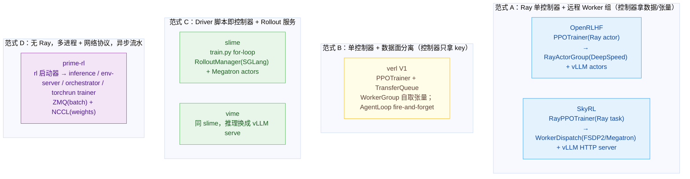

> 基于同一台 4 × H100 NVL（94 GB）机器、同一天（2026-10-31）对 6 个仓库最新 commit 的源码阅读与实测。
> 单个框架的详细文档（安装 / 接口 / 例子 / 架构图 / 时序图 / 带数值的源码走读）：[verl](/posts/verl-arch/) · [vime](/posts/vime-study-notes/) · [slime](/posts/slime-study-notes/) · [SkyRL](/posts/skyrl-study-notes/) · [prime-rl](/posts/prime-rl-study-notes/)

| 框架 | commit / 日期 | 维护方 |
|---|---|---|
| verl | `8e48d72d` / 2026-10-29（0.10.0.dev0） | 字节 Seed / verl-project |
| vime | `d7e40fe8` / 2026-10-14 | vllm-project（slime 的 vLLM 移植） |
| slime | `540ea919` / 2026-10-27（0.4.0） | THUDM / 智谱 |
| SkyRL | `50cfa014` / 2026-10-30 | NovaSky（UC Berkeley Sky Lab） |
| OpenRLHF | `dc2a7ad` / 2026-09-17（0.10.x） | OpenRLHF 社区 |
| prime-rl | `a566e5d8` / 2026-10-29（0.10.0） | Prime Intellect |

---

## 0. Concepts

> 本节解释后文反复出现的几个核心概念，数值与代码位置均来自本次实测和源码核对。

### 0.1 GRPO 优势（advantage）

* **公式**：同一个 prompt 采样 n 条回答，奖励为 r₁…rₙ，第 i 条的优势 `Aᵢ = (rᵢ − μ) / (σ + ε)`，μ、σ 是这组奖励的均值和标准差。
  * 减 μ：用组内平均奖励当基线，替代 PPO 里的 critic；比平均好的回答 A>0 被强化，差的 A<0 被抑制。
  * 除 σ：把每组优势缩放到相近量级。
  * σ 一律是无偏标准差（`torch.std`，分母 n−1）。
* **数值例子**（n=5，除 σ）：
  * `[1,0,0,0,0]`：μ=0.2、σ=0.447 → 答对 **+1.789**、答错 **−0.447**（verl 例 1 第 1 步日志 `critic/advantages/max=1.7889, min=−0.4472` 完全一致）；若用有偏 σ=0.4 会变成 +2.0 / −0.5。
  * `[1,1,0,1,0]`：μ=0.6、σ=0.548 → +0.730 / −1.095。
  * 全对或全错：σ=0、分子也为 0 → 优势全为 0，这组样本不贡献梯度；DAPO 的动态过滤（OpenRLHF `--algo.dynamic_filtering_enable`、verl `filter_groups`）就是丢掉这种组再补新 prompt。
  * prime-rl 只减均值不除 σ：`[1,0,0,0,0]` → +0.8 / −0.2。
* **各框架实现**：
  * verl：控制器 `_compute_advantage` → `core_algos.py:268 compute_grpo_outcome_advantage`，ε=1e-6，`algorithm.norm_adv_by_std_in_grpo=False` 可关闭除 σ；单样本组令 μ=0、σ=1。
  * SkyRL：控制器 → `ppo_utils.py:1411`，ε=1e-6，`trainer.algorithm.grpo_norm_by_std=false` 关闭除 σ；单样本组处理同 verl。
  * slime / vime：在**生成侧** RolloutManager 的 `batch_builder.py:207`（vime `:210`）`_post_process_rewards` 里算，ε=1e-6，结果写回 `rewards[i]`（训练侧看到的 “reward” 已经是优势）；`--disable-grpo-std-normalization`（Dr.GRPO）关闭除 σ，`--disable-rewards-normalization` 连均值也不减。
  * OpenRLHF：`--algo.advantage.estimator group_norm` → `experience_maker.py:274`，ε=**1e-9**；`dr_grpo` / `reinforce_baseline` 只减均值。
  * prime-rl：orchestrator `GRPOAlgorithm.score_group`（`algo/grpo.py:60`），`advantages = shaped_rewards − baseline`，**默认不除 σ**；可选 `length_penalty`（先做长度惩罚）、`length_weighted_baseline`（按 token 数加权的均值作基线，默认关）。
* **从标量到 token**：所有框架都把同一个 Aᵢ 赋给该条回答的每个 response token。
  * verl / SkyRL：`scores.unsqueeze(-1) * response_mask`。
  * slime：`get_grpo_returns` 生成长度为 response_length、值全为 Aᵢ 的张量。
  * OpenRLHF：先把标量放在最后一个 token，再在 γ=1 下累加回报，结果每个 token 仍等于 Aᵢ。
* **差异的影响**：
  * 除不除 σ 影响最大：除 σ 会放大低方差组（“难题偶尔答对”的 +1.789 vs 不除时 +0.8），Dr.GRPO 认为这引入了难度偏置；两种做法的优势量级不同，同一学习率效果不可直接比。
  * ε 取 1e-6 还是 1e-9 实际无关紧要：σ=0 时分子也是 0，σ>0 时 ε 可忽略。
  * 在哪个进程算决定读代码从哪看：控制器（verl / SkyRL / OpenRLHF）、生成侧 RolloutManager（slime / vime）、orchestrator（prime-rl）。
  * 优势之后的 loss 归一化也会改变有效学习率，要和优势一起看（见第 5 节第 2 条）。

### 0.2 old logprob：重算 / 不重算 / 单 step 复用

* **它是什么**：PPO 的重要性比率 `ratio = π_θ / π_old = exp(logπ_θ − logπ_old)`。π_θ 是正在训练的策略，π_old 是生成这批数据时的策略，π_old 的 log 概率就是 old logprob。loss `−min(ratio·A, clip(ratio, 1−ε, 1+ε)·A)` 依赖 ratio，所以 old logprob 准不准直接决定 clip 是否正确。
* **三种来源**：
  * **重算**：生成完、更新前，用训练引擎（FSDP / DeepSpeed / Megatron）对整批数据额外 forward 一次，作为 old logprob。verl、SkyRL、OpenRLHF 采用；slime / vime 在一轮有多次 optimizer step 时也这样做。
  * **不重算**：直接用推理引擎（vLLM）生成时顺带返回的 logprob。prime-rl 默认如此；SkyRL fully-async 的 `rollout_is`、verl 的 `bypass_mode` 也是。
  * **单 step 复用**：一轮只做 1 次 optimizer step 时，不单独 forward，直接复用训练那次 forward 的结果。slime / vime（本次例 1）。
* **为什么要重算**：权重相同时，训练引擎和推理引擎算出的概率也不完全一样（bf16、FlashAttention vs PagedAttention、batch 组成、CUDA Graph 等）。
  * 实测差距：slime / vime `train-rollout logp abs diff` ≈ 0.010–0.012；verl `rollout_probs_diff_mean` ≈ 0.004；prime-rl `Mismatch KL` 0.0006，staleness 大时涨到 0.045。
  * 用 vLLM logprob 当 old 时，第一次更新时 ratio 就不等于 1，PPO 会把数值噪声当成 “策略变了” 去 clip；重算让 π_old 和 π_θ 来自同一套代码，从源头消除噪声。
  * 代价：每步多一次全量 forward，verl 实测 `old_log_prob` ≈ 0.57 s/步（一步总共 ≈5.7 s）。
* **单 step 复用的原理**（以 slime 例 1 为例）：
  * 每轮 32 prompt × 8 = 256 条，`global_batch_size=256` → 整轮只有 1 次 optimizer step；更新前的权重就是生成时的权重，训练 forward 的 log_probs 本身就是 old logprob。
  * 判断条件在 `megatron_utils/actor.py` 的 `can_reuse_log_probs_in_loss`：只有 1 个 step、`loss_type == "policy_loss"`、`kl_coef == 0`、不用 rollout logprob。
  * 复用发生在 `loss.py:1181-1182`：`old_log_probs = [log_prob.detach() for log_prob in log_probs]`，ratio 严格 ≡ 1，所以 slime / vime 日志里 `pg_clipfrac`、`ppo_kl` 全为 0，并省掉一次 actor forward。
  * verl / SkyRL / OpenRLHF 本次每个 global step 有 2 次 optimizer step：第 2 个 mini-batch 训练时权重已被第 1 次更新改过，π_old 必须是更新前的值，只能提前单独重算。这也是 OpenRLHF `clip_ratio` ≈ 4e-4 的原因（第 1 个 mini-batch ratio ≡ 1，只有第 2 个可能被 clip）。
* **为什么 prime-rl 不重算**：默认异步，数据可能是几步之前的旧权重生成的（staleness 最大到 8），trainer 只有最新权重，还原不出生成时的 π_old；真实的行为策略只有 vLLM 当时记下的 logprob。它用 IPO loss 兜底：|p−q|>0.3 的 token 被 mask，重要性比率有上限。
* **折中做法**：verl `separate_async` 一个同步周期内有多个 mini-batch 时，用 `save_model_to_cpu / restore_model_from_cpu` 把周期开始时的权重存在 CPU，算 old logprob 时临时换回（`trainer_separate_async.py:201`），整个周期用同一个稳定的 π_old。
* **小结**：
  * 重算：最准，每步多 1 次 forward，适合同步训练、每轮多次 step。
  * 单 step 复用：同样准、零开销，只适用于每轮恰好 1 次 step。
  * 不重算：零开销但带训推噪声，需要 IS / mask 修正，是异步训练的必然选择。

### 0.3 直接用 vLLM logprob 会有什么问题

* **结论**：会有问题，但大多可控。prime-rl 本次就是直接用 vLLM logprob，reverse-text eval 0.10 → 0.82，训练正常；关键是知道问题在哪、框架有没有修正。
* **可能的问题**：
  * **数值噪声导致误 clip**：平均差虽小（slime / vime ≈ 0.011，verl 概率差 ≈ 0.004），单 token 最大偏差可能很大（verl `rollout_probs_diff_max` 0.15–0.42），第一次更新时 ratio 就不等于 1。
  * **采样参数不一致造成系统性偏差（最危险）**：vLLM 用了 temperature / top-p / top-k 时，返回的可能是处理后分布的 logprob；训练侧若按 T=1 原始 logits 计算，两边根本不是同一个分布。OpenRLHF 开 IS 修正时让 vLLM 返回 `processed_logprobs`，verl 训练 forward 会传入 rollout 的 temperature；自己接 vLLM 时必须确认口径一致。
  * **序列越长误差越大**：逐 token 误差沿序列累积，整条序列的 IS 比率（逐 token 相乘）很容易爆炸，所以一般用 token 级比率或几何平均（SkyRL geo-mask）并设上下限。
  * **推理优化放大差异**：FP8 / 量化推理；MoE 两边路由到不同 expert（verl、slime 有 routing replay，把推理时的路由记下来训练时照用）；投机解码、batch 组成、prefix cache。
  * **异步时叠加 “策略变旧”**：除数值噪声，vLLM logprob 还对应几步之前的旧权重。实测 prime-rl Mismatch KL 随 staleness 从 0.0006 涨到 0.045、回落后降到 0.002；SkyRL fully-async `is_ratio_max` 随 staleness 涨到 6。
* **框架的兜底手段**：
  * 信任域 mask：偏差过大的 token 不参与训练（prime-rl IPO：|p−q|>0.3 被 mask）。
  * 截断重要性采样（TIS）：比率设上限（slime `--use-tis`、OpenRLHF `is_correction_mode clip`、prime-rl capped IS）。
  * 区间置零 / 序列级 mask：比率超出区间的 token 置零、偏差大的整条序列丢弃（SkyRL `rollout_is` + geo-mask，实测 0.3%–0.6% 的序列被 mask）。
  * 重算 + 修正：重算一份 old logprob 给 PPO ratio，vLLM logprob 只用于额外的 IS 修正（verl `rollout_correction`、OpenRLHF `is_correction_level`）。
  * 让推理确定性：batch-invariant kernel 从根源缩小差异（vime 的确定性采样选项导出 `VLLM_BATCH_INVARIANT=1`）。
* **建议**：
  * 同步训练且算力够：重算 old logprob 最稳，vLLM logprob 只用来监控训推差异。
  * 异步训练：只能用 vLLM logprob，必须开修正（TIS / mask / IPO）并设 staleness 上限。
  * 都要监控偏差指标：`rollout_probs_diff`、`train_rollout_logprob_abs_diff`、`Mismatch KL`、`is_ratio_max`；持续上升往往是崩溃前兆，常见原因是采样参数不一致、量化、MoE 路由、staleness 过大。

### 0.4 staleness（陈旧度）

* **定义**：生成某条数据的权重版本，比正在用它训练的权重版本落后了多少步。每做一次 optimizer 更新并同步给推理引擎，版本加 1。
  * 例：trainer 正在训第 5 步（当前权重 v4，已更新 4 次），这条数据由 v2 生成 → staleness = 4 − 2 = 2。
  * 同步训练恒为 0：生成 → 训练 → 同步严格交替。
  * 异步训练 > 0：推理引擎在 trainer 训练的同时继续用旧权重生成，staleness 越大数据越 off-policy。
* **各框架的计算与控制**：
  * verl：`trajectory_staleness = (global_steps−1) − max_global_steps`（`trainer_base.py:1984`）；partial rollout 时一条轨迹可能跨多个版本，另记 `trajectory_spans`（跨了几个版本）和 `staleness_worst`（按最旧版本算）。上限 `max_off_policy_threshold=8`，默认 `drop`（丢弃并补新 prompt），也可选 `wait`（暂停采样等它生成完）。
  * SkyRL：按组计算 `global_step − global_step_when_scheduled`（`fully_async_trainer.py:1067`）；`max_staleness_steps=4`，不丢数据而是限制提交量：容量 = (max_staleness + 当前步) × mini_batch − (已接收 + 在飞)（`:185`），超出就不派发新生成。
  * prime-rl：按 token 计算，token 由 vk 生成、这批训练 v(step−1)，staleness = (step−1) − k；`max_staleness=8`，过旧 token 移出 loss（`train_sink.py:238`）；另有 `TARGET_LAG=1` 闸门，生成端领先太多就暂停派发。
  * slime / vime fully-async：没有专门指标，陈旧数据来自完成队列里留存的组；被 abort 的组放回 data_buffer 续写，没有硬上限。
  * OpenRLHF async：生成与训练间的队列容量默认 1，实际最多 1。
* **本次实测**：
  * verl 例 1 `sync`：恒 0。
  * verl 例 4 `colocate_async`：0 / 1 交替（预取 1 个 batch，相邻两步一次用最新权重、一次用上一版权重生成）。
  * verl 例 5 `separate_async`：恒 1。
  * SkyRL 例 4 fully-async：0 → 1 → 2 → 3 → 4 后一直卡在上限 4（训练慢，生成端一直被容量限制）。
  * prime-rl reverse-text：0 → 8（触及上限）后回落到 1–2；GSM8K：稳定在 2。
* **为什么要关心**：staleness 是吞吐与数据新鲜度之间的旋钮。
  * 放大：推理端不停生成，GPU 利用率高、单步更快。
  * 代价：数据越旧与当前策略差得越远，重要性比率波动越大，越需要 TIS / IPO / mask 修正（prime-rl Mismatch KL 在 staleness 8 时涨到 0.045；SkyRL `is_ratio_max` 涨到 6）。
  * 经验：先设小上限（1–4），观察偏差指标是否稳定，再决定是否放宽。

### 0.5 长尾（long tail）及解决办法

* **什么是长尾**：同一批回答长短差别很大，大部分很快写完，少数很长的还在生成。同步训练必须等这一批全部写完才能训练，于是整批 GPU 陪着最慢的几条一起等。
  * 本次 verl 实测：回答平均约 300 token，最短只有 54–77 token（例 5 / 例 4），最长顶到上限 512；例 1 每步 6%–15% 的回答被 512 截断。
  * 等待还会被轮询粒度放大：verl 的 ReplayBuffer 每 2 s 检查一次是否凑齐，例 1 每步 `gen` 恒为约 2.11 s，大部分是在等。
  * 任务越长（长思维链、多轮 Agent），长度差别越大，长尾越严重。
* **办法 1：多发一些，先完成的先训练（over-sampling）**：提交比一步所需更多的 prompt，凑够数量就开训，没完成的留给下一步。
  * verl `colocate_async`：多预取一个 batch（`num_warmup_batches=1`），下一步直接取上一步剩下的已完成样本，`gen` 从 2.15 s 降到 0.15 s。
  * slime / vime fully-async：后台生成池一直在跑，每轮只从完成队列取 `rollout_batch_size` 组，多余的留在队列（实测 slime 每轮取完后队列里还剩约 90–100 组）。
  * SkyRL fully-async：并行生成 worker 持续产出，训练端从缓冲区取够一个 mini-batch 就训练。
* **办法 2：没写完的先中断，换完权重接着写（partial rollout）**：长回答不必在一个权重版本内写完，已生成的 token 不浪费。
  * verl：取完数据后 abort 未完成请求、推理引擎 sleep；同步新权重后 `FullyAsyncLLMServerClient` 用 “prompt + 已生成 token” 续写，并扣掉已写的长度预算。日志指标 `response/aborted_ratio`、`trajectory_spans`（一条轨迹跨了几个权重版本）。
  * slime：被 abort 的样本状态为 `ABORTED`，`prepare_retry_group` 把整组放回 `data_buffer`，部分 token 保留在 `sample.tokens`，下次以 `max_new_tokens -= response_length` 续写。vime 做法相同。
  * OpenRLHF：`--train.partial_rollout_enable`（需 `--train.async_enable`），权重同步时用 vLLM 的 pause / resume 代替加锁，在飞请求暂停后继续生成。
* **办法 3：训练和生成彻底分开，互不等待（异步分离）**：推理卡一直生成，训练卡一直训练，长尾只拖慢生成端，不阻塞训练。
  * prime-rl 默认如此；SkyRL fully-async、verl `separate_async`、slime / vime fully-async、OpenRLHF `async_enable` 都可开启。
  * 前提是训推卡数配平，否则瓶颈只是换了个地方（见 4.3：verl `separate_async` 与 SkyRL fully-async 是训练成瓶颈，OpenRLHF 异步是生成成瓶颈）。
* **办法 4：把请求分散到多个推理引擎，避免某个引擎积压**：
  * OpenRLHF：按各引擎未完成请求数用小顶堆分配 prompt（`_dispatch_prompts_to_vllm`）。
  * verl、SkyRL、slime、vime：经负载均衡器或 router（vllm-router、SGLang router）分发。
* **办法 5：限制长度，砍掉过长的尾巴**：
  * 设 `max_response_length` / `max_new_tokens` 上限，过长的回答被截断（截断样本照常训练或按配置处理）。
  * 加长度惩罚：prime-rl 的 `length_penalty` 按 token 数和轮数扣减奖励，让模型倾向于更短的回答。
* **训练侧的长尾（顺带一提）**：不同 DP rank 拿到的序列长短不一，最长的 rank 决定这一步多久结束。
  * verl `_balance_batch`、slime `--balance-data`：按序列长度把样本均衡分到各 rank。
  * 动态 batch（slime `--use-dynamic-batch-size --max-tokens-per-gpu`、verl `use_dynamic_bsz`）：按 token 数而不是条数切 micro-batch。
* **代价：解决长尾都会引入偏差**：
  * 选择偏差：先完成的往往是短回答。实测 slime / vime fully-async 首轮平均长度约 155，同步版约 225，奖励也偏高。
  * off-policy：续写或留到下一步的样本由旧权重生成，staleness 变大，需要 TIS / IPO / mask 修正（见 0.3、0.4）。
  * 所以要盯住 staleness、训推 logprob 差、每步平均长度这几个指标，确认偏差在可接受范围内。

### 0.6 Ray actor

* **是什么**：被 Ray 放到单独进程里、一直存在、自带状态的 Python 对象。在本地调用它的方法，实际是在那个进程里执行。
* **最小例子**：
  ```python
  import ray
  ray.init()

  @ray.remote                      # 加上装饰器，这个类就成了 actor 类
  class Counter:
      def __init__(self):
          self.n = 0               # 状态保存在 actor 进程里
      def add(self, k):
          self.n += k
          return self.n

  c = Counter.remote()             # Ray 启动一个新进程，在里面创建对象；c 只是句柄
  ref = c.add.remote(5)            # 立即返回 ObjectRef（类似 future），不阻塞
  print(ray.get(ref))              # 等结果 → 5
  print(ray.get(c.add.remote(3)))  # → 8，self.n 一直留在那个进程里
  ```
* **和普通对象的区别**：
  * 运行位置：普通对象在当前进程；actor 在单独的进程，可以在另一台机器上。
  * 创建和调用：用 `Counter.remote()` 创建，拿到的是句柄；调用写成 `c.add.remote(5)`，返回 ObjectRef，要 `ray.get` 才能拿到结果。
  * 状态：一直保存在 actor 进程里，每次调用都能看到上一次的修改。
  * 资源：可以声明需要的资源，如 `@ray.remote(num_gpus=1)`，Ray 会把它调度到有空 GPU 的位置。
  * 并发：同一个 actor 的方法默认一个接一个执行；方法写成 `async def` 时，可以在一个事件循环里并发执行。
* **Ray task**：`@ray.remote` 加在普通函数上，调用一次运行一次，运行完就结束，没有状态。actor 则是长期存在、带状态的服务。
* **为什么 RL 框架都用它**：控制器、训练进程、推理引擎、打分进程都要常驻（模型只加载一次），各自占用指定的 GPU 或 CPU，还要能被别的进程远程调用。把每个角色做成一个 actor，正好满足这三点。
* **各框架里的 actor**：
  * verl：`TaskRunnerV1`（1 个，CPU）、`ActorRolloutRefWorker`（4 个，包在 `WorkerDict` 里，每个 1 张 GPU）、vLLM server（4 个，和训练共用 4 张卡）、`AgentLoopWorkerTQ`（8 个，CPU）、`RewardLoopWorker`（CPU）。
  * slime / vime：`RolloutManager`、`MegatronTrainRayActor` × 4、SGLang / vLLM 引擎 × 4；`train.py` 本身是普通 driver 脚本，不是 actor。
  * SkyRL：`RayPPOTrainer` 运行在 `skyrl_entrypoint` 这个 Ray task 里；`PolicyWorker` / `RefWorker` × 4、`VLLMServerActor` × 4 都是 actor。
  * OpenRLHF：`PPOTrainer` 本身是 actor；`PolicyModelActor` × 4、`ReferenceModelActor` × 4、`RolloutRayActor` × 4。
  * prime-rl：**不用 Ray**，各进程之间通过 HTTP、ZMQ、NCCL 通信。

### 0.7 六个自问：看懂任意框架的架构

读一个新框架或画它的架构图时，依次问这 6 个问题：谁指挥？数据存在哪？数据从哪来？训练怎么拿到数据？谁来算？权重怎么回去？各框架文档 Overview 里的架构图就是按这个顺序画出来的。下面是 6 个框架的答案。

* **1. 谁指挥？**
  * verl：`TaskRunnerV1 / PPOTrainer`，一个 Ray actor，是单控制器。
  * slime / vime：`train.py` 的主循环 `for rollout_id`，依次调 generate、train、update_weights。
  * SkyRL：`RayPPOTrainer.train()`，运行在 `skyrl_entrypoint` 这个 Ray task 里。
  * OpenRLHF：`PPOTrainer.fit()`，一个 Ray actor。
  * prime-rl：**没有总控制器**。orchestrator（CPU 进程）和 trainer（torchrun 进程）各自运行，靠"权重版本闸门"协调节奏。
* **2. 数据存在哪？**
  * verl：**TransferQueue**，控制器只拿 key。
  * slime / vime：Ray object store，控制器拿的是 4 份数据引用。
  * SkyRL：控制器持有整批 `GeneratorOutput` / `TrainingInputBatch`，经 Ray object store 发给 Worker。
  * OpenRLHF：`Experience` 列表放在 PPOTrainer 的 replay buffer 里。
  * prime-rl：在 orchestrator 内存里，凑满后经 ZMQ 发给 trainer。
* **3. 数据从哪来？**
  * verl：8 个 `AgentLoopWorkerTQ` 调用 4 个 vLLM，由 `RewardLoopWorker` 打分。
  * slime：`RolloutManager` 经 Router 调用 4 个 SGLang，自己打分。
  * vime：`RolloutManager` 经 vllm-router 调用 4 个 vLLM，自己打分。
  * SkyRL：`SkyRLGymGenerator` 经 `VLLMRouter` 调用 4 个 `VLLMServerActor`，由 `GSM8kEnv.step` 打分。
  * OpenRLHF：`SamplesGenerator` 调用 4 个 `RolloutRayActor`，每个里面是 vLLM 加 `reward_func`。
  * prime-rl：`Dispatcher` 派发给 env-server（verifiers），env-server 调用 vLLM（GPU 0–1）并计算奖励。
* **4. 训练怎么拿到数据？**
  * verl：`ReplayBuffer.sample()` 每 2 s 轮询一次 TQ，凑齐后返回 320 个 key。
  * slime / vime：`BatchBuilder` 做 GRPO 组归一化，再按 DP 切成 4 份。
  * SkyRL：生成结束后直接返回 `GeneratorOutput`，由 `WorkerDispatch` 按 DP 切分。
  * OpenRLHF：`ExperienceMaker` 算完 logprob 和优势后，存进 replay buffer。
  * prime-rl：`TrainSink` 凑满 128 条，`BatchPacker` 按长度打包，再经 ZMQ 发给 trainer。
* **5. 谁来算？**
  * verl：`ActorRolloutRefWorker` × 4，使用 FSDP。
  * slime / vime：`MegatronTrainRayActor` × 4，使用 Megatron DP4；ref 和 actor 的权重备份在 CPU 上。
  * SkyRL：`PolicyWorker` × 4 和 `RefWorker` × 4，使用 FSDP2。
  * OpenRLHF：`PolicyModelActor` × 4 和 `ReferenceModelActor` × 4，使用 DeepSpeed ZeRO-2。
  * prime-rl：trainer 单独占用 GPU 2–3，使用 torchrun + FSDP2。
* **6. 权重怎么回去？**
  * verl：`update_weights`，经 CUDA IPC 交给同卡的 vLLM，约 0.42 s。
  * slime：经 CUDA IPC 交给 SGLang。
  * vime：用 vLLM 的 weight-transfer 走 IPC，约 0.78 s。
  * SkyRL：经 IPC 交给 4 个 `VLLMServerActor`。
  * OpenRLHF：经 CUDA IPC 逐个参数传，约 1.15 s。
  * prime-rl：**NCCL 广播**（推理和训练不在同一张卡上），新版本到达后 orchestrator 才放行下一批派发（`TARGET_LAG` 闸门）。
* **从这 6 个问题能看出的规律**：
  * 问题 2 最能区分架构：只有 verl 有独立的数据面（TQ），其他框架要么由控制器直接持有数据，要么传对象引用。
  * 问题 6 能看出共卡还是分卡：共卡的框架都走 CUDA IPC，只有分卡的 prime-rl 走 NCCL。
  * 问题 1 能看出同步还是异步：只有 prime-rl 没有总控制器，所以默认就是异步流水。

## 1. 总览：一张表看差异

| 维度 | verl | vime | slime | SkyRL | OpenRLHF | prime-rl |
|---|---|---|---|---|---|---|
| **控制范式** | 单控制器（TaskRunner→PPOTrainer）+ TransferQueue 数据面 | Driver 脚本 `train.py` 即控制器 | 同 vime（`train.py` for 循环） | 单控制器 `RayPPOTrainer`（Ray task 内） | 单控制器 `PPOTrainer`（Ray actor） | **无中心 Ray**：启动器 + orchestrator 进程 |
| **调度/通信层** | Ray + TQ（KV 存储） | Ray | Ray | Ray | Ray | subprocess + HTTP + ZMQ + NCCL |
| **训练后端** | FSDP/FSDP2、Megatron、VeOmni、TorchTitan、AutoModel、MindSpeed | Megatron-LM | Megatron-LM | FSDP2、Megatron、JAX(skyrl-tx) | DeepSpeed ZeRO(1/2/3) + AutoTP + RingAttn | FSDP2（torchtitan 风格），EP/CP |
| **推理后端** | vLLM / SGLang / TRT-LLM（HTTP server 副本） | vLLM（`vllm serve` 子进程） | SGLang（server + Model Gateway） | vLLM HTTP server + vllm-router（或外部服务） | vLLM AsyncLLMEngine（Ray actor 内） | vLLM（OpenAI server，可换 Dynamo 等外部服务） |
| **rollout 接口** | `LLMServerClient.generate`（Ray 调 server actor） | `POST /inference/v1/generate`（token in/out） | `POST /generate`（input_ids） | `POST /inference/v1/generate`（经 router） | `llm.generate()`（进程内） | OpenAI chat/completions（经 env-server、renderer） |
| **奖励/环境** | RewardLoopWorker（规则/模型/自定义函数）+ AgentLoop（单轮/工具多轮） | rm_hub 规则 / 自定义 rm / 自定义 generate | 同 vime | skyrl-gym 环境 `env.step()` | `reward_func(queries,prompts,labels)` / 远程 RM / AgentInstance | verifiers v1 `Taskset/Task` + `@vf.reward` |
| **共置方式** | hybrid engine（同进程组时分复用） | colocate（同卡）或分离 | colocate 或分离 | colocate_all 或分离 | colocate_all / colocate_actor_ref / 分离 | **只支持分离**（`partition_gpus`：训练卡与推理卡不重叠） |
| **异步训练** | `trainer_mode=colocate_async/separate_async`、partial rollout | fully-async rollout / streaming | fully-async rollout / streaming | `fully_async_trainer` | `--train.async_enable`（ppo_trainer_async） | **默认异步**（TARGET_LAG=1、max_staleness=8） |
| **权重同步（共置）** | naive：ZMQ + CUDA-IPC bucket（2 GB） | vLLM 原生 weight-transfer IPC（packed tensor） | `update_weights_from_tensor`（flattened bucket + IPC） | vLLM weight-transfer IPC | CUDA-IPC 逐参数（`update_weight_cuda_ipc`） | — |
| **权重同步（分离）** | NCCL / NIXL / Mooncake / HCCL / Kimi checkpoint engine | NCCL broadcast | NCCL broadcast | NCCL | NCCL / Ray collective broadcast（rank0 → 所有 vLLM rank） | NCCL broadcast（也有 filesystem / NIXL / ModelExpress） |
| **ref 模型** | 与 actor 同一 WorkerDict 进程内的独立 FSDP 模型（可 param_offload） | 同一 Megatron 模型切换权重（CPU 备份） | 同 vime | 独立 RefWorker 组 | 独立 ReferenceModelActor 组 | 默认不用（可选 ref_kl） |
| **old logprob** | 重算（或 bypass 用 rollout logprob） | 重算；单 step 时复用训练 forward | 同 vime | 重算 | 重算 | **不重算**：直接用 vLLM 的 inference logprob |
| **默认 GRPO 优势** | (r−μ)/(σ+ε)（可关 std） | (r−μ)/(σ+1e-6)（在 RolloutManager 里做） | 同 vime | (r−μ)/(σ+ε) | `group_norm`: (r−μ)/(σ+1e-9) | **r − μ**（无 std） |
| **默认策略损失** | vanilla PPO-clip，token-mean | PPO-clip（eps_clip_high 支持 clip-higher） | 同 vime | PPO-clip，token_mean（分母前移进 advantage） | PPO-clip，token 级全局归一化 | **IPO**（\|p−q\|>0.3 的 token mask + capped IS） |
| **配置系统** | Hydra/OmegaConf（`a.b=c`） | argparse（Megatron + `--vllm-`*） | argparse（Megatron + `--sglang-*`） | dataclass + `a.b=c` CLI | argparse（`--ns.key`） | TOML + pydantic（`--a.b-c`） |
| **安装** | `uv sync --extra fsdp --extra vllm`（自带 uv.lock） | Docker `vllm/vime`（需与 commit 匹配） | Docker `slimerl/slime` | `uv sync --extra fsdp`（uv.lock） | `pip install openrlhf[vllm]` | `uv sync --all-extras`（uv.lock + 子模块） |

---

## 2. 架构范式对比



**解读**

* **范式 A（OpenRLHF / SkyRL）**：一个控制器进程把整批张量（Experience / TrainingInputBatch）在 Ray object store 里搬来搬去，代码最直观；规模变大后控制器内存与序列化开销会成为瓶颈（SkyRL 用 `stage_data` 预先按 DP 切分、OpenRLHF 用 `async_run_method_batch` 预切分来缓解）。
* **范式 B（verl V1）**：控制器只拿 `KVBatchMeta`（key 列表），张量放在 TransferQueue，由 worker 按 key 自取自写；生成是 fire-and-forget 的 AgentLoop，ReplayBuffer 轮询 TQ 凑 batch——同一套代码同时支撑同步/共置异步/分离异步。
* **范式 C（slime / vime）**：没有 “trainer 对象”，`train.py` 里的 for 循环就是全部调度逻辑；RolloutManager 负责生成 + 奖励 + **组归一化** + 按 DP 切分，训练侧只看到 `rewards[i]` 标量。最容易读懂、改动面最小，Megatron 原生支持超大 MoE。
* **范式 D（prime-rl）**：四类进程只靠 HTTP / ZMQ / NCCL 通信，训练与推理物理分离，天然异步（带 staleness 控制）；适合跨集群、去中心化、超长 agent rollout。
* 用"六个自问"逐项对照这 6 个框架，见 [0.7](#07-六个自问看懂任意框架的架构)。

---

## 3. 一次训练步里 “谁在做什么” —— 同一问题的 6 种实现

| 阶段 | verl | vime / slime | SkyRL | OpenRLHF | prime-rl |
|---|---|---|---|---|---|
| 取 prompt | StatefulDataLoader(64) + uid | RolloutDataSource.get_samples(32) → 32×8 Sample | dataloader(64) → ×n | dataloader(bs=1) 攒 32 条 | train_source.next_task（按需） |
| 发生成请求 | AgentLoopWorkerTQ（8 个 actor，asyncio） | asyncio + semaphore(512×引擎数) → router | 一次批量 HTTP（batched）或每条 agent_loop | 每 prompt 一个 `generate_responses.remote`，小顶堆负载均衡 | Dispatcher 按并发许可逐条发给 env-server |
| 奖励 | RewardLoopWorker（与生成并行） | rm_hub（生成完立即） | env.step() | vLLM actor 内 `reward_func` | env-server 内 `@vf.reward` |
| 组优势 | controller：`compute_grpo_outcome_advantage` | RolloutManager：`_post_process_rewards` | controller：`compute_grpo_outcome_advantage` | controller：`compute_advantages_and_returns` | orchestrator：`GRPOAlgorithm.score_group` |
| old logprob | actor 重算 | 单 step 时复用训练 forward | policy 重算 | actor 重算 | 不算（用 vLLM logprob） |
| ref logprob | ref（同 worker） | 同模型换权重 | RefWorker | ReferenceModelActor | 无 |
| 更新 | 2 mini-batch → 2 次 step | 1 次 step | 2 mini-batch → 2 次 step | grad_accum=4 → 2 次 step | 1 次 step |
| 权重同步（共置） | naive：ZMQ+IPC bucket | IPC（vime：vLLM transfer engine；slime：SGLang from_tensor） | vLLM transfer engine IPC | 逐参数 CUDA IPC | —（NCCL 到独立推理卡） |

---

## 4. 实测对比（同一台 4×H100）

> ⚠ 这些例子的模型 / 奖励格式 / batch / 响应长度并不完全相同（为了尽量贴近各框架官方 quickstart），所以 **吞吐数字只能横向参考量级，不能当作严格 benchmark**。完全同超参的严格对比只有 slime vs vime（见 vime 文档第 8 节）。

### 4.1 本次跑通的全部例子

| 框架 | 例子 | 模型 | 卡分配 | 每步样本 | 步数 | 单步耗时（稳态） | 效果 |
|---|---|---|---|---|---|---|---|
| OpenRLHF | 例1 SFT | Qwen2.5-0.5B | DS ZeRO-2 ×4 | 64 | 64 step | 256 micro / 48 s | gpt_loss 0.84 → 0.29 |
| OpenRLHF | 例2 PPO(GAE+critic) | Qwen2.5-0.5B-Ins | 共置 4 卡 | 32×4=128 | 10 | ≈13.6 s | reward 0.40 → 0.46；critic_loss 0.24 → 0.11 |
| OpenRLHF | 例3 GRPO(group_norm) | Qwen2.5-0.5B-Ins | 共置 4 卡（vLLM eager） | 32×8=256 | 10 | ≈14 s（生成 10 s） | eval pass@1 0.4945 → 0.4992（boxed） |
| OpenRLHF | 例4 DPO | Qwen2.5-0.5B-Ins | DS ZeRO-3 ×4 | 64 对 | 32 step | 128 micro / 62 s | loss 0.693 → 0.262，acc 1.0 |
| OpenRLHF | 例5 异步 GRPO（partial rollout） | Qwen2.5-0.5B-Ins | 2 训(actor+ref) + 2 vLLM（NCCL） | 32×8=256 | 10 | ≈13.8 s（生成 14.4 s 为瓶颈） | eval pass@1 0.4945（step 5） |
| verl | 例1 GRPO | Qwen2.5-0.5B-Ins | hybrid 4 卡 | 64×5=320 | 15 | ≈5.7 s | val 0.08% → 37.2%（strict ####） |
| verl | 例2 PPO(GAE+critic) | Qwen2.5-0.5B-Ins | hybrid 4 卡（无 ref） | 128×1 | 20 | ≈4.4 s | val 0.08% → 8.4%；vf_loss 10.0 → 0.05 |
| verl | 例3 SFT（Ulysses SP=2） | Qwen2.5-0.5B-Ins | torchrun DP2×SP2 | 256 | 29 | ≈1.1 s | loss 0.695 → 0.396 |
| verl | 例4 GRPO colocate_async | Qwen2.5-0.5B-Ins | hybrid 4 卡 + 1 预取 batch | 64×5=320 | 15 | 15 步平均 5.4 s（例 1 同步平均 6.6 s） | val 0.0% → 41.9%；staleness 0/1 交替 |
| verl | 例5 GRPO separate_async | Qwen2.5-0.5B-Ins | 2 训 + 2 vLLM（NCCL checkpoint engine） | 64×5=320 | 15 | ≈7.0 s（训练成瓶颈，gen≈0） | val 0.08% → 30.3%；staleness 恒 1 |
| slime | 例1 GRPO | Qwen3-0.6B（无思考） | 共置 4 卡 | 32×8=256 | 10 | ≈14.0 s | eval 0.556 → 0.597 |
| slime | 例2 GRPO 训推分离 | Qwen3-0.6B（无思考） | 2 训 + 2 SGLang（NCCL） | 32×8=256 | 10 | ≈6.4 s | eval 0.563 → 0.578 |
| slime | 例3 fully-async | Qwen3-0.6B（无思考） | 2 训 + 2 SGLang（NCCL） | 32×8=256 | 10 | ≈4.6 s | reward 0.76 → 0.59（首轮选择偏差，无 eval） |
| slime | 例4 PPO + critic（默认参数） | Qwen3-0.6B（无思考） | 共置 4 卡（actor + critic + SGLang） | 32×8=256 | 10 | ≈19.0 s | eval 0.564 → 0.550（critic lr 1e-6 学不动，A≈+2.9） |
| slime | 例4b PPO + critic（critic lr 1e-5 + 优势白化） | Qwen3-0.6B（无思考） | 共置 4 卡 | 32×8=256 | 10 | ≈19.5 s | eval 0.573 → 0.557；value_loss 14 → 0.83（critic 能学，10 轮仍不及 GRPO） |
| vime | 例1 GRPO | Qwen3-0.6B（无思考） | 共置 4 卡 | 32×8=256 | 10 | ≈13.6 s | eval 0.551 → 0.563 |
| vime | 例2 GRPO 训推分离 | Qwen3-0.6B（无思考） | 2 训 + 2 vLLM（NCCL） | 32×8=256 | 10 | ≈4.65 s | eval 0.582 → 0.584 |
| vime | 例3 fully-async | Qwen3-0.6B（无思考） | 2 训 + 2 vLLM（NCCL） | 32×8=256 | 10 | ≈2.7 s | reward 0.83 → 0.66（首轮选择偏差，无 eval） |
| SkyRL | 例1 GRPO | Qwen2.5-0.5B-Ins | colocate 4 卡 | 64×5=320 | 10 | ≈6.3 s | val 0 → 11.3%（strict ####） |
| SkyRL | 例2 多轮 GRPO | Qwen2.5-0.5B-Ins | colocate 4 卡 | 64×5=320 轨迹 | 10 | ≈7.4 s | 真实正确率 0.4% → 34.0% |
| SkyRL | 例3 PPO(GAE+critic) | Qwen2.5-0.5B-Ins | colocate 4 卡（policy/critic/ref） | 64×2=128 | 10 | ≈4.7 s | val 0 → 1.6%；critic_loss 0.048 → 0.02 |
| SkyRL | 例4 fully-async GRPO（rollout_is + geo-mask） | Qwen2.5-0.5B-Ins | 2 训 + 2 vLLM（NCCL） | 64×5=320 | 10 | ≈5.7 s（训练成瓶颈） | val 0 → 2.3%；staleness 钉在上限 4；每步只 1 次更新 |
| prime-rl | 例1 SFT | Qwen3-0.6B | 2 训 + 2 推（评测） | 32 | 100 | 3.2 s | reverse-text 0.04 → 0.72 |
| prime-rl | 例2 RL | Qwen3-0.6B-RT-SFT | 2 训 + 2 推 | 8×16=128 | 20 | ≈1.7 s（异步） | reverse-text 0.10 → 0.82 |
| prime-rl | 例3 RL | Qwen3-0.6B（无思考） | 2 训 + 2 推 | 32×8=256 | 15 | ≈10 s（异步，等打分） | gsm8k 0.555 → 0.660 |

### 4.2 从实测中能看出的架构差异

> 各例子的超参不同，下面只看量级和趋势，不是严格 benchmark。

1. **同步训练里，生成是最慢的一环**
   * OpenRLHF 例 3 每步约 14 s，其中生成约 10 s（占 70%）。
   * OpenRLHF 的例子关掉了 CUDA Graph（`--vllm.enforce_eager`），所以生成比 verl / SkyRL 慢得多。
2. **小模型共置时，切换显存的固定开销比训练本身还大**
   * slime / vime 每轮要在训练和推理之间切换显存（Megatron `sleep` + `wake_up`），耗时 7–8 s；而 0.6B 模型训练一次只要约 1 s。
   * verl、SkyRL 的同类开销都在 1 s 以内。
   * 模型越大，训练越久，这笔固定开销的占比就越小。
3. **小模型上，训推分离比共置快 2–3 倍**
   * 同样超参，从 4 卡共置换成 2 训 + 2 推：slime 14.0 → 6.4 s/轮，vime 13.6 → 4.65 s/轮。
   * 原因一：分离后不用每轮切换显存。
   * 原因二：权重同步从 IPC 换成 NCCL 广播，更快（slime 0.26 → 0.06 s，vime 0.78 → 0.11 s）。
4. **权重同步：打包传比逐个传快得多**
   * 共置时的纯传输耗时：verl 0.14 s、SkyRL 0.25 s、slime 0.26 s、vime 0.78 s、OpenRLHF 1.15 s。
   * OpenRLHF 最慢，因为它对 290 个参数逐个发 RPC；其他框架把参数打包成 bucket 一次传。
   * verl、SkyRL 的数字只算纯传输；算上暂停 / 唤醒推理引擎，整体分别是 0.42 s、0.35 s。
5. **异步能不能提速，取决于训练卡和推理卡是否配平**（完整数据见 4.3）
   * 两边配平时收益最大：slime fully-async 6.40 → 4.61 s/轮（−28%），vime fully-async 4.65 → 2.68 s/轮（−42%）。
   * 共置异步只能省掉等待时间：verl `colocate_async` 15 步总时间 98.3 → 80.7 s（−18%）。
   * 一边成为瓶颈时，收益很小甚至变慢：
     * 训练太慢：verl `separate_async`（2 训 + 2 推）总时间反而是 109.3 s；SkyRL fully-async 的 staleness 很快顶到上限 4，推理卡在等训练。
     * 生成太慢：OpenRLHF 异步（2 训 + 2 推）13.8 s/步，只追平 4 卡共置的同步版（≈14.3 s）。
   * 代价是数据变旧（off-policy）：
     * slime / vime 首轮最先拿到的是最快写完的短回答，平均长度约 155（同步版约 225），奖励也偏高。
     * vime 的训推 logprob 差逐轮从 0.0105 升到 0.0147，说明离策略程度在累积。
6. **奖励稀疏时，GRPO 比 PPO 学得快**
   * 严格 `####` 奖励，训练前几乎全错（verl 0.08%，SkyRL 0%）：
     * verl：PPO 20 步到 8.4%，GRPO 15 步到 37.2%。
     * SkyRL：PPO 10 步到 1.6%，GRPO 10 步到 11.3%。
   * `\boxed{}` 奖励、起点约 0.4（OpenRLHF）：两者 train reward 都在 0.4–0.5 之间波动，差别不大。
   * critic 本身能学会：10 步左右 value loss 明显下降（verl 10 → 0.05，OpenRLHF 0.24 → 0.11，SkyRL 0.048 → 0.02）。但奖励稀疏时，组内对比比 critic 基线更省样本。
   * 两种算法的 n 和步数都不同，这里只能当定性结论。

### 4.3 异步 / 分离模式实测汇总（每个框架都至少跑了一种异步）

| 框架 · 模式 | 卡分配 | 对照基线（同框架同超参） | 基线单步 | 异步单步 | staleness（实测） | 稳态瓶颈 |
|---|---|---|---|---|---|---|
| verl `colocate_async` | 4 卡共置 | 例 1 `sync` | 6.6 s（15 步均值） | **5.4 s** | 0/1 交替 | 生成（只省掉了等待） |
| verl `separate_async` | 2 训 + 2 推 | 例 1 `sync` | 5.7 s（中位数） | 7.0 s | 恒 1 | **训练**（推理卡大半空闲） |
| slime fully-async | 2 训 + 2 推 | 例 2 同步分离 | 6.40 s | **4.61 s** | 队列留存（未单独统计） | 训练等待 + 权重同步 1.07 s |
| vime fully-async | 2 训 + 2 推 | 例 2 同步分离 | 4.65 s | **2.68 s** | 队列留存；logp 差 0.0105 → 0.0147 | 训练 |
| OpenRLHF `async_enable` | 2 训 + 2 推 | 例 3 4 卡共置同步 | ≈14.3 s | 13.8 s | ≤1（队列容量 1） | **生成**（2 个 eager 引擎） |
| SkyRL fully-async | 2 训 + 2 推 | 例 1 4 卡共置同步 | 6.4 s（中位数） | 5.7 s | 0→4，钉在上限 4 | **训练** |
| prime-rl（默认异步） | 2 训 + 2 推 | — | — | 1.7 s（reverse-text）/ 5–20 s（gsm8k，等打分） | 最高 8 / 稳定 2 | 生成 + 环境打分 |

规律：

* **共置异步（verl colocate_async）**只能省 “等待” 不能省 “生成本身”，因为训练时推理引擎在 sleep；收益 ≈ 每步一次轮询/同步等待。
* **分离异步**的收益取决于训推卡数配平：生成慢（OpenRLHF eager 引擎）时异步只把训练藏到生成下面；训练慢（verl separate、SkyRL 2 卡 FSDP）时推理卡空闲、staleness 迅速顶到上限；两边接近时（slime/vime 0.6B）收益最大。
* staleness 越大，离策略修正越重要：SkyRL 例 4 的 `is_ratio_max` 随 staleness 涨到 6，vime 的 train-rollout logp 差逐轮上升，prime-rl 的 Mismatch KL 随 staleness 涨到 0.045——三者分别用 `rollout_is`+geo-mask、（可选）TIS、IPO 信任域来兜底。

---

## 5. 关键实现细节差异（踩坑价值最高的部分）

1. **GRPO 的 std 归一化**：verl / SkyRL / slime / vime / OpenRLHF(`group_norm`) 都默认 `(r-μ)/σ`；prime-rl 默认只减均值（Dr.GRPO 风格），OpenRLHF 的 `reinforce_baseline`/`dr_grpo` 也只减均值。σ 用的都是 **无偏** 标准差（`torch.std`），所以 n=5 时 `[1,0,0,0,0]` → `+1.789 / −0.447`（verl 日志可直接看到这两个数）。
2. **loss 归一化**：verl `token-mean`（全局 token 数）；SkyRL 把分母预先乘进 advantage，worker 只做 sum；OpenRLHF 在每个梯度累积窗口内用全局 token 数归一（`iter_grad_accum_global_norm`）；slime/vime 按 `rollout_mask_sums` 做 “样本内 token 平均、样本间平均”；prime-rl 用全局 rl 权重和。不同的归一化会让同样的超参得到不同的有效学习率。实测的一个直观体现：on-policy（ratio≡1）且组内优势和为 0 时，slime/vime 的 “样本内 token 平均 → 样本间求和” 使 `pg_loss` 恒 ≈1e-9（日志 `train/pg_loss: 5.6e-09`），而 verl 的全局 token-mean 会按响应长度加权，`actor/pg_loss` 是 1e-3 量级的非零数——**loss 数值本身没有可比性，要看 grad_norm 与奖励曲线**。
3. **old logprob 的来源**：只有 prime-rl 默认直接用推理引擎的 logprob；其余框架都会在训练引擎上重算（verl 可 `rollout_correction.bypass_mode` 跳过，slime/vime 在 1 个 optimizer step 时自动复用训练 forward）。重算的代价是一次额外 forward，好处是 PPO ratio 基于同一套 kernel，训推不一致只体现在 IS 修正里。
4. **ref 模型的显存**：slime/vime 不为 ref 建第二个模型，而是在 CPU 上备份两套权重、按需拷进同一个 Megatron 模型（`TensorBackuper`）；verl 把 ref 与 actor 放在同一个 WorkerDict 进程（可 param_offload）；OpenRLHF/SkyRL 是独立的 actor 组。
5. **共置时的显存让渡**：vLLM 用 sleep mode（level 1/2，`/sleep` `/wake_up?tags=weights|kv_cache`）；SGLang 用 `release/resume_memory_occupation`（torch_memory_saver）；DeepSpeed 用 `offload_deepspeed_states`；Megatron（slime/vime）用自己的 `sleep()/wake_up()` 并 **销毁/重建 NCCL 进程组**（实测每轮 ~6 s 的固定开销）。
6. **奖励格式陷阱**：verl / SkyRL 的 GSM8K 规则奖励是严格 `#### 数字`，Instruct 模型起点 ≈0；OpenRLHF 的 `math_reward_func` 与 slime/vime 的 `math` 要求 `\boxed{}`；slime 的 `boxed_math` 会二次抽取导致 **永远 0 分**（本次实测踩到）。
7. **镜像与代码版本绑定**：slime/vime 的 Docker 镜像里带着打过 patch 的 vLLM/SGLang/Megatron；仓库 HEAD 若比镜像新，可能依赖镜像里不存在的接口（vime 的 `/health_generate`）。
8. **PPO/critic 的默认值差异很大**（本次 4 个框架都跑了 PPO）：GAE 优势白化——OpenRLHF（`gae` 在白化列表里）、verl（`core_algos.py:262 masked_whiten`）、SkyRL（`compute_gae_advantage_return` 内 `masked_whiten`）**默认做**，slime/vime **默认不做**（`--normalize-advantages` 默认 False）；critic 学习率——OpenRLHF/SkyRL/verl 都有独立参数（本次 5e-6 / 5e-6 / 1e-5），slime/vime 的 critic **继承 actor 的 lr**（1e-6），要单独设只能走 `--megatron-config-path` 的 `role: critic` 覆盖。实测 slime 默认配置下随机 value head 的 V≈−2.3 使所有样本 A≈+2.9，10 轮 eval 0.564 → 0.550 不升反降；改成 critic lr 1e-5 + `--normalize-advantages` 后 value_loss 14 → 0.83、优势回到零均值，但 10 轮内 eval 仍持平（0.573 → 0.557），critic 需要若干轮才能提供可靠基线。

---

## 6. 选型建议

| 场景 | 推荐 | 理由 |
|---|---|---|
| 入门 / 读懂 RLHF 全流程 | **OpenRLHF** | 4 个模型角色一目了然，`train_step` → `make_experience` → `ppo_train` → `broadcast_to_vllm` 一条线读完；SFT/RM/DPO/PPO 全家桶 |
| 研究新算法（优势/损失/采样策略）、需要最多现成配方 | **verl** | 优势估计器与 loss 注册表最全（GRPO/RLOO/REINFORCE++/DAPO/GSPO/CISPO/SAPO/OPD...），后端覆盖最广，社区示例最多；V1 同时支持同步/异步 |
| 超大模型（MoE、百 B 以上）、Megatron 生态 | **slime**（SGLang）/ **vime**（vLLM） | Megatron TP/PP/EP/CP 原生透传；主循环极简，改 rollout 只需替换函数路径；GLM 系列的生产框架 |
| 希望推理侧统一用 vLLM（含 vLLM 新特性：weight-transfer engine、sleep mode、P/D） | **vime** | 与 slime 同构，推理换成 `vllm serve` + vllm-router |
| Agent / 多轮环境 / 工具调用、需要 Gym 式环境抽象 | **SkyRL** | skyrl-gym 环境、`agent_loop`、step-wise 训练、turn-level reward、Tinker API；推理全走 HTTP，易接外部服务 |
| 小模型（≤1B）在少量卡上追求迭代速度 | 训推分离 + 异步（如 **vime** fully-async、**verl** colocate_async） | 本次实测：0.6B 下 slime/vime 4 卡共置每轮要付 7–8 s 的 Megatron sleep/wake 固定开销；vime 2+2 fully-async 2.7 s/轮、slime 同配置 4.6 s/轮；verl colocate_async 比 sync 快 18%。但分离时要配平训推卡数（verl separate_async 2+2 时训练成瓶颈、反而更慢） |
| 需要 PPO + critic 开箱即用 | **OpenRLHF / verl / SkyRL** | 三者 critic 有独立 lr、GAE 优势默认白化；slime/vime 的 critic 继承 actor lr 且默认不白化，需手动调参（见第 5 节第 8 条） |
| 跨集群 / 去中心化、长 rollout、需要异步 off-policy | **prime-rl** | 不依赖 Ray；四类进程通过 HTTP/ZMQ/NCCL 解耦；默认异步 + staleness 控制 + IPO 信任域；verifiers 环境生态 |

## 7. 一句话总结

* **OpenRLHF**：最“教科书”的 Ray + DeepSpeed + vLLM 实现，单控制器搬张量。
* **verl**：最“平台化”，控制流（单控制器）与数据流（TransferQueue）分离，后端与算法覆盖最广。
* **slime**：最“极简”，`train.py` 一个 for 循环 + Megatron + SGLang，把复杂度放在 rollout 函数里。
* **vime**：slime 的 vLLM 孪生，验证了 “训练框架与推理引擎解耦” —— 同样的训练代码，换推理后端只改 `*_utils` 与 rollout 函数。
* **SkyRL**：最“Agent 化”，Generator + Env 抽象，推理一律 HTTP 化。
* **prime-rl**：最“分布式系统化”，无中心调度、异步流水线、以 inference logprob 为行为策略的 IPO 损失。
