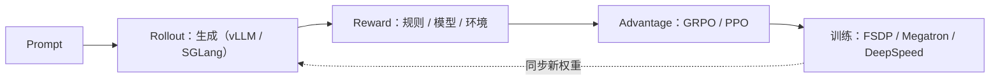
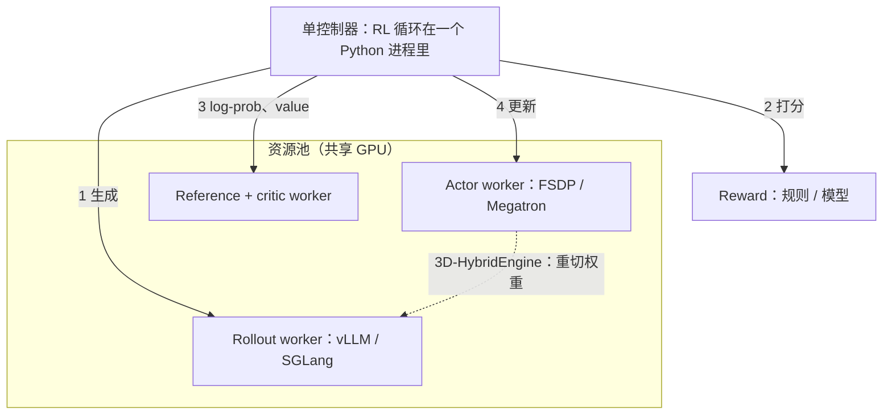
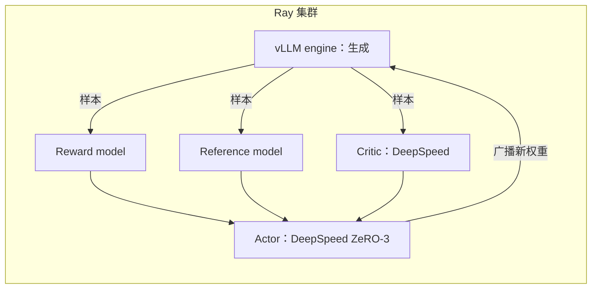
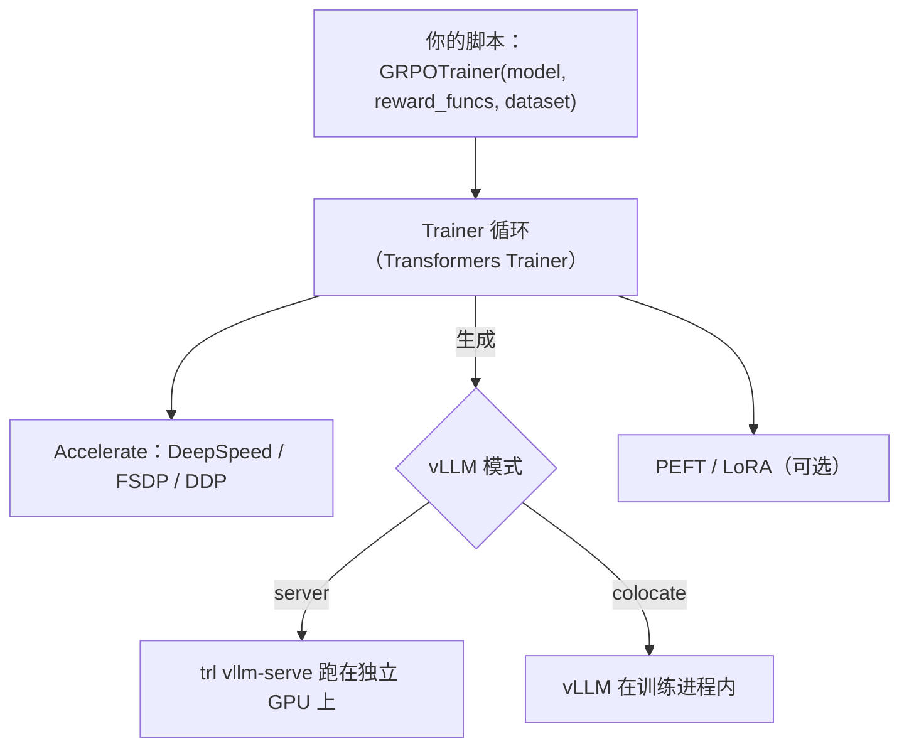
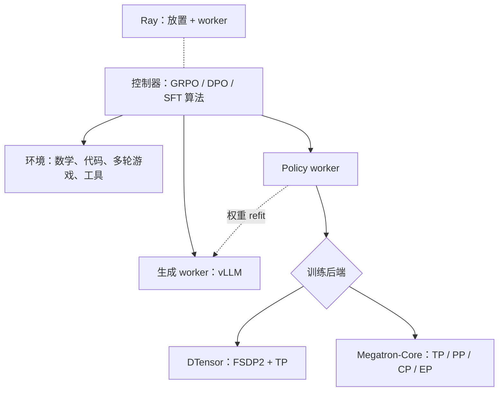
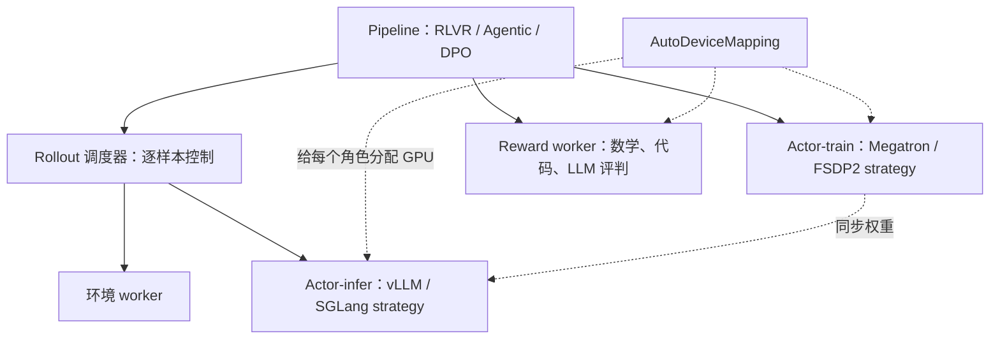
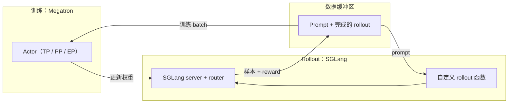
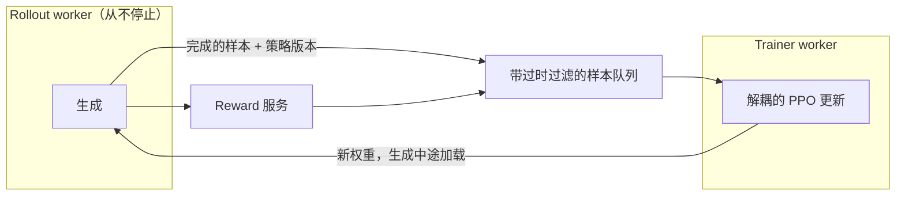

入门选 TRL；要一套通用的、基于 Ray 的 RL 框架选 OpenRLHF 或 verl；要在 Megatron 规模上训练 MoE 选 slime 或 NeMo RL；做资源编排复杂的 agentic RL 选 ROLL；做完全异步的 RL 选 AReaL。它们都是把训练引擎和推理引擎（vLLM/SGLang）接在一起，主要区别在于两者之间怎么调度 GPU [[1]](https://github.com/verl-project/verl)[[3]](https://arxiv.org/abs/2409.19256)。

## 一览

| | verl | OpenRLHF | TRL | NeMo RL | ROLL | slime | AReaL |
|---|---|---|---|---|---|---|---|
| 来自 | 字节 Seed → 社区 | OpenRLHF 社区 | Hugging Face | NVIDIA | 阿里巴巴 | 智谱 AI / THUDM | 蚂蚁集团 + 清华 |
| 核心思路 | HybridFlow 数据流 | Ray + vLLM，简单、易扩展 | 基于 Transformers 的 Trainer API | Ray，Megatron/DTensor | 多角色资源编排 | SGLang 和 Megatron 之间的数据缓冲区 | 完全异步的 rollout 服务 |
| 训练后端 | FSDP / FSDP2 / Megatron | DeepSpeed | Accelerate（DeepSpeed / FSDP） | DTensor（FSDP2）/ Megatron | FSDP2 / Megatron | Megatron | 可插拔 |
| Rollout 后端 | vLLM / SGLang / HF | vLLM | vLLM | vLLM | vLLM / SGLang | SGLang | 独立的推理服务 |
| 同步 / 异步 | 都支持 | 都支持 | 以同步为主 | 都支持 | 都支持 | 都支持 | 完全异步 |
| 最适合的规模 | 小规模 → 超大 MoE | 小规模 → 70B 级 | 单机 → 小集群 | 大集群 | 大集群、agent | 超大 MoE | 大规模异步训练 |
| 最适合 | 通用研究 + 生产 | 易读的 PPO/GRPO 实现 | 学习、快速实验 | 用 NVIDIA 技术栈的团队 | Agentic RL | Megatron 规模的 RL | 异步 RL 研究 |

各家功能变化很快，选型前请看各仓库最新的文档 [[5]](https://github.com/OpenRLHF/OpenRLHF)[[6]](https://github.com/huggingface/trl)[[7]](https://github.com/NVIDIA-NeMo/RL)[[8]](https://github.com/alibaba/ROLL)[[9]](https://github.com/THUDM/slime)[[10]](https://github.com/inclusionAI/AReaL)。

## 共同的问题

- **生成是瓶颈**：一个 RL step 的大部分时间花在生成上，所以每个框架都借用一个快速的推理引擎。
- **同一个模型，两种布局**：训练为了省显存会切分权重；生成需要张量并行的权重加 KV cache。两者之间切换要花时间。
- **GPU 调度**：训练和生成要么在同一批 GPU 上轮流跑（colocate），要么在不同的 GPU 上同时跑（分离部署）。

## 各框架

### verl

**是什么**：字节 Seed 的框架，现在由 verl 社区维护，也是 HybridFlow 论文的开源实现 [[3]](https://arxiv.org/abs/2409.19256)。使用最广的通用 LLM RL 框架。

**架构**

**关键：一个大脑，很多双手（HybridFlow）**

- **单控制器**：整个 RL 算法就是一个很短的循环：生成 → 打分 → 算 advantage → 更新。读起来就像普通 Python，所以把 PPO 改成 GRPO 只需要动这个循环。
- **Worker 组**：每个角色是一组运行同一程序的 GPU 进程（SPMD）。控制器调用某个角色时，verl 把 batch 切到这一组的 GPU 上，再把结果收回来。
- **3D-HybridEngine**：actor 和 rollout 共用同一批 GPU。训练完成后，同一份权重从训练布局（FSDP/Megatron 分片）重新切成推理布局（vLLM/SGLang 张量并行），不保留第二份副本。生成期间释放优化器状态，给 KV cache 腾出空间。

**优势**：算法最全（PPO、GRPO、GSPO、DAPO、REINFORCE++、RLOO、Dr. GRPO）；从单机到超大 MoE 都能跑；支持同步、colocate 异步、分离异步三种模式 [[2]](https://verl.readthedocs.io/en/latest/)。

**注意**：配置项很多；异步 trainer 和 Omni/VLA 支持还在实验模块里。

**适合**：想用一个框架同时做研究和生产规模训练。

### OpenRLHF

**是什么**：基于 Ray、DeepSpeed 和 vLLM 的社区框架，设计目标是易读、易扩展 [[5]](https://github.com/OpenRLHF/OpenRLHF)。

**架构**

**关键：四个模型，由 Ray 安排位置**

- PPO 式的 RLHF 需要四个模型：**actor**（策略）、**critic**（价值估计）、**reward model**，以及 **reference**（让策略不要偏离起点太远）。
- **Ray** 可以把每个模型放在独立的 GPU 上，也可以把几个模型放在一起，所以 70B 级的模型可以把各个角色分散到多个节点上装下。
- **vLLM** 负责生成；每次更新后，actor 通过 NCCL 把**权重广播**给 vLLM engine，让 rollout 用上新策略。
- **Hybrid engine** 模式把所有模型放在同一批 GPU 上，训练时让 vLLM 进入 sleep 释放显存。

**优势**：一个仓库覆盖 SFT、reward model、DPO 和 RL（PPO、REINFORCE++、GRPO、RLOO）；代码紧凑，很多研究分支都基于它；支持样本打包和 LoRA。

**注意**：基于 DeepSpeed，所以面向超大 MoE 的 Megatron 式张量/流水线并行不是它的重点。

**适合**：想要一套易读的 PPO/GRPO 实现，模型在 70B 左右以内，并且打算改代码。

### TRL

**是什么**：Hugging Face 的后训练库，构建在 Transformers、Accelerate 和 PEFT 之上 [[6]](https://github.com/huggingface/trl)。

**架构**

**关键：每种方法一个 Trainer**

- 每种方法都是一个 **Trainer 类**：`SFTTrainer`、`DPOTrainer`、`GRPOTrainer`、`RLOOTrainer`、`RewardTrainer`。传入模型、数据集，以及（GRPO 需要的）reward 函数，trainer 就会跑完整个循环。
- 扩展靠 **Accelerate**，也就是普通 Hugging Face 微调用的那一层，所以 DeepSpeed 或 FSDP 的配置可以直接沿用。
- 生成是慢的部分，所以 TRL 用 **vLLM**，有两种模式：**server**（独立的 `trl vllm-serve` 进程跑在自己的 GPU 上，每步推送权重）或 **colocate**（vLLM 在同一个进程里，共用 GPU）。

**优势**：门槛最低；支持任何 Hugging Face 模型；通过 PEFT 支持 LoRA；有命令行（`trl sft`、`trl dpo`）；文档很好；新论文的方法加得很快。

**注意**：单个 Trainer 循环比 Ray 数据流简单，所以 rollout 集群分离的大规模多节点 RL 更难调。

**适合**：学习、快速实验，或单机 / 小集群训练。

### NeMo RL

**是什么**：NVIDIA NeMo 家族里的开源 RL 库 [[7]](https://github.com/NVIDIA-NeMo/RL)。

**架构**

**关键：一个接口，两种训练后端**

- 算法代码只和抽象的 **policy worker** 打交道。底下可以选 **DTensor**（PyTorch 原生的 FSDP2 + 张量并行，上手快，兼容 Hugging Face checkpoint）或 **Megatron-Core**（完整的 TP/PP/上下文并行/专家并行，用于最大的模型）。
- **环境**是一等公民：数学验证器、代码沙箱、多轮游戏都用同一种方式接入，做 agent 训练很直接。
- 每一步之后，权重从训练布局 **refit** 到 vLLM。

**优势**：一个库里有 SFT、DPO、reward model 和 GRPO；针对 NVIDIA 硬件调优；用 Megatron 可以扩展到大集群。

**注意**：比 verl 和 OpenRLHF 年轻，社区也更小；如果你已经在用 NeMo/Megatron，最合适。

**适合**：团队用 NVIDIA 技术栈训练，想要有厂商支持的 Megatron 规模 RL。

### ROLL

**是什么**：阿里巴巴面向大规模和 agentic 训练的 RL 框架 [[8]](https://github.com/alibaba/ROLL)。

**架构**

**关键：角色 + strategy + AutoDeviceMapping**

- 每个模型是一个**角色**（actor-train、actor-infer、reference、critic、reward、environment）。每个角色选一个 **strategy**，也就是运行它的后端（Megatron、FSDP2、vLLM、SGLang）。
- **AutoDeviceMapping** 读取一份配置，里面写明每个角色用哪些 GPU，所以同一条 pipeline 不改代码，就能在 8 张 GPU 上 colocate 运行，也能分散到几百张 GPU 上。
- **Rollout 调度器**按样本工作，而不是按 batch：它可以停止、重试单个样本，或把单个样本路由到不同的 reward worker（数学检查器、代码沙箱、LLM 评判），所以慢的或失败的样本不会拖住所有人。

**优势**：有现成的多领域 RLVR 和 agentic RL pipeline；GPU 放置粒度细；有异步选项提升吞吐。

**注意**：英文社区较小；角色/strategy 的配置需要时间学习。

**适合**：需要做 agentic RL，或者要在大集群上精确控制每个角色跑在哪里。

### slime

**是什么**：智谱 AI 和清华（THUDM）的 RL 框架，用于 GLM-4.5 系列的后训练 [[9]](https://github.com/THUDM/slime)。

**架构**

**关键：Megatron 和 SGLang 之间的数据缓冲区**

- 只有两个引擎：**Megatron** 负责训练，**SGLang** 负责生成，用 Ray 连起来。不用维护一堆后端组合。
- **数据缓冲区**是两边的交汇点：它把 prompt 交给 rollout，把完成的样本交给训练。两边只通过缓冲区通信，所以既可以步调一致（colocate、同步），也可以各跑各的（分开的 GPU、异步）。
- Rollout 逻辑是一个可以替换的**普通 Python 函数**：多轮 agent、工具调用、自定义采样都写在这里，调用 SGLang 的 server API。

**优势**：代码小，容易改；在超大 MoE 上用 Megatron 的完整并行验证过；直接用上 SGLang server 的功能。

**注意**：训练只支持 Megatron，意味着要做 checkpoint 转换和并行配置，比 FSDP 类工具准备工作多。

**适合**：用 Megatron 训练超大 MoE 模型，想要一个精简的 RL 循环。

### AReaL

**是什么**：蚂蚁集团和清华 IIIS 的完全异步 RL 系统 [[10]](https://github.com/inclusionAI/AReaL)。

**架构**

**关键：生成从不等待**

- **天生异步**：rollout GPU 不停地生成；trainer 一有 batch 就立刻更新。没有 GPU 需要等最慢的那个回答。
- **可中断的 rollout**：新权重到达时，rollout worker 在生成中途加载并继续，所以一个长回答可能由更新后的策略写完。
- **过时上限**：每个样本带着生成它的策略版本号；落后太多版本的样本会被丢弃。
- **解耦的 PPO 目标**：把生成样本的策略和做信任域检查的策略分开，所以略微过时的数据也能稳定训练。论文报告训练速度比同步系统最多快约 2.8 倍 [[11]](https://arxiv.org/abs/2505.24298)。

**优势**：回答长度差异很大时（长推理、agent），GPU 利用率最高；AReaL-lite 提供一个以算法为先的精简 API。

**注意**：异步 RL 更难调试和调参；过时上限放得太宽会影响稳定性。

**适合**：生成时间在 RL step 里占大头，想做完全异步的训练。

## 关键优化

这些思路在各个框架里反复出现。每个先给一句好记的话，再说它实际做什么。

### 异步 rollout

*不等最慢的那个*

同步 RL 里，一个 batch 要等最长的回答完成才算结束，其他 GPU 只能干等。异步 rollout 让已完成的样本先去算 reward 和训练，长的样本继续生成。

### 部分 rollout

*截断长尾，下一轮接着写*

特别长的生成到预算上限就停下、保存，下一步再接着生成，而不是卡住这一步。少一点新鲜度，换来少得多的等待。

### Rollout 服务

*把 rollout 做成服务*

推理引擎作为 server 运行，trainer 像调 API 一样调用它。这适合多轮 agent 和工具调用，因为一个样本需要来回生成很多次。

### Colocate 与分离部署

*共用一张桌子，还是各用一张*

- **Colocate**：训练和生成在同一批 GPU 上轮流跑。不需要额外硬件，但两者不能同时进行。
- **分离部署**：专门的生成 GPU 和训练 GPU 并行运行。吞吐更高，但权重要传过去，数据也会稍微过时。

### GPU 放置

*给各个角色排座位*

资源池是一组有名字的 GPU。放置决定哪个角色（actor、critic、reference、reward）坐在哪个池上，以及哪些角色共用 GPU。

### 重新切分

*同一份权重，换身衣服*

权重本身不变，变的只是训练和生成时它在 GPU 之间的切法。原地完成可以避免第二份完整副本，也缩短切换时间。

### 权重同步

*把新战术发给队员*

每次更新后，新权重发送到 rollout 引擎，中间做格式转换（比如 Megatron → vLLM）。同步越快，rollout 越新，停顿越短。

### 模型并行

*把大模型切开才装得下*

FSDP2 切分参数、梯度和优化器状态；Megatron 加上张量并行和流水线并行；专家并行把 MoE 的 expert 分散到各 GPU 上。

### 省显存

*三种省显存的办法*

- **Offload**：参数或优化器状态不用时挪到 CPU。
- **序列打包**：把几条短样本拼成一条序列，不让 padding 浪费计算。
- **LoRA**：只训练小的 adapter 矩阵，而不是全部权重。

### 过时控制

*带保质期的传送带*

样本沿着队列从 rollout 送到 trainer。过时上限规定样本最多可以落后几个策略版本；更旧的样本会被丢弃或降权。

### 引擎功能

*借用，不重造*

CUDA Graph、KV cache 管理和 continuous batching 都来自 vLLM/SGLang，RL 框架直接复用。

## 参考资料

1. [verl on GitHub](https://github.com/verl-project/verl)
2. [verl documentation](https://verl.readthedocs.io/en/latest/)
3. [HybridFlow: A Flexible and Efficient RLHF Framework (arXiv 2409.19256)](https://arxiv.org/abs/2409.19256)
4. [verl contribution guide](https://github.com/verl-project/verl/blob/main/CONTRIBUTING.md)
5. [OpenRLHF on GitHub](https://github.com/OpenRLHF/OpenRLHF)
6. [TRL on GitHub](https://github.com/huggingface/trl)
7. [NeMo RL on GitHub](https://github.com/NVIDIA-NeMo/RL)
8. [ROLL on GitHub](https://github.com/alibaba/ROLL)
9. [slime on GitHub](https://github.com/THUDM/slime)
10. [AReaL on GitHub](https://github.com/inclusionAI/AReaL)
11. [AReaL: A Large-Scale Asynchronous Reinforcement Learning System for Language Reasoning (arXiv 2505.24298)](https://arxiv.org/abs/2505.24298)
