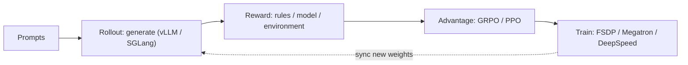
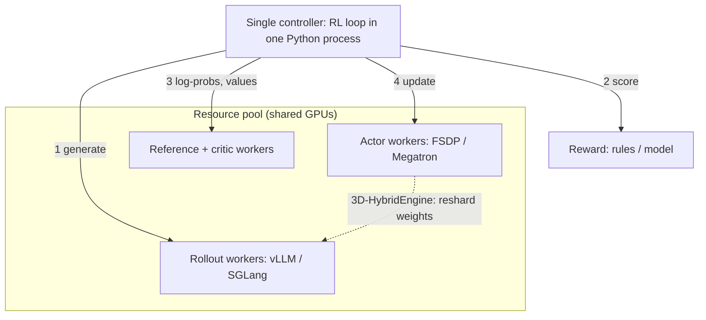
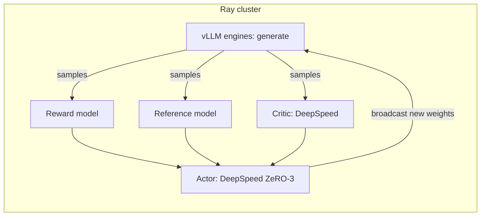
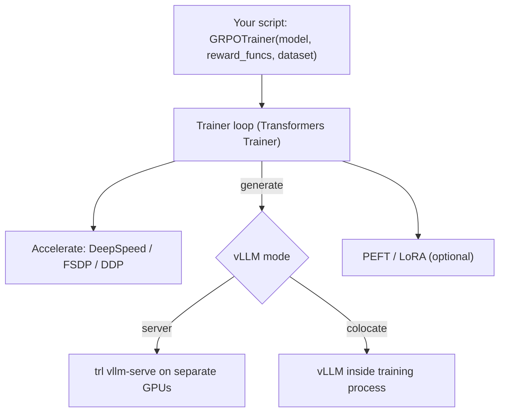
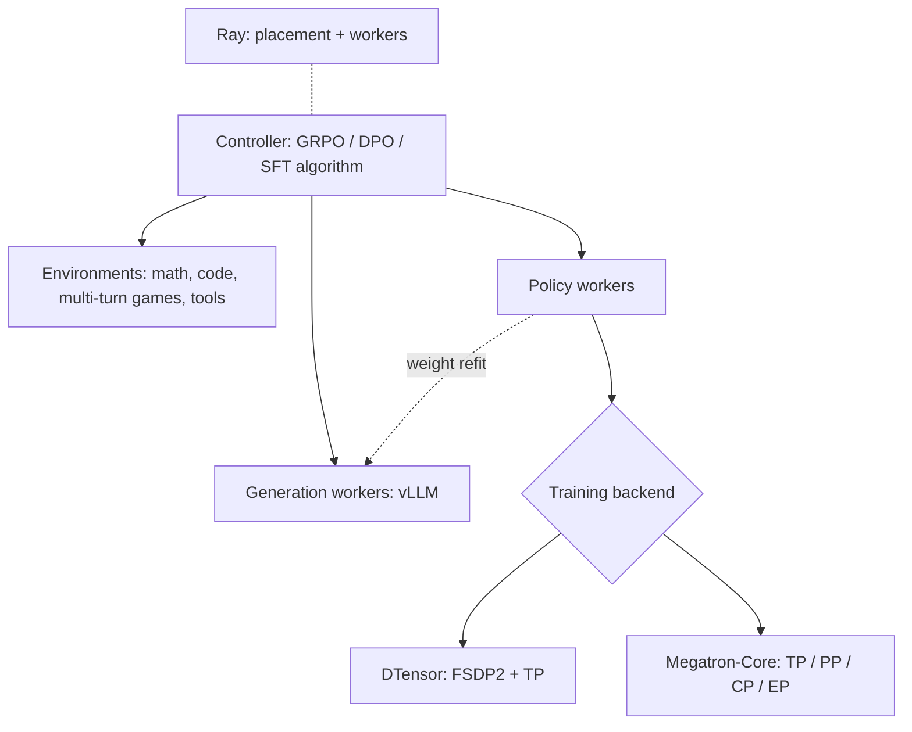
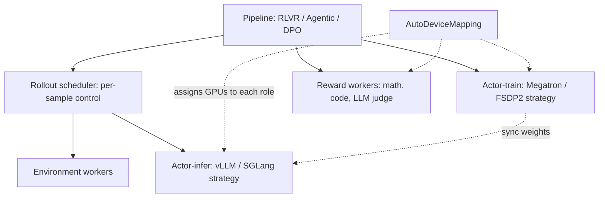
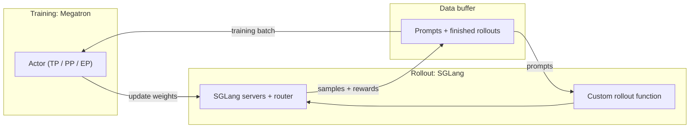
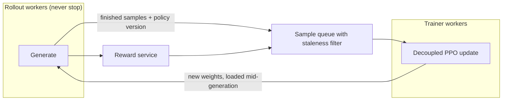

Pick TRL to get started, OpenRLHF or verl for a general Ray-based RL stack, slime or NeMo RL for Megatron-scale MoE training, ROLL for agentic RL with heavy resource orchestration, and AReaL for fully asynchronous RL; they all wire a training engine to an inference engine (vLLM/SGLang) and differ mainly in how they schedule GPUs between the two [[1]](https://github.com/verl-project/verl)[[3]](https://arxiv.org/abs/2409.19256).

## At a glance

| | verl | OpenRLHF | TRL | NeMo RL | ROLL | slime | AReaL |
|---|---|---|---|---|---|---|---|
| From | ByteDance Seed → community | OpenRLHF community | Hugging Face | NVIDIA | Alibaba | Zhipu AI / THUDM | Ant Group + Tsinghua |
| Core idea | HybridFlow dataflow | Ray + vLLM, simple and scalable | Trainer API on Transformers | Ray, Megatron/DTensor | Multi-role resource orchestration | Data buffer between SGLang and Megatron | Fully async rollout service |
| Training backend | FSDP / FSDP2 / Megatron | DeepSpeed | Accelerate (DeepSpeed / FSDP) | DTensor (FSDP2) / Megatron | FSDP2 / Megatron | Megatron | Pluggable |
| Rollout backend | vLLM / SGLang / HF | vLLM | vLLM | vLLM | vLLM / SGLang | SGLang | Separate inference service |
| Sync / Async | Both | Both | Mostly sync | Both | Both | Both | Fully async |
| Scale sweet spot | Small → very large MoE | Small → 70B class | Single node → small clusters | Large clusters | Large clusters, agents | Very large MoE | Large async training |
| Best for | General research + production | Readable PPO/GRPO stack | Learning, quick experiments | NVIDIA-stack teams | Agentic RL | Megatron-scale RL | Async RL research |

Exact feature sets move fast; check each repo's latest docs before choosing [[5]](https://github.com/OpenRLHF/OpenRLHF)[[6]](https://github.com/huggingface/trl)[[7]](https://github.com/NVIDIA-NeMo/RL)[[8]](https://github.com/alibaba/ROLL)[[9]](https://github.com/THUDM/slime)[[10]](https://github.com/inclusionAI/AReaL).

## What every framework has to solve

- **Generation is the bottleneck**: most of an RL step is spent generating, so every framework borrows a fast inference engine.
- **Two layouts for one model**: training shards weights for memory; generation wants tensor-parallel weights plus a KV cache. Switching between them costs time.
- **GPU scheduling**: either training and generation take turns on the same GPUs (colocate) or run on separate GPUs at the same time (disaggregate).

## The frameworks in detail

### verl

**What it is**: ByteDance Seed's framework, now run by the verl community, and the open-source code behind the HybridFlow paper [[3]](https://arxiv.org/abs/2409.19256). The most widely used general-purpose LLM RL framework.

**Architecture**

**The key part: one brain, many hands (HybridFlow)**

- **Single controller**: the whole RL algorithm is a short loop — generate → score → compute advantage → update. It reads like ordinary Python, so changing PPO to GRPO only touches this loop.
- **Worker groups**: each role is a group of GPU processes running the same program (SPMD). When the controller calls a role, verl splits the batch across that group's GPUs and gathers the results.
- **3D-HybridEngine**: actor and rollout share the same GPUs. After training, the same weights are re-cut from the training layout (FSDP/Megatron shards) into the inference layout (vLLM/SGLang tensor parallel) without keeping a second copy. Optimizer state is freed during generation so the KV cache has room.

**Strengths**: the widest algorithm list (PPO, GRPO, GSPO, DAPO, REINFORCE++, RLOO, Dr. GRPO); runs from one node to very large MoE; sync, colocate-async, and separate-async modes [[2]](https://verl.readthedocs.io/en/latest/).

**Watch out**: many config knobs; the async trainer and Omni/VLA support live in experimental modules.

**Use it when**: you want one framework for both research and production-scale runs.

### OpenRLHF

**What it is**: a community framework built on Ray, DeepSpeed, and vLLM, designed to be easy to read and easy to scale [[5]](https://github.com/OpenRLHF/OpenRLHF).

**Architecture**

**The key part: four models, placed by Ray**

- PPO-style RLHF needs four models: **actor** (the policy), **critic** (value estimate), **reward model**, and **reference** (to keep the policy close to where it started).
- **Ray** puts each model on its own GPUs or packs several together, so 70B-class models fit by spreading roles across nodes.
- **vLLM** does generation; after each update the actor **broadcasts weights** to the vLLM engines (NCCL), so rollouts use the new policy.
- **Hybrid engine** mode colocates everything on the same GPUs and sleeps vLLM during training to free memory.

**Strengths**: one repo for SFT, reward model, DPO, and RL (PPO, REINFORCE++, GRPO, RLOO); compact code that many research forks build on; sample packing and LoRA.

**Watch out**: built on DeepSpeed, so Megatron-style tensor/pipeline parallelism for giant MoE models isn't its focus.

**Use it when**: you want a readable PPO/GRPO stack for models up to about 70B and expect to modify the code.

### TRL

**What it is**: Hugging Face's post-training library on top of Transformers, Accelerate, and PEFT [[6]](https://github.com/huggingface/trl).

**Architecture**

**The key part: a Trainer per method**

- Every method is a **Trainer class** — `SFTTrainer`, `DPOTrainer`, `GRPOTrainer`, `RLOOTrainer`, `RewardTrainer`. You pass a model, a dataset, and (for GRPO) reward functions; the trainer runs the whole loop.
- Scaling comes from **Accelerate**, the same layer that runs normal Hugging Face fine-tuning, so DeepSpeed or FSDP configs carry over.
- Generation is the slow part, so TRL uses **vLLM** in one of two modes: **server** (a separate `trl vllm-serve` process on its own GPUs, weights pushed each step) or **colocate** (vLLM in the same process, sharing GPUs).

**Strengths**: lowest barrier to entry; works with any Hugging Face model; LoRA via PEFT; CLI (`trl sft`, `trl dpo`); excellent docs; adds new methods from papers quickly.

**Watch out**: a single Trainer loop is simpler than a Ray dataflow, so large multi-node RL with separate rollout clusters is harder to tune.

**Use it when**: learning, quick experiments, or single-node / small-cluster runs.

### NeMo RL

**What it is**: NVIDIA's open-source RL library in the NeMo family [[7]](https://github.com/NVIDIA-NeMo/RL).

**Architecture**

**The key part: two training backends behind one interface**

- The algorithm code talks to an abstract **policy worker**. Underneath, you pick **DTensor** (PyTorch-native FSDP2 + tensor parallel, quick to start, works with Hugging Face checkpoints) or **Megatron-Core** (full TP/PP/context/expert parallel for the largest models).
- **Environments** are first-class: a math verifier, a code sandbox, or a multi-turn game all plug in the same way, which makes agent training straightforward.
- After each step, weights are **refit** from the training layout into vLLM.

**Strengths**: SFT, DPO, reward models, and GRPO in one library; tuned for NVIDIA hardware; scales to large clusters with Megatron.

**Watch out**: younger and smaller community than verl or OpenRLHF; fits best if you already use NeMo/Megatron.

**Use it when**: your team trains on the NVIDIA stack and wants Megatron-scale RL with vendor support.

### ROLL

**What it is**: Alibaba's RL framework for large-scale and agentic training [[8]](https://github.com/alibaba/ROLL).

**Architecture**

**The key part: roles + strategies + AutoDeviceMapping**

- Every model is a **role** (actor-train, actor-infer, reference, critic, reward, environment). Each role picks a **strategy** — the backend that runs it (Megatron, FSDP2, vLLM, SGLang).
- **AutoDeviceMapping** reads a config that says which GPUs each role gets, so the same pipeline can run colocated on 8 GPUs or spread over hundreds without code changes.
- The **rollout scheduler** works per sample, not per batch: it can stop, retry, or route single samples to different reward workers (math checker, code sandbox, LLM judge), so slow or failed samples don't stall everyone.

**Strengths**: ready pipelines for multi-domain RLVR and agentic RL; fine-grained GPU placement; async options for throughput.

**Watch out**: smaller English-language community; the role/strategy config takes time to learn.

**Use it when**: you need agentic RL or precise control over where each role runs on a large cluster.

### slime

**What it is**: the RL framework from Zhipu AI and Tsinghua (THUDM), used to post-train the GLM-4.5 series [[9]](https://github.com/THUDM/slime).

**Architecture**

**The key part: a data buffer between Megatron and SGLang**

- Only two engines: **Megatron** trains, **SGLang** generates, joined by Ray. No backend matrix to maintain.
- The **data buffer** is the meeting point: it feeds prompts to rollout and hands finished samples to training. Because the two sides only talk through the buffer, they can run in lockstep (colocated, sync) or independently (separate GPUs, async).
- Rollout logic is a **plain Python function** you can replace — multi-turn agents, tool calls, or custom sampling go there, calling SGLang's server API.

**Strengths**: small, hackable codebase; proven on very large MoE with Megatron's full parallelism; native SGLang server features.

**Watch out**: Megatron-only training means checkpoint conversion and parallel configs — more setup than FSDP tools.

**Use it when**: you train very large MoE models with Megatron and want a lean RL loop.

### AReaL

**What it is**: a fully asynchronous RL system from Ant Group and Tsinghua IIIS [[10]](https://github.com/inclusionAI/AReaL).

**Architecture**

**The key part: generation never waits**

- **Async by design**: rollout GPUs generate nonstop; trainers update as soon as a batch is ready. No GPU waits for the slowest answer.
- **Interruptible rollout**: when new weights arrive, rollout workers load them mid-generation and keep going, so a long answer may be finished by a newer policy.
- **Staleness limit**: each sample carries the policy version that made it; samples too many versions old are dropped.
- **Decoupled PPO objective**: separates the policy that generated a sample from the one used for the trust-region check, so slightly stale data still trains stably. The paper reports up to about 2.8× faster training than synchronous systems [[11]](https://arxiv.org/abs/2505.24298).

**Strengths**: highest GPU use when answer lengths vary a lot (long reasoning, agents); AReaL-lite offers a small algorithm-first API.

**Watch out**: async RL is harder to debug and tune; loose staleness limits can hurt stability.

**Use it when**: generation time dominates your RL steps and you want fully async training.

## Key system optimizations

These ideas show up across all the frameworks. Each gets one line to remember, then what it actually does.

### Async rollout — "don't wait for the slowest one"

In sync RL, a batch finishes only when its longest answer finishes; the other GPUs sit idle. Async rollout lets finished samples move on to reward and training while long ones keep generating.

### Partial rollout — "cut the long tail, finish it next round"

Very long generations are stopped at a budget, saved, and resumed in the next step instead of blocking this one. A little less freshness for much less waiting.

### Server-based generation — "rollout as a service"

The inference engine runs as a server and the trainer calls it like an API. This fits multi-turn agents and tool calls, where one sample needs many back-and-forth generations.

### Colocate vs Separate — "share the desk or get two desks"

- **Colocate**: training and generation take turns on the same GPUs. No extra hardware, but they can't run at the same time.
- **Separate**: dedicated generation GPUs and training GPUs run in parallel. More throughput, but weights must be shipped across and data is slightly stale.

### Resource pool and placement — "seat assignment for roles"

A resource pool is a named set of GPUs. Placement decides which role (actor, critic, reference, reward) sits on which pool, and which roles share GPUs.

### Resharding — "same weights, change clothes"

The weights stay the same; only how they are cut across GPUs changes between training and generation. Doing it in place avoids a second full copy and shortens the switch.

### Weight synchronization — "send the new playbook to the players"

After each update, new weights go to the rollout engine, converted between formats (e.g. Megatron → vLLM). Faster sync means fresher rollouts and shorter pauses.

### FSDP2 / Megatron / Expert parallelism — "split big models so they fit"

FSDP2 shards parameters, gradients, and optimizer state; Megatron adds tensor and pipeline parallelism; expert parallelism spreads MoE experts across GPUs.

### Offloading, sequence packing, LoRA — "save memory three ways"

- **Offloading**: move parameters or optimizer state to CPU when not in use.
- **Sequence packing**: put several short samples into one sequence so padding doesn't waste compute.
- **LoRA**: train small adapter matrices instead of all weights.

### TransferQueue and staleness — "a conveyor belt with an expiry date"

Samples ride a queue from rollout to trainer. A staleness limit caps how many policy versions old a sample may be; older ones are dropped or down-weighted.

### Inference engine features — "borrow, don't rebuild"

CUDA Graphs, KV cache management, and continuous batching come from vLLM/SGLang; the RL framework reuses them.

## verl code map

| Path | What it does | Good PR topics |
|---|---|---|
| `verl/trainer/` | RL training loop and algorithms | Trainer correctness, scheduling |
| `verl/workers/` | Actor, rollout, model execution | Backend integration, weight sync |
| `verl/single_controller/` | Ray worker orchestration, resource pools | GPU placement, scheduling |
| `verl/experimental/` | Async training and dataflow experiments | Async pipeline, staleness, partial rollout |
| `verl/utils/` | Shared data structures and helpers | Bug fixes, performance, compatibility |
| `tests/` | Unit and integration tests | Regression tests, backend coverage |

Paths change between versions; check the main branch [[1]](https://github.com/verl-project/verl).

## Where to start contributing to verl

| Direction | Difficulty | Good first PR |
|---|---|---|
| Rollout backend compatibility fix | Low–medium | Yes |
| Async rollout edge cases | Medium | Yes |
| Resource pool scheduling bug | Medium | Yes |
| Agentic multi-turn rollout fix | Medium | Yes |
| Async trainer / TransferQueue | Medium–high | After some experience |
| FSDP2 / Megatron integration | High | With prior experience |
| Weight sync optimization | High | Not first |
| Resharding optimization | High | Not first |

Start from the [good first issues](https://github.com/verl-project/verl/labels/good%20first%20issue) and the [contribution guide](https://github.com/verl-project/verl/blob/main/CONTRIBUTING.md) [[4]](https://github.com/verl-project/verl/blob/main/CONTRIBUTING.md). For an LLM-systems path: rollout scheduling → GPU placement → weight sync → async pipeline.

## Pitfalls

- **Async ≠ free speed**: off-policy data can hurt stability; watch staleness limits.
- **Features differ by backend**: parallelism and optimizations depend on FSDP vs Megatron and vLLM vs SGLang.
- **Experimental modules move fast**: async and Omni/VLA APIs change between releases.
- **Inference speed comes from the engine**: tune vLLM/SGLang settings, not only the RL framework.
- **Comparison tables age quickly**: these projects add backends every few months.

## References

1. [verl on GitHub](https://github.com/verl-project/verl)
2. [verl documentation](https://verl.readthedocs.io/en/latest/)
3. [HybridFlow: A Flexible and Efficient RLHF Framework (arXiv 2409.19256)](https://arxiv.org/abs/2409.19256)
4. [verl contribution guide](https://github.com/verl-project/verl/blob/main/CONTRIBUTING.md)
5. [OpenRLHF on GitHub](https://github.com/OpenRLHF/OpenRLHF)
6. [TRL on GitHub](https://github.com/huggingface/trl)
7. [NeMo RL on GitHub](https://github.com/NVIDIA-NeMo/RL)
8. [ROLL on GitHub](https://github.com/alibaba/ROLL)
9. [slime on GitHub](https://github.com/THUDM/slime)
10. [AReaL on GitHub](https://github.com/inclusionAI/AReaL)
11. [AReaL: A Large-Scale Asynchronous Reinforcement Learning System for Language Reasoning (arXiv 2505.24298)](https://arxiv.org/abs/2505.24298)
