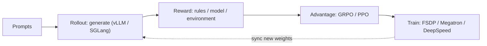
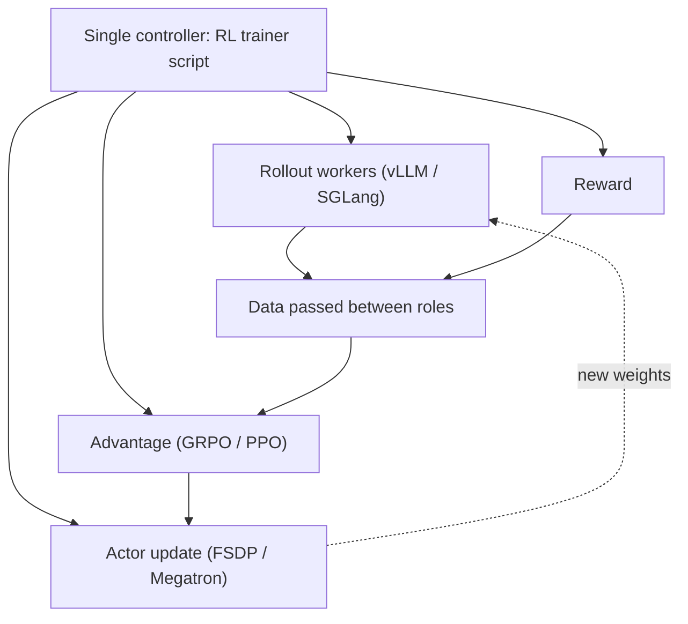
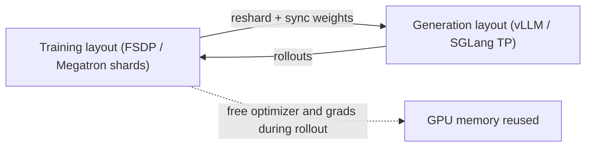

Pick TRL to get started, OpenRLHF or verl for a general Ray-based RL stack, slime or NeMo RL for Megatron-scale MoE training, ROLL for agentic RL with heavy resource orchestration, and AReaL for fully asynchronous RL; they all wire a training engine to an inference engine (vLLM/SGLang) and differ mainly in how they schedule GPUs between the two [[1]](https://github.com/verl-project/verl)[[3]](https://arxiv.org/abs/2409.19256).

## At a glance

| | verl | OpenRLHF | TRL | NeMo RL | ROLL | slime | AReaL |
|---|---|---|---|---|---|---|---|
| From | ByteDance Seed → community | OpenRLHF community | Hugging Face | NVIDIA | Alibaba | Zhipu AI / THUDM | Ant Group + Tsinghua |
| Core idea | HybridFlow dataflow | Ray + vLLM, simple and scalable | Trainer API on Transformers | Ray, Megatron/DTensor | Multi-role resource orchestration | Data buffer between SGLang and Megatron | Fully async rollout service |
| Training backend | FSDP / FSDP2 / Megatron | DeepSpeed | Accelerate (DeepSpeed / FSDP) | DTensor (FSDP2) / Megatron | FSDP2 / Megatron | Megatron | Pluggable |
| Rollout backend | vLLM / SGLang / HF | vLLM | vLLM | vLLM | vLLM / SGLang | SGLang | Separate inference service |
| Sync / Async | Both | Both | Mostly sync | Both | Both | Both | Fully async |
| Scale sweet spot | Small → very large MoE | Small → 70B class | Single node → small clusters | Large clusters | Large clusters, agents | Very large MoE | Large async training |
| Best for | General research + production | Readable PPO/GRPO stack | Learning, quick experiments | NVIDIA-stack teams | Agentic RL | Megatron-scale RL | Async RL research |

Exact feature sets move fast; check each repo's latest docs before choosing [[5]](https://github.com/OpenRLHF/OpenRLHF)[[6]](https://github.com/huggingface/trl)[[7]](https://github.com/NVIDIA-NeMo/RL)[[8]](https://github.com/alibaba/ROLL)[[9]](https://github.com/THUDM/slime)[[10]](https://github.com/inclusionAI/AReaL).

## What every framework has to solve

- **Generation is the bottleneck**: most of an RL step is spent generating, so every framework borrows a fast inference engine.
- **Two layouts for one model**: training shards weights for memory; generation wants tensor-parallel weights plus a KV cache. Switching between them costs time.
- **GPU scheduling**: either training and generation take turns on the same GPUs (colocate) or run on separate GPUs at the same time (disaggregate).

## The frameworks in detail

### verl

**What it is**: ByteDance Seed's framework, now run by the verl community, and the open-source code behind the HybridFlow paper [[3]](https://arxiv.org/abs/2409.19256). It is the most widely used general-purpose LLM RL framework.

**How it works**

- A **single controller** (one Python process) writes the RL loop; **worker groups** on many GPUs run each role.
- Training on FSDP / FSDP2 / Megatron-LM; generation on vLLM, SGLang, or HF Transformers.
- The **3D-HybridEngine** reshards weights so training and generation can share the same GPUs.
- Resource pools decide which roles share GPUs and which get their own.

**Strengths**

- Widest algorithm list: PPO, GRPO, GSPO, DAPO, REINFORCE++, RLOO, Dr. GRPO.
- Scales from one node to very large MoE models; agentic multi-turn and multimodal RL are supported.
- Sync and async modes, so you can start simple and add overlap later.

**Watch out**: many config knobs, and newer features (async trainer, Omni/VLA) live in experimental modules.

**Use it when**: you want one framework that covers research and production-scale runs. Details in the deep dive below.

### OpenRLHF

**What it is**: a community framework built on Ray, DeepSpeed, and vLLM, aimed at being easy to read and easy to scale [[5]](https://github.com/OpenRLHF/OpenRLHF).

**How it works**

- Ray places the four RLHF models — actor, critic, reward model, reference model — on separate or shared GPUs.
- **DeepSpeed ZeRO-3** trains the actor and critic; **vLLM** generates, and weights are pushed to vLLM after each update.
- A **hybrid-engine** mode colocates training and vLLM on the same GPUs to save hardware.

**Strengths**

- Full pipeline in one repo: SFT, reward model, DPO, and RL (PPO, REINFORCE++, GRPO, RLOO).
- Compact code that is easy to follow, so it is a common base for research forks and papers.
- Practical extras: sample packing, LoRA/QLoRA, and async and agent modes in newer versions.

**Watch out**: built around DeepSpeed, so Megatron-style tensor/pipeline parallelism for very large MoE models is not its focus.

**Use it when**: you want a readable PPO/GRPO stack for models up to roughly the 70B class and plan to modify the code.

### TRL

**What it is**: Hugging Face's post-training library, sitting directly on Transformers, Accelerate, and PEFT [[6]](https://github.com/huggingface/trl).

**How it works**

- Each method is a **Trainer class**: `SFTTrainer`, `DPOTrainer`, `GRPOTrainer`, `RLOOTrainer`, `RewardTrainer`, and more.
- Distributed training comes from **Accelerate** (DeepSpeed or FSDP under the hood).
- vLLM speeds up generation in two ways: **server mode** (`trl vllm-serve` on separate GPUs) or **colocate mode** (inside the training process).

**Strengths**

- Lowest barrier to entry: a GRPO run is a few lines, and it works with any Hugging Face model.
- LoRA via PEFT, a CLI (`trl sft`, `trl dpo`), and very good docs and examples.
- Fast to adopt new methods from papers.

**Watch out**: the Trainer design is simpler than a Ray-based dataflow, so very large multi-node RL with separate rollout clusters is harder to tune.

**Use it when**: learning RL for LLMs, running single-node or small-cluster experiments, or fine-tuning small and mid-size models.

### NeMo RL

**What it is**: NVIDIA's open-source RL library, part of the NeMo framework family [[7]](https://github.com/NVIDIA-NeMo/RL).

**How it works**

- **Ray** orchestrates workers; a single-controller design similar in spirit to verl.
- Two training backends: **DTensor** (PyTorch-native FSDP2 + TP) for quick start, and **Megatron-Core** for the largest models.
- **vLLM** generates; weights move from trainer to generator after each step.

**Strengths**

- Covers SFT, DPO, reward models, and GRPO in one library.
- Multi-turn environments for agent and tool-use training.
- Tuned for NVIDIA hardware and scaling to large clusters with Megatron parallelism.

**Watch out**: a younger project with a smaller community than verl or OpenRLHF; fits best if you already use NeMo or Megatron.

**Use it when**: your team trains on the NVIDIA stack and wants Megatron-scale RL with official support.

### ROLL

**What it is**: Alibaba's RL framework for large-scale and agentic training [[8]](https://github.com/alibaba/ROLL).

**How it works**

- Built around **roles** (actor, critic, reference, reward, environment) and **strategies** (the training or inference backend each role uses).
- Training on Megatron-Core or FSDP2; generation on vLLM or SGLang.
- **AutoDeviceMapping** maps each role to a set of GPUs, colocated or separate, from config.
- A **rollout scheduler** manages generation per sample, so long or failed samples don't stall the batch.

**Strengths**

- Pipelines for RLVR across many domains (math, code, general reasoning) and for agentic RL with environments.
- Flexible GPU placement for very large clusters.
- Async training options for higher throughput.

**Watch out**: documentation and community are smaller outside China; the role/strategy config takes time to learn.

**Use it when**: you need agentic RL or fine control over where each role runs across many GPUs.

### slime

**What it is**: the RL framework from Zhipu AI and Tsinghua (THUDM), used to post-train the GLM-4.5 series [[9]](https://github.com/THUDM/slime).

**How it works**

- Only two engines: **Megatron** trains, **SGLang** generates, with **Ray** connecting them.
- A **data buffer** sits in the middle: it holds prompts and finished rollouts, and both sides read and write it.
- Rollout logic is a plain function you can replace, so custom agents and multi-turn generation are easy to plug in.
- Runs either **colocated** (sync) or **disaggregated** (async, separate rollout GPUs).

**Strengths**

- Small, focused codebase — no backend matrix to maintain.
- Proven at very large MoE scale with Megatron's full parallelism.
- Uses SGLang natively, including its server-based API.

**Watch out**: Megatron-only training means more setup (checkpoint conversion, parallel configs) than FSDP-based tools.

**Use it when**: you train very large MoE models with Megatron and want a lean, hackable RL loop.

### AReaL

**What it is**: a fully asynchronous RL system from Ant Group and Tsinghua IIIS [[10]](https://github.com/inclusionAI/AReaL).

**How it works**

- Rollout workers **never stop generating**; trainers update as soon as enough samples arrive.
- **Interruptible rollout**: new weights are loaded mid-generation, so a long answer can be finished by a newer policy.
- A **staleness limit** caps how old a sample's policy version may be.
- A **decoupled PPO objective** corrects for samples generated by older policies, keeping training stable.

**Strengths**

- Highest GPU use when answer lengths vary a lot, as in long reasoning; the paper reports up to about 2.8× faster training than sync systems [[11]](https://arxiv.org/abs/2505.24298).
- **AReaL-lite** offers a smaller, algorithm-first API for research.
- Strong results on math and code reasoning and on agentic tasks.

**Watch out**: async RL is harder to debug and tune; stale data can hurt stability if the limits are loose.

**Use it when**: generation time dominates your RL steps and you want to research or exploit fully async training.

## verl deep dive

### HybridFlow: one brain, many hands

- **Single controller (MPMD)**: one process holds the RL loop — rollout → reward → advantage → policy update. It reads like plain Python.
- **Multi-controller (SPMD)**: each role is a group of GPU workers running the same program in parallel (FSDP, Megatron, vLLM, SGLang).
- **Dataflow abstraction**: the controller calls a role; verl splits data across that role's GPUs and gathers the results.

The payoff: a new algorithm is a change to the controller script, not to the distributed system [[3]](https://arxiv.org/abs/2409.19256).

### Train and generate on the same GPUs

The **3D-HybridEngine** switches roles, converts training weights into the inference engine's format, reshards across GPUs, removes duplicate weight copies, and reuses the same GPUs for both [[3]](https://arxiv.org/abs/2409.19256).

### Three ways to run

| Mode | How it runs | Trade-off |
|---|---|---|
| Sync | Generate, then train, in strict turns | Simple and on-policy; GPUs idle while waiting for the slowest sample |
| Colocate Async | Both share one GPU pool and overlap | Better use of the same GPUs |
| Separate Async | Rollout GPUs keep generating; trainer updates on another pool | Highest throughput; data is slightly off-policy |

The async path adds TransferQueue, a replay buffer, and partial rollout [[2]](https://verl.readthedocs.io/en/latest/).

## Key system optimizations

These ideas show up across all the frameworks. Each gets one line to remember, then what it actually does.

### Async rollout — "don't wait for the slowest one"

In sync RL, a batch finishes only when its longest answer finishes; the other GPUs sit idle. Async rollout lets finished samples move on to reward and training while long ones keep generating.

### Partial rollout — "cut the long tail, finish it next round"

Very long generations are stopped at a budget, saved, and resumed in the next step instead of blocking this one. A little less freshness for much less waiting.

### Server-based generation — "rollout as a service"

The inference engine runs as a server and the trainer calls it like an API. This fits multi-turn agents and tool calls, where one sample needs many back-and-forth generations.

### Colocate vs Separate — "share the desk or get two desks"

- **Colocate**: training and generation take turns on the same GPUs. No extra hardware, but they can't run at the same time.
- **Separate**: dedicated generation GPUs and training GPUs run in parallel. More throughput, but weights must be shipped across and data is slightly stale.

### Resource pool and placement — "seat assignment for roles"

A resource pool is a named set of GPUs. Placement decides which role (actor, critic, reference, reward) sits on which pool, and which roles share GPUs.

### Resharding — "same weights, change clothes"

The weights stay the same; only how they are cut across GPUs changes between training and generation. Doing it in place avoids a second full copy and shortens the switch.

### Weight synchronization — "send the new playbook to the players"

After each update, new weights go to the rollout engine, converted between formats (e.g. Megatron → vLLM). Faster sync means fresher rollouts and shorter pauses.

### FSDP2 / Megatron / Expert parallelism — "split big models so they fit"

FSDP2 shards parameters, gradients, and optimizer state; Megatron adds tensor and pipeline parallelism; expert parallelism spreads MoE experts across GPUs.

### Offloading, sequence packing, LoRA — "save memory three ways"

- **Offloading**: move parameters or optimizer state to CPU when not in use.
- **Sequence packing**: put several short samples into one sequence so padding doesn't waste compute.
- **LoRA**: train small adapter matrices instead of all weights.

### TransferQueue and staleness — "a conveyor belt with an expiry date"

Samples ride a queue from rollout to trainer. A staleness limit caps how many policy versions old a sample may be; older ones are dropped or down-weighted.

### Inference engine features — "borrow, don't rebuild"

CUDA Graphs, KV cache management, and continuous batching come from vLLM/SGLang; the RL framework reuses them.

## verl code map

| Path | What it does | Good PR topics |
|---|---|---|
| `verl/trainer/` | RL training loop and algorithms | Trainer correctness, scheduling |
| `verl/workers/` | Actor, rollout, model execution | Backend integration, weight sync |
| `verl/single_controller/` | Ray worker orchestration, resource pools | GPU placement, scheduling |
| `verl/experimental/` | Async training and dataflow experiments | Async pipeline, staleness, partial rollout |
| `verl/utils/` | Shared data structures and helpers | Bug fixes, performance, compatibility |
| `tests/` | Unit and integration tests | Regression tests, backend coverage |

Paths change between versions; check the main branch [[1]](https://github.com/verl-project/verl).

## Where to start contributing to verl

| Direction | Difficulty | Good first PR |
|---|---|---|
| Rollout backend compatibility fix | Low–medium | Yes |
| Async rollout edge cases | Medium | Yes |
| Resource pool scheduling bug | Medium | Yes |
| Agentic multi-turn rollout fix | Medium | Yes |
| Async trainer / TransferQueue | Medium–high | After some experience |
| FSDP2 / Megatron integration | High | With prior experience |
| Weight sync optimization | High | Not first |
| Resharding optimization | High | Not first |

Start from the [good first issues](https://github.com/verl-project/verl/labels/good%20first%20issue) and the [contribution guide](https://github.com/verl-project/verl/blob/main/CONTRIBUTING.md) [[4]](https://github.com/verl-project/verl/blob/main/CONTRIBUTING.md). For an LLM-systems path: rollout scheduling → GPU placement → weight sync → async pipeline.

## Pitfalls

- **Async ≠ free speed**: off-policy data can hurt stability; watch staleness limits.
- **Features differ by backend**: parallelism and optimizations depend on FSDP vs Megatron and vLLM vs SGLang.
- **Experimental modules move fast**: async and Omni/VLA APIs change between releases.
- **Inference speed comes from the engine**: tune vLLM/SGLang settings, not only the RL framework.
- **Comparison tables age quickly**: these projects add backends every few months.

## References

1. [verl on GitHub](https://github.com/verl-project/verl)
2. [verl documentation](https://verl.readthedocs.io/en/latest/)
3. [HybridFlow: A Flexible and Efficient RLHF Framework (arXiv 2409.19256)](https://arxiv.org/abs/2409.19256)
4. [verl contribution guide](https://github.com/verl-project/verl/blob/main/CONTRIBUTING.md)
5. [OpenRLHF on GitHub](https://github.com/OpenRLHF/OpenRLHF)
6. [TRL on GitHub](https://github.com/huggingface/trl)
7. [NeMo RL on GitHub](https://github.com/NVIDIA-NeMo/RL)
8. [ROLL on GitHub](https://github.com/alibaba/ROLL)
9. [slime on GitHub](https://github.com/THUDM/slime)
10. [AReaL on GitHub](https://github.com/inclusionAI/AReaL)
11. [AReaL: A Large-Scale Asynchronous Reinforcement Learning System for Language Reasoning (arXiv 2505.24298)](https://arxiv.org/abs/2505.24298)
