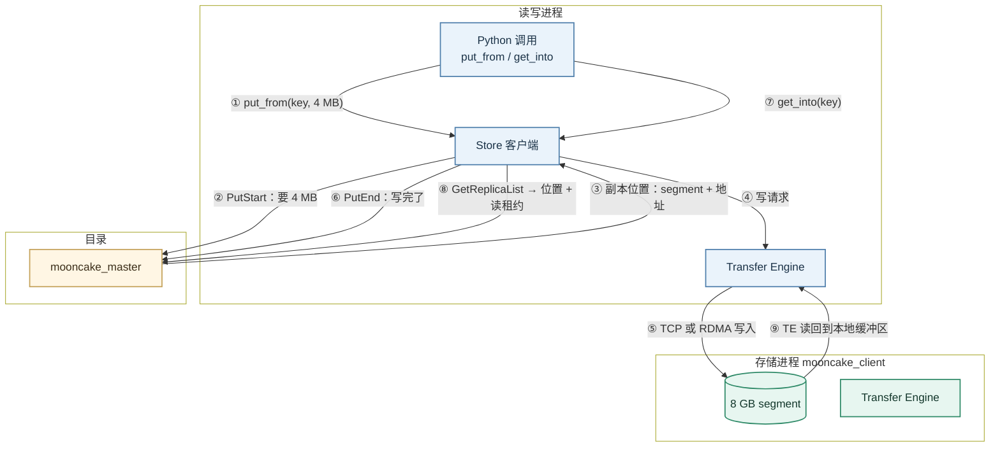
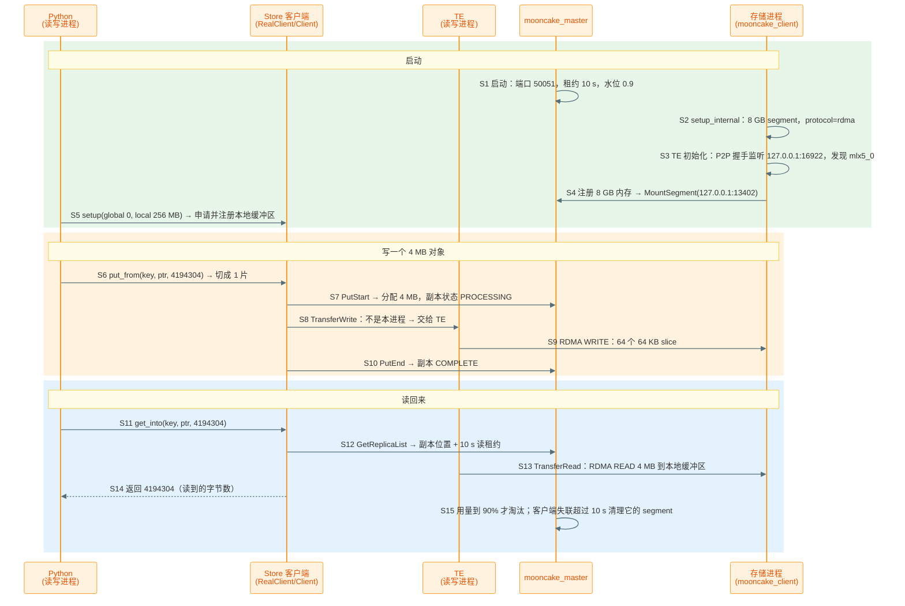

> 代码版本：`Mooncake@b19b2e97`（2026-11-07，`mooncake_master --version` 显示 0.3.14）。运行环境：ghpc005 单机，CPU 内存，一张 `mlx5_0` InfiniBand 网卡（400 Gb/s NDR），本作业分到 8 个 CPU；Mooncake 在 conda 环境 `mksrc` 里从源码编译安装。文中数值都来自本机跑通的例子，代码行号对应上述 commit。

## Mooncake Overview

Mooncake 是月之暗面开源的 KV cache 数据层，Kimi 的线上推理用它在 GPU 进程之间搬运和保存 KV cache。它不跑模型，也不调度请求：vLLM、SGLang、各家 RL 框架调用它来存、取、搬张量。

入门时先记住三个角色：

| 角色            | 代码里的名字                            | 职责                                                       |
| --------------- | --------------------------------------- | ---------------------------------------------------------- |
| 目录            | `mooncake_master`                       | 记录每个 key 存在哪、分配空间、管租约和淘汰，从不经手数据   |
| 客户端          | `MooncakeDistributedStore`（每个进程一个）| 拿出一块内存加入存储池（segment），按 key 读写             |
| 搬运            | Transfer Engine（TE），嵌在客户端进程里 | 在两块已注册的内存之间用 TCP、RDMA 等直接读写               |

关键是**数据和控制分开**：客户端先问 Master "放在哪/在哪"，拿到对方内存的地址，再由 TE 直接把字节搬过去。Master 只处理几十字节的元数据。

本例起三个进程：

| 进程 | 做什么 |
| ---- | ------ |
| `mooncake_master` | 目录服务，端口 50051 |
| `mooncake_client`（存储进程） | 拿出 8 GB 内存加入存储池，自己不读写 |
| 读写进程 | 官方的 `store_kv_bench.py` 负责写，`mooncake_probe_read.py` 负责读；自己拿出 0 字节，所以数据全部存在存储进程里，每次读写都要经过 TE |



下面解释图中 9 个步骤，数值取自后文例子：一次写 4 MB 的对象，存到存储进程的 8 GB segment 里，再读回来。

- **① put_from(key, 4 MB)**：Python 把一块已注册内存的地址和长度交给 Store 客户端，key 形如 `w0640000000000000017`。

    - `put_from`：零拷贝写。数据已经在 Store 注册过的内存里，TE 直接从这里发出，不需要先拷进 Store 的缓冲区。对应的读是 `get_into`。

    - 已注册内存：RDMA 网卡只能读写注册过的内存（注册时内核把页锁住，网卡拿到访问钥匙）。所以读写进程启动时就申请了 256 MB 的本地缓冲区并注册好。

- **② PutStart：要 4 MB**：客户端告诉 Master "我要写一个 4 MB 的对象，1 个副本"。

    - 切片：对象先按最大 16 MB 切片（`kMaxSliceSize`），4 MB 只有 1 片。

- **③ 副本位置：segment + 地址**：Master 从存储池里挑一个 segment，在里面分出 4 MB，返回副本描述：

    ```text
    segment: 127.0.0.1:13402（存储进程）
    transport_endpoint: 127.0.0.1:16922（存储进程的 TE 地址）
    buffer_address: 0x7f...（存储进程内存里的虚拟地址）
    size: 4194304
    status: PROCESSING（还没写完，别人读不到）
    ```

- **④ 写请求**：客户端看到副本不在本进程（endpoint 不同），就交给 TE，而不是直接 `memcpy`。

    - 同进程才 `memcpy`：只有副本就在本进程的内存里时才直接拷贝。同一台机器的两个进程也不行，因为对方的地址在本进程里没有意义。

- **⑤ TCP 或 RDMA 写入**：TE 按协议把数据写进存储进程的那 4 MB：

    ```text
    TCP ：整块 4 MB 走一条 socket，存储进程收下后拷进 segment
    RDMA：切成 64 个 64 KB 的 slice，作为 RDMA WRITE 投递到网卡，直接写进对方内存，对方 CPU 不参与
    ```

    - 本机实测（4 条并发通道）：4 MB 对象写入 TCP 3.31 GB/s，RDMA 21.82 GB/s。

- **⑥ PutEnd：写完了**：客户端通知 Master 传完了，Master 把副本标成 `COMPLETE`，这时别人才能读到。

    - 一次写要两次 Master RPC（PutStart、PutEnd），小对象的写入速度主要被它限制：64 KB 对象每秒只能写约 6,000 个，TCP 和 RDMA 差不多。

- **⑦ get_into(key)**：Python 给出 key 和一块已注册内存，要把对象读到这里。

- **⑧ GetReplicaList → 位置 + 读租约**：Master 返回副本位置，同时给这个对象一个 10 s 的读租约，租约期间不会被淘汰。

    - 租约：防止"刚拿到地址，对象就被淘汰、内存被别人覆盖"。默认 `default_kv_lease_ttl=10000` ms。

- **⑨ TE 读回到本地缓冲区**：TE 从存储进程的那块内存读 4 MB 到本地缓冲区。读只要一次 Master RPC，所以比写快：4 MB 对象读 TCP 5.21 GB/s，RDMA 27.82 GB/s。

<br />
<br />

## 代码在哪里

```text
Mooncake/
├── mooncake-store/
│   ├── src/master.cpp                    # mooncake_master 入口和所有 --flag
│   ├── src/master_service.cpp            # MountSegment、PutStart、PutEnd、GetReplicaList、淘汰
│   ├── src/real_client_main.cpp          # mooncake_client（只出内存的存储进程）
│   ├── src/real_client.cpp               # Python 绑定背后的 RealClient：setup、put_from、get_into
│   ├── src/client_service.cpp            # Client：Put、Get、MountSegment
│   ├── src/transfer_task.cpp             # TransferSubmitter：选 memcpy 还是 TE
│   ├── src/client_buffer.cpp             # 切片
│   └── benchmarks/store_kv_bench.py      # 官方端到端压测
├── mooncake-integration/store/store_py.cpp   # pybind11：MooncakeDistributedStore
├── mooncake-transfer-engine/
│   ├── src/transfer_engine_impl.cpp      # TE 初始化、P2P 握手
│   └── src/transport/{tcp,rdma}_transport/   # 各协议的实现
├── mooncake-wheel/、python/              # Python 包
└── docs/source/                          # 文档
```

<br />
<br />

## 安装

### 更新代码

`origin` 是自己的 fork，最新代码在官方仓库，所以先把官方仓库加成 `upstream`：

```bash
git remote add upstream https://github.com/kvcache-ai/Mooncake.git   # 只需第一次
git fetch upstream
git checkout main
git rebase --autostash upstream/main        # 未提交的改动自动收起，做完再放回
git submodule update --init --recursive     # extern/pybind11
```

- `--autostash`：有未提交的改动时，rebase 会拒绝执行；加上它就自动 stash 和 pop。

### 安装

只用、不改代码时，装 PyPI 的 wheel 就够了：

```bash
pip install mooncake-transfer-engine          # CUDA ≤ 12.9
pip install mooncake-transfer-engine-cuda13   # CUDA 13
```

要改代码就从源码装。官方流程是 `sudo bash dependencies.sh` 装系统包，再 `cmake .. && make -j && sudo make install`。本机没有 sudo，把 `dependencies.sh` 里的每个系统包换成 conda-forge 的包，装进 conda 环境 `mksrc`，再用 `pip install .` 编译安装 Python 包：

```bash
# 1. 建环境（只需第一次）：编译器和全部 C++ 依赖都来自 conda-forge
conda create -y -n mksrc python=3.12 numpy pip \
    gcc=13 gxx=13 gcc_linux-64=13 gxx_linux-64=13 \
    cmake ninja ccache pkg-config make patchelf \
    rdma-core libnuma glog gflags jsoncpp libunwind libboost-devel openssl libcurl \
    yaml-cpp libhiredis liburing jemalloc msgpack-cxx zeromq cppzmq zstd asio xxhash \
    cli11 elfutils "go>=1.26=nocgo_*" rust etcd scikit-build-core pybind11 \
    aiohttp msgpack-python requests pytest pyzmq
conda activate mksrc

# 2. 编译安装 Python 包（scikit-build-core 调 CMake）
cd ~/lxy/Mooncake
CMAKE_BUILD_PARALLEL_LEVEL=8 pip install --no-build-isolation -v . \
    -Ccmake.define.USE_CUDA=ON -Ccmake.define.USE_HTTP=ON -Ccmake.define.USE_CXL=ON \
    -Ccmake.define.USE_ETCD=ON -Ccmake.define.STORE_USE_ETCD=ON -Ccmake.define.WITH_CONDUCTOR=ON \
    -Ccmake.define.CMAKE_CUDA_HOST_COMPILER=$CXX \
    -Ccmake.define.CMAKE_C_COMPILER_LAUNCHER=ccache -Ccmake.define.CMAKE_CXX_COMPILER_LAUNCHER=ccache \
    -Ccmake.define.CMAKE_CUDA_COMPILER_LAUNCHER=ccache
```

- `--no-build-isolation`：用环境里 conda 装好的 scikit-build-core 和 pybind11，不从 PyPI 下载。
- `-Ccmake.define.USE_CUDA=ON`：`pyproject.toml` 里默认 `USE_CUDA = false`，不传就装出 CPU 版。
- 构建目录固定在 `build/python/cp312-cp312-linux_x86_64`，再装一次是增量编译：这次从 `e60f941b` 更新到 `b19b2e97` 后重装用了 7 分 28 秒（8 个 CPU）。
- 装好后 `$CONDA_PREFIX/bin` 里有 `mooncake_master`、`mooncake_client`、`transfer_engine_bench`。
- conda 环境的完整配置（还要设几个环境变量，绕过几个写死路径的编译脚本）和 C++ 单测的跑法，见本机的环境搭建笔记（VoidIndex 草稿 `inference-oss-env-setup.md` 第 4 章）。

### 检查安装

```bash
mooncake_master --version
# mooncake_master version 0.3.14 (git: b19b2e97)
python -c "import mooncake.store, mooncake.engine; print(mooncake.store.__file__)"
# .../envs/mksrc/lib/python3.12/site-packages/mooncake/store/__init__.py
```

- 版本号不一致：`pip show` 显示 0.3.12.post1，这是 `pyproject.toml` 里写死的；`mooncake_master --version` 的 0.3.14 来自 git。

<br />
<br />

# 提PR

<br />
<br />

## 提 PR 流程

规则以官方的 `CONTRIBUTING.md` 和 `.github/pull_request_template.md` 为准。

### 1. 建分支

```bash
git fetch upstream
git checkout -b fix/<主题> upstream/main
```

动手前先查重：

```text
https://github.com/kvcache-ai/Mooncake/pulls?q=is%3Apr+<关键词>
```

超过 500 行的架构改动（不算 kernel、数据、配置、测试）要先开 issue 写 RFC，否则 PR 会被打上 `rfc-required`，可能不会被 review。

### 2. 测试

```bash
pip install -r requirements.txt && pre-commit install    # 只需第一次
pre-commit run --files <改动的文件>                       # clang-format、ruff、codespell、cmake-format 等
./scripts/code_format.sh --staged                         # 只格式化暂存的 C/C++ 改动

cd build && ctest -R <相关测试> --output-on-failure        # C++ 单测（先 cmake -B build ... -DBUILD_UNIT_TESTS=ON 编过）
python -m pytest <相关的 Python 测试>
```

- 改了 Store-RS：pre-commit 还会跑 `cargo fmt` 和 `cargo clippy`。
- 修复前后各跑一次：修复前失败、修复后通过，才能证明测试有效。

### 3. 提交

```bash
git add <文件>
git commit -s -m "[Store] fix lease expiry during batch get"   # -s 加 DCO 的 Signed-off-by
git push -u origin fix/<主题>
```

- 标题前缀：`[Bugfix]`、`[CI/Build]`、`[Doc]`、`[Store]`、`[TransferEngine]`、`[Integration]`、`[Conductor]`、`[P2PStore]`、`[Misc]`；历史上也常用 `[TE]`、`[TENT]`、`[EP]`、`[PG]`、`[Wheel]`。
- DCO：每个提交都要有和提交者一致的 `Signed-off-by`，DCO Check 工作流会逐个检查。`git commit -S` 的签名不能代替它。
- 忘了签：最近一次还没推送的提交用 `git commit --amend -s --no-edit` 补上。

### 4. 开 PR

目标选 `kvcache-ai/Mooncake:main`，正文照模板的各节写：

```markdown
## Description

<问题是什么、怎么修。Fixes #<issue>>

## Suggested Merge Priority

- [x] P2 — Normal

## Module

- [x] Mooncake Store (`mooncake-store`)

## Type of Change

- [x] Bug fix

## How Has This Been Tested?

**Test commands:**
<命令>

**Test results:**
- [x] Unit tests pass

## Checklist

- [x] Every commit I contribute includes my `Signed-off-by` trailer certifying the DCO
- [x] I have performed a self-review of my own code
- [x] I have formatted my code using `./scripts/code_format.sh`
- [x] I have run pre-commit on the files changed in this PR and all hooks pass
- [x] I have added tests to prove my changes are effective

## AI Assistance Disclosure

- [x] AI tools were used (specify below)
```

- 优先级：默认 P2，P0/P1 要在描述里说明影响和紧急程度，最终由维护者定。
- AI 协助：模板要求声明，提交的人要能解释和维护所有改动。
- 大小标签：按增删行数自动打 `size/S`（<100）、`size/M`、`size/L`（>1000）。

### 5. 更新 PR

**情况 1：改代码或回应 review**

```bash
git checkout fix/<主题>
# 修改代码
pre-commit run --files <改动的文件>
git add <文件>
git commit -s -m "[Store] address review comments"
git push
```

**情况 2：上游 main 更新了，需要同步或解决冲突**

```bash
git fetch upstream
git rebase upstream/main      # 保留每个提交的 Signed-off-by
git push --force-with-lease
```

- 有冲突：编辑冲突文件，`git add <文件>`，再 `git rebase --continue`。
- 想放弃：`git rebase --abort`。

<br />
<br />

## 跑通第一个例子：TCP 和 RDMA 下的 put 和 get

一台机器上起三个进程：Master、只出内存的存储进程、只读写的进程。每种对象大小（64 KB、1 MB、4 MB）各写 2 GiB、再读 5 秒，TCP 和 RDMA 各跑一遍。

### 1. 启动 Master 和存储进程

```bash
conda activate mksrc
export WITH_NVIDIA_PEERMEM=1                 # 本机是闭源驱动、没有 DMA-BUF；不设的话 TE 会把 mlx5_0 整个禁用

mooncake_master --rpc_port 50051 &           # 其余用默认值：读租约 10 s，用到 90% 开始淘汰

ARGS=(
    --host 127.0.0.1 --port 50052            # 存储进程自己的服务地址
    --metadata_server P2PHANDSHAKE           # TE 之间直接握手交换内存描述，不需要 etcd 或 HTTP 元数据服务
    --master_server_address 127.0.0.1:50051
    --protocol rdma --device_names mlx5_0    # TCP 时改成 --protocol tcp --device_names ""
    --global_segment_size "8 GB"             # 拿出 8 GB 内存加入存储池
)
mooncake_client "${ARGS[@]}" &
```

### 2. 写

用官方的 `store_kv_bench.py`，场景 `fill`：

```bash
ARGS=(
    --scenario fill                          # 只写，写多少个由 --nr-objects 定
    --io-api zcopy                           # put_from：从已注册的本地缓冲区直接发出
    --local-hostname 127.0.0.1:50071
    --metadata-server P2PHANDSHAKE
    --master-server 127.0.0.1:50051
    --protocol rdma --device-name mlx5_0
    --global-segment-size 0                  # 本进程不出内存：数据全部存在 mooncake_client 里
    --local-buffer-size $((256*1024*1024))   # 本地缓冲区 256 MB，要放得下 4 条通道 × 对象大小
    --numjobs 4                              # 4 个线程，每个同步地一个接一个写
    --nr-objects 512 --value-size 4194304    # 512 × 4 MB = 2 GiB
    --key-prefix w064 --pattern 0xab         # 内容全是 0xab，读的时候用来抽查
)
python mooncake-store/benchmarks/store_kv_bench.py "${ARGS[@]}"
```

### 3. 读

另起一个进程，用 `rl_study/scripts/mooncake_probe_read.py`：4 个线程循环 `get_into` 5 秒，每次读完抽查 3 个字节是不是 `0xab`，同时统计 loopback 网卡上实际走过的字节数。

```bash
python mooncake_probe_read.py rdma w064 512 4194304 5     # 协议、key 前缀、个数、对象大小、秒数
```

为什么读不用 `store_kv_bench.py` 的 `read_perf`：在本机，它在不加 `--verify` 时报出的读速度（TCP 最高 58 GB/s）比 loopback 上实际走过的字节多出好几倍；加上 `--verify` 后两者一致，但这时测到的是 Python 逐字节校验的速度。另起一个进程读，报的字节数和 loopback 上的一致，数据也全部正确。原因还没查清，测吞吐时最好像这样核对一下传输层的字节数。

完整脚本见 `rl_study/scripts/mooncake_ex1_sweep.sh`。

### 4. 关键配置

| 配置 | 含义 | 取值 |
| ---- | ---- | ---- |
| `--protocol` | TE 用什么传 | `tcp` / `rdma` |
| `--metadata_server` | TE 怎么找到对方的内存描述 | `P2PHANDSHAKE`（直接握手） |
| `--global_segment_size` | 这个进程拿出多少内存给存储池 | 存储进程 8 GB，读写进程 0 |
| `--local_buffer_size` | 本地缓冲区，零拷贝读写用 | 256 MB |
| `default_kv_lease_ttl` | 读租约 | 10000 ms（默认） |
| `eviction_high_watermark_ratio` / `eviction_ratio` | 用到多少开始淘汰、每次淘汰多少 | 0.9 / 0.05（默认） |

### 5. 结果分析

4 条并发通道，单位 GB/s（10^9 字节/秒），括号里是每秒完成的次数：

| 对象大小 | 写 TCP | 写 RDMA | 读 TCP | 读 RDMA |
| -------- | ------ | ------- | ------ | ------- |
| 64 KB    | 0.37（5,652 次/s） | 0.42（6,478 次/s） | 2.09（31,875 次/s） | 3.17（48,389 次/s） |
| 1 MB     | 3.44（3,282 次/s） | 10.07（9,608 次/s） | 4.29（4,093 次/s） | 24.06（22,949 次/s） |
| 4 MB     | 3.31（789 次/s）   | 21.82（5,201 次/s） | 5.21（1,242 次/s） | 27.82（6,633 次/s） |

```mermaid
xychart-beta
  x-axis ["写 64KB", "写 1MB", "写 4MB", "读 64KB", "读 1MB", "读 4MB"]
  y-axis "GB/s（TCP 和 RDMA 各一根）" 0 --> 30
  bar [0.37, 3.44, 3.31, 2.09, 4.29, 5.21]
  bar [0.42, 10.07, 21.82, 3.17, 24.06, 27.82]
```



（每组两根柱子，前一根 TCP，后一根 RDMA。）

- 小对象被 Master RPC 限制：64 KB 时 TCP 和 RDMA 几乎一样，写约 6,000 次/s、平均 0.5–0.6 ms 一次，读约 3–5 万次/s。64 KB 本身在 RDMA 上只要几微秒，时间都花在 PutStart、PutEnd（写）和 GetReplicaList（读）这几次 RPC 上。写要 2 次 RPC，读只要 1 次，所以读快得多。
- 大对象 RDMA 明显快：4 MB 写 21.82 vs 3.31 GB/s（6.6 倍），读 27.82 vs 5.21 GB/s（5.3 倍）。TCP 要经过内核协议栈，两边各拷贝一次，CPU 是瓶颈；RDMA 由网卡直接读写对方内存。
- TCP 确实走了网络栈：每写 2 GiB，loopback 网卡上多出约 4.3 GB（收发各计一次）；读 5 秒的字节数也和报出的一致。
- RDMA 走网卡内部回环：同一台机器上的 RDMA 不经过网卡的物理端口，端口计数器几乎不动；跨机时还要受 400 Gb/s（50 GB/s）链路限制。
- 测的时候另一个会话的 SGLang 正占着 2 个 CPU，TCP 的数会受影响，RDMA 基本不受影响。
- 存储池用量：Master 每 10 s 打一次，写完三种大小后是 `Mem Storage: 6.00 GB / 8.00 GB (75.0%)`，没到 90%，没有淘汰。

<br />
<br />

## 一次 put 和 get 的时序图

整个过程分成三段：

- 启动（S1–S5，只执行一次）：Master 启动；存储进程初始化 TE、注册 8 GB 内存、挂到 Master 上；读写进程初始化，申请并注册本地缓冲区。
- 写（S6–S10）：切片 → PutStart 拿到位置 → TE 写过去 → PutEnd 提交。
- 读（S11–S14）：GetReplicaList 拿到位置和租约 → TE 读回来 → 返回长度；最后是淘汰和退出。

图中编号 S1–S15 和下一节的代码一一对应。



<br />
<br />

## 代码逐步详解（带入数值）

每一步都按同样的顺序讲：**做什么 → 代码 → 带入数值 → 这一步的结果**。编号和上面的时序图一一对应。

例子的配置：

- 存储进程 `--global_segment_size "8 GB"`，读写进程 `global_segment_size=0`、`local_buffer_size=256 MB`。
- `--metadata_server P2PHANDSHAKE`，`--protocol rdma --device_names mlx5_0`（TCP 时数值单独说明）。
- 对象 4 MB，1 个内存副本，4 条通道。

### 第一阶段：启动（S1–S5，只执行一次）

#### S1: 启动 Master

**目的**：起目录服务，所有客户端都连它。

代码位置：`mooncake-store/src/master.cpp:145`、`:161`、`:163`

```cpp
DEFINE_string(default_kv_lease_ttl, kDefaultKvLeaseTtlFlagValue, ...);  // 读租约，默认 10000 ms
DEFINE_double(eviction_ratio, mooncake::DEFAULT_EVICTION_RATIO, ...);  // 每次淘汰 5%
DEFINE_double(eviction_high_watermark_ratio, ...);  // 用到 90% 开始淘汰
```

**带入数值**：启动日志：

```text
Mooncake master version: 0.3.14 (git: b19b2e97)
Master service started on port 50051, max_threads=16, metrics_port=9003, default_kv_lease_ttl=10000,
  eviction_ratio=0.05, eviction_high_watermark_ratio=0.9, enable_ha=0, client_active_ttl_sec=10, ...
```

- `enable_ha=0`：只有一个 Master，它挂了整个存储池就不可用；生产环境要开高可用。
- 9003 是指标端口，每 10 s 打一次存储池用量。

**结果**：Master 就绪，存储池是空的（`Mem Storage: 0 B / 0 B`）。

<br />

#### S2: 存储进程 setup

**目的**：`mooncake_client` 是一个只出内存、不读写的客户端，启动时按命令行参数 setup。

代码位置：`mooncake-store/src/real_client_main.cpp:24`、`:147`

```cpp
DEFINE_string(global_segment_size, "4 GB", "Size of global segment");  // 本例传 "8 GB"

auto res = client_inst->setup_internal(FLAGS_host, FLAGS_metadata_server, global_segment_size, local_buffer_size, FLAGS_protocol, FLAGS_device_names, FLAGS_master_server_address, ...);
```

**带入数值**：`global_segment_size=8589934592`，`local_buffer_size=0`（日志 `Local buffer size is 0, skip registering local memory`：它自己不读写，不需要本地缓冲区）。

**结果**：进入 TE 初始化和挂载。

<br />

#### S3: 初始化 Transfer Engine

**目的**：TE 准备好监听地址和网卡，之后别的进程才能连过来读写这块内存。

代码位置：`mooncake-transfer-engine/src/transfer_engine_impl.cpp:214`

**带入数值**：

```text
Transfer Engine RPC using P2P handshake, listening on 127.0.0.1:16922
Using specified RDMA devices: mlx5_0
Device mlx5_0 port 1 is available
[RDMA] Relaxed ordering is supported on this host
```

- `P2PHANDSHAKE`：两个 TE 第一次通信时直接握手，互相交换"我注册了哪些内存、钥匙是什么"，不需要 etcd 或 HTTP 元数据服务。
- TCP 时：`TcpTransport: listen on port 15940`、`I/O pool started with 1 thread(s)`。

**结果**：TE 在 127.0.0.1:16922 等握手。

<br />

#### S4: 注册内存，挂到 Master

**目的**：把 8 GB 内存注册给 TE（RDMA 时网卡才能直接读写），再告诉 Master "这 8 GB 归你分配"。

代码位置：`mooncake-store/src/client_service.cpp:4047`、`:4068`、`:4073`；`mooncake-store/src/master_service.cpp:1056`

```cpp
int rc = transfer_engine_->registerLocalMemory((void*)buffer, size, ...);  // RDMA：锁页，网卡拿到访问钥匙

segment.name = local_hostname_;  // 127.0.0.1:13402
segment.base = reinterpret_cast<uintptr_t>(buffer);
segment.size = size;  // 8589934592
segment.te_endpoint = transfer_engine_->getLocalIpAndPort();  // 127.0.0.1:16922，别人用它找到这个 TE

auto mount_result = master_client_.MountSegment(segment);
```

**带入数值**：

```text
存储进程：Mounting segment: 8589934592 bytes, 8589934592 of 8589934592
Master：  action=mount_segment, segment_name=127.0.0.1:13402
Master：  Mem Storage: 0 B / 8.00 GB (0.0%)
```

**结果**：存储池有 8 GB 可分配。

<br />

#### S5: 读写进程 setup

**目的**：读写进程也建一个客户端，但不出内存，只申请一块本地缓冲区用于零拷贝。

代码位置：`mooncake-integration/store/store_py.cpp:2452`

```python
store = MooncakeDistributedStore()
store.setup("127.0.0.1:50071", "P2PHANDSHAKE", 0, 256 * 1024 * 1024, "rdma", "mlx5_0", "127.0.0.1:50051")  # global 0：不出内存；local 256 MB
```

**带入数值**：`store_kv_bench.py` 从这 256 MB 里租出 4 × 4 MB = 16 MB，每条通道一块；读脚本自己申请 16 MB 再 `register_buffer`。两种方式测到的读速度一样（TCP 3.5–4.1 GB/s）。

**结果**：两个客户端都就绪。

### 第二阶段：写（S6–S10）

<br />

#### S6: put_from，切片

**目的**：把用户给的内存切成 Store 能处理的片。

代码位置：`mooncake-integration/store/store_py.cpp:3166`、`mooncake-store/src/real_client.cpp:5778`、`mooncake-store/src/client_buffer.cpp:131`

```cpp
std::vector<mooncake::Slice> slices = split_into_slices(buffer, size);  // 每片最多 kMaxSliceSize
auto put_result = client_->Put(key, slices, config);
const static uint64_t kMaxSliceSize = facebook::cachelib::Slab::kSize - 16;  // kSize = 1 << 24，即 16 MB - 16 字节
```

**带入数值**：4194304 < 16777200，1 片。

**结果**：`slices = [{ptr, 4194304}]`。

<br />

#### S7: PutStart

**目的**：向 Master 要空间。

代码位置：`mooncake-store/src/client_service.cpp:2100`；`mooncake-store/src/master_service.cpp:5380`、`:5192`

```cpp
auto start_result = master_client_.PutStart(key, slice_lengths, client_cfg);  // slice_lengths = [4194304]，1 个副本
// Master 端：同名对象已经写完 → OBJECT_ALREADY_EXISTS；否则分配并插入元数据
return AllocateAndInsertMetadata(accessor, client_id, slice_length, config, ...);  // 在某个 segment 里分出 4 MB
```

**带入数值**：存储池只有存储进程这一个 segment，所以 4 MB 一定分在 `127.0.0.1:13402` 里；返回的副本描述带着它的 TE 地址 `127.0.0.1:16922` 和分到的内存地址，状态是 `PROCESSING`。

**结果**：客户端知道了"往哪写"。

<br />

#### S8: 选 memcpy 还是 TE

**目的**：副本在本进程就直接拷贝，否则交给 TE。

代码位置：`mooncake-store/src/client_service.cpp:2151`；`mooncake-store/src/transfer_task.cpp:1111`、`:2056`、`:1822`

```cpp
TransferStrategy strategy = selectStrategy(handle, slices);  // 比较副本的 endpoint 和本进程的 endpoint

bool TransferSubmitter::canUseLocalMemcpy(const std::string& endpoint) const {
    return memcpy_enabled_ && (isSameProcessEndpoint(endpoint, local_hostname_) || isSameProcessEndpoint(endpoint, local_endpoint_));  // 同一台机器不够，必须是同一个进程
}
seg = engine_.openSegment(handle.transport_endpoint_);  // 第一次时和对方 TE 握手
request.opcode = op_code;  // WRITE
request.source = static_cast<char*>(slice.ptr);  // 本地 4 MB
request.target_id = seg;
request.target_offset = base_address + offset;  // 对方内存里的地址
request.length = slice.size;
return submitTransfer(requests, intent);
```

**带入数值**：副本 endpoint `127.0.0.1:16922` 不是本进程 → `TRANSFER_ENGINE`。这正是例子里让读写进程不出内存的原因：否则大部分对象会分在自己的 segment 里，走 `memcpy`，测不到 TE。

**结果**：1 个 `TransferRequest` 交给 TE。

<br />

#### S9: TE 写到对方内存

**目的**：按协议把 4 MB 写过去。

代码位置：`mooncake-transfer-engine/src/transport/rdma_transport/rdma_transport.cpp:1225`、`:1241`；`mooncake-transfer-engine/src/transport/tcp_transport/tcp_transport.cpp:581`

```cpp
const size_t kBlockSize = globalConfig().slice_size;  // 默认 65536，可用 MC_SLICE_SIZE 改
for (uint64_t offset = 0; offset < request.length;) {
    size_t slice_length = slice_calc.calculate(offset);  // 每个 slice 最多 64 KB
    slice->source_addr = (char *)request.source + offset;
    ...  // 选网卡和 QP，投递 RDMA WRITE
}
```

**带入数值**：

- RDMA：4194304 / 65536 = 64 个 slice；4 条通道下 4 MB 写平均 0.75 ms 一次，21.82 GB/s。
- TCP：一个请求一个 slice，经 socket 发过去，存储进程收下后拷进 segment；平均 5.06 ms 一次，3.31 GB/s。每写 2 GiB，loopback 上多出约 4.3 GB。

**结果**：数据已经在存储进程的内存里，但 Master 还认为它没写完。

<br />

#### S10: PutEnd

**目的**：通知 Master 写完了。

代码位置：`mooncake-store/src/client_service.cpp:2204`；`mooncake-store/src/master_service.cpp:5468`、`:5575`

```cpp
auto end_result = master_client_.PutEnd(ObjectMeta{key, object_checksum}, *finalize_decision.end_type);  // 传输失败时改走 PutRevoke，释放空间
replica.mark_complete();  // PROCESSING → COMPLETE，之后 GetReplicaList 才会返回它
```

**带入数值**：每写一个对象要 PutStart、PutEnd 两次 RPC。64 KB 对象传输本身只要几微秒，所以写速度停在约 6,000 个/s（平均 0.5–0.6 ms），TCP 和 RDMA 差不多。

**结果**：对象可读。三种大小都写完后，Master 打印 `Mem Storage: 6.00 GB / 8.00 GB (75.0%)`。

### 第三阶段：读（S11–S15）

<br />

#### S11: get_into

**目的**：把对象读进一块已注册的内存。

代码位置：`mooncake-integration/store/store_py.cpp:3058`、`mooncake-store/src/real_client.cpp:5247`、`:5229`

```cpp
int64_t RealClient::get_into(const std::string &key, void *buffer, size_t size) {
    ... get_into_range_internal(key, buffer, 0, 0, size, true, true) ...  // 从头读，size 是缓冲区容量
}

auto metadata_result = resolve_ranged_read_metadata(key);  // S12：问 Master
return execute_ranged_read(key, buffer, dst_offset, src_offset, size, metadata_result.value(), ...);  // S13：读
```

**带入数值**：`size=4194304`，读脚本每次读之前先把这块内存清零，读完抽查第 0、最后一个和一个随机位置的字节。

**结果**：进入 S12。

<br />

#### S12: GetReplicaList

**目的**：问 Master 对象在哪，同时让 Master 在读的这段时间别淘汰它。

代码位置：`mooncake-store/src/client_service.cpp:1390`；`mooncake-store/src/master_service.cpp:4727`

```cpp
auto replica_list = GetReadableReplicaDescriptors(metadata);  // 只返回 COMPLETE 的副本

metadata.GrantReadLease(std::chrono::milliseconds(default_kv_lease_ttl_));  // 10 s 内不会被淘汰

return GetReplicaListResponse(std::move(replica_list), default_kv_lease_ttl_, ...);
```

**带入数值**：副本在 `127.0.0.1:13402`，租约 10000 ms。读只要这 1 次 RPC，所以 64 KB 对象能读 3–5 万个/s，比写快 5–7 倍。

**结果**：拿到副本位置。

<br />

#### S13: TE 读回来

**目的**：把对方内存里的 4 MB 读到本地缓冲区。

代码位置：`mooncake-store/src/client_service.cpp:1609`；`mooncake-store/src/transfer_task.cpp:1877`

```cpp
err = TransferRead(replica, slices);  // 和 S8 同样选策略，op_code = READ
```

**带入数值**：

- RDMA：4 MB 读 27.82 GB/s（6,633 次/s），由网卡直接从存储进程内存读，对方 CPU 不参与。
- TCP：5.21 GB/s（1,242 次/s），loopback 上的字节数和报出的一致（5.21 vs 5.22 GB/s）。

**结果**：本地缓冲区里是 4 MB 的 `0xab`。

<br />

#### S14: 返回长度

**目的**：告诉调用方读了多少字节。

**带入数值**：返回 4194304。RDMA 4 MB 的 5 秒里共读 33,165 次，抽查全部正确；返回负数表示出错，例如 key 不存在。

**结果**：Python 拿到数据。

<br />

#### S15: 淘汰和退出

**目的**：存储池满了要腾地方；进程退出后它的内存要从池里摘掉。

**带入数值**：

- 淘汰：用量到 90% 时按近似 LRU 淘汰 5%，持有读租约的对象不会被选中；本例最多用到 75%，没有触发。
- 退出：读写进程 `close()` 时，TE 删掉自己发布的内存描述（日志 `removeSegmentDesc 127.0.0.1:16780 finish`）。进程没打招呼就消失时，Master 按 `client_active_ttl_sec=10` 判断客户端是否还活着，超时就清理它挂的 segment。

**结果**：一次 put 和 get 结束。

<br />
<br />

## 常见问题

- **为什么要单独起一个存储进程？** 读写进程自己也出内存的话，对象常常分在自己的 segment 里，Store 直接 `memcpy`，测不到 TE。
- **RDMA 网卡被禁用了？** 闭源驱动没有 DMA-BUF、也没加载 `nvidia-peermem` 时，TE 认为网卡做不了 GPU RDMA，把它整个禁用；只用 CPU 内存时设 `WITH_NVIDIA_PEERMEM=1`。
- **小对象为什么 RDMA 也不快？** 每次写要两次 Master RPC，每次读要一次，64 KB 时 RPC 比传输慢得多。用 `batch_put_from` / `batch_get_into` 把多个对象合进一次 RPC。
- **读到一半失败？** 读租约 10 s，读得比这还慢、对象又正好被淘汰时会读失败。必须保留的对象设 `with_hard_pin` 或 soft pin。
- **压测数字可信吗？** 本机 `store_kv_bench.py read_perf` 不加 `--verify` 时报出的读速度高于传输层实际的字节数，用 loopback 或网卡计数器核对一下再下结论。

<br />
<br />

## 后续

1. 两台机器各起一个进程，测跨机 RDMA，看能否接近 400 Gb/s。
2. 试 `batch_put_from` / `batch_get_into`，看小对象的吞吐能提高多少。
3. 在 RL 里用：NeMo RL 打开 `data_plane.enabled=true` 并选 `backend: mooncake_cpu`，rollout 数据就存进 Mooncake Store，见 [NeMo RL 入门笔记](09_nemo-rl.md)。
4. 和 vLLM、SGLang 配合做 KV cache 共享，见 [Dynamo 入门笔记](10_dynamo.md) 里的 KV 路由部分。