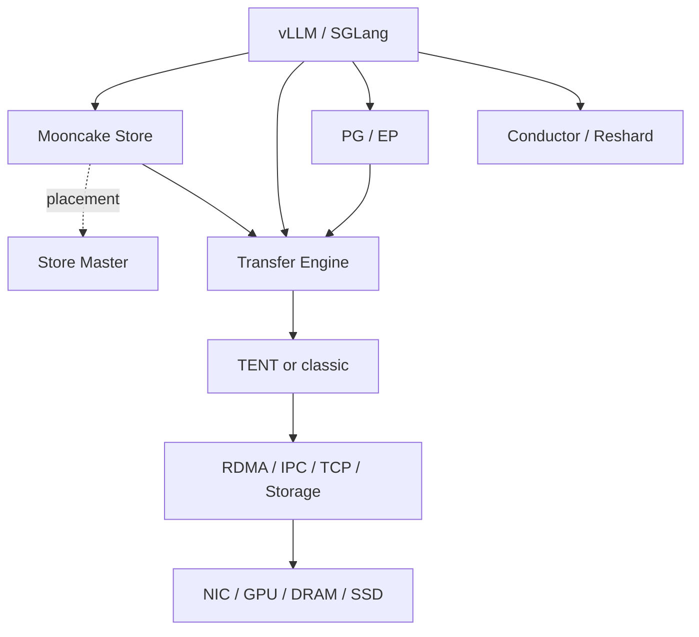

Mooncake 不是一个单独的传输库，而是一组把对象管理、点对点传输、弹性通信、缓存路由和权重重分片组合起来的推理基础设施。

## 要点

- **Transfer Engine（TE）**是数据面：注册本地 DRAM/VRAM，打开远端 Segment，异步执行 READ/WRITE。
- **Mooncake Store**是对象层：Master 负责放置、租约和副本，Client 通过 TE 在节点间直接搬运对象数据；Master 不转发 payload。[[1]](https://kvcache-ai.github.io/Mooncake/design/architecture.html)
- **TENT**是新一代 TE runtime：动态选择 transport、切片调度、采集 telemetry，并在路径失败时重试或切换 backend。[[2]](https://kvcache-ai.github.io/Mooncake/design/tent/overview.html)
- **Mooncake PG/EP**解决弹性 collective、P2P 和 MoE token dispatch/combine；**Conductor**维护全局前缀缓存索引；**Reshard**把 TP/PP/EP/DP 放置差异变成可执行的数据搬运计划。
- 控制面传递位置、拓扑、租约、成员和索引；大块 Tensor、KV Cache 与权重由数据面在拥有 Buffer 的进程之间直接传输。
- 本文的“每个接口”指架构图中各模块的**公开接口与 transport 插件契约**；绑定层中的重载和等价别名合并说明，私有 helper 不单独列出。

## 模块选择

| 需求 | 应使用的模块 | 不负责什么 |
| --- | --- | --- |
| 已知源/目标地址，直接搬数据 | Transfer Engine | 对象命名、副本和淘汰 |
| 按 key 存取 KV Cache、权重或 Tensor | Mooncake Store | 模型计算和请求调度 |
| `torch.distributed` collective/P2P | Mooncake PG | KV 对象生命周期 |
| MoE token dispatch/combine | Mooncake EP | 通用对象存储 |
| 根据缓存命中选择实例 | Conductor | 搬运 KV payload |
| TP/PP/EP/DP 间权重重排 | Reshard | 底层网络传输；执行时仍依赖 Store/TE |

## 总体架构


### 应用层

应用层决定“为什么移动数据”，Mooncake 负责“数据放在哪里、怎样可靠高效地移动”。这一层不需要直接了解 QP、CUDA IPC handle 或 Segment metadata。

| 方框 | 具体解释 |
| --- | --- |
| **推理、训练与数据系统** | 图中最上方的总入口，代表 vLLM、SGLang、TensorRT-LLM、LMCache、FastDeploy、强化学习训练和自定义服务。它们产生 KV Cache、hidden states、模型权重和 MoE token，并根据需求选择 Store、直接 TE、PG/EP 或 Conductor/Reshard。 |
| **vLLM / SGLang 等推理引擎** | 推理引擎负责模型执行、请求调度和 GPU Tensor 生命周期。Mooncake 通常以 Connector、Store backend 或通信 backend 的形式嵌入其中，不替代模型 scheduler。 |

### 接口层

接口层是业务代码可直接调用的公开入口。同一份数据可以按“对象”交给 Store，也可以按“地址范围”交给 TE；两者抽象层级不同。

| 方框 | 具体解释 |
| --- | --- |
| **Mooncake Store API** | 按 key 管理 KV Cache、权重或普通对象，提供 `Put/Get/Upsert/Remove`、批量、零拷贝和 Tensor 接口。调用者描述“哪个对象”，Store 决定对象副本放在哪些 Segment，并调用 TE 传输各 slice。 |
| **Transfer Engine API** | 按本地指针、远端 Segment、远端 offset 和长度执行 READ/WRITE。调用者必须自己注册 Buffer、打开远端 Segment、管理 Batch 和等待完成；它不管理对象 key、副本数和淘汰策略。 |
| **Mooncake PG / EP** | PG 是 `torch.distributed` backend，提供 collective、P2P 和动态成员；EP 提供 MoE dispatch/combine。两者的控制面管理 rank，实际 payload 可以复用 TE 或设备侧 transport。 |
| **Conductor / Reshard** | Conductor 查询“哪个实例已经缓存最长前缀”，帮助 router 选实例；Reshard 计算 TP/PP/EP/DP 放置变化产生的逻辑搬运区域。Conductor 不搬 payload，Reshard 规划后仍由 Store/TE 执行。 |

### Store 控制面

Store 把控制决策和数据搬运分开：Master 决定放置，Client 直接互传数据，避免大对象经过中心服务。

| 方框 | 具体解释 |
| --- | --- |
| **Mooncake Store** | Store 的整体边界，包含 Client、Master 协议、内存/磁盘 backend 和对象生命周期。它把多个 Client 贡献的 DRAM、VRAM、SSD 等资源组成一个分布式对象池。 |
| **Store Client** | 同时有两种角色：向上接受 Put/Get 请求；向下贡献本机 Segment 并执行其他 Client 发来的读写。它把对象切成 slices、获取副本描述、提交 TE 请求，并在传输结束后向 Master commit 或 revoke。 |
| **Master Service** | Store 的中心控制面，维护对象目录、Segment 成员、副本、租约、配额、放置、淘汰和异步复制任务。它返回 Buffer/副本描述符，但不接收或转发对象字节。 |
| **Store Client ↔ Master RPC** | 图中的虚线表示控制信息，例如申请空间、查询副本、提交对象、心跳和租约。一次 Put 通常先预留目标，再直接传数据，最后 commit。 |

### 元数据控制面

TE metadata 描述“怎样找到并访问一块 Buffer”，它与 Store Master 的“对象放在哪里”是两套不同的控制信息。

| 方框 | 具体解释 |
| --- | --- |
| **元数据、发现与拓扑** | 保存 Segment、Buffer、endpoint、设备位置和拓扑。TE 用它把远端名称解析为 Segment ID，并选择适合源/目标内存的 NIC 或本地 GPU 路径。 |
| **etcd / Redis / HTTP** | 集中式 metadata backend。进程发布自己的 Segment 和 endpoint，peer 在第一次打开或缓存刷新时查询。它们只存描述信息，不存 Tensor payload。 |
| **P2PHANDSHAKE** | 去中心化发现方式，由两个进程在连接握手时交换 Segment/endpoint 信息，因此可以不部署独立 TE metadata 服务。使用 Store 时仍然需要 Store Master。 |
| **CPU / NUMA / GPU / NIC 拓扑** | 描述 Buffer 与 CPU socket、GPU 和网卡的亲和关系。RDMA 用它选择近端 NIC，TENT 还会把拓扑作为 transport selection 和 staged path 的输入。 |
| **09：时间戳编码位置** | Segment 描述符编码会生成 timestamp；旧代码使用共享静态状态的 `std::localtime()`，多线程编码时产生数据竞争。它属于 metadata/common utility 问题，不是数据面的传输错误。 |

### 其他控制服务

这些服务管理“谁参与”和“请求发给谁”，不会取代 TE 的数据路径。

| 方框 | 具体解释 |
| --- | --- |
| **其他控制服务** | 图中 PG Coordinator 和 Conductor 的逻辑分组。它们服务于不同场景：前者管理通信成员，后者管理缓存索引。 |
| **PG Coordinator** | 当前由 global rank 0 承担，汇总 Agent 会话、链路观察和 GroupView，维护 rank 的 `Offline/Synced/Healthy` 以及 group member 状态。它决定 activate/deactivate，但 collective payload 不经过它。 |
| **PG Agents** | 每个进程的本地控制代理，向 Coordinator 报告健康和连通性，接收并应用新的 GroupView。图中未单独画框，但属于 PG Coordinator 控制链。 |
| **Conductor** | 订阅 vLLM、SGLang 和 Store 的 stored/removed/cleared 事件，建立跨 device、host、disk tier 的全局前缀表。Router 通过 query 获取各实例最长匹配 token 数。 |

### 数据面入口

数据面方框都嵌入实际拥有或消费 Buffer 的进程。控制服务给出描述后，源进程和目标进程的 TE 直接建立数据路径。

| 方框 | 具体解释 |
| --- | --- |
| **每个进程内嵌的 Transfer Engine** | 每个参与者注册本地 Buffer，并拥有本地 worker、transport 和连接状态。远端进程运行对称的 TE；图只画了一侧实现，箭头代表两侧之间的直接 payload 路径。 |
| **`mooncake::TransferEngine` 兼容入口** | 对上保持一套 C++/Python API，对内根据 `MC_USE_TENT` 或 `MC_USE_TEV1` 选择 TENT，否则选择 classic。它还完成 classic `TransferRequest` 与 TENT `Request` 的类型转换。 |
| **Store 的 TENT 原生直连** | Store 检测到 TENT 后可取得 `tent::TransferEngine`，直接创建 TENT Request，省掉兼容层转换。准确调用链是 `Store → tent::TransferEngine → tent::TransferEngineImpl`，不是直接持有 Impl。 |
| **Store 的 classic/兼容入口** | 未启用 TENT 时，Store 通过统一的 `mooncake::TransferEngine` 分配 Batch 并提交 classic `TransferRequest`。 |

### TENT 数据面

TENT 的核心变化是应用只描述“搬什么”，runtime 决定“走哪条 transport/path”，并可随运行状态改变决定。

| 方框 | 具体解释 |
| --- | --- |
| **TENT（Transfer Engine NEXT）** | 新一代声明式数据移动 runtime，面向异构互联、动态拓扑和局部失败。它把 transport 选择、分片、调度和 failover 集中到 runtime。 |
| **`tent::TransferEngine`** | 原生 façade，暴露 `openSegment`、`allocateBatch`、`submitTransfer`、`getTransferStatus` 和 `freeBatch` 等接口。它只做 API 与生命周期封装，实际工作交给 Impl。 |
| **`tent::TransferEngineImpl Runtime`** | TENT 核心实现：解析本地/远端内存位置，调用 TransportSelector，构造直接或 staged plan，把大请求切成 slices，安排 worker，并聚合 task 状态。 |
| **TransportSelector** | 根据 source/target memory pattern、可用 backend、拓扑、配置 policy 和 `transport_hint` 生成候选 transport。第一个候选同步拒绝时，runtime 可以尝试后续候选。 |
| **分片/调度** | 大请求被拆成细粒度 slice；多个 NIC/rail 可并行工作。调度器依据队列和完成时间等 telemetry，减少慢路径对尾延迟的影响。 |
| **QoS / Deadline** | 利用 priority、intent 和 deadline 控制排队与资源分配，区分前台 GET、后台 prefetch、migration 等流量。 |
| **Telemetry / Failover / Worker** | Worker 推进请求，telemetry 记录路径表现；路径失败后暂停或降低使用，slice 可在同 transport 的其他 rail 或其他 backend 上重试。 |
| **TENT RDMA Transport（01）** | 通过 RNIC 执行跨节点 DRAM/VRAM 传输，内部包含 endpoint、QP、CQ、worker 和 RailMonitor。01 问题发生在握手失败未计入 rail failure，导致坏网卡对每次都被重试。 |
| **TENT NVLink / IPC（02）** | 同机进程通过 CUDA IPC 打开对端显存，并用 CUDA stream/P2P 拷贝。02 问题是 mapping 按调用线程当前 GPU 打开且缓存不含本地设备，导致 GPU2 数据可能绕 GPU0。 |
| **TENT TCP / SHM** | TCP 是通用跨节点 fallback；SHM 是同机 DRAM 的 mmap/memcpy 路径。它们可作为直接 transport，也可参与 staged transfer。 |
| **TENT GDS / XPU / 其他** | GDS 面向 GPU 与 NVMe/storage 的直接 I/O；XPU 和其他插件适配不同 accelerator/runtime。具体能力由 `capabilities()` 声明。 |

### Classic 数据面

classic 以 MultiTransport 为中心，把统一请求分派给已安装 transport；相比 TENT，它的 backend 选择和动态调度能力更分散在各实现中。

| 方框 | 具体解释 |
| --- | --- |
| **classic Transfer Engine** | 原始 TE runtime，继续提供成熟的 RDMA、TCP、NVLink、EFA、HIP、SHM、NVMe-oF 等实现。未设置 TENT 环境变量时兼容入口进入这里。 |
| **`TransferEngineImpl`** | 管理初始化、Batch、Segment、通知、状态和析构生命周期，并把传输交给 MultiTransport。06 的析构竞争发生在它与 MultiTransport 延迟清理线程之间。 |
| **`MultiTransport`** | 持有多个 classic transport，把请求按能力拆分和分发，执行 fallback，并管理 deferred batch cleanup。它不是硬件驱动，而是 transport 编排层。 |
| **classic RDMA** | 使用 topology priority matrix、endpoint pool、multi-NIC slice 和 retry 执行 RDMA。它和 TENT RDMA 是不同代码实现。 |
| **classic Nvlink / IPC（03）** | 同机 CUDA IPC 路径。03 与 02 根因同类，但发生在 classic `NvlinkTransport::relocateSharedMemoryAddress()` 和 `remap_entries_`。 |
| **classic TCP / SHM** | TCP 处理通用 host 网络传输，SHM 优化同主机、同 UID 且共享 `/dev/shm` 的 DRAM Buffer。 |
| **classic EFA / HIP / 其他** | EFA 服务 AWS 网络，HIP 服务 AMD GPU IPC；还可编译 Ascend、CXL、MUSA、MACA 等平台 transport。 |

### 运行库层

这一层把 Mooncake 的 transport 请求翻译为操作系统、GPU runtime 或设备 API。它们不是 Mooncake 调度器，但其上下文和错误语义直接影响正确性。

| 方框 | 具体解释 |
| --- | --- |
| **libibverbs / RDMA Runtime** | 提供 MR、QP、CQ、WR、completion 等 verbs。Mooncake 负责选择 rail 和管理生命周期，libibverbs 负责向 RNIC 提交工作。 |
| **CUDA Runtime / Driver** | 提供 `cudaIpcOpenMemHandle`、P2P、stream、event 和 memcpy。CUDA 当前设备是 CPU 线程状态，而显存指针所属设备是 allocation 属性，两者不能混为一谈。 |
| **Socket / POSIX SHM** | Socket 支撑 TCP 控制/数据流；POSIX SHM 通过共享对象和 mmap 完成同机传输。SHM 路径要求两个进程看到同一个共享内存命名空间。 |
| **Storage I/O Runtime** | 包括 NVMe-oF、cuFile/GDS 和 Store storage backend，把内存传输扩展到 SSD、远端块存储或对象存储。 |
| **异构加速器与网络 Runtime** | 对接 EFA、ROCm/HIP、Ascend、MUSA、Intel XPU、CXL 等 API，使上层仍使用统一 Segment/Request 模型。 |

### 硬件层

硬件层决定可达到的实际路径和带宽；transport 名称只表示软件协议，不保证机器上存在某种物理互联。

| 方框 | 具体解释 |
| --- | --- |
| **RDMA NIC / Fabric** | InfiniBand、RoCE 或 EFA 等网络设备。多 NIC 时，拓扑和 rail 调度决定是否跨 NUMA、是否聚合带宽以及故障时如何切换。 |
| **GPU / VRAM** | 保存 KV Cache、Tensor 和权重。同机 GPU 之间可能走 NVLink，也可能只有 PCIe P2P；跨节点可通过 GPUDirect RDMA。 |
| **CPU / DRAM** | 提供 host Buffer、staging、page cache 和 Store 内存池。NUMA 位置影响 NIC 亲和性和跨 socket 成本。 |
| **SSD / NVMe / 对象存储** | 扩展 Store 容量和持久性，可作为本地冷层、NVMe-oF、DFS 或对象 backend。延迟高于内存层，因此通常配合 prefetch/replication。 |
| **其他 Accelerator / Interconnect** | AMD、Ascend、Intel XPU、MUSA、CXL 和专用互联。Mooncake 通过平台 loader 与 transport plugin 隔离上层接口差异。 |



一次 Store `Put` 的关键路径如下：

1. Client 向 Master 请求对象放置，Master 返回目标 Segment、offset 和副本描述。
2. Client 把对象切成 slices，转换为 TE 的 `TransferRequest`。
3. TE 根据本地/远端内存位置、拓扑和配置选择 TENT 或 classic 数据路径。
4. transport 通过 RDMA、CUDA IPC、TCP、SHM 或存储 I/O 直接写入目标 Client 的 Buffer。
5. Client 向 Master 提交完成状态，对象才从预留状态进入可读状态。

## 核心概念

| 概念 | 含义 | 常见误解 |
| --- | --- | --- |
| Segment | 一个进程对外暴露的逻辑地址空间；RAM Segment 可包含多块不连续 Buffer | 不是一块必须连续的物理内存 |
| Buffer | 已注册的连续 DRAM/VRAM 地址范围 | 注册不会复制数据，只建立传输元数据和硬件资源 |
| Segment ID/Handle | 本进程引用远端 Segment 的标识 | 不是 GPU 编号，也不是对象 key |
| Batch | 一组异步 transfer task 的生命周期容器 | `submit` 成功不等于传输已完成 |
| READ | 远端 Buffer → 本地 Buffer | `request.source` 在兼容接口里仍表示本地地址字段，需看 opcode |
| WRITE | 本地 Buffer → 远端 Buffer | 远端虚拟地址必须落在已发布 Buffer 中 |
| Metadata | Segment、Buffer、endpoint、拓扑等控制信息 | metadata service 不承载实际 payload |
| Transport | 执行特定数据路径的插件 | `NvlinkTransport` 也可能实际走 PCIe P2P，不保证有物理 NVLink |

## TE 生命周期

TE 的标准顺序是：初始化 → 注册本地内存 → 打开远端 Segment → 分配 Batch → 提交 → 轮询 → 释放 Batch → 关闭 Segment → 注销内存。公开 C++ 类定义以当前 `TransferEngine` 头文件为准。[[3]](https://github.com/kvcache-ai/Mooncake/blob/main/mooncake-transfer-engine/include/transfer_engine.h)

### 初始化接口

| 接口 | 作用 | 关键约束 |
| --- | --- | --- |
| `TransferEngine(auto_discover)` | 创建兼容入口 | `MC_USE_TENT`/`MC_USE_TEV1` 决定内部 backend |
| `init(...)` | 初始化 metadata、RPC、拓扑和 transport | `local_server_name` 必须在集群内唯一 |
| `freeEngine()` | 主动停止引擎 | 正常情况下析构函数也会清理；不要与在途任务竞态调用 |
| `installTransport(proto, args)` | classic 模式动态安装 transport | 只安装编译时可用的 backend |
| `uninstallTransport(proto)` | 卸载 transport | 必须保证不再有依赖它的在途任务 |
| `isUsingTent()` | 查询当前是否使用 TENT | 仅用于能力分支，不应改变业务语义 |
| `getTentEngine()` | 取得原生 `tent::TransferEngine` | Store 可借此绕过兼容层类型转换；classic 返回空 |
| `getMetadataConnectionString()` | 返回已生效的 metadata 连接串 | 便于复用同一个引擎初始化上层 Client |
| `enableGracefulShutdown()` | 启用平滑退出 | 退出前等待或拒绝新的不安全工作 |

### Segment 接口

| 接口 | 作用 | 关键约束 |
| --- | --- | --- |
| `openSegment(name)` | 将远端名称解析为本地 Handle | metadata 缓存可能需要显式刷新 |
| `closeSegment(handle)` | 释放本地引用 | 不会删除远端 Segment |
| `getSegmentBuffers(handle, out)` | 获取远端 Buffer 快照 | 仅返回描述，不读 payload |
| `CheckSegmentStatus(id)` | 检查 Segment/peer 状态 | 适合健康检查，不替代 transfer completion |
| `removeLocalSegment(name)` | 删除本地发布的 Segment 元数据 | 会影响新 peer 打开该 Segment |
| `syncSegmentCache(name)` | 刷新一个或全部 Segment 缓存 | peer 重启或 Buffer 变化后使用 |
| `probePeerAliveByID(id)` | 探测 peer 可达性 | 返回 `Alive`/`Unreachable`，不是传输成功保证 |

### 内存接口

| 接口 | 作用 | 关键约束 |
| --- | --- | --- |
| `registerLocalMemory(addr, len, location, remote_accessible, update_metadata)` | 注册单块 DRAM/VRAM | 内存在注销前必须持续有效；`location` 如 `cpu:0`、`cuda:2` |
| `unregisterLocalMemory(addr, update_metadata)` | 注销 Buffer | 必须先排空引用该地址的任务 |
| `registerLocalMemoryBatch(list, location)` | 批量注册 | 减少控制面开销；任一地址仍需满足生命周期要求 |
| `unregisterLocalMemoryBatch(addrs)` | 批量注销 | 调用者负责确保所有任务完成 |
| `allocateSharedMemory(len, options)` | 为 SHM transport 分配可导出的内存 | 仍需 `registerLocalMemory` 才能远端访问 |
| `freeSharedMemory(addr)` | 释放上述共享内存 | 必须先注销和排空任务 |
| `checkOverlap(addr, len)` | 检查地址是否与已注册范围重叠 | 用于注册前防止范围冲突 |
| `getBaseAddr()` | 返回引擎管理区基址 | 主要供兼容/集成层使用 |

### 传输接口

| 接口 | 作用 | 关键约束 |
| --- | --- | --- |
| `allocateBatchID(size)` | 创建最多容纳 `size` 个 task 的 Batch | 返回 `INVALID_BATCH_ID` 表示失败 |
| `submitTransfer(batch, requests)` | 异步提交 READ/WRITE 列表 | 返回 OK 只表示接收成功，不表示完成 |
| `submitTransferWithNotify(...)` | 完成传输后发送通知 | 通知和数据完成的保证依 transport 而异 |
| `getTransferStatus(batch, task, out)` | 查询单个 task | 完成后不要无限重复查询已释放 Batch |
| `getBatchTransferStatus(batch, out)` | 聚合查询整个 Batch | 用于统一等待多任务 |
| `freeBatchID(batch)` | 释放 Batch 生命周期 | `BatchCleanupDeferred` 也会使 ID 失效；Buffer 可能仍被后台清理持有 |
| `submitScatter(ranges)` | 提交分散范围并返回可等待 Operation | TENT 要求可取消的直接路径，不使用 staged route/自动 failover |
| `transferScatter(ranges)` | 同步执行 scatter | 等价于 submit 后 wait |
| `ScatterTransferOperation::wait()` | 等待 scatter 终态 | 单消费者，不要从 completion callback 内调用 |
| `ScatterTransferOperation::waitFor(timeout)` | 有超时的等待 | 超时不取消传输，Operation 和 Buffer 必须继续存活 |

`TransferRequest` 的核心字段是 `opcode`、本地地址 `source`、远端 `target_id`、远端 `target_offset` 和 `length`。一次请求必须完整落在注册范围内。

### 通知接口

| 接口 | 作用 | 关键约束 |
| --- | --- | --- |
| `getNotifies(out)` | 拉取收到的通知 | 应用层自行定义 name/message 语义 |
| `sendNotifyByID(id, msg)` | 按 Segment ID 通知 peer | RDMA 返回成功可能只表示已入 notification QP |
| `sendNotifyByName(name, msg)` | 按远端 agent 名称通知 | 内部先解析目标 |

### 诊断接口

| 接口 | 作用 |
| --- | --- |
| `getLocalIpAndPort()` / `getRpcPort()` | 获取本地控制端点 |
| `getNicLoadStats(out)` | 获取 NIC 负载统计 |
| `getTransport(proto)` | 获取已安装的 classic transport 指针 |
| `isTcpOnly()` | 判断 host transport 是否只有 TCP |
| `setAutoDiscover(...)` | 配置拓扑和设备自动发现 |
| `setWhitelistFilters(filters)` | 限制可使用设备 |
| `numContexts()` | 返回内部 transport context 数量 |
| `getLocalTopology()` / `getLocalTopologyString()` | 获取结构化拓扑或 JSON dump |
| `showLinks(json)` | 输出当前链路状态 |
| `getMetadata()` | 获取 classic metadata 对象；TENT 下不应假设存在 |
| `getOrCreateP2pTransport()` / `getOrCreateRdmaTransport()` / `getOrCreateNcclTransport()` | 供 EP 等设备侧集成复用底层 transport |

### 多协议接口

只有启用 `ENABLE_MULTI_PROTOCOL` 时才提供：

| 接口 | 作用 |
| --- | --- |
| `mp_registerLocalMemory(map)` | 为不同 protocol 注册不同 Buffer 集合 |
| `mp_unregisterLocalMemory(map)` | 批量撤销多协议注册 |
| `mp_submitTransfer(..., proto)` | 指定 protocol 提交 |
| `mp_submitTransferWithNotify(..., proto)` | 指定 protocol 并附带通知 |

## Python TE

Python API 是 C++ 生命周期的便捷包装，官方文档给出了完整签名和同步/异步语义。[[4]](https://kvcache-ai.github.io/Mooncake/api-reference/python/transfer-engine.html)

| 接口 | 作用 |
| --- | --- |
| `TransferEngine()` | 创建引擎对象 |
| `initialize(...)` / `initialize_ext(...)` | 初始化 metadata、protocol 和设备过滤 |
| `get_engine()` | 取内部引擎，供 Store 复用 |
| `get_rpc_port()` | 获取 P2P/RPC 端口 |
| `TransferNotify(name, msg)` | 构造完成通知 |
| `TransferOpcode.READ/WRITE` | 指定读写方向 |
| `allocate_managed_buffer()` / `free_managed_buffer()` | 使用绑定层管理的内存池 |
| `get_first_buffer_address(segment)` | 查询远端第一个 Buffer 地址 |
| `register_memory()` / `unregister_memory()` | 注册/注销单块本地内存 |
| `batch_register_memory()` / `batch_unregister_memory()` | 批量注册/注销 |
| `transfer_sync_write()` | 本地 → 远端同步写 |
| `transfer_sync_read()` | 远端 → 本地同步读 |
| `transfer_sync()` | 通过 opcode 统一执行同步读写，可附通知 |
| `transfer_submit_write()` | 异步提交单个写并返回 Batch ID |
| `transfer_check_status()` | 轮询异步单任务状态 |
| `transfer_write_on_cuda()` / `transfer_read_on_cuda()` | 面向 CUDA Buffer 的便捷接口 |
| `batch_transfer_sync_write()` / `batch_transfer_sync_read()` | 同步批量写/读 |
| `batch_transfer_sync()` | opcode 驱动的同步批量接口 |
| `batch_transfer_async_write()` / `batch_transfer_async_read()` | 异步批量写/读 |
| `batch_transfer_async()` | opcode 驱动的异步批量接口 |
| `get_batch_transfer_status()` | 查询整个 Batch |
| `batch_transfer_write_on_cuda()` / `batch_transfer_read_on_cuda()` | CUDA 批量便捷接口 |
| `scatter_transfer_sync_*_with_ticket()` | 同步语义但返回 drain ticket，区分失败后是否完全排空 |
| `submit_scatter_write()` / `submit_scatter_read()` | 直接提交 scatter Operation |
| `ScatterTransferTicket.drain()` | 对 completion unknown 的任务继续等待排空 |
| `write_bytes_to_buffer()` / `read_bytes_from_buffer()` | Python bytes 与原始 Buffer 间复制 |
| `get_local_topology()` | 返回本地拓扑 |
| `get_notifies()` | 拉取通知 |
| `send_probe()` | 主动探测目标 |

`transport_hint` 在 TENT 下把单次请求固定到命名 transport；classic 会忽略它。`nic_hint` 是 classic RDMA 的本地 RNIC 偏好，不是硬性绑定。

## TENT 接口

TENT 对应用仍暴露 Batch/Request，但把“如何走”从应用移入 runtime。[[2]](https://kvcache-ai.github.io/Mooncake/design/tent/overview.html)

| 层 | 主要接口 | 作用 |
| --- | --- | --- |
| façade | `tent::TransferEngine::allocateBatch/freeBatch` | 管理 Batch |
| façade | `submitTransfer(...)` | 提交声明式 Request |
| façade | `getTransferStatus(...)` | 查询 task 进度 |
| façade | `openSegment(...)` | 打开 peer Segment |
| runtime | `TransportSelector::select(...)` | 根据内存模式、拓扑和 policy 生成候选 transport |
| runtime | slicing/scheduling | 把大请求切片并按 telemetry 分配 rail/path |
| runtime | failover/retry | 当前候选失败时尝试后续候选或 staged path |
| runtime | QoS/deadline | 按 priority、intent、deadline 控制排队与资源 |

### 插件契约

每个 TENT transport 实现同一契约：

| 接口 | transport 必须保证什么 |
| --- | --- |
| `install(...)` / `uninstall()` | 建立/释放控制面、拓扑和设备资源 |
| `quiesce()` | 在 Buffer 注册表销毁前排空后台工作 |
| `capabilities()` | 声明支持的内存、操作和路径能力 |
| `allocateSubBatch()` / `freeSubBatch()` | 管理 transport 私有 Batch 状态 |
| `submitTransferTasks()` | **全有或全无**；失败时不得留下已发布前缀，否则 failover 会重复执行 |
| `getTransferStatus()` | 报告 transport task 的字节数和终态 |
| `retryTransferTask()` | 在该 transport 内重试单 task |
| `supportsCancellation()` / `cancelTransferTask()` | 最佳努力阻止尚未到设备的工作；已 post 工作仍可能完成 |
| `allocateLocalMemory()` / `freeLocalMemory()` | 按平台分配本地内存 |
| `warmupMemory()` | 注册前 pin/prefault，避免 NUMA 探测干扰 |
| `addMemoryBuffer()` / `removeMemoryBuffer()` | 创建/销毁 transport 注册资源 |
| `tracksLocalBuffer()` | 声明是否维护不发布给 peer 的本地注册 |
| `supportNotification()` / `sendNotification()` | 声明并执行通知能力 |

## Classic 接口

classic 路径是 `TransferEngineImpl → MultiTransport → Transport`：`TransferEngineImpl` 管理 Batch、通知和生命周期，`MultiTransport` 选择 backend、拆分 task、处理 fallback 与延迟清理，具体 transport 执行数据移动。

| classic `Transport` 接口 | 作用 |
| --- | --- |
| `allocateBatchID()` / `freeBatchID()` | 管理 transport Batch |
| `submitTransfer()` | 接收一组请求 |
| `submitTransferTask()` / `submitTransferTaskGroup()` | 接收 MultiTransport 拆出的 task |
| `supportsGroupedScatter()` | 声明是否保持 request 顺序执行 grouped scatter |
| `supportsBatchCompletionCounter()` | 声明 completion 是否无需前台 poll 推进 |
| `getTransferStatus()` | 查询 task |
| `OpenChannel()` / `CheckStatus()` | 建立/检查 peer channel |
| `registerLocalMemory*()` / `unregisterLocalMemory*()` | 管理 transport 注册资源 |
| `getName()` | 返回 protocol 名 |

TENT 和 classic 可以实现相同协议，但内部类不是同一个实现。例如 TENT 使用 `NVLinkTransport`，classic 使用 `NvlinkTransport`；修复一边不会自动修复另一边。

## Store 接口

Store 把“地址传输”提升为“按 key 管理对象”。Master 只做控制面，Client 之间通过 TE 搬 payload。Python facade 默认选择 C++ Store，也可在构建包含 Store-RS 时通过 `MOONCAKE_STORE_BACKEND=rs` 选择 Rust backend。[[5]](https://kvcache-ai.github.io/Mooncake/api-reference/python/mooncake-store.html)

### 生命周期接口

| 接口 | 作用 |
| --- | --- |
| `MooncakeDistributedStore()` | 创建 facade |
| `setup(...)` | 启动真实 Client，连接 Master/metadata，贡献可选全局 Segment 和本地 Buffer |
| `setup_dummy(...)` | 连接独立 Store daemon；当前 Python 进程不进入分布式控制面 |
| `close()` | 停止后台线程、注销内存并释放连接 |
| `get_hostname()` | 返回本 Client 发布的主机标识 |
| `init_all()` | 初始化集成层所需组件 |

### 对象接口

| 接口 | 作用 |
| --- | --- |
| `put(key, bytes)` | 创建新对象；key 已存在通常返回冲突 |
| `get(key)` | 读取完整对象并返回 bytes |
| `put_batch()` / `get_batch()` | 批量对象读写 |
| `upsert()` | 不存在则创建，存在则更新 |
| `upsert_batch()` | 批量 upsert |
| `remove()` / `batch_remove()` | 删除一个/多个对象 |
| `remove_by_regex()` | 按正则删除 |
| `remove_all()` | 删除当前可见范围内全部对象 |
| `is_exist()` / `batch_is_exist()` | 查询 key 是否存在 |
| `probe_key()` / `batch_probe_key()` | 返回比布尔存在性更细的路由/可读状态 |
| `get_size()` | 查询对象字节数 |
| `get_buffer()` / `batch_get_buffer()` | 读取到绑定层管理的 Buffer |
| `put_parts()` | 以多个 part 写入一个逻辑对象 |

### 零拷贝接口

| 接口 | 作用 | 生命周期要求 |
| --- | --- | --- |
| `register_buffer(ptr, size)` | 注册调用方 Buffer | 注销前地址必须有效 |
| `unregister_buffer(ptr)` | 撤销注册 | 先排空任务 |
| `put_from(key, ptr, size)` | 从注册 Buffer 写对象 | 避免 Python bytes 中间复制 |
| `get_into(key, ptr, capacity)` | 读入注册 Buffer | 返回实际字节数或错误码 |
| `get_into_ranges(...)` | 只读取对象指定 ranges | 适合局部 Tensor/权重恢复 |
| `upsert_from()` / `batch_upsert_from()` | 从注册 Buffer 更新对象 |
| `upsert_parts()` | 用多个已注册范围更新分片对象 |
| `batch_put_from()` / `batch_get_into()` | 批量单 Buffer 零拷贝 |
| `batch_put_from_multi_buffers()` / `batch_get_into_multi_buffers()` | 每个对象由多个 Buffer 组成 |
| `alloc_from_mem_pool()` | 从 Client 内存池分配已注册内存 |
| `BufferPool.acquire()/release()/close()` | 复用 setup 时已注册的临时 Buffer，减少 RDMA MR 注册抖动 |
| `MooncakeHostMemAllocator.alloc()/free()` | 分配/释放 host memory，可配 hugepage |

### 会话接口

多 Buffer ranged transfer 使用显式会话保持路由、租约和中间状态：

| 接口 | 作用 |
| --- | --- |
| `batch_get_session_start()` | 为一批 ranged GET 建立会话 |
| `batch_get_into_multi_buffer_ranges()` | 在会话内读取多个对象范围到多个 Buffer |
| `batch_get_session_end()` | 正常结束 GET 会话并释放状态 |
| `batch_put_session_start()` | 为 ranged PUT 预留对象与副本 |
| `batch_put_from_multi_buffer_ranges()` | 在会话内上传各范围 |
| `batch_put_session_end()` | 提交 PUT，使对象可读 |
| `batch_put_session_revoke()` | 失败时撤销预留和未提交对象 |

### Segment 接口

| 接口 | 作用 |
| --- | --- |
| `mount_segment()` | 把一段内存作为 Store Segment 挂载到集群 |
| `unmount_segment()` | 停止贡献该 Segment |
| `allocate_and_mount_segment()` | 分配后立即挂载 |
| `unmount_and_free_segment()` | 卸载并释放由 Store 分配的 Segment |
| `get_replica_desc()` / `batch_get_replica_desc()` | 查询对象副本位置描述 |

### 任务接口

| 接口 | 作用 |
| --- | --- |
| `create_copy_task(key, targets)` | 异步为对象创建目标副本 |
| `create_move_task(key, source, target)` | 异步迁移副本 |
| `query_task(id)` | 查询 `PENDING/PROCESSING/SUCCESS/FAILED` |

### Tensor 接口

| 接口族 | 包含的方法 | 作用 |
| --- | --- | --- |
| 普通 Tensor | `put_tensor`、`get_tensor`、`batch_put_tensor`、`batch_get_tensor`、`batch_pub_tensor` | 序列化 Tensor 元数据并存取 payload |
| TP Tensor | `put_tensor_with_tp`、`get_tensor_with_tp`、`pub_tensor_with_tp` 及 batch 版本 | 保存/恢复 Tensor Parallel 分片 |
| Upsert Tensor | `upsert_tensor`、`upsert_tensor_from`、`batch_upsert_tensor_from`、`batch_upsert_tensor`、`upsert_pub_tensor`、`batch_upsert_pub_tensor` | 更新已有 Tensor 或发布更新结果 |
| 零拷贝 Tensor | `put_tensor_from`、`batch_put_tensor_from`、`get_tensor_into` 及 TP 对应版本 | 在调用方 Tensor storage 与 Store 间直接传输 |
| 元数据发布 | `put_from_with_metadata`、`pub_tensor` | 把 payload 与 shape/dtype/并行布局等描述关联 |

### Structured 接口

Structured Object 层把一个 Python 对象拆成 manifest、Tensor payload 和普通 bytes：

| 接口/类型 | 作用 |
| --- | --- |
| `StructuredObjectStore.put/get` | 完整写入/恢复结构化对象 |
| `put_from/get_into` | 复用调用方提供的 storage |
| partial read | 只恢复选定字段或 ranges |
| bundle fallback | 在后端不支持原生 structured contract 时退化为 bundle keys |
| transfer policy | 控制副本数、并行布局和零拷贝策略 |

### 放置配置

`ReplicateConfig` 控制每次 Put/Upsert，而不是修改全局默认值：

| 字段 | 含义 |
| --- | --- |
| `replica_num` | DRAM/VRAM 内存副本数 |
| `nof_replica_num` | NoF SSD 副本数 |
| `dfs_replica_num` | DFS 副本数，当前通常为 0 或 1 |
| `soft_pin_action` / `soft_pin_ttl_ms` | 临时保护对象不被淘汰 |
| `with_hard_pin` | 永久 pin，直到显式处理 |
| `preferred_segment` | 首选存储 Segment |
| `prefer_alloc_in_same_node` | 倾向同节点放置 |
| `session_ids` / `residency_affinity_ids` / `group_ids` | 会话、驻留和对象组约束 |

### C++ 核心

C++ `Client` 的核心接口与 Python facade 对应：`Init`、`Put`、`Get`、`Upsert`、`BatchUpsert`、`Remove`、`CreateCopyTask`、`CreateMoveTask`、`QueryTask`、`QueryByRegex`、`RemoveByRegex`、`BatchQueryIp` 和 `BatchReplicaClear`。高级权重管理还提供 revision import/commit/query/list、lease acquire/renew/release、residency operation 和 delete。

Master RPC 的职责是预留 Buffer、提交/撤销对象、查询副本、维护租约、Segment 心跳和异步任务；它返回描述符，不代理数据字节。

## PG 接口

Mooncake PG 注册 `mooncake` accelerator backend 和 `mooncake-cpu` backend，并复用标准 `torch.distributed` 入口。[[6]](https://kvcache-ai.github.io/Mooncake/api-reference/python/ep-backend.html)

| 接口 | 作用 |
| --- | --- |
| `dist.init_process_group(backend="mooncake")` | 初始化 accelerator ProcessGroup |
| `dist.init_process_group(backend="mooncake-cpu")` | 初始化 CPU ProcessGroup |
| `MooncakeBackendOptions(...)` | 设置最大 group 容量、extension 模式、active-rank mirror 和失败策略 |
| `pg.set_host_ip(ip)` | 初始化前覆盖控制/数据端点 IP |
| `pg.set_device_filter(filters)` | 初始化前限制 NIC/HCA |
| `pg.set_transfer_engine(engine)` | 复用外部 TE；外部对象必须活得更久 |
| `pg.get_active_ranks(backend)` | 获取已提交的 active-rank tensor |
| `pg.get_num_synced_ranks(backend)` | 查询本地可激活 slot 数 |
| `pg.get_peer_state(backend, ranks)` | 无通信地读取本地 readiness mirror |
| `pg.activate_ranks(...)` / `recover_ranks(...)` | 向 Coordinator 提议激活 rank |
| `pg.deactivate_ranks(...)` | 提议停用 rank |
| `pg.join_group(backend)` | extension/recovery rank 声明就绪并阻塞等待激活 |
| `pg.sync_after_failure(backend)` | 上报链路观察、等待协调并应用最新 GroupView |

支持的 `torch.distributed` family 包括 `all_reduce`、`broadcast`、`all_gather`、`all_gather_into_tensor`、`reduce_scatter_tensor`、`all_to_all`、`barrier`、`reduce`、`gather`、`scatter`、`isend`、`irecv` 和 `batch_isend_irecv`。active rank 参与通信，inactive slot 保留编号但不参与。

## EP 接口

EP 通常从一个已健康初始化的 Mooncake PG 构造，数据路径依次是 dispatch → 本地 expert compute → combine。[[6]](https://kvcache-ai.github.io/Mooncake/api-reference/python/ep-backend.html)

| 接口 | 作用 | 关键约束 |
| --- | --- | --- |
| `Buffer.get_ep_buffer_size_hint(...)` | 根据最大 token、hidden、rank、expert 计算 workspace | 按峰值而不是平均负载配置 |
| `Buffer(group, bytes)` | 创建 EP Buffer | group 必须先初始化 |
| `Buffer.connect()` | 交换 MR/QP/GID/IPC handle 并选择 fast path | 集体 bootstrap，所有 rank 需一致参与 |
| `Buffer.dispatch(x, topk_idx, ...)` | 把 token 发给 expert-owner rank 并按本地 expert 打包 | 返回的 handle 必须交给匹配 combine |
| `Buffer.combine(x, handle, ...)` | 把 expert 输出送回 token owner 并按权重归并 | 不得跨请求复用 handle |
| `Buffer.get_next_combine_buffer(handle)` | 获取 zero-copy combine 目标 Buffer | 用同一 handle 调 `combine(zero_copy=True)` |
| `Buffer.update_ep_member()` | PG 成员变化后刷新 peer metadata/QP | 不会恢复已经中断的旧 operation |
| `EventOverlap.current_stream_wait()` | 让当前 stream 等待通信结果 | 使用输出前必须显式同步，或调用 recv hook |
| `Buffer.destroy()` | 集体释放 EP 资源 | 所有 rank 协调销毁最可预测 |

EP fast path 包括 inter-node IBGDA/RDMA、intra-node P2P/IPC，以及不满足条件时的 Python collective fallback。

## Conductor

Conductor 是缓存索引和查询控制面，不承载 KV payload。它订阅 vLLM、SGLang 和 Store 的 stored/removed/cleared 事件，按 model、LoRA、tenant、block size 和 hash profile 维护跨 device/host/disk tier 的前缀表。[[7]](https://kvcache-ai.github.io/Mooncake/design/conductor/index.html)

| Python/C++ Client 接口 | 作用 |
| --- | --- |
| `setup/Setup(config)` | 连接 Conductor RPC |
| `close/Close()` | 幂等关闭，可再次 setup |
| `health_check/HealthCheck()` | 探测服务可达性 |
| `query/Query(request)` | 计算 token 序列在各实例、DP rank 和 tier 的最长命中 |
| `register/Register(config)` | 注册一个 serving instance/DP rank 与 hash profile |
| `unregister/Unregister(...)` | 注销指定实例 rank |
| `get_global_view/GetGlobalView()` | 导出 context、profile、实例和 prefix 数 |
| `list_services/ListServices()` | 列出当前注册服务 |

内部 `PrefixCacheTable` 的接口是 `Register/Unregister`、`StoreEngine/RemoveEngine/ClearEngine`、`StoreShared/RemoveShared/ClearShared`、`Query` 和 `GetGlobalView`。事件是增量且可能丢失，publisher/subscriber 必须用 replay 或快照机制恢复一致视图。

## Reshard

Reshard 不直接移动字节；它先计算逻辑 N-D region，再把逻辑计划绑定到运行时 Buffer，最后由 Store/TE 执行。[[8]](https://github.com/kvcache-ai/Mooncake/blob/main/docs/source/design/mooncake-reshard/model-weight-reshard-planner.md)

| 接口 | 作用 |
| --- | --- |
| `plan_placement_transfer(source, target)` | 计算两个并行放置间的逻辑搬运区域 |
| `plan_placement_transfer_to_local_target(...)` | 只规划当前 rank 的目标区域 |
| `plan_stored_transfer_to_target_placement(manifest, target)` | 从 Store manifest 规划到运行时放置 |
| `bind_logical_transfer_plan(plan, target_bindings, ...)` | 用不可变 Buffer 快照把逻辑区域绑定为实际地址/range |
| `WeightStore.load()` | 根据计划从 Store 恢复权重 |
| `get_into_ranges(...)` adapter | 把多个逻辑 region 合并为 Store ranged read |

放置轴语义：`SplitAxis` 真正切分某维，`ReplicatedAxis` 要求每个 rank 有完整副本，`OwnershipAxis` 只决定对象归属而不改变 Tensor 几何。TP/PP/EP/DP 的差异必须先在 manifest 中表达，不能靠运行时地址猜测。

## 元数据接口

TE metadata 支持 etcd、Redis、HTTP 或 `P2PHANDSHAKE`。HTTP backend 的最小契约是：

| HTTP 接口 | 作用 |
| --- | --- |
| `GET /metadata?key=...` | 读取 Segment/endpoint 元数据 |
| `PUT /metadata?key=...` | 发布或更新元数据 |
| `DELETE /metadata?key=...` | 删除元数据 |

Store Master 与 TE metadata 是不同控制面：Master 管对象和副本，TE metadata 管可传输地址和 endpoint。使用 P2P handshake 时不需要独立 TE metadata 服务，但 Store 仍需要 Master。

## 使用示例

最短 Store 用法需要一个已运行的 `mooncake_master`；下面使用 Master 内置 HTTP metadata：

```python
from mooncake.store import MooncakeDistributedStore

store = MooncakeDistributedStore()
store.setup(
    "127.0.0.1",
    "http://127.0.0.1:8080/metadata",
    512 * 1024 * 1024,  # contributed global segment
    128 * 1024 * 1024,  # local scratch/BufferPool region
    "tcp",
    "",
    "127.0.0.1:50051",
)

store.put("kv/request-42", b"payload")
assert store.get("kv/request-42") == b"payload"
store.remove("kv/request-42")
store.close()
```

直接使用 TE 时，应用必须自己管理远端 session、地址和 Buffer 生命周期：

```python
from mooncake.engine import TransferEngine

engine = TransferEngine()
assert engine.initialize("127.0.0.1", "P2PHANDSHAKE", "tcp", "") == 0

# ptr/length 必须来自仍然存活的 ctypes、mmap、CUDA allocation 等对象。
assert engine.register_memory(ptr, length) == 0
rc = engine.transfer_sync_write(peer_session, ptr, peer_ptr, length)
assert rc == 0
assert engine.unregister_memory(ptr) == 0
```

## 常见陷阱

- **把 Store Master 当数据代理**：Master 只返回放置和租约，payload 在 Client 间直传。
- **把 submit 当完成**：异步 API 必须 poll/wait，Batch 和 Buffer 在终态前不能释放。
- **注册后提前 free**：RDMA MR、CUDA IPC mapping 和 worker 仍可能引用原地址。
- **混淆本地 GPU 与线程当前 GPU**：指针可属于 GPU2，而新 CPU 线程的 `cudaGetDevice()` 仍返回 GPU0；IPC mapping 应按本地 Buffer 设备打开并按设备缓存。
- **把远端 `cuda:N` 当本地 ordinal**：两进程的 `CUDA_VISIBLE_DEVICES` 可不同，远端编号不能直接传给本地 `cudaSetDevice()`。
- **只修 TENT 或 classic**：两条路径有不同实现和缓存，修复不能自动同步。
- **把 TENT hint 当普通偏好**：`transport_hint` 会固定单次请求路径，可能绕过正常 policy 选择。
- **忽略 scatter timeout 语义**：等待超时不会取消在途 DMA；必须保留 ticket/operation 和 Buffer 直到 drained。
- **PG rank 编号混淆**：group API 使用 in-group rank；global rank 和 group slot 不一定相同。
- **EP 成员恢复后不 refresh**：PG 激活新 rank 后必须 `update_ep_member()`，否则 EP 仍持有旧 QP/IPC metadata。
- **Conductor 当强一致数据库**：事件流可能丢失或重放，必须设计快照/replay 和 hash-profile fencing。
- **未经绑定执行 Reshard**：逻辑计划不含运行时地址，必须先通过 immutable snapshot 完成 binding。

## References

1. [Mooncake Architecture](https://kvcache-ai.github.io/Mooncake/design/architecture.html)
2. [TENT: Transfer Engine NEXT](https://kvcache-ai.github.io/Mooncake/design/tent/overview.html)
3. [TransferEngine C++ header](https://github.com/kvcache-ai/Mooncake/blob/main/mooncake-transfer-engine/include/transfer_engine.h)
4. [Transfer Engine Python API](https://kvcache-ai.github.io/Mooncake/api-reference/python/transfer-engine.html)
5. [Mooncake Store Python API](https://kvcache-ai.github.io/Mooncake/api-reference/python/mooncake-store.html)
6. [Mooncake PG and EP API](https://kvcache-ai.github.io/Mooncake/api-reference/python/ep-backend.html)
7. [Mooncake Conductor](https://kvcache-ai.github.io/Mooncake/design/conductor/index.html)
8. [Model Weight Reshard Planner](https://github.com/kvcache-ai/Mooncake/blob/main/docs/source/design/mooncake-reshard/model-weight-reshard-planner.md)
