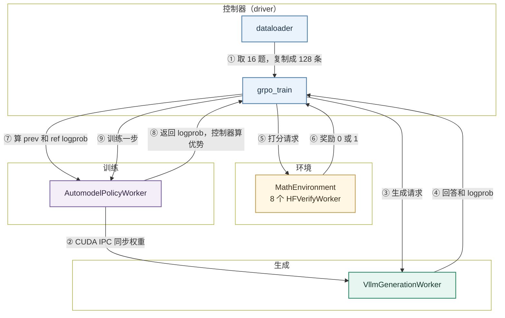
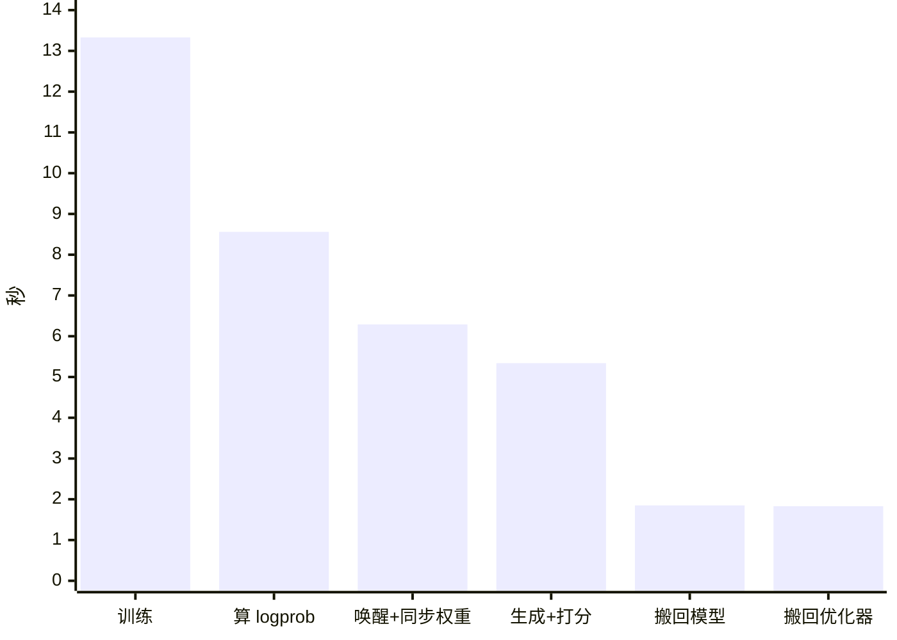
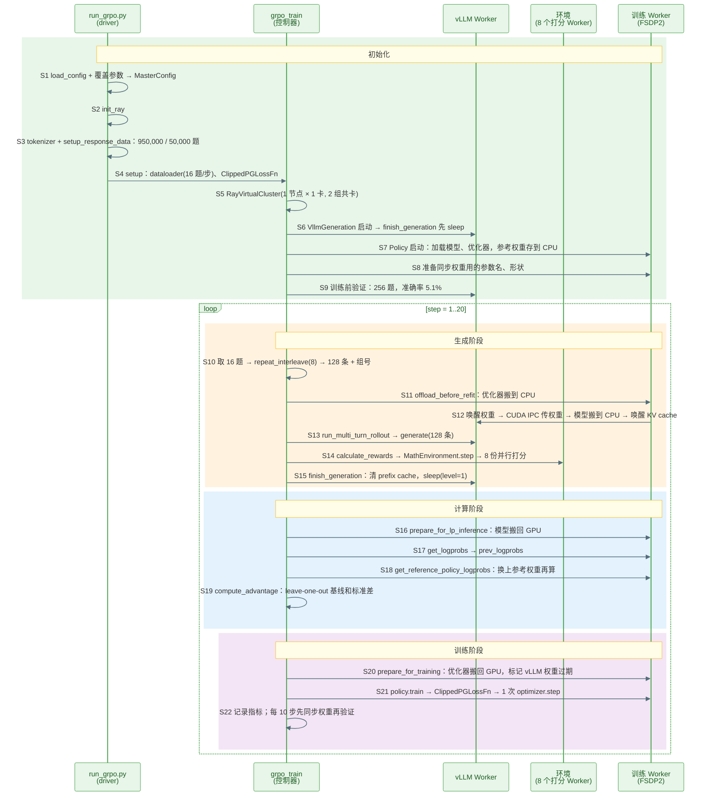

> 代码版本：`RL@31c9a494`（2026-11-04，`package_info.py` 里是 0.8.0）。运行环境：1 × A40 46GB（Slurm 只分到这一张卡），NGC 镜像 `nvcr.io/nvidia/nemo-rl:v0.7.0` 提供系统库，Python 包按仓库的 `uv.lock` 装：`torch 2.13.0+cu130`、`vllm 0.29.0`、`nemo_automodel 0.6.1`、`transformers 5.12.1`、`flash-attn 2.8.1`、`ray 2.58.0`。文中数值都来自本机跑通的例子，代码行号对应上述 commit。

## NeMo RL Overview

NeMo RL 是 NVIDIA 开源的大模型后训练库：GRPO、PPO、DPO、SFT、蒸馏都跑在同一套 Worker 上，训练后端可选 PyTorch 原生的 Automodel（FSDP2）或 Megatron，生成后端可选 vLLM、SGLang、Megatron、TensorRT-LLM 或托管的 Dynamo。

入门时先记住四个角色：

| 角色   | 代码里的名字                                    | 职责                                   |
| ------ | ----------------------------------------------- | -------------------------------------- |
| 控制器 | driver 进程里的 `grpo_train`                    | 按顺序调用下面三类 Worker，batch 在它手里 |
| 生成端 | `VllmGeneration` → 1 个 `VllmGenerationWorker`  | 生成回答，接收新权重                   |
| 环境   | `MathEnvironment` → 8 个 `HFVerifyWorker`       | 用 math-verify 判断答案对不对          |
| 训练端 | `Policy` → 1 个 `AutomodelPolicyWorker`（FSDP2）| 算 logprob、更新模型                   |

它们都是 Ray actor。和 verl 不同，NeMo RL 默认不走 TransferQueue：batch 是一个 `BatchedDataDict`，作为 Ray 调用的参数发给 Worker，结果再作为返回值回到控制器（`data_plane.enabled=true` 才换成 TQ，主循环也会换成 `grpo_train_sync`）。

本例只有一张卡，vLLM 和训练 Worker **共卡**：两者轮流占用显存，一个工作时另一个把自己搬到 CPU 或进入 sleep。



下面解释图中 9 个步骤，数值取自后文例子的第 1 步。

- **① 取 16 题，复制成 128 条**：dataloader 每步取 16 道题（`num_prompts_per_step=16`），`repeat_interleave(8)` 把每题复制 8 份，得到 128 条待生成的样本。
  - 题目：来自 OpenMathInstruct-2，训练集 950,000 道，验证集 50,000 道（从原始训练集切 5%）。
  - prompt：每题套上 `examples/prompts/cot.txt` 再套 Qwen 的聊天模板，第 1 步的 prompt 长 61–163 个 token，中位数 110。
  - 组号：同一题的 8 条共用一个 `prompt_group_ids`，后面算优势时按它分组。
- **② CUDA IPC 同步权重**：训练 Worker 把新权重交给同卡的 vLLM。第 1 步跳过这一步，因为 vLLM 启动时已经自己读了 HF 权重；从第 2 步开始，每步先同步一次。
  - 共卡时的顺序（`refit_policy_generation`）：
  - 打包：缓冲区大小是当前空闲显存的 30%（`NRL_REFIT_BUFFER_MEMORY_RATIO` 默认 0.3）。Qwen2.5-1.5B 的 bf16 权重约 3.0 GiB，一次就装得下，日志里是 `Packed 1 groups of tensors`。
  - 耗时：真正传权重只要 0.10 s，但整个 `prepare_for_generation` 中位数 6.29 s，大部分花在第 1、4 步把优化器状态和模型搬到 CPU 上。
  - CUDA IPC：同一张卡上的两个进程共享一块显存。发过去的是 64 字节的句柄，不是 3 GB 的权重：
- **③ 生成请求**：控制器把 128 条交给 vLLM，temperature=1.0，`max_total_sequence_length=512`，prompt 和回答加起来最多 512 个 token。
  - vLLM 用的是同步的 `LLM.generate`（`async_engine: false`），128 条一次性提交，vLLM 自己做 continuous batching。
  - 显存：`gpu_memory_utilization=0.6`，KV cache 22.64 GiB，可放 847,696 个 token，对 128 × 512 绰绰有余。
- **④ 回答和 logprob**：vLLM 返回生成的 token 和每个 token 的 logprob（`generation_logprobs`）。第 1 步平均每条 318 个 token，81 条（63%）写到 512 上限被截断。
  - 截断多的原因：`Qwen2.5-1.5B` 是基座模型，不是 Instruct 版，答完常常不停下来，继续输出无关内容。
  - `generation_logprobs` 只用来监控：日志里的 `Generation KL Error`（第 1 步 0.0006）比较它和训练 Worker 重算的 logprob 差多少，差得越少说明两边算得越一致。
- **⑤ 打分请求**：控制器把回答交给环境。`MathEnvironment` 把 128 条切成 8 份，交给 8 个 `HFVerifyWorker` 并行打分。
  - 打分：把标准答案包成 `\boxed{答案}`，用 math-verify 从回答里抽取最后的数学表达式，两者在数学上相等就得 1。
  - 打分发生在生成阶段内部：`run_multi_turn_rollout` 生成完就调用环境打分，所以它的耗时算在 `generation` 里；后面的 `reward_calculation` 只是整理奖励，只要 0.01 s。
- **⑥ 奖励 0 或 1**：第 1 步 128 条里只有 6 条答对，平均奖励 0.047。
  - 生成结束后，vLLM 立即 sleep：先清空 prefix cache（下一步权重变了，旧缓存不能用），再 `sleep(level=1)`，释放 26 GiB 显存给训练用。
- **⑦ 算 prev 和 ref logprob**：训练 Worker 先把模型搬回 GPU，然后对 128 条各做一次前向：
  - prev logprob：当前模型（也就是生成时的模型）的 logprob，PPO ratio 的分母。
  - ref logprob：冻结的初始模型的 logprob，用来算 KL。Automodel 后端没有第二份模型，而是把 CPU 上存的初始权重拷进同一个模型，算完再拷回。
  - 两次前向共 8.56 s（中位数）。第 1 步 23.99 s，包含首次运行的预热。
- **⑧ 返回 logprob，控制器算优势**：控制器拿到两份 logprob 后自己算 GRPO 优势，只用 0.01 s。
  - 优势：每条回答和"同组另外 7 条"比较：减去另外 7 条的平均奖励，再除以另外 7 条奖励的标准差（leave-one-out）。
  - 8 条都对或都错的组：每条和其余 7 条一模一样，优势全是 0，对梯度没有贡献。第 11 步 128 条全错，loss 就是 0。
- **⑨ 训练一步**：训练 Worker 把优化器状态搬回 GPU，然后用 128 条做 1 次 `optimizer.step`（`train_global_batch_size=128`），中位数 13.33 s。
  - loss：PPO clip（ratio 限制在 [0.8, 1.2]）加 0.01 × k3 KL。
  - 128 条在训练里的划分：
      | 划分          | 大小                         | 原因                                    | 改了会怎样               |
      | ------------- | ---------------------------- | --------------------------------------- | ------------------------ |
      | 按组          | 16 组 × 8 条                 | 同一题的回答之间比较，算优势            | 不能改，这是 GRPO 的定义 |
      | global batch  | 128 条，1 次 `optimizer.step`| `train_global_batch_size=128`           | 改小就一步更新多次，影响训练效果 |
      | micro-batch   | 每个最多 2048 个 token       | sequence packing 把短样本拼在一起，凑满再前向 | 只影响速度和显存     |

  
  


## 代码在哪里

```text
RL/
├── examples/run_grpo.py                       # 入口
├── examples/configs/grpo_math_1B.yaml         # 本例用的配置
├── examples/prompts/cot.txt                   # prompt 模板
├── nemo_rl/algorithms/
│   ├── grpo.py                                # setup、grpo_train 主循环、refit_policy_generation
│   ├── advantage_estimator.py                 # GRPOAdvantageEstimator
│   ├── utils.py                               # leave-one-out 基线和标准差
│   └── loss/loss_functions.py                 # ClippedPGLossFn
├── nemo_rl/experience/rollouts.py             # run_multi_turn_rollout：生成 + 打分
├── nemo_rl/environments/math_environment.py   # MathEnvironment、HFVerifyWorker
├── nemo_rl/distributed/virtual_cluster.py     # RayVirtualCluster：GPU 资源
├── nemo_rl/models/generation/vllm/            # VllmGeneration、VllmGenerationWorker、权重接收
├── nemo_rl/models/policy/lm_policy.py         # Policy：把调用分发给训练 Worker
├── nemo_rl/models/policy/workers/automodel_policy_worker.py  # FSDP2 训练 Worker
└── 3rdparty/                                  # Automodel、Megatron-Bridge、Gym 子模块
```

  


## 安装

### 更新代码

`origin` 是自己的 fork，最新代码在官方仓库，所以先把官方仓库加成 `upstream`：

```bash
git remote add upstream https://github.com/NVIDIA-NeMo/RL.git   # 只需第一次
git fetch upstream
git checkout main
git rebase --autostash upstream/main        # 未提交的改动自动收起，做完再放回
git submodule update --init --recursive     # 子模块对齐到这个 commit 记录的版本
```

- `--autostash`：有未提交的改动时，rebase 会拒绝执行；加上它就自动 stash 和 pop。
- 子模块：Automodel、Megatron-Bridge、Gym 都是子模块，版本由主仓库的 commit 记录。只更新主仓库不更新子模块，装出来的环境就和代码对不上。
- 不要加 `--depth 1`：本机试过，`git submodule update --init --depth 1` 让 Gym 和 Megatron-Bridge 停在了各自的 main 上，而不是记录的版本。

### 安装

官方流程只有两步，`uv` 会读 `.python-version` 选 Python（main 要求 3.13.14 以上），按 `uv.lock` 装包：

```bash
uv venv
uv run examples/run_grpo.py      # 第一次运行时自动 uv sync
```

本机的系统库太旧，用 NGC 镜像提供系统环境，代码仍是宿主机上的 checkout。`rl_study/scripts/nrlbox.sh` 把命令包进容器执行：

```bash
apptainer exec --nv --bind /data/home --bind /tmp --pwd /data/home/xli49/lxy/RL nemo-rl-v0.7.0.sif \
  env UV_PROJECT_ENVIRONMENT=$N/venv \
      NEMO_RL_VENV_DIR=$N/ray_venvs_sm86 \
      UV_CACHE_DIR=$N/uv_cache_sm86 \
      RAY_TMPDIR=/tmp/ray_nrl_$USER \
      TORCH_CUDA_ARCH_LIST="8.6" FLASH_ATTN_CUDA_ARCHS="80" \
      bash -c "<命令>"
```

| 变量 | 为什么要设 |
| ---- | ---------- |
| `UV_PROJECT_ENVIRONMENT` | 镜像里自带的 venv 是只读的，项目 venv 放到可写的目录 |
| `NEMO_RL_VENV_DIR` | 每类 Worker 有自己的 venv（见下），也要放到可写目录 |
| `UV_CACHE_DIR` | 按 GPU 架构分开：编出来的 CUDA 扩展只对一种架构有效 |
| `RAY_TMPDIR` | Ray 的 socket 路径有 107 字节的上限，路径要短 |
| `TORCH_CUDA_ARCH_LIST` | 镜像默认 `9.0 10.0`（H100、B200），源码编的扩展（flash-attn、TE 等）没有 A40 的 sm86 kernel |

- 每类 Worker 一个 venv：NeMo RL 第一次创建某类 Worker 时，按它需要的 extra 单独建一个 venv，例如 vLLM Worker 装 vllm，训练 Worker 装 flash-attn。本机建好的两个：
- 第一次很慢：flash-attn 等要按 sm86 从源码编，本机 8 个 CPU 编了约 2 小时；之后都从 uv 缓存安装。

### 检查安装

只检查环境和 `uv.lock` 是否一致，不改环境：

```bash
uv sync --locked --check
# Resolved 574 packages in 174ms
# Checked 266 packages in 4.36s
# Would make no changes
```

  


# 提PR

  


## 提 PR 流程

规则以官方的 `CONTRIBUTING.md`、`docs/testing.md`、`.github/PULL_REQUEST_TEMPLATE.md` 和 `skills/contributing/SKILL.md` 为准。用 AI 助手改代码时，仓库的 `CLAUDE.md` 要求先读 `skills/` 下对应的 `SKILL.md`。

### 1. 建分支

```bash
git fetch upstream
git checkout -b fix/<主题> upstream/main
git submodule update --init --recursive
```

动手前先查重，已有 open PR 修同一个问题就不要再开：

```text
https://github.com/NVIDIA-NeMo/RL/pulls?q=is%3Apr+<关键词>
```

### 2. 测试

```bash
uv run --group dev pre-commit install                    # 只需第一次
uv run --group dev pre-commit run --all-files            # ruff 等检查
uv run --group test pytest tests/unit/<目录>/test_xxx.py  # 跑相关的单测
uv run --group test bash tests/run_unit.sh               # 全部单测
```

- 只用 `uv`：不要 `pip install`，加依赖用 `uv add`，`pyproject.toml` 和 `uv.lock` 一起提交。
- 修复前后各跑一次：修复前失败、修复后通过，才能证明测试有效。

### 3. 提交

```bash
git add <文件>
git commit -s -m "fix(grpo): <描述>"     # -s 加 Signed-off-by
git push -u origin fix/<主题>
```

标题用 Conventional Commits，CI 的 `semantic-pull-request` 会检查：

```text
<类型>[(范围)]: <描述>

fix: preserve RAY_EXPERIMENTAL_NOSET_CUDA_VISIBLE_DEVICES
feat(grpo): add dataclass config defaults infrastructure
```

- 类型：`feat`、`fix`、`perf`、`refactor`、`test`、`docs`、`ci`、`build`、`chore`、`revert`。
- 不要用方括号：`[ci] fix: ...` 这种写法不符合规范。
- 签名：没有 `Signed-off-by` 的提交不会被接受。

### 4. 开 PR

目标选 `NVIDIA-NeMo/RL:main`，正文照模板的各节写：

```markdown
# What does this PR do ?

<一句话：问题是什么、怎么修。>

# Issues

Closes #<issue>

# Usage

<用法示例；没有 API 变化就写 No API change.>

# Before your PR is "Ready for review"

- [x] Make sure you read and followed Contributor guidelines
- [x] Did you write any new necessary tests?
- [x] Did you run the unit tests and functional tests locally?
- [ ] Did you add or update any necessary documentation?

# Additional Information

<测试命令和结果：修复前失败，修复后通过>
```

- 触发 CI：推送后在 PR 里评论 `/ok to test <完整 commit sha>`，sha 用 `git rev-parse HEAD` 取，不能用短 sha。
- 自动 review：评论 `/review` 会触发仓库配置的 review 服务。

### 5. 更新 PR

**情况 1：改代码或回应 review**

```bash
git checkout fix/<主题>
# 修改代码
uv run --group dev pre-commit run --all-files
git add <文件>
git commit -s -m "fix(grpo): address review comments"
git push
```

推送后 sha 变了，要重新评论 `/ok to test <新 sha>`。

**情况 2：上游 main 更新了，需要同步或解决冲突**

```bash
git fetch upstream
git rebase upstream/main
git submodule update --init --recursive
git push --force-with-lease
```

- 有冲突：编辑冲突文件，`git add <文件>`，再 `git rebase --continue`。
- 想放弃：`git rebase --abort`。

  
  


## 跑通第一个例子：GRPO

用官方的 `grpo_math_1B.yaml`：Qwen2.5-1.5B 学做 OpenMathInstruct-2 的数学题，Automodel 训练，vLLM 生成，两者共卡。官方配置每步 32 题 × 16 条 = 512 条，单张 A40 上约 123 s 一步；这里缩小到 16 题 × 8 条 = 128 条，跑 20 步。

配置是 YAML，命令行可以用 `a.b.c=value` 覆盖任意字段。

### 1. 准备数据

不用手动准备：第一次运行时从 Hugging Face 下载 `nvidia/OpenMathInstruct-2`，切出 5% 做验证集。

### 2. 启动训练

```bash
# 参数写成 bash 数组，每个参数后面都能加注释（反斜杠续行的写法里不能在行尾加注释）
export CUDA_VISIBLE_DEVICES=2                    # 只用 Slurm 分给本作业的那张卡
ARGS=(
    # ---- GRPO ----
    grpo.num_prompts_per_step=16                 # 每步 16 道题（官方 32）
    grpo.num_generations_per_prompt=8            # 每题 8 条回答（官方 16）→ 每步 128 条
    grpo.max_num_steps=20                        # 只跑 20 步
    grpo.val_period=10                           # 每 10 步验证一次
    grpo.val_at_start=true                       # 训练前先验证一次
    # 不改的默认值：normalize_rewards=true、use_leave_one_out_baseline=true、
    # max_val_samples=256、val_num_generations_per_prompt=1

    # ---- 训练 ----
    policy.train_global_batch_size=128           # 128 条做 1 次 optimizer.step（官方 512）
    # 不改的默认值：model_name=Qwen/Qwen2.5-1.5B、max_total_sequence_length=512、
    # lr=5e-6（前 50 步线性 warmup）、sequence_packing.train_mb_tokens=2048

    # ---- 其他 ----
    checkpointing.enabled=false                  # 不存 checkpoint
    logger.log_dir=rl_study/runs/nemorl/ex1_grpo # 每步的样本写到这里的 train_data_step*.jsonl
)
uv run examples/run_grpo.py --config examples/configs/grpo_math_1B.yaml "${ARGS[@]}"
```

本机是在容器里跑的，完整脚本见 `rl_study/scripts/nemorl_ex1_grpo.sh`。

### 3. 关键配置

| 配置 | 含义 | 取值 |
| ---- | ---- | ---- |
| `grpo.num_prompts_per_step` | 每步题数 | 16 |
| `grpo.num_generations_per_prompt` | 每题回答数 | 8 |
| `policy.train_global_batch_size` | 每次 `optimizer.step` 用的样本数 | 128 |
| `policy.max_total_sequence_length` | prompt + 回答的最大长度 | 512 |
| `policy.generation.colocated.enabled` | vLLM 和训练共卡 | true |
| `policy.generation.vllm_cfg.gpu_memory_utilization` | vLLM 显存比例 | 0.6 |
| `loss_fn.reference_policy_kl_penalty` | KL 系数 | 0.01 |
| `loss_fn.ratio_clip_min` / `ratio_clip_max` | PPO clip | 0.2 / 0.2 |

### 4. 结果分析

总耗时 22 分 26 秒：启动 431 s（其中创建 Worker 394 s），训练前验证 9.3 s，20 步训练约 13 分钟。

| step | 训练平均奖励 | 验证准确率（256 题） | 平均回答长度 |
| ---- | ------------ | -------------------- | ------------ |
| 1    | 0.047        | 5.1%（训练前）       | 318          |
| 5    | 0.070        |                      | 331          |
| 10   | 0.141        | 7.0%                 | 347          |
| 15   | 0.070        |                      | 298          |
| 20   | 0.086        | 12.1%                | 341          |

每步只有 16 道题，训练平均奖励波动很大，看趋势要看验证准确率：20 步从 5.1% 升到 12.1%。

第 2–20 步（去掉含验证的第 10、20 步）每步中位数约 37.4 s，构成如下：



- 搬显存占了约 10 s：同步权重前后把优化器和模型搬到 CPU（6.29 s 里只有 0.10 s 是传权重），算 logprob 前把模型搬回 GPU（1.85 s），训练前把优化器搬回 GPU（1.83 s），合计约 27%。这是单卡共卡的代价，卡多时可以让 vLLM 和训练分开（`colocated.enabled=false`）。
- 生成只有 5.34 s：128 条、平均 330 个 token，vLLM 一次提交全部请求。
- 第 1 步 46.55 s：算 logprob 用了 23.99 s，是首次前向的预热；而且这一步不需要同步权重。

  
  


## 一步训练时序图

整个训练分成两段：

- 启动（S1–S9，只执行一次）：读配置、启动 Ray，读数据，申请 GPU，先建 vLLM 再建训练 Worker，准备同步权重用的参数信息，训练前验证一次。
- 每步循环（S10–S22）：取 16 题复制成 128 条 → 搬走训练状态、同步权重、唤醒 vLLM → 生成并打分 → vLLM sleep → 算 prev / ref logprob → 算优势 → 搬回优化器、训练一步 → 记录，每 10 步验证一次。

图中编号 S1–S22 和下一节的代码一一对应。图中简称与源码类名的对应：

| 图中简称    | 源码                     |
| ----------- | ------------------------ |
| vLLM Worker | `VllmGenerationWorker`   |
| 训练 Worker | `AutomodelPolicyWorker`  |
| 打分 Worker | `HFVerifyWorker`         |
| 环境        | `MathEnvironment`        |



  


## 代码逐步详解（带入数值）

每一步都按同样的顺序讲：**做什么 → 代码 → 带入数值 → 这一步的结果**。编号和上面的时序图一一对应。

例子的配置：

- `num_prompts_per_step=16`、`num_generations_per_prompt=8`：每步 16 题，共 128 条。
- `train_global_batch_size=128`：每步 1 次 `optimizer.step`。
- `max_total_sequence_length=512`：prompt 加回答最多 512 个 token。
- 1 张 A40，vLLM 和训练 Worker 共卡。
- `max_num_steps=20`、`val_period=10`、`val_at_start=true`。

### 第一阶段：启动（S1–S9，只执行一次）

#### S1: 读配置

**目的**：读 YAML，用命令行参数覆盖，再校验成 `MasterConfig`。

代码位置：`examples/run_grpo.py:83`、`:88`、`:92`

```python
config = load_config(args.config)  # 读 grpo_math_1B.yaml，支持 defaults 继承

config = parse_hydra_overrides(config, overrides)  # 命令行的 a.b.c=value 覆盖进去

config = MasterConfig(**config)  # pydantic 校验：字段名写错、类型不对会在这里报错
```

**带入数值**：8 个覆盖参数，例如 `grpo.num_prompts_per_step=16`。日志里打印出完整的 `MasterConfig`，其中 `grpo=GRPOConfig(num_prompts_per_step=16, num_generations_per_prompt=8, max_num_steps=20, ...)`。

**结果**：配置校验通过。

  


#### S2: 启动 Ray

**目的**：启动本机的 Ray，后面所有 Worker 都是 Ray actor。

代码位置：`examples/run_grpo.py:127`

```python
init_ray()  # 有现成的 Ray 集群就连上，没有就新启动一个；RAY_TMPDIR 决定 socket 放在哪
```

**带入数值**：本机没有现成的集群，新启动一个，`ray_init: 28.8s`（日志的 `RL INIT TIMING BREAKDOWN`）。

**结果**：Ray 就绪。

  


#### S3: 读 tokenizer 和数据

**目的**：加载 tokenizer，下载并切分数据集，确定每道题用哪个环境打分。

代码位置：`examples/run_grpo.py:131`、`:151`

```python
tokenizer = get_tokenizer(config.policy["tokenizer"])  # Qwen/Qwen2.5-1.5B 的 tokenizer

dataset, val_dataset, task_to_env, val_task_to_env = setup_response_data(tokenizer, config.data, config.env)  # 读数据；按 env_name="math" 建 MathEnvironment
```

**带入数值**：

- OpenMathInstruct-2 切出 5% 做验证，训练集 950,000 题、验证集 50,000 题。
- `processor: math_hf_data_processor`：套 `cot.txt` 模板转成 token，同时带上标准答案，供 S14 打分。
- `env.math.num_workers=8`：`MathEnvironment` 里有 8 个 `HFVerifyWorker`。

**结果**：`tokenizer: 0.7s`、`data: 7.6s`。

  


#### S4: 进入 setup

**目的**：建 dataloader 和 loss 函数，接下来在 setup 里申请 GPU、建 Worker。

代码位置：`examples/run_grpo.py:172`、`nemo_rl/algorithms/grpo.py:883`、`:985`

```python
dataloader = StatefulDataLoader(dataset, batch_size=dataloader_batch_size, shuffle=data_config["shuffle"], collate_fn=rl_collate_fn, drop_last=True)  # batch_size = 16，打乱，丢掉不满一批的尾巴

loss_fn = ClippedPGLossFn(loss_config, use_fused_linear_logprobs=..., seq_logprob_error_threshold=...)  # PPO clip + KL，系数来自 loss_fn 配置
```

**带入数值**：950,000 / 16 = 59,375 个 batch，日志打印为 `Training dataloader loaded with 59375 samples`（这里的 samples 实际是 batch 数）。

**结果**：数据和 loss 就绪。

  


#### S5: 申请 GPU

**目的**：用 Ray placement group 把 GPU 包装成一个虚拟集群，生成和训练两组 Worker 共用它。

代码位置：`nemo_rl/algorithms/grpo.py:1140`

```python
cluster = RayVirtualCluster(
    name="grpo_policy_cluster",
    bundle_ct_per_node_list=[1] * 1,  # 1 个节点，每节点 1 个 GPU bundle
    use_gpus=True,
    num_gpus_per_node=1,
    max_colocated_worker_groups=2,  # vLLM 一组、训练一组，挤在同一个 bundle 上
)
```

**带入数值**：`cluster.gpus_per_node=1`、`num_nodes=1`；`colocated.enabled=true`，所以训练和推理用同一个集群。

**结果**：日志 `Ray cluster for policy initialized with 1 nodes`。

  


#### S6: 启动 vLLM，然后 sleep

**目的**：先建 vLLM。共卡时必须先建 vLLM，让它在干净的显存上测出 KV cache 能用多少，然后立刻 sleep，把显存还给后面的训练 Worker。

代码位置：`nemo_rl/algorithms/grpo.py:1521`、`:1630`

```python
def init_vllm():
    pg = VllmGeneration(cluster=inference_cluster, config=generation_config)  # 启动 VllmGenerationWorker，加载 HF 权重

    pg.finish_generation()  # 共卡 → sleep，释放显存

    return pg, time.perf_counter() - t0

policy_generation, generation_time = init_generation_fn()  # 共卡：先 vLLM
policy, policy_time = init_policy()  # 再训练 Worker
```

**带入数值**：

- `Model loading took 3.02 GiB memory and 14.46 seconds`。
- `gpu_memory_utilization=0.6`：`Available KV cache memory: 22.64 GiB`，`GPU KV cache size: 847,696 tokens`。
- 第一次启动还要编译和捕获 CUDA graph：`init engine ... took 50.46 s`。
- `Sleep mode freed 26.08 GiB memory`，`It took 1.39 seconds to fall asleep`。

**结果**：`1 workers initialized in 121.41s`，vLLM 在 sleep 状态等待。

  


#### S7: 启动训练 Worker

**目的**：建 `Policy`，在 GPU 上用 FSDP2 加载模型和优化器，并把初始权重存一份到 CPU 作为参考模型。

代码位置：`nemo_rl/algorithms/grpo.py:1492`、`automodel_policy_worker.py:635`

```python
p = _make_policy(cluster=train_cluster, config=policy_config, tokenizer=tokenizer, init_optimizer=True, init_reference_model=True)  # 1 个 AutomodelPolicyWorker
self.reference_model_state_dict = setup_reference_model_state(self.model)  # 初始权重拷一份到 CPU，后面算 ref logprob 时换进来
```

**带入数值**：Qwen2.5-1.5B 共 338 个参数张量（`Loading weights: 338/338`）；优化器 AdamW，lr 5e-6。

**结果**：`1 workers initialized in 91.00s`。日志 `RL INIT TIMING BREAKDOWN` 里 `workers: 394.0s` 就是 S5–S8 的总和。

  


#### S8: 准备同步权重用的参数信息

**目的**：让 vLLM 预先知道每个参数的名字、形状和 dtype，之后同步时只传数据。

代码位置：`nemo_rl/algorithms/grpo.py:2093`

```python
if getattr(policy_generation, "weight_synchronizer", None) is None and _needs_hf_refit_handshake(backend, nccl_reshard_refit_enabled, colocated_inference):
    initialize_refit_metadata(policy, policy_generation)  # 训练 Worker 报出 state_dict 的形状，发给 vLLM 存成 state_dict_info
```

**带入数值**：`refit_transport=null` 加上共卡，对应 CUDA IPC 这条路径，没有专门的 `weight_synchronizer`。

**结果**：vLLM 端有了 `state_dict_info`，S12 收到一块显存后就能按它切出每个参数。

  


#### S9: 训练前验证

**目的**：用没训练过的模型做一遍验证题，得到起点。

代码位置：`nemo_rl/algorithms/grpo.py:3652`

```python
policy_generation.prepare_for_generation()  # 唤醒 vLLM

val_metrics, validation_timings = validate(policy_generation, val_dataloader, tokenizer, val_task_to_env, step=0, master_config=master_config)  # 256 题，每题 1 条

policy_generation.finish_generation()  # 验证完 sleep
```

**带入数值**：`max_val_samples=256`、`val_num_generations_per_prompt=1`，验证也用 temperature 1.0（`val_temperature` 默认等于 `temperature`）。

**结果**：`Accuracy: 0.0508`，`Total validation time: 9.34s`。

### 第二阶段：生成（S10–S15，每步一次）

下面以第 2 步为例（第 1 步不同步权重），数值用的是第 2–20 步的中位数或第 1 步的样本。

  


#### S10: 取 16 题，复制成 128 条

**目的**：取一批题，每题复制 8 份，记下哪 8 条属于同一组。

代码位置：`nemo_rl/algorithms/grpo.py:3758`、`:3773`

```python
repeated_batch = batch.repeat_interleave(master_config.grpo.num_generations_per_prompt)  # 16 → 128，同一题的 8 份挨在一起

prompt_group_ids = _prompt_group_ids(repeated_batch.size, master_config.grpo.num_generations_per_prompt, group_offset=next_prompt_group_id)  # [g, g, g, g, g, g, g, g, g+1, ...]
```

**带入数值**：16 × 8 = 128；第 1 步 prompt 长度 61–163 个 token。

**结果**：日志 `▶ Generating responses for batch of size 128...`。

  


#### S11: 把优化器搬到 CPU

**目的**：上一步训练完，vLLM 的权重已经过期，要同步。共卡时先把训练 Worker 的优化器状态搬走，给 vLLM 腾显存。

代码位置：`nemo_rl/algorithms/grpo.py:3825`、`:3193`、`automodel_policy_worker.py:1640`

```python
if POLICY_GENERATION_STALE:  # 训练过一次后为 True
    refit_policy_generation(policy, policy_generation, colocated_inference, ...)  # S11–S12
def offload_before_refit(self):
    if self.optimizer is not None:
        self.move_optimizer_to_device("cpu")  # AdamW 的两份动量状态逐个 .to("cpu")

    gc.collect()
    torch.cuda.empty_cache()  # 把空出来的显存还给驱动，vLLM 才能用
```

**带入数值**：第 1 步 `POLICY_GENERATION_STALE=False`，跳过同步，`prepare_for_generation/total` 只有 1.67 s；第 2 步起都要同步。

**结果**：显存里只剩训练 Worker 的模型参数。

  


#### S12: 同步权重，唤醒 vLLM

**目的**：把训练后的新权重交给 vLLM，然后把训练 Worker 的模型也搬走，再恢复 vLLM 的 KV cache。

代码位置：`nemo_rl/algorithms/grpo.py:3194`、`:3226`、`:3257`；接收端 `nemo_rl/models/generation/vllm/vllm_backend.py:2054`

```python
policy_generation.prepare_for_generation(tags=["weights"])  # vLLM 只唤醒权重显存

buffer_size_bytes = int(policy.get_free_memory_bytes() * 0.3)  # 打包缓冲区 = 空闲显存的 30%

futures_train = policy.stream_weights_via_ipc_zmq(buffer_size_bytes=buffer_size_bytes)  # 训练端：参数拷进缓冲区，发 IPC 句柄

futures_inference = policy_generation.update_weights_via_ipc_zmq()  # vLLM 端：收句柄，按 state_dict_info 切出参数并加载

ray.get(futures_train); results = ray.get(futures_inference)

policy.offload_after_refit()  # 训练 Worker 的模型也搬到 CPU

policy_generation.prepare_for_generation(tags=["kv_cache"])  # 唤醒 KV cache
```

接收端的核心：

```python
payload = self.zmq_socket.recv_pyobj()  # (ipc_handle, list_keys, used_bytes)，或者 COMPLETE

buffer = rebuild_cuda_tensor_from_ipc(ipc_handle, self.device.index)  # 映射训练端那块显存

weight = buffer[offset : offset + size_in_bytes].view(dtype=dtype).view(shape)  # 按 state_dict_info 切出一个参数
```

**带入数值**：

- 3.0 GiB 的 bf16 权重一次装下：`Packed 1 groups of tensors`。
- `wake up tags ['weights']` 0.24 s，传权重 `transfer_and_update_weights` 0.10 s，`wake up tags ['kv_cache']` 0.62 s。
- `prepare_for_generation/total` 中位数 6.29 s，其余时间都在 S11 和 `offload_after_refit` 搬显存。

**结果**：vLLM 用上新权重，KV cache 就绪；训练 Worker 在 GPU 上只剩 0 GB（日志 `GPU Memory after optimizer offload: 0.00GB allocated`）。

  


#### S13: 生成 128 条

**目的**：让 vLLM 为 128 条生成回答。

代码位置：`nemo_rl/algorithms/grpo.py:3925`、`nemo_rl/experience/rollouts.py:1118`、`:672`

```python
repeated_batch, rollout_metrics = run_multi_turn_rollout(policy_generation=policy_generation, input_batch=repeated_batch, tokenizer=tokenizer, task_to_env=task_to_env, max_seq_len=512, max_rollout_turns=1, greedy=False)  # 数学题只有 1 轮
for turn in range(max_rollout_turns):  # 1 轮
    active_batch, generated_ids, gen_metrics = generate_responses(policy_generation, generation_input_data, active_batch, tokenizer, ...)  # 内部调用 policy_generation.generate

    env_output = calculate_rewards(active_batch, task_to_env)  # 生成完立即打分，见 S14
```

**带入数值**：

- 128 条一次交给 vLLM 的 `LLM.generate`，temperature=1.0。
- 第 1 步平均回答 318 个 token，81 条写到 512 上限。
- `generation` 中位数 5.34 s（含 S14 打分）。

**结果**：每条样本的 `message_log` 里多了 assistant 的回答 token 和 `generation_logprobs`。

  


#### S14: 打分

**目的**：把 128 条回答分给 8 个打分 Worker，判断答案对不对。

代码位置：`nemo_rl/experience/rollouts.py:937`、`nemo_rl/environments/math_environment.py:489`、`:101`

```python
future = task_to_env[task_name].step.remote(messages, env_info)  # 所有样本的 task_name 都是 math
chunked_assistant_response_batch = chunk_list_to_workers(assistant_response_batch, self.num_workers)  # 128 条切成 8 份，每份 16 条

ground_truth_parsable = "\\boxed{" + ground_truth + "}"  # 标准答案包成 \boxed{}

ret_score, extracted_answer = self.verify_func([ground_truth_parsable], [response])  # math-verify：抽出回答里的答案，数学上相等得 1
```

**带入数值**：第 1 步标准答案为 15 的那题，回答里写了 `the 5 students will need $15 in total`，抽出 15，得 1.0；128 条里共 6 条得 1。

**结果**：`total_reward` 是 128 个 0 或 1，第 1 步平均 0.047。

  


#### S15: vLLM sleep

**目的**：生成结束，vLLM 让出显存给后面的 logprob 和训练。

代码位置：`nemo_rl/algorithms/grpo.py:3946`、`nemo_rl/models/generation/vllm/vllm_worker.py:1617`

```python
self.llm.llm_engine.reset_prefix_cache()  # 下一步权重会变，旧的 prefix cache 不能再用

self.llm.sleep(level=1)  # level 1：权重备份到 CPU，KV cache 直接丢弃

gc.collect(); torch.cuda.empty_cache()
```

**带入数值**：`Sleep mode freed 26.52 GiB memory, 1.19 GiB memory is still in use`，用时 0.18 s。

**结果**：GPU 几乎空出来，留给训练 Worker。

### 第三阶段：计算（S16–S19，每步一次）

  


#### S16: 把模型搬回 GPU

**目的**：算 logprob 需要模型在 GPU 上。

代码位置：`nemo_rl/algorithms/grpo.py:4195`、`automodel_policy_worker.py:1581`

```python
self.move_to_cuda(self.model)  # 模型参数从 CPU 搬回 GPU
self.model.eval()  # 推理模式
```

**带入数值**：`offload_optimizer_for_logprob=false`，优化器留在 CPU，只搬模型；`logprob_inference_prep` 中位数 1.85 s。

**结果**：模型在 GPU 上，可以前向。

  


#### S17: 算 prev logprob

**目的**：用当前模型给 128 条回答的每个 token 算 logprob，作为 PPO ratio 的分母。

代码位置：`nemo_rl/algorithms/grpo.py:4236`

```python
prev_lp_result = policy.get_logprobs(logprob_data, timer=timer)  # 128 条，按 2048 token 打包成 micro-batch 前向

train_data["prev_logprobs"] = prev_lp_result["logprobs"]
```

**带入数值**：第 1 步 128 条共 54,836 个 token（prompt + 回答），按 2048 token 一个 micro-batch 打包，至少要 27 个。第 1 步答对的第 1 组第 4 条，回答 211 个 token，vLLM 的平均 logprob 是 −0.5355，训练 Worker 重算的是 −0.5329。

**结果**：`train_data` 里多了 `prev_logprobs`。

  


#### S18: 算 ref logprob

**目的**：用初始模型再算一遍，作为 KL 的参照。

代码位置：`nemo_rl/algorithms/grpo.py:4249`、`automodel_policy_worker.py:1297`

```python
with self.use_reference_model():  # 进入时：当前权重拷到 CPU，参考权重拷进模型
    ...  # 和 S17 同样的前向
# 退出时：当前权重拷回来
curr_state_dict = get_cpu_state_dict(self.model.state_dict().items(), pin_memory=True)  # 先把当前权重存到 CPU

for k, v in self.model.state_dict().items():
    to_local_if_dtensor(v).copy_(self.reference_model_state_dict[k])  # 参考权重逐个拷进模型
```

**带入数值**：S17 和 S18 合计 `policy_and_reference_logprobs` 中位数 8.56 s。

**结果**：`train_data` 里多了 `reference_policy_logprobs`。

  


#### S19: 算优势

**目的**：每条回答和同组另外 7 条比较，得到优势。

代码位置：`nemo_rl/algorithms/grpo.py:4314`、`nemo_rl/algorithms/advantage_estimator.py:106`、`nemo_rl/algorithms/utils.py:118`

```python
baseline, std, is_trivial_distribution = calculate_baseline_and_std_per_prompt(prompt_ids, rewards, valid_mask, leave_one_out_baseline=True)  # 每条的基线和标准差都只看同组另外 7 条

advantages = (rewards - baseline).unsqueeze(-1)

normalize_mask = (std > 0) & ~is_trivial_distribution  # 另外 7 条奖励都一样时不除标准差
advantages[normalize_mask] = advantages[normalize_mask] / (std.unsqueeze(-1)[normalize_mask] + 1e-6)

return advantages.expand(mask.shape)  # 每个 token 用同一个优势
```

**带入数值**：第 1 步的两组：

| 组 | 奖励 | 答对的优势 | 答错的优势 |
| -- | ---- | ---------- | ---------- |
| 第 1 组 | 1 对 7 错 | 1.000（另外 7 条全错，不除标准差） | (0 − 1/7) / 0.378 = −0.378 |
| 第 6 组 | 2 对 6 错 | (1 − 1/7) / 0.378 = 2.268 | (0 − 2/7) / 0.488 = −0.586 |

- 第 6 组答错的一条：另外 7 条里有 2 个 1，平均 2/7 = 0.286，样本标准差 sqrt(2/7 × 5/7 × 7/6) = 0.488。
- 这些数和 `train_data_step1.jsonl` 里记录的 `advantages` 完全一致。

**结果**：`train_data["advantages"]`，`advantage_calculation` 只要 0.01 s。

### 第四阶段：训练（S20–S22，每步一次）

  


#### S20: 把优化器搬回 GPU

**目的**：训练要用优化器状态。

代码位置：`nemo_rl/algorithms/grpo.py:4355`、`:4356`、`automodel_policy_worker.py:1612`

```python
self.move_to_cuda(self.model)  # 模型已在 GPU，不会再搬
self.model.train()
self.move_optimizer_to_device("cuda")  # S11 搬走的优化器状态搬回来
with timer.time("training_prep"):
    policy.prepare_for_training()
    POLICY_GENERATION_STALE = True  # 马上要训练，vLLM 里的权重随即过期，下一步 S11 要重新同步
```

**带入数值**：`training_prep` 中位数 1.83 s。

**结果**：模型和优化器都在 GPU 上，vLLM 的权重被标记为过期。

  


#### S21: 训练一步

**目的**：用优势更新模型。

代码位置：`nemo_rl/algorithms/grpo.py:4367`、`automodel_policy_worker.py:696`、`:760`、`:772`、`:827`、`:868`、`nemo_rl/algorithms/loss/loss_functions.py:874`、`:1050`、`:1134`

```python
num_global_batches = int(total_dataset_size.item()) // gbs  # 128 // 128 = 1 → 1 次 optimizer.step

for gb_idx in range(num_global_batches):
    self.optimizer.zero_grad()
    mb_results = automodel_forward_backward(...)  # 按 2048 token 打包的 micro-batch 逐个前向、反向，梯度累加
    grad_norm = scale_grads_and_clip_grad_norm(self.max_grad_norm, ...)  # 梯度裁剪到 1.0
    self.optimizer.step()
kl = self.reference_policy_kl_penalty * calculate_kl(logprobs=curr_logprobs_unfiltered, logprobs_reference=reference_policy_logprobs, kl_type=self.reference_policy_kl_type, ...)  # 0.01 × 每个 token 的 k3 KL

actor_loss, ratios, ratios_clamped = actor_objective(curr_logprobs, prev_logprobs=prev_logprobs, advantages=advantages, ..., ratio_clip_min=self.ratio_clip_min, ratio_clip_max=self.ratio_clip_max)  # ratio = exp(curr − prev)，限制在 [0.8, 1.2]

loss = actor_loss + kl + self.positive_example_nll_weight * nll_loss  # 本例 positive_example_nll_weight = 0
```

**带入数值**：

- 1 次 `optimizer.step`，lr 从 5e-7 线性升到 5e-6（前 50 步 warmup）。
- `policy_training` 中位数 13.33 s。
- 第 1 步 `Loss: 0.0030`；第 11 步 128 条全错，所有优势为 0，`Loss: 0.0000`。

**结果**：训练 Worker 里的模型更新了，vLLM 里还是旧权重。

  


#### S22: 记录、验证

**目的**：打印指标，按频率验证。

代码位置：`nemo_rl/algorithms/grpo.py:4394`、`:4406`、`:4421`

```python
should_run_validation = (val_period > 0 and (total_steps + 1) >= val_start_at and (total_steps + 1) % val_period == 0) or (val_at_end and is_last_step)  # 第 10、20 步

if should_run_validation:
    if POLICY_GENERATION_STALE:
        refit_policy_generation(...)  # 先把刚训练完的权重同步给 vLLM
    val_metrics, validation_timings = validate(...)  # 256 题
```

**带入数值**：

- 第 10 步验证准确率 7.0%（8.15 s），第 20 步 12.1%（8.17 s）；这两步总耗时 53–54 s，比平时多出的部分是验证和验证前的同步。
- 验证前已经同步过，所以第 11 步的 S11–S12 不再传权重：第 2–20 步里只有 18 步记录了 `transfer_and_update_weights`。
- 每步的样本写到 `train_data_step{N}.jsonl`，128 行，含 token、奖励、优势和三种 logprob。

**结果**：第 1–19 步回到 S10；第 20 步后训练结束。

  


## 常见问题

- **训练 Worker 为什么一会儿在 GPU、一会儿在 CPU？** 共卡。vLLM 工作时训练 Worker 把模型和优化器搬到 CPU，训练时 vLLM sleep。卡多时关掉 `colocated.enabled`，搬显存的约 10 s 就没了，但要改用 NCCL 同步权重。
- `reward_calculation` **为什么只有 0.01 s？** 打分在 `run_multi_turn_rollout` 里已经做完，算在 `generation` 里。
- **启动为什么这么慢？** 本机 394 s 在建 Worker：每类 Worker 在自己的 venv 里启动，vLLM 还要编译和捕获 CUDA graph。第一次运行还要建 venv，更慢。
- **换了分支或子模块后 Worker 报错？** Worker venv 是第一次运行时建的，依赖或子模块变了要设 `NRL_FORCE_REBUILD_VENVS=true` 重建（README 的 Tips and Tricks）。
- **验证准确率为什么这么低？** 用的是 Qwen2.5-1.5B 基座模型，答完常常不停，63% 的回答写满 512 个 token。

  
  


## 后续

1. 换成官方原始规模（32 × 16 = 512 条），对比每步耗时和准确率曲线。
2. 打开 `grpo.async_grpo.enabled=true`，看生成和训练怎么重叠。
3. 试 `data_plane.enabled=true`，主循环换成 `grpo_train_sync`，张量改走 TransferQueue，可选 `mooncake_cpu` 存储，见 [Mooncake 入门笔记](08_mooncake.md)。
4. 用 `grpo_math_1B_dynamo.yaml` 把生成交给托管的 Dynamo，见 [Dynamo 入门笔记](10_dynamo.md)。
5. 对比其他框架：[框架对比](/posts/llm-rl-frameworks-comparison/)。