From P100 to B200, NVIDIA grew dense FP16 matrix throughput about 100× (21 → 2,250 TFLOPS), while memory bandwidth grew only about 11× (0.73 → 8 TB/s). Every generation spends most of its new transistors on Tensor Cores running ever lower precision, plus more memory and faster links to feed them [[1]](https://images.nvidia.com/content/pdf/tesla/whitepaper/pascal-architecture-whitepaper.pdf)[[5]](https://resources.nvidia.com/en-us-blackwell-architecture).

## Key points

- **Pascal (P100, 2016)**: first GPU with HBM2 and NVLink, and it runs FP16 at twice the FP32 rate. No Tensor Cores yet.
- **Volta (V100, 2017)**: introduces **Tensor Cores**, units that do a small matrix multiply-add in one step. Deep learning throughput jumps about 6×.
- **Ampere (A100, 2020)**: adds TF32 and BF16, 2:4 sparsity, and MIG (splitting one GPU into up to 7 isolated GPUs). L2 cache grows to 40 MB.
- **Hopper (H100, 2022)**: adds **FP8** with the Transformer Engine, the TMA copy engine, and thread block clusters. Power draw reaches 700 W.
- **Blackwell (B200, 2024)**: **two dies in one package** that act as one GPU, adds FP4/FP6, and NVLink 5 at 1.8 TB/s.

## Spec comparison

SXM versions, dense Tensor Core numbers (no sparsity) [[1]](https://images.nvidia.com/content/pdf/tesla/whitepaper/pascal-architecture-whitepaper.pdf)[[2]](https://images.nvidia.com/content/volta-architecture/pdf/volta-architecture-whitepaper.pdf)[[3]](https://images.nvidia.com/aem-dam/en-zz/Solutions/data-center/nvidia-ampere-architecture-whitepaper.pdf)[[4]](https://resources.nvidia.com/en-us-tensor-core/gtc22-whitepaper-hopper)[[6]](https://www.nvidia.com/en-us/data-center/hgx/).

How the key specs changed:

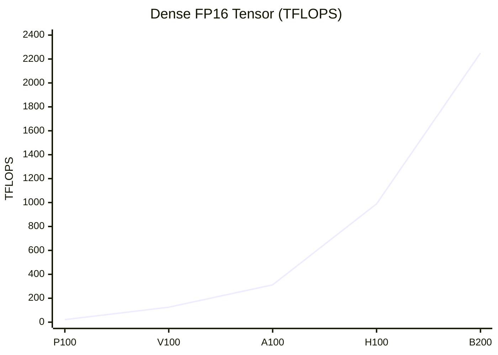

Compute grew about 100×, with the biggest jump at Volta when Tensor Cores arrived, then roughly 2–3× every generation.

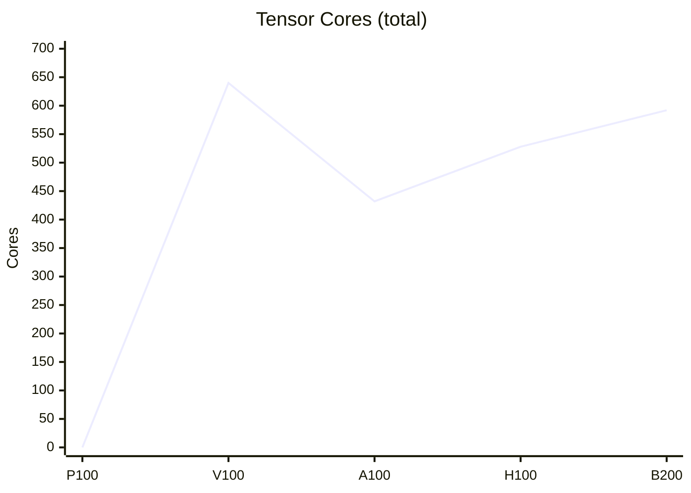

The Tensor Core count actually dropped after V100 — each newer core is much wider, so speed comes from what each core does per clock, not from having more of them.

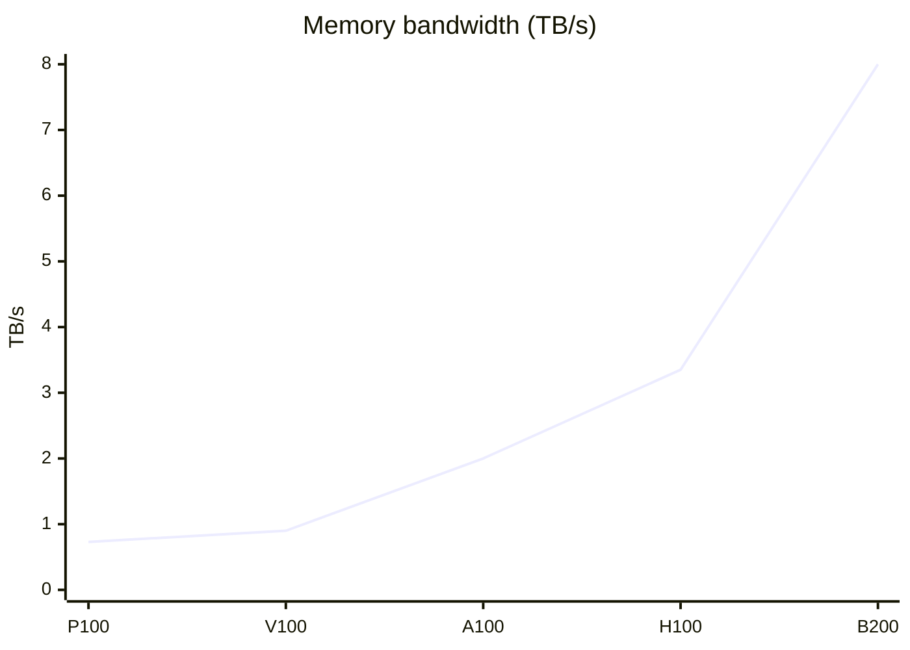

Bandwidth grew only about 11×, far slower than compute, which is why newer GPUs lean on bigger caches and lower precision.

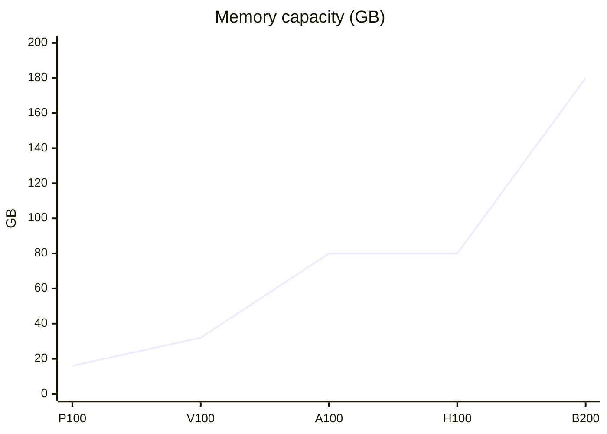

Capacity grew about 11×, stalled at 80 GB from A100 to H100, then more than doubled with B200's eight HBM3e stacks.

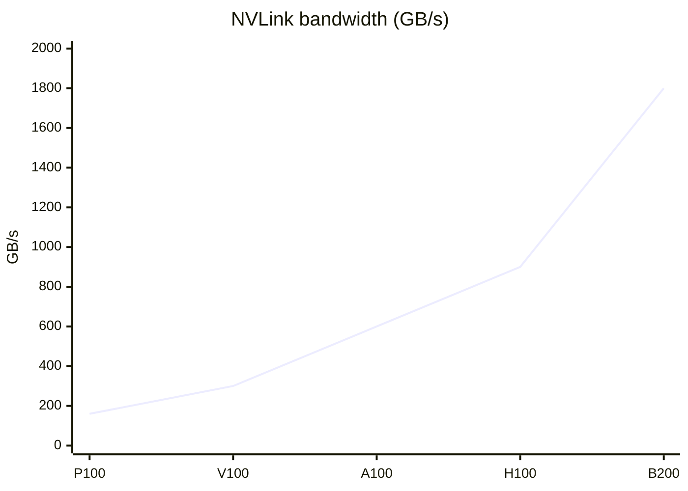

NVLink roughly doubled each generation, growing about 11×, to keep pace with multi-GPU training and inference.

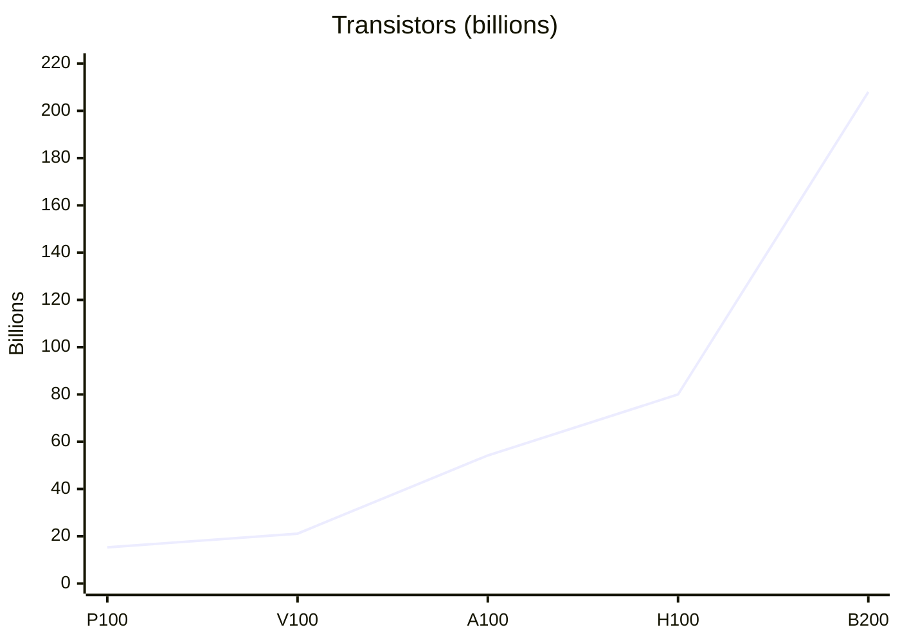

Transistors grew about 14×; B200 jumps 2.6× over H100 by putting two dies in one package instead of a smaller process.

```mermaid
xychart-beta
  title "TDP (W)"
  x-axis [P100, V100, A100, H100, B200]
  y-axis "W" 0 --> 1100
  line [300, 300, 400, 700, 1000]
```

Power stayed at 300 W for two generations, then more than tripled to 1,000 W, pushing data centers toward liquid cooling.

Full numbers:

| | P100 | V100 | A100 | H100 | B200 |
|---|---|---|---|---|---|
| Architecture | Pascal | Volta | Ampere | Hopper | Blackwell |
| Year | 2016 | 2017 | 2020 | 2022 | 2024 |
| Process | TSMC 16nm | TSMC 12nm | TSMC 7nm | TSMC 4N | TSMC 4NP |
| Transistors | 15.3B | 21.1B | 54.2B | 80B | 208B (2 dies) |
| SMs enabled | 56 | 80 | 108 | 132 | 148 |
| FP32 cores / SM | 64 | 64 | 64 | 128 | 128 |
| CUDA cores (FP32, total) | 3,584 | 5,120 | 6,912 | 16,896 | 18,944* |
| Tensor Core gen | — | 1st | 3rd | 4th | 5th |
| Tensor Cores / SM | — | 8 | 4 | 4 | 4 |
| Tensor Cores (total) | — | 640 | 432 | 528 | 592* |
| Tensor Core precisions | — | FP16 | FP64, TF32, BF16, FP16, INT8, INT4 | FP64, TF32, BF16, FP16, FP8, INT8 | FP64, TF32, BF16, FP16, FP8, FP6, FP4, INT8 |
| FP64 (TFLOPS) | 5.3 | 7.8 | 9.7 (19.5 Tensor) | 34 (67 Tensor) | 37 |
| Dense FP16 (TFLOPS) | 21.2 | 125 | 312 | 989 | 2,250 |
| Memory | 16 GB HBM2 | 16/32 GB HBM2 | 40/80 GB HBM2e | 80 GB HBM3 | 180 GB HBM3e |
| Bandwidth | 0.73 TB/s | 0.9 TB/s | 2.0 TB/s | 3.35 TB/s | 8 TB/s |
| L2 cache | 4 MB | 6 MB | 40 MB | 50 MB | not published |
| NVLink (total) | 160 GB/s | 300 GB/s | 600 GB/s | 900 GB/s | 1,800 GB/s |
| TDP | 300 W | 300 W | 400 W | 700 W | 1,000 W |

P100's FP16 number comes from its regular cores, not Tensor Cores. \*B200 core counts are derived from 148 SMs × per-SM counts; NVIDIA doesn't list them directly.

## How an NVIDIA GPU is organized

All five generations share the same hierarchy. Only the counts and the units inside the SM change.

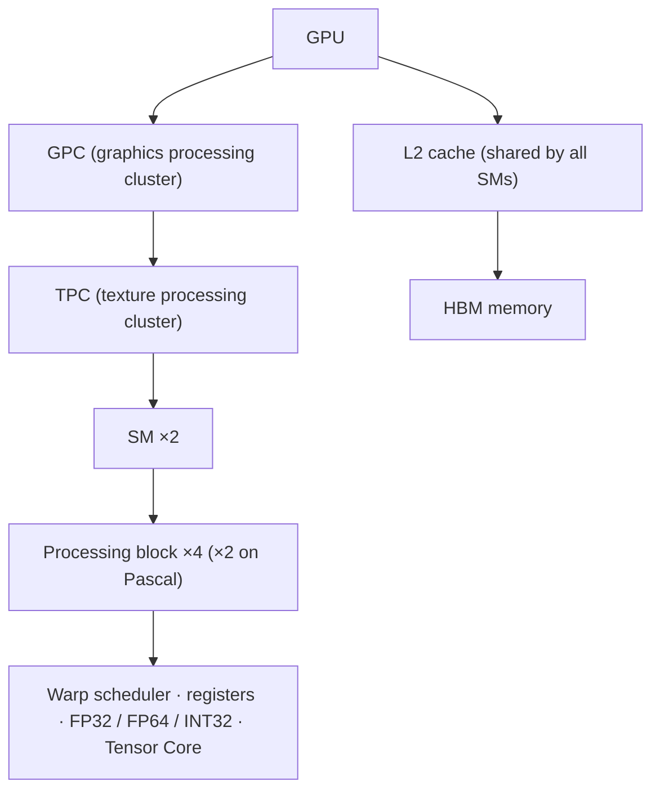

- **SM (streaming multiprocessor)**: the basic building block. A thread block runs on one SM and shares its fast on-chip memory.
- **Processing block**: a quarter of the SM. Each has its own warp scheduler, which issues one instruction per clock to a group of 32 threads (a warp).
- **L2 cache and HBM**: shared by the whole chip. Most performance work boils down to keeping data in registers and shared memory instead of going back to HBM.

## Pascal — P100

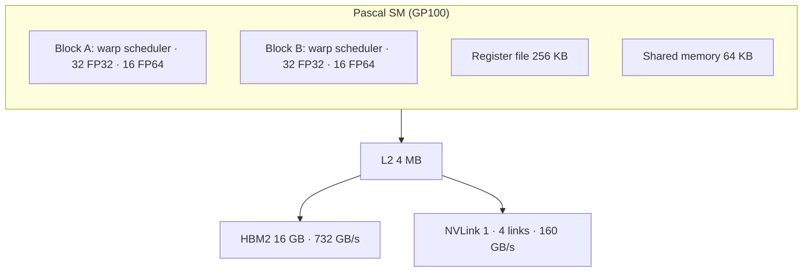

### Architecture

The GP100 SM has 64 FP32 cores split into **two** processing blocks, half as many cores per SM as Maxwell, so each core gets more registers and shared memory. FP64 runs at half the FP32 rate, which made it a strong HPC chip [[1]](https://images.nvidia.com/content/pdf/tesla/whitepaper/pascal-architecture-whitepaper.pdf).

### What changed

- **HBM2**: memory stacked next to the GPU on one package, about 3× the bandwidth of the GDDR5 cards before it.
- **NVLink 1**: a direct GPU-to-GPU link, about 5× faster than PCIe 3.0.
- **FP16 at 2× FP32**: two half-precision operations packed into one instruction. The first nod to deep learning.
- **Unified memory with page faults**: the GPU can touch memory larger than its own and pages migrate on demand.

## Volta — V100

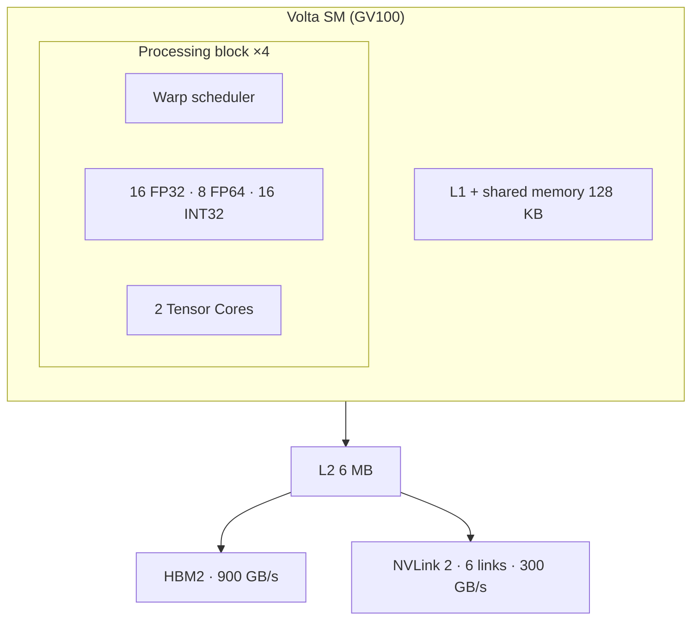

### Architecture

Back to **four** processing blocks per SM. Each block has 2 Tensor Cores (8 per SM), and each Tensor Core does a 4×4×4 FP16 matrix multiply with FP32 accumulate every clock. L1 and shared memory are merged into one 128 KB pool [[2]](https://images.nvidia.com/content/volta-architecture/pdf/volta-architecture-whitepaper.pdf).

### What changed

- **Tensor Cores**: 125 TFLOPS for deep learning versus about 15 TFLOPS from FP32 cores. From here on, AI speedups come mostly from Tensor Cores.
- **Separate INT32 units**: address math and float math issue in parallel.
- **Independent thread scheduling**: each thread has its own program counter, so threads in a warp can diverge and sync safely.
- **NVLink 2**: 6 links, 300 GB/s.

## Ampere — A100

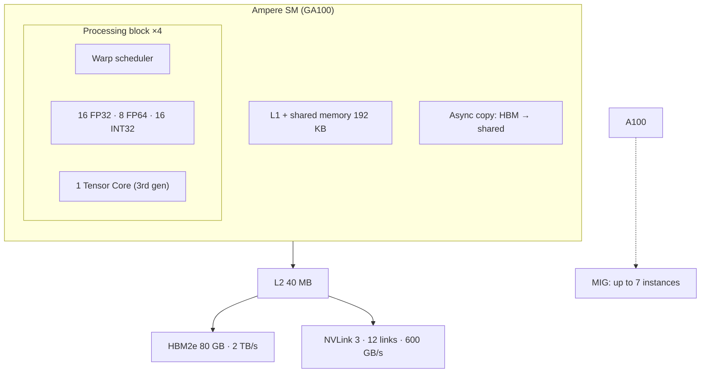

### Architecture

One Tensor Core per block, but each is 4× wider than Volta's, so per-SM throughput doubles. Shared memory grows to 192 KB, and a new **async copy** instruction moves data from global memory into shared memory without passing through registers [[3]](https://images.nvidia.com/aem-dam/en-zz/Solutions/data-center/nvidia-ampere-architecture-whitepaper.pdf).

### What changed

- **TF32**: FP32 code gets Tensor Core speed with no code change (FP32 range, 10-bit mantissa).
- **BF16** and INT8/INT4 on Tensor Cores.
- **2:4 structured sparsity**: if 2 of every 4 weights are zero, Tensor Core throughput doubles.
- **MIG**: split one A100 into up to 7 isolated GPUs with their own memory and cache.
- **L2 40 MB**: almost 7× V100, so more of the working set stays on chip.
- **NVLink 3**: 600 GB/s.

## Hopper — H100

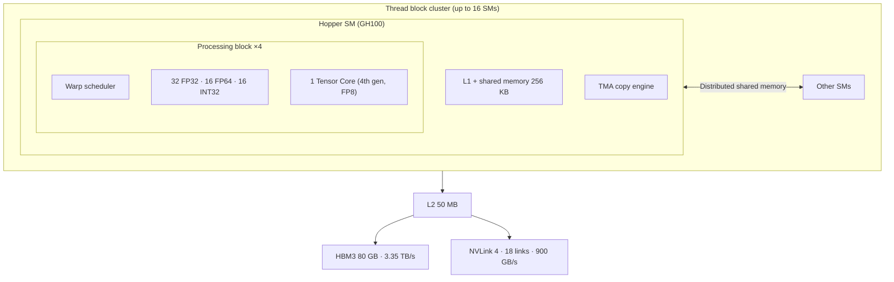

### Architecture

FP32 cores per SM double to 128. The Tensor Core doubles again and adds FP8. The **TMA** (Tensor Memory Accelerator) copies whole tiles between HBM and shared memory from one instruction, so a single thread can issue the copy while others compute. A **thread block cluster** groups blocks on neighboring SMs that can read each other's shared memory directly [[4]](https://resources.nvidia.com/en-us-tensor-core/gtc22-whitepaper-hopper).

### What changed

- **FP8 + Transformer Engine**: software picks FP8 or FP16 per layer and manages scaling. Dense FP8 is 1,979 TFLOPS.
- **TMA** and **async transaction barriers**: the basis of fast kernels such as FlashAttention-3.
- **Thread block clusters and distributed shared memory**: a new level between block and grid.
- **DPX instructions** for dynamic programming (e.g. genomics).
- **HBM3** and **NVLink 4** (900 GB/s); NVLink Switch connects up to 256 GPUs.
- **H200** is the same chip with 141 GB HBM3e at 4.8 TB/s.

## Blackwell — B200

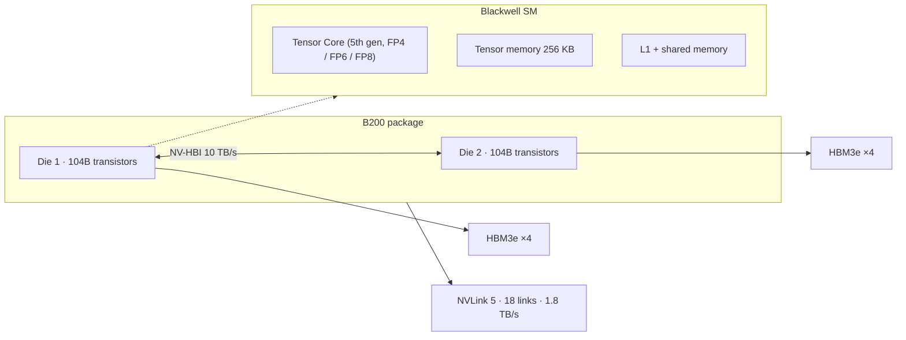

### Architecture

Each die is about as large as a die can be manufactured, so NVIDIA put **two dies** in one package, joined by a 10 TB/s link (NV-HBI). Software sees a single GPU with 8 HBM3e stacks. Inside the SM, the 5th-gen Tensor Core reads and writes a new **tensor memory** (256 KB per SM) instead of registers, which frees registers for other work [[5]](https://resources.nvidia.com/en-us-blackwell-architecture)[[7]](https://docs.nvidia.com/cuda/parallel-thread-execution/#tensor-memory).

### What changed

- **Two dies, one GPU**: 208B transistors in total.
- **FP4 and FP6** with microscaling (a shared scale per small block of values). Dense FP4 is about 9 PFLOPS, 4.5× H100's FP8.
- **2nd-gen Transformer Engine** that handles the microscaling formats.
- **NVLink 5**: 1.8 TB/s per GPU. **GB200 NVL72** links 72 GPUs into one NVLink domain.
- **Decompression engine** and a **RAS engine** for reliability at large scale.
- **B300 (Blackwell Ultra)**: 288 GB HBM3e and more FP4 throughput.

## The pattern across generations

- **The precision ladder**: FP16 (Pascal) → Tensor Core FP16 (Volta) → TF32/BF16 (Ampere) → FP8 (Hopper) → FP4 (Blackwell). Halving the bits roughly doubles throughput at the same area.
- **Compute outruns bandwidth**: FP16 FLOPS grew ~100×, HBM bandwidth ~11×. So each generation adds bigger caches, async copy engines (async copy → TMA → tensor memory), and lower-precision weights to need fewer bytes.
- **Scale-up links**: NVLink went from 160 GB/s to 1.8 TB/s, and from 4-GPU to 72-GPU domains. Large models are now built for many GPUs, not one.
- **Power**: 300 W → 1,000 W, which pushed data centers to liquid cooling.

## Pitfalls

- **Sparse vs dense**: NVIDIA headline numbers from Ampere on usually assume 2:4 sparsity (2× dense). Compare dense to dense.
- **SXM vs PCIe**: PCIe cards have lower power limits and clocks; H100 PCIe has 114 SMs and HBM2e, not 132 and HBM3.
- **H100 vs H200 vs H800**: H200 only changes memory; H800 is an export version with cut NVLink bandwidth.
- **B200 numbers vary by system**: the per-GPU figures differ between HGX B200 (1,000 W) and GB200 (higher power), so quote the system.
- **FP8/FP4 are not free**: they need scaling recipes and kernel support (Transformer Engine, cuBLASLt, newer CUDA).

## References

1. [NVIDIA Tesla P100 Whitepaper](https://images.nvidia.com/content/pdf/tesla/whitepaper/pascal-architecture-whitepaper.pdf)
2. [NVIDIA Tesla V100 GPU Architecture Whitepaper](https://images.nvidia.com/content/volta-architecture/pdf/volta-architecture-whitepaper.pdf)
3. [NVIDIA A100 Tensor Core GPU Architecture Whitepaper](https://images.nvidia.com/aem-dam/en-zz/Solutions/data-center/nvidia-ampere-architecture-whitepaper.pdf)
4. [NVIDIA H100 Tensor Core GPU Architecture Whitepaper](https://resources.nvidia.com/en-us-tensor-core/gtc22-whitepaper-hopper)
5. [NVIDIA Blackwell Architecture Technical Brief](https://resources.nvidia.com/en-us-blackwell-architecture)
6. [NVIDIA HGX Platform (B200 specs)](https://www.nvidia.com/en-us/data-center/hgx/)
7. [CUDA PTX ISA — Tensor Memory](https://docs.nvidia.com/cuda/parallel-thread-execution/#tensor-memory)
