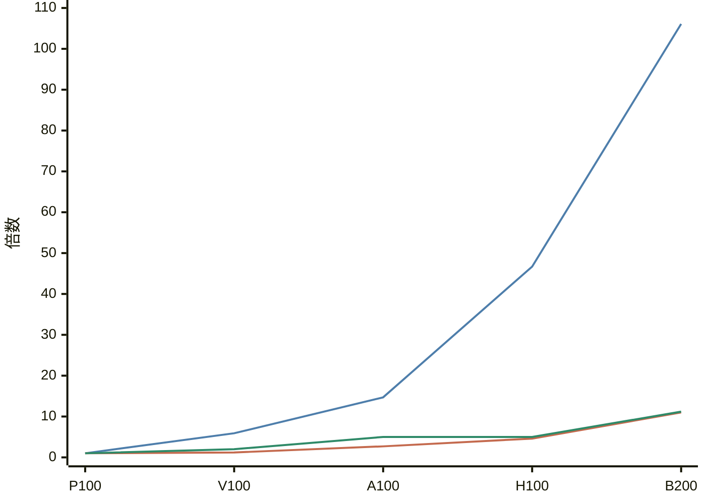

> 从 P100 到 B200，NVIDIA 数据中心 GPU 的 dense FP16 Tensor 算力增长了约 106 倍，显存带宽只增长了约 11 倍，所以每一代的新特性都围绕两件事：降低精度来提高算力，以及让数据留在片上 [[1]](https://images.nvidia.com/content/pdf/tesla/whitepaper/pascal-architecture-whitepaper.pdf)[[5]](https://resources.nvidia.com/en-us-blackwell-architecture)。

## 速览

- **Pascal（P100，2016）**：第一款使用 <mark>HBM2 和 NVLink</mark> 的 GPU，FP16 速度是 FP32 的 2 倍，还没有 Tensor Core。
- **Volta（V100，2017）**：引入 <mark>Tensor Core</mark>，一条指令完成一个小矩阵的乘加，深度学习吞吐约为 P100 的 6 倍。
- **Ampere（A100，2020）**：Tensor Core 支持 <mark>TF32、BF16</mark> 和 2:4 稀疏；新增 MIG 和异步拷贝；L2 增大到 40 MB。
- **Hopper（H100，2022）**：Tensor Core 支持 <mark>FP8</mark>；新增 <mark>TMA</mark> 拷贝引擎和 thread block cluster；功耗 700 W。
- **Blackwell（B200，2024）**：<mark>一个封装两颗 die</mark>，对外是一张 GPU；Tensor Core 支持 <mark>FP4</mark> 和 FP6；新增 tensor memory；NVLink 5 达到 1.8 TB/s。

## 规格对比

均为 SXM 版本，Tensor Core 算力为 dense（不含稀疏）[[1]](https://images.nvidia.com/content/pdf/tesla/whitepaper/pascal-architecture-whitepaper.pdf)[[2]](https://images.nvidia.com/content/volta-architecture/pdf/volta-architecture-whitepaper.pdf)[[3]](https://images.nvidia.com/aem-dam/en-zz/Solutions/data-center/nvidia-ampere-architecture-whitepaper.pdf)[[4]](https://resources.nvidia.com/en-us-tensor-core/gtc22-whitepaper-hopper)[[6]](https://www.nvidia.com/en-us/data-center/hgx/)。

| | P100 | V100 | A100 | H100 | B200 |
| --- | --- | --- | --- | --- | --- |
| 架构 | Pascal | Volta | Ampere | Hopper | Blackwell |
| 年份 | 2016 | 2017 | 2020 | 2022 | 2024 |
| 制程 | TSMC 16nm | TSMC 12nm | TSMC 7nm | TSMC 4N | TSMC 4NP |
| 晶体管 | 153 亿 | 211 亿 | 542 亿 | 800 亿 | 2080 亿（2 颗 die） |
| SM 数 | 56 | 80 | 108 | 132 | 148\* |
| 每 SM FP32 核 | 64 | 64 | 64 | 128 | 128 |
| FP32 核总数 | 3,584 | 5,120 | 6,912 | 16,896 | 18,944\* |
| Tensor Core | — | 第 1 代，640 个 | 第 3 代，432 个 | 第 4 代，528 个 | 第 5 代，592 个\* |
| 最低精度 | FP16 | FP16 | INT4 / BF16 | FP8 | FP4 |
| FP64（TFLOPS） | 5.3 | 7.8 | 9.7（Tensor 19.5） | 34（Tensor 67） | 37 |
| FP16 Tensor（TFLOPS） | 21.2（非 Tensor） | 125 | 312 | 989 | 2,250 |
| 显存 | 16 GB HBM2 | 16/32 GB HBM2 | 40/80 GB HBM2e | 80 GB HBM3 | 180 GB HBM3e |
| 显存带宽 | 0.73 TB/s | 0.9 TB/s | 2.0 TB/s | 3.35 TB/s | 8 TB/s |
| 算力 / 带宽（FLOP/byte） | 29 | 139 | 156 | 295 | 281 |
| L2 cache | 4 MB | 6 MB | 40 MB | 50 MB | 未公布 |
| NVLink（每卡总计） | 160 GB/s | 300 GB/s | 600 GB/s | 900 GB/s | 1,800 GB/s |
| TDP | 300 W | 300 W | 400 W | 700 W | 1,000 W |

\*NVIDIA 没有直接公布 B200 的 SM 数，148 来自 CUDA 查询结果，核数由 SM 数推算。

<p align="center"><strong>五代 GPU 关键规格相对 P100 的增长倍数</strong><br /><span style="color:#4E7EAB">━━ FP16 Tensor 算力</span>&emsp;<span style="color:#C46A4E">━━ 显存带宽</span>&emsp;<span style="color:#2F8A68">━━ 显存容量</span></p>



- **算力 106 倍**：最大的一跳是 Volta 引入 Tensor Core，之后每代约 2–3 倍。
- **带宽和容量各约 11 倍**：两条线几乎贴在一起，远远落后于算力。
- **算力 / 带宽**：从 29 涨到约 280 FLOP/byte。一个 kernel 每读 1 字节要做 280 次运算才能跑满 B200 的 Tensor Core，做不到就是带宽瓶颈。LLM 推理的 decode 阶段远低于这个值。
- **Tensor Core 数量**：V100 之后反而变少，因为每个 Tensor Core 每个时钟做的运算越来越多。

## GPU 的层级结构

五代 GPU 共用同一套层级，变化的是每一层的数量和 SM 内部的单元：

```text
GPU
├── GPC（Graphics Processing Cluster）× 7–8
│   └── TPC（Texture Processing Cluster）
│       └── SM × 2
│           ├── 处理块 × 4（Pascal 为 × 2）
│           │   ├── warp 调度器：每个时钟向一个 warp（32 个线程）发一条指令
│           │   ├── 寄存器堆
│           │   ├── FP32 / FP64 / INT32 单元
│           │   └── Tensor Core（Volta 起）
│           ├── L1 cache + shared memory（同一块 SRAM）
│           └── Tensor memory（Blackwell 起）
├── L2 cache（所有 SM 共享）
├── HBM 显存
└── NVLink
```

- **SM**：基本计算单元。一个 thread block 只在一个 SM 上运行，块内线程共享这个 SM 的 shared memory。
- **处理块**：SM 的四分之一，有自己的 warp 调度器和寄存器堆。
- **存储层级**：寄存器 → shared memory → L2 → HBM，越往下容量越大、越慢。大部分 kernel 优化的目标都是减少对 HBM 的访问。

## Pascal：P100


GP100 的 SM 有 64 个 FP32 核，分成两个处理块，核数只有 Maxwell SM 的一半，所以每个核分到的寄存器和 shared memory 更多。FP64 速度是 FP32 的一半，HPC 性能很强 [[1]](https://images.nvidia.com/content/pdf/tesla/whitepaper/pascal-architecture-whitepaper.pdf)。

**数据流**：


- **1 → 2 `ld.global`**：每个线程发出读指令，数据从 HBM2 读进 L2。
- **2 → 3 缓存**：数据经过 L1，同一 SM 内再次读取时可以直接命中。
- **3 → 4 装入**：数据进入线程自己的寄存器。一块数据要被多个线程复用时，线程先把它从寄存器写进 shared memory，`__syncthreads()` 之后其他线程再读。
- **4 → 5 `FFMA / HFMA2`**：FP32 核从寄存器取操作数，每个线程每个时钟做一次 FP32 乘加；FP16 用 HFMA2，一次算两个。
- **5 → 6 结果**：乘加结果写回寄存器，沿 K 方向循环累加。
- **6 → 7 `st.global`**：算完后结果从寄存器写出，进入 L2。
- **7 → 8 写回**：L2 把数据写回 HBM2。另一张 GPU 的数据可以经 NVLink 1 直接进入本卡的 L2，不经过 CPU。

**关键变化**：

- <mark>**HBM2**</mark>：显存堆叠在 GPU 旁边，和 GPU 在同一个封装里，带宽约为 GDDR5 的 3 倍。
- <mark>**NVLink 1**</mark>：GPU 之间的直连，带宽约为 PCIe 3.0 x16 的 5 倍。
- **FP16 双倍速**：一条指令处理两个打包的半精度数，FP16 算力是 FP32 的 2 倍。
- **统一内存缺页**：GPU 访问不在显存里的页面时触发缺页，再按需迁移，可以使用超过显存容量的内存。

## Volta：V100


SM 改回 4 个处理块，每块 2 个 Tensor Core，每 SM 共 8 个。每个 Tensor Core 每个时钟完成一次 4×4×4 的 FP16 矩阵乘、FP32 累加。L1 和 shared memory 合并成一块 128 KB 的 SRAM，可以按需划分 [[2]](https://images.nvidia.com/content/volta-architecture/pdf/volta-architecture-whitepaper.pdf)。

**数据流**：


- **1 → 2 `ld.global`**：线程从 HBM2 读取 A、B 的 tile，经过 L2 和 L1。
- **2 → 3 装入**：数据先进入线程的寄存器。这一步和下一步都要占用线程和寄存器。
- **3 → 4 `st.shared`**：线程把数据写进 shared memory，供整个 block 复用。
- **4 → 5 读片段**：warp 从 shared memory 读出 Tensor Core 需要的矩阵片段，放进寄存器。
- **5 → 6 `mma.sync`**（本代新增）：32 个线程协作，把寄存器里的片段交给 Tensor Core，完成一个 16×16×16 的矩阵乘。
- **6 → 7 累加**（本代新增）：结果累加到寄存器里的累加器 C，沿 K 方向循环直到算完。
- **7 → 8 `st.global`**：累加器从寄存器写回 HBM2。
- **瓶颈**：搬数据和计算靠同一批线程，线程在第 1–4 步搬运时，Tensor Core 只能等着。

**关键变化**：

- <mark>**Tensor Core**</mark>：FP16 矩阵运算 125 TFLOPS，而 FP32 核只有约 15 TFLOPS。此后 AI 算力的增长主要来自 Tensor Core。
- **独立 INT32 单元**：地址计算和浮点运算可以同时发射。
- **独立线程调度**：每个线程有自己的程序计数器，warp 内的线程分叉后可以安全地同步。
- **NVLink 2**：6 条链路，300 GB/s。

## Ampere：A100


每个处理块只剩 1 个 Tensor Core，但每个的吞吐是 Volta 的 4 倍，所以每 SM 的 Tensor 吞吐翻倍。shared memory 增大到 192 KB，新增的异步拷贝指令把数据从全局内存直接搬进 shared memory，不经过寄存器 [[3]](https://images.nvidia.com/aem-dam/en-zz/Solutions/data-center/nvidia-ampere-architecture-whitepaper.pdf)。

**数据流**：


- **1 → 2 读入**：tile 从 HBM2e 读进 L2。
- **2 → 3 `cp.async`**（本代新增）：数据从 L2 直接写进 shared memory，不经过寄存器，还可以绕过 L1。线程发出指令后不用等待，可以继续计算。
- **3 → 4 `ldmatrix`**（本代新增）：一条指令把 shared memory 里的矩阵块按 Tensor Core 需要的布局，装进整个 warp 的寄存器。
- **4 → 5 `mma.sync`**：寄存器里的片段交给 Tensor Core 做矩阵乘，和 Volta 相同。
- **5 → 6 累加**：结果累加到寄存器里的累加器。
- **6 → 7 `st.global`**：算完后累加器写回 HBM2e。
- **多级流水**：shared memory 分成几个 stage。Tensor Core 在第 4–6 步计算第 k 块时，第 k+1、k+2 块正在走第 2–3 步，拷贝时间被计算掩盖。

**关键变化**：

- <mark>**TF32**</mark>：数值范围和 FP32 相同，尾数 10 位。FP32 代码不改就能用 Tensor Core。
- <mark>**BF16、INT8、INT4**</mark>：Tensor Core 支持更多精度，BF16 成为训练的主流格式。
- **2:4 结构化稀疏**：每 4 个权重中有 2 个为零时，Tensor Core 吞吐翻倍。
- **MIG**：一张 A100 最多切成 7 个实例，每个实例有独立的 SM、显存和 L2。
- **L2 40 MB**：约为 V100 的 7 倍，更多工作集能留在片上。
- **NVLink 3**：12 条链路，600 GB/s。

## Hopper：H100


每 SM 的 FP32 核翻倍到 128 个，Tensor Core 吞吐再翻倍并支持 FP8。TMA（Tensor Memory Accelerator）用一条指令在全局内存和 shared memory 之间拷贝整块 tile：一个线程发起，其余线程继续计算。Thread block cluster 把相邻 SM 上的 block 组成一组，组内可以直接读写彼此的 shared memory [[4]](https://resources.nvidia.com/en-us-tensor-core/gtc22-whitepaper-hopper)。

**数据流**：


- **1 → 2 读入**：tile 从 HBM3 读进 L2。
- **2 → 3 TMA 加载**（本代新增）：一个线程用 tensor map 描述整块 tile，地址计算和搬运都由 TMA 硬件完成，数据写进 shared memory，完成后通过 mbarrier 通知等待的线程。cluster 内几个 SM 需要同一块数据时，TMA 可以 multicast：从 L2 读一次，同时写进这几个 SM。
- **3 → 4 `wgmma` 直接读**（本代新增）：4 个 warp（一个 warpgroup）一起发起矩阵乘，Tensor Core 直接从 shared memory 读操作数，不再需要先 `ldmatrix` 到寄存器。
- **4 → 5 累加**：结果累加到寄存器里的累加器。`wgmma` 是异步的，常见写法是 producer warp 只发 TMA，consumer warpgroup 只做计算。
- **5 → 6 `st.shared`**：算完后，累加器从寄存器写进 shared memory。
- **6 → 7 TMA 写回**（本代新增）：TMA 把整块结果从 shared memory 写回 HBM3。

**关键变化**：

- <mark>**FP8 和 Transformer Engine**</mark>：软件逐层在 FP8 和 FP16 之间选择，并管理缩放因子。dense FP8 为 1,979 TFLOPS。
- <mark>**TMA 和异步事务屏障**</mark>：拷贝和计算重叠，FlashAttention-3 等高性能 kernel 依赖这两项。
- **Thread block cluster**：在 block 和 grid 之间新增一层，组内 SM 通过分布式 shared memory 交换数据。可移植的上限是 8 个 SM，最多 16 个。
- **DPX 指令**：加速动态规划，比如基因序列比对。
- **HBM3 和 NVLink 4**：NVLink 900 GB/s，通过 NVLink Switch 最多连接 256 张 GPU。
- **H200**：同一颗芯片，显存换成 141 GB HBM3e，带宽 4.8 TB/s。

## Blackwell：B200


单颗 die 已经接近光刻能做的最大面积，所以 B200 在一个封装里放两颗 die，用 10 TB/s 的 NV-HBI 连接，软件看到的是一张带 8 个 HBM3e 堆栈的 GPU。SM 内部，第 5 代 Tensor Core 的累加结果写进新增的 tensor memory（每 SM 256 KB），不再占用寄存器 [[5]](https://resources.nvidia.com/en-us-blackwell-architecture)[[7]](https://docs.nvidia.com/cuda/parallel-thread-execution/#tensor-memory)。

**数据流**：


- **1 → 2 读入**：tile 从 HBM3e 读进 L2。另一颗 die 上的 HBM 数据经 NV-HBI 传过来，对软件透明。
- **2 → 3 TMA 加载**：和 Hopper 相同，TMA 把整块 tile 写进 shared memory。
- **3 → 4 `tcgen05.mma`**（本代新增）：一个线程就能发起矩阵乘，不再需要整个 warpgroup。Tensor Core 从 shared memory 读操作数，两个相邻 SM 还可以组成一对，共同完成一次更大的矩阵乘。
- **4 → 5 累加**（本代新增）：结果累加到 tensor memory，不再占用寄存器。
- **5 → 6 `tcgen05.ld`**（本代新增）：算完后把结果从 tensor memory 读进寄存器，在寄存器里做缩放、激活和精度转换（epilogue）。
- **6 → 7 `st.shared`**：处理后的结果写进 shared memory。
- **7 → 8 TMA 写回**：TMA 把整块结果写回 HBM3e。

**关键变化**：

- <mark>**两颗 die，一张 GPU**</mark>：共 2080 亿晶体管，晶体管数的增长来自封装，而不是更先进的制程。
- <mark>**FP4 和 FP6**</mark>：使用 microscaling 格式，每一小块数值共享一个缩放因子。dense FP4 约 9 PFLOPS，是 H100 FP8 的 4.5 倍。
- <mark>**NVFP4**</mark>：NVIDIA 自己的 FP4 格式。元素是 FP4（E2M1），每 16 个元素共享一个 FP8（E4M3）缩放因子，每个张量再有一个 FP32 缩放因子，等效约 4.5 bit。对比 OCP 标准的 MXFP4：每 32 个元素共享一个只能是 2 的幂的缩放因子（E8M0）。NVFP4 块更小、缩放更精细，量化误差更低。
- **第 2 代 Transformer Engine**：支持 microscaling 格式的缩放管理。
- **tensor memory**：Tensor Core 专用的片上存储，寄存器可以留给其他计算。
- **NVLink 5**：每卡 1.8 TB/s。GB200 NVL72 把 72 张 GPU 连成一个 NVLink 域。
- **解压缩引擎和 RAS 引擎**：分别加速数据解压和提高大规模集群的可靠性。
- **B300（Blackwell Ultra）**：显存 288 GB HBM3e，FP4 吞吐更高。

## 趋势

- **精度逐代降低**：FP16（Pascal）→ Tensor Core FP16（Volta）→ TF32 / BF16（Ampere）→ FP8（Hopper）→ FP4（Blackwell）。位宽减半，同样面积的吞吐大约翻倍。
- **算力跑赢带宽**：算力 / 带宽从 29 涨到约 280 FLOP/byte。对应的硬件变化是更大的 L2，以及越来越强的数据搬运单元：异步拷贝（Ampere）→ TMA（Hopper）→ tensor memory（Blackwell）。
- **互联规模扩大**：NVLink 从 160 GB/s 涨到 1.8 TB/s，单个 NVLink 域从 4 卡扩到 72 卡，大模型按多卡来设计。
- **功耗上升**：300 W → 1,000 W，数据中心转向液冷。

## 注意事项

- **dense 和稀疏**：从 Ampere 起，NVIDIA 宣传的算力通常按 2:4 稀疏计算，是 dense 的 2 倍。比较时要 dense 对 dense。
- **SXM 和 PCIe**：PCIe 卡的功耗和频率更低。H100 PCIe 只有 114 个 SM，显存是 HBM2e。
- **H100、H200、H800**：H200 只换了显存；H800 是出口版，NVLink 带宽被削减到 400 GB/s。
- **B200 的数字随系统变化**：HGX B200（1,000 W）和 GB200（功耗更高）的单卡规格不同，引用时要注明系统。
- **低精度需要软件支持**：FP8 和 FP4 需要缩放方案和 kernel 支持，比如 Transformer Engine、cuBLASLt 和较新的 CUDA。

## 参考资料

1. [NVIDIA Tesla P100 Whitepaper](https://images.nvidia.com/content/pdf/tesla/whitepaper/pascal-architecture-whitepaper.pdf)
2. [NVIDIA Tesla V100 GPU Architecture Whitepaper](https://images.nvidia.com/content/volta-architecture/pdf/volta-architecture-whitepaper.pdf)
3. [NVIDIA A100 Tensor Core GPU Architecture Whitepaper](https://images.nvidia.com/aem-dam/en-zz/Solutions/data-center/nvidia-ampere-architecture-whitepaper.pdf)
4. [NVIDIA H100 Tensor Core GPU Architecture Whitepaper](https://resources.nvidia.com/en-us-tensor-core/gtc22-whitepaper-hopper)
5. [NVIDIA Blackwell Architecture Technical Brief](https://resources.nvidia.com/en-us-blackwell-architecture)
6. [NVIDIA HGX Platform（B200 规格）](https://www.nvidia.com/en-us/data-center/hgx/)
7. [CUDA PTX ISA：Tensor Memory](https://docs.nvidia.com/cuda/parallel-thread-execution/#tensor-memory)
