从 P100 到 B200，NVIDIA 的 dense FP16 矩阵算力增长了约 100 倍（21 → 2,250 TFLOPS），而显存带宽只增长了约 11 倍（0.73 → 8 TB/s）。每一代新增的晶体管大多花在 Tensor Core 上，让它跑越来越低的精度，再配上更多显存和更快的互联来喂饱它 [[1]](https://images.nvidia.com/content/pdf/tesla/whitepaper/pascal-architecture-whitepaper.pdf)[[5]](https://resources.nvidia.com/en-us-blackwell-architecture)。

## 要点

- **Pascal（P100，2016）**：第一款用 HBM2 和 NVLink 的 GPU，FP16 速度是 FP32 的两倍。还没有 Tensor Core。
- **Volta（V100，2017）**：引入 **Tensor Core**，一步完成一个小矩阵的乘加。深度学习吞吐提升约 6 倍。
- **Ampere（A100，2020）**：加入 TF32 和 BF16、2:4 稀疏，以及 MIG（把一张 GPU 切成最多 7 个相互隔离的 GPU）。L2 cache 增大到 40 MB。
- **Hopper（H100，2022）**：加入 **FP8** 和 Transformer Engine、TMA 拷贝引擎、thread block cluster。功耗达到 700 W。
- **Blackwell（B200，2024）**：**一个封装里两颗 die**，对外表现为一张 GPU；加入 FP4/FP6，NVLink 5 达到 1.8 TB/s。

## 规格

SXM 版本，Tensor Core 数字为 dense（不含稀疏）[[1]](https://images.nvidia.com/content/pdf/tesla/whitepaper/pascal-architecture-whitepaper.pdf)[[2]](https://images.nvidia.com/content/volta-architecture/pdf/volta-architecture-whitepaper.pdf)[[3]](https://images.nvidia.com/aem-dam/en-zz/Solutions/data-center/nvidia-ampere-architecture-whitepaper.pdf)[[4]](https://resources.nvidia.com/en-us-tensor-core/gtc22-whitepaper-hopper)[[6]](https://www.nvidia.com/en-us/data-center/hgx/)。

关键规格的变化：

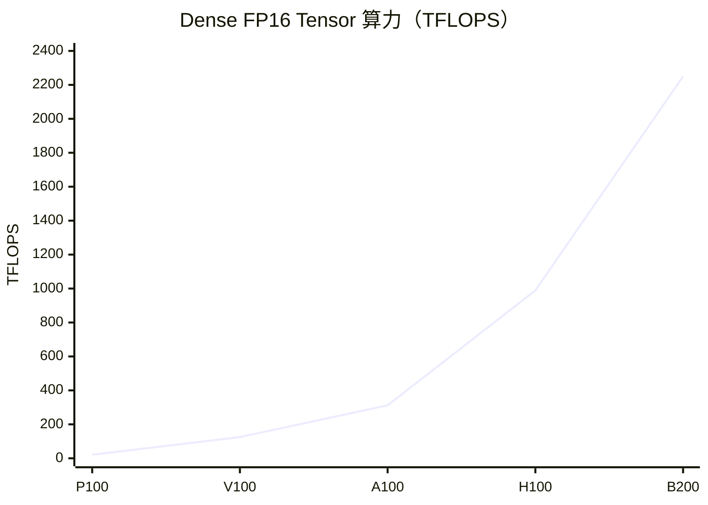

算力增长约 100 倍，最大的一跳在 Volta 引入 Tensor Core 时，之后每代大约 2–3 倍。

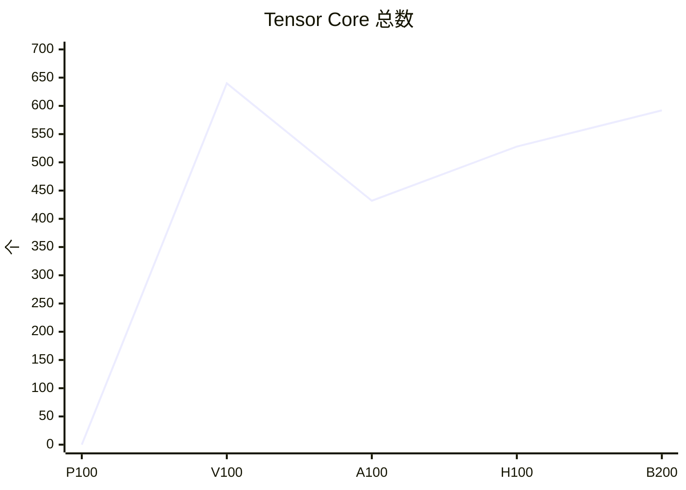

V100 之后 Tensor Core 数量反而减少了：新一代的每个核都宽得多，速度来自每个核每个时钟做的事更多，而不是核更多。

```mermaid
xychart-beta
  title "显存带宽（TB/s）"
  x-axis [P100, V100, A100, H100, B200]
  y-axis "TB/s" 0 --> 8
  line [0.73, 0.9, 2.0, 3.35, 8]
```

带宽只增长了约 11 倍，远慢于算力，所以新 GPU 越来越依赖更大的 cache 和更低的精度。

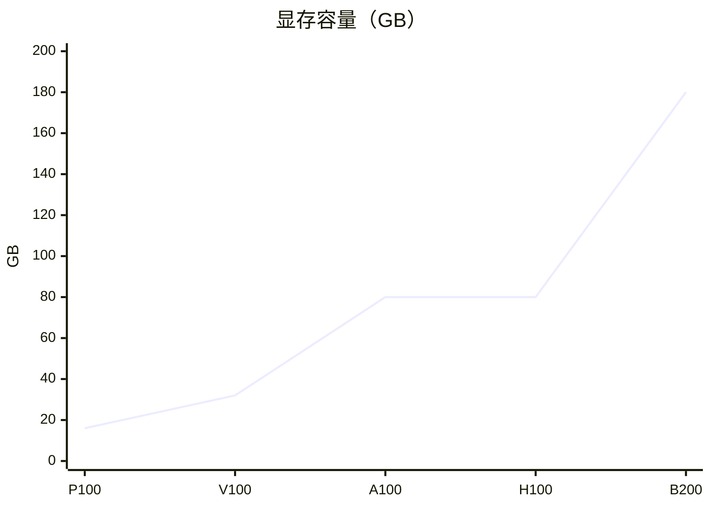

容量增长约 11 倍，从 A100 到 H100 停在 80 GB，到 B200 用 8 个 HBM3e 堆栈翻了一倍多。

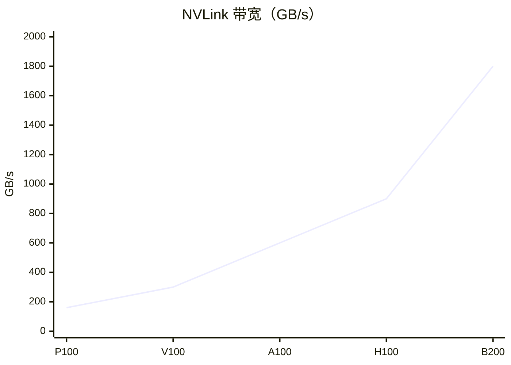

NVLink 大约每代翻一倍，总共增长约 11 倍，跟上多卡训练和推理的需求。

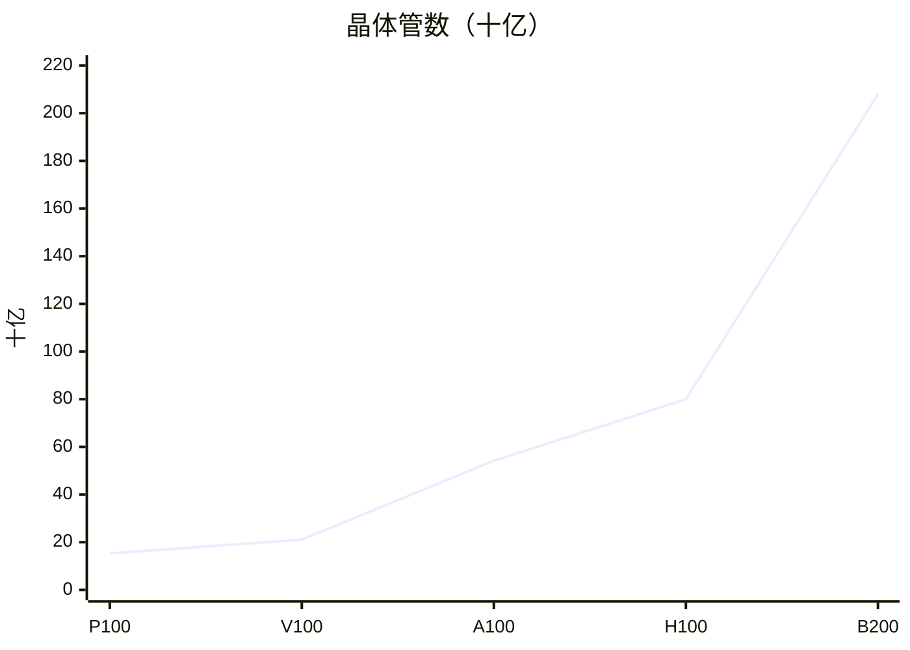

晶体管增长约 14 倍；B200 比 H100 多 2.6 倍，靠的是一个封装放两颗 die，而不是更小的制程。

```mermaid
xychart-beta
  title "TDP（W）"
  x-axis [P100, V100, A100, H100, B200]
  y-axis "W" 0 --> 1100
  line [300, 300, 400, 700, 1000]
```

功耗连续两代停在 300 W，之后涨了三倍多到 1,000 W，把数据中心推向液冷。

完整数据：

| | P100 | V100 | A100 | H100 | B200 |
|---|---|---|---|---|---|
| 架构 | Pascal | Volta | Ampere | Hopper | Blackwell |
| 年份 | 2016 | 2017 | 2020 | 2022 | 2024 |
| 制程 | TSMC 16nm | TSMC 12nm | TSMC 7nm | TSMC 4N | TSMC 4NP |
| 晶体管 | 153 亿 | 211 亿 | 542 亿 | 800 亿 | 2080 亿（2 颗 die） |
| 启用的 SM | 56 | 80 | 108 | 132 | 148 |
| 每 SM FP32 核数 | 64 | 64 | 64 | 128 | 128 |
| CUDA 核（FP32，总数） | 3,584 | 5,120 | 6,912 | 16,896 | 18,944* |
| Tensor Core 代数 | — | 第 1 代 | 第 3 代 | 第 4 代 | 第 5 代 |
| 每 SM Tensor Core | — | 8 | 4 | 4 | 4 |
| Tensor Core 总数 | — | 640 | 432 | 528 | 592* |
| Tensor Core 精度 | — | FP16 | FP64、TF32、BF16、FP16、INT8、INT4 | FP64、TF32、BF16、FP16、FP8、INT8 | FP64、TF32、BF16、FP16、FP8、FP6、FP4、INT8 |
| FP64（TFLOPS） | 5.3 | 7.8 | 9.7（Tensor 19.5） | 34（Tensor 67） | 37 |
| Dense FP16（TFLOPS） | 21.2 | 125 | 312 | 989 | 2,250 |
| 显存 | 16 GB HBM2 | 16/32 GB HBM2 | 40/80 GB HBM2e | 80 GB HBM3 | 180 GB HBM3e |
| 带宽 | 0.73 TB/s | 0.9 TB/s | 2.0 TB/s | 3.35 TB/s | 8 TB/s |
| L2 cache | 4 MB | 6 MB | 40 MB | 50 MB | 未公布 |
| NVLink（总计） | 160 GB/s | 300 GB/s | 600 GB/s | 900 GB/s | 1,800 GB/s |
| TDP | 300 W | 300 W | 400 W | 700 W | 1,000 W |

P100 的 FP16 数字来自普通计算核，不是 Tensor Core。\*B200 的核数由 148 个 SM × 每 SM 的数量推算，NVIDIA 没有直接公布。

## GPU 的结构

五代 GPU 共用同一套层级结构，变的只是数量和 SM 内部的单元。

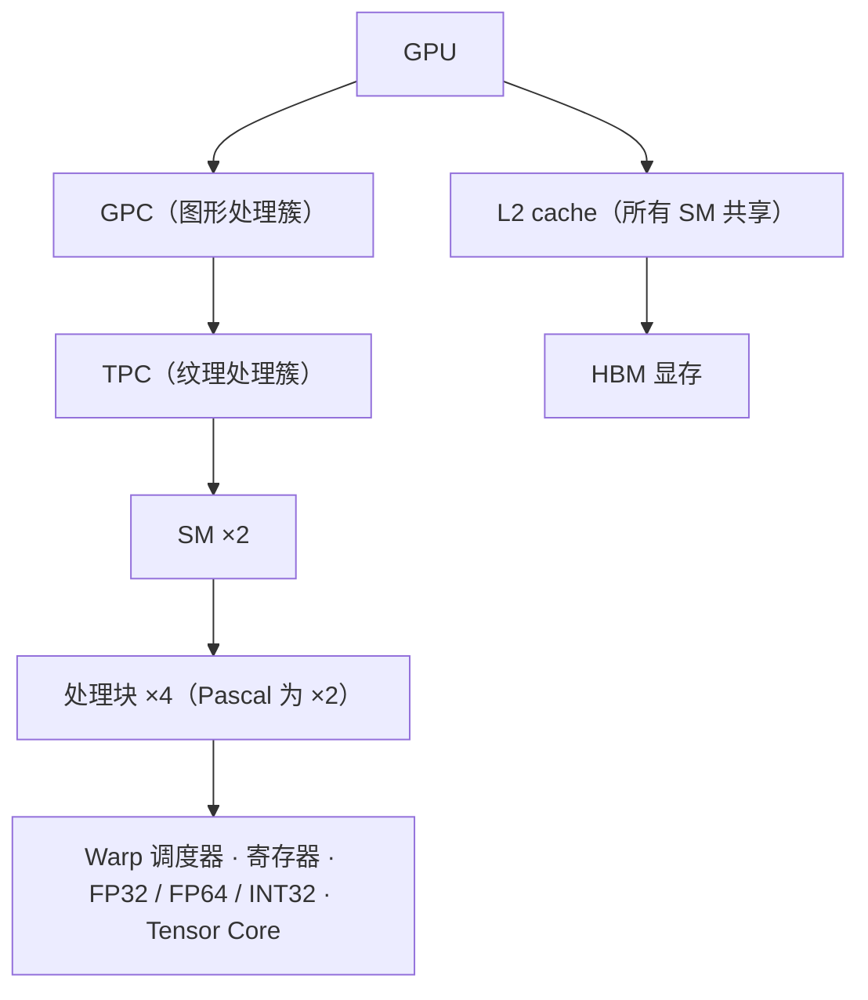

- **SM（流式多处理器）**：基本构建单元。一个 thread block 在一个 SM 上运行，共享它的片上高速存储。
- **处理块**：SM 的四分之一。每块有自己的 warp 调度器，每个时钟向一组 32 个线程（一个 warp）发出一条指令。
- **L2 cache 和 HBM**：整个芯片共享。大部分性能优化，归根结底就是让数据留在寄存器和 shared memory 里，不要回到 HBM。

## Pascal — P100

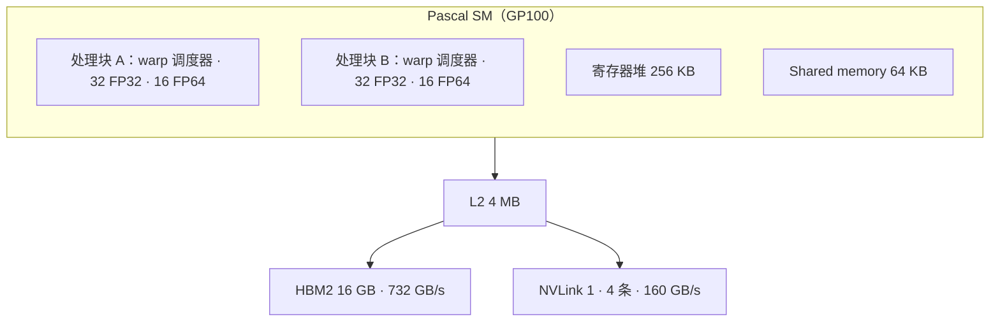

### 架构

GP100 的 SM 有 64 个 FP32 核，分成**两个**处理块，每个 SM 的核数是 Maxwell 的一半，因此每个核分到更多的寄存器和 shared memory。FP64 速度是 FP32 的一半，这让它成为很强的 HPC 芯片 [[1]](https://images.nvidia.com/content/pdf/tesla/whitepaper/pascal-architecture-whitepaper.pdf)。

### 改了什么

- **HBM2**：显存堆叠在 GPU 旁边、同一个封装里，带宽约为之前 GDDR5 卡的 3 倍。
- **NVLink 1**：GPU 之间的直连，速度约为 PCIe 3.0 的 5 倍。
- **FP16 速度为 FP32 的 2 倍**：一条指令打包两个半精度运算。第一次向深度学习示好。
- **支持缺页的统一内存**：GPU 能访问比自身显存更大的内存，页面按需迁移。

## Volta — V100

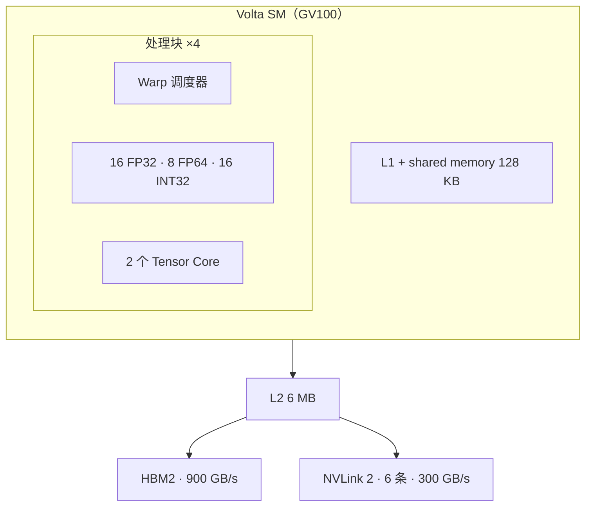

### 架构

每个 SM 回到**四个**处理块。每块有 2 个 Tensor Core（每 SM 8 个），每个 Tensor Core 每个时钟做一次 4×4×4 的 FP16 矩阵乘、FP32 累加。L1 和 shared memory 合并成一个 128 KB 的池 [[2]](https://images.nvidia.com/content/volta-architecture/pdf/volta-architecture-whitepaper.pdf)。

### 改了什么

- **Tensor Core**：深度学习 125 TFLOPS，而 FP32 核只有约 15 TFLOPS。从这以后，AI 的提速主要来自 Tensor Core。
- **独立的 INT32 单元**：地址计算和浮点计算可以并行发射。
- **独立线程调度**：每个线程有自己的程序计数器，warp 内的线程可以安全地分叉和同步。
- **NVLink 2**：6 条，300 GB/s。

## Ampere — A100

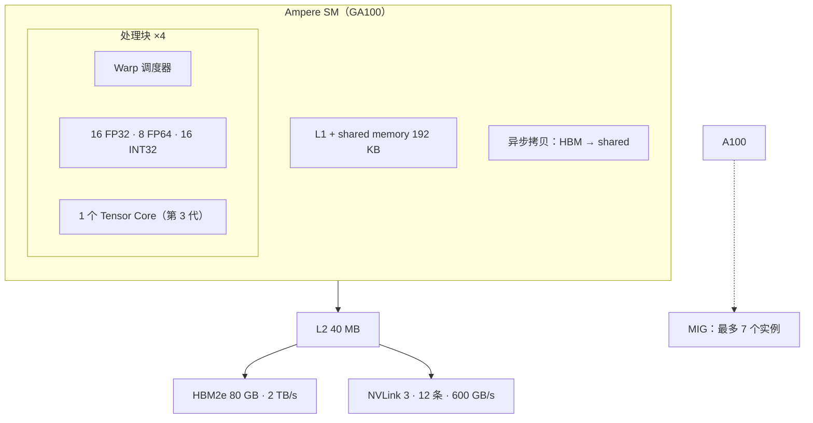

### 架构

每个处理块只有 1 个 Tensor Core，但宽度是 Volta 的 4 倍，所以每 SM 的吞吐翻倍。shared memory 增大到 192 KB，新增的**异步拷贝**指令能把数据从全局内存直接搬到 shared memory，不经过寄存器 [[3]](https://images.nvidia.com/aem-dam/en-zz/Solutions/data-center/nvidia-ampere-architecture-whitepaper.pdf)。

### 改了什么

- **TF32**：FP32 代码不用改就能获得 Tensor Core 的速度（FP32 的数值范围，10 位尾数）。
- Tensor Core 支持 **BF16** 和 INT8/INT4。
- **2:4 结构化稀疏**：每 4 个权重里有 2 个为零时，Tensor Core 吞吐翻倍。
- **MIG**：一张 A100 最多切成 7 个相互隔离的 GPU，各自有独立的显存和 cache。
- **L2 40 MB**：接近 V100 的 7 倍，更多工作集能留在片上。
- **NVLink 3**：600 GB/s。

## Hopper — H100

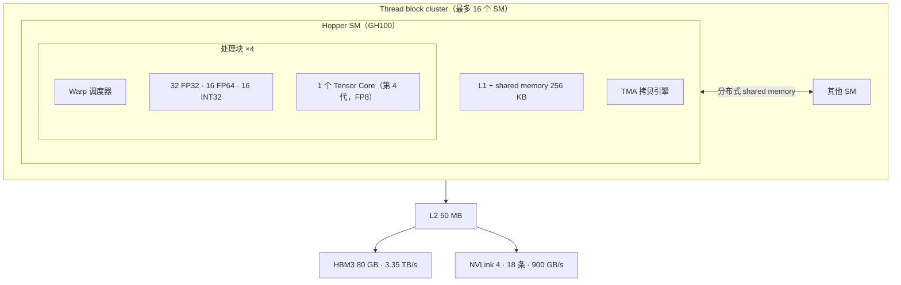

### 架构

每 SM 的 FP32 核翻倍到 128 个。Tensor Core 再翻一倍，并支持 FP8。**TMA**（Tensor Memory Accelerator）一条指令就能在 HBM 和 shared memory 之间拷贝整块 tile，一个线程发起拷贝，其余线程继续计算。**Thread block cluster** 把相邻 SM 上的 block 组成一组，它们可以直接读写彼此的 shared memory [[4]](https://resources.nvidia.com/en-us-tensor-core/gtc22-whitepaper-hopper)。

### 改了什么

- **FP8 + Transformer Engine**：软件逐层选择 FP8 或 FP16，并管理缩放。Dense FP8 为 1,979 TFLOPS。
- **TMA** 和**异步事务屏障**：FlashAttention-3 等高速 kernel 的基础。
- **Thread block cluster 和分布式 shared memory**：在 block 和 grid 之间新增的一层。
- **DPX 指令**，用于动态规划（比如基因组学）。
- **HBM3** 和 **NVLink 4**（900 GB/s）；NVLink Switch 最多连接 256 张 GPU。
- **H200** 是同一颗芯片，换成 141 GB HBM3e，带宽 4.8 TB/s。

## Blackwell — B200

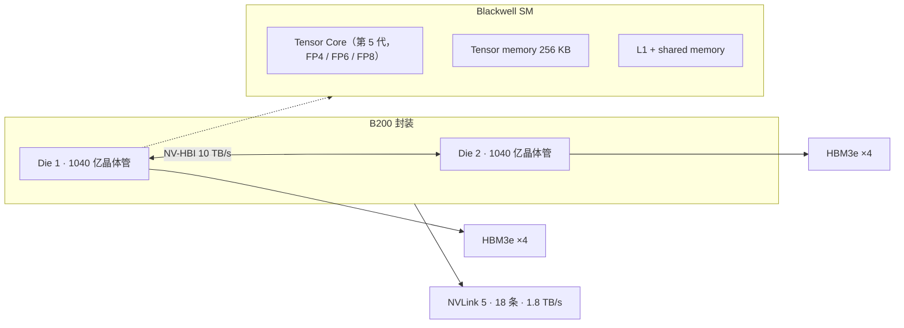

### 架构

每颗 die 已经接近能制造的最大尺寸，所以 NVIDIA 在一个封装里放了**两颗 die**，用 10 TB/s 的链路（NV-HBI）连起来。软件看到的是一张有 8 个 HBM3e 堆栈的 GPU。SM 内部，第 5 代 Tensor Core 读写新增的 **tensor memory**（每 SM 256 KB），而不是寄存器，把寄存器腾出来做别的事 [[5]](https://resources.nvidia.com/en-us-blackwell-architecture)[[7]](https://docs.nvidia.com/cuda/parallel-thread-execution/#tensor-memory)。

### 改了什么

- **两颗 die，一张 GPU**：总共 2080 亿晶体管。
- **FP4 和 FP6**，带 microscaling（每一小块数值共享一个 scale）。Dense FP4 约 9 PFLOPS，是 H100 FP8 的 4.5 倍。
- **第 2 代 Transformer Engine**，支持 microscaling 格式。
- **NVLink 5**：每张 GPU 1.8 TB/s。**GB200 NVL72** 把 72 张 GPU 连成一个 NVLink 域。
- **解压缩引擎**和 **RAS 引擎**，保证大规模下的可靠性。
- **B300（Blackwell Ultra）**：288 GB HBM3e，FP4 吞吐更高。

## 趋势

- **精度阶梯**：FP16（Pascal）→ Tensor Core FP16（Volta）→ TF32/BF16（Ampere）→ FP8（Hopper）→ FP4（Blackwell）。位数减半，同样面积下吞吐大约翻倍。
- **算力跑赢带宽**：FP16 FLOPS 增长约 100 倍，HBM 带宽约 11 倍。所以每代都加大 cache、加入异步拷贝引擎（异步拷贝 → TMA → tensor memory），并用更低精度的权重来减少字节数。
- **Scale-up 互联**：NVLink 从 160 GB/s 涨到 1.8 TB/s，从 4 卡域扩到 72 卡域。大模型现在是为多卡设计的，而不是单卡。
- **功耗**：300 W → 1,000 W，把数据中心推向液冷。

## 注意事项

- **稀疏和 dense**：从 Ampere 起，NVIDIA 宣传的数字通常假设 2:4 稀疏（dense 的 2 倍）。比较时要 dense 对 dense。
- **SXM 和 PCIe**：PCIe 卡的功耗上限和频率更低；H100 PCIe 只有 114 个 SM、用 HBM2e，不是 132 个 SM 和 HBM3。
- **H100、H200、H800**：H200 只换了显存；H800 是出口版，NVLink 带宽被削减。
- **B200 的数字因系统而异**：HGX B200（1,000 W）和 GB200（功耗更高）的单卡数字不同，引用时要说明是哪个系统。
- **FP8/FP4 不是白来的**：需要缩放方案和 kernel 支持（Transformer Engine、cuBLASLt、较新的 CUDA）。

## 参考资料

1. [NVIDIA Tesla P100 Whitepaper](https://images.nvidia.com/content/pdf/tesla/whitepaper/pascal-architecture-whitepaper.pdf)
2. [NVIDIA Tesla V100 GPU Architecture Whitepaper](https://images.nvidia.com/content/volta-architecture/pdf/volta-architecture-whitepaper.pdf)
3. [NVIDIA A100 Tensor Core GPU Architecture Whitepaper](https://images.nvidia.com/aem-dam/en-zz/Solutions/data-center/nvidia-ampere-architecture-whitepaper.pdf)
4. [NVIDIA H100 Tensor Core GPU Architecture Whitepaper](https://resources.nvidia.com/en-us-tensor-core/gtc22-whitepaper-hopper)
5. [NVIDIA Blackwell Architecture Technical Brief](https://resources.nvidia.com/en-us-blackwell-architecture)
6. [NVIDIA HGX Platform (B200 specs)](https://www.nvidia.com/en-us/data-center/hgx/)
7. [CUDA PTX ISA — Tensor Memory](https://docs.nvidia.com/cuda/parallel-thread-execution/#tensor-memory)
