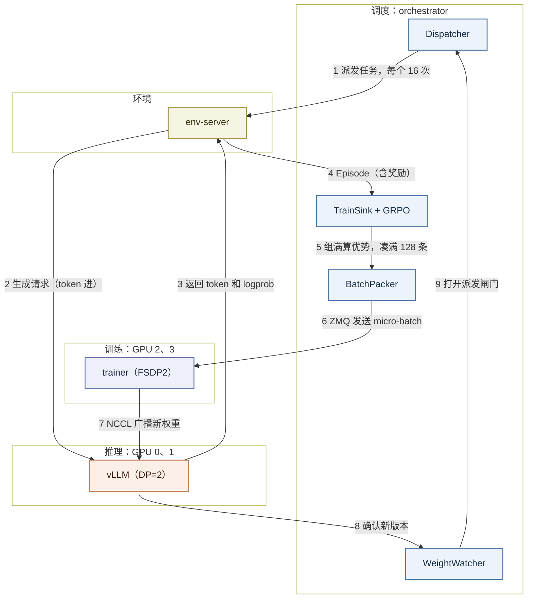
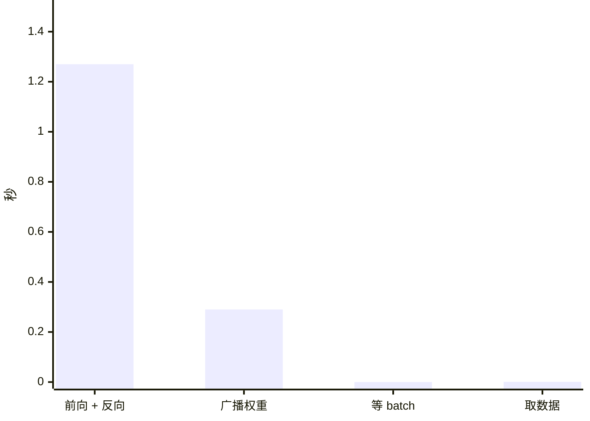
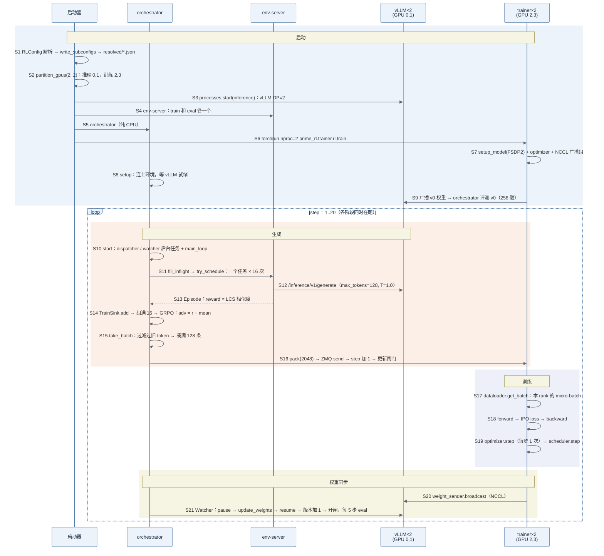

> 代码版本：`prime-rl@a566e5d8`（2026-10-29，0.10.0）。运行环境：4 × H100 NVL 94GB，`uv sync --all-extras` 装出的 `torch 2.13`（cu130）、`vllm 0.32`、`flash-attn 2.8.3`、`transformers 5.19`。文中数值都来自本机跑通的 reverse-text 例子，代码行号对应上述 commit。

## prime-rl Overview

prime-rl 是 Prime Intellect 开源的大模型强化学习框架，INTELLECT-2/3 都用它训练。它和 verl、slime 最大的不同是：**没有 Ray，也没有一个总控制器**，推理和训练放在不同的卡上，异步地同时运行。

入门时先记住四个角色，它们是四类独立的进程：

| 角色       | 进程            | 职责                                                 |
| ---------- | --------------- | ---------------------------------------------------- |
| 调度       | `orchestrator`  | 派发任务、收集结果、算优势、凑 batch 发给 trainer    |
| 环境       | `env-server`    | 把任务变成请求发给 vLLM，再给回答打分               |
| 推理       | `inference`     | vLLM server，生成回答，接收新权重                    |
| 训练       | `trainer`       | torchrun + FSDP2，收到一批就训一步，把新权重广播出去 |

它们之间不共享内存，只走网络协议：

| 从 → 到                     | 方式  | 传什么                       |
| --------------------------- | ----- | ---------------------------- |
| orchestrator → env-server   | HTTP  | 要跑的任务                   |
| env-server → vLLM           | HTTP  | token 进、token 出的生成请求 |
| orchestrator → trainer      | ZMQ   | 打包好的训练数据             |
| trainer → vLLM              | NCCL  | 新权重                       |

所以四类进程可以拆到不同的机器上，这是 INTELLECT 系列做跨地域训练的基础。



下面解释图中 9 个步骤，数值取自后文 reverse-text 例子：每步 128 条 = 8 个任务 × 16，GPU 0、1 跑 vLLM，GPU 2、3 跑 trainer，共 20 步。这 9 步不是一步接一步地执行，而是同时在跑的流水线：trainer 训练第 n 步时，vLLM 已经在为后面的步生成数据。

- **1 派发任务，每个 16 次**：`Dispatcher` 只要还有并发名额、派发闸门是开的，就从训练集取一个任务，把同一个任务拆成 16 次独立的 run 发给 env-server。

    - 任务（task）：一道待回答的题。reverse-text 的任务是"把一段文字逐字符反转"，训练集 1000 道，评测集 256 道。

    - group：同一个任务的 16 次 run 组成一组，GRPO 在组内比较好坏。

        ```text
        task 42 → group 42，group_size=16
        run 42/0, 42/1, ..., 42/15   逐个发出，谁先完成谁先回来
        ```

    - 并发名额：`max_inflight` 默认 1024，即最多同时有 1024 次 run 在跑，相当于 8 个 batch。

    - 派发闸门：控制 orchestrator 比 vLLM 的权重版本领先多少，见第 9 步。

- **2 生成请求（token 进）**：env-server 把任务拼成聊天消息，由 renderer 在客户端套模板、转成 token，再调用 vLLM 的 `/inference/v1/generate`。最多生成 128 个 token，temperature=1.0。

    - 消息内容：

        ```text
        system: Reverse the text character-by-character. Put your answer in <reversed_text> tags.
        user:   The community in Bruck was merged into it
        ```

    - renderer：`prime-qwen3`，把消息转成 Qwen3 格式的 token。分词在客户端做，vLLM 收到的就是 token id，返回的也是 token id，训练用的 token 和生成时的完全一致。

    - 评测走另一个接口：评测只需要文本，用的是普通的 `/v1/chat/completions`。

- **3 返回 token 和 logprob**：vLLM 返回生成的 token、每个 token 的 logprob，以及生成时用的权重版本。

    - logprob：在 prime-rl 里，这份 vLLM 算出的 logprob 就是训练用的"行为策略"概率。trainer 不再重算 old logprob，省掉一次前向（见第 7 步）。

    - 权重版本：每个 token 都记下是哪个版本的权重生成的，后面靠它算 staleness。

    - 第 1 步：prompt 平均 54 个 token，回答平均 111 个 token。

- **4 Episode（含奖励）**：env-server 从回答里取出 `<reversed_text>...</reversed_text>` 中间的文字，和正确答案比较相似度，作为奖励。完成的 Episode 回到 orchestrator。

    - 奖励：用 Python 的 `SequenceMatcher` 算两个字符串的相似度，0 到 1。

        ```text
        正确答案："ti otni degrem saw kcurB ni ytinummoc ehT"
        回答完全一致                         → 1.0
        回答有几个字符错位                   → 例如 0.93
        128 个 token 内没写完 </reversed_text> → 取不到答案，0.0
        ```

    - 第 1 步平均奖励 0.212，73% 的回答写满 128 个 token 被截断，所以起点很低。

    - Episode：一次 run 的完整记录，包括 token、mask、logprob、权重版本和奖励。

- **5 组满算优势，凑满 128 条**：orchestrator 把回来的 Episode 放进 `TrainSink`。同一组 16 条到齐后才算 GRPO 优势；攒够 128 条组成一个训练 batch。

    - GRPO 优势：只减组均值，不除标准差。

        ```text
        组均值 = 0.41
        奖励 1.0 → 优势 +0.59
        奖励 0.0 → 优势 −0.41
        ```

        verl、slime 的 GRPO 会再除以组标准差；prime-rl 不除，这是 Dr. GRPO 的做法，避免方差很小的组被放大。

    - staleness：一个 token 是几步之前的权重生成的。超过 `max_staleness=8` 的 token 不进 loss；一条样本的 token 全部过旧，整条丢掉。

- **6 ZMQ 发送 micro-batch**：`BatchPacker` 把 128 条"prompt + 回答"拼成长度 2048 的 packed 序列，按 2 个 trainer rank 切开，经 ZMQ 发出去。发送会阻塞到 trainer 来取，发完训练步数加 1。

    - packed 序列：把多条短样本首尾相接拼成一条长序列，再用 `position_ids` 和每条的长度告诉 attention 边界在哪，避免 padding 浪费算力。

        ```text
        128 条 × 平均 165 token ≈ 21,000 token
        拼成长度 2048 的序列：约 11 条
        rank 0 ← 约 5–6 条，rank 1 ← 约 5–6 条（按平均长度估算）
        ```

    - ZMQ：一个轻量的消息队列库，这里点对点地把字节发给 trainer，不经过任何中间存储。

- **7 NCCL 广播新权重**：trainer 收到一批数据后，用当前模型算 logprob，和 vLLM 的 logprob 一起算 IPO loss，做 1 次 `optimizer.step`，然后把完整参数通过 NCCL 广播给 2 个 vLLM。

    - IPO loss：直接用 π_θ / π_vLLM 作为重要性比率，而不是 π_θ / π_old。

        ```text
        ratio = exp(trainer_logprob − vllm_logprob)
        |p_trainer − p_vllm| > 0.3 的 token：mask 掉，不参与 loss（信任域）
        ratio 的前向值截断到 1e4，梯度照常传
        loss = −advantage × ratio
        ```

    - 每步约 1.76 s：前向 + 反向约 1.27 s，广播权重约 0.29 s，约 15k tokens/s。

    - NCCL 广播：trainer 和 vLLM 在不同的卡上，不能用 CUDA IPC，改用 NCCL 把权重从 trainer 的 GPU 直接发到 vLLM 的 GPU。

- **8 确认新版本**：orchestrator 的 `WeightWatcher` 发现新版本发布后，先取消过旧的 rollout，再让 vLLM 暂停、接收并加载 NCCL 发来的权重、恢复生成，最后把策略版本号更新为新版本。

    - vLLM 侧的请求顺序：`POST /pause?mode=keep` → `POST /update_weights` → `POST /resume`。`mode=keep` 让正在生成的请求原地暂停，换完权重接着生成，所以一条回答的前半段和后半段可能来自不同版本。

- **9 打开派发闸门**：orchestrator 比较已发出的 batch 数和 vLLM 的权重版本，领先超过 1 步就关闸，不再派发新的训练 rollout；新版本到位后重新打开。

    - 闸门公式：

        ```text
        lead = (progress.step − 1) − policy.version
        lead > 1（TARGET_LAG） → 关闸，暂停派发新任务
        lead ≤ 1              → 开闸
        ```

    - 闸门只管"新派发"：已经在跑的、已经跑完在队列里排队的 rollout 都不受影响。

    - 本例 staleness 为什么涨到 8：启动时闸门是开的，Dispatcher 按 1024 的并发上限一口气派发了约 8 个 batch 的 rollout，全部用 v0 权重生成。之后 trainer 每步取一批，第 k 步取到的还是 v0 的数据，staleness 就是 k − 1，第 9 步到 8。第 10 步 v0 的数据超过上限，157 条被丢掉，之后 staleness 回落到 1–2。

        ```text
        step     1   2   3   ...   9   10        11–20
        staleness 0   1   2   ...   8   丢 157 条  1–2
        ```

<br />
<br />

## 代码在哪里

```text
prime-rl/
├── src/prime_rl/entrypoints/
│   └── rl.py                       # rl 启动器：拆配置、分 GPU、起 4 类进程
├── src/prime_rl/orchestrator/
│   ├── orchestrator.py             # Orchestrator：setup / start / main_loop / finalize_train_batch / 派发闸门
│   ├── dispatcher.py               # 按并发名额派发 rollout（train / eval 两种）
│   ├── train_sink.py               # 收 Episode → 组满算优势 → 凑满 batch → 过滤过旧 token
│   ├── algo/grpo.py                # GRPO：优势 = 奖励 − 组均值
│   ├── batch.py                    # BatchPacker：打包成 packed 序列
│   └── watcher.py                  # WeightWatcher：等新版本发布 → 让 vLLM 加载
├── src/prime_rl/trainer/rl/
│   ├── train.py                    # trainer 主循环：收 batch → 前向反向 → step → 广播
│   ├── loss.py                     # IPOLoss 等
│   └── data.py                     # 从 ZMQ 收数据
├── src/prime_rl/transports/
│   ├── batch/zmq.py                # orchestrator → trainer 的数据通道
│   └── weights/nccl.py             # trainer → vLLM 的权重通道
├── src/prime_rl/inference/         # vLLM server 和补丁
├── packages/prime-rl-configs/      # 所有 pydantic 配置
├── deps/verifiers/environments/    # 环境：reverse_text、gsm8k、wordle ...
└── examples/basic/reverse-text/    # 本文的例子：sft.toml、rl.toml
```

<br />
<br />

## 安装

### 更新代码

`origin` 是自己的 fork，最新代码在官方仓库，所以先把官方仓库加成 `upstream`：

```bash
git remote add upstream https://github.com/PrimeIntellect-ai/prime-rl.git   # 只需第一次
git fetch upstream
git checkout main
git rebase --autostash upstream/main     # 未提交的改动自动收起，做完再放回
git submodule update --init -- deps/verifiers deps/renderers deps/prime-envs deps/pydantic-config   # 子模块跟着更新
```

- `--autostash`：有未提交的改动时，rebase 会拒绝执行；加上它就自动 stash 和 pop。
- 子模块：verifiers（环境框架）、renderers（聊天模板）、prime-envs、pydantic-config 都是子模块，主仓库更新后要重新同步。

### 安装

官方用 uv，仓库自带 `uv.lock`：

```bash
uv sync --all-extras                                          # 装 prime-rl 本身和所有 extra
uv sync --all-extras --inexact --package prime-rl --package reverse-text   # 环境是可选的 workspace 成员，要单独装
source .venv/bin/activate
```

- `--all-extras`：flash-attn、vLLM 等都在 extra 里，flash-attn 用的是预编译 wheel，不用本地编译。
- `--package reverse-text`：每个环境是一个独立的 workspace 包，`uv sync --all-extras` 默认不装，要训练哪个就装哪个。
- `--inexact`：只增不删，不卸载已经装好的其他环境。
- `source .venv/bin/activate`：`rl` 启动器按名字调用 `inference`、`orchestrator`、`env-server`、`torchrun` 这些命令，`.venv/bin` 必须在 PATH 里，否则报 `FileNotFoundError: 'inference'`。也可以用 `uv run rl ...`。

本机遇到的问题：

| 现象                                                  | 原因                            | 解决                                                                        |
| ----------------------------------------------------- | ------------------------------- | --------------------------------------------------------------------------- |
| `git@github.com: Permission denied`                   | `.gitmodules` 用的是 SSH 地址   | `git -c url."https://github.com/".insteadOf="git@github.com:" submodule update --init ...` |
| `git-lfs: command not found`                          | prime-envs 子模块用了 LFS        | `GIT_LFS_SKIP_SMUDGE=1 git submodule update ...`                            |
| `mooncake-transfer-engine ... manylinux_2_35`         | 宿主机 glibc 是 2.34            | 在 Ubuntu 24.04 容器里用 `/usr/bin/python3.12` 建 venv，再在容器里运行     |
| `The prime monitor found no Prime API key`            | 默认开启 Prime 平台的监控       | 加 `--no-monitors.prime`；W&B 用 `WANDB_MODE=disabled`                       |

### 检查安装

```bash
uv run python -c "import torch, vllm, flash_attn, reverse_text; print(torch.__version__, vllm.__version__, torch.cuda.is_available())"
uv run rl @ examples/basic/reverse-text/rl.toml --dry-run True    # 只解析配置，写出 resolved/*.json，不启动进程
```

- `--dry-run True`：把最终生效的配置写到 `configs/attempt_1/resolved/` 下，可以先检查 GPU 划分、loss 类型这些推导出来的值。

<br />
<br />

## 提 PR 流程

规则以官方的 `AGENTS.md` 和 `docs/development.md` 为准。

### 1. 建分支

```bash
git fetch upstream
git checkout -b fix/<主题> upstream/main    # bug 用 fix/，功能用 feat/，杂项用 chore/，实验用 exp/
```

动手前先查重，已有 open PR 修同一个问题就不要再开：

```text
https://github.com/PrimeIntellect-ai/prime-rl/pulls?q=is%3Apr+<关键词>
```

### 2. 测试

```bash
uv run pre-commit install                   # 只需第一次，之后每次 commit 自动跑 ruff check 和 ruff format
uv run pytest tests/unit -m "not gpu" -v    # CPU 单元测试，和 CPU CI 一样
uv run pytest tests/integration/test_reverse_text.py -vvs   # 端到端：tiny 模型跑一遍 RL
```

- 一律用 `uv run`：不要直接调 `python`，保证用的是锁定的环境。
- 测试分三层：`tests/unit/`（快、隔离的逻辑）、`tests/integration/`（tiny 模型跑完整 RL/SFT）、`tests/regression/`（每晚跑）。
- 测试写法：普通函数 + pytest fixture，不写 class 风格的测试；只测纯函数、数据变换、算法这类逻辑清楚的代码，不为框架胶水代码写一堆 mock。
- 不要随便加测试：改现有测试可以，新增测试文件或测试函数要有明确必要。
- GPU 测试：推送到 PR 不会跑 GPU CI。要跑时由有权限的人给 PR 打 `gpu-ci` 标签，工作流开始后会自动去掉标签，新推送后要重新打。fork 来的 PR 跑不了 GPU CI，需要维护者把分支推到主仓库。

### 3. 提交

```bash
git add <文件>                             # 不要 git add .
git commit -m "fix(trainer): <描述>"
git push -u origin fix/<主题>
```

commit 标题和 PR 标题用 Conventional Commits 格式，括号里写模块：

```text
fix(ckpt): restore optimizer param groups when resuming with optimizer state offload
feat(trainer): add a fixed sample length to fake RL data
perf(deepseek-v4): balance indexer scoring across CP ranks
refactor(trainer)!: fold multimodal into trainer/vlm.py
```

- 类型：`feat`、`fix`、`perf`、`refactor`、`chore`、`docs`、`test` 等。
- 破坏兼容：类型后面加 `!`，比如 `refactor(trainer)!:`。
- 依赖：加依赖写进 `pyproject.toml` 再 `uv sync --all-extras`；git 依赖的 `rev` 用 7 位短 hash。
- 不要改 `.venv/`：下次 `uv sync` 会覆盖，也不会同步给别人。

### 4. 开 PR

```bash
gh pr create --draft --base main --title "fix(trainer): <描述>" --body-file pr.md
```

- 先开 draft：避免不必要地触发 CI，准备好了再转成 ready。
- 正文：写清楚改了什么、为什么；只有真的跑过测试，才写 test plan。

```markdown
## Summary

Fixes #<issue>. <一两句话：问题是什么、怎么修。>

## Changes

- `src/prime_rl/xxx.py`: <改了什么、为什么>

## Test plan

- `uv run pytest tests/unit/test_xxx.py -v`：修复前失败，修复后通过
```

- 文档：`docs/` 只描述 `main` 的现状，不写"以前是 X"、迁移路径这类历史。

### 5. 更新 PR

**情况 1：改代码或回应 review（最常见）**

```bash
git checkout fix/<主题>
# 修改代码
git add <文件>
git commit -m "fix(trainer): address review comments"
git push                                   # 普通推送，PR 自动出现新提交
gh pr edit <编号> --body-file pr.md        # 每次推送后同步更新 PR 描述，让它反映分支现状
```

**情况 2：上游 main 更新了，需要同步或解决冲突**

```bash
git fetch upstream
git rebase upstream/main       # 把你的提交搬到 upstream 最新代码后面
git push --force-with-lease    # rebase 改写了历史，必须强制推送
```

- 没有冲突：rebase 自动完成，直接 push。
- 有冲突：编辑冲突文件，删掉 `<<<<<<<`、`=======`、`>>>>>>>` 标记，`git add <文件>`，再 `git rebase --continue`。有合并冲突的 PR 跑不了 GPU CI。
- 想放弃：`git rebase --abort`，回到 rebase 之前的状态。

<br />
<br />

## 跑通第一个例子：reverse-text GRPO

用 `PrimeIntellect/Qwen3-0.6B-Reverse-Text-SFT`（已经做过 SFT 的 0.6B 模型）学习逐字符反转文字，4 张卡：GPU 0、1 跑 vLLM，GPU 2、3 跑 trainer，共 20 步。配置是 TOML + pydantic，命令行用 `--a.b-c value` 覆盖（字段名里的下划线写成连字符）。

### 1. 准备数据和模型

reverse-text 的数据和模型都在 Hugging Face 上，第一次运行时自动下载。离线运行就先下载好：

```bash
uv run python -c "from huggingface_hub import snapshot_download as s; s('PrimeIntellect/Qwen3-0.6B-Reverse-Text-SFT')"
uv run python -c "from huggingface_hub import snapshot_download as s; s('PrimeIntellect/Reverse-Text-RL', repo_type='dataset')"
```

- 数据集：每行一段英文，答案就是它的逆序（`row["prompt"][::-1]`），训练 1000 道、评测 256 道。
- 模型：官方用 `examples/basic/reverse-text/sft.toml` 在 Qwen3-0.6B 上 SFT 100 步得到。本机自己跑过一次，SFT 后奖励 0.72，和官方权重的起点相当。

### 2. 启动训练

`examples/basic/reverse-text/rl.toml` 的内容：

```toml
max_steps = 20                       # 共 20 步
seq_len = 2048                       # packed 序列长度

[model]
name = "PrimeIntellect/Qwen3-0.6B-Reverse-Text-SFT"   # trainer 和 vLLM 共用的初始权重

[orchestrator]
batch_size = 128                     # 每步 128 条 rollout

[orchestrator.train]
group_size = 16                      # 每个任务跑 16 次 → 每步 8 个任务

[orchestrator.train.sampling]
max_completion_tokens = 128          # 回答最长 128 token

[[orchestrator.train.source]]
name = "reverse-text"
env.taskset.id = "reverse-text"      # verifiers 的 taskset
env.agent.harness.id = "null"        # 单轮，不需要 agent 框架
env.agent.runtime.type = "subprocess"

[orchestrator.eval]
interval = 5                         # 每 5 步评测一次（训练前也评测一次）

[[orchestrator.eval.source]]
name = "reverse-text-eval"
select.limit = 256                   # 评测 256 道
env.taskset.id = "reverse-text"

[trainer.optim]
lr = 3e-6                            # 学习率

[orchestrator.renderer]
name = "prime-qwen3"                 # 聊天模板；名字带 -SFT 后缀匹配不到默认映射，要显式指定

[inference]                          # 有这一节，rl 启动器才会在本机起 vLLM
```

启动：

```bash
source .venv/bin/activate
export WANDB_MODE=disabled HF_HUB_OFFLINE=1
ARGS=(
    @ examples/basic/reverse-text/rl.toml          # 读 TOML，下面的参数覆盖它
    --deployment.num-train-gpus 2                  # trainer 用 2 张卡
    --deployment.num-infer-gpus 2                  # vLLM 用 2 张卡 → 自动设成 DP=2
    --output-dir rl_study/runs/prime               # 输出目录
    --run.name rl_reverse_text                     # 本次运行的名字，日志在 <output-dir>/<name>/logs/
    --clean True                                   # 清掉同名的旧输出
    --dashboard False                              # 不起本地看板
    --no-monitors.prime                            # 关掉 Prime 平台监控（需要 API key）
)
rl "${ARGS[@]}"
```

- `@ file.toml`：pydantic-config 的写法，先读文件，再用后面的命令行参数覆盖。
- 完整脚本在 `rl_study/scripts/prime_ex2_rl.sh`，用 `rl_study/scripts/inbox.sh` 在容器里运行。

### 3. 关键配置

除了 TOML 里写的，下面这些是默认值或自动推导出来的（`--dry-run True` 可以看到）：

| 配置                                     | 含义                              | 取值                 |
| ---------------------------------------- | --------------------------------- | -------------------- |
| `orchestrator.batch_size`                | 每步 rollout 数                   | 128                  |
| `orchestrator.train.group_size`          | 每个任务跑几次                    | 16                   |
| `orchestrator.max_staleness`             | token 最多可以落后几个版本        | 8（默认）            |
| `orchestrator.concurrency.max_inflight`  | 同时在跑的 rollout 上限           | 1024（默认）         |
| `trainer.loss.type` / `eps`              | loss 类型 / 信任域阈值            | ipo / 0.3（默认）    |
| `trainer.loss.max_importance_ratio`      | 重要性比率前向截断                | 1e4（默认）          |
| `inference.vllm.data_parallel_size`      | vLLM DP                           | 2（由推理卡数推导）  |
| `inference.vllm.gpu_memory_utilization`  | vLLM 显存比例                     | 0.9（独占卡，默认）  |
| `weight_broadcast.type`                  | 训练 → 推理的权重传输             | nccl                 |

### 4. 结果分析

总耗时 4 分 19 秒，其中 vLLM 启动和 torch.compile 约 2.5 分钟。

| step   | 训练平均奖励 | 评测奖励        | 截断率 | Max Staleness |
| ------ | ------------ | --------------- | ------ | ------------- |
| 0      | –            | 0.104（训练前） | 86.3%  | –             |
| 1      | 0.212        |                 | 73.4%  | 0             |
| 5      | 0.170        | 0.756           | 78.1%  | 4             |
| 10     | 0.316        | 0.820           | 56.2%  | 8             |
| 15     | 0.714        | 0.824           | 0.8%   | 4             |
| 20     | 0.715        | 0.820           | 0.0%   | 1             |

- 起点低主要是截断：128 个 token 内写不完 `</reversed_text>` 就得 0 分。RL 很快学会"写短、写完整"，截断率从 73% 降到 0。
- 前 9 步训练奖励几乎不涨：这几步训练用的都是 v0 生成的旧数据（staleness 从 0 涨到 8），奖励反映的是 v0 的水平。第 10 步起换上新数据，奖励立刻跳到 0.3–0.7。
- 评测比训练奖励先涨：评测在第 5 步用的是 v5 权重，已经学到了不截断，奖励 0.756。
- `Mismatch KL`（trainer 和 vLLM 的 logprob 差）随 staleness 增大到 0.045，staleness 回落后降到 0.002。这就是 IPO 需要信任域 mask 的原因。

trainer 每步约 1.76 s，构成如下：



- 等 batch 几乎为 0：数据一直是现成的，trainer 是瓶颈。orchestrator 那边每步要等 trainer 约 1.4 s（日志里的 `Orchestrator waited ... for policy updates`）。
- 第 1 步 59 s：等第一批数据 40 s（vLLM 还在 warm-up），前向反向 18.6 s（torch.compile）。
- 约 15k tokens/s、MFU 约 3%：0.6B 模型、序列很短，通信和 kernel 启动开销占了大头。

<br />
<br />

## 一步训练时序图

整个训练分成两段：

- 启动（S1–S9，只执行一次）：解析配置、分 GPU，依次启动 vLLM、env-server、orchestrator 和 trainer，trainer 初始化模型和 NCCL，把 v0 权重广播给 vLLM，orchestrator 在评测集上测一次。
- 每步循环（S10–S21）：orchestrator 持续派发任务 → env-server 调 vLLM 生成并打分 → 组满算优势、凑满 128 条 → 打包经 ZMQ 发给 trainer → trainer 前向、IPO loss、1 次 `optimizer.step` → NCCL 广播新权重 → vLLM 加载、版本号加 1、重新开闸，每 5 步评测一次。生成和训练是重叠的，图里按一个 batch 的生命周期画。

图中编号 S1–S21 和下一节的代码一一对应。图中简称与源码的对应：

| 图中简称      | 源码                                         |
| ------------- | -------------------------------------------- |
| 启动器        | `rl` 命令（`entrypoints/rl.py` 的 `rl_local`） |
| Dispatcher    | `orchestrator/dispatcher.py` 的 `Dispatcher` |
| TrainSink     | `orchestrator/train_sink.py` 的 `TrainSink`  |
| Watcher       | `orchestrator/watcher.py` 的 `WeightWatcher` |
| env-server    | verifiers 的环境服务（reverse-text）         |



<br />
<br />

## 代码逐步详解（带入数值）

每一步都按同样的顺序讲：**做什么 → 代码 → 带入数值 → 这一步的结果**。编号和上面的时序图一一对应。

例子的配置：

- GPU 0、1：vLLM，DP=2；GPU 2、3：trainer，FSDP2，torchrun 2 个 rank。
- `batch_size=128`、`group_size=16`：每步 8 个任务 × 16 次。
- `max_completion_tokens=128`：回答最长 128 token。
- `seq_len=2048`：packed 序列长度。
- `max_steps=20`：只跑 20 步。
- `loss=ipo`、`eps=0.3`、`lr=3e-6`。
- `max_staleness=8`、`TARGET_LAG=1`、`max_inflight=1024`。

### 第一阶段：启动（S1–S9，只执行一次）

#### S1: 解析配置，拆成子配置

**目的**：读 TOML 和命令行，校验并推导出完整配置，再拆成每个进程各自的配置文件。

代码位置：`entrypoints/rl.py:562`、`:177`、`:160`、`packages/prime-rl-configs/src/prime_rl/configs/rl.py:618`

```python
config_dir, log_dir = prepare_attempt_dirs(config.run_dir)  # runs/prime/rl_reverse_text/{configs,logs}/attempt_1

write_subconfigs(config, config_dir)  # 拆成 resolved/{trainer,orchestrator,inference}.json 和 envs/{train,eval}/*.json
```

```python
if num_infer_gpus != self.inference.vllm.data_parallel_size * self.inference.vllm.tensor_parallel_size:
    self.inference.vllm.data_parallel_size = num_infer_gpus // self.inference.vllm.tensor_parallel_size  # 推理卡数没用满就自动加 DP
```

**带入数值**：

- 推理卡 2，默认 DP=1、TP=1，2 ≠ 1，所以 DP 改成 2 // 1 = 2。
- 推导出的值：`loss.type=ipo`、`eps=0.3`、`weight_broadcast.type=nccl`、`inference_world_size=2`、vLLM 地址 `http://localhost:8000/v1`。

**结果**：`attempt_1/resolved/` 下有了每个进程的 JSON 配置。

<br />

#### S2: 切分 GPU

**目的**：决定哪几张卡给推理、哪几张给训练。

代码位置：`entrypoints/rl.py:206`、`utils/process.py:61`

```python
infer_gpu_ids, trainer_gpu_ids = partition_gpus(num_infer_gpus, config.deployment.num_train_gpus)  # 前 num_infer 张给推理，后面的给训练
```

**带入数值**：物理卡 [0, 1, 2, 3]，推理 2 张、训练 2 张，所以推理 [0, 1]、训练 [2, 3]。日志 `Starting inference on GPU(s) 0 1`、`Starting trainer on GPU(s) 2 3`。

**结果**：GPU 划分确定。

<br />

#### S3: 启动 vLLM

**目的**：在 GPU 0、1 上启动 vLLM 的 OpenAI 兼容 server。

代码位置：`entrypoints/rl.py:241`

```python
processes.start("inference", ["inference", "@", "resolved/inference.json"], env={..., "CUDA_VISIBLE_DEVICES": "0,1"}, log_path=log_dir / "inference.log")  # 一个子进程，DP=2 时内部起 2 个 engine
```

**带入数值**：

- 端口 8000，DP=2，TP=1，`gpu_memory_utilization=0.9`（推理独占这两张卡）。
- prime-rl 通过 vLLM 插件加了权重接收、`/inference/v1/generate` 等接口。

**结果**：vLLM 开始加载模型、编译，这一步最慢，约 2 分钟。

<br />

#### S4: 启动 env-server

**目的**：为训练和评测各启动一个环境服务。

代码位置：`entrypoints/rl.py:282`

```python
for split, source in env_servers(config):  # train: reverse-text；eval: reverse-text-eval
    processes.start(f"{split} env server {name}", ["env-server", "@", f"envs/{split}/{name}.json"], ...)
```

**带入数值**：两个 env-server，都是纯 CPU 进程。日志 `Starting reverse-text server`、`Starting reverse-text-eval server`。

**结果**：环境服务就绪，等 orchestrator 连上来。

<br />

#### S5: 启动 orchestrator

**目的**：启动调度进程。

代码位置：`entrypoints/rl.py:290`

```python
processes.start("orchestrator", ["orchestrator", "@", "resolved/orchestrator.json"], ...)  # 纯 CPU 的 asyncio 进程
```

**结果**：orchestrator 开始初始化（S8）。

<br />

#### S6: 启动 trainer

**目的**：用 torchrun 在 GPU 2、3 上启动 2 个训练 rank。

代码位置：`entrypoints/rl.py:309`、`:340`

```python
processes.start("trainer", torchrun_cmd("prime_rl.trainer.rl.train", "resolved/trainer.json", 2, log_dir, ...), env={..., "CUDA_VISIBLE_DEVICES": "2,3"})  # torchrun --nproc-per-node 2

processes.wait("trainer", "orchestrator")  # 启动器之后就只等这两个进程正常退出
```

**带入数值**：2 个 rank，各占 1 张卡。启动器不参与任何调度，只负责起进程和等它们退出。

**结果**：四类进程都在运行。

<br />

#### S7: trainer 初始化

**目的**：加载模型并用 FSDP2 切分，创建优化器和学习率调度，建好到 vLLM 的 NCCL 广播组。

代码位置：`trainer/rl/train.py:97`、`:161`、`:182`

```python
model = setup_model(config.model, parallel_dims, loading_from_ckpt_later)  # HF 模型 + FSDP2，2 个 rank 各存一半参数

optimizer, gradient_manager = setup_optimizer(...)  # AdamW(lr=3e-6)，优化器状态放 CPU

scheduler = setup_scheduler(optimizer, ...)  # constant

weight_sender = setup_weight_broadcast(config.weight_broadcast)  # NCCL：trainer ↔ 2 个 vLLM rank，端口 29501
```

**带入数值**：

- FSDP2 `dp_shard=2`：参数、梯度切成 2 份，每卡 1 份。
- 日志 `Wrapping optimizer with CPUOffloadOptimizer`：Adam 的状态放 CPU，每卡显存峰值只有 7.9 GiB。
- 日志 `Initializing weight broadcast (... port=29501 inference_world_size=2 type='nccl')`。

**结果**：trainer 就绪，等第一批数据。

<br />

#### S8: orchestrator 初始化

**目的**：连上两个 env-server 和 vLLM，准备打包器、ZMQ 发送端和权重接收端。

代码位置：`orchestrator/orchestrator.py:202`、`:220`

```python
self.clients = InferenceClient(..., train_client_type="renderer", renderer_config=config.renderer)  # 训练请求走 renderer：客户端分词，token 进 token 出

self.packer = BatchPacker(config)  # 打包器（S16）

self.sender = setup_batch_sender(config.rollout_transport)  # 默认 ZMQ

await self.train_envs.start()  # 日志：Env reverse-text ready (num_tasks=1000)

await self.admin_plane.wait_for_ready(model_name)  # 日志：Waiting for inference server at http://localhost:8000 to start up
```

**带入数值**：训练任务 1000 道，评测任务 256 道（`select.limit=256`）。

**结果**：orchestrator 等 vLLM 起来，再进入主循环。

<br />

#### S9: 广播 v0 权重，评测 v0

**目的**：第一步之前先把 trainer 的权重广播一次，确认推理端和训练端的初始权重一致、广播链路通畅；然后测一次起点。

代码位置：`trainer/rl/train.py:294`、`:299`

```python
startup_version = progress.step - 1  # 0

weight_sender.broadcast(model, startup_version)  # 日志：Broadcasting startup policy weights (v0) to inference engines
```

**带入数值**：

- v0 评测：256 题，用时 31.6 s，奖励 0.104，截断率 86.3%。
- vLLM 日志里 `/init_broadcaster` 出现 1 次，之后每次广播都对应一次 `/pause` → `/update_weights` → `/resume`，共 21 次（v0–v20）。

**结果**：所有组件就绪，流水线开始运转。

### 第二阶段：生成（S10–S16，orchestrator 持续在跑）

下面以第 1 步的 batch 为例。

<br />

#### S10: 启动后台任务和主循环

**目的**：同时跑三件事：派发 rollout、监听新权重、处理回来的结果。

代码位置：`orchestrator/orchestrator.py:412`、`:535`

```python
asyncio.create_task(self.dispatcher.start(), name="dispatcher")  # 后台：不停派发 rollout（S11）

asyncio.create_task(self.watcher.start(), name="watcher")  # 后台：等新版本发布（S21）

await self.main_loop()  # 前台：从 dispatcher.out_q 取结果，交给 TrainSink（S14–S16）
```

```python
item = await asyncio.wait_for(self.dispatcher.out_q.get(), timeout=0.5)  # main_loop：取一个完成的 Episode

train_batch = await self.train_sink.add(episode)  # 交给 TrainSink；凑满就返回一个 batch

await self.handle_train_result(train_batch)  # 有 batch 就发给 trainer（S16）
```

**结果**：三个协程在同一个事件循环里并发运行。

<br />

#### S11: 派发 rollout

**目的**：只要有并发名额、闸门开着，就不断派发训练 rollout。

代码位置：`orchestrator/dispatcher.py:401`、`:443`

```python
while True:
    if self.available_permits <= 0 or self.admission_budget() <= 0:
        return  # 没有并发名额
    if not self.dispatch_allowed.is_set():
        return  # 闸门关着（S16 / S21 更新）
    scheduled = await self.try_schedule("train")  # 派发一次 run
```

```python
for gid, group in list(self.groups.items()):  # try_schedule：优先继续派发还没发满 16 次的组，这样同组请求挨在一起，前缀缓存命中更多
    ...
fresh = self.next_fresh_group("train", envs)  # 没有未发满的组，就从训练集取一个新任务
```

**带入数值**：

- 每次派发占 1 个名额，上限 1024，即最多 64 组同时在跑。
- 启动时闸门是开的，所以一开始就派发了约 8 个 batch 的量，全部用 v0 生成。这是后面 staleness 涨到 8 的原因。
- 评测 rollout 不受闸门限制：每 5 步切到 `PREFER_EVAL` 模式，256 道评测题插队生成。

**结果**：大量 rollout 在 env-server 和 vLLM 上并发运行。

<br />

#### S12: env-server 调用 vLLM

**目的**：把任务拼成消息，用 renderer 转成 token，调用 vLLM 生成。

代码位置：`deps/verifiers/environments/reverse_text/reverse_text/taskset.py:14`、`:53`

```python
SYSTEM = "Reverse the text character-by-character. Put your answer in <reversed_text> tags."  # system prompt

ReverseTextData(prompt=row["prompt"], system_prompt=SYSTEM, answer=row["prompt"][::-1])  # 答案就是原文逆序
```

```text
# 请求示意：renderer（prime-qwen3）在客户端把 system + user 消息转成 token id
POST /inference/v1/generate      token id 进，最多 128 个 token，temperature 1.0
→ 返回 token id、每个 token 的 logprob、生成时的权重版本
```

**带入数值**：

- user 内容例如 `The community in Bruck was merged into it`，答案 `ti otni degrem saw kcurB ni ytinummoc ehT`。
- 第 1 步 prompt 平均 54 个 token，回答平均 111 个、最短 26 个、最长 128 个。
- 整个训练过程 vLLM 收到 2824 次 `/inference/v1/generate`（训练）和 1280 次 `/v1/chat/completions`（5 次评测 × 256 题）。

**结果**：env-server 拿到回答的 token、logprob 和版本号。

<br />

#### S13: 打分

**目的**：从回答里取出标签中的文字，和答案比较相似度。

代码位置：`reverse_text/taskset.py:17`、`:31`

```python
_TAG = re.compile(r"<reversed_text>(.*?)</reversed_text>", re.DOTALL)  # 必须有完整的开闭标签

@vf.reward(weight=1.0)
async def lcs(self, trace: vf.Trace) -> float:
    completion = trace.last_reply  # 模型的最后一次回答（单轮只有一次）
    match = _TAG.search(completion or "")
    response = match.group(1).strip() if match else ""  # 没写完标签 → 空字符串
    return SequenceMatcher(None, response, self.data.answer).ratio()  # 0 到 1 的相似度
```

**带入数值**：

- 完全一致得 1.0；空字符串和答案的相似度是 0。
- 第 1 步平均 0.212，73.4% 被截断。

**结果**：Episode（token、mask、logprob、版本号、奖励）回到 orchestrator 的 `dispatcher.out_q`。

<br />

#### S14: 组满，算 GRPO 优势

**目的**：同组 16 条到齐后，用组均值做基线算优势。

代码位置：`orchestrator/train_sink.py:193`、`:291`、`orchestrator/algo/grpo.py:60`、`:85`、`:92`

```python
rewards = torch.tensor([trace.reward for trace in traces], dtype=torch.float32)  # 16 个 LCS 分数

shaped_rewards = rewards  # 没有配置长度惩罚

baseline = shaped_rewards.mean()  # 组均值

advantages = shaped_rewards - baseline  # 不除以标准差

for trace, advantage in zip(traces, advantages.tolist(), strict=True):
    assign_advantages(trace, advantage)  # 写到这条 trace 每个可训练 token 上
```

**带入数值**：一组 16 个分数的均值是 0.41：

- 奖励 1.0：优势 1.0 − 0.41 = +0.59。
- 奖励 0.93：优势 +0.52。
- 奖励 0.0：优势 −0.41。
- 16 条全是 0（全部截断）的组，优势全是 0，不贡献梯度。

**结果**：这一组的 16 条进入待训练队列 `pending_batch`。

<br />

#### S15: 过滤过旧 token，凑满 128 条

**目的**：每步扫一遍待训练队列，把超过 `max_staleness` 的 token 移出 loss；剩下的够 128 条就组成一个 batch。

代码位置：`orchestrator/train_sink.py:232`、`:238`、`orchestrator/utils.py:43`

```python
self._drop_stale()  # 先过滤

return await self.process_batch() if len(self.pending_batch) >= self.batch_size else None  # 够 128 条才出 batch
```

```python
min_version = min_fresh_version(self.progress.step, self.config.max_staleness)  # (step − 1) − 8，比它旧的版本算过旧

masked = [mask_stale_tokens(sample, ..., policy.start, min_version) for sample in samples]  # 过旧的 token 移出 loss

del self.pending_batch[trace_id]  # 全部 token 都过旧的样本，整条丢掉
```

**带入数值**：

- 第 1–9 步：`min_version = (step − 1) − 8 ≤ 0`，v0 的数据都还能用。
- 第 10 步：`min_version = 9 − 8 = 1`，队列里剩下的 v0 数据全部过旧，日志 `Dropped 157 queued traces with every token past max_staleness=8`。
- 本例 `staleness/token/masked` 一直是 0：一条回答很短，不会出现前半段新、后半段旧的情况，要么整条可用，要么整条丢掉。

**结果**：一个 128 条的 `TrainBatch`。

<br />

#### S16: 打包，发给 trainer，更新闸门

**目的**：把 128 条拼成 packed 序列，按 trainer rank 切开，经 ZMQ 发出；发完步数加 1，并重新计算闸门。

代码位置：`orchestrator/orchestrator.py:665`、`:713`、`:718`、`:720`、`:1102`、`orchestrator/batch.py:707`、`transports/batch/zmq.py:37`

```python
micro_batch_grid = await asyncio.to_thread(self.packer.pack, batch.samples)  # 拼成 seq_len=2048 的 packed 序列，按 2 个 rank 切成网格

send_batch_time = await self.sender.send(micro_batch_grid)  # ZMQ；阻塞到每个 trainer rank 都来取

self.progress.step += 1  # 发完，步数加 1

self.update_dispatch_gate()  # 重新计算闸门
```

```python
lead = (self.progress.step - 1) - self.policy.version  # 已发出的 batch 数 − vLLM 的权重版本

if lead > TARGET_LAG:  # TARGET_LAG = 1
    gate.clear()  # 关闸：暂停派发新的训练 rollout
else:
    gate.set()  # 开闸
```

**带入数值**：

- 128 条 × 平均 165 token ≈ 21,000 token，拼成约 11 条长度 2048 的序列，两个 rank 各约 5–6 条（按平均长度估算）。
- 打包约 0.01 s。
- `send` 阻塞的时间就是在等 trainer：本例中位数约 1.4 s，说明 trainer 是瓶颈。
- 第 1 步发完：`progress.step=2`，`policy.version=0`，lead = 1 − 0 = 1，不超过 1，闸门开着。

**结果**：trainer 收到第 1 步的数据。

### 第三阶段：训练（S17–S19，trainer 每步一次）

<br />

#### S17: 收数据

**目的**：从 ZMQ 收到属于本 rank 的 micro-batch 列表。

代码位置：`trainer/rl/train.py:276`、`:314`、`trainer/rl/data.py:258`

```python
while True:  # trainer 主循环：收一批，训一步
    micro_batches = dataloader.get_batch()  # 阻塞，直到 orchestrator 发来下一批
```

**带入数值**：

- 每个 micro-batch 是 1 条 packed 序列，包含 `input_ids`、`position_ids`、`loss_mask`、`advantages`、`inference_logprobs`、每条样本的长度。
- 第 2 步起 `wait_for_batch` 中位数 0 s：数据总是现成的。

**结果**：本 rank 的 micro-batch 在 GPU 上。

<br />

#### S18: 前向、IPO loss、反向

**目的**：对每个 micro-batch 前向算 logprob，和 vLLM 的 logprob 一起算 IPO loss，反向累加梯度。

代码位置：`trainer/rl/train.py:566`、`:594`、`trainer/rl/loss.py:207`、`:222`、`:226`、`:161`

```python
loss, loss_tensors = compute_loss(trainer_logprobs, inference_logprobs, ref_logprobs=None, advantages, loss_mask, ...)  # 不用 ref 模型

loss.backward()  # 梯度累加，不马上更新
```

```python
log_importance_ratio = trainer_logprobs - inference_logprobs  # π_θ / π_vLLM，不重算 old logprob

abs_probs_diff = torch.exp(larger_logprob) * -torch.expm1(smaller_logprob - larger_logprob)  # |p_θ − p_vLLM| 的数值稳定写法

is_masked = abs_probs_diff > loss_config.eps  # 概率差超过 0.3 的 token 不训

importance_ratio = _capped_importance_ratio(log_importance_ratio[keep_mask], loss_config.max_importance_ratio)  # 前向值截断到 1e4，梯度直通

pg_loss = -loss_config.adv_tau * advantages[keep_mask] * importance_ratio  # adv_tau 默认 1.0

loss = pg_loss.sum()  # compute_loss 再除以全局的 token 权重和
```

**带入数值**（举例）：一个 token，trainer 算出概率 0.62，vLLM 算出 0.60，优势 +0.59：

- 概率差 |0.62 − 0.60| = 0.02 < 0.3，保留。
- ratio = 0.62 / 0.60 = 1.033。
- 这个 token 的 loss = −0.59 × 1.033 = −0.610。
- 如果 trainer 算出 0.95、vLLM 算出 0.60，差 0.35 > 0.3，这个 token 被 mask 掉。

本例第 1 步 `Mismatch KL=0.0006`，staleness 涨到 8 时升到 0.045。前向加反向约 1.27 s。

**结果**：梯度已经累加好。

<br />

#### S19: 更新模型

**目的**：每步只做 1 次 `optimizer.step`。

代码位置：`trainer/rl/train.py:662`、`:666`

```python
optimizer.step()  # 每步 1 次，梯度裁剪 max_norm=1.0

optimizer.zero_grad()

scheduler.step()  # constant，学习率保持 3e-6
```

**带入数值**：第 1 步 `Loss 0.0066`、`Grad Norm 0.914`、`Entropy 0.612`；第 2 步起每步约 1.7 s，约 15k tokens/s。

**结果**：trainer 的模型已经更新，vLLM 里还是旧权重。

### 第四阶段：同步权重（S20–S21，每步一次）

<br />

#### S20: 广播新权重

**目的**：把 FSDP 的完整参数通过 NCCL 广播给 2 个 vLLM rank。

代码位置：`trainer/rl/train.py:686`、`transports/weights/base.py:54`、`transports/weights/nccl.py:240`、`:189`

```python
weight_sender.broadcast(model, step=progress.step)  # 每步训练完调用
```

**带入数值**：

- 0.6B × 2 字节 ≈ 1.2 GB，每步约 0.29 s。
- 握手顺序：trainer 先发布"第 n 步权重已就绪"的标记；vLLM 那边暂停引擎、回复确认后，trainer 才进入 NCCL 集合通信。这样不会和旧标记搞混。

**结果**：新权重已经送到 vLLM 的 GPU 上。

<br />

#### S21: vLLM 加载新权重，版本号加 1，开闸

**目的**：orchestrator 的 `WeightWatcher` 等到新版本发布，先取消过旧的 rollout，再让 vLLM 暂停、接收、加载、恢复，最后更新版本号、重新计算闸门。

代码位置：`orchestrator/watcher.py:79`、`transports/weights/base.py:148`、`transports/weights/nccl.py:258`、`orchestrator/orchestrator.py:1102`

```python
await self.receiver.wait_published(next_step, ...)  # 等 trainer 发布 v(n)

for observer in self.observers:
    await observer.on_version_pending(next_step)  # 先让 dispatcher 取消过旧的 rollout，再暂停引擎

await self.receiver.receive(next_step)  # vLLM：/pause?mode=keep → NCCL 接收 → /update_weights → /resume

self.policy.version = next_step  # vLLM 用上了新版本
```

```python
self.update_dispatch_gate()  # on_policy_update：版本号变了，lead 变小，重新开闸
```

**带入数值**：

- 第 1 步训练完：`policy.version` 从 0 变 1，lead 减 1。之前因为 lead > 1 关上的闸门在这里重新打开。
- `mode=keep`：正在生成的请求原地暂停，换完权重接着生成。
- 每 5 步评测一次：v5 0.756、v10 0.820、v15 0.824、v20 0.820。

**结果**：第 1–19 步不断重复 S11–S21；第 20 步的数据发出后，orchestrator 不再派发，trainer 训完第 20 步退出，启动器结束。

<br />
<br />

## 常见问题

- **为什么没有 old logprob 和 ref 模型？** IPO loss 直接用 vLLM 返回的 logprob 当行为策略，用概率差阈值做信任域，省掉一次前向；默认不加 KL，所以也不需要 ref 模型。
- **staleness 一开始就涨到 8 正常吗？** 正常。启动时闸门开着，Dispatcher 按 `max_inflight=1024` 一口气派发了约 8 个 batch 的 v0 rollout，前 9 步都在消化这批数据。想让数据更新鲜，可以调小 `orchestrator.concurrency.max_inflight`，或调小 `max_staleness`。
- **`FileNotFoundError: 'inference'`？** `.venv/bin` 不在 PATH 里。先 `source .venv/bin/activate`，或用 `uv run rl ...`。
- **SFT 报 `batch_size * cp must be divisible by world_size * micro_batch_size`？** 训练卡数要能整除 batch 大小。3 张训练卡配 batch 32 不行，改成 2 张。
- **训练和推理哪个是瓶颈？** 看日志的警告：`Trainer waited ... for a batch` 说明推理慢，要加推理卡；`Orchestrator waited ... for policy updates` 说明训练慢。本例是后者。

<br />
<br />

## 后续

1. 换成 GSM8K：`env.taskset.id = "gsm8k"`，关掉 Qwen3 的思考（`env.agent.sampling.chat_template_kwargs = {enable_thinking = false}`），和 verl、slime 的 GSM8K 结果对比。本机实测 15 步 v0 0.555 → v15 0.660。
2. 先做 SFT：`sft @ examples/basic/reverse-text/sft.toml`，100 步后奖励 0.72，再接上面的 RL。
3. 写自己的环境：在 verifiers 里写 `Taskset` + `Task`，用 `@vf.reward` 定义奖励、`@vf.stop` 定义停止条件，加进 workspace 后 `--package` 安装。
4. 写自己的算法：在 `orchestrator/algo/` 下继承 `Algorithm`，实现 `score_group(episodes)`。
5. 对比其他框架：[开源 LLM 强化学习框架](/posts/llm-rl-frameworks/)。
