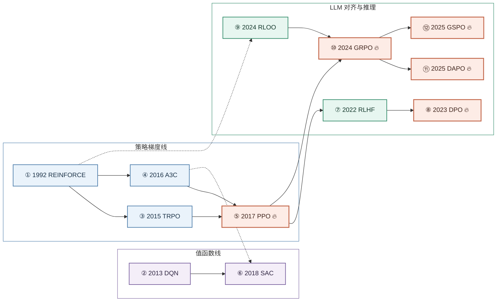
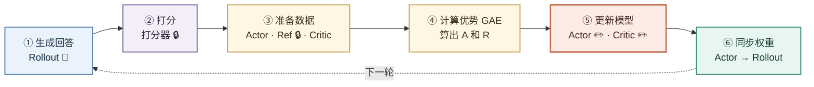
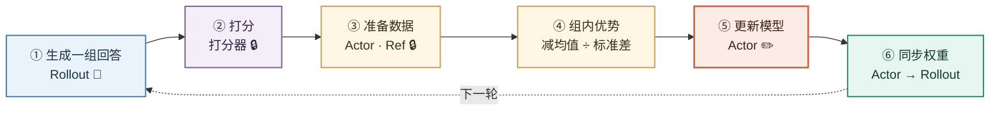

强化学习算法沿两条线演进：值函数线（DQN 系列）和策略梯度线（REINFORCE → PPO → GRPO）。2026 年最常用的是面向 LLM 推理的、不需要 critic 的 GRPO 系列。

<br>
<br>

## 时间线

序号按年份排列，箭头表示“在前者基础上改进”。🔥 表示当前常用。



**① 1992 REINFORCE**：按回答的总得分直接调整每个动作的概率，得分高的动作就多做，是最早的策略梯度方法。[[1]](https://doi.org/10.1007/BF00992696)

- 策略梯度线的起点。
- ③ TRPO 和 ④ A3C 在它的基础上解决更新不稳定、方差大的问题。
- ⑨ RLOO 和 ⑩ GRPO 在 LLM 时代又回到它的思路，只是加上了组内基线。

**② 2013 DQN**：用神经网络估计每个动作的价值（Q 值），每次选价值最高的动作，首次在 Atari 游戏上达到人类水平。[[4]](https://arxiv.org/abs/1312.5602)

- 值函数线的起点，和策略梯度线并行发展。
- ⑥ SAC 继承了它的 Q 网络和经验回放。

**③ 2015 TRPO**：给每次策略更新加上 KL 约束，保证新旧策略差别不大，训练更稳定，但实现复杂、计算量大。[[5]](https://arxiv.org/abs/1502.05477)

- 改进 ① REINFORCE：限制每次更新的幅度，避免一步走太远导致训练崩溃。
- ⑤ PPO 用 clip 简化了它的 KL 约束。

**④ 2016 A3C**：多个进程同时和环境交互、异步更新同一个 actor-critic 模型，加快训练。[[6]](https://arxiv.org/abs/1602.01783)

- 改进 ① REINFORCE：引入 critic 作为基线，降低方差。
- 它的 actor-critic 结构被 ⑤ PPO 和 ⑥ SAC 沿用。

**⑤ 2017 PPO** 🔥：用简单的 clip 代替 TRPO 的 KL 约束，限制每轮更新幅度，再配合 critic 计算每步的优势。[[7]](https://arxiv.org/abs/1707.06347)

- 结合 ③ TRPO 的“限制更新幅度”和 ④ A3C 的 actor-critic 结构。
- ⑦ RLHF 把它用到语言模型上；⑩ GRPO 保留它的 clip，去掉了 critic。

**⑥ 2018 SAC**：在奖励之外额外奖励策略的随机性（最大熵），并能反复利用历史数据，常用于机器人控制。[[8]](https://arxiv.org/abs/1801.01290)

- 结合 ② DQN 的 Q 网络、经验回放和 ④ A3C 的 actor-critic 结构。
- 主要用于连续控制，没有进入 LLM 训练的主线。

**⑦ 2022 RLHF / InstructGPT**：先用人类偏好训练奖励模型，再用 PPO 优化语言模型，是 ChatGPT 的训练方法。[[9]](https://arxiv.org/abs/2203.02155)

- 把 ⑤ PPO 用到语言模型上，奖励来自用人类偏好训练的奖励模型。
- ⑧ DPO 去掉了奖励模型和 RL 采样，把它简化成监督学习。

**⑧ 2023 DPO** 🔥：不训练奖励模型、也不做 RL 采样，直接用“A 比 B 好”的偏好数据像监督学习一样训练模型。[[10]](https://arxiv.org/abs/2305.18290)

- 简化 ⑦ RLHF：从 RLHF 的目标推导出可以直接用偏好数据训练的损失。
- 属于离线方法，和 ⑨ RLOO、⑩ GRPO 这类在线 RL 方法并行使用。

**⑨ 2024 RLOO**：对同一道题采样多个回答，每个回答用其他回答的平均分作基线，不需要 critic。[[2]](https://arxiv.org/abs/2402.14740)

- 回到 ① REINFORCE，用同组其他回答的平均分代替 ⑤ PPO 的 critic。
- 思路和同年的 ⑩ GRPO 相近。

**⑩ 2024 GRPO** 🔥：对同一道题采样一组回答，用组内平均分和标准差算优势，去掉了 PPO 的 critic。[[3]](https://arxiv.org/abs/2402.03300)

- 保留 ⑤ PPO 的 clip 和 KL 约束，用组内平均分代替 critic，思路和 ⑨ RLOO 相近。
- ⑪ DAPO 和 ⑫ GSPO 都在它的基础上改进。

**⑪ 2025 DAPO** 🔥：在 GRPO 基础上放宽 clip 上限、过滤全对或全错的组、按 token 平均 loss，解决熵坍缩和长回答被稀释的问题。[[11]](https://arxiv.org/abs/2503.14476)

- 改进 ⑩ GRPO 训练中的熵坍缩、无效样本和长回答被稀释等问题。
- 和 ⑫ GSPO 是 GRPO 之后两条并行的改进方向。

**⑫ 2025 GSPO** 🔥：把重要性比率和 clip 从单个 token 改到整个回答上计算，训练更稳定，尤其适合 MoE 模型。[[12]](https://arxiv.org/abs/2507.18071)

- 改进 ⑩ GRPO：把 token 级的重要性比率和 clip 换成序列级，降低方差。
- 和 ⑪ DAPO 是 GRPO 之后两条并行的改进方向。

<br>

# PPO

*2017 年，Schulman 等，OpenAI。至今仍是 RLHF 的基线算法 [[7]](https://arxiv.org/abs/1707.06347)。*

PPO（Proximal Policy Optimization，近端策略优化）让模型自己作答、按得分调整写法，同时用 clip 限制每轮的改动幅度，保证训练稳定。它额外训练一个 Critic 模型来预测“每一步之后还能拿多少分”，再用 GAE 把总分拆到每个 token 上，从而知道具体是哪一步写得好或写得差。

下面用一道题完整走一遍。数字是**示意值**，但每一步都按真实公式计算。

**设定**：β = 0.05（KL 惩罚系数）；λ = 1（先取最简单的情况）；ε = 0.2（clip 范围）；每个回答简化成 4 个 token（实际的 token 比这里短得多）。

**图例**：✏️ 训练　🔒 冻结　🔄 只同步权重，自身不训练



<br>

### 一、参与训练的模型：哪些要训练，哪些不用

#### 训练前的准备

PPO 不是从零开始的。在它之前，通常已经完成了下面几步：

```
预训练 ──► SFT（监督微调）──► 得到 SFT 模型
                              │
                              ├──► 复制一份，作为 Ref（冻结）
                              ├──► 复制一份，作为 Actor 的初始权重
                              └──► 复制一份，作为 Critic 的初始主体

（如果用奖励模型）用人类偏好数据单独训练 ──► 奖励模型（冻结）
```

所以 PPO 开始时：
- **Actor 和 Ref 完全一样**，都是 SFT 模型，这时 kl = 0；
- **奖励模型已经训练好了**，PPO 期间只用来打分；
- **Critic 刚初始化**，预测还不准，要在 PPO 里边用边学。

#### 五个角色

| 角色 | 从哪来 | PPO 中的状态 | 怎么训练 | 用在哪一步 | 作用 |
|---|---|---|---|---|---|
| **Actor** | SFT 模型复制 | ✏️ 训练 | 用优势 A 和 PPO clip 更新 | ③ ⑤ | 要优化的模型，最终产出就是它 |
| **Critic** | SFT 模型（或奖励模型）复制，最后一层换成只输出 1 个数 | ✏️ 训练 | 最小化 `(V_t − R_t)²` | ③ ⑤ | 预测每个位置最后能拿几分 |
| **Ref** | SFT 模型复制 | 🔒 冻结 | — | ③ | 作为参照，用来计算 KL |
| **打分器** | 规则程序，或 PPO 之前训练好的奖励模型 | 🔒 冻结 | — | ② | 给完整回答打总分 |
| **Rollout** | 推理引擎，加载 Actor 的权重 | 🔄 每轮从 Actor 同步 | — | ① ⑥ | 快速生成回答 |

#### 常见疑问

**reward 用的是 RL 之前的模型吗？**
是的。如果用奖励模型打分，它是在 PPO 开始**之前**用人类偏好数据训练好的，PPO 期间**一直固定不变**。原因是：PPO 期间没有新的人类标注可以训练它；如果裁判的标准一直在变，Actor 也学不稳定。本例用的是规则判分（答案对给 1、错给 0），它就是一段程序，本来就不会变。

**Ref 和 Actor 是同一个模型吗？**
一开始是。两者都从 SFT 模型复制而来，第一轮时 kl = 0。之后 Actor 不断更新，Ref 始终不变，两者的差距越来越大。kl 衡量的就是这个差距。

**Ref 为什么不训练？**
Ref 的作用是保留“原来的样子”。如果 Ref 也跟着训练，它会和 Actor 一起变，kl 就一直接近 0，起不到约束作用。

**Rollout 和 Actor 是什么关系？**
它们是**同一份权重**。Actor 在训练框架里，能算梯度、能更新；Rollout 在推理引擎里，生成速度快，但不能训练。每轮 Actor 更新完，把新权重同步给 Rollout。

**为什么只训练 Actor 和 Critic？**
Actor 是最终要用的模型；Critic 是帮助 Actor 判断每一步好坏的工具，它的预测需要随着 Actor 的变化不断更新，否则就会过时。

#### 本例中各模型的状态

| 角色 | 本例中的情况 |
|---|---|
| Actor | 已经训练了若干轮，开始偏离 Ref，所以 kl 不为 0 |
| Critic | 已经训练了若干轮，预测大致合理 |
| Ref | 始终是 SFT 模型 |
| 打分器 | 规则判分：答案是 13 给 1 分，否则 0 分 |
| Rollout | 加载的是当前 Actor 的权重 |

<br>

### 二、核心公式

| 公式 | 名称 | 含义 | 用在哪一步 |
|---|---|---|---|
| `kl_t = logp_t − ref_t` | KL | 新模型比原模型更想写这个 token 多少，衡量偏离程度 | ③ |
| `r_t = −β · kl_t`，最后一步再加 `reward` | 每步奖励 | 每个 token 扣一点 KL 惩罚，最后一步加上总分 | ③ |
| `δ_t = r_t + V_{t+1} − V_t` | TD 误差 | 写完这一步后，实际情况比预期好了多少 | ④ |
| `A_t = δ_t + λ · A_{t+1}` | 优势 | 这一步的总贡献，从后往前算 | ④ |
| `R_t = A_t + V_t` | 回报 | 从这一步往后的真实回报，是 Critic 的学习目标 | ④ |

更新时用到的两条规则：
- **Actor**：A > 0 就提高这个 token 的概率，A < 0 就降低；每轮概率最多变成原来的 0.8～1.2 倍（PPO clip）。
- **Critic**：让 V_t 靠近 R_t，即最小化 `(V_t − R_t)²`。

计算顺序：

```
logp, ref ──► kl ──► r ──► δ ──► A ──► R
                     ▲     ▲           ▲
                  reward   V           V
```

<br>

### 三、总览

| 步骤 | 目的 | 参与的模型 | 用到的公式 | 这道题里发生了什么 |
|---|---|---|---|---|
| ① 生成回答 | 让当前模型实际作答，得到训练数据 | Rollout 🔄 | — | 写出两个回答，一个先算乘法，一个从左往右算 |
| ② 打分 | 判断每个回答整体对不对 | 打分器 🔒 | — | 回答 A 得 1 分，回答 B 得 0 分 |
| ③ 准备数据 | 算出每步的 KL 惩罚，以及 Critic 的预测值 | Actor、Ref 🔒、Critic，都只做前向，不更新 | `kl_t = logp_t − ref_t`<br>`r_t = −β · kl_t (+ reward)` | 每个 token 扣 0.005～0.010；B 写下“从左算”后，Critic 的预测从 0.5 降到 0.2 |
| ④ 计算优势（GAE） | 把总分分配到每个 token，并算出 Critic 的学习目标 | 无，纯计算 | `δ_t = r_t + V_{t+1} − V_t`<br>`A_t = δ_t + λ · A_{t+1}`<br>`R_t = A_t + V_t` | B 的“从左算”A = −0.53，问题最大 |
| ⑤ 更新模型 | Actor 多写好的、少写差的；Critic 预测更准 | **Actor ✏️、Critic ✏️** | PPO clip<br>`(V_t − R_t)²` | “先算乘法”的概率上升，“从左算”的概率下降 |
| ⑥ 同步权重 | 下一轮用更新后的模型生成 | Actor → Rollout 🔄 | — | 再遇到这类题，更可能先算乘法 |

**注意**：整个流程里，只有第 ⑤ 步会改变模型参数，而且只改 Actor 和 Critic。

<br>

### 四、逐步计算

#### ① 生成回答（Rollout）

**目的**：强化学习靠“自己尝试、看结果”来学习，所以先让当前模型实际作答。

**参与的模型**：Rollout 🔄（加载当前 Actor 的权重）。只生成，不训练。

**题目**：`3 + 5 × 2 = ?`（正确答案 13）

| 位置 t | 0 | 1 | 2 | 3 |
|---|---|---|---|---|
| 回答 A | 先算乘法 | 5×2=10 | 10+3=13 | 答案13 |
| 回答 B | 从左算 | 3+5=8 | 8×2=16 | 答案16 |

#### ② 打分（Reward）

**目的**：给整段回答一个总分，这是训练方向的根本依据。

**参与的模型**：打分器 🔒，PPO 全程不变。本例是规则判分：提取最终答案，和 13 比较。如果换成奖励模型，它也是在 PPO 之前训练好、之后固定不动的。

| | 最终答案 | reward |
|---|---|---:|
| 回答 A | 13 | **1** |
| 回答 B | 16 | **0** |

#### ③ 准备训练数据

**目的**：
- 比较 Actor 和 Ref，算出每个 token 的 KL，转成惩罚，防止模型为了刷分偏离原模型太远；
- 让 Critic 在每个位置预测“写这个 token 之前，最后大概能拿几分”，也就是 V。

**参与的模型**：
- **Actor**：读一遍回答，输出 logp。这里只做前向计算，不更新；
- **Ref 🔒**：读一遍回答，输出 ref；
- **Critic**：读一遍回答，输出 V。这里也只做前向计算，不更新。

**计算 KL：kl_t = logp_t − ref_t**

回答 A：

| 位置 | 先算乘法 | 5×2=10 | 10+3=13 | 答案13 |
|---|---:|---:|---:|---:|
| logp（Actor） | −0.9 | −0.4 | −0.3 | −0.1 |
| ref（Ref 🔒） | −1.0 | −0.6 | −0.4 | −0.3 |
| **kl** | 0.1 | 0.2 | 0.1 | 0.2 |

回答 B：

| 位置 | 从左算 | 3+5=8 | 8×2=16 | 答案16 |
|---|---:|---:|---:|---:|
| logp（Actor） | −0.8 | −0.5 | −0.3 | −0.1 |
| ref（Ref 🔒） | −1.0 | −0.6 | −0.4 | −0.3 |
| **kl** | 0.2 | 0.1 | 0.1 | 0.2 |

kl 都是正数，说明 Actor 经过前几轮训练，已经比 Ref 更倾向于写这些 token 了。

**计算每步奖励：r_t = −β · kl_t，最后一步加 reward**

| | 位置 0 | 位置 1 | 位置 2 | 位置 3 |
|---|---:|---:|---:|---:|
| 回答 A | −0.05×0.1 = −0.005 | −0.05×0.2 = −0.010 | −0.05×0.1 = −0.005 | −0.05×0.2 + **1** = 0.990 |
| 回答 B | −0.05×0.2 = −0.010 | −0.05×0.1 = −0.005 | −0.05×0.1 = −0.005 | −0.05×0.2 + **0** = −0.010 |

**Critic 预测 V**

V_t 表示：**写第 t 个 token 之前，Critic 预测最后能拿几分。** 写完最后一个 token 后没有后续，所以 V_4 = 0。

| | V_0 | V_1 | V_2 | V_3 | V_4 |
|---|---:|---:|---:|---:|---:|
| 回答 A | 0.5 | 0.7 | 0.9 | 0.95 | 0 |
| 回答 B | 0.5 | 0.2 | 0.15 | 0.1 | 0 |

怎么理解：
- 两个回答的 V_0 都是 0.5，因为这时只看到题目，还什么都没写；
- A 写了“先算乘法”以后，Critic 认为方向对了，预测升到 0.7；
- B 写了“从左算”以后，Critic 认为会算错，预测降到 0.2。

#### ④ 计算优势和回报（GAE）

**目的**：
- **A（优势）**：把总分分配到每个 token，看哪一步比预期好、哪一步比预期差，给 Actor 用；
- **R（回报）**：每个位置的真实回报，作为 Critic 的学习目标。

**参与的模型**：无。这一步只是用 ③ 的结果做加减法。GAE 的出处见 [[13]](https://arxiv.org/abs/1506.02438)。

**从最后一个位置往前算。**

回答 A（答对）：

| t | token | δ_t = r_t + V_{t+1} − V_t | A_t = δ_t + A_{t+1} | R_t = A_t + V_t |
|---|---|---|---|---|
| 3 | 答案13 | 0.990 + 0 − 0.95 = **+0.040** | +0.040 | 0.040 + 0.95 = 0.990 |
| 2 | 10+3=13 | −0.005 + 0.95 − 0.9 = **+0.045** | 0.045 + 0.040 = +0.085 | 0.085 + 0.9 = 0.985 |
| 1 | 5×2=10 | −0.010 + 0.9 − 0.7 = **+0.190** | 0.190 + 0.085 = +0.275 | 0.275 + 0.7 = 0.975 |
| 0 | 先算乘法 | −0.005 + 0.7 − 0.5 = **+0.195** | 0.195 + 0.275 = **+0.470** | 0.470 + 0.5 = 0.970 |

回答 B（答错）：

| t | token | δ_t = r_t + V_{t+1} − V_t | A_t = δ_t + A_{t+1} | R_t = A_t + V_t |
|---|---|---|---|---|
| 3 | 答案16 | −0.010 + 0 − 0.1 = **−0.110** | −0.110 | −0.110 + 0.1 = −0.010 |
| 2 | 8×2=16 | −0.005 + 0.1 − 0.15 = **−0.055** | −0.055 − 0.110 = −0.165 | −0.165 + 0.15 = −0.015 |
| 1 | 3+5=8 | −0.005 + 0.15 − 0.2 = **−0.055** | −0.055 − 0.165 = −0.220 | −0.220 + 0.2 = −0.020 |
| 0 | 从左算 | −0.010 + 0.2 − 0.5 = **−0.310** | −0.310 − 0.220 = **−0.530** | −0.530 + 0.5 = −0.030 |

（λ = 1，所以 `A_t = δ_t + λ · A_{t+1}` 简化成 `A_t = δ_t + A_{t+1}`。）

怎么读这两张表：
- 看 **δ**：回答 B 里，“从左算”的 δ = −0.310，比其他位置低得多。GAE 准确找到了**错误出在第一步**。
- 回答 A 里，“先算乘法”和“5×2=10”的 δ 最大，说明这两步是答对的关键。
- **验算**：λ = 1 时，R_0 应该等于所有 r 的总和。
  - A：−0.005 − 0.010 − 0.005 + 0.990 = 0.970 ✓
  - B：−0.010 − 0.005 − 0.005 − 0.010 = −0.030 ✓

#### ⑤ 更新模型

**目的**：
- **Actor**：按 A 调整，A > 0 的写法提高概率，A < 0 的降低概率；
- **Critic**：让 V 靠近 R，下一轮预测更准；
- **PPO clip**：每轮只改一小步，概率最多变成原来的 0.8～1.2 倍。

**参与的模型**：**只有 Actor ✏️ 和 Critic ✏️ 在这一步更新参数。** Ref 🔒、打分器 🔒、Rollout 🔄 都不变。

同一批数据通常会重复用几遍（几个 epoch），每遍分成小批次，每个小批次做一次梯度更新。

**Actor 更新（用 A）**

训练方式：重新算一遍当前的 logp，和第 ③ 步的旧 logp 比较得到概率比，再按 PPO clip 规则计算损失，反向传播更新 Actor 参数。

旧概率 = e^logp，例如 e^−0.9 ≈ 41%。

| token | A | 旧概率 | 这一轮最多变到 | 方向 |
|---|---:|---:|---:|---|
| 先算乘法 | +0.470 | 41% | 49%（× 1.2） | ⬆ 提高 |
| 5×2=10 | +0.275 | 67% | 80%（× 1.2） | ⬆ 提高 |
| 从左算 | **−0.530** | 45% | 36%（× 0.8） | ⬇ **降低最多** |
| 3+5=8 | −0.220 | 61% | 49%（× 0.8） | ⬇ 降低 |

clip 的作用：即使“从左算”明显是错的，这一轮也最多把它的概率从 45% 降到 36%，不会一下降到 0。剩下的调整留给后面几轮。

**Critic 更新（用 R）**

训练方式：重新算一遍当前的 V，计算 `(V_t − R_t)²`，反向传播更新 Critic 参数。

| 回答 | 位置 | 原预测 V | 学习目标 R | 方向 |
|---|---|---:|---:|---|
| A | 0 | 0.5 | 0.970 | ⬆ 预测偏低，往上调 |
| A | 1 | 0.7 | 0.975 | ⬆ 往上调 |
| B | 1 | 0.2 | −0.020 | ⬇ 预测偏高，往下调 |
| B | 2 | 0.15 | −0.015 | ⬇ 往下调 |

下一轮再遇到类似情况，Critic 的预测会更接近真实回报。

#### ⑥ 同步权重

**目的**：把更新后的 Actor 权重同步给 Rollout，下一轮用新模型生成回答，形成“生成 → 打分 → 更新”的循环。

**参与的模型**：Actor 把权重复制给 Rollout 🔄。Ref 🔒 和打分器 🔒 依然不变。

同步后，下一轮再遇到类似的题（比如 `4 + 6 × 3`）：
- 写“先算乘法”的概率从 41% 升到约 49%；
- 写“从左算”的概率从 45% 降到约 36%。

经过多轮训练，模型就会稳定地先算乘法。训练结束后，**最终留下来使用的是 Actor**。

<br>

### 五、实际训练中的一批数据

实际训练时，第 ① 步每轮会生成**几百到几千个回答**，覆盖很多道题。每个回答都按上面的流程算出 r、V、A、R，然后放在一起，分成小批次做第 ⑤ 步的更新。

上面这道题的两个回答，就是这一批数据里的两条。

<br>
<br>

## GRPO

*2024 年，Shao 等，DeepSeek。随 DeepSeekMath 提出，后来用于训练 DeepSeek-R1，是目前推理模型 RL 训练最常用的算法之一 [[3]](https://arxiv.org/abs/2402.03300)。*

GRPO（Group Relative Policy Optimization，组相对策略优化）对同一道题一次生成一组回答，用这组回答的平均分当作“预期”，比平均分高的回答就多写、低的就少写。这样就不再需要 Critic 模型，省下一个和 Actor 一样大的模型的显存和计算量；更新时仍然沿用 PPO 的 clip。

下面用和 PPO 一节相同的题目走一遍，方便对比。数字是**示意值**，但每一步都按真实公式计算。

**设定**：组大小 G = 4（每道题生成 4 个回答）；β = 0.04（KL 系数）；ε = 0.2（clip 范围）；每个回答简化成 4 个 token。

**图例**：✏️ 训练　🔒 冻结　🔄 只同步权重，自身不训练



<br>

### 一、参与训练的模型：哪些要训练，哪些不用

#### 训练前的准备

和 PPO 一样，GRPO 也从 SFT 模型出发，但**不需要准备 Critic**：

```
预训练 ──► SFT（监督微调）──► 得到 SFT 模型
                              │
                              ├──► 复制一份，作为 Ref（冻结）
                              └──► 复制一份，作为 Actor 的初始权重

（如果用奖励模型）用人类偏好数据单独训练 ──► 奖励模型（冻结）
```

#### 四个角色

| 角色 | 从哪来 | GRPO 中的状态 | 怎么训练 | 用在哪一步 | 作用 |
|---|---|---|---|---|---|
| **Actor** | SFT 模型复制 | ✏️ 训练 | 用组内优势、PPO clip 和 KL 项更新 | ③ ⑤ | 要优化的模型，最终产出就是它 |
| **Ref** | SFT 模型复制 | 🔒 冻结 | — | ③ | 作为参照，用来计算 KL |
| **打分器** | 规则程序，或训练好的奖励模型 | 🔒 冻结 | — | ② | 给完整回答打总分 |
| **Rollout** | 推理引擎，加载 Actor 的权重 | 🔄 每轮从 Actor 同步 | — | ① ⑥ | 快速生成一组回答 |

#### 常见疑问

**没有 Critic，怎么知道一个回答算好还是算差？**
看同一道题的其他回答。4 个回答里有 2 个答对，平均分是 0.5；答对的回答比平均高，就是好的，答错的比平均低，就是差的。组平均分起的作用，就是 PPO 里 Critic 的 V。

**为什么还要除以标准差？**
让不同题目的优势大小可比。有的题大家分数差距大，有的差距小，除以标准差后，优势都落在差不多的范围里。

**KL 为什么不放进奖励里？**
PPO 把 KL 惩罚加进每步奖励，再通过 GAE 传播，这需要 Critic。GRPO 没有 Critic，所以把 KL 直接作为一项加进 loss。

<br>

### 二、核心公式

| 公式 | 名称 | 含义 | 用在哪一步 |
|---|---|---|---|
| `A_i = (reward_i − mean) / std` | 组内优势 | 第 i 个回答比同组平均好多少；这个回答里所有 token 用同一个 A_i | ④ |
| `ρ_t = π_θ(token) / π_old(token)` | 概率比 | 新模型写这个 token 的概率是旧模型的几倍 | ⑤ |
| `min(ρ_t · A_i, clip(ρ_t, 1−ε, 1+ε) · A_i)` | clip 目标 | 和 PPO 相同，限制每轮改动幅度 | ⑤ |
| `kl_t = e^(ref_t − logp_t) − (ref_t − logp_t) − 1` | KL（k3 估计） | Actor 偏离 Ref 的程度，结果总是 ≥ 0 | ③ ⑤ |
| `loss = −平均[ clip 目标 − β · kl_t ]` | 总损失 | 先对每个回答的 token 求平均，再对组内回答求平均 | ⑤ |

计算顺序：

```
reward ──► 组内均值、标准差 ──► A_i ─┐
                                    ├──► loss ──► 更新 Actor
logp, ref ──► kl ───────────────────┘
```

<br>

### 三、总览

| 步骤 | 目的 | 参与的模型 | 用到的公式 | 这道题里发生了什么 |
|---|---|---|---|---|
| ① 生成一组回答 | 对同一道题生成多个回答，用来互相比较 | Rollout 🔄 | — | 生成 4 个回答，2 个先算乘法，2 个先算加法 |
| ② 打分 | 判断每个回答整体对不对 | 打分器 🔒 | — | 得分 [1, 0, 1, 0] |
| ③ 准备数据 | 算出每个 token 的 KL | Actor、Ref 🔒，都只做前向 | `kl_t = e^(ref−logp) − (ref−logp) − 1` | KL 在 0.005～0.019 之间 |
| ④ 组内优势 | 用组平均分代替 Critic，判断每个回答的好坏 | 无，纯计算 | `A_i = (reward_i − mean) / std` | 答对的 A = +1，答错的 A = −1 |
| ⑤ 更新模型 | 多写答对的回答，少写答错的回答 | **Actor ✏️** | clip 目标<br>`− β · kl_t` | 答对回答的每个 token 概率上升，答错的下降 |
| ⑥ 同步权重 | 下一轮用更新后的模型生成 | Actor → Rollout 🔄 | — | 再遇到这类题，更可能先算乘法 |

**注意**：整个流程里，只有第 ⑤ 步会改变模型参数，而且只改 Actor。

<br>

### 四、逐步计算

#### ① 生成一组回答（Rollout）

**目的**：GRPO 靠同组回答互相比较，所以每道题要生成多个回答。

**参与的模型**：Rollout 🔄（加载当前 Actor 的权重）。只生成，不训练。

**题目**：`3 + 5 × 2 = ?`（正确答案 13）

| 位置 t | 0 | 1 | 2 | 3 |
|---|---|---|---|---|
| 回答 A | 先算乘法 | 5×2=10 | 10+3=13 | 答案13 |
| 回答 B | 从左算 | 3+5=8 | 8×2=16 | 答案16 |
| 回答 C | 先算乘法 | 5×2=10 | 3+10=13 | 答案13 |
| 回答 D | 先算加法 | 3+5=8 | 8×2=16 | 答案16 |

#### ② 打分（Reward）

**目的**：给每个回答一个总分。

**参与的模型**：打分器 🔒。规则判分：提取最终答案，和 13 比较。

| | 最终答案 | reward |
|---|---|---:|
| 回答 A | 13 | **1** |
| 回答 B | 16 | **0** |
| 回答 C | 13 | **1** |
| 回答 D | 16 | **0** |

#### ③ 准备训练数据

**目的**：算出每个 token 的 KL，后面加进 loss，防止 Actor 偏离 Ref 太远。

**参与的模型**：
- **Actor**：读一遍回答，输出 logp。只做前向，不更新；
- **Ref 🔒**：读一遍回答，输出 ref。

和 PPO 不同，这里**没有 Critic，也不算每步奖励**。

**计算 KL：kl_t = e^(ref_t − logp_t) − (ref_t − logp_t) − 1**

这个写法叫 k3 估计。和 PPO 用的 `logp − ref` 相比，它的结果总是 ≥ 0，方差也更小。

回答 A：

| 位置 | 先算乘法 | 5×2=10 | 10+3=13 | 答案13 |
|---|---:|---:|---:|---:|
| logp（Actor） | −0.9 | −0.4 | −0.3 | −0.1 |
| ref（Ref 🔒） | −1.0 | −0.6 | −0.4 | −0.3 |
| ref − logp | −0.1 | −0.2 | −0.1 | −0.2 |
| **kl** | e^−0.1 + 0.1 − 1 = **0.0048** | e^−0.2 + 0.2 − 1 = **0.0187** | **0.0048** | **0.0187** |

回答 B：

| 位置 | 从左算 | 3+5=8 | 8×2=16 | 答案16 |
|---|---:|---:|---:|---:|
| logp（Actor） | −0.8 | −0.5 | −0.3 | −0.1 |
| ref（Ref 🔒） | −1.0 | −0.6 | −0.4 | −0.3 |
| ref − logp | −0.2 | −0.1 | −0.1 | −0.2 |
| **kl** | **0.0187** | **0.0048** | **0.0048** | **0.0187** |

回答 C、D 的算法相同，不再列出。

#### ④ 计算组内优势

**目的**：不用 Critic，改用同组回答的平均分作为“预期”，判断每个回答比预期好还是差。

**参与的模型**：无，纯计算。

**A_i = (reward_i − mean) / std**

- 平均分：mean = (1 + 0 + 1 + 0) / 4 = **0.5**
- 标准差：std = √[((1−0.5)² + (0−0.5)² + (1−0.5)² + (0−0.5)²) / 4] = **0.5**

| 回答 | reward | reward − mean | A = (reward − mean) / std |
|---|---:|---:|---:|
| A | 1 | +0.5 | **+1** |
| B | 0 | −0.5 | **−1** |
| C | 1 | +0.5 | **+1** |
| D | 0 | −0.5 | **−1** |

这个回答里的**每个 token 都用同一个 A**：

| 回答 B 的 token | 从左算 | 3+5=8 | 8×2=16 | 答案16 |
|---|---:|---:|---:|---:|
| PPO 的 A（来自上一节） | −0.530 | −0.220 | −0.165 | −0.110 |
| GRPO 的 A | −1 | −1 | −1 | −1 |

对比可以看出 GRPO 的取舍：PPO 靠 Critic 找到了“从左算”是罪魁祸首；GRPO 分不出来，连本身算得没错的“3+5=8”也一起被惩罚。但只要样本足够多，“先算乘法”出现在答对回答里的次数更多，平均下来模型仍会学到正确的写法。

（这里用的是总体标准差。有些实现用样本标准差，std = 0.577，A = ±0.866，方向不变。）

#### ⑤ 更新模型

**目的**：
- 按 A 调整 Actor：答对回答的 token 提高概率，答错回答的 token 降低概率；
- 用 clip 限制每轮的改动幅度；
- 用 KL 项把 Actor 拉住，不让它离 Ref 太远。

**参与的模型**：**只有 Actor ✏️ 更新参数。** Ref 🔒、打分器 🔒、Rollout 🔄 都不变。没有 Critic 要训练。

**clip 目标**

和 PPO 完全相同，每轮概率最多变成原来的 0.8～1.2 倍：

| 回答 | token | A | 旧概率 | 这一轮最多变到 | 方向 |
|---|---|---:|---:|---:|---|
| A | 先算乘法 | +1 | 41% | 49%（× 1.2） | ⬆ 提高 |
| A | 5×2=10 | +1 | 67% | 80%（× 1.2） | ⬆ 提高 |
| B | 从左算 | −1 | 45% | 36%（× 0.8） | ⬇ 降低 |
| B | 3+5=8 | −1 | 61% | 49%（× 0.8） | ⬇ 降低 |

**loss 的数值**（第 1 个 epoch，新旧模型相同，ρ = 1）

每个 token 的 loss = −(ρ · A) + β · kl = −A + 0.04 × kl

| 回答 | 每个 token 的 loss | 回答内平均 |
|---|---|---:|
| A | −1 + 0.04×0.0048 = −0.9998，−1 + 0.04×0.0187 = −0.9993，−0.9998，−0.9993 | −0.9996 |
| B | +1 + 0.04×0.0187 = 1.0007，+1 + 0.04×0.0048 = 1.0002，1.0002，1.0007 | 1.0005 |

- A 的 loss 为负、B 的为正：梯度下降会让 A 的写法更常出现、B 的更少出现；
- KL 项只有 0.0002～0.0007，很小，只是轻轻拉住 Actor；
- 最后再对组内 4 个回答求平均，得到这一组的 loss。

#### ⑥ 同步权重

**目的**：把更新后的 Actor 权重同步给 Rollout，下一轮用新模型生成。

**参与的模型**：Actor 把权重复制给 Rollout 🔄。Ref 🔒 和打分器 🔒 依然不变。

同步后，下一轮再遇到类似的题：
- “先算乘法”的概率从 41% 升到约 49%；
- “从左算”的概率从 45% 降到约 36%。

<br>

### 五、GRPO 的局限

**全对或全错的组没有信号**

如果 4 个回答都答对，得分是 [1, 1, 1, 1]，平均分 1，每个 A 都是 0，这组数据对训练没有任何作用。全错也一样。题目太简单或太难时，大量算力就浪费了。DAPO 的改进之一就是把这类组过滤掉，再补采样 [[11]](https://arxiv.org/abs/2503.14476)。

**无法定位具体哪一步出错**

如 ④ 所示，同一个回答的所有 token 拿同一个 A，只能靠大量样本平均来区分好坏 token。

**长回答被稀释**

先对每个回答内的 token 求平均，长回答里每个 token 的权重就更小。DAPO 改成对整批 token 统一求平均来解决这个问题。

<br>
<br>

## References

1. [Williams, 1992. Simple Statistical Gradient-Following Algorithms for Connectionist Reinforcement Learning](https://doi.org/10.1007/BF00992696)
2. [Ahmadian et al., 2024. Back to Basics: Revisiting REINFORCE Style Optimization for Learning from Human Feedback in LLMs (RLOO)](https://arxiv.org/abs/2402.14740)
3. [Shao et al., 2024. DeepSeekMath (GRPO)](https://arxiv.org/abs/2402.03300)
4. [Mnih et al., 2013. Playing Atari with Deep Reinforcement Learning (DQN)](https://arxiv.org/abs/1312.5602)
5. [Schulman et al., 2015. Trust Region Policy Optimization](https://arxiv.org/abs/1502.05477)
6. [Mnih et al., 2016. Asynchronous Methods for Deep Reinforcement Learning (A3C)](https://arxiv.org/abs/1602.01783)
7. [Schulman et al., 2017. Proximal Policy Optimization Algorithms](https://arxiv.org/abs/1707.06347)
8. [Haarnoja et al., 2018. Soft Actor-Critic](https://arxiv.org/abs/1801.01290)
9. [Ouyang et al., 2022. Training Language Models to Follow Instructions with Human Feedback](https://arxiv.org/abs/2203.02155)
10. [Rafailov et al., 2023. Direct Preference Optimization](https://arxiv.org/abs/2305.18290)
11. [Yu et al., 2025. DAPO: An Open-Source LLM Reinforcement Learning System at Scale](https://arxiv.org/abs/2503.14476)
12. [Zheng et al., 2025. Group Sequence Policy Optimization](https://arxiv.org/abs/2507.18071)
13. [Schulman et al., 2015. High-Dimensional Continuous Control Using Generalized Advantage Estimation](https://arxiv.org/abs/1506.02438)
