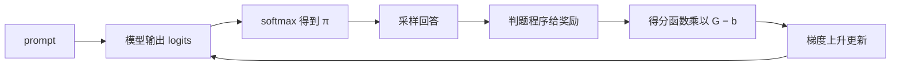

强化学习算法沿两条线演进：值函数线（DQN 系列）和策略梯度线（REINFORCE → PPO → GRPO）。2026 年最常用的是面向 LLM 推理的、不需要 critic 的 GRPO 系列。

## 时间线

*🔥 表示当前常用。*

- **1992 REINFORCE**：第一个策略梯度算法 [[1]](https://doi.org/10.1007/BF00992696)
- **2013 DQN**：用神经网络学 Q 值 [[4]](https://arxiv.org/abs/1312.5602)
- **2015 TRPO**：信赖域约束策略更新 [[5]](https://arxiv.org/abs/1502.05477)
- **2016 A3C**：异步 actor-critic [[6]](https://arxiv.org/abs/1602.01783)
- **2017 PPO** 🔥：用 clip 简化 TRPO [[7]](https://arxiv.org/abs/1707.06347)
- **2018 SAC**：最大熵离线策略 [[8]](https://arxiv.org/abs/1801.01290)
- **2022 RLHF / InstructGPT**：奖励模型加 PPO [[9]](https://arxiv.org/abs/2203.02155)
- **2023 DPO** 🔥：不需要奖励模型的偏好对齐 [[10]](https://arxiv.org/abs/2305.18290)
- **2024 RLOO**：REINFORCE 加留一基线 [[2]](https://arxiv.org/abs/2402.14740)
- **2024 GRPO** 🔥：组内基线，去掉 critic [[3]](https://arxiv.org/abs/2402.03300)
- **2025 DAPO** 🔥：修正 GRPO 的熵坍缩和长度偏差 [[11]](https://arxiv.org/abs/2503.14476)
- **2025 GSPO** 🔥：序列级重要性比率 [[12]](https://arxiv.org/abs/2507.18071)

## REINFORCE

*1992 年，Williams。策略梯度家族的起点。*

### Overview

- **做什么**：直接调整选动作的概率（策略），让平均分变高。
- **怎么做**：每轮按当前策略采样，拿到环境给的分数，计算"让这个动作更常出现的方向"（得分函数），乘以分数，再沿这个方向走一小步。
- **为什么能算**：对数导数技巧把梯度写成期望，所以只靠采样就能估计。分数可以来自任意黑盒，不需要可导。
- **特点**：在线策略、蒙特卡洛（等整条轨迹结束才更新）、没有 critic。
- **主要缺点**：方差大。减去一个**基线**就能缓解，这也是后来"优势"的由来。
- **在 LLM 中回归**：RLOO 和 GRPO 本质上都是"REINFORCE 加组内基线" [[2]](https://arxiv.org/abs/2402.14740) [[3]](https://arxiv.org/abs/2402.03300)。

### 本节场景

*一个最小化的 LLM 数学题 RL 训练：模型答题，判题程序判对错，用对错去更新模型。*

- **prompt**："2+3="
- **候选 token**：为了能手算，把词表缩成 3 个：`"5"`、`"6"`、`"7"`。
- **模型输出的 logits**：θ = [θ_5, θ_6, θ_7] = **[1.0, 0.5, 0.0]**。模型已经有点倾向答 5，但不确定。
- **奖励**：判题程序把答案和标准答案比较，答 `"5"` 得 1 分，其余得 0 分。
- **一个 batch**：对同一个 prompt 采样 4 个回答，结果是 `"5"`、`"6"`、`"5"`、`"7"`。
- **学习率**：α = 0.1。

### 公式

#### ① 策略（softmax）

$$
\pi_\theta(a) = \frac{e^{\theta_a}}{\sum_{a'} e^{\theta_{a'}}}
$$

**总结**：把每个 token 的 logit 取指数，再除以总和，得到生成每个 token 的概率。logit 越高，概率越大。

**英文读法**："pi theta of a equals e to the theta a, over the sum over a prime of e to the theta a prime."

**符号说明**

- π_θ(a)：策略，参数为 θ 时生成 token a 的概率。
- θ_a：token a 的 logit，即模型最后一层对它的打分。
- e：常数，约等于 2.718。
- a'：求和用的变量，遍历词表中所有 token。

**代入数值**

- 取指数：e^1.0 = 2.7183，e^0.5 = 1.6487，e^0.0 = 1.0000
- 求和：2.7183 + 1.6487 + 1.0000 = 5.3670
- π("5") = 2.7183 / 5.3670 = **0.5065**
- π("6") = 1.6487 / 5.3670 = **0.3072**
- π("7") = 1.0000 / 5.3670 = **0.1863**
- 含义：模型有约 51% 的概率答对。

#### ② 回报

$$
G_t = \sum_{k=t}^{T} \gamma^{k-t} r_k
$$

**总结**：从第 t 个 token 开始，把之后的奖励加起来，越远的奖励打的折越多。

**英文读法**："G sub t equals the sum from k equals t to capital T of gamma to the power k minus t, times r sub k."

**符号说明**

- G_t：第 t 个 token 的回报。
- r_k：第 k 个 token 拿到的奖励。LLM 中只有最后一个 token 有奖励，其余为 0。
- γ：折扣因子。LLM 中常取 1。
- T：回答的最后一个 token。

**代入数值**

- 完整回答通常是多个 token，例如 `"答"`、`"案"`、`"是"`、`"5"`，共 4 个，T = 3。
- 判题程序只在最后给分：r = [0, 0, 0, 1]，γ = 1。
  - G_3 = **1**
  - G_2 = 0 + 1 × 1 = **1**
  - G_1 = 0 + 1 × 1 = **1**
  - G_0 = 0 + 1 × 1 = **1**
- 结论：γ = 1 时，回答里的每个 token 都分到同样的回报，就是这个回答的最终得分。
- 本节场景中回答只有 1 个 token，4 个样本的回报依次是 **[1, 0, 1, 0]**。

#### ③ 目标函数

$$
J(\theta) = \mathbb{E}_{\tau \sim \pi_\theta} \big[ G(\tau) \big]
$$

**总结**：按当前模型去答题时的平均得分，也就是答对率。训练就是让它变大。

**英文读法**："J of theta equals the expectation, over tau sampled from pi theta, of G of tau."

**符号说明**

- J(θ)：目标函数，即平均得分。
- 𝔼：期望，按概率加权的平均。
- τ：一个完整回答（轨迹）。
- τ ∼ π_θ：回答由当前模型采样生成。

**代入数值**

- J = π("5") × 1 + π("6") × 0 + π("7") × 0 = **0.5065**
- 用 batch 估计：4 个回答对了 2 个，(1 + 0 + 1 + 0) / 4 = **0.5**，和真实值 0.5065 接近。

#### ④ 对数导数技巧

$$
\nabla_\theta \pi_\theta = \pi_\theta \cdot \nabla_\theta \log \pi_\theta
$$

**总结**：概率的梯度等于概率乘以对数概率的梯度。代入目标函数后，梯度就变成一个期望，可以用采样来估计。

**英文读法**："the gradient of pi theta with respect to theta equals pi theta times the gradient of log pi theta."

**符号说明**

- ∇_θ：对参数 θ 求梯度，即每个参数变化时函数值增长最快的方向。
- log π_θ：对数概率（log-prob），训练框架里每个 token 都会算出这个值。

**代入数值**

- 本场景中 J = π("5")。它对 θ_5 的梯度直接算是 π("5") × (1 − π("5")) = 0.5065 × 0.4935 = **0.2500**
- 右边：π("5") × ∂log π("5")/∂θ_5 = 0.5065 × (1 − 0.5065) = **0.2500**，两边相等。

#### ⑤ 策略梯度

$$
\nabla_\theta J(\theta) = \mathbb{E}_{\tau \sim \pi_\theta} \Big[ \sum_{t=0}^{T} \nabla_\theta \log \pi_\theta(a_t \mid s_t) \cdot G_t \Big]
$$

**总结**：REINFORCE 的核心。对每个 token，用"让这个 token 更常出现的方向"乘以"这个回答的得分"，再对 batch 求平均。

**英文读法**："the gradient of J of theta equals the expectation, over tau sampled from pi theta, of the sum from t equals 0 to capital T of the gradient of log pi theta of a t given s t, times G sub t."

**符号说明**

- a_t：第 t 个生成的 token。
- s_t：第 t 步的状态，即 prompt 加上已生成的 token。本场景中 s_0 = "2+3="。
- |：读作 "given"，表示条件。
- ∇_θ log π_θ(a_t | s_t)：得分函数（score function），见 ⑥。

**代入数值**（不加基线，得分函数的值来自 ⑥）

- 样本 1 `"5"`，G = 1：1 × [0.4935, −0.3072, −0.1863] = [0.4935, −0.3072, −0.1863]
- 样本 2 `"6"`，G = 0：贡献 **[0, 0, 0]**
- 样本 3 `"5"`，G = 1：[0.4935, −0.3072, −0.1863]
- 样本 4 `"7"`，G = 0：贡献 **[0, 0, 0]**
- batch 平均：∇J ≈ (2 × [0.4935, −0.3072, −0.1863]) / 4 = **[0.2468, −0.1536, −0.0932]**
- 含义：提高 "5" 的 logit，降低 "6" 和 "7" 的。两个答错的样本没有贡献任何信号。

#### ⑥ 得分函数（softmax）

$$
\nabla_\theta \log \pi_\theta(a) = \mathbf{1}_a - \pi_\theta
$$

**总结**：被采样到的 token 记 1、其余记 0，再减去当前概率。被采样 token 的分量为正，其余为负。

**英文读法**："the gradient of log pi theta of a equals the one-hot vector of a minus pi theta."

**符号说明**

- 𝟏_a：独热向量（one-hot），只有 token a 的位置是 1。
- π_θ：当前的概率向量 [0.5065, 0.3072, 0.1863]。

**代入数值**

- 采样到 `"5"`：[1, 0, 0] − [0.5065, 0.3072, 0.1863] = **[0.4935, −0.3072, −0.1863]**
- 采样到 `"6"`：[0, 1, 0] − [0.5065, 0.3072, 0.1863] = **[−0.5065, 0.6928, −0.1863]**
- 采样到 `"7"`：[0, 0, 1] − [0.5065, 0.3072, 0.1863] = **[−0.5065, −0.3072, 0.8137]**

#### ⑦ 参数更新

$$
\theta \leftarrow \theta + \alpha \nabla_\theta J(\theta)
$$

**总结**：沿梯度方向走一小步。要让答对率变大，所以是梯度上升，用加号。

**英文读法**："theta is updated to theta plus alpha times the gradient of J of theta."

**符号说明**

- ←：更新为。
- α：学习率，控制步长。

**代入数值**（用 ⑤ 的梯度）

- θ = [1.0, 0.5, 0.0] + 0.1 × [0.2468, −0.1536, −0.0932] = **[1.0247, 0.4846, −0.0093]**
- 取指数：e^1.0247 = 2.7862，e^0.4846 = 1.6236，e^−0.0093 = 0.9907，总和 = 5.4005
- 新的 π("5") = 2.7862 / 5.4005 = **0.5159**
- 结论：一步更新后，答对率从 0.5065 升到 0.5159。

#### ⑧ 基线

$$
\nabla_\theta J(\theta) = \mathbb{E} \Big[ \sum_{t} \nabla_\theta \log \pi_\theta(a_t \mid s_t) \cdot (G_t - b) \Big]
$$

**总结**：把回报换成"回报减基线"。因为得分函数的期望为 0，减去不依赖动作的 b 不改变梯度的期望，但能大幅降低方差。

**英文读法**："the gradient of J of theta equals the expectation of the sum over t of the gradient of log pi theta of a t given s t, times G sub t minus b."

**符号说明**

- b：基线，任何不依赖当前动作的值。这里取 batch 的平均得分。
- G_t − b：比平均好多少，是后来"优势" A_t 的雏形。

**代入数值**

- 基线：b = (1 + 0 + 1 + 0) / 4 = **0.5**
- 每个样本的 G − b：[+0.5, −0.5, +0.5, −0.5]
- 每个样本的贡献（得分函数 × (G − b)）：
  - 样本 1 `"5"`：0.5 × [0.4935, −0.3072, −0.1863] = **[0.2468, −0.1536, −0.0932]**
  - 样本 2 `"6"`：−0.5 × [−0.5065, 0.6928, −0.1863] = **[0.2532, −0.3464, 0.0932]**
  - 样本 3 `"5"`：**[0.2468, −0.1536, −0.0932]**
  - 样本 4 `"7"`：−0.5 × [−0.5065, −0.3072, 0.8137] = **[0.2532, 0.1536, −0.4068]**
- batch 平均：∇J ≈ **[0.2500, −0.1250, −0.1250]**
- 更新：θ = [1.0, 0.5, 0.0] + 0.1 × [0.25, −0.125, −0.125] = **[1.0250, 0.4875, −0.0125]**
- 新的 π("5") = **0.5159**，π("6") = **0.3014**，π("7") = **0.1828**
- 和不加基线比较：
  - 答错的样本 2 和样本 4 现在也有贡献，分别把 "6" 和 "7" 压低。
  - 不加基线时 "6" 和 "7" 被压低的幅度是 −0.1536 和 −0.0932，取决于它们当前的概率；加基线后两者都是 −0.125，因为它们都答错了，受到的惩罚相同。
  - 这一步的答对率提升相近，但加基线后每个样本都有信号，单步方差更小。

## References

1. [Williams, 1992. Simple Statistical Gradient-Following Algorithms for Connectionist Reinforcement Learning](https://doi.org/10.1007/BF00992696)
2. [Ahmadian et al., 2024. Back to Basics: Revisiting REINFORCE Style Optimization for Learning from Human Feedback in LLMs (RLOO)](https://arxiv.org/abs/2402.14740)
3. [Shao et al., 2024. DeepSeekMath (GRPO)](https://arxiv.org/abs/2402.03300)
4. [Mnih et al., 2013. Playing Atari with Deep Reinforcement Learning (DQN)](https://arxiv.org/abs/1312.5602)
5. [Schulman et al., 2015. Trust Region Policy Optimization](https://arxiv.org/abs/1502.05477)
6. [Mnih et al., 2016. Asynchronous Methods for Deep Reinforcement Learning (A3C)](https://arxiv.org/abs/1602.01783)
7. [Schulman et al., 2017. Proximal Policy Optimization Algorithms](https://arxiv.org/abs/1707.06347)
8. [Haarnoja et al., 2018. Soft Actor-Critic](https://arxiv.org/abs/1801.01290)
9. [Ouyang et al., 2022. Training Language Models to Follow Instructions with Human Feedback](https://arxiv.org/abs/2203.02155)
10. [Rafailov et al., 2023. Direct Preference Optimization](https://arxiv.org/abs/2305.18290)
11. [Yu et al., 2025. DAPO: An Open-Source LLM Reinforcement Learning System at Scale](https://arxiv.org/abs/2503.14476)
12. [Zheng et al., 2025. Group Sequence Policy Optimization](https://arxiv.org/abs/2507.18071)
