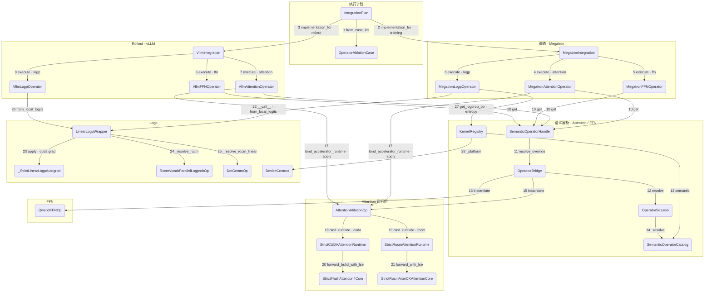

一次 R/* 前向从 `IntegrationPlan` 出发。Attention 和 FFN 经语义目录实例化；训练和 rollout 的 Logp 都走 `LinearLogpWrapper`，只有训练侧另算 entropy 时才用 `KernelRegistry` 的契约分发。方框都是类，序号在调用边上。

## 调用图

## 调用步骤

- **1** `IntegrationPlan.from_case_ids` 为 attention、ffn、logp 各生成一个 `OperatorAblationCase`。案例是 P/P、P/R、R/P、R/R，分别记下训练侧和 rollout 侧用 production 还是 rl_kernel。进程实际读的是 `RL_KERNEL_ATTENTION_CASE`、`RL_KERNEL_FFN_CASE`、`RL_KERNEL_LOGP_CASE`。
- **2** `IntegrationPlan.implementation_for(module, "training")` 把训练侧选择交给 `MegatronIntegration`。该类继承 `FrameworkOperatorIntegration`，`execute` 定义在父类上。
- **3** 同一份计划用 `implementation_for(module, "rollout")` 交给 `VllmIntegration`。训练和 rollout 可以各选一边，所以 P/R 与 R/P 能拆开。
- **4** 训练前向进 attention 时，`MegatronIntegration.execute("attention")` 查看该模块的 `Implementation`。PRODUCTION 调用 Megatron 自己的 native forward；RL_KERNEL 调用已经装上的 `MegatronAttentionOperator`。
- **5** FFN 同样经过 `execute("ffn")`。RL_KERNEL 时进入 `MegatronFFNOperator`。
- **6** Logp 经过 `execute("logp")`。RL_KERNEL 时进入 `MegatronLogpOperator`，它持有 `LinearLogpWrapper`，不走语义目录。
- **7** vLLM 的 attention 钩子调用 `VllmIntegration.execute("attention")`。RL_KERNEL 时进入 `VllmAttentionOperator`，由它把 paged KV 整理成逻辑行。
- **8** vLLM FFN 经 `execute("ffn")` 进入 `VllmFFNOperator`。
- **9** vLLM sampler 经 `execute("logp")` 进入 `VllmLogpOperator`。`compute_logits` 不进 `execute`，只把 hidden 和 LM-head 权重留给 sampler。
- **10** 四个 Attention / FFN 适配器都调用 `SemanticOperatorHandle.get(tensor, topology)`。句柄按 target 固定为 training 或 rollout，并带上精确的 `backend_id`。设备或 dtype 在首次解析后发生变化会直接失败。
- **11** `SemanticOperatorHandle` 用 `OperatorOverride.for_target` 只声明这一侧，再调用 `OperatorBridge.resolve_override`。要求里带上 device、dtype、topology，以及 `deterministic=True`，并且 `strict=True`。
- **12** `OperatorBridge` 把这一侧交给 `OperatorSession.resolve`。rollout 与 training 的解析互不复用。
- **13** `OperatorBridge` 默认拿 `KernelRegistry.semantic`，也就是进程里的那份 `SemanticOperatorCatalog`。
- **14** `SemanticOperatorCatalog._resolve` 按 `semantic_op + backend_id` 查找 `OperatorBackendDescriptor`，再核对 target、device、dtype、topology 和可观测性。对不上就抛 `OperatorResolutionError`，不会偷偷换一个后端。Attention 的工厂是 `AttentionAblationOp`，FFN 的工厂是 `Qwen3FFNOp`。
- **15** Attention 解析成功后，`OperatorBridge.instantiate` 经 session 调用工厂，得到 `AttentionAblationOp`，并缓存。随后 `instance_provenance` 把实例指纹写回句柄。
- **16** FFN 走同一条 instantiate，得到 `Qwen3FFNOp`。`rl_engine.ops.ffn.qwen3` 在 import 时按 HIP 绑定 ROCm 或 CUDA 实现，类名仍是 `Qwen3FFNOp`。
- **17** 适配器拿到实例后调用 `AttentionAblationOp.bind_accelerator_runtime`，再 `__call__` / `apply`。参数里的 `AttentionContract` 写明 role、mode、dtype、TP/CP 和 zigzag 或 packed 布局；`AttentionAblationConfig` 写明该平台的 strict core 与 schedule。
- **18** 张量设备是 CUDA 且不是 HIP 时，`bind_runtime(platform="cuda")` 装上 `StrictCUDAAttentionRuntime`，并把它同时当作 core 和 CP backend。平台或 process group 再变会拒绝重绑。
- **19** HIP 构建走 `bind_runtime(platform="rocm")`，装上 `StrictRocmAttentionRuntime`。PyTorch 对 AMD 仍报告 `cuda` 设备，平台以 `torch.version.hip` 为准。
- **20** CUDA runtime 把前向交给 `StrictFlashAttention4Core.forward_bshd_with_lse`，paged 路径用 `forward_paged_bshd_with_lse`。CP 大于 1 时通信后端是 `cuda_ag_rs`。
- **21** ROCm runtime 把前向交给 `StrictRocmAiterCKAttentionCore`。dense 用 `forward_with_lse`，paged / decode 用 runtime 上对应的 paged 或 decode 入口。CP 通信后端是 `rccl_ag_rs`。
- **22** `MegatronLogpOperator.__call__` 在请求带 hidden 时调用 provider，并把 `LinearLogpWrapper` 传进去。本地 logits 能复用时走 `from_local_logits`，否则走 `__call__`。hidden 必须在 GPU 上（CUDA 或 ROCm），这条路径不经 `SemanticOperatorHandle`。
- **23** CUDA 上走 `__call__` 且需要梯度时，TP=1 进入 `sm90_deterministic_linear_logp`，由 `_StrictLinearLogpAutograd.apply` 接上反向；TP 大于 1 时进入 `sm90_deterministic_linear_logp_tp`，由 `_StrictTensorParallelLinearLogpAutograd` 接上。`from_local_logits` 需要梯度时由 `_StrictLocalLogitsTPAutograd` 接上。TP=1 无梯度的前向直接进已编译的 `fused_linear_logp_sm90`。
- **24** HIP 上 `LinearLogpWrapper._resolve_rocm` 构造 `RocmVocabParallelLogprobOp`。
- **25** 同一条 ROCm 线性路径里，`_resolve_rocm_linear` 构造 `DetGemmOp`。`rl_engine.ops.gemm.det_gemm` 同样在 import 时按 HIP 选择 `RocmDetGemmOp` 或 CUDA `DetGemmOp`。
- **26** `VllmLogpOperator` 先让 vLLM 原生采样，再用 `LinearLogpWrapper.from_local_logits` 替换被采样 token 的 logp，输入是 `compute_logits` 留下的上下文。ROCm 有 top-p 时走 sparse nucleus 入口。
- **27** 训练 provider 需要 entropy、又不能复用 strict 结果时，用 logits 建成 `LogprobContract`，调用 `KernelRegistry.get_logprob_op`。候选必须带 `LogprobBackendCapability`，并且 role、dtype、TP/CP、vocab mask 与确定性归约都匹配；能力不符的候选只记录拒绝原因，不会当作未声明的回退。
- **28** `KernelRegistry._platform` 读取 `DeviceContext`，区分 cuda、rocm、npu、musa 和 cpu，再在该平台的候选列表里 `_get_or_create_backend`。成功的实例进缓存，本进程里已经失败的后端直接跳过。

以上按 RL-Kernel 提交 `85881586` 的源码核对。
