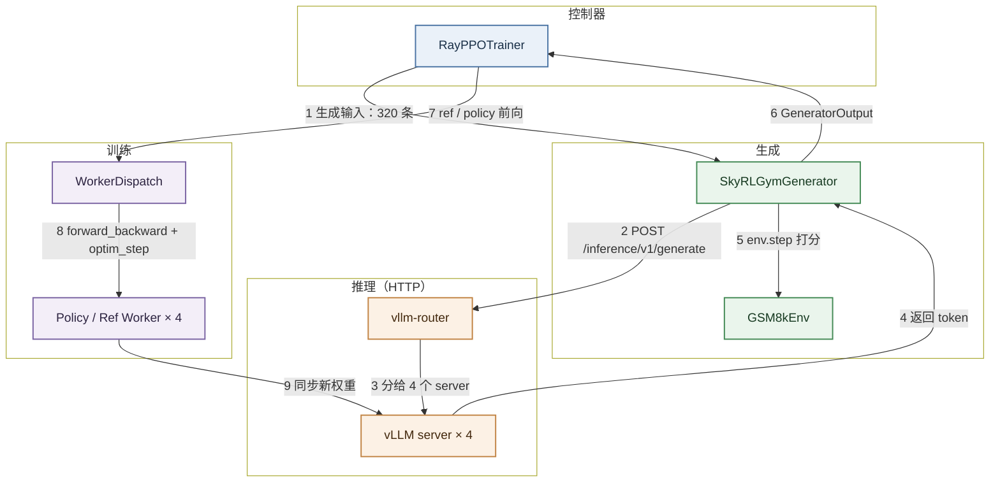
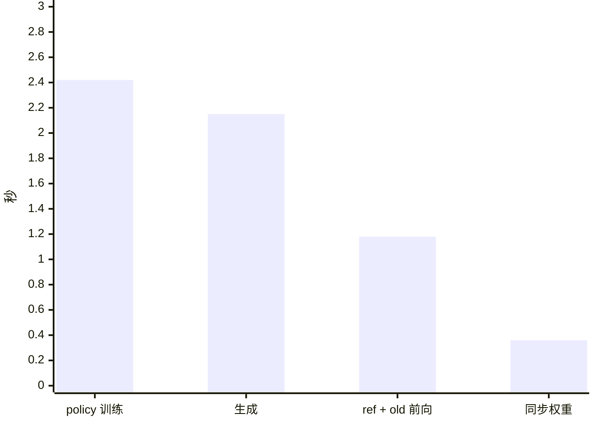
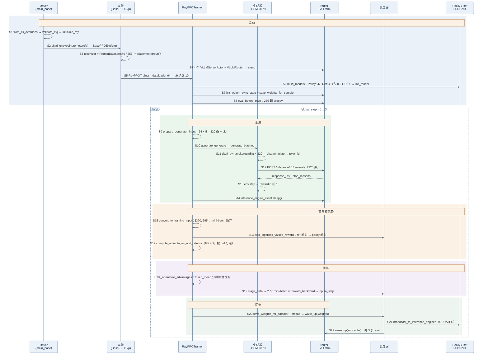

> 代码版本：`SkyRL@50cfa014`（2026-10-30）。运行环境：4 × H100 NVL 94GB，`uv sync --extra fsdp` 装出的 `torch 2.13.0`（cu130）、`vllm 0.32.0`、`flash-attn 2.8.3`、`ray 2.57.0`、`vllm-router`。文中数值都来自本机跑通的 GRPO 例子，代码行号对应上述 commit。

## 架构

SkyRL 是 Berkeley Sky Computing Lab（NovaSky）开源的大模型强化学习库，面向 Agent 设计：同一个训练器既能跑单轮数学题，也能跑多轮 SQL、SWE agent。它把"生成"和"环境"做成独立的模块，奖励由 skyrl-gym 环境的 `step()` 给出。

入门时先记住三个角色：

| 角色   | 代码里的名字                                         | 职责                                   |
| ------ | ---------------------------------------------------- | -------------------------------------- |
| 控制器 | `RayPPOTrainer`（跑在 `skyrl_entrypoint` 这个 Ray 任务里） | 按顺序下命令，自己算优势             |
| 生成端 | `SkyRLGymGenerator` + skyrl-gym 环境 + 4 个 vLLM server | 生成回答，交给环境打分               |
| 训练端 | `WorkerDispatch` + 4 个 FSDP2 Worker（policy、ref 各一组） | 前向、训练、把新权重发给 vLLM       |

它们之间**没有单独的数据面**：生成结果是控制器内存里的一个 Python 字典，要发给 GPU 时由 `WorkerDispatch` 按 DP 切成 4 份，经 Ray 传给 4 个 Worker；Worker 算完把结果返回控制器。生成也一律走 HTTP：即使和训练共卡，请求也是发给 vllm-router，再转给 4 个 vLLM server。



下面解释图中 9 个步骤，数值取自后文 GRPO 例子的第 1 步，耗时取第 2–9 步的中位数。

- **1 生成输入：320 条**：控制器从 dataloader 取 64 个 prompt，每个重复 5 次，得到 320 条对话。同一个 prompt 的 5 条共用一个 uid，GRPO 后面按它分组。

    - 每条还带上环境名 `gsm8k` 和标准答案，例如 `"72"`，环境打分时要用。

    - 采样参数：temperature 1.0，最多生成 512 个 token。

        ```text
        prompt 0（Natalia 那题）× 5 → uid 都是 a1f3...，ground_truth "72"
        prompt 1                × 5 → uid 都是 7c02...
        ...
        共 64 × 5 = 320 条
        ```

- **2 POST /inference/v1/generate**：`generator.batched=true`，所以 `generate_batched` 先把 320 条对话一起套上 chat template、转成 token id，再一次性发给 vllm-router。

    - token 进、token 出：请求里是 token id，返回的也是 token id，训练用的 token 和生成时的完全一致。

    - batched 和 agent_loop：`batched=true` 适合单轮任务，320 条一次发出；多轮任务要设成 false，走 `agent_loop`，每条轨迹自己循环"生成 → 环境 → 再生成"。

- **3 分给 4 个 server**：router 把请求分给 4 个 `VLLMServerActor`，每卡一个。

    - `VLLMServerActor`：一个 Ray actor，里面跑 vLLM 的 `AsyncLLMEngine` 和一个 HTTP 服务，除了生成接口，还提供 sleep、wake_up 和权重传输接口。

    - 为什么共卡也走 HTTP：训练器只认一个 URL，后端换成外部推理服务、PD 分离都不用改训练代码。

- **4 返回 token**：返回每条回答的 token id 和结束原因（`stop` 或 `length`）。第 1 步平均回答 325 个 token。

- **5 env.step 打分**：每条回答交给一个 `GSM8kEnv`，调用 `step(回答)`。GSM8K 环境严格匹配 `#### 72` 格式，答对 1，否则 0。第 1 步平均奖励 0.0156，即 320 条里只有 5 条得分。

    - 环境：skyrl-gym 的接口和 Gymnasium 类似，`init(prompt)` 返回初始对话，`step(action)` 返回奖励、是否结束、下一条观察。GSM8K 是单轮任务，`step` 一次就结束。

        ```python
        def step(self, action: str) -> BaseTextEnvStepOutput:
            done = True                                    # 单轮：一步就结束
            reward = utils.compute_score(action, "72")     # 找 "#### 数字"，和答案相同得 1
            return BaseTextEnvStepOutput(observations=[], reward=reward, done=done, metadata={})
        ```

    - 起点接近 0：Qwen2.5-0.5B-Instruct 默认用 `\boxed{}` 或自然语言作答，不写 `####`，所以前几步主要在学格式。

- **6 GeneratorOutput**：生成器返回 prompt token、response token、奖励和 loss mask。随后控制器让 vLLM sleep，把显存让给训练，再把 320 条拼成张量批。

    - 拼成张量：每条 "prompt + 回答" 作为一个整体左 padding，得到 `[320, 695]`，695 是这一批里最长的那条。

        ```text
        示意（长度为举例）：
        第 0 条：[pad pad ... pad | prompt 83 | 回答 236]
        第 1 条：[pad ...    pad | prompt 83 | 回答 512]
        ...
        全部右对齐到长度 695
        ```

    - sleep：vLLM 进程不退出，只释放权重和 KV cache 的显存。

- **7 ref / policy 前向**：`WorkerDispatch` 把 320 条按 DP 切成 4 份，每卡 80 条，先算 ref logprob，再算 policy 的 old logprob，合计约 1.18 s。然后控制器自己算 GRPO 优势。

    - `WorkerDispatch`：控制器和 Worker 之间的中间层，负责按 DP 切数据、调用 Worker，以及管理共卡模型的显存：要用哪个模型，就把它搬上 GPU，同卡上暂时不用的搬到 CPU。

        ```text
        算 ref logprob 时：  ref 在 GPU，policy 在 CPU
        算 old logprob 时：  policy 在 GPU，ref 在 CPU
        训练时：            policy 和优化器状态在 GPU
        生成时：            全部在 CPU，显存留给 vLLM
        ```

    - GRPO 优势：同一题的 5 条回答做组内归一化。

        ```text
        一组 5 个得分：[1, 0, 0, 0, 0]
        平均 μ = 0.2，标准差 σ = 0.447（无偏）
        答对：(1 − 0.2) / 0.447 = +1.789
        答错：(0 − 0.2) / 0.447 = −0.447
        全对或全错的组，优势为 0
        ```

    - 把 loss 的分母除进优势：默认按 token 平均（`token_mean`）。SkyRL 先把"一个 mini-batch 的总 token 数"除进优势，Worker 里的 loss 只求和，这样 micro-batch 怎么切都不影响结果。

        ```text
        一个 mini-batch 160 条 × 平均 325 token ≈ 52,000 个 token
        优势 +1.789 → 每个 token 的值是 1.789 / 52,000
        ```

- **8 forward_backward + optim_step**：每 32 个 prompt（160 条）为一个 mini-batch，一步 2 个 mini-batch，所以做 2 次 `optim_step`。每卡每个 mini-batch 40 条，按 micro-batch 8 分 5 次梯度累积，约 2.42 s。

    - 320 条在后续计算中的划分：

        | 划分        | 大小                          | 原因                                 | 改了会怎样             |
        | ----------- | ----------------------------- | ------------------------------------ | ---------------------- |
        | 按组        | 64 组 × 5 条                  | 同一题的回答之间比较，算优势         | 不能改，这是 GRPO 的定义 |
        | 按卡        | 4 卡 × 80 条                  | 并行加速                             | 只影响速度             |
        | mini-batch  | 160 条（32 题 × 5），共 2 批  | 每批 `optim_step` 一次               | 影响训练效果，需要调参 |
        | micro-batch | 每卡 8 条，5 次累加           | 显存放不下全部，分批前向和反向       | 只影响速度和显存       |

    - 整除要求：每卡每个 mini-batch 的条数（32 × 5 / 4 = 40）必须能被 micro-batch（8）整除，否则启动时报错。

- **9 同步新权重**：先唤醒 vLLM 的权重显存，每张卡上的 FSDP2 Worker 拼出完整参数打包，通过 vLLM 原生的 weight-transfer 接口用 CUDA IPC 交给同卡的 server，再恢复 KV cache。整体约 0.36 s，纯传输约 0.25 s。

    - CUDA IPC：同一张卡上的两个进程共享一块显存。Worker 把显存地址做成一个小句柄交给 vLLM，vLLM 直接读这块显存，不经过 CPU。

    - 为什么配置写的是 nccl：`weight_sync_backend=nccl` 用于训推分离的情况；共卡时自动改走 IPC。

<br />
<br />

## 代码在哪里

```text
SkyRL/
├── skyrl/train/
│   ├── entrypoints/main_base.py           # 入口：main → skyrl_entrypoint（Ray 任务）→ BasePPOExp.run
│   ├── config/config.py                   # SkyRLTrainConfig（dataclass，命令行用 a.b.c=value 覆盖）
│   ├── trainer.py                         # RayPPOTrainer：train() 主循环和各阶段
│   ├── fully_async_trainer.py             # 全异步训练器
│   ├── generators/skyrl_gym_generator.py  # SkyRLGymGenerator：generate_batched（单轮）/ agent_loop（多轮）
│   └── dataset/                           # PromptDataset（读 parquet）
├── skyrl/backends/skyrl_train/
│   ├── workers/worker_dispatch.py         # WorkerDispatch：forward / 训练 / 权重同步 / 显存管理
│   ├── workers/worker.py                  # PolicyWorkerBase / RefWorkerBase / CriticWorkerBase
│   ├── workers/fsdp/fsdp_worker.py        # FSDP2 实现
│   ├── utils/ppo_utils.py                 # 优势估计器、policy loss
│   ├── inference_servers/                 # VLLMServerActor / VLLMRouter / RemoteInferenceClient
│   └── weight_sync/                       # 训练到推理的权重传输
├── skyrl-gym/skyrl_gym/envs/gsm8k/        # GSM8kEnv：step() 打分
└── examples/train/gsm8k/                  # gsm8k_dataset.py、run_gsm8k.sh
```

<br />
<br />

## 安装

### 更新代码

`origin` 是自己的 fork，最新代码在官方仓库，所以先把官方仓库加成 `upstream`：

```bash
git remote add upstream https://github.com/NovaSky-AI/SkyRL.git   # 只需第一次
git fetch upstream
git checkout main
git rebase --autostash upstream/main     # 未提交的改动自动收起，做完再放回
```

- `--autostash`：有未提交的改动时，rebase 会拒绝执行；加上它就自动 stash 和 pop。
- 冲突：两边改了同一处时照样会冲突，改好后 `git add`，再 `git rebase --continue`。

### 安装

官方用 uv，仓库自带 `uv.lock`：

```bash
uv venv --python 3.12
uv sync --extra fsdp                     # FSDP2 + vLLM
source .venv/bin/activate
```

- `--extra fsdp`：训练后端用 FSDP2，同时装 vLLM 和 flash-attn。用 Megatron 就换成 `--extra megatron`。
- 后端 extra 互相冲突：`fsdp`、`megatron`、`jax` 不能同时装。
- 官方脚本的启动方式：`uv run --isolated --extra fsdp -m skyrl.train.entrypoints.main_base ...`。`--isolated` 每次用一个干净的临时环境，Ray worker 通过 uv 的 runtime-env 钩子复用同一个环境。本文已经激活 `.venv`，直接 `python -m` 启动。

本机遇到的问题：

| 现象                                                  | 原因                                  | 解决                                                         |
| ----------------------------------------------------- | ------------------------------------- | ------------------------------------------------------------ |
| `vllm-router ... only has wheels for manylinux_2_35`  | 宿主机 glibc 是 2.34                  | 在 Ubuntu 24.04 容器里用 `/usr/bin/python3.12` 建 venv，再在容器里运行 |
| 在容器里 `uv sync` 仍报平台不兼容                     | uv 缓存了宿主机同一解释器的平台信息   | 用容器内的 `/usr/bin/python3.12` 建 venv                    |

```bash
rl_study/scripts/inbox.sh 'cd /data/home/xli49/lxy/SkyRL && uv venv --python /usr/bin/python3.12 .venv && uv sync --extra fsdp'
```

### 检查安装

```bash
python -c "import torch, vllm, flash_attn, ray, skyrl_gym; print(torch.__version__, vllm.__version__, ray.__version__, torch.cuda.is_available())"
```

<br />
<br />

## 提 PR 流程

规则以官方的 `AGENTS.md`、`.agents/docs/contributing.md` 和 `docs/content/docs/getting-started/development.mdx` 为准。

### 1. 建分支

```bash
git fetch upstream
git checkout -b fix/<主题> upstream/main
```

动手前先查重，已有 open PR 修同一个问题就不要再开：

```text
https://github.com/NovaSky-AI/SkyRL/pulls?q=is%3Apr+<关键词>
```

### 2. 测试

```bash
uv run --isolated --extra dev pre-commit run --all-files     # 格式和 lint，也可以 bash format.sh

# CPU 测试（和 .github/workflows/cpu_skyrl.yaml 一致，按 vllm 标记分两半跑）
uv run --isolated --extra skyrl-train --extra dev pytest tests/train/ tests/backends/skyrl_train/ --ignore=tests/backends/skyrl_train/gpu -m "not vllm"
uv run --isolated --extra fsdp --extra dev pytest tests/train/ tests/backends/skyrl_train/ --ignore=tests/backends/skyrl_train/gpu -m "vllm"

# GPU 测试（需要有 GPU 的 Ray 集群）
uv run --isolated --extra dev --extra fsdp pytest tests/backends/skyrl_train/gpu/gpu_ci/test_engine_generation.py
```

- 一律用 `uv run --isolated`：不要直接用 `python`、`pip`。
- 测试会 `ray.init()`：如果机器上已经有正在训练的 Ray 集群，测试会连上去把它的 worker 搞崩，所以加 `RAY_ADDRESS=local`。
- 从小处开始：改配置先跑 CPU 测试；改生成跑生成测试；动了训练和推理的边界跑权重同步测试；最后才跑 1–2 步端到端训练。用最小的模型（比如 `Qwen/Qwen3-0.6B`）和最少的卡。
- GPU CI：给 PR 打 `run_h100_gpu_ci` 标签触发 H100 测试；端到端 GPU 测试每天定时跑一次。
- 修复前后各跑一次：修复前失败、修复后通过，才能证明测试有效。

### 3. 提交

```bash
git add <文件>                                # 不要 git add .
git commit -m "[trainer] fix: <描述>"
git push -u origin fix/<主题>
```

SkyRL 没有强制的标题格式，近期合并的 PR 标题大致是这两种：

```text
[vllm] Extend the DeepSeek-V4 weight-sync reload patch to V4.1's text model
[feat][megatron] Support optimizer state offload to disk
feat(megatron): fuse LM-head entropy for RL
```

- 代码风格：遵循 Google Python Style Guide，并沿用仓库里已有的写法，比如分词器用 `skyrl.utils.tok.get_tokenizer`。
- 不要做的事：Ray 任务和 actor 用 `fork` 启动（要用 `spawn`）；只需要子配置时把整个 `SkyRLTrainConfig` 传进去。
- 同步更新：改了路径或命名，要更新示例脚本、文档、`.agents/` 和 `AGENTS.md`；改了文档要确认能构建（`cd docs && npm install && npm run build`）。

### 4. 开 PR

在自己的 fork 上点 Compare & pull request，目标选 `NovaSky-AI/SkyRL:main`。正文按 `.agents/docs/contributing.md` 的结构写，用不上的节删掉：

```markdown
# What does this PR do?

Fixes #<issue>. <一两句话。>

TLDR: <一句话结论。>

## Why it happens

1. <原因链的第一步>
2. <第二步>

## Solution

<怎么修的；考虑过哪些别的办法，为什么没选。>

## Test plan

<新测试断言了什么，为什么够用。>

## Validation

- 硬件：4 × H100
- 命令：`uv run --isolated --extra fsdp --extra dev pytest tests/... -v`
- 结果：修复前 4 failed / 40 passed，修复后 0 failed / 44 passed
```

- 原样引用报错：贴真实的错误信息，比"一个张量错误"有用得多。
- 给真实数字：前后对比用表格最清楚；说明哪些失败是本来就有的或偶发的。

### 5. 更新 PR

**情况 1：改代码或回应 review（最常见）**

```bash
git checkout fix/<主题>
# 修改代码
uv run --isolated --extra dev pre-commit run --all-files
git add <文件>
git commit -m "[trainer] fix: address review comments"
git push                       # 普通推送，PR 自动出现新提交
```

**情况 2：上游 main 更新了，需要同步或解决冲突**

```bash
git fetch upstream
git rebase upstream/main       # 把你的提交搬到 upstream 最新代码后面
git push --force-with-lease    # rebase 改写了历史，必须强制推送
```

- 没有冲突：rebase 自动完成，直接 push。
- 有冲突：编辑冲突文件，删掉 `<<<<<<<`、`=======`、`>>>>>>>` 标记，`git add <文件>`，再 `git rebase --continue`。
- 想放弃：`git rebase --abort`，回到 rebase 之前的状态。

<br />
<br />

## 跑通第一个例子：GRPO

用 Qwen2.5-0.5B-Instruct 学做 GSM8K 数学题，4 张卡，FSDP2 和 vLLM 共卡，共 10 步。配置是一个 dataclass（`SkyRLTrainConfig`），所有字段都能用 `a.b.c=value` 覆盖，默认值在 `skyrl/train/config/config.py`。

### 1. 准备数据

下载 GSM8K，转成 SkyRL 读取的 parquet，再截出一小份：

```bash
python examples/train/gsm8k/gsm8k_dataset.py --output_dir rl_study/data/skyrl_gsm8k
# 训练集取前 640 条（640 / 64 = 10 步），验证集取前 256 条
```

每条数据的格式：

```json
{"data_source": "openai/gsm8k",
 "prompt": [{"role": "user", "content": "Natalia sold clips ... output the final answer after \"####\"."}],
 "env_class": "gsm8k",
 "reward_spec": {"method": "rule", "ground_truth": "72"},
 "extra_info": {...}}
```

- `prompt`：聊天消息列表，结尾要求在 `####` 后写答案。
- `env_class`：用哪个 skyrl-gym 环境打分。
- `reward_spec.ground_truth`：标准答案，传给环境。

### 2. 启动训练

```bash
D=/data/home/xli49/lxy/rl_study/data/skyrl_gsm8k
ARGS=(
    # ---- 数据 ----
    data.train_data="['$D/train_640.parquet']"                 # 训练 640 题
    data.val_data="['$D/val_256.parquet']"                     # 验证 256 题
    trainer.max_prompt_length=512                              # prompt 最长 512 token
    environment.env_class=gsm8k                                # 用 GSM8K 环境打分

    # ---- 算法 ----
    trainer.algorithm.advantage_estimator="grpo"               # 组内 (r − μ) / (σ + 1e-6)，不需要 critic
    trainer.algorithm.use_kl_loss=true                         # 和 ref 的 KL 作为 loss 项（默认系数 0.001，k3 估计）

    # ---- 模型 ----
    trainer.policy.model.path="Qwen/Qwen2.5-0.5B-Instruct"     # policy 和 ref 共用的初始权重
    trainer.strategy=fsdp                                      # 训练后端 FSDP2
    trainer.policy.optimizer_config.lr=1.0e-6                  # 学习率

    # ---- 放置 ----
    trainer.placement.colocate_all=true                        # 训练模型和 vLLM 共卡
    trainer.placement.policy_num_gpus_per_node=4               # policy 4 卡
    trainer.placement.ref_num_gpus_per_node=4                  # ref 也 4 卡（同样的 4 张）
    trainer.placement.critic_num_gpus_per_node=4               # GRPO 不建 critic，这个值不起作用

    # ---- 批次 ----
    trainer.train_batch_size=64                                # 每步 64 个 prompt；× 5 → 320 条
    trainer.policy_mini_batch_size=32                          # 每次 optim_step 用 32 个 prompt（160 条）→ 每步 2 次
    trainer.micro_forward_batch_size_per_gpu=16                # 前向时每卡 16 条：每卡 80 条 → 5 个 micro
    trainer.micro_train_batch_size_per_gpu=8                   # 训练时每卡 8 条：每卡每个 mini-batch 40 条 → 5 个 micro
    trainer.update_epochs_per_batch=1                          # 每批数据只用 1 遍
    trainer.epochs=1                                           # 640 题跑 1 个 epoch → 10 步

    # ---- 生成（vLLM）----
    generator.inference_engine.backend=vllm                    # 推理引擎 vLLM
    generator.inference_engine.num_engines=4                   # 4 个 vLLM server
    generator.inference_engine.tensor_parallel_size=1          # 每个 server 1 张卡
    generator.inference_engine.run_engines_locally=true        # 在本机 Ray 集群里起 server
    generator.inference_engine.weight_sync_backend=nccl        # 训推分离时用 NCCL；共卡时自动改走 IPC
    generator.inference_engine.gpu_memory_utilization=0.6      # vLLM 最多占 60% 显存
    generator.batched=true                                     # 单轮：320 条一次性发出
    generator.n_samples_per_prompt=5                           # 每个 prompt 5 条（GRPO 的组大小）
    generator.sampling_params.max_generate_length=512          # 回答最长 512 token

    # ---- 评测和日志 ----
    trainer.eval_before_train=true                             # 训练前先评测
    trainer.eval_interval=5                                    # 每 5 步评测
    trainer.eval_batch_size=256
    trainer.ckpt_interval=100                                  # 实际上不保存
    trainer.logger=console                                     # 指标打到控制台
    trainer.project_name=skyrl_study trainer.run_name=grpo_qwen25_05b
    trainer.resume_mode=null                                   # 不从 checkpoint 恢复
)
python -m skyrl.train.entrypoints.main_base "${ARGS[@]}"
```

- 完整脚本在 `rl_study/scripts/skyrl_ex1_grpo.sh`，由官方 `examples/train/gsm8k/run_gsm8k.sh` 改小，用 `rl_study/scripts/inbox.sh` 在容器里运行。

### 3. 关键配置

先记住这几个：

| 配置                                          | 含义                         | 取值 |
| --------------------------------------------- | ---------------------------- | ---- |
| `trainer.algorithm.advantage_estimator`       | 优势估计器                   | grpo |
| `trainer.train_batch_size`                    | 每步 prompt 数               | 64   |
| `generator.n_samples_per_prompt`              | 每个 prompt 采样几条         | 5    |
| `trainer.policy_mini_batch_size`              | 每次 `optim_step` 的 prompt 数 | 32 |
| `trainer.micro_train_batch_size_per_gpu`      | 训练时每卡 micro-batch       | 8    |
| `trainer.placement.colocate_all`              | 训练和推理共卡               | true |
| `generator.batched`                           | 单轮批量生成                 | true |
| `environment.env_class`                       | 打分用的环境                 | gsm8k |

### 4. 结果分析

总耗时约 6 分 20 秒，其中启动 4 个 vLLM、加载 FSDP 模型和训练前评测约 4 分半，10 步训练约 1 分半。

| step | 训练平均得分 | 验证准确率     | 平均回答长度 |
| ---- | ------------ | -------------- | ------------ |
| 1    | 0.016        | 0.0%（训练前） | 325          |
| 5    | 0.050        | 2.3%           | 292          |
| 10   | 0.147        | 11.3%          | 313          |

- 起点接近 0：GSM8K 环境严格要求 `#### 数字`，模型默认不这样写，前 10 步主要在学格式。和 verl 的例子是同一个现象。
- `policy_kl` 从 3e-4 涨到 1.3e-2：模型离 ref 越来越远。
- `clip_ratio` 约 2e-4：每步 2 个 mini-batch，第 2 个 mini-batch 用的是已经更新过一次的模型，ratio 才会偏离 1。

每步约 6.3 s，构成如下：



- 第 1 步 13.6 s：前向 3.6 s、训练 6.5 s，是首次 warm-up。
- 第 10 步 26.4 s：包含一次评测。

<br />
<br />

## 一步训练时序图

整个训练分成两段：

- 启动（S1–S8，只执行一次）：解析配置、启动 Ray，在一个 Ray 任务里创建实验对象，读数据、建 placement group，启动 4 个 vLLM server 和 router，创建 policy、ref 两组 Worker，把初始权重同步给 vLLM，再评测一次。
- 每步循环（S9–S22）：取 64 道题 × 5 → 批量生成、环境打分 → vLLM sleep → 拼成张量 → ref 和 policy 前向 → GRPO 优势 → 分母除进优势 → 2 个 mini-batch、2 次 `optim_step` → 新权重同步给 vLLM，每 5 步评测一次。

图中编号 S1–S22 和下一节的代码一一对应。图中简称与源码的对应：

| 图中简称          | 源码                                   |
| ----------------- | -------------------------------------- |
| Driver            | `main_base.py` 的 `main()`             |
| 实验              | `BasePPOExp`（在 `skyrl_entrypoint` 里） |
| 生成器            | `SkyRLGymGenerator` + `GSM8kEnv`       |
| 调度层            | `WorkerDispatch`                       |
| 推理客户端        | `RemoteInferenceClient`                |



<br />
<br />

## 代码逐步详解（带入数值）

每一步都按同样的顺序讲：**做什么 → 代码 → 带入数值 → 这一步的结果**。编号和上面的时序图一一对应。

例子的配置：

- `train_batch_size=64`：每步 64 道题。
- `n_samples_per_prompt=5`：每题生成 5 条回答，共 320 条。
- `policy_mini_batch_size=32`：每次更新用 32 道题（160 条），每步更新 2 次。
- `micro_train_batch_size_per_gpu=8`：训练时每卡一次算 8 条。
- `micro_forward_batch_size_per_gpu=16`：前向时每卡一次算 16 条。
- 4 张 GPU，`colocate_all=true`：FSDP2 和 4 个 vLLM server（TP=1）共卡。
- 训练 640 题、验证 256 题：10 步。

### 第一阶段：启动（S1–S8，只执行一次）

#### S1: 解析配置，启动 Ray

**目的**：把命令行覆盖到配置 dataclass 上，检查合法性，启动 Ray。

代码位置：`skyrl/train/entrypoints/main_base.py:417`

```python
def main() -> None:
    cfg = SkyRLTrainConfig.from_cli_overrides(sys.argv[1:])  # "trainer.train_batch_size=64" 这类覆盖 dataclass 默认值

    validate_cfg(cfg)  # 检查共卡、batch 整除关系等

    initialize_ray(cfg)  # ray.init(runtime_env=...)

    ray.get(skyrl_entrypoint.remote(cfg))  # 训练循环放进一个 Ray 任务里跑，driver 阻塞等它结束
```

**带入数值**：

- `validate_cfg` 检查：每卡每个 mini-batch 32 × 5 / 4 = 40 条，能被 micro 8 整除，通过。如果 micro 设成 16，40 % 16 ≠ 0，直接报 `AssertionError`。
- 共卡时要求 policy 卡数 4 = vLLM 卡数（4 个 server × TP 1）。

**结果**：配置检查通过，Ray 已启动。

<br />

#### S2: 创建实验对象

**目的**：在一个只占 1 个 CPU 的 Ray 任务里创建 `BasePPOExp`，后面所有步骤都在这个任务里执行。

代码位置：`main_base.py:411`、`:43`、`:355`

```python
@ray.remote(num_cpus=1)
def skyrl_entrypoint(cfg):
    exp = BasePPOExp(cfg)  # 实验对象：数据、推理服务、训练器都由它创建

    exp.run()  # _setup_trainer → trainer.train()
```

**带入数值**：这个 Ray 任务只占 1 个 CPU，不占 GPU；控制器 `RayPPOTrainer` 就运行在这个进程里。

**结果**：实验对象创建完成。

<br />

#### S3: 读数据，建 placement group

**目的**：加载分词器和数据集，用 placement group 占住 4 张卡。

代码位置：`main_base.py:43`、`:106`

```python
self.tokenizer = get_tokenizer(model.path, padding_side="left")  # 左 padding

self.train_dataset = PromptDataset(datasets=[train_640.parquet], tokenizer, max_prompt_length=512)  # 640 条

self.eval_dataset = PromptDataset(datasets=[val_256.parquet], ...)  # 256 条

self.colocate_pg = self.get_colocate_pg()  # 4 个 bundle，每个 {GPU: 1, CPU: 1}
```

**带入数值**：bundle 数 = `num_engines` 4 × `tensor_parallel_size` 1 = 4，策略 `PACK`。

**结果**：数据就绪，4 张卡已经占住。

<br />

#### S4: 启动 vLLM server 和 router

**目的**：在 4 张卡上各起一个 vLLM server，再起一个 router 作为统一入口，然后让 vLLM sleep。

代码位置：`main_base.py:222`、`:246`、`inference_servers/setup.py:265`、`inference_servers/vllm_server_actor.py:145`

```python
server_groups = [ServerGroup(..., placement_group=colocate_pg, placement_group_bundle_offset=i * gpus_per_server, ...) for i in range(4)]  # 每个 ServerGroup 起 1 个 VLLMServerActor

router = VLLMRouter(server_urls)  # vllm-router 进程

client = RemoteInferenceClient(proxy_url=router_url, server_urls=[...])  # 训练器以后只通过这个客户端访问推理

asyncio.run(client.sleep())  # 共卡：启动后立即 sleep，把显存让给训练模型初始化
```

**带入数值**：

- 4 个 server 在 `:8000`、`:8100`、`:8200`、`:8300`，router 在 `:43487`（端口随机）。
- 日志 `HTTP Inference: Colocated mode - slept inference engines after startup`。

**结果**：推理服务就绪并 sleep。

<br />

#### S5: 创建训练器，算总步数

**目的**：创建 `RayPPOTrainer` 和 dataloader，算出总步数。

代码位置：`skyrl/train/trainer.py:107`、`:224`

```python
self.train_dataloader = build_dataloader(cfg, train_dataset, is_train=True)  # 每批 64，打乱

self.total_training_steps = len(self.train_dataloader) * epochs  # (640 // 64) × 1 = 10
```

**带入数值**：640 / 64 = 10 步。

**结果**：训练器创建完成。

<br />

#### S6: 创建 Worker，加载模型

**目的**：在同样的 4 张卡上创建 policy 和 ref 两组 FSDP2 Worker，并创建 `WorkerDispatch`。

代码位置：`trainer.py:689`

```python
use_ref_model = use_kl_loss or use_kl_in_reward  # 开了 KL loss → 需要 ref

policy_model = PPORayActorGroup(cfg.trainer, 1, 4, PolicyWorker, pg=colocate_pg, num_gpus_per_actor=0.2)  # 4 个 policy 进程

ref_model = PPORayActorGroup(cfg.trainer, 1, 4, RefWorker, pg=colocate_pg, num_gpus_per_actor=0.2)  # 4 个 ref 进程

self.dispatch = WorkerDispatch(cfg, policy=..., ref=..., colocate_all=True, inference_engine_client=client)  # 中间层
```

**带入数值**：

- 每卡上有 1 个 policy Worker、1 个 ref Worker、1 个 vLLM server。`num_gpus_per_actor=0.2` 只是给 Ray 记账，实际显存靠 sleep 和 offload 轮流使用。
- policy 额外创建 AdamW 和学习率调度，调度总步数 = 10 步 × 2 次 = 20。
- GRPO 没有设置 critic 模型路径，所以不建 critic。

**结果**：policy 和 ref 模型都已加载。

<br />

#### S7: 首次同步权重

**目的**：建立 vLLM 的权重传输通道，把 policy 的初始权重发给 vLLM。

代码位置：`trainer.py:284`、`:302`

```python
self.init_weight_sync_state()  # 共卡 → IPC 传输

await self.dispatch.save_weights_for_sampler()  # 首次同步，过程和 S20–S22 相同
```

**结果**：vLLM 和 policy 的权重一致。

<br />

#### S8: 训练前评测

**目的**：用还没训练的模型做一遍验证题，得到基线。

代码位置：`trainer.py:284`

```python
if eval_interval > 0 and eval_before_train:
    eval_metrics = await self.eval()  # 256 题，temperature 默认 0，每题 1 条

self.global_step += 1  # 从 1 开始
```

**带入数值**：pass@1 = 0.0，256 题一题都没按 `####` 格式答对。

**结果**：有了对比的起点，进入训练循环。

### 第二阶段：生成（S9–S14，每步一次）

下面以第 1 步为例。

<br />

#### S9: 构造生成输入

**目的**：把 64 个 prompt 各重复 5 次，带上环境名、答案和 uid。

代码位置：`trainer.py:344`、`:360`、`generators/utils.py:567`

```python
for _, rand_prompts in enumerate(self.train_dataloader):  # 主循环
    rand_prompts = self._remove_tail_data(rand_prompts)  # 64 条，保证能被 DP 整除
    generator_input, uids = prepare_generator_input(...)
```

```python
all_prompts = [p["prompt"] for p in prompts for _ in range(5)]  # 320 条，同一个 prompt 的 5 条相邻

all_envs = ["gsm8k"] * 320

env_extras = [{"reward_spec": {"ground_truth": "72"}, "extra_info": ...}, ...]

uids = [uuid_of_prompt] * 5 ...  # 同一个 prompt 的 5 条共享 uid

sampling_params = get_sampling_params_for_backend("vllm", cfg.generator.sampling_params)  # temperature=1.0，max_tokens=512
```

**结果**：一个 `GeneratorInput`，320 条。

<br />

#### S10: 调用生成器

**目的**：控制器把输入交给生成器，等它返回。

代码位置：`trainer.py:375`、`:1052`、`generators/skyrl_gym_generator.py:957`

```python
generator_output: GeneratorOutput = await self.generate(generator_input)  # 返回时 320 条已经全部生成并打分
```

**带入数值**：`generator.batched=true`，所以走 `generate_batched`；多轮任务走 `agent_loop`。

**结果**：进入生成器。

<br />

#### S11: 创建环境，转成 token

**目的**：每条对话创建一个环境，再把 320 条对话一起转成 token id。

代码位置：`skyrl_gym_generator.py:838`

```python
for env_class, env_extra, prompt in zip(...):  # 320 次
    env = skyrl_gym.make("gsm8k", env_config=..., extras=env_extra)  # GSM8kEnv(ground_truth="72")
    init_prompt, _ = env.init(prompt)  # 单轮环境原样返回 prompt

prompt_token_ids = self.tokenizer.apply_chat_template(init_prompts, add_generation_prompt=True, tokenize=True)  # 套聊天模板，转成 token id
```

**带入数值**：320 个 `GSM8kEnv`，每个记着自己那道题的答案；同一道题的 5 个环境答案相同。

**结果**：320 个环境，320 条 token 序列。

<br />

#### S12: 批量发给 vLLM

**目的**：一次请求把 320 条发给 router，router 再分给 4 个 server。

代码位置：`skyrl_gym_generator.py:838`、`inference_servers/remote_inference_client.py:637`

```python
engine_output = await self.inference_engine_client.generate(InferenceEngineInput(prompt_token_ids=prompt_token_ids, sampling_params=sampling_params))  # POST {router}/inference/v1/generate
```

**带入数值**：

- 每个 server 分到约 80 条。
- 第 1 步平均回答 325 个 token，最多 512 个。
- 生成约 2.2 s。

**结果**：拿回 320 条回答的 token id 和结束原因。

<br />

#### S13: 环境打分

**目的**：每条回答交给自己的环境，拿到奖励。

代码位置：`skyrl_gym_generator.py:838`、`skyrl-gym/skyrl_gym/envs/gsm8k/env.py:21`

```python
for i, (output, response, env) in enumerate(...):
    env_step_output = await self._run_in_executor_if_available(env.step, output)  # GSM8kEnv.step：done=True；可以放到线程池里跑
    reward = env_step_output["reward"]
    rewards.append(reward)  # 标量 0 或 1
    loss_masks.append([1] * len(response))  # 单轮：回答全部参与 loss

return {"prompt_token_ids": ..., "response_ids": ..., "rewards": ..., "loss_masks": ..., "stop_reasons": ..., "rollout_logprobs": None}
```

```python
def step(self, action: str) -> BaseTextEnvStepOutput:
    done = True  # 单轮：一步就结束
    reward = utils.compute_score(action, self.ground_truth)  # 严格匹配 "#### 数字"
    return BaseTextEnvStepOutput(observations=[], reward=reward, done=done, metadata={})
```

**带入数值**：

- 回答结尾是 `#### 72`，得 1；用 `\boxed{72}` 或自然语言作答，得 0。
- 日志里的例子：Janet 的鸭子那道题，回答没有 `#### 18`，得 0。
- 第 1 步 320 条里只有 5 条得分，平均 0.0156。

**结果**：`GeneratorOutput` 返回给控制器。

<br />

#### S14: vLLM sleep

**目的**：共卡时让 vLLM 释放显存，给训练用。

代码位置：`trainer.py:394`、`remote_inference_client.py:1279`

```python
await self.inference_engine_client.sleep()  # 默认 level=2：权重和 KV cache 都释放
```

**结果**：4 张卡的显存空出来。

### 第三阶段：前向和优势（S15–S17，每步一次）

<br />

#### S15: 拼成张量批

**目的**：把 320 条回答拼成训练用的张量，并算好 mini-batch 的边界。

代码位置：`trainer.py:405`、`:434`、`:908`

```python
generator_output, uids = self.postprocess_generator_output(generator_output, uids)  # 统计奖励等指标

training_input = self.convert_to_training_input(generator_output, uids)
```

```python
sequences, attention_mask, response_mask, rewards, loss_mask, ... = convert_prompts_responses_to_batch_tensors(pad_token_id, prompt_ids, response_ids, rewards, loss_masks, ...)  # 每条 [pad | prompt | response] 整体左 padding

training_input.metadata["policy_mini_batch_boundaries"] = compute_prompt_mini_batch_boundaries(uids, policy_mini_batch_size=32, ...)  # [(0, 160), (160, 320)]

dp_size = self.dispatch.get_lcm_dp_size()  # 4；320 能被 4 整除，不用补
```

**带入数值**：

- `sequences` 是 `[320, 695]`，695 是这一批里 prompt + 回答最长的那条（日志 `batch_padded_seq_len: 695`）。
- `response_mask`、`rewards`、`loss_mask` 是 `[320, R_max]`，真实回答靠右对齐。
- 标量奖励放在每条回答的最后一个 token 上，其他位置是 0。

**结果**：一个 `TrainingInputBatch`。

<br />

#### S16: ref 和 policy 前向

**目的**：算 ref logprob（给 KL loss 用）和 policy 的 old logprob（给 PPO ratio 用）。

代码位置：`trainer.py:438`、`:1378`、`worker_dispatch.py:247`、`:171`、`workers/worker.py:1342`

```python
base_log_probs = self._execute_forward_pass("ref", data_fwd_pass, key="logprobs", mini_batch_boundaries=None)  # ref 前向

self.dispatch.empty_cache("ref")

action_log_probs = self._execute_forward_pass("policy", ..., mini_batch_boundaries=[(0, 160), (160, 320)])  # policy 前向，得到 old logprob

training_input["base_action_log_probs"] = base_log_probs  # [320, R_max]

training_input["action_log_probs"] = action_log_probs  # [320, R_max]
```

```python
self._ensure_on_gpu(model)  # WorkerDispatch.forward 先把要用的模型搬上 GPU，同卡上不用的搬走

refs = MeshDispatch.dispatch(actor_infos, "forward", data)  # 按 DP 切成 4 份，每卡 80 条
```

**带入数值**：

- 每卡 80 条，micro 16，分 5 次前向。
- ref 和 policy 前向合计约 1.18 s。

**结果**：张量批里多了 `base_action_log_probs` 和 `action_log_probs`。

<br />

#### S17: 算 GRPO 优势

**目的**：同一个 prompt 的 5 条回答互相比较。

代码位置：`trainer.py:447`、`:1195`、`utils/ppo_utils.py:1503`、`:1411`

```python
scores = token_level_rewards.sum(dim=-1)  # [320]，每条一个总分

id2score[uid].append(scores[i])  # 按 uid 分组，每组 5 个

scores[i] = (scores[i] - id2mean[uid]) / (id2std[uid] + 1e-6)  # 组内标准化；std 是无偏估计

return scores.unsqueeze(-1) * response_mask  # 同一条回答的每个 token 用同一个优势
```

**带入数值**：一组 5 条的得分是 `[1, 0, 0, 0, 0]`：

- 平均值 μ = 0.2，标准差 σ = 0.447。
- 答对：(1 − 0.2) / 0.447 = +1.789。
- 答错：(0 − 0.2) / 0.447 = −0.447。
- 第 1 步 64 组里大部分是全 0，优势全是 0。
- 这和 verl 例子第 1 步日志里的 `advantages/max=1.7889`、`min=−0.4472` 完全一致：同样的公式、同样 n=5。

**结果**：张量批里多了 `advantages` 和 `returns`。

### 第四阶段：训练（S18–S19，每步一次）

<br />

#### S18: 把 loss 分母除进优势

**目的**：按 token 平均的 loss，分母是一个 mini-batch 的总 token 数。SkyRL 提前把它除进优势，Worker 里只做求和。

代码位置：`ppo_utils.py:1219`

```python
for (start, end) in [(0, 160), (160, 320)]:  # 每个 mini-batch
    normalized_advantages[start:end] = advantages[start:end] / loss_mask[start:end].sum()  # loss_reduction="token_mean"
```

**带入数值**：

- 第 1 步平均回答 325 token，一个 mini-batch 160 条约 52,000 个 token。
- 优势 +1.789 的 token 变成 1.789 / 52,000 ≈ 3.4e-5。

为什么要这样做：如果在每个 micro-batch 里各自求平均，再把 5 个 micro 的平均加起来，结果取决于 micro 怎么切。提前除以整个 mini-batch 的 token 数，各 micro 直接求和，就等于整个 mini-batch 的 token 平均。

**结果**：优势已经带上 loss 的归一化。

<br />

#### S19: 训练 2 个 mini-batch

**目的**：用优势更新模型，这是模型真正变化的地方。

代码位置：`trainer.py:464`、`:1630`、`:1583`、`worker_dispatch.py:341`、`:410`、`:456`、`worker.py:1003`、`:1328`

```python
all_chunk_refs = self.dispatch.stage_data("policy", data, boundaries)  # 每个 mini-batch 预先按 DP 切 4 份，放进 Ray object store

for chunk_refs in all_chunk_refs:  # 2 个 mini-batch
    status = self.dispatch.forward_backward_from_staged("policy", chunk_refs)  # 4 个 Worker 各算 40 条
    grad_norm = self.dispatch.optim_step("policy")  # 每个 mini-batch 更新一次
```

```python
action_log_probs, output = self.model(sequences, ..., compute_entropy=True)  # Worker 内：每个 micro-batch 8 条前向

policy_loss, loss_metrics = self.policy_loss_fn(action_log_probs, old_action_log_probs, advantages, config, loss_mask)  # PPO-clip：ratio 限制在 [0.8, 1.2]，loss 只求和

kl_loss = compute_approx_kl(action_log_probs, base_action_log_probs, "k3")  # 和 ref 的 KL，按 token 平均

loss = policy_loss + 0.001 * kl_loss  # kl_loss_coef 默认 0.001

self.strategy.backward(loss, ...)  # 5 个 micro 累加梯度
```

**带入数值**：

- 每卡每个 mini-batch 160 / 4 = 40 条，micro 8，5 次梯度累积。
- 一步 2 次 `optim_step`，10 步共 20 次。
- 约 2.42 s。第 1 步 `policy_loss=0.0007`、`policy_kl=0.0003`、`grad_norm=0.247`。

**结果**：FSDP2 里的模型已经更新，vLLM 里还是旧权重。

### 第五阶段：同步权重（S20–S22，每步一次）

<br />

#### S20: 准备同步，唤醒权重显存

**目的**：把训练用的显存腾出来，再让 vLLM 只恢复权重的显存。

代码位置：`trainer.py:512`、`worker_dispatch.py:791`、`:740`、`remote_inference_client.py:1311`

```python
await self.dispatch.save_weights_for_sampler()  # 控制器发起
```

```python
await self._prepare_for_weight_sync()  # offload 优化器状态等

if self.colocate_all:
    await self._inference_engine_client.wake_up(tags=["weights"])  # vLLM 只恢复权重显存
    await _broadcast_and_finish()  # S21
    await self._inference_engine_client.wake_up(tags=["kv_cache"])  # S22
```

**结果**：vLLM 的权重显存已分配，等待写入。

<br />

#### S21: 发送新权重

**目的**：每个 FSDP2 Worker 拼出完整参数，用 CUDA IPC 交给同卡的 vLLM server。

代码位置：`worker_dispatch.py:705`、`workers/fsdp/fsdp_worker.py:200`、`worker.py:631`、`weight_sync/weight_senders.py:135`

```python
async def broadcast_to_inference_engines(self, inference_engine_client, inference_engine_cfg, model_id=None):  # FSDP Worker 上，4 个同时进行
    if self._is_lora:
        ...  # LoRA 只同步 adapter，本例不走这条路
    await self._sync_weights_to_inference_engines(inference_engine_client, inference_engine_cfg)  # 全量权重
```

`_sync_weights_to_inference_engines`（`worker.py:631`）做三件事：

1. FSDP2 把切成 4 份的参数 all-gather 成完整参数。
2. 按桶打包成连续显存，交给 `SkyrlIPCTrainerWeightTransferEngine`（`weight_senders.py:135`）。
3. 生成 CUDA IPC 句柄发给同卡的 vLLM server，vLLM 直接读这块显存加载。

**带入数值**：

- 模型约 0.49B × 2 字节 ≈ 1 GB。
- 纯传输约 0.25 s（`sync_weights_only_transfer`）。

**结果**：vLLM 用上了新权重。

<br />

#### S22: 恢复 KV cache，评测

**目的**：恢复 KV cache，按频率评测，进入下一步。

代码位置：`worker_dispatch.py:772`

```python
self._finish_weight_sync()  # 收尾

await self._inference_engine_client.wake_up(tags=["kv_cache"])  # 恢复 KV cache，下一步可以生成
```

**带入数值**：

- 整个同步约 0.36 s，比纯传输多出的约 0.1 s 是暂停、恢复生成和 wake_up。
- `eval_interval=5`：第 5、10 步评测，pass@1 是 2.3% 和 11.3%。

**结果**：第 1–9 步回到 S9；第 10 步后训练结束。

<br />
<br />

## 常见问题

- **启动时报 `policy_mini_batch_size_per_gpu 40 should be divisible by micro_train_batch_size_per_gpu 16`？** 每卡每个 mini-batch 的条数是 `policy_mini_batch_size × n_samples_per_prompt / 训练卡数`，要能被 micro-batch 整除。把 micro 改成 8，或者调整 mini-batch。
- **多轮环境 `environment/avg_steps` 一直是 1？** `agent_loop` 会用 `generator.max_turns` 覆盖数据里的 `max_turns`，而它默认是 1。要显式加 `generator.max_turns=3`。
- **多轮环境的 `pass_at_1` 很高，但正确率不高？** SkyRL 的 `pass_at_1` 定义是"最后一轮奖励大于 0"，在 `gsm8k_multi_turn` 里格式对但答错也有 0.0667 分，也算通过。要从 dump 出来的逐条结果自己算正确率。
- **配置写的是 `weight_sync_backend=nccl`，为什么走的是 IPC？** 共卡时训练和推理在同一张卡上，自动改用 CUDA IPC；NCCL 用于训推分离。
- **跑测试把正在训练的任务搞崩了？** 测试里的 `ray.init()` 会连上机器上已有的 Ray 集群，加 `RAY_ADDRESS=local`。

<br />
<br />

## 后续

1. 多轮：`generator.batched=false environment.env_class=gsm8k_multi_turn generator.max_turns=3`，环境在第 2、3 轮提示"请用 `####` 格式"。本机实测 10 步真实正确率 34%，比单轮的 11.3% 学得快。
2. 换成 PPO：`advantage_estimator=gae` 并设置 `trainer.critic.model.path`，对比 critic 的作用。稀疏、起点为 0 的奖励下，组内对比（GRPO）比 critic 基线更有效。
3. fully-async：`examples/train/fully_async/main_fully_async.py`，2 卡训练 + 2 卡生成，`max_staleness_steps` 控制生成最多领先几个版本。
4. 写自己的环境：继承 `skyrl_gym.envs.base_text_env.BaseTextEnv`，实现 `init` 和 `step`，用 `skyrl_gym.register` 注册，数据里写 `env_class`。
5. 对比其他框架：[开源 LLM 强化学习框架](/posts/llm-rl-frameworks/)。
