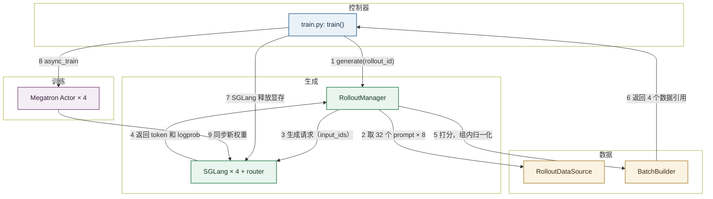
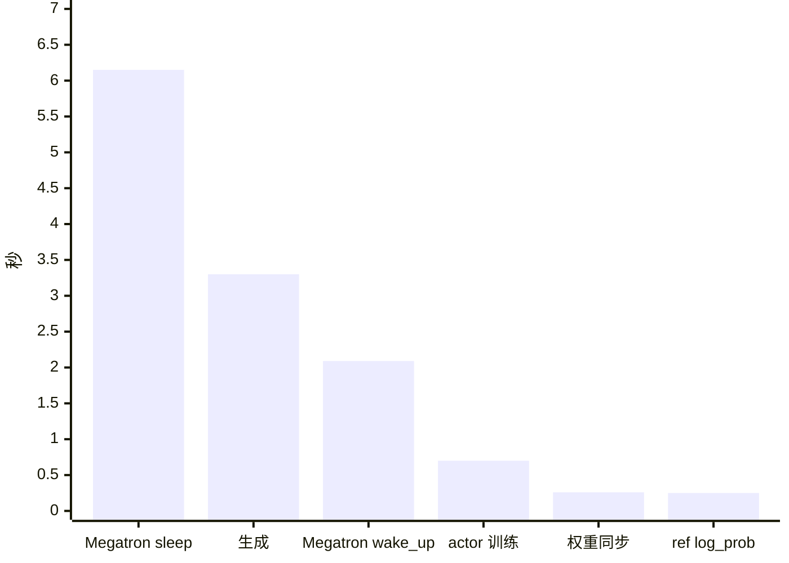
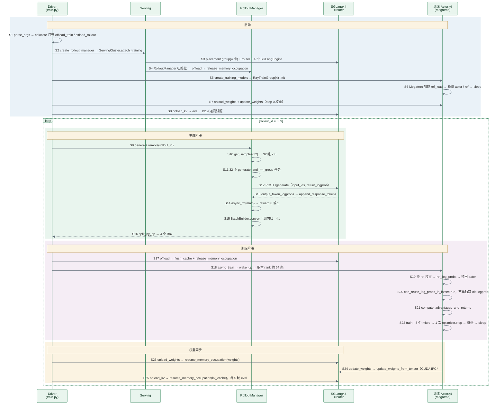

> 代码版本：`slime@540ea919`（2026-10-27，0.4.0）。运行环境：4 × H100 NVL 94GB，官方镜像 `slimerl/slime:latest-cu130`（转成 Apptainer SIF），内含 `sglang 0.5.21`、`torch 2.13.0+cu130`、Megatron-LM、TransformerEngine。文中数值都来自本机跑通的 GRPO 例子，代码行号对应上述 commit。

## slime Overview

slime 是智谱（Z.ai）开源的大模型强化学习框架，GLM-4.5 到 GLM-5.3 的 RL 训练都用它：训练用 Megatron，生成用 SGLang。它的设计目标是轻量，训练主循环就是 `train.py` 里不到 100 行的 for 循环。

入门时先记住三个角色：

| 角色   | 代码里的名字                                        | 职责                             |
| ------ | --------------------------------------------------- | -------------------------------- |
| 控制器 | `train.py` 里的 `train()` 函数                      | 按顺序下命令，不碰张量           |
| 生成端 | `RolloutManager` + 4 个 `SGLangEngine` + router     | 生成回答、打分、整理成训练数据   |
| 训练端 | 4 个 `MegatronTrainRayActor`                        | 取数据、更新模型、把新权重发回去 |

它们之间靠 **Ray object store** 传数据。`RolloutManager` 把整理好的数据切成 4 份，各自 `ray.put` 进 object store，控制器手里只有 4 个引用（`Box`），再原样转给 4 个训练 actor，大张量不经过控制器。



下面解释图中 9 个步骤，数值取自后文 GRPO 例子的第 1 轮（rollout 0），耗时取第 2–10 轮的中位数。

- **1 generate(rollout_id)**：`train()` 调用 `ray.get(rollout_manager.generate.remote(rollout_id))`，一直阻塞到这一轮的数据全部准备好。例子共跑 10 轮（`--num-rollout 10`）。

    - `train()`：Ray driver 进程里的普通函数，不是 Ray actor。用 `python3 train.py` 启动的主进程就是 driver，它第一次调用 Ray 时在本机起一个 Ray 集群，之后由它创建和调用所有 actor。

        | 框架       | 控制器                        | 是不是 Ray actor |
        | ---------- | ----------------------------- | ---------------- |
        | verl       | `TaskRunnerV1`                | 是               |
        | OpenRLHF   | `PPOTrainer`                  | 是               |
        | slime/vime | `train.py` 的 `train()` 函数  | 不是，就是 driver |

        控制逻辑写在 driver 里，好处是读一个文件就能看懂整个流程；代价是 driver 一退出，整个训练就结束。

    - `.remote()` 和 `ray.get`：`.remote(rollout_id)` 把"执行 `generate`"这条命令发到 `RolloutManager` 的进程，立刻返回一个占位符 `ObjectRef`。外层的 `ray.get` 让 driver 停下来，等 `generate` 跑完再取回结果。

    - 为什么必须等：下一步要让 SGLang 释放显存、把卡让给训练，所以这个例子里生成和训练是串行的。

    - 训练前评测：进入主循环前先在 GSM8K 测试集 1319 题上做一次评测，准确率 55.6%。

- **2 取 32 个 prompt × 8**：`RolloutDataSource.get_samples(32)` 从打乱后的训练集（7473 题）里取 32 个 prompt，每个深拷贝 8 份，一共 256 个 `Sample`。

    - `Sample`：一条回答的全部信息，包括 prompt、生成的 token、奖励、logprob 和状态，定义在 `slime/utils/types.py`。

    - `group_index`：同一个 prompt 的 8 份共用一个编号，后面 GRPO 按它分组。

    - chat template：prompt 套了 Qwen3 的聊天模板，并关掉思考（`enable_thinking=false`），模板会留一段空的 `<think>\n\n</think>`。Natalia 那道题的 prompt 是 66 个 token，256 条平均约 84 个。

- **3 生成请求（input_ids）**：每组起一个异步任务，组内 8 条各发一个请求，256 条同时发出。请求经 router 分给 4 个 SGLang，temperature=1.0，最多生成 1024 个 token。

    - 请求体直接是 token id，SGLang 不用再分词：

        ```json
        POST http://<router>/generate
        {"input_ids": [151644, 872, 198, ...],
         "sampling_params": {"temperature": 1.0, "top_p": 1.0, "top_k": -1, "max_new_tokens": 1024, "no_stop_trim": true},
         "return_logprob": true}
        ```

    - 并发上限：`--sglang-server-concurrency` 默认 512，乘以 4 个引擎是 2048。256 条远没到上限。

    - router：SGLang 的 Model Gateway，策略是 `cache_aware`，前缀相同的请求尽量发到同一个引擎，这样同组 8 条可以共享 prompt 的 KV cache。

    - `SGLangEngine`：每个引擎是一个 Ray actor，它在子进程里启动 SGLang 的 HTTP server，占 1 张卡，静态显存比例 0.5（`--sglang-mem-fraction-static`），KV cache 能放 42.2 万个 token（K、V 各 22.55 GB）。

- **4 返回 token 和 logprob**：SGLang 一边解码一边接新请求，每条写完就单独返回。返回体的 `meta_info.output_token_logprobs` 里是每个生成 token 的 (logprob, token_id)，存进 `sample.tokens` 和 `rollout_log_probs`。

    - 连续批处理（continuous batching）：不等整批都写完，谁先写完谁先返回，空出来的位置马上接新请求。

    - 第 1 轮 256 条回答平均 228 个 token，没有一条写满 1024。整轮生成约 3.3 s，由最长的那几条决定。

    - logprob：SGLang 采样时算出的对数概率。这个例子只用它做"训推一致性"监控，训练用的是 Megatron 自己算的 logprob（见第 8 步）。

- **5 打分，组内归一化**：每条回答返回后立刻打分，答对 1、答错 0。256 条都回来后，`BatchBuilder` 按组做 GRPO 归一化。第 1 轮平均奖励 0.621。

    - 打分：`--rm-type math` 取回答里最后一个 `\boxed{}`，和标准答案比较。

    - 组内归一化：每组先减平均，再除以标准差（加 1e-6）。

        ```text
        一组 8 个得分：[1, 1, 1, 0, 1, 1, 0, 1]
        平均 μ = 0.75，标准差 σ = 0.463
        答对：(1 − 0.75) / 0.463 = +0.540
        答错：(0 − 0.75) / 0.463 = −1.620
        ```

    - 全对或全错的组：标准差为 0，优势全是 0，等于不参与训练。第 1 轮 32 组里有 9 组是这样（8 组全对、1 组全错），72 条样本白生成了。

    - 为什么在生成端归一化：GRPO 只需要每条一个标量，`RolloutManager` 在交出数据前就算好，训练端拿到的 `rewards` 已经是归一化后的值。

- **6 返回 4 个数据引用**：`split_by_dp` 按长度把 256 条均衡分给 4 个训练 rank，每个 64 条，再各自 `ray.put` 进 object store，返回 4 个 `Box`。

    - DP rank：数据并行的编号。例子里 TP=PP=CP=1，所以 4 张卡就是 4 个 DP rank，各算一份数据。

    - micro-batch：每个 rank 约 64 × (84 + 230) ≈ 20,100 个 token，按每卡最多 9216 个 token（`--max-tokens-per-gpu`）切成 3 个 micro-batch。

        ```text
        20,100 / 9216 = 2.18 → 向上取整，3 个 micro-batch
        如果按条数固定切（比如每个 micro 8 条），长回答多的那包可能超出显存，
        短回答多的那包又吃不满 GPU；按 token 数切，每包的计算量接近。
        ```

    - `Box`：只是包了一层 `ObjectRef` 的小对象。driver 拿到的是 4 张"取货单"，数据本身留在 object store。

- **7 SGLang 释放显存**：driver 让 4 个 SGLang 先清前缀缓存，再释放显存（`release_memory_occupation`）。

    - 释放显存：SGLang 用 `torch_memory_saver` 管理自己的显存。释放时权重和 KV cache 的显存都还给 GPU，进程和 CUDA graph 都保留，醒来时不用重新启动。

        ```text
        SGLang 进程（一直活着）
        ├─ 权重显存     release → 释放      resume(tags=weights)  → 重新分配，等新权重写入
        └─ KV cache    release → 释放      resume(tags=kv_cache) → 重新分配
        ```

- **8 async_train**：driver 把第 i 个引用交给第 i 个训练 actor。每个 actor 先把训练状态搬回 GPU，再算 ref logprob、算优势、训练，整轮只做 1 次 `optimizer.step`，最后把训练状态搬走、释放显存。

    - 搬回 GPU（`wake_up`）：`torch_memory_saver.resume()` 把上一轮暂停时搬走的参数、梯度和优化器状态放回 GPU，再重建 NCCL 通信组，约 2.1 s。

    - ref logprob：ref 模型不单独占进程，它的权重以备份形式放在 CPU，计算时拷进同一个 Megatron 模型，算完再换回 actor 权重。

        ```text
        CPU 上的备份：actor 权重、ref 权重（初始都是 Qwen3-0.6B）
        GPU 上只有一个 Megatron 模型
        ├─ 换成 ref 权重 → 前向 → ref_log_probs（约 0.25 s）
        └─ 换回 actor 权重 → 训练
        ```

        这样 ref 不额外占 GPU 显存，代价是每轮在 CPU 和 GPU 之间拷两次权重。例子的 `--kl-loss-coef 0`，ref logprob 只用来监控 KL，不进 loss。

    - 不单独算 old logprob：`global_batch_size=256` 等于这一轮的全部样本，只有 1 次 `optimizer.step`，所以 old 策略就是当前策略，训练前向算出的 logprob 直接当 old logprob，ratio 恒为 1。

    - 训练：3 个 micro-batch 前向、反向、累加梯度，然后 1 次 `optimizer.step`，约 0.70 s，单卡约 105 TFLOPS。

    - 搬走（`sleep`）：先把新的 actor 权重备份到 CPU（第 9 步就从这份备份里读），再 `torch_memory_saver.pause()` 释放显存、销毁 NCCL 组，约 6.1 s。这是每轮最大的一块固定开销。

- **9 同步新权重**：先恢复 SGLang 的权重显存，再把新权重发过去，最后恢复 KV cache，权重同步本身约 0.26 s。每 5 轮评测一次。

    - 如何同步：每张卡上的 Megatron 把权重转成 HF 格式，打平成一块连续显存（`FlattenedTensorBucket`），序列化成 CUDA IPC 句柄，调用同卡 SGLang 的 `update_weights_from_tensor`。

        ```text
        POST /resume_memory_occupation tags=weights   # 1. 只分配权重显存
        POST /pause_generation + GET /flush_cache      # 2. 暂停生成，清前缀缓存
        POST /update_weights_from_tensor × N 桶        # 3. HTTP 只传句柄和元数据，权重由 SGLang 直接从 GPU 读
        POST /continue_generation                      # 4. 恢复生成
        POST /resume_memory_occupation tags=kv_cache  # 5. 恢复 KV cache
        ```

    - CUDA IPC：同一张卡上的两个进程共享一块显存。Megatron 进程把显存地址做成一个小句柄，经 HTTP 发给 SGLang，SGLang 打开句柄后直接读这块显存，不经过 CPU。

    - 和 vime 的差别：vime 走 vLLM 原生的三段式接口（start → 每桶 update → finish），约 0.78 s；slime 每桶只调一次 `update_weights_from_tensor`，约 0.26 s。

<br />
<br />

## 代码在哪里

```text
slime/
├── train.py                                   # 入口和主循环（不到 100 行）
├── scripts/models/qwen3-0.6B.sh               # 模型结构参数 MODEL_ARGS
├── tools/convert_hf_to_torch_dist.py          # HF → Megatron 检查点
├── slime/utils/arguments.py                   # 参数解析和校验
├── slime/ray/
│   ├── placement_group.py                     # 分配 GPU，创建 RolloutManager 和训练 actor
│   ├── rollout.py                             # RolloutManager：generate / eval / offload
│   └── actor_group.py                         # RayTrainGroup：把命令发给 4 个训练 actor
├── slime/rollout/
│   ├── sglang_rollout.py                      # 默认生成函数：并发请求 SGLang、打分
│   ├── rm_hub/                                # 规则奖励：math / deepscaler / dapo / f1 ...
│   └── fully_async_rollout.py                 # 后台持续生成的异步版本
├── slime/data/
│   ├── data_source.py                         # 读 prompt，按组复制
│   └── batch_builder.py                       # 组内归一化、转成训练数据、按 DP 切分
├── slime/backends/sglang_utils/
│   ├── sglang_engine.py                       # SGLangEngine：启动 server，释放 / 恢复显存，权重接口
│   └── engine_group.py                        # 多个引擎的统一控制
└── slime/backends/megatron_utils/
    ├── actor.py                               # MegatronTrainRayActor：train / sleep / wake_up
    ├── model.py                               # forward_only / train / train_one_step
    ├── loss.py                                # logprob、优势、policy loss
    └── update_weight/                         # 训练到推理的权重同步
```

<br />
<br />

## 安装

### 更新代码

`origin` 是自己的 fork，最新代码在官方仓库，所以先把官方仓库加成 `upstream`：

```bash
git remote add upstream https://github.com/THUDM/slime.git   # 只需第一次
git fetch upstream
git checkout main
git rebase --autostash upstream/main     # 未提交的改动自动收起，做完再放回
```

- `--autostash`：有未提交的改动时，rebase 会拒绝执行；加上它就自动 stash 和 pop。
- 冲突：两边改了同一处时照样会冲突，改好后 `git add`，再 `git rebase --continue`。

### 安装

slime 依赖特定版本的 SGLang、Megatron-LM、TransformerEngine 和 apex，自己编译很慢，官方推荐直接用 Docker 镜像：

```bash
docker pull slimerl/slime:latest-cu130
docker run --rm -it --gpus all --ipc=host --shm-size=16g --ulimit memlock=-1 \
  -v $PWD:/root/slime -w /root/slime slimerl/slime:latest-cu130 bash
pip install -e . --no-deps               # 镜像里已有全部依赖，只把源码装成可编辑模式
```

- `cu130`：CUDA 13 镜像，H100、H200、B200 通用；驱动旧时会自动启用 forward-compat。
- `--ipc=host`、`--shm-size=16g`：Ray object store 和 CUDA IPC 都要用共享内存，默认的 64 MB 不够。
- `-v $PWD:/root/slime`：把本地源码挂到镜像里 slime 的安装位置，改代码立即生效。
- `--no-deps`：不让 pip 动镜像里已经配好的 SGLang、torch 版本。
- 没有 Docker：仓库里的 `build_conda.sh` 会从源码编译 SGLang、Megatron、TE 和 apex，耗时很长。

本机没有 Docker，用 Apptainer 把镜像转成 SIF 文件，再用同样的方式挂载源码：

```bash
apptainer pull rl_study/sif/slime-cu130.sif docker://slimerl/slime:latest-cu130   # 约 13.9 GB，6 分钟
apptainer exec --nv --writable-tmpfs \
  --bind /data/home --bind /tmp --bind /data/home/xli49/lxy/slime:/root/slime \
  rl_study/sif/slime-cu130.sif bash        # rl_study/scripts/slimebox.sh 就是这条命令
```

- `--nv`：把宿主机的 NVIDIA 驱动挂进容器。
- `--writable-tmpfs`：允许在容器里临时写文件，退出后丢弃。

### 检查安装

进入容器后，确认关键包能导入、GPU 可用：

```bash
python -c "import torch, sglang, megatron.core, transformer_engine; print(torch.__version__, sglang.__version__, torch.cuda.is_available())"
pip show slime | grep "Editable project location"    # 应是 /root/slime，说明用的是挂载进来的源码
```

<br />
<br />

## 提 PR 流程

规则以官方的 `CONTRIBUTING.md` 和 `docs/en/developer_guide/ci.md` 为准。slime 对外部贡献有明确的范围，动手前先看清楚。

### 1. 先看范围，再建分支

slime 和智谱内部版本同步维护，所以只接收两类 PR：

| 欢迎                                            | 暂不接收                                        |
| ----------------------------------------------- | ----------------------------------------------- |
| bug 报告、带测试或清晰复现步骤的 bug 修复       | 大范围重构                                      |
| 有明确 benchmark、能用 CI 或常规训练验证的优化  | 通用数据标准、eval 标准、工具基类这类抽象       |
|                                                 | 无法用 CI 验证的功能、整套算法复现流程          |
|                                                 | 对 Megatron 的大幅改动                          |

```bash
git fetch upstream
git checkout -b fix/<主题> upstream/main
```

动手前先查重，已有 open PR 修同一个问题就不要再开：

```text
https://github.com/THUDM/slime/pulls?q=is%3Apr+<关键词>
```

### 2. 测试

```bash
pre-commit install                     # 只需第一次
pre-commit run --all-files             # ruff、autoflake、isort、black 等
python tests/<相关测试>.py              # CI 也是这样直接运行测试文件
```

- CPU 测试：PR 打开或更新时自动运行（`cpu-unittest`、`agent-test`），覆盖参数校验、batch 调度、奖励函数、`Sample` 行为等。
- GPU 测试：由维护者打标签触发，在自建机器上跑真实的 Megatron 训练和 SGLang 生成：

    | 标签                  | 跑什么                                                 |
    | --------------------- | ------------------------------------------------------ |
    | `run-ci-megatron`     | Megatron 训练：dense、MoE、PPO、fully async 等         |
    | `run-ci-sglang-config`| SGLang 部署配置、多模型、显存 offload 的故障恢复       |
    | `run-ci-precision`    | 不同并行配置下的数值一致性                             |
    | `run-ci-ckpt`         | checkpoint 保存和加载                                  |
    | `run-ci-changed`      | 只跑新增或修改过的测试                                 |

- 新测试文件：CI 直接 `python tests/<file>.py`，所以 pytest 文件结尾要有 `if __name__ == "__main__": raise SystemExit(pytest.main([__file__]))`。
- 修复前后各跑一次：修复前失败、修复后通过，才能证明测试有效。

### 3. 提交

```bash
git add <文件>                                    # 不要 git add .
git commit -m "fix: <描述>"
git push -u origin fix/<主题>
```

slime 没有强制的标题格式，近期合并的 PR 标题大致是这几种：

```text
fix: put the critic value head on a VLM's language_model
Keep a router's existing registration when an engine registers again
[docs] Refine index page
[docker] Upgrade SGLang to 0.5.21 and align the CUDA 13 runtime
```

### 4. 开 PR

在自己的 fork 上点 Compare & pull request，目标选 `THUDM/slime:main`。仓库没有 PR 模板，正文写清楚这几项：

```markdown
## Problem

Fixes #<issue>. <一两句话：现象是什么，怎么复现。>

## Fix

<为什么会出错，改了哪里。>

## Verification

- `python tests/test_xxx.py`：修复前失败，修复后通过
- <训练日志或 benchmark：改动前后的数字>
```

- 优化类 PR：一定要附 benchmark，能被 CI 或常规训练复现。
- AI 协助：说明哪些部分由 AI 生成，自己读过每一行、跑过测试。

### 5. 更新 PR

**情况 1：改代码或回应 review（最常见）**

```bash
git checkout fix/<主题>
# 修改代码
pre-commit run --all-files
git add <文件>
git commit -m "fix: address review comments"
git push                       # 普通推送，PR 自动出现新提交
```

**情况 2：上游 main 更新了，需要同步或解决冲突**

```bash
git fetch upstream
git rebase upstream/main       # 把你的提交搬到 upstream 最新代码后面
git push --force-with-lease    # rebase 改写了历史，必须强制推送
```

- 没有冲突：rebase 自动完成，直接 push。
- 有冲突：编辑冲突文件，删掉 `<<<<<<<`、`=======`、`>>>>>>>` 标记，`git add <文件>`，再 `git rebase --continue`。
- 想放弃：`git rebase --abort`，回到 rebase 之前的状态。

<br />
<br />

## 跑通第一个例子：GRPO

用 Qwen3-0.6B 学做 GSM8K 数学题，4 张卡，Megatron 和 SGLang 共卡，共 10 轮。配置全是命令行参数：Megatron 的参数原样传入，SGLang 的参数加 `--sglang-` 前缀，slime 自己的参数在 `slime/utils/arguments.py`。

### 1. 准备数据和模型

下载 GSM8K，转成每行一个 JSON 的 jsonl 文件：

```bash
python rl_study/scripts/prep_gsm8k_jsonl.py      # 写出 gsm8k_train.jsonl（7473 行）和 gsm8k_test.jsonl（1319 行）
```

每行的格式：

```json
{"prompt": [{"role": "user", "content": "Natalia sold clips ... output the final answer within \\boxed{}."}], "label": "72"}
```

- `prompt`：聊天消息列表，`--apply-chat-template` 会把它套上模板。
- 结尾的 `\boxed{}` 提示：让模型把答案写进 `\boxed{}`，`math` 奖励函数从这里取答案。
- `label`：标准答案，只保留数字。

Megatron 训练端读的是 Megatron 自己的检查点格式，所以要先把 HF 权重转一次（容器里执行）：

```bash
cd /root/slime && source scripts/models/qwen3-0.6B.sh      # 载入 MODEL_ARGS
PYTHONPATH=/root/Megatron-LM python3 tools/convert_hf_to_torch_dist.py \
    ${MODEL_ARGS[@]} \
    --hf-checkpoint $HF_QWEN3_0_6B \
    --save rl_study/ckpt/slime_qwen3-0.6B_torch_dist
```

- `MODEL_ARGS`：Megatron 不读 HF 的 `config.json`，模型结构要用参数写出来。Qwen3-0.6B 是 `--num-layers 28 --hidden-size 1024 --ffn-hidden-size 3072 --num-attention-heads 16 --group-query-attention --num-query-groups 8 --kv-channels 128 --qk-layernorm --swiglu --normalization RMSNorm --rotary-base 1000000 --vocab-size 151936`。
- `torch_dist`：Megatron 的分布式检查点格式，加载时可以按任意 TP/PP 切分。转换成功后目录里有 `latest_checkpointed_iteration.txt`，内容是 `release`。
- `--hf-checkpoint`：训练时仍然要给，SGLang 用它加载权重，tokenizer 也从这里读。

### 2. 启动训练

```bash
source scripts/models/qwen3-0.6B.sh
HF=/data/home/xli49/.cache/huggingface/hub/models--Qwen--Qwen3-0.6B/snapshots/c1899de2...
D=/data/home/xli49/lxy/rl_study/data
ARGS=(
    # ---- 放置 ----
    --actor-num-nodes 1 --actor-num-gpus-per-node 4      # 训练用 1 个节点 4 张卡
    --colocate                                           # 训练和 SGLang 共用这 4 张卡，自动打开 offload_train / offload_rollout
    --rollout-num-gpus-per-engine 1                      # 每个 SGLang 占 1 张卡 → 4 个引擎
    --sglang-mem-fraction-static 0.5                     # 每个 SGLang 静态占 50% 显存

    # ---- 模型 ----
    "${MODEL_ARGS[@]}"                                   # Megatron 模型结构
    --hf-checkpoint $HF                                  # SGLang 权重和 tokenizer
    --ref-load rl_study/ckpt/slime_qwen3-0.6B_torch_dist # Megatron 初始权重；没有 --load 时 actor 也从这里加载
    --save rl_study/runs/slime/grpo_colocate --save-interval 1000  # 实际上不保存

    # ---- 数据 ----
    --prompt-data $D/gsm8k_train.jsonl                   # 训练集 7473 题
    --input-key prompt --label-key label                 # jsonl 里 prompt 和答案的字段名
    --apply-chat-template                                # 套 Qwen3 聊天模板
    --apply-chat-template-kwargs '{"enable_thinking": false}'   # 关掉思考，模板里留空的 <think></think>
    --rollout-shuffle                                    # 每个 epoch 打乱顺序
    --rm-type math                                       # 奖励：取最后一个 \boxed{} 和答案比较

    # ---- 生成 ----
    --num-rollout 10                                     # 共 10 轮
    --rollout-batch-size 32                              # 每轮 32 个 prompt
    --n-samples-per-prompt 8                             # 每个 prompt 生成 8 条 → 每轮 256 条
    --rollout-max-response-len 1024                      # 回答最长 1024 token
    --rollout-temperature 1                              # 训练采样温度

    # ---- 评测 ----
    --eval-interval 5                                    # 每 5 轮评测一次（训练前也评测一次）
    --eval-prompt-data gsm8k $D/gsm8k_test.jsonl         # 测试集 1319 题，名字叫 gsm8k
    --n-samples-per-eval-prompt 1 --eval-max-response-len 1024 --eval-top-p 1

    # ---- 训练批次 ----
    --global-batch-size 256                              # 每次 optimizer.step 用 256 条 → 每轮 256/256 = 1 次 step
    --balance-data                                       # 按 token 数把样本均衡分给 4 个 DP rank
    --use-dynamic-batch-size --max-tokens-per-gpu 9216   # 按 token 数打包 micro-batch，每包最多 9216 个 token
    --tensor-model-parallel-size 1 --pipeline-model-parallel-size 1 --context-parallel-size 1   # 不切模型 → DP = 4

    # ---- 算法 ----
    --advantage-estimator grpo                           # 组内 (r − μ) / (σ + 1e-6)，不需要 critic
    --use-kl-loss --kl-loss-coef 0.00 --kl-loss-type low_var_kl   # 算 ref logprob 做监控，但 KL 不进 loss
    --entropy-coef 0.00                                  # 不加熵奖励
    --eps-clip 0.2 --eps-clip-high 0.28                  # PPO clip：ratio 限制在 [0.8, 1.28]

    # ---- 优化器 ----
    --optimizer adam --lr 1e-6 --lr-decay-style constant
    --weight-decay 0.1 --adam-beta1 0.9 --adam-beta2 0.98

    # ---- 数值 ----
    --attention-dropout 0.0 --hidden-dropout 0.0         # RL 训练关掉 dropout
    --accumulate-allreduce-grads-in-fp32 --attention-softmax-in-fp32
    --attention-backend flash
)
python3 train.py "${ARGS[@]}"
```

- `PYTHONPATH=/root/Megatron-LM`：Megatron 不是 pip 包，要把源码目录加进路径。
- `CUDA_DEVICE_MAX_CONNECTIONS=1`：Megatron 推荐的设置，让 GPU 按提交顺序执行 kernel，通信和计算的重叠才按预期发生。
- 官方脚本一般先 `ray start --head` 再 `ray job submit`；这里直接 `python3 train.py`，由它在本机起 Ray。
- 完整脚本在 `rl_study/scripts/slime_ex1_grpo_colocate.sh`，用 `rl_study/scripts/slimebox.sh` 在容器里运行。

### 3. 关键配置

先记住这几个：

| 配置                            | 含义                           | 取值             |
| ------------------------------- | ------------------------------ | ---------------- |
| `--colocate`                    | 训练和推理共卡                 | 开               |
| `--rollout-batch-size`          | 每轮 prompt 数                 | 32               |
| `--n-samples-per-prompt`        | 每个 prompt 采样几条           | 8                |
| `--global-batch-size`           | 每次 `optimizer.step` 的条数   | 256（每轮 1 次） |
| `--max-tokens-per-gpu`          | 每个 micro-batch 的 token 上限 | 9216             |
| `--sglang-mem-fraction-static`  | SGLang 显存比例                | 0.5              |
| `--advantage-estimator`         | 优势估计器                     | grpo             |

### 4. 结果分析

总耗时约 6 分 30 秒，其中启动 4 个 SGLang（含 CUDA graph 捕获，每个约 6.6 s）、加载 Megatron 和训练前评测约 3 分 20 秒，10 轮训练和两次评测约 3 分钟。

| rollout | 训练平均得分 | 验证准确率       | 平均回答长度 |
| ------- | ------------ | ---------------- | ------------ |
| 0       | 0.621        | 55.6%（训练前）  | 228          |
| 4       | 0.598        | 57.0%            | 246          |
| 9       | 0.598        | 59.7%            | 222          |

- 起点就有 55%：Qwen3-0.6B 本来就习惯把答案写进 `\boxed{}`，不需要像 verl 例子那样先学格式。
- 训练得分波动大（0.50–0.73）：每轮只有 32 道题，题目难度的差异比 10 轮的提升大，看验证准确率更可靠。
- `pg_loss` 约 1e-9、`ppo_kl=0`、`clipfrac=0`：每轮只有 1 次 step，ratio 恒为 1；组内归一化后每组优势之和为 0，所以 loss 的数值接近 0。但梯度不是 0，`grad_norm` 约 0.8。
- `train-rollout logp abs diff` 约 0.011：Megatron 和 SGLang 对同一个 token 算出的 logprob 平均差 0.011，用来监控训推一致性。
- 前缀缓存命中率：第 1 轮 63%，第 6 轮 65%，其余 8 轮只有约 1%；用同样超参的 vime 每轮都在 72%–81%。命中率高的两轮恰好都紧跟在一次评测之后，原因这里没有深究。

每轮约 14.0 s，构成如下：



- 训练本身只有约 1 s，显存搬进搬出（sleep + wake_up）约 8.2 s，是共卡的固定开销。0.6B 模型太小，这部分开销反而占了大头。
- 剩下约 1.3 s 是 SGLang 的释放和恢复、数据整理和 Ray 调度。
- 第 1 轮的 ref logprob 2.3 s、训练 2.3 s，是首次 warm-up。

<br />
<br />

## 一轮训练时序图

整个训练分成两段：

- 启动（S1–S8，只执行一次）：解析参数，分配 GPU，启动 router 和 4 个 SGLang，创建 `RolloutManager` 和 4 个训练 actor，把初始权重同步给 SGLang，再在测试集上评测一次。
- 每轮循环（S9–S25）：取 32 道题 × 8 → SGLang 生成并打分 → 组内归一化、切成 4 份 → SGLang 释放显存 → Megatron wake_up → ref logprob、优势、1 次 `optimizer.step` → Megatron sleep → 新权重同步给 SGLang → 恢复 KV cache，每 5 轮评测一次。

图中编号 S1–S25 和下一节的代码一一对应。图中简称与源码的对应：

| 图中简称      | 源码                               |
| ------------- | ---------------------------------- |
| Driver        | `train.py` 的 `main()` / `train()` |
| Serving       | `ServingCluster`（detached actor） |
| 训练 Actor    | `MegatronTrainRayActor`            |
| 训练组        | `RayTrainGroup`                    |
| 权重同步器    | `UpdateWeightFromTensor`           |



<br />
<br />

## 代码逐步详解（带入数值）

每一步都按同样的顺序讲：**做什么 → 代码 → 带入数值 → 这一步的结果**。编号和上面的时序图一一对应。

例子的配置：

- `rollout_batch_size=32`：每轮 32 道题。
- `n_samples_per_prompt=8`：每题生成 8 条回答，共 256 条。
- `global_batch_size=256`：每轮只做 1 次 `optimizer.step`。
- `max_tokens_per_gpu=9216`：每个 micro-batch 最多 9216 个 token。
- 4 张 GPU，`--colocate`，TP=PP=CP=1：Megatron 是 DP=4，每卡一个 SGLang。
- `num_rollout=10`：只跑 10 轮。
- `eval_interval=5`：每 5 轮评测一次。

### 第一阶段：启动（S1–S8，只执行一次）

#### S1: 解析参数

**目的**：解析 Megatron、SGLang 和 slime 三类参数，补齐默认值。

代码位置：`train.py:130`、`slime/utils/arguments.py:2135`、`:2182`

```python
args, restore_plan = parse_args(return_restore_plan=True)  # 先用 Megatron 的 parser，再加 --sglang-* 和 slime 自己的参数
```

```python
if args.colocate:  # 共卡
    args.offload_rollout = True  # 训练时 SGLang 让出显存
    args.offload_train = True  # 生成时 Megatron 让出显存

if args.over_sampling_batch_size is None:
    args.over_sampling_batch_size = args.rollout_batch_size  # 每次从数据集取多少组，默认等于每轮 prompt 数
```

**带入数值**：

- `--colocate`，所以 `offload_rollout` 和 `offload_train` 都是 True。
- `rollout_num_gpus` 没给，默认等于训练卡数 4；每个引擎 1 张卡，所以 4 个引擎。
- `over_sampling_batch_size` 没给，等于 32，一次正好取 32 组，不多取。
- `global_batch_size=256`、`rollout_batch_size × n_samples_per_prompt = 256`，所以每轮 1 次 step。

**结果**：参数确定，交给 `main()`。

<br />

#### S2: 创建 ServingCluster 和 RolloutManager

**目的**：创建管理推理服务的 `ServingCluster`，再由它创建 `RolloutManager`。

代码位置：`train.py:109`、`placement_group.py:293`、`:310`

```python
startup = create_rollout_manager(args, restore_plan=restore_plan)  # 创建或复用推理服务和 RolloutManager

train(startup.args, startup.placements, startup.manager, ...)  # 进入训练
```

```python
serving = ServingCluster.options(name=..., lifetime="detached", get_if_exists=True).remote(args, restore_plan)  # detached：训练失败时推理服务和回放数据可以保留，手动重启后复用

deployment = ray.get(serving.attach_training.remote(args, job_id))  # 分配 GPU，启动 router 和 SGLang（S3）

manager = RolloutManager.options(name=name, lifetime="detached", ...).remote(args, placements["rollout"], serving=serving, deployment=deployment)  # 创建 RolloutManager（S4）
```

**带入数值**：本机单节点，第一次启动，`get_if_exists` 找不到旧的 `ServingCluster`，新建一个。

**结果**：推理服务开始启动，driver 拿到 `RolloutManager` 的句柄。

<br />

#### S3: 分配 GPU，启动 router 和 SGLang

**目的**：用 Ray placement group 占住 4 张卡，启动 router 和 4 个 SGLang。

代码位置：`placement_group.py:123`、`:103`、`sglang_engine.py:38`、`:111`

```python
num_gpus, rollout_offset = _get_placement_group_layout(args)  # 共卡：返回 (max(4, 4), 0) = (4, 0)

pg, actor_pg_reordered_bundle_indices, actor_pg_reordered_gpu_ids = _create_placement_group(num_gpus)  # 一个 placement group，4 个 bundle

rollout_pg_reordered_bundle_indices = actor_pg_reordered_bundle_indices[rollout_offset:]  # offset 为 0：SGLang 和训练用同样的 4 张卡
```

```python
p = multiprocessing.Process(target=_launch_server, args=(server_args, os.getpid()))  # 在子进程里跑 SGLang 的 HTTP server
p.start()

_wait_server_healthy(base_url=server_args.url(), ...)  # 反复请求 /health_generate，直到返回 200
```

```python
from sglang.srt.entrypoints.http_server import launch_server  # 子进程里：调用 SGLang 自己的 launch_server

kill_itself_when_parent_died()  # Ray actor 被杀时，server 也跟着退出，把显存还回去
```

**带入数值**：

- placement group 有 4 个 bundle，对应 GPU 0–3。
- router 在 `172.30.200.9:3905` 启动，端口每次随机，策略 `cache_aware`。
- 每个 SGLang：KV cache 42.2 万个 token，K、V 各 22.55 GB；decode 的 CUDA graph 覆盖 batch size 1–256，捕获约 6.6 s。

**结果**：4 个 SGLang 已启动并注册到 router，里面是 HF 的初始权重。

<br />

#### S4: 初始化 RolloutManager，让 SGLang 先释放显存

**目的**：准备数据源、生成函数和 `BatchBuilder`，然后让 SGLang 释放显存，给 Megatron 加载模型腾地方。

代码位置：`rollout.py:44`、`:127`、`:129`、`:451`、`sglang_engine.py:378`

```python
self.data_source = data_source_cls(args)  # 默认 RolloutDataSourceWithBuffer：读 jsonl，套聊天模板

self.generate_rollout = load_function(self.args.rollout_function_path)  # 默认 slime.rollout.sglang_rollout.generate_rollout

self.eval_generate_rollout = load_function(self.args.eval_function_path)  # 没指定时和生成函数相同，以 evaluation=True 调用

self.batch_builder = BatchBuilder(args, controller=self.controller)  # 样本 → 训练数据
```

```python
def release_memory_occupation(self):
    self.flush_cache()  # 先清前缀缓存
    return self._make_request("release_memory_occupation")  # 再释放权重和 KV cache 的显存
```

**带入数值**：

- 训练集 7473 条，评测集 1319 条。
- `offload_rollout=True`，所以创建完立刻释放显存。

**结果**：`RolloutManager` 就绪，4 个 SGLang 不占显存。

<br />

#### S5: 创建训练 actor

**目的**：在同样的 4 张卡上创建 4 个 `MegatronTrainRayActor`。

代码位置：`train.py:16`、`placement_group.py:203`、`:190`、`:172`

```python
actor_model = allocate_train_group(args=actor_args, num_nodes=1, num_gpus_per_node=4, pg=pgs["actor"], with_ref=actor_args.kl_coef != 0 or actor_args.use_kl_loss)  # 开了 KL loss 就要 ref

actor_start_rollout_ids = actor_model.create(rollout_manager=rollout_manager)  # 4 个 actor 各自执行 init（S6）
```

```python
return RayTrainGroup(..., num_gpus_per_actor=0.4, ...)  # allocate_train_group 内部：每个 actor 只向 Ray 申请 0.4 张卡，剩下的留给同卡的 SGLang
```

**带入数值**：

- 4 个 actor，各占 1 张卡的 0.4。这个数字只是给 Ray 记账，实际显存靠 sleep / wake_up 轮流使用。
- `use_kl_loss=True`，所以 `with_ref=True`，即使 `kl_loss_coef=0` 也要加载 ref。

**结果**：4 个训练进程开始初始化。

<br />

#### S6: 加载 Megatron 模型，备份权重，sleep

**目的**：加载模型和优化器，把 actor 和 ref 权重各备份一份到 CPU，然后释放显存。

代码位置：`actor.py:65`、`:103`、`:132`、`:135`、`:153`、`:182`

```python
self.model, self.optimizer, self.opt_param_scheduler, loaded_rollout_id = initialize_model_and_optimizer(args, role)  # 没有 --load，从 --ref-load 加载

self.weights_backuper = TensorBackuper(...)  # CPU 上存多份权重的工具

self.weights_backuper.backup("actor")  # 备份 actor 权重

self.load_other_checkpoint("ref", args.ref_load)  # 再读一次 ref_load，备份成 ref

self.weight_updater = create_weight_updater(...)  # 共卡 → UpdateWeightFromTensor

self.sleep()  # offload_train：释放显存
```

```python
destroy_process_groups()  # 销毁 NCCL 通信组，它们也占显存

torch_memory_saver.pause()  # 把参数、梯度、优化器状态搬走，释放显存
```

**带入数值**：

- 初始时 actor 和 ref 是同一份 Qwen3-0.6B 权重。
- 0.6B × 2 字节（bf16）≈ 1.2 GB 一份，CPU 上两份。
- 日志 `Memory-Usage after offload model` 显示每卡只剩约 1 GB。

**结果**：Megatron 模型已加载并 sleep，CPU 上有 actor 和 ref 两份备份。

<br />

#### S7: 首次同步权重

**目的**：把 Megatron 的权重发给 SGLang，保证生成和训练用同一份权重。

代码位置：`train.py:19`、`:22`

```python
ray.get(rollout_manager.onload_weights.remote())  # SGLang 先分配权重显存

actor_model.update_weights()  # 把初始权重同步给 SGLang，过程和 S24 相同
```

**带入数值**：权重版本从 0 变为 1。这时权重和 SGLang 自己从 HF 加载的完全一样，但仍然要同步一次，顺便提前检查传输链路。

**结果**：SGLang 和 Megatron 的权重一致。

<br />

#### S8: 恢复 KV cache，训练前评测

**目的**：恢复 SGLang 的 KV cache，用还没训练的模型做一遍测试题，得到基线。

代码位置：`train.py:31`、`:49`

```python
ray.get(rollout_manager.onload_kv.remote())  # resume_memory_occupation(tags=["kv_cache"])

if args.eval_interval is not None and rollout_id == 0 and not args.skip_eval_before_train:
    ray.get(rollout_manager.eval.remote(rollout_id))  # 训练前评测
```

**带入数值**：

- 1319 道测试题，每题 1 条，`top_p=1`。
- 准确率 55.57%，平均回答 244 个 token，截断率 0.15%。

**结果**：有了对比的起点，进入主循环。

### 第二阶段：生成（S9–S16，每轮一次）

下面以第 1 轮（rollout 0）为例。

<br />

#### S9: driver 发起生成

**目的**：让 `RolloutManager` 生成这一轮的数据，driver 等它返回。

代码位置：`train.py:51`、`rollout.py:317`、`:335`、`:503`

```python
rollout_data_ref = ray.get(rollout_manager.generate.remote(rollout_id))  # 阻塞到 256 条全部生成、打分、整理完
```

```python
data, metrics = self._get_rollout_data(rollout_id=rollout_id)  # 调用生成函数（S10–S14）

data = self.batch_builder.convert(data)  # 组内归一化，转成训练数据（S15）

return self.batch_builder.split_by_dp(data)  # 切成 4 份，返回 4 个 Box（S16）
```

**带入数值**：`rollout_id=0`，调用链是 `generate` → `_generate` → `_get_rollout_data` → `call_rollout_fn` → `sglang_rollout.generate_rollout`。

**结果**：`RolloutManager` 开始干活，driver 在 `ray.get` 上等待。

<br />

#### S10: 取 32 个 prompt，每个复制 8 份

**目的**：从数据集取一批题目，每题复制 8 份，同组共用一个编号。

代码位置：`data_source.py:104`

```python
prompt_samples.extend(self.dataset.samples[self.sample_offset : self.sample_offset + count])  # 按顺序取 32 个；每个 epoch 开头会打乱

for prompt_sample in prompt_samples:  # 32 个 prompt
    for _ in range(self.args.n_samples_per_prompt):  # 每个复制 8 份
        sample = copy.deepcopy(prompt_sample)
        sample.group_index = self.sample_group_index  # 同组同编号，GRPO 按它分组
        sample.index = self.sample_index  # 全局递增编号
        self.sample_index += 1
        group.append(sample)
    self.sample_group_index += 1
```

**带入数值**：

- 返回 32 组 × 8 = 256 个 `Sample`。
- 第 1 轮 `group_index` 是 0–31，`index` 是 0–255。

**结果**：256 个待生成的 `Sample`，状态都是 `PENDING`。

<br />

#### S11: 提交 32 个并发任务

**目的**：每组起一个异步任务，组内 8 条各起一个子任务，全部同时运行。

代码位置：`sglang_rollout.py:492`、`:84`、`:388`、`:289`

```python
state = GenerateState(args)  # 单例：tokenizer、并发信号量、采样参数

while len(data) < target_data_size:  # 要凑够 32 组
    while state.remaining_batch_size < target_data_size:
        samples = data_source(args.over_sampling_batch_size)  # 取 32 组（S10）
        state.submit_generate_tasks(samples)  # 每组一个 generate_and_rm_group 任务
    done, state.pendings = await asyncio.wait(state.pendings, return_when=asyncio.FIRST_COMPLETED)  # 有一组完成就收一组
```

```python
self.semaphore = asyncio.Semaphore(args.sglang_server_concurrency * get_rollout_num_engines(args))  # 512 × 4 = 2048

self.sampling_params = dict(temperature=1.0, top_p=1.0, top_k=-1, max_new_tokens=1024, no_stop_trim=True, ...)  # 按原始分布采样
```

```python
for idx, sample in enumerate(group):  # 组内 8 条
    tasks.append(asyncio.create_task(generate_and_rm(args, sample, current_sampling_params, evaluation=evaluation)))  # 每条：生成 + 打分
```

**带入数值**：

- 32 个组任务，256 个子任务。
- 256 < 2048，信号量不会挡住任何请求，256 条同时发出。

**结果**：256 个协程在 `RolloutManager` 进程里并发运行。

<br />

#### S12: 发请求给 SGLang

**目的**：把 prompt 转成 token，发给 router，再由 router 转给某个 SGLang。

代码位置：`sglang_rollout.py:158`、`:164`、`:182`、`:208`

```python
url = f"http://{args.sglang_router_ip}:{args.sglang_router_port}/generate"  # router 的地址

prompt_ids = _prepare_prompt_ids(sample, state.tokenizer, state.processor)  # 套聊天模板，转成 token id

sampling_params["max_new_tokens"] -= sample.response_length  # 已经生成过的部分要扣掉（续写时用），这里是 1024 − 0

payload = {"sampling_params": sampling_params, "return_logprob": True}  # 要求返回每个 token 的 logprob

payload["input_ids"] = prompt_ids  # 纯文本时 token 进；带图片时改传 text，让 SGLang 自己处理图片占位符

output = await post(url, payload)
```

**带入数值**：

- Natalia 那道题的 prompt 是 66 个 token，256 条平均约 84 个。
- router 按前缀把同组请求尽量送到同一个引擎，同组 8 条可以共享 prompt 的 KV cache。

**结果**：请求进入 SGLang 的调度队列。

<br />

#### S13: 取回 token 和 logprob

**目的**：从 SGLang 的返回体里取出生成的 token 和 logprob，追加到 `Sample`。

代码位置：`sglang_rollout.py:240`

```python
new_response_tokens = [item[1] for item in output["meta_info"]["output_token_logprobs"]]  # 每项是 (logprob, token_id, text)

new_response_log_probs = [item[0] for item in output["meta_info"]["output_token_logprobs"]]

sample.append_response_tokens(args, tokens=new_response_tokens, log_probs=new_response_log_probs, trainable=True, meta_info=..., text=output["text"])  # tokens 追加回答，loss_mask 追加 1，rollout_log_probs 追加 logprob
```

**带入数值**：

- 第 1 轮平均回答 228 个 token，没有写满 1024 的。
- 一条 230 个 token 的回答：`tokens` 长 84 + 230 = 314，`loss_mask` 是 230 个 1，`rollout_log_probs` 长 230。

**结果**：`Sample` 的状态变为 `COMPLETED`（写满上限则是 `TRUNCATED`）。

<br />

#### S14: 打分

**目的**：从回答里取出答案，和标准答案比较。

代码位置：`rm_hub/__init__.py:55`、`:81`

```python
sample.reward = await async_rm(args, sample)  # generate_and_rm 末尾，生成完立刻打分
```

```python
elif rm_type == "math":
    return 1 if grade_answer_verl(response, label) else 0  # 取最后一个 \boxed{...}，先字符串比较，再用 sympy 判等
```

**带入数值**：

- 日志里第 1 条样本：Darla 那道电费题，回答结尾是 `\boxed{1350}`，标准答案 `1350`，得 1。
- 第 1 轮 256 条平均 0.621。
- 不要用 `--rm-type boxed_math`：它先取出 `\boxed{}` 里的内容（比如 `"3450"`），再交给 `grade_answer_verl` 又找一次 `\boxed{}`，永远找不到，所有奖励都是 0。

**结果**：每条 `Sample` 都有了 0 或 1 的 `reward`。

<br />

#### S15: 组内归一化，转成训练数据

**目的**：同一个 prompt 的 8 条互相比较，再把 `Sample` 对象转成按字段组织的字典。

代码位置：`batch_builder.py:207`、`:256`

```python
raw_rewards = [sample.get_reward_value(self.args) for sample in samples]  # 256 个 0 或 1

for positions in groups.values():  # 按 group_index 分组，32 组
    centered = rewards[positions] - rewards[positions].mean()  # 减组均值
    if self.args.advantage_estimator in ["grpo", "gspo", "cispo"] and self.args.grpo_std_normalization and len(positions) > 1:
        centered = centered / (centered.std() + 1e-6)  # 除以组标准差；1e-6 防止除以 0
    rewards[positions] = centered
```

**带入数值**：一组 8 条的得分是 `[1, 1, 1, 0, 1, 1, 0, 1]`：

- 平均值 μ = 0.75，标准差 σ = 0.463。
- 答对：(1 − 0.75) / 0.463 = +0.540。
- 答错：(0 − 0.75) / 0.463 = −1.620。
- 第 1 轮 32 组里 8 组全对、1 组全错，这 9 组的 72 条优势都是 0。

`convert` 再把结果组装成字典：`tokens`、`response_lengths`、`rewards`（归一化后）、`raw_reward`、`loss_masks`、`rollout_log_probs` 等，每个字段是长度 256 的列表。

**结果**：一份按字段组织的训练数据，奖励已经是归一化后的值。

<br />

#### S16: 切成 4 份，返回引用

**目的**：按 token 数把 256 条均衡分给 4 个 DP rank，并算好每个 rank 的 micro-batch 划分。

代码位置：`batch_builder.py:445`、`:527`

```python
schedule = build_dp_schedule(..., global_batch_size=256)  # --balance-data：按 token 数均衡分配；--use-dynamic-batch-size：按 token 数切 micro-batch

result.append(Box(ray.put(value)))  # 每个 rank 一份，放进 object store
```

**带入数值**：

- 每个 rank 64 条，约 64 × 314 ≈ 20,100 个 token。
- 20,100 / 9216 向上取整 = 3，每个 rank 3 个 micro-batch，`num_microbatches=[3]`（日志 `ref forward: 0/3 microbatch`）。
- `global_batch_sizes=[256]`：只有 1 个 step。

**结果**：driver 的 `ray.get` 返回 4 个 `Box`。这一轮生成约 2.8 s（之后中位数 3.3 s）。

### 第三阶段：训练（S17–S22，每轮一次）

<br />

#### S17: SGLang 释放显存

**目的**：让 4 个 SGLang 释放显存，给 Megatron 用。

代码位置：`train.py:54`、`rollout.py:451`、`engine_group.py:392`、`:269`、`sglang_engine.py:378`

```python
ray.get(rollout_manager.offload.remote())  # driver 发起
```

```python
self.flush_cache()  # GET /flush_cache，有请求在跑时会返回非 200，最多重试 60 次

return self._make_request("release_memory_occupation")  # 释放权重和 KV cache
```

**带入数值**：共卡时这一刻没有在跑的请求，清缓存一次就成功。

**结果**：4 张卡的显存空出来。

<br />

#### S18: 唤醒 Megatron，取数据

**目的**：driver 把 4 个引用交给 4 个训练 actor，每个 actor 把训练状态搬回 GPU，再取自己那份数据。

代码位置：`train.py:67`、`actor_group.py:148`、`actor.py:400`、`:202`、`:223`

```python
ray.get(actor_model.async_train(rollout_id, rollout_data_ref))  # 4 个 actor 同时训练，driver 等全部完成
```

```python
if self.args.offload_train:
    self.wake_up()  # torch_memory_saver.resume() + 重建 NCCL 组 + 换回 actor 权重

rollout_data = self._get_rollout_data(rollout_data_ref)  # 按自己的 DP rank 取出那一份，张量搬上 GPU

self.train_actor(rollout_id, rollout_data)  # S19–S22

self.sleep()  # 训练完释放显存
```

**带入数值**：

- 每个 actor 拿到 64 条。4 个 Box 都发给了每个 actor，但每个只 `ray.get` 自己那一个。
- `wake_up` 约 2.1 s，取数据约 0.02 s。

**结果**：模型、优化器和数据都在 GPU 上了。

<br />

#### S19: 算 ref logprob

**目的**：把 ref 权重换进模型，前向一遍算出每个 token 的 ref logprob，再换回 actor 权重。

代码位置：`actor.py:464`、`:293`、`:382`、`model.py:369`

```python
if "ref" in self.weights_backuper.backup_tags:  # with_ref=True
    self._switch_model("ref")  # CPU 上的 ref 备份拷进模型参数
    rollout_data.update(self.compute_log_prob(data_iterator, num_microbatches, store_prefix="ref_"))  # 只前向，结果存成 ref_log_probs

self._switch_model("actor")  # 换回 actor 权重
```

```python
forward_only(get_log_probs_and_entropy, ...)  # compute_log_prob 内部：Megatron 只做前向，每个 micro-batch 用 packed 序列跑一遍，取回答部分 token 的 logprob
```

**带入数值**：

- 每个 rank 3 个 micro-batch，前向约 0.25 s。
- 第 1 轮 ref 和 actor 权重相同，KL 是 0；之后 actor 变了，KL 才大于 0。
- `kl_loss_coef=0`，ref logprob 只用于日志。

**结果**：`rollout_data` 里多了 `ref_log_probs`。

<br />

#### S20: 判断能不能复用 logprob

**目的**：如果一轮只做 1 次 step，old logprob 就等于训练前向的 logprob，可以省一次前向。

代码位置：`actor.py:488`、`loss.py:1182`

```python
can_reuse_log_probs_in_loss = (
    len(num_microbatches) == 1  # 只有 1 个 step
    and self.args.loss_type == "policy_loss"
    and self.args.kl_coef == 0  # 奖励里不加 KL
    and not self.args.use_rollout_logprobs  # 不用 SGLang 的 logprob 当 old
    and not self.args.use_critic  # 没有 critic
    ...
)
```

```python
old_log_probs = [log_prob.detach() for log_prob in log_probs]  # policy_loss_function 里：没有现成的 old，就用当前前向的结果
```

**带入数值**：`num_microbatches=[3]`，长度 1；`kl_coef=0`；GRPO 没有 critic。所以 `can_reuse_log_probs_in_loss=True`，ratio = exp(log_prob − old_log_prob) = 1。

**结果**：跳过 old logprob 的前向，每轮省约 0.25 s。

<br />

#### S21: 算优势

**目的**：把 S15 的归一化奖励铺到这条回答的每个 token 上。

代码位置：`actor.py:530`、`loss.py:725`、`:786`

```python
elif args.advantage_estimator in ["grpo", "gspo", "cispo"]:
    rewards = torch.tensor(rewards)  # 已经是组归一化后的值
    returns = get_grpo_returns(rewards, kl)  # 每条回答：长度 = 回答长度，每个位置都等于这条的奖励
    advantages = [r for r in returns]  # GRPO 里优势就是 returns
```

**带入数值**：一条奖励为 +0.540、长 230 个 token 的回答，优势是 230 个 0.540。

**结果**：`rollout_data` 里多了 `advantages` 和 `returns`。

<br />

#### S22: 训练，备份，sleep

**目的**：用优势更新模型，这是模型真正变化的地方；然后备份新权重、释放显存。

代码位置：`actor.py:555`、`model.py:737`、`:533`、`loss.py:1495`、`:1128`、`actor.py:582`

```python
with timer("actor_train"):
    train(rollout_id, self.model, self.optimizer, self.opt_param_scheduler, data_iterator, num_microbatches, global_batch_sizes)  # 遍历每个 step，本例 1 个
```

```python
optimizer.zero_grad()

losses_reduced = forward_backward_func(forward_step_func=forward_step, data_iterator=data_iterator, num_microbatches=3, ...)  # 3 个 micro-batch 前向 + 反向，梯度累加

update_successful, grad_norm, num_zeros_in_grad = optimizer.step()  # 1 次更新

opt_param_scheduler.step(increment=256)  # 学习率调度按样本数前进
```

```python
ppo_kl = old_log_probs - log_probs  # 本例全是 0

ratio = (-ppo_kl).exp()  # 本例全是 1

pg_losses1 = -ratio * advantages

pg_losses2 = -ratio.clamp(1 - 0.2, 1 + 0.28) * advantages  # clip-higher：上界放宽到 1.28，鼓励探索

pg_losses = torch.maximum(pg_losses1, pg_losses2)  # 取更保守的那个
```

```python
self.weights_backuper.backup("actor")  # 新 actor 权重写回 CPU 备份，S24 从这里读
```

**带入数值**：

- 每个 rank 64 条，3 个 micro-batch，1 次 `optimizer.step`。
- 训练约 0.70 s，单卡约 105 TFLOPS。
- 第 1 轮 `pg_loss` 约 6e-9、`grad_norm=0.850`、`entropy=0.334`。
- 之后的 `sleep` 约 6.1 s。

**结果**：Megatron 里的模型已经更新，CPU 上有新的 actor 备份，GPU 显存已释放。SGLang 里还是旧权重。

### 第四阶段：同步权重（S23–S25，每轮一次）

<br />

#### S23: 恢复 SGLang 的权重显存

**目的**：只给 SGLang 分配权重的显存，KV cache 先不恢复，留出空间给权重传输用的缓冲。

代码位置：`train.py:87`、`rollout.py:463`、`engine_group.py:406`、`sglang_engine.py:382`

```python
ray.get(rollout_manager.onload_weights.remote())  # driver 发起

self._make_request("resume_memory_occupation", {"tags": ["weights"]})  # 每个引擎一次
```

**结果**：SGLang 的权重显存已分配，等待写入新权重。

<br />

#### S24: 同步新权重

**目的**：把 Megatron 的新权重发给同卡的 SGLang。

代码位置：`train.py:89`、`actor_group.py:178`、`actor.py:629`、`update_weight_from_tensor.py:287`、`:352`、`:378`、`sglang_engine.py:299`

```python
self.weight_version += 1  # 版本号加 1

flush_cache = should_flush_cache(self.args.flush_cache_interval, self.weight_version, ...)  # 默认每次都清前缀缓存

engine.pause_generation.remote(mode="abort" if flush_cache else "in_place")  # 0 号 rank 让所有引擎暂停生成

engine.flush_cache.remote()  # 清掉前缀缓存，旧权重算出的 KV 不能再用

megatron_local_weights = self.weights_getter()  # 从 CPU 备份读出 actor 权重

for hf_named_tensors in self._hf_weight_iterator.get_hf_weight_chunks(megatron_local_weights, ...):  # 一桶一桶地转成 HF 格式
    refs, long_lived_tensors = self._send_hf_params(hf_named_tensors)  # 发给同卡 SGLang
    ray.get(refs)

engine.continue_generation.remote()  # 恢复生成
```

```python
flattened_tensor_data = _build_flattened_tensor_data(named_tensors)  # 一桶打平成一块连续显存 + 每个参数的名字、形状、偏移

serialized_tensors.append(MultiprocessingSerializer.serialize(flattened_tensor_data, output_str=True))  # 序列化成 CUDA IPC 句柄字符串

dist.gather_object(serialized_tensors, ..., dst=ipc_gather_src, group=ipc_gather_group)  # 收集到引擎对应的 rank；TP=1 时组里只有自己

ipc_engine.update_weights_from_tensor.remote(serialized_named_tensors, load_format="flattened_bucket", weight_version=...)  # HTTP 只传句柄，SGLang 打开句柄后直接从 GPU 读
```

按顺序是：

1. 暂停生成，清前缀缓存。
2. 从 CPU 备份读出 actor 权重，搬到 GPU，转成 HF 的名字和形状（比如把 Megatron 合在一起的 qkv、gate/up 拆开）。
3. 一桶打平成一块连续显存，生成 CUDA IPC 句柄。
4. 调用 SGLang 的 `update_weights_from_tensor`，SGLang 打开句柄、读出参数、调用 `load_weights`。
5. 重复 2–4 直到所有桶发完，释放这些临时显存。
6. 恢复生成。

**带入数值**：

- 模型约 1.2 GB，4 个引擎同时进行。
- 整个同步约 0.26 s。
- `flush_cache_interval` 默认 1，所以每次都用 `abort` 模式暂停。共卡时没有在跑的请求，没有影响；fully-async 时会把正在生成的请求打断。

**结果**：SGLang 用上了新权重。

<br />

#### S25: 恢复 KV cache，评测

**目的**：恢复 KV cache，按频率评测，进入下一轮。

代码位置：`train.py:96`、`:99`

```python
ray.get(rollout_manager.onload_kv.remote())  # resume_memory_occupation(tags=["kv_cache"])

if should_run_periodic_action(rollout_id, args.eval_interval, num_rollout_per_epoch):
    ray.get(rollout_manager.eval.remote(rollout_id))  # (rollout_id + 1) % 5 == 0 时评测
```

**带入数值**：

- `eval_interval=5`，rollout 4 和 rollout 9 之后评测，准确率 57.0% 和 59.7%。
- 每轮 step 约 14.0 s，其中训练 actor 等待（`train_wait`）约 13.0 s。

**结果**：rollout 0–8 回到 S9；rollout 9 后训练结束。

<br />
<br />

## 常见问题

- **所有奖励都是 0，但回答明明答对了？** 检查 `--rm-type`。`boxed_math` 会提取两次 `\boxed{}`，GSM8K 这种数据要用 `math`；`boxed_` 前缀只适合 `deepscaler`、`dapo`、`f1` 这类接收"纯答案"的奖励函数。
- **`pg_loss` 一直约等于 0 正常吗？** 正常。每轮只有 1 次 step，ratio 恒为 1，组内优势之和为 0；看 `grad_norm` 是否大于 0。
- **每轮大部分时间不在训练？** 共卡时 Megatron 的 sleep + wake_up 约 8.2 s。实测 2 卡训练 + 2 卡生成的训推分离每轮只要 6.4 s，比 4 卡共卡快 2.2 倍，权重同步也从 0.26 s 降到 0.06 s（NCCL 广播）。
- **SGLang 日志里有 `freeze_gc failed ... Connection refused`？** 引擎 warmup 后的 GC 冻结请求比 HTTP server 先发出，无害。
- **fully-async 报 `fully-async rollout doesn't support evaluation mode`？** 没指定 `--eval-function-path` 时评测也会走 fully-async 函数。加 `--eval-function-path slime.rollout.sglang_rollout.generate_rollout`，并用 `--skip-eval-before-train` 跳过训练前评测。
- **PPO 学不动？** `--advantage-estimator ppo` 时 critic 默认用 actor 的学习率（1e-6），而且不做优势白化（`--normalize-advantages` 默认关）。给 critic 单独设学习率（`--megatron-config-path`，`role: critic` 覆盖 `lr`），再打开 `--normalize-advantages`。

<br />
<br />

## 后续

1. 训推分离：把 `--colocate` 换成 `--actor-num-gpus-per-node 2 --rollout-num-gpus 2 --sglang-mem-fraction-static 0.8`，权重同步改走 NCCL 广播（`UpdateWeightFromDistributed`）。
2. fully-async：`--rollout-function-path slime.rollout.fully_async_rollout.generate_rollout_fully_async`，后台持续生成，多出来的组留给下一轮。注意第 1 轮先完成的都是短回答，奖励偏高。
3. 写自己的奖励：`--custom-rm-path xx.rm`，函数签名是 `async def rm(args, sample) -> float`。多轮 agent 用 `--custom-generate-function-path`。
4. 对比 vLLM 版：[vime 入门笔记](/posts/vime-study-notes/) 用完全相同的超参，可以直接比较两个推理后端。
5. 对比其他框架：[开源 LLM 强化学习框架](/posts/llm-rl-frameworks/)。
