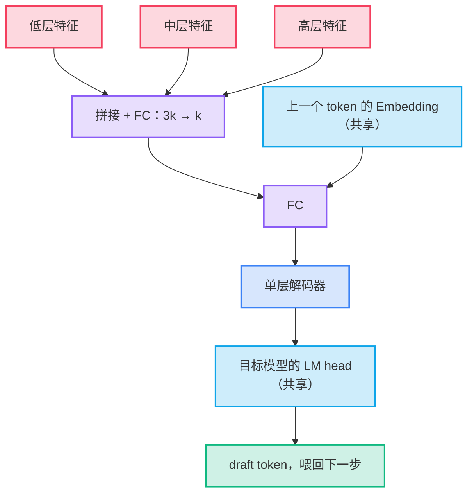
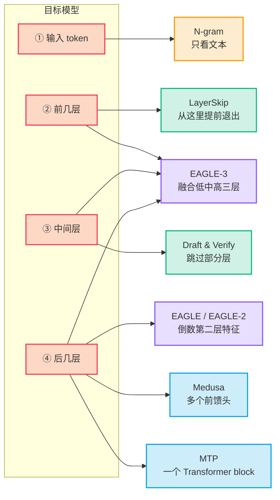

随机解码（Speculative Decoding，也常译作“推测解码”）先低成本猜几个 token，再让目标模型一次 forward 全部验证；这些方法的流程基本相同，主要区别是**候选从哪来**，论文报告的加速大约在 1.5–6.5 倍之间 [[8]](https://arxiv.org/abs/2503.01840)[[10]](https://lmsys.org/blog/2023-11-21-lookahead-decoding/)。

## 要点

- **共同流程**：提议 → 目标模型验证 → 保留猜对的前缀。每轮至少产出 1 个 token，所以最差也不会卡住 [[1]](https://arxiv.org/abs/2211.17192)。
- **区别看三个维度**：候选来源、候选形状（单链或树）、接受规则。
- **Speculative Sampling 不是另一种候选来源**：它是接受规则，用来在采样时保持目标分布。Standard Speculative Decoding 和它是同一思路，由两个团队同期独立提出 [[2]](https://arxiv.org/abs/2302.01318)。
- **省的是显存带宽，花的是算力**：猜错的计算会浪费。算力充足、受显存带宽限制时才划算 [[1]](https://arxiv.org/abs/2211.17192)。
- **vLLM 里实际能选的**：`draft_model`、`ngram`、`eagle`、`eagle3`、`mtp` 等。当前配置里没有 Medusa、Self-Speculative 和 Lookahead [[14]](https://github.com/vllm-project/vllm/blob/main/vllm/config/speculative.py)。

## 方法对比

| 方法 | 候选来源 | 额外模型 | 要训练吗 | 形状 | 输出分布 | vLLM `method` |
|---|---|---|---|---|---|---|
| Standard | 独立的小模型 | 要 | 现成小模型即可 | 单链 | 不变 | `draft_model` |
| Speculative Sampling | 不限（接受规则） | 不限 | 不需要 | 不限 | 不变 | `rejection_sample_method: standard` |
| Self-Speculative：Draft & Verify | 目标模型跳过中间层 | 不要 | 不要 | 单链 | 不变 | 无 |
| Self-Speculative：LayerSkip | 目标模型的前几层 | 不要 | 要重新训练模型 | 单链 | 等于训练后的模型 | 无 |
| Medusa-1 | 目标模型上的多个预测头 | 几个头 | 只训练头 | 树 | 用拒绝采样时不变 | 无 |
| Medusa-2 | 同上 | 几个头 | 头和主干联合训练 | 树 | 主干已改变 | 无 |
| EAGLE / EAGLE-2 | 单层解码器预测**特征** | 单层模块 | 要 | 静态树 / 动态树 | 不变 | `eagle` |
| EAGLE-3 | 单层解码器直接预测 **token** | 单层模块 | 要 | 动态树 | 不变 | `eagle3` |
| Lookahead | 目标模型自身的 Jacobi 迭代 | 不要 | 不要 | 多条 n-gram | 精确 | 无 |
| N-gram | 在已有文本里做字符串匹配 | 不要 | 不要 | 单链 | 不变 | `ngram` |
| MTP | 模型自带的多 token 预测模块 | 单层模块 | 随模型一起训练 | 单链 | 不变 | `mtp` |

- vLLM 的配置和 EAGLE 代码里都没有 draft tree 选项，只按 `num_speculative_tokens` 走单链，所以拿不到论文里树结构带来的那部分收益 [[14]](https://github.com/vllm-project/vllm/blob/main/vllm/config/speculative.py)。
- “不变”指接受规则保持目标分布。vLLM 还有一个有损的 `fly`，它放宽校验，不保证分布 [[13]](https://docs.vllm.ai/en/latest/features/speculative_decoding/)。

## 原理

*所有方法都是同一个循环，只换掉“提议”这一步。*


加速比由三个数决定 [[1]](https://arxiv.org/abs/2211.17192)：

```text
加速比 = (1 − α^(γ+1)) / ((1 − α)(γc + 1))
```

- **α**：每个候选被接受的概率。
- **γ**：每轮猜几个 token。
- **c**：跑一次提议的耗时 ÷ 跑一次目标模型的耗时。
- 例子：γ=4、c=0.05 时，α=0.8 得 2.8 倍，α=0.6 只有 1.9 倍。公式的前提是目标模型能并行验证而不增加耗时，所以这是理论上限。
- 判断是否值得开：只要 α > c，就存在能带来加速的 γ。

### 接受规则

*采样时不能“猜得像就收下”，否则分布会偏。*

设目标分布为 p，提议分布为 q，候选为 x [[1]](https://arxiv.org/abs/2211.17192)[[2]](https://arxiv.org/abs/2302.01318)：

- **贪心**：x 等于 p 的 argmax 就接受。
- **采样**：以 min(1, p(x)/q(x)) 的概率接受。
- **拒绝后**：从 norm(max(0, p − q)) 里重采样，这一步保证结果严格服从 p。
- **全部接受**：再从目标模型多采 1 个 token，所以每轮最多 γ+1 个。
- N-gram 这类确定性提议可以看成 q(x)=1，代入后接受概率就是 p(x)。

## 各方法的区别

### Standard 与 Sampling

*同一个算法，两个名字。*

- 两篇论文同期独立完成，核心思路相同。Chen 等人明确说明了这一点，并更侧重分布式部署 [[2]](https://arxiv.org/abs/2302.01318)。
- Leviathan 的论文里也定义了 speculative sampling，所以“Standard 只做贪心、Sampling 才做采样”并不成立 [[1]](https://arxiv.org/abs/2211.17192)。
- Chen 的 draft 是 4B 模型，每 token 1.8 ms；目标 Chinchilla 70B 每 token 14.1 ms [[2]](https://arxiv.org/abs/2302.01318)。

### Self-Speculative

*不要第二个模型，这个名字下有两种做法。*

- **Draft & Verify**：跳过目标模型的部分中间层来生成候选。无需训练，也不额外占显存 [[3]](https://arxiv.org/abs/2309.08168)。
- **LayerSkip**：训练时加层 dropout 和 early exit loss，推理时用前面的层生成候选，后面的层校验。提议和验证共享计算和激活，所以省显存；代价是必须重新训练模型 [[4]](https://arxiv.org/abs/2404.16710)。

### Medusa

*在最后的隐藏状态上接多个头，分别预测后面的第 1、2、3… 个 token。*

- 每个头只有一层残差前馈层，加一个 LM head。论文建议训练 5 个头 [[5]](https://arxiv.org/abs/2401.10774)。
- **Tree attention**：取各头的 top-k 做笛卡尔积。比如 top-2 和 top-3 得到 6 条候选，一次全部验证 [[5]](https://arxiv.org/abs/2401.10774)。
- **弱点**：所有头都从同一个隐藏状态出发，看不到前一个头选了什么。EAGLE 的论文给出的准确率对比是 Medusa 约 0.6、EAGLE 约 0.8 [[6]](https://arxiv.org/abs/2401.15077)。
- **Typical acceptance** 能提高加速，但靠概率阈值判断，不再是严格无损 [[5]](https://arxiv.org/abs/2401.10774)。

### EAGLE 三代

*一层解码器当 draft，每一代只改一件事。*

| 版本 | 改了什么 | 需要重新训练 |
|---|---|---|
| EAGLE | 在倒数第二层特征上做自回归，并输入提前一步的 token 消除不确定性；树结构固定 [[6]](https://arxiv.org/abs/2401.15077) | 要 |
| EAGLE-2 | 用 draft 的置信度估计接受率，动态决定树往哪长 [[7]](https://arxiv.org/abs/2406.16858) | 不要，沿用 EAGLE |
| EAGLE-3 | 放弃特征预测，直接预测 token；融合低、中、高三层特征 [[8]](https://arxiv.org/abs/2503.01840) | 要 |

EAGLE-3 的 draft 结构 [[8]](https://arxiv.org/abs/2503.01840)：



- EAGLE 复用目标模型的 embedding 和 LM head，只训练很小的部分。70B 模型上可训练参数只有 0.99B [[6]](https://arxiv.org/abs/2401.15077)。
- **Training-time test**：去掉特征损失后，第二个 token 的接受率会崩，因为 draft 的输入来自自己的预测，和训练时不一样。EAGLE-3 训练时把自己的输出喂回去，模拟推理时的条件 [[8]](https://arxiv.org/abs/2503.01840)。

### Lookahead

*把解码看成解方程，用目标模型自己的迭代结果当候选。*

- Jacobi 迭代并行更新未来 W 个位置，把各位置的值串起来，存进 n-gram 池 [[10]](https://lmsys.org/blog/2023-11-21-lookahead-decoding/)。
- 每步一次 forward 同时做两件事：继续迭代，并验证最多 G 条首 token 匹配的 n-gram。两部分用注意力掩码隔开 [[10]](https://lmsys.org/blog/2023-11-21-lookahead-decoding/)。
- 不需要 draft 模型或外部数据，但每步要多算很多 token：W(N−1) + G(N−1) [[10]](https://lmsys.org/blog/2023-11-21-lookahead-decoding/)。
- 它和 N-gram 的区别：Lookahead 的候选来自模型计算，N-gram 的候选只来自文本匹配。

### N-gram

*最便宜：没有神经网络，只做字符串匹配。*

- 取最后几个 token，在前文里找相同片段，把它后面的内容当作候选 [[11]](https://github.com/apoorvumang/prompt-lookup-decoding)。
- 输出会抄输入时最有效，比如摘要、文档问答、代码修改。可抄内容少时收益很小 [[11]](https://github.com/apoorvumang/prompt-lookup-decoding)。

### MTP

*draft 是模型的一部分，由模型作者一起训练。*

- DeepSeek-V3 的 MTP 模块包含一个 Transformer block 和一个投影矩阵，embedding 和输出头与主模型共享。它使用 D=1，只多预测 1 个 token [[12]](https://arxiv.org/abs/2412.19437)。
- **它首先是训练目标**：推理时默认丢弃模块，也可以留下来做随机解码 [[12]](https://arxiv.org/abs/2412.19437)。
- 和 Medusa 的区别：MTP 模块里有 Transformer block，还保留了预测深度之间的因果链；Medusa 的头只是前馈层。
- 不是所有模型都有。vLLM 支持列表里有 DeepSeek、MiMo、Qwen、GLM、Gemma 4 等 [[14]](https://github.com/vllm-project/vllm/blob/main/vllm/config/speculative.py)。

## 接入位置

*同样是“不要第二个模型”，各方法接在目标模型的位置完全不同。*



- Standard 不接入目标模型，它是完全独立的模型，所以图里没有它。
- Lookahead 也不接分支：它直接把未来位置放进目标模型一起算。
- 越靠后接入，draft 能用的信息越多，代价是要先跑完目标模型；EAGLE 和 MTP 复用目标模型刚算出的特征，draft 本身只有一层。

## 怎么选

| 情况 | 选择 |
|---|---|
| 模型自带 MTP（DeepSeek、Gemma 4 等） | `mtp`，零训练、接受率高 |
| 有现成的 EAGLE-3 checkpoint | `eagle3`，延迟收益大 |
| 什么都没有，但有同家族的小模型 | `draft_model` |
| 输出大量抄输入（RAG、代码修改） | `ngram`，几乎零成本 |
| 能重新训练模型 | LayerSkip 或 Medusa-2，但 vLLM 不支持 |

vLLM 文档的结论是：模型类方法（EAGLE、MTP、draft model）降延迟最多，N-gram 和 suffix 加速较小，但高峰期不增加负担 [[13]](https://docs.vllm.ai/en/latest/features/speculative_decoding/)。

## 用法

```python
from vllm import LLM

# 独立小模型
draft = {"method": "draft_model", "model": "<draft-model>", "num_speculative_tokens": 5}

# 文本匹配，不需要额外模型
ngram = {"method": "ngram", "num_speculative_tokens": 5, "prompt_lookup_max": 4}

# 模型自带 MTP
mtp = {"method": "mtp", "num_speculative_tokens": 1}

# EAGLE-3
eagle3 = {
    "method": "eagle3",
    "model": "RedHatAI/Llama-3.1-8B-Instruct-speculator.eagle3",
    "num_speculative_tokens": 2,
}

llm = LLM("meta-llama/Llama-3.1-8B-Instruct", speculative_config=eagle3)
```

在线服务 [[13]](https://docs.vllm.ai/en/latest/features/speculative_decoding/)：

```bash
vllm serve XiaomiMiMo/MiMo-7B-Base \
  --speculative-config '{"method": "mtp", "num_speculative_tokens": 1}'
```

## 数据

*下表来自各自的论文，模型、硬件和任务都不同，不能横向比较。*

| 方法 | 加速 | 设置 |
|---|---|---|
| Standard | 2.3–3.4 倍 | T5-XXL，翻译和摘要 [[1]](https://arxiv.org/abs/2211.17192) |
| Speculative Sampling | 1.92–2.46 倍 | Chinchilla 70B，K=4 [[2]](https://arxiv.org/abs/2302.01318) |
| Draft & Verify | 最高 1.99 倍 | LLaMA-2 及其变体 [[3]](https://arxiv.org/abs/2309.08168) |
| LayerSkip | 最高 2.16 倍 | CNN/DM 摘要 [[4]](https://arxiv.org/abs/2404.16710) |
| Medusa-1 / Medusa-2 | 2.18 / 2.83 倍 | Vicuna-7B，MT-Bench，batch 1 [[5]](https://arxiv.org/abs/2401.10774) |
| EAGLE | 2.7–3.5 倍 | LLaMA2-Chat 70B [[6]](https://arxiv.org/abs/2401.15077) |
| EAGLE-2 | 3.05–4.26 倍 | 三个模型系列，六个任务 [[7]](https://arxiv.org/abs/2406.16858) |
| EAGLE-3 | 3.0–6.5 倍 | 峰值在 HumanEval [[8]](https://arxiv.org/abs/2503.01840) |
| Lookahead | 最高 1.8 倍 / 多卡代码补全最高 4 倍 | MT-Bench / 多 GPU 强扩展 [[9]](https://arxiv.org/abs/2402.02057) |
| N-gram | 约 2.4 倍 | Mistral-7B，A100，贪心，摘要和问答 [[11]](https://github.com/apoorvumang/prompt-lookup-decoding) |
| MTP | 1.8 倍 TPS | DeepSeek-V3，接受率 85–90% [[12]](https://arxiv.org/abs/2412.19437) |

同一设置下才能直接比较：LLaMA-Instruct 3.1 8B、MT-bench 上，EAGLE-2 为 3.16 倍，EAGLE-3 为 4.40 倍 [[8]](https://arxiv.org/abs/2503.01840)。

## 注意事项

- **大 batch 收益变小。** EAGLE-3 在 SGLang、H100 上，batch 1 时吞吐从 158 涨到 373 tokens/s，batch 64 时只有 1.38 倍 [[8]](https://arxiv.org/abs/2503.01840)。
- **算力紧张时反而有害。** 猜错的计算全部浪费，α 越低，额外算量越大 [[1]](https://arxiv.org/abs/2211.17192)。
- **“无损”不等于每次输出相同。** 分布不变，但 vLLM 不保证 logprob 稳定，相同请求的输出仍可能不同 [[13]](https://docs.vllm.ai/en/latest/features/speculative_decoding/)。
- **draft 也要占显存。** EAGLE 在 24GB 显卡、Vicuna 7B 上，最大 batch 从 8 降到 7 [[6]](https://arxiv.org/abs/2401.15077)。
- **论文里的树，在 vLLM 里是链。** 不要直接拿 EAGLE 论文的加速比估算 vLLM 上的效果。
- **`tensor_parallel_size` 不能写进 `speculative_config`**，要用 `draft_tensor_parallel_size` [[13]](https://docs.vllm.ai/en/latest/features/speculative_decoding/)。

## 参考资料

1. [Leviathan et al. — Fast Inference from Transformers via Speculative Decoding](https://arxiv.org/abs/2211.17192)
2. [Chen et al. — Accelerating Large Language Model Decoding with Speculative Sampling](https://arxiv.org/abs/2302.01318)
3. [Zhang et al. — Draft & Verify: Lossless Large Language Model Acceleration via Self-Speculative Decoding](https://arxiv.org/abs/2309.08168)
4. [Elhoushi et al. — LayerSkip: Enabling Early Exit Inference and Self-Speculative Decoding](https://arxiv.org/abs/2404.16710)
5. [Cai et al. — Medusa: Simple LLM Inference Acceleration Framework with Multiple Decoding Heads](https://arxiv.org/abs/2401.10774)
6. [Li et al. — EAGLE: Speculative Sampling Requires Rethinking Feature Uncertainty](https://arxiv.org/abs/2401.15077)
7. [Li et al. — EAGLE-2: Faster Inference of Language Models with Dynamic Draft Trees](https://arxiv.org/abs/2406.16858)
8. [Li et al. — EAGLE-3: Scaling up Inference Acceleration of Large Language Models via Training-Time Test](https://arxiv.org/abs/2503.01840)
9. [Fu et al. — Break the Sequential Dependency of LLM Inference Using Lookahead Decoding](https://arxiv.org/abs/2402.02057)
10. [LMSYS Blog — Lookahead Decoding](https://lmsys.org/blog/2023-11-21-lookahead-decoding/)
11. [Prompt Lookup Decoding — reference implementation](https://github.com/apoorvumang/prompt-lookup-decoding)
12. [DeepSeek-V3 Technical Report](https://arxiv.org/abs/2412.19437)
13. [vLLM Docs — Speculative Decoding](https://docs.vllm.ai/en/latest/features/speculative_decoding/)
14. [vLLM source — `vllm/config/speculative.py`](https://github.com/vllm-project/vllm/blob/main/vllm/config/speculative.py)
