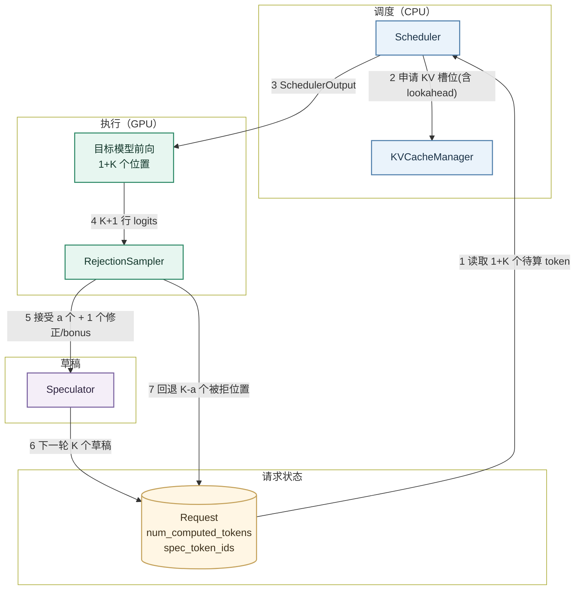
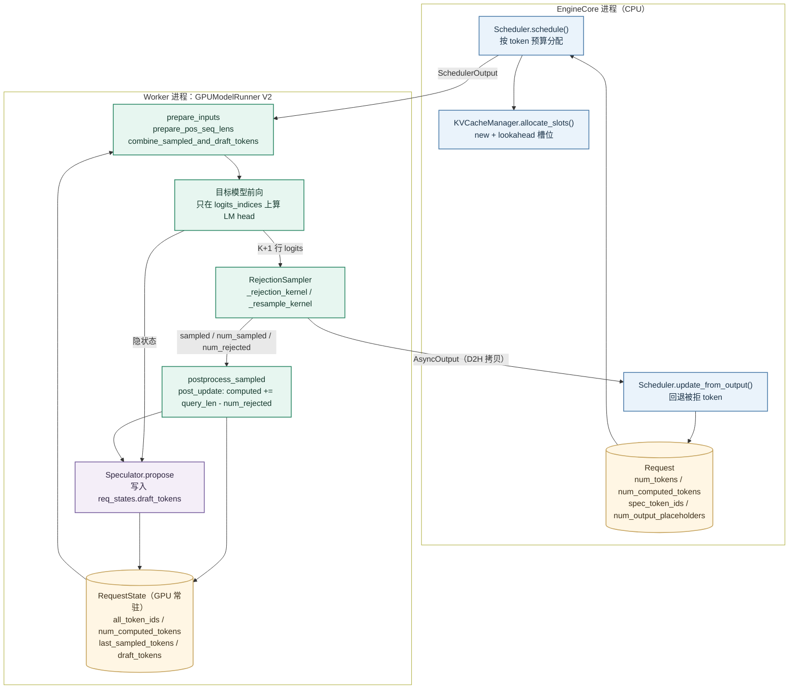
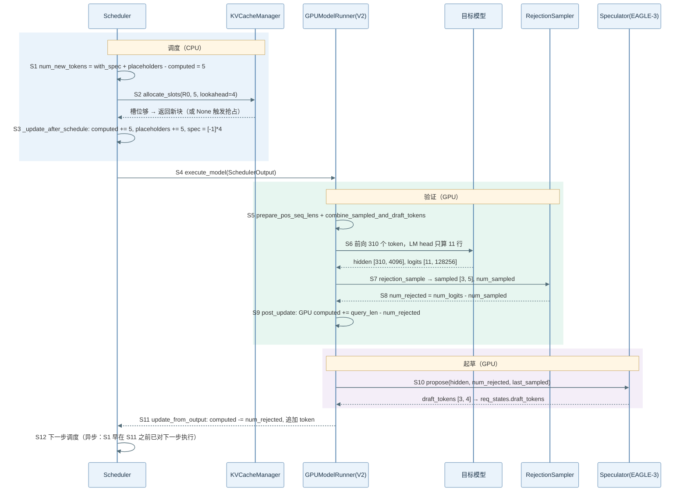

> 代码版本：`vllm@f8b11640`（2026-11-07，`v0.33.0rc0-974`）。默认走 **Model Runner V2**（`vllm/v1/worker/gpu/`）和异步调度。运行环境：1 × NVIDIA A40 48GB，目标模型 `Llama-3.1-8B-Instruct`。第 8 节的数字来自本机实测，其余例子里的数字是手算的，用来演示公式和代码；代码行号对应上述 commit。

文章按 “解码瓶颈 → 算法流程 → 正确性 → 系统实现 → 性能评估” 展开。

| 主题 | 核心问题 | 解答 |
| --- | --- | --- |
| 1 解码瓶颈与优化动机 | 自回归生成的主要开销在哪里？ | 开销主要在"读权重"，而不在计算 |
| 2 投机解码的执行流程 | 如何通过一次验证推进多个 token？ | 先让便宜的草稿器猜 K 个 token，再让目标模型用一次前向把它们全部检查一遍 |
| 3 并行验证机制 | 自回归依赖为何不妨碍批量验证？ | 串行性来自"下一个 token 要等上一个采样出来"，而验证时候选序列已经给定，这个依赖就不存在了 |
| 4 采样正确性 | 如何保持目标模型的输出分布？ | 用拒绝采样，保证每个 token 最终出现的概率正好等于目标模型的概率 |
| 5 性能模型与资源代价 | 什么条件下能够获得加速？ | 草稿要猜得准、要便宜，验证 K+1 个位置还要几乎免费 |
| 6 草稿生成方法 | 不同候选生成方式有哪些权衡？ | 权衡的是"猜得准不准"（α）、"猜一次多贵"（c），以及前置条件和额外显存 |
| 7 vLLM 系统实现 | 如何与推理引擎协同工作？ | 调度器和 KV Cache 管理器不认识"草稿"，只把它当成"这个请求这一步多算 K 个 token"；验证、拒绝和回退都由少数几个计数器完成 |
| 8 性能评估与问题定位 | 如何衡量收益并解释性能变化？ | 只改投机配置做对照实验，分别测延迟和吞吐，再用接受长度、逐位接受率和等效草稿成本解释结果 |

## 投机解码 Overview

投机解码（Speculative Decoding）让一个便宜的“草稿器”先猜出后面 K 个 token，再让大模型（目标模型）用**一次前向**把这 K 个猜测全部检查一遍：猜对的连续前缀直接收下，第一个猜错的位置由目标模型改正。只要猜得够准、草稿够便宜，每次大模型前向就能推进多个 token。

入门时先记住三个角色：

| 角色 | vLLM 里的名字 | 职责 |
| --- | --- | --- |
| 草稿器 | `speculator`（`NgramGPUSpeculator` / `EagleSpeculator` / `StandaloneARSpeculator` / `MTPSpeculator`） | 每步结束后为每个请求提出 K 个候选 token |
| 目标模型 | `GPUModelRunner.model` | 一次前向同时算出“最后一个已确认 token + K 个候选”这 K+1 个位置的 logits |
| 验证器 | `RejectionSampler` | 逐位置比较草稿与目标分布，决定接受几个、在哪里改正、补一个 bonus token |

调度器（`Scheduler`）和 KV Cache 管理器（`KVCacheManager`）不懂“草稿”是什么，它们只看到“这个请求这一步要算 1+K 个 token，需要多少 KV 槽位”，以及“验证完有几个被拒绝，要回退多少”。



下面用一个 K=4 的 decode 请求把图中 7 个步骤走一遍。括号里是 7.2 节时序图的编号，第 7 节按这些编号对应到代码。

**起始状态**：请求已有 150 个确认的 token（prompt 120 + 已生成 30），占位置 0–149。位置 0–148 已经算过 KV；位置 149 的 token `t` 是上一步刚采样出来的，还没算 KV。草稿器上一步已经给出 4 个候选 d1–d4。

```text
位置    0 … 148   149   150   151   152   153
token   已确认     t     d1    d2    d3    d4
KV      已有       ←────── 本步要算的 5 个 ──────→
验证    —          —     接受  接受  拒绝   丢弃
                                    ↓
                                 改正为 x
```

- **1 读取待算 token**（S1）：调度器只看两个数：`num_tokens_with_spec = 150 + 4 = 154`，`num_computed_tokens = 149`。待算 = 154 − 149 = **5 个**，即 `t` 和 d1–d4。
- **2 申请槽位**（S2）：为位置 149–153 申请 5 个 KV 槽位。EAGLE 类草稿器之后还要写自己的 KV，所以再多预留 4 个 lookahead 槽位。
- **3 下发**（S3、S4）：调度器把 `num_computed_tokens` 乐观地加到 154，并通过 `SchedulerOutput` 把任务交给 GPU：`num_scheduled_tokens=5`，`scheduled_spec_decode_tokens=[d1, d2, d3, d4]`。
- **4 一次前向**（S5、S6）：目标模型一次前向处理这 5 个位置，算出 5 行 logits。第 i 行表示"看到位置 i 及之前的内容后，下一个 token 的分布"。
- **5 验证**（S7、S8）：逐个检查草稿。d1、d2 被接受；d3 被拒绝，在位置 152 用修正分布重新采样出 `x`；d4 排在 d3 之后，直接丢弃。本步新增 3 个 token：d1、d2、x。
- **6 起草下一轮**（S10）：草稿器从 `x` 往后再猜 4 个，得到 e1–e4。
- **7 回退**（S9、S11）：位置 152、153 已经写进了 d3、d4 的 KV，但它们已经作废。调度器把 `num_computed_tokens` 从 154 减到 **152**，不清空、不释放这两个槽位，下一步 `x` 和 e1 会直接覆盖它们。

一步结束后：确认的 token 从 150 个变成 153 个，`num_computed_tokens = 152`，下一步待算仍是 `x` + e1–e4 共 5 个。

## 1. 解码瓶颈与优化动机

### 1.1 token 之间是串行的

自回归生成第 t 个 token 依赖前 t−1 个 token：没有 x₁ 就算不出 x₂ 的分布。所以一次请求生成 256 个 token，最朴素的做法就要做 256 次完整的前向，每次只推进一个 token。

### 1.2 小 batch 的 decode 是“读权重”而不是“算矩阵”

以本机的 `Llama-3.1-8B-Instruct`（80.3 亿参数，bf16）在 A40 上 batch=1 decode 为例：

| 量 | 数值 | 怎么来的 |
| --- | --- | --- |
| 权重字节 | 16.06 GB | 8.03e9 × 2 字节 |
| 每 token 计算量 | 16.06 GFLOP | 每个参数一次乘加 = 2 FLOP |
| A40 显存带宽 | 696 GB/s | 规格值 |
| A40 bf16 稠密算力 | 149.7 TFLOPS | 规格值 |
| 读一遍权重的时间 | 23.1 ms | 16.06 / 696 |
| 做完计算的时间 | 0.11 ms | 16.06e9 / 149.7e12 |

每生成一个 token，都要把 16 GB 权重从显存搬进计算单元一次，而真正的乘加只占 0.11 ms。算力利用率不到 0.5%，瓶颈是带宽。所以 batch=1 时理论上限约 1000 / 23.1 ≈ 43 token/s，实测见第 8 节。

一步前向的耗时可以粗略写成“搬数据”和“算”两者取大：

$$
t_{\mathrm{step}}(n) \approx \max\left( \frac{B_{\mathrm{weight}} + B_{\mathrm{kv}}(n)}{\mathrm{BW}},\ \frac{2 P n}{\mathrm{FLOPS}} \right)
$$

**符号**

- t_step(n)：一次前向同时处理 n 个 token 位置所需的时间。
- n：这次前向要算的 token 位置总数（batch 内所有请求的 query token 之和）。
- B_weight：模型权重的字节数，这里是 16.06 GB，与 n 无关，每步固定读一次。
- B_kv(n)：读写 KV Cache 的字节数，随上下文长度和 n 增长。
- BW：显存带宽，A40 为 696 GB/s。
- P：参数个数，这里是 8.03e9。
- 2Pn：n 个位置的矩阵乘总 FLOP 数（每个参数对每个位置做一次乘加）。
- FLOPS：GPU 峰值算力，A40 bf16 为 149.7e12。
- max(·,·)：取较大者，哪个慢哪个决定耗时。

**整个式子读作**：一次前向的时间由“读完所有数据”和“算完所有乘加”中较慢的那个决定。

**为什么这样设计**：这是 roofline 模型的简化版。它直接说明了投机解码的出发点：n 从 1 涨到 5 时，第一项几乎不变（权重还是只读一次），第二项从 0.11 ms 涨到 0.54 ms，仍远小于 23 ms。也就是说 **同样 23 ms，一次算 1 个位置和一次算 5 个位置几乎一样贵**。

### 1.3 拐点在哪里

把两项相等的位置叫拐点：2Pn / FLOPS = B_weight / BW，解出 n ≈ 149.7e12 / 696e9 / 1 ≈ 215（bf16 下每参数 2 字节，正好和 2 FLOP 抵消）。

215 是用峰值算的。实际的矩阵乘一般只能跑到峰值算力的六七成，带宽也到不了 696 GB/s（第 8 节 batch=1 只跑到约 82%），两者都打折后，拐点大约在 150–180。batch 大时 KV Cache 的读取也算在“搬数据”那一项里，会把拐点往上推一些。拐点也不是一个尖点，接近它时验证就已经不完全免费了，准确位置要实测。

- n < 215：带宽瓶颈，多算几个位置“免费”。
- n > 215：算力瓶颈，多算一个位置就多花一份时间。

这个数决定了投机解码在高并发下为什么会变差：64 个请求 × (1+4) = 320 个位置，已经越过拐点，验证 K 个草稿不再免费（见 5.4 和第 8 节）。

## 2. 投机解码的执行流程

### 2.1 一轮的四个动作

1. **起草**：草稿器根据当前前缀猜出 d₁…d_K。
2. **验证**：把 [x_last, d₁, …, d_K] 一起送进目标模型，一次前向得到 K+1 个位置的分布 p₁…p_{K+1}。
3. **接受连续前缀**：从 d₁ 开始逐个检查，遇到第一个不通过的 d_j 就停，前面 j−1 个全部接受。
4. **修正或奖励**：
   - 如果 d_j 被拒，在位置 j 用修正分布重采一个 token 替换它，d_{j+1}…d_K 全部丢弃。
   - 如果 K 个全部接受，第 K+1 个位置的分布 p_{K+1} 已经算出来了，免费再采一个，叫 **bonus token**。

所以每轮产出的 token 数在 1 到 K+1 之间，**最坏也有 1 个**，和不用投机解码一样。

### 2.2 带入一个例子

GSM8K 第一题的回答里，模型已经写到 `Janet's ducks lay 16 eggs per`，K=4，温度 0（贪心）。

| 位置 | 输入 token | 草稿 | 目标 argmax | 结果 |
| --- | --- | --- | --- | --- |
| 0 | `per`（已确认） | — | `day` | 用来验证 d₁ |
| 1 | `day`（d₁） | `day` | `.` | d₁ = `day` 与位置 0 的 argmax 一致，接受 |
| 2 | `.`（d₂） | `.` | `She` | d₂ = `.` 与位置 1 的 argmax 一致，接受 |
| 3 | `She`（d₃） | `She` | `eats` | d₃ = `She` 一致，接受 |
| 4 | `sells`（d₄） | `sells` | `three` | d₄ = `sells`，位置 3 的 argmax 是 `eats`，**拒绝** |

注意错位：**位置 i 的 logits 用来检验第 i+1 个输入**。位置 3 的输出是“看完 `... per day . She` 之后下一个词”，它说是 `eats`，而草稿给的是 `sells`，所以在这里停。

本轮结果：接受 3 个（`day . She`），在 d₄ 的位置换成目标给的 `eats`，共推进 4 个 token，只花了一次目标前向。位置 4 的 logits（看完 `sells` 之后的分布）作废。

## 3. 并行验证机制

### 3.1 为什么能一次算 K+1 个位置

自回归的串行性来自“下一个 token 要等采样结果”。验证时**候选序列已经给定**，这个依赖就不存在了：模型只需要回答“给定前缀 x₁…x_{t+i}，第 t+i+1 个 token 的分布是什么”，对 i = 0…K 这 K+1 个问题互不等待。这和 prefill 一次算完整个 prompt 是同一件事。

### 3.2 因果注意力保证每个位置只看到自己的前缀

5 个查询位置在注意力里用因果 mask，第 i 行只能看到位置 ≤ i 的 key：

```text
             key:  ctx(0..148)  149(per)  150(d1)  151(d2)  152(d3)  153(d4)
query 149 (per)        ✓           ✓        ✗        ✗        ✗        ✗
query 150 (d1)         ✓           ✓        ✓        ✗        ✗        ✗
query 151 (d2)         ✓           ✓        ✓        ✓        ✗        ✗
query 152 (d3)         ✓           ✓        ✓        ✓        ✓        ✗
query 153 (d4)         ✓           ✓        ✓        ✓        ✓        ✓
```

所以位置 151 的输出和“真的先生成 d1、再把 d2 喂进去”得到的分布在数学上完全一样。即使 d1 是错的，位置 151 的结果会被丢弃，也不会污染位置 150 的结果。

### 3.3 位置对齐

验证时有三套“下标”要对齐，后面读 vLLM 代码时会反复出现：

| 下标 | 例子中的值 | 含义 |
| --- | --- | --- |
| 序列位置 `positions` | 149, 150, 151, 152, 153 | 送进 RoPE 的绝对位置，决定 KV 写到哪个槽位 |
| batch 内 token 下标 | 0..4（如果它是 batch 中第一个请求） | 在扁平化的 `input_ids` 里的位置 |
| logits 行号 | 0..4 | 只对需要采样的位置算 LM head，行号从 `logits_indices` 映射过来 |

位置 i 的 logits 检验的是输入下标 i+1 的 token，这个“错一位”就是 `gather_draft_sampled` 里 `draft_sampled_ptr + logit_idx + 1` 的来源（7.6 节）。

## 4. 采样正确性

投机解码的承诺是：**输出分布和只用目标模型逐个采样完全一样**。下面分温度 0 和温度 > 0 两种情况。

### 4.1 贪心：逐位比较 argmax

温度为 0 时目标模型的“分布”是一个点：argmax。规则就是 2.2 节的表格：d_i 等于位置 i−1 的 argmax 就接受，否则拒绝并把 argmax 填进去。结果和逐个贪心生成逐 token 相同。vLLM 的实现只有一行（`rejection_sampler_utils.py:634`）：

```python
accepted = target_argmax == draft_sampled
```

### 4.2 随机采样：拒绝采样

温度 > 0 时，草稿 token x 是从草稿分布 q 里抽出来的，目标分布是 p。Leviathan 等人（2023）给出的接受规则是：

$$
P_{\mathrm{accept}}(x) = \min\left(1,\ \frac{p(x)}{q(x)}\right)
$$

**符号**

- x：草稿器在当前位置提出的候选 token。
- p(x)：目标模型在当前位置给 x 的概率（已应用温度、top-p 等采样参数）。
- q(x)：草稿器给 x 的概率；n-gram 这种确定性草稿相当于 q(x)=1。
- p(x)/q(x)：目标比草稿“更想要” x 的倍数。
- min(1, ·)：概率不能超过 1，目标比草稿更想要时就一定接受。
- P_accept(x)：接受 x 的概率。实现上抽一个均匀随机数 u ∈ (0,1)，u < p(x)/q(x) 时接受。

**整个式子读作**：草稿给的 token，如果目标也同样或更想要，就一定收下；如果目标没那么想要，就按两者概率之比随机收下。

**为什么这样设计**：草稿器“多给”的那部分概率（q(x) > p(x) 的地方）要按比例打折，才能让 x 最终出现的概率正好压回 p(x)。打折掉的概率质量交给下面的修正分布去补。

被拒绝时，从修正分布（residual distribution）里重新采一个：

$$
r(x) = \frac{\max\left(0,\ p(x) - q(x)\right)}{\sum_{y} \max\left(0,\ p(y) - q(y)\right)}
$$

**符号**

- r(x)：拒绝之后重采时用的分布。
- max(0, p(x) − q(x))：目标比草稿“多出来”的那部分概率，草稿给多了的地方记为 0。
- y：遍历整个词表的求和变量。
- Σ_y：对词表所有 token 求和，作分母做归一化，让 r 的总和为 1。

**整个式子读作**：只在目标比草稿更想要的那些 token 上，按“多出来的量”的比例重新抽签。

**为什么这样设计**：接受阶段只能让 x 的概率变小（被打折），不能变大；p(x) > q(x) 的 token 在接受阶段最多只能拿到 q(x) 的概率，缺的 p(x) − q(x) 正好由拒绝后的重采补上。两部分相加刚好等于 p(x)。

### 4.3 带入数值验证一次

词表只有 3 个词 {A, B, C}：

| token | p（目标） | q（草稿） | min(1, p/q) | max(0, p−q) |
| --- | --- | --- | --- | --- |
| A | 0.5 | 0.2 | 1 | 0.3 |
| B | 0.3 | 0.6 | 0.5 | 0 |
| C | 0.2 | 0.2 | 1 | 0 |

修正分布 r = [0.3, 0, 0] / 0.3 = [1, 0, 0]，拒绝后一定重采到 A。

最终每个 token 出现的概率：

- B：草稿抽到 B 的概率 0.6 × 接受率 0.5 = 0.30，等于 p(B)。
- C：0.2 × 1 = 0.20，等于 p(C)。
- A：草稿直接抽到 A 并接受 0.2 × 1 = 0.2，加上“拒绝后重采到 A”：拒绝只发生在抽到 B 且没过时，概率 0.6 × 0.5 = 0.3，重采必得 A。合计 0.2 + 0.3 = 0.5，等于 p(A)。

三个都和目标分布一致。vLLM 在 log 空间做同样的比较（`rejection_sampler_utils.py:716`），避免小概率下溢：

```python
# p(x) > u * q(x)  <=>  log p(x) > log u + log q(x)
accepted = target_logprob > tl.log(u) + draft_logprob
# 例：draft=B, log p = log 0.3 = -1.204, log q = log 0.6 = -0.511
#   u = 0.4: -1.204 > -0.916 + -0.511 = -1.427  → 接受
#   u = 0.7: -1.204 > -0.357 + -0.511 = -0.868? 否 → 拒绝, 从 r 重采 → A
```

n-gram 这种没有 q 分布的草稿（`HAS_DRAFT_LOGITS=False`），draft_logprob 当作 0（q=1），规则退化为“u < p(x) 则接受”，修正分布是“把 p 里被拒的那个 token 置零再归一化”（`rejection_sampler_utils.py:990`）。

### 4.4 分布一致 ≠ 逐字一致

拒绝采样保证的是**分布**相同，不是同一个 seed 下**逐字**相同。两类差异要分清：

| 差异来源 | 温度 0 也会发生吗 | 原因 |
| --- | --- | --- |
| 随机数消耗方式不同 | 否 | 投机解码每个位置额外抽了 u，采样路径和普通解码不是同一串随机数，所以温度 > 0 时同 seed 输出会不同，但分布相同 |
| 数值误差 | 是 | 验证时 1+K 个位置一起算，矩阵形状、kernel 选择、reduction 顺序都和逐个 decode 不同。bf16 下 logits 的末位差异可能翻转两个接近的 argmax，此后整段输出分叉 |
| batch 组成变化 | 是 | 同一请求和不同的邻居拼 batch，形状不同，同样会引入末位差异（这一条不开投机解码也存在） |

所以评测“投机解码是否改变了结果”时，正确的做法是比较任务指标（准确率、困惑度）或分布统计，而不是要求和基线逐字一致。第 8 节的对照实验显示：本机温度 0 下，不开投机解码、只是重跑一遍，逐字分叉也和开投机解码时差不多多。

## 5. 性能模型与资源代价

### 5.1 平均接受长度

假设每个草稿位置被接受的概率都是 α，且相互独立（Leviathan 等人的简化假设）。一轮产出的 token 数（接受的 + 1 个修正或 bonus）的期望是：

$$
\mathbb{E}[L] = \sum_{i=0}^{K} \alpha^{i} = \frac{1 - \alpha^{K+1}}{1 - \alpha}
$$

**符号**

- L：一轮验证实际推进的 token 数，取值 1…K+1。
- 𝔼[L]：L 的期望，即 vLLM 日志里的 “Mean acceptance length”。
- α：单个草稿 token 被接受的概率（接受率）。
- K：每轮的草稿个数（`num_speculative_tokens`）。
- α^i：前 i 个草稿全部被接受的概率；第 i+1 个 token 能拿到的前提是前 i 个都过了。
- Σ_{i=0}^{K}：把 i = 0…K 加起来。i = 0 那一项是 1，对应“至少有修正或 bonus 的 1 个 token”。

**整个式子读作**：每轮至少推进 1 个，再加上“第 1 个草稿过了”的概率、“前 2 个都过了”的概率……一直加到“K 个全过了”的概率。

**为什么这样设计**：连续前缀接受意味着第 i 个草稿只有在前面全过时才有意义，所以每一项是 α 的幂而不是 α 本身。这也说明了 **K 增大的边际收益是指数衰减的**。

带入几个 α：

| α \ K | 1 | 2 | 3 | 4 | 5 | 6 | 8 |
| --- | --- | --- | --- | --- | --- | --- | --- |
| 0.5 | 1.50 | 1.75 | 1.88 | 1.94 | 1.97 | 1.98 | 2.00 |
| 0.7 | 1.70 | 2.19 | 2.53 | 2.77 | 2.94 | 3.06 | 3.20 |
| 0.8 | 1.80 | 2.44 | 2.95 | 3.36 | 3.69 | 3.95 | 4.33 |
| 0.9 | 1.90 | 2.71 | 3.44 | 4.10 | 4.69 | 5.22 | 6.13 |

α = 0.5 时，K 从 4 加到 8 只多了 0.06 个 token；α = 0.9 时还能多 2 个。

vLLM 的统计口径（`vllm/v1/spec_decode/metrics.py:114`）：

```python
mean_acceptance_length = 1 + (num_accepted_tokens / num_drafts)
# num_drafts: 有草稿参与验证的“请求·步”数；num_accepted_tokens: 被接受的草稿总数
# 例：100 次验证共接受 177 个草稿 → 1 + 177/100 = 2.77，对应 α≈0.7, K=4
```

### 5.2 加速比

设目标模型一次前向（验证 K+1 个位置）耗时为 1 个单位，草稿器每猜一个 token 耗时 c 个单位：

$$
S = \frac{\mathbb{E}[L]}{1 + K c}
$$

**符号**

- S：相对普通 decode 的加速比（每单位时间推进的 token 数之比）。
- 𝔼[L]：上一节的平均接受长度。
- 1：一次目标前向的耗时，这里假设验证 K+1 个位置和普通 decode 1 个位置一样贵（带宽瓶颈区成立）。
- c：草稿器产生一个 token 的耗时与目标前向耗时之比。
- Kc：一轮起草 K 个 token 的总耗时。

**整个式子读作**：一轮花 1 + Kc 的时间换来 𝔼[L] 个 token，而普通 decode 花 1 的时间只换 1 个 token。

**为什么这样设计**：它把加速拆成两个可以分别测量的量：接受质量（α，决定 𝔼[L]）和草稿成本（c）。选方法、选 K 都是在这两者之间权衡。

α = 0.7 时的 S：

| c \ K | 1 | 2 | 3 | 4 | 5 | 6 | 8 |
| --- | --- | --- | --- | --- | --- | --- | --- |
| 0（n-gram） | 1.70 | 2.19 | 2.53 | 2.77 | 2.94 | 3.06 | 3.20 |
| 0.05（EAGLE 单层头） | 1.62 | 1.99 | 2.20 | 2.31 | **2.35** | **2.35** | 2.29 |
| 0.15（1B 草稿模型） | 1.48 | 1.69 | **1.75** | 1.73 | 1.68 | 1.61 | 1.45 |
| 0.30（太大的草稿） | 1.31 | **1.37** | 1.33 | 1.26 | 1.18 | 1.09 | 0.94 |

两个结论：

- **草稿越贵，最优 K 越小**：c = 0.05 时最优 K≈5，c = 0.15 时 K≈3，c = 0.3 时 K≈2。
- **K 设大了会变慢**：c = 0.3、K = 8 时 S = 0.94，比不开还慢。

### 5.3 c 怎么估

c 也受带宽支配，粗略等于“草稿器每步要读的字节 / 目标每步要读的字节”：

| 草稿器 | 每步读的权重 | c 粗估 |
| --- | --- | --- |
| n-gram | 0（只在 GPU 上扫一遍 token id） | ≈ 0 |
| EAGLE-3 头（Llama-3.1-8B 配套） | 1 层 decoder + fc + 32000 词表的 LM head，约 0.85 GB（不含词嵌入表，见下） | ≈ 0.05 |
| Llama-3.2-1B 草稿模型 | 1.24e9 × 2 = 2.5 GB | ≈ 0.15 |
| DeepSeek-V3 MTP 模块 | 1 个 MoE 层（激活约 0.6 B）+ 投影约 0.1 B + 和主干共享的 LM head（129280 × 7168 ≈ 0.93 B） | ≈ 1.6 / 37 ≈ 0.04 |

- 分母都是目标模型每步读的权重：Llama-3.1-8B 是 16.06 GB；DeepSeek-V3 每个 token 激活 37 B 参数。
- 共享的权重也要算：MTP 和主干共用 LM head，但草稿每步仍要把它完整读一遍，和 EAGLE 那一行算草稿 LM head 是同一个口径。只算 MoE 层会得到 0.6 / 37 ≈ 0.016，低估一半以上。

实际 c 还要加上 kernel 启动、CUDA graph 切换、采样等固定开销，所以小模型的实测 c 往往比字节比更大。

### 5.4 并发、显存与 K

**并发**。5.2 的假设“验证 K+1 个位置和 1 个一样贵”只在拐点（A40 按峰值算约 215 个位置，实际约 150–180）以下成立：

| 并发 | 不开投机 | K=4 时每步位置数 | 区间 |
| --- | --- | --- | --- |
| 1 | 1 | 5 | 带宽瓶颈，验证免费 |
| 16 | 16 | 80 | 带宽瓶颈，验证基本免费 |
| 64 | 64 | 320 | 已过拐点，被拒的草稿是在浪费算力 |

高并发下，被拒绝的草稿位置实打实地消耗 FLOPs，而 batch 本身已经把带宽利用起来了，所以投机解码的收益随并发增大而下降，甚至变成负收益。vLLM 为此提供了 `num_speculative_tokens_per_batch_size`（按 batch 大小动态调 K，见 `scheduler.py:328` 的 `build_dynamic_sd_schedule_lookup`）。

**显存**。三部分开销：

| 开销 | Llama-3.1-8B + K=4 的量 |
| --- | --- |
| 草稿权重 | EAGLE-3 头的文件 1.9 GB，其中 1.05 GB 是词嵌入表（128256 × 4096，每步只按 token 查几行），每步真正读的约 0.85 GB；1B 草稿模型 2.5 GB |
| 草稿器自己的 KV Cache | 1B 草稿：2 × 16 层 × 8 头 × 64 维 × 2 字节 = 32 KB/token，是目标（128 KB/token）的 25%；EAGLE 单层：4 KB/token |
| 预留槽位 | 每个请求每步多占 K 个验证位置 + K 个 lookahead 位置的 KV 槽位 |

权重和草稿 KV 都会从 `gpu_memory_utilization` 的总额里扣，挤占目标模型的 KV 块数，进而降低最大并发。

**K 的取值**。综合起来：低并发、高接受率（复制、代码编辑）用大 K；高并发、开放生成用小 K 或关闭。

## 6. 草稿生成方法：从独立草稿模型到原生多 token 预测

### 6.1 分类框架：草稿器依赖什么信息

所有草稿器要回答同一个问题：“在不跑完整目标模型的前提下，怎样猜出接下来 K 个 token”。区别在于它们借用了什么信息：

| 方法 | 借用的信息 | 是否需要训练 | 每步草稿成本 c | 对 α 的典型影响 |
| --- | --- | --- | --- | --- |
| 独立草稿模型 | 只用 token 序列，自己有一整套小模型 | 不需要（用同系列小模型），蒸馏后更好 | 中（0.1–0.3） | 中到高，取决于大小模型是否同源（本机 1B→8B 实测 α≈0.90） |
| n-gram（Prompt Lookup） | 只用上下文里已经出现过的 token | 不需要 | ≈ 0 | 两极：复制类任务很高，开放生成很低 |
| EAGLE 系列 | 目标模型最后几层的隐状态 + token | 需要为每个目标模型训练一个头 | 低（≈ 0.05） | 高且稳定 |
| MTP | 目标模型自带的多 token 预测模块 | 预训练时已经训练好 | 低 | 高（模块和主干一起训练） |

下面每种方法按“设计思路 → 带入数值 → vLLM 实现 → 适用条件”展开。

### 6.2 独立草稿模型（Standalone Draft Model）

#### 设计思路

最早的投机解码（Leviathan 2023、Chen 2023）就是这种形式：找一个同词表的小模型，让它像普通 LLM 一样自回归地生成 K 个 token，再交给大模型验证。

它成立的前提是“大部分 token 很容易预测”：标点、虚词、固定搭配、重复前文的实体名，小模型和大模型的判断基本一致；只有少数关键 token 需要大模型的能力。小模型把容易的部分包掉，大模型只在难的地方纠正。


草稿模型是串行的：K 个草稿就要做 K 次小模型前向。

#### 带入数值：Llama-3.2-1B 给 Llama-3.1-8B 打草稿

先检查硬性条件：两者都用 Llama-3 的 128256 词表 tokenizer，token id 一一对应，可以直接比较。

| 项 | 目标 Llama-3.1-8B | 草稿 Llama-3.2-1B | 比值 |
| --- | --- | --- | --- |
| 参数量 | 8.03 B | 1.24 B | 0.15 |
| 层数 × hidden | 32 × 4096 | 16 × 2048 | — |
| bf16 权重 | 16.06 GB | 2.47 GB | 0.15 |
| 每 token KV | 128 KB | 32 KB | 0.25 |
| A40 读一遍权重 | 23.1 ms | 3.6 ms | 0.15 |

一轮 K=4（batch=1，只算带宽下限）：

```text
起草: 4 次 × 3.6 ms   = 14.4 ms
验证: 1 次 × 23.1 ms  = 23.1 ms   (5 个位置, 仍在带宽区)
一轮合计               = 37.5 ms
若 α = 0.7: E[L] = 2.77 token/轮 → 37.5 / 2.77 = 13.5 ms/token
不开投机: 23.1 ms/token  → 理论加速 23.1 / 13.5 = 1.71×
```

这里 c = 3.6 / 23.1 = 0.156，和 5.2 节表格 c = 0.15 那一行吻合：K=4 时 S = 1.73。

换成第 8 节实测的 α ≈ 0.90：𝔼[L] = (1 − 0.9⁵) / (1 − 0.9) = 4.10，理论 S = 4.10 / (1 + 4 × 0.156) = 2.52×；实测是 2.19×。由实测反推出的 c 是 0.22（8.3 ③），比字节比 0.156 大，多出来的就是 1B 模型的固定开销（kernel 启动、采样、CUDA graph 切换）。

#### vLLM 实现

配置入口是 `StandaloneARSpeculatorConfig`（`vllm/v1/worker/gpu/spec_decode/standalone_ar/config.py`）：

```python
class StandaloneARSpeculatorConfig(DraftModelSpeculatorConfig):
    base_method = "draft_model"
    draft_has_own_vocab = True          # 草稿模型自带词表，必须与目标一致
    shares_target_positions = False     # 独立模型，有自己的位置上限

    @property
    def num_lookahead_tokens(self) -> int:
        return self.num_speculative_tokens   # K=4 → 每请求多预留 4 个 KV 槽位

    @property
    def max_num_new_slots_for_drafting(self) -> int:
        if self.spec_config.parallel_drafting:
            return self.num_speculative_tokens   # PARD: K 个并行查询都要新槽
        return 1                                  # 普通自回归: 多 1 个
```

为什么普通草稿模型每个请求要多 1 个 token 预算？看它的第 0 步输入是怎么拼的（`standalone_ar/speculator.py:457` 的 `_prepare_prefill_inputs_kernel`）：

```python
num_valid  = q_next - q_start - num_rejected   # 目标这一步里有效的输入 token
total_out  = q_next - q_start + 1              # 多出 1 个位置放修正 token
token_ids  = tl.where(is_correction, correction_token, token_ids)
```

带入 Overview 的例子（目标输入 [per, d1, d2, d3, d4]，位置 149..153，接受 2 个，修正 token x）：

| 草稿输入下标 | 0 | 1 | 2 | 3 | 4 | 5 |
| --- | --- | --- | --- | --- | --- | --- |
| token | per | d1 | d2 | **x**（修正） | 占位 | 占位 |
| 位置 | 149 | 150 | 151 | 152 | 153 | 154 |
| 角色 | 有效 | 有效 | 有效 | 修正 | 被拒的槽 | 被拒的槽 |

- `num_valid` = 5 − 2 = 3，`total_out` = 5 + 1 = 6。
- 草稿模型和目标模型不共享 KV，它必须自己把 per、d1、d2 的 KV 补上，再把 x 也喂进去才能预测 x 之后的 token。所以它的查询比目标多 1 个，最坏情况（全部接受）是 5 个有效 + 1 个 bonus = 6 个。
- 输出长度始终是 `query_len + 1`，不随 `num_rejected` 变化，这样 CPU 不需要等 GPU 告诉它拒绝了几个（避免同步）。被拒的位置写进去的 KV 是临时的，下一轮会被覆盖。
- 第 0 步结束取 `last_token_indices = out_start + num_valid`（下标 3，即 x 的位置）的 logits 采第一个草稿，之后 K−1 步每步只喂 1 个 token。

#### 适用条件与局限

- 必须同词表（`draft_has_own_vocab`）。不同系列的模型不能直接配。
- 小模型的 KV 和权重都要占显存，挤掉目标的 KV 块。
- 小模型能力和目标差距越大，α 越低；差距越小，c 越大。通常选目标参数量的 1/10 到 1/20。
- 变体 **PARD**（`parallel_drafting=True`）：训练草稿模型一次前向并行吐出 K 个 token，把 K 次串行变成 1 次，代价是每请求 K 个额外槽位（上面代码的 `return self.num_speculative_tokens`）。

### 6.3 Prompt Lookup：基于 n-gram 匹配的无模型草稿

#### 设计思路

很多任务的输出会大段复述输入：代码编辑只改几行、RAG 回答引用检索段落、摘要沿用原文的短语、多轮对话重复上文实体名。Prompt Lookup Decoding（Saxena 2023）的思路是：**拿当前序列末尾的几个 token 去前文里找一样的片段，把那个片段后面紧跟的 token 当草稿**。

它不需要任何模型，c ≈ 0；代价是只有在“前文出现过”的地方才猜得准。

#### 带入数值：一次匹配

把词当作 token（真实场景是 BPE token id）。prompt 和已生成部分拼成 32 个 token 的序列：

```text
下标:  0       1    2     3  4  5  6   7       8  9     10 11  12   13  14   15   16 17   18    19 20  21
      Natalia sold clips to 48 of her friends in April ,  and then she sold half as many clips in May .
下标:  22  23   24 25 26    27  28   29 30   31
      She sold 48 in April and half as many clips        ← 当前末尾, seq_len = 32
```

配置 `prompt_lookup_min=2, prompt_lookup_max=5, K=4`：

1. 先试 n=5：后缀是 `and half as many clips`（27..31），前文里找不到。
2. n=4：后缀 `half as many clips`（28..31），在下标 15..18 找到。
3. n=3：`as many clips` 在 16..18 找到；n=2：`many clips` 在 17..18 找到。
4. 取**最长**的匹配 n=4，起点 pos=15。草稿从匹配段之后开始：`draft_start = 15 + 4 = 19`，取下标 19..22：`in May . She`。

目标模型很可能接受 `in May .`，然后在 `She` 处拒绝（它更可能接 `How` 或换行）。本轮推进 4 个 token（3 个接受 + 1 个修正），草稿成本几乎为零。

#### 匹配的打分公式

vLLM 的 GPU 实现要在一个 Triton kernel 里并行地比较所有 (n, pos) 组合，再用一次 `max` 归约选出“最长、同长取最靠右”的那个。为此它把 (n, pos) 打包成一个整数（`ngram/speculator.py:83`）：

$$
\mathrm{score}(n, \mathrm{pos}) = n \cdot (L + 1) + \mathrm{pos} + 1
$$

**符号**

- score：一个候选匹配的打分，值越大越优先；0 表示没匹配。
- n：匹配的 n-gram 长度，取值 prompt_lookup_min…prompt_lookup_max。
- pos：匹配段在序列里的起始下标。
- L：`max_model_len`，序列可能的最大长度，pos 一定小于 L。
- L + 1：一个比任何 pos+1 都大的“进位基数”，保证 n 大的候选总分一定高于 n 小的候选。
- +1：让 pos=0 的匹配也得到正分，和“没匹配 = 0”区分开。

**整个式子读作**：把匹配长度当作高位、起始位置当作低位，拼成一个数。

**为什么这样设计**：GPU 上并行比较时最省事的归约是取最大值。按这个打包方式，一次 `max` 就同时实现了“先比长度、长度相同再比位置（越靠右越新）”的两级排序，不需要排序或多轮归约。

带入 L = 4096（本机的 `max_model_len`），L+1 = 4097：

| 候选 | n | pos | score |
| --- | --- | --- | --- |
| `half as many clips` | 4 | 15 | 4×4097 + 15 + 1 = **16404** |
| `as many clips` | 3 | 16 | 3×4097 + 16 + 1 = 12308 |
| `many clips` | 2 | 17 | 2×4097 + 17 + 1 = 8212 |

最大值 16404。解包（`ngram/speculator.py:126-130`）：

```python
s1 = score - 1                         # 16403
best_n = s1 // Lp1                     # 16403 // 4097 = 4
best_pos = s1 - best_n * Lp1           # 16403 - 16388 = 15
draft_start = best_pos + best_n        # 15 + 4 = 19
```

#### vLLM 实现

V2 runner 的 n-gram 草稿器是两个 Triton kernel（`vllm/v1/worker/gpu/spec_decode/ngram/speculator.py`）：

| kernel | grid | 做什么 | 例子中的数 |
| --- | --- | --- | --- |
| `_ngram_scan_kernel` | (请求数, n_blocks) | 每个 block 负责 BLOCK_L 个候选起点，对每个 n 比较 token，写出本 block 最高分 | L=4096 ≥ 1024 → BLOCK_L=256，n_blocks=16 |
| `_ngram_finalize_kernel` | (请求数,) | 在 16 个 block 分数里取最大，解包，拷出 K 个 token | best_n=4, pos=15, 草稿=下标 19..22 |

finalize 里还有一个细节（`ngram/speculator.py:147`）：

```python
# 找不到匹配, 或者匹配段后面不够 K 个 token 时, 用最后采样的 token 填充
out = tl.where(slot_valid, gathered, last_tok)
```

例子里 `tokens_avail = seq_len - draft_start = 32 - 19 = 13 ≥ 4`，4 个都有效。如果找不到匹配，草稿全是 last_tok，它们大概率被拒，只浪费了验证位置，不影响正确性。

默认值：不设 `prompt_lookup_min/max` 时两者都取 5（`ngram/config.py:23`，注释里写着 “arbitrarily chosen”）。要求严格的 5-gram 匹配，命中率偏低但很少误命中；本文实验用 2..5。

V1 runner 用的是 CPU 上的 numba 实现（`vllm/v1/spec_decode/ngram_proposer.py:210`），把序列翻转后用 KMP 的 lps 数组一次线性扫描找最长匹配，逻辑相同。

#### 适用条件与局限

- 适合：代码编辑与补全、文档改写、RAG 引用、结构化抽取、长上下文问答。
- 不适合：开放式创作、数学推理（新内容多，匹配少）。
- 在高并发下，没命中的请求每步仍然要验证 K 个无效位置，白占算力。

同类的还有 **Suffix Decoding**（`method="suffix"`）：把历史请求的输出也建成后缀树，能匹配“别的请求说过的话”，适合 agent 这类高度重复的工作负载。

### 6.4 EAGLE 系列：基于目标模型隐状态的特征级自回归

#### 设计思路：在特征层而不是 token 层做自回归

独立草稿模型只看 token，信息量有限。EAGLE（Li et al., ICML 2024）的观察是：目标模型送进 LM head 的那个隐状态（论文叫 feature，即最后一层 decoder 的输出经过最后的 norm；论文说的 second-to-top layer 是把 LM head 算作最顶层）已经包含了“下一个 token 是什么”的大部分信息，而且**在特征层做自回归比在 token 层更容易**。于是它训练一个很小的头（1 层 decoder），输入目标模型的特征，预测下一个位置的特征，再用目标模型的 LM head 变成 token。

但只给特征有歧义：同一个特征 f_t 之后，采样可能走向 “am” 也可能走向 “always”，接下来的特征完全不同。EAGLE 的解决办法是把“已经采出来的下一个 token”也喂进去：

$$
\hat{f}_{t+1} = \mathrm{Layer}\left( W_{\mathrm{fc}} \left[ f_{t} \,;\, e(x_{t+1}) \right] \right)
$$

**符号**

- f_t：目标模型在位置 t 的特征，即送进 LM head 的那个隐状态（vLLM 的 Llama 在 `llama.py:452` 做完最后的 norm 后把它返回给 EAGLE）。
- x_{t+1}：位置 t+1 已经确定（或刚草拟出）的 token。
- e(x_{t+1})：x_{t+1} 的词嵌入，复用目标模型的 embedding 表。
- [· ; ·]：向量拼接，4096 + 4096 = 8192 维。
- W_fc：把拼接向量压回 hidden 维度的线性层。
- Layer：一个 Transformer decoder 层（attention + MLP），有自己的 KV Cache。
- f̂_{t+1}：预测出来的位置 t+1 的特征，送进 LM head 得到 x_{t+2} 的分布。

**整个式子读作**：把“位置 t 的特征”和“位置 t+1 的 token”拼起来，过一层 Transformer，猜出位置 t+1 的特征。

**为什么这样设计**：token 消除了采样带来的不确定性（知道走了哪条分支），特征提供了目标模型已经算好的丰富上下文。两者结合，一层网络就能达到很高的接受率，且草稿成本只有目标的 1/30 左右。

**EAGLE-2** 在此基础上用草稿置信度动态生成树状草稿；**EAGLE-3**（2025）做了两处改进：

**改进一：多层特征融合**。不再只用最后一层，而是取低、中、高三层的隐状态拼起来，用 fc 压缩：

$$
g_{t} = W_{\mathrm{fuse}} \left[ h^{(l)}_{t} \,;\, h^{(m)}_{t} \,;\, h^{(h)}_{t} \right]
$$

**符号**

- h^(l)_t、h^(m)_t、h^(h)_t：目标模型在位置 t 的低层、中层、高层隐状态，各 4096 维。
- [· ; · ; ·]：三者拼接成 12288 维。
- W_fuse：12288 → 4096 的线性层（vLLM 里叫 `combine_hidden_states`）。
- g_t：融合后的特征，替代 EAGLE-1 里的 f_t。

**整个式子读作**：把目标模型三个深度的隐状态拼起来，压成一个 4096 维的特征。

**为什么这样设计**：最后一层特征被训练成“只为预测下一个 token 服务”，对再往后的 token 信息不足；低层和中层保留了更多通用语义。融合后，第 2、3、4 个草稿的接受率衰减更慢。

**改进二：训练时测试（training-time test）**。训练时就让草稿头吃自己预测出的特征多步展开，消除“训练时总喂真特征、推理时喂自己的预测”造成的误差累积；同时去掉了特征回归损失，只监督 token。

#### 带入数值：Llama-3.1-8B 的 EAGLE-3 头

本机用的 `RedHatAI/Llama-3.1-8B-Instruct-speculator.eagle3`，`config.json` 里的关键值：

| 项 | 值 | 含义 |
| --- | --- | --- |
| `num_hidden_layers` | 1 | 只有 1 层 decoder |
| `hidden_size` / `intermediate_size` | 4096 / 14336 | 和目标的一层同规格 |
| `draft_vocab_size` | 32000 | 草稿 LM head 只覆盖 32000 个高频 token |
| 辅助层 | (2, 16, 29) | vLLM 默认取 `(2, num_layers // 2, num_layers - 3)`，32 层 → 2、16、29（`interfaces.py:1787`） |
| `speculative_tokens` | 3 | 训练时用的展开步数，推荐 K=3 |

一步草稿读的权重：attention（输入 8192 维）≈ 67 M 参数，MLP 3 × 4096 × 14336 ≈ 176 M，fc 12288 × 4096 ≈ 50 M，草稿 LM head 32000 × 4096 ≈ 131 M，合计 ≈ 425 M 参数 ≈ 0.85 GB，c ≈ 0.85 / 16.06 ≈ 0.053。

`draft_vocab_size=32000` 的代价：目标词表有 128256 个 token，草稿只能提议其中 32000 个（用 `d2t` 表映射回目标 id）。如果目标真正要输出的是那 96256 个低频 token 之一，这个位置的草稿一定被拒。换来的是 LM head 只有原来 1/4 大。

#### vLLM 实现：输入错位与免同步的填充

`EagleSpeculator` 继承 `TargetDependentARSpeculator`，核心在 `propose`（`target_dependent_ar/speculator.py:103`）。第 0 步（vLLM 叫 prefill）要把目标模型这一步的输入 token **左移一位**，和目标的隐状态配对，因为 EAGLE 要的是 (f_t, x_{t+1}) 这样的组合：

```python
# _prepare_prefill_inputs_kernel (target_dependent_ar/speculator.py:443)
query_len -= num_rejected                    # 有效长度
# Shift target_input_ids by one.
for i in range(1, query_len, BLOCK_SIZE):    # draft_ids[i-1] = target_ids[i]
    ...
last_token_index = query_start + query_len - 1
tl.store(draft_input_ids_ptr + last_token_index, next_token)   # 最后一格放刚采的 token
```

带入例子（目标输入位置 149..153，接受 d1、d2，拒 d3，修正为 x，`num_rejected = 2`）：

| 行 | 位置（目标 / 草稿层 KV） | 目标输入 | 目标隐状态 | EAGLE 输入 token | 用途 |
| --- | --- | --- | --- | --- | --- |
| 0 | 149 | per | g(per) | d1 | (g_149, d1) |
| 1 | 150 | d1 | g(d1) | d2 | (g_150, d2) |
| 2 | 151 | d2 | g(d2) | **x** | (g_151, x)，`last_token_index`，在这里采第一个草稿 e1 |
| 3 | 152 | d3 | g(d3) | 填充 | 被拒，结果不用 |
| 4 | 153 | d4 | g(d4) | 填充 | 被拒，结果不用 |

- `query_len` = 5 − 2 = 3，`last_token_index` = 0 + 3 − 1 = 2。
- 第 2 行用 g(d2)（目标看完 d2 之后的特征）配上 x（序列位置 152），输出的是 x 之后那个 token 的分布，采出 e1（序列位置 153）。注意草稿层的 KV 位置比它输入的 token 早一位：第 p 行存的是 (g_p, x_{p+1})。
- 第 3、4 行没有被删掉。代码注释（`target_dependent_ar/speculator.py:142`）说明了原因：CPU 不知道每个请求拒绝了几个（那个数在 GPU 上），为了避免 GPU→CPU 同步，EAGLE 的输入保持和目标同样的形状，**直接复用目标的** `query_start_loc`**、**`seq_lens` **和 attention metadata**，只是不读多余行的结果。

之后 K−1 步每步每请求只输入 1 个 token（`_prepare_decode_inputs_kernel`，`target_dependent_ar/speculator.py:565`）：

```python
seq_len = target_seq_len - num_rejected      # 154 - 2 = 152
position = tl.minimum(position + 1, max_model_len - 1)   # 151 → 152
seq_len = tl.minimum(seq_len + 1, max_model_len)          # 153
```

| 草稿 step | 输入 token | 草稿层 KV 位置 | seq_len | 输出（序列位置） |
| --- | --- | --- | --- | --- |
| 0（prefill） | d1, d2, x, 填充, 填充 | 149..153 | 154 | e1（153） |
| 1 | e1 | 152 | 153 | e2（154） |
| 2 | e2 | 153 | 154 | e3（155） |
| 3 | e3 | 154 | 155 | e4（156） |

step 3 往位置 154 写了 EAGLE 层的 KV，这已经超出目标这一步的查询范围（149..153）。全部接受时最远写到 153 + 3 = 156，比目标的查询范围多 K − 1 = 3 个槽位，所以调度器在 `allocate_slots` 时要多预留槽位（7.5 节）。`EagleSpeculatorConfig.num_lookahead_tokens` 返回的是 K（`eagle/config.py:56`），比 EAGLE 实际用到的多 1 个，代码里没有说明原因，可以看作余量。

EAGLE-3 额外要求目标模型在前向时把第 2、16、29 层的输出存下来（`uses_aux_hidden_states`，`eagle/config.py:77`），`propose` 开头用 `self.model.combine_hidden_states(torch.cat(aux_hidden_states, dim=-1))` 做融合。

#### 适用条件与局限

- 每个目标模型都要专门训练一个头，换目标（甚至换微调版本）就得重训，否则 α 大幅下降。
- 和目标模型共享 KV 槽位布局（同样的 block table），但 EAGLE 层有自己的 KV Cache 张量。
- 是目前通用场景下最常用的方案：c 小、α 高、不依赖任务类型。
- 变体 **P-EAGLE**（`parallel_drafting`）一次前向出 K 个草稿，每请求需要 K−1 个额外槽位。

### 6.5 MTP：预训练阶段内生的多 token 预测头

#### 设计思路

MTP（Multi-Token Prediction）最初是一个**训练目标**：DeepSeek-V3 在主干之外接了 1 个 MTP 模块，训练时除了预测下一个 token，还让这个模块预测下下个 token，作为额外的监督信号来提升主模型质量。推理时这个模块恰好就是一个现成的、和主干一起训练过的草稿头。

DeepSeek-V3 的第 k 个 MTP 模块计算如下：

$$
h'^{\,k}_{i} = M_{k} \left[ \mathrm{RMSNorm}\left(h^{k-1}_{i}\right) \,;\, \mathrm{RMSNorm}\left(\mathrm{Emb}(t_{i+k})\right) \right]
$$

**符号**

- i：当前位置。
- k：第几个 MTP 模块，k=1 预测 i+2 处的 token。
- h^{k−1}_i：上一级在位置 i 的表示；k=1 时就是主干最后一层的输出。
- t_{i+k}：位置 i+k 的真实（或已确定）token。
- Emb(·)：和主干共享的词嵌入。
- RMSNorm(·)：分别对两路输入做归一化，让它们尺度一致再拼接。
- [· ; ·]：拼接。
- M_k：线性投影，2d → d。
- h'^k_i：投影后的结果，之后再过一个 Transformer 块得到 h^k_i，最后用和主干**共享的输出头**算 logits。

**整个式子读作**：把“上一级的表示”和“下一个已知 token 的嵌入”各自归一化后拼起来，投影回 d 维，作为这一级 Transformer 块的输入。

**为什么这样设计**：结构和 EAGLE 几乎一样（特征 + 错一位的 token），区别在于它是**预训练时和主干一起学的**，所以不用另外训练，和主干的分布天然对齐。共享 embedding 和输出头也让额外参数很少。

#### 带入数值

DeepSeek-V3 技术报告给出的数字：只用 1 个 MTP 模块预测第 2 个 token，接受率在 85% 到 90% 之间，解码速度（TPS）提升到 1.8 倍。

用 5.1 节的公式核对：K=1、α=0.85 时 𝔼[L] = 1 + 0.85 = 1.85；MTP 模块的 c ≈ 0.04（5.3 节），S ≈ 1.85 / 1.04 ≈ 1.78，和报告的 1.8 倍一致。

如果把同一个模块串着用 K=3 次（vLLM 允许），第 2、3 次的输入特征是模块自己产生的，不是它训练时见过的分布，α 会逐位下降。vLLM 会打一条警告（`mtp/config.py:90-98`）：

```text
Enabling num_speculative_tokens > 1 will run multiple times of forward on same MTP layer,
which may result in lower acceptance rate
```

#### vLLM 实现

- `MTPSpeculatorConfig` 直接继承 `EagleSpeculatorConfig`（`mtp/config.py:18`），所以输入错位、lookahead 槽位、免同步填充这些机制和 6.4 节完全一样。
- `default_model` 返回目标模型自己的路径（`mtp/config.py:43`）：MTP 权重就在目标 checkpoint 里，不需要另外指定 `model`。
- 模型有多个 MTP 模块且 K > 1 时，切换到 `MultiModuleMTPSpeculatorConfig`：第 k 个草稿用第 k 个模块，不再重复用同一个。它的 `num_prefill_lookahead_tokens` 等于 K（`multi_module_mtp/config.py:14`），因为第 k 个模块要读到位置 i+k 的 token，调度器切 chunked prefill 时不能在 prompt 末尾 K 个 token 以内断开（`scheduler.py:700` 的 `_reserve_prefill_lookahead`）。

#### 适用条件

只有预训练时带了 MTP 的模型能用：DeepSeek-V3/R1 系列、MiMo、Qwen3-Next、GLM-4.5 等。对这些模型，MTP 通常是第一选择：不用找草稿模型，不用训练，α 高。

### 6.6 vLLM 里的其他草稿器

`SpeculativeConfig.max_num_new_slots_for_drafting` 的文档字符串（`vllm/config/speculative.py:1765`）列出了每种方法在目标 batch 里额外占用的槽位，可以看出它们的结构差异：

| 算法 | method | 并行起草 | 额外槽位/请求 | 说明 |
| --- | --- | --- | --- | --- |
| EAGLE3 | eagle3 | 否 | 0 | 6.4 节 |
| P-EAGLE | eagle3 | 是 | K−1 | 一次前向出 K 个草稿 |
| DFlash | dflash | 是 | 0 | 块扩散式草稿器，单独一次查询前向；本文未实测 |
| DSpark | dspark | 是 | 0 | 同上，DeepSeek-V4 / V4.1 的草稿器（`dspark/config.py:56`）；本文未实测 |
| MTP | mtp | 否 | 0 | 6.5 节 |
| N-gram | ngram | 否 | 0 | 6.3 节 |
| Draft model | draft_model | 否 | 1 | 6.2 节，多 1 个修正 token |
| PARD | draft_model | 是 | K | 并行草稿模型 |

### 6.7 横向对比与选型

| 维度 | 独立草稿模型 | n-gram | EAGLE-3 | MTP |
| --- | --- | --- | --- | --- |
| 草稿成本 c | 0.1–0.3 | ≈ 0 | ≈ 0.05 | ≈ 0.04（DeepSeek-V3） |
| 接受率 α | 中到高（同源蒸馏时很高） | 复制类高，开放生成低 | 高 | 高 |
| 额外显存 | 权重 + 一整套 KV | 无 | 1.9 GB 权重文件（含 1.05 GB 词嵌入）+ 1 层 KV | 已在 checkpoint 里 |
| 前置条件 | 同词表小模型 | 无 | 为该目标训练过的头 | 模型自带 MTP |
| 草稿串行步数 | K 次小模型前向 | 1 次 kernel | 1 次 prefill + K−1 次单层 | 同 EAGLE |
| vLLM 预留 lookahead | K | 0 | K | K |

选型顺序：

1. 模型自带 MTP（DeepSeek、MiMo、Qwen3-Next 等）→ 用 MTP。
2. 有现成的 EAGLE-3 头 → 用 EAGLE-3，K 取训练时的展开步数（通常 3）。
3. 输出大量复述输入（代码编辑、RAG、改写）→ n-gram，可以和上面两者对比实测。
4. 以上都没有，又有同系列小模型 → 独立草稿模型，K 取 2–4。
5. 高并发吞吐优先 → 先测不开的基线，很可能不开更好，或者用按 batch 大小调整 K 的动态配置。

## 7. vLLM 系统实现：调度、验证与 KV Cache 一致性

本节对照 `vllm@f8b11640` 的默认路径：**V2 model runner + 异步调度**。先看整体架构，再看一步的时序图，然后按时序图的 S1…S12 逐步带入数值。

贯穿本节的例子是同一个 batch 里的 3 个请求，草稿器为 EAGLE-3，K=4，`block_size=16`：

| 请求 | 状态 | prompt | 已生成 | `num_tokens` | 本步查询 token |
| --- | --- | --- | --- | --- | --- |
| R0 | decode | 120 | 30 | 150 | 1 个最后采样的 token + 4 个草稿 = 5 |
| R1 | decode | 50 | 9 | 59 | 1 + 4 = 5 |
| R2 | 新请求，prefill | 300 | 0 | 300 | 300（一次算完） |

### 7.1 整体架构



这张图里最重要的设计是**两份状态**：

| 状态 | 在哪 | 谁写 | 精确吗 |
| --- | --- | --- | --- |
| `Request`（CPU） | EngineCore 进程 | 调度器 | 异步调度下是**乐观上界**：先假设草稿全被接受，结果回来再减 |
| `RequestState`（GPU） | Worker 的显存 | `post_update` kernel | **精确**：每步用 GPU 上的 `num_rejected` 直接修正 |

草稿 token 本身只存在于 GPU 的 `req_states.draft_tokens` 里。在没有结构化输出时，调度器从头到尾**不知道草稿是什么**，只知道“有 4 个”（`DraftTokensHandler.set_draft_tokens` 只记宽度，`spec_decode/utils.py:83`）。这样每步都不用把草稿从 GPU 拷回 CPU。

### 7.2 一步的时序图



### 7.3 请求状态：五个计数器

读懂 vLLM 投机解码的关键，是看清 `Request` 上这几个量在一步里怎么变：

| 字段 | 含义 |
| --- | --- |
| `num_tokens` | 已经**确认**的 token 数（prompt + 输出），`len(_all_token_ids)` |
| `spec_token_ids` | 待验证的草稿（异步调度下是 `[-1]*K` 占位） |
| `num_tokens_with_spec` | `num_tokens + len(spec_token_ids)`（`request.py:337`） |
| `num_computed_tokens` | 已经为之写过 KV 的 token 数（调度时就乐观地加上） |
| `num_output_placeholders` | 异步调度下，已调度但结果还没回来的输出 token 数 |

调度器的核心思想写在 `schedule()` 开头的注释里（`scheduler.py:722-731`）：没有 prefill 阶段和 decode 阶段之分，每个请求只有 `num_computed_tokens` 和 `num_tokens_with_spec`，调度就是让前者追上后者。投机解码只是让后者一次多出 K 个。

**同步调度**（`async_scheduling=False`）时 R0 一步的变化：

| 时刻 | `num_tokens` | `spec_token_ids` | `with_spec` | `num_computed_tokens` | 说明 |
| --- | --- | --- | --- | --- | --- |
| 调度前 | 150 | [d1, d2, d3, d4] | 154 | 149 | 待算 154 − 149 = 5 |
| 调度后 | 150 | [] | 150 | 154 | 乐观地认为 5 个都算了（`scheduler.py:1935`） |
| 结果回来 | 153 | [] | 153 | 154 − 2 = **152** | 接受 2 个 + 修正 1 个，回退 2 个 |
| 收到新草稿 | 153 | [e1, e2, e3, e4] | 157 | 152 | 下一步待算 157 − 152 = 5 |

不变量：结果回来后 `num_computed_tokens = num_tokens − 1`，即除了最后一个刚采样的 token，其余都有 KV。

**异步调度**（默认）时，第 N+1 步在第 N 步的结果回来**之前**就调度好了：

| 时刻 | `num_tokens` | `computed` | `placeholders` | 待算 = with_spec + placeholders − computed |
| --- | --- | --- | --- | --- |
| 第 N 步调度前 | 150 | 149 | 0 | 150 + 4 + 0 − 149 = 5 |
| 第 N 步调度后 | 150 | 154 | 5 | — |
| 第 N+1 步调度（N 还在跑） | 150 | 154 | 5 | 154 + 5 − 154 = 5 |
| 第 N+1 步调度后 | 150 | 159 | 10 | — |
| 第 N 步结果回来：拒 2，产出 3 | 153 | 159 − 2 = 157 | 10 − 2 − 3 = 5 | — |
| 第 N+2 步调度 | 153 | 157 | 5 | 157 + 5 − 157 = 5 |

- 第 N+1 步调度时，CPU 以为 R0 的 KV 会算到位置 158，实际 GPU 上只到 156（因为第 N 步拒了 2 个）。CPU 只用这个乐观值来**多分配**槽位，不会算错。
- 真正的 `positions`、`seq_lens` 由 GPU 用自己的 `req_states.num_computed_tokens.gpu` 计算（`model_runner.py:1561` 的 `prepare_pos_seq_lens`），这个值在第 N 步的 `post_update` 里已经精确扣掉了被拒的 2 个。
- placeholders 先减 `num_rejected`（`scheduler.py:2440`），再减实际追加的 token 数（`scheduler.py:2933`）。

### 7.4 调度与批处理（S1、S3）

`schedule()` 先遍历 running 队列（`scheduler.py:861-866`）：

```python
num_new_tokens = (
    request.num_tokens_with_spec          # R0: 150 + 4 = 154
    + request.num_output_placeholders     # 同步: 0
    - request.num_computed_tokens         # 149
)                                         # → 5
num_new_tokens = min(num_new_tokens, token_budget, input_budget - draft_slots)
```

- `token_budget` 和 `input_budget` 都从 `max_num_batched_tokens` 开始（例子取 8192）。草稿 token 和普通 token 一样占预算，**K=4 的 decode 请求每步要 5 个预算**。
- `draft_slots = spec.max_num_new_slots_for_drafting`（6.6 节表格）。EAGLE 是 0，独立草稿模型是 1：每调度一个请求，`input_budget` 要多扣 1，给草稿器的多出来的那个修正 token 留位置。
- 例子 batch 的预算消耗：R0 5 + R1 5 + R2 300 = 310，远小于 8192。

调度成功后把草稿挂到输出上（`scheduler.py:1032-1047`）：

```python
if request.spec_token_ids:
    num_scheduled_spec_tokens = (
        num_new_tokens + request.num_computed_tokens
        - request.num_tokens - request.num_output_placeholders
    )                                       # 5 + 149 - 150 - 0 = 4
    if num_scheduled_spec_tokens > 0:
        spec_token_ids = request.spec_token_ids
        if len(spec_token_ids) > num_scheduled_spec_tokens:
            spec_token_ids = spec_token_ids[:num_scheduled_spec_tokens]   # 预算不够时截断
        scheduled_spec_decode_tokens[request.request_id] = spec_token_ids
    request.spec_token_ids = []             # 交出去了，等下一轮新草稿
```

如果预算只剩 3，`num_new_tokens = 3`，草稿就被截成 2 个：投机解码在预算紧张时会自动退化。

另外两个和批处理相关的细节：

- **补齐到 1+K**：一个从 waiting 队列恢复的请求如果只有 1 个新 token，调度器会把它补成 1+K 个（草稿是 -1 占位），让整个 batch 每个请求都是 5 个 token，从而能用 FULL CUDA graph（`scheduler.py:1364-1386`）。-1 草稿在验证时一定被拒。
- **跳过起草**：V2 runner 下，如果本步所有请求都用不上下一轮的草稿（比如下一步就到 `max_tokens`），模型 runner 这一步不起草（`scheduler.py:524` 的 `_drafts_unused`）。

### 7.5 KV 槽位分配（S2）

`allocate_slots`（`kv_cache_manager.py:401`）的文档字符串画了一张槽位布局图，投机解码相关的是最后两段：

```text
| < comp > | < new_comp > | < ext_comp > | < new >  | < lookahead > |
                                         | < to be computed >      |
                         |           < to be allocated >          |
```

- `new` = `num_new_tokens`，**包含还没验证的草稿**。
- `lookahead` = `num_lookahead_tokens`，来自 `VllmConfig.num_lookahead_tokens`（`config/vllm.py:607`）：草稿器要往目标查询范围之外写 KV 时需要的余量。EAGLE、MTP、独立草稿模型都是 K，n-gram 是 0。

需要的槽位数（`kv_cache_manager.py:572`）：

```python
num_tokens_main_model = total_computed_tokens + num_new_tokens          # 149 + 5 = 154
num_tokens_need_slot = min(num_tokens_main_model + num_lookahead_tokens,
                           self.max_model_len)                          # 154 + 4 = 158
```

带入 `block_size=16`：

| 步 | computed | new | lookahead | 需要槽位 | 需要块数 | 已有块数 | 新分配 |
| --- | --- | --- | --- | --- | --- | --- | --- |
| 第 N 步 | 149 | 5 | 4 | 158 | ⌈158/16⌉ = 10 | 10 | 0 |
| 第 N+1 步（同步，拒 2 后） | 152 | 5 | 4 | 161 | ⌈161/16⌉ = 11 | 10 | 1 |

槽位不够时 `allocate_slots` 返回 None，调度器抢占 running 队列末尾的请求（`scheduler.py:935-1000`），和不开投机解码时的逻辑一样。投机解码让每个请求每步多要 K 个验证槽位 + K 个 lookahead 槽位，显存紧张时更容易触发抢占。

**哪些 token 能进 prefix cache**（`kv_cache_manager.py:642`）：

```python
# 只缓存"已确认"的 token, 草稿可能被拒, 不能进入可共享的 prefix cache
num_tokens_to_cache = min(
    total_computed_tokens + num_new_tokens,   # 149 + 5 = 154
    request.num_tokens,                       # 150
)                                             # → 150
```

150 个确认 token 里，满块只有 ⌊150/16⌋ = 9 块（144 个 token）会被算哈希、加入 prefix cache。位置 150..153 上的草稿 KV 永远不会被其他请求命中，即使后来被接受，也要等它们成为“确认 token”之后的某一步才会进入缓存。

### 7.6 候选位置分配（S5、S6）

GPU 侧 `prepare_inputs` 先用 GPU 上精确的 `num_computed_tokens` 算出每个 token 的位置（`model_runner.py:1561`），再调用 `combine_sampled_and_draft_tokens`（`model_runner.py:1572`，实现在 `input_batch.py:415`）把“上一步最后采样的 token”和“草稿”写进 `input_ids` 的正确位置，同时算出哪些行需要 logits：

```python
num_logits = cu_num_logits_end - cu_num_logits_start     # R0: 5
num_draft_tokens = num_logits - NUM_NEW_SAMPLED_TOKENS   # 5 - 1 = 4
query_end = tl.load(query_start_loc_ptr + batch_idx + 1) # R0: 5
logits_start = query_end - num_logits                    # 0
# logits_indices[0..4] = 0..4
tl.store(input_ids_ptr + logits_start, last_token_id)    # input_ids[0] = per
tl.store(input_ids_ptr + query_end - num_draft_tokens + block, draft_tokens)  # input_ids[1..4] = d1..d4
```

带入整个 batch：

| 量 | R0 | R1 | R2 |
| --- | --- | --- | --- |
| 查询长度 | 5 | 5 | 300 |
| `query_start_loc` | 0 | 5 | 10（结束于 310） |
| `positions` | 149..153 | 58..62 | 0..299 |
| `input_ids` | [per, d1, d2, d3, d4] | [y, f1, f2, f3, f4] | prompt 的 300 个 token |
| 需要的 logits 数 | 5 | 5 | 1（只要最后一个位置） |
| `cu_num_logits` | 0 | 5 | 10（结束于 11） |
| `logits_indices` | 0, 1, 2, 3, 4 | 5, 6, 7, 8, 9 | 309 |

于是：

- 目标模型对 310 个 token 做前向，得到 `hidden [310, 4096]`。
- LM head 只在 11 行上算：`logits [11, 128256]`。R2 的 299 个 prompt 位置不需要 logits。
- 每个 token 的 KV 写到哪个槽位，由 `block_tables.compute_slot_mappings`（`model_runner.py:1671`）根据 `positions` 和 block table 算出。R0 的 d3、d4 写进位置 152、153 对应的槽位，**此时还不知道它们会被拒**。

`input_ids` 的写入在 GPU 上完成：`last_sampled_tokens` 和 `draft_tokens` 都是 GPU 常驻张量，上一步的采样结果和草稿不需要经过 CPU。这是异步调度能和投机解码一起工作的前提。

### 7.7 验证（S7、S8）

`sample()` 在本步有草稿时改用 `RejectionSampler`（`model_runner.py:1748`）。`RejectionSampler.__call__`（`spec_decode/rejection_sampler.py:424`）分三步：

**① 取出每行 logits 要检验的草稿**：`gather_draft_sampled` 对第 i 行 logits 取 `input_ids[logits_indices[i] + 1]`，也就是第 3.3 节说的“位置 i 检验第 i+1 个输入”：

| logits 行 | 0 | 1 | 2 | 3 | 4 |
| --- | --- | --- | --- | --- | --- |
| 对应输入 | per | d1 | d2 | d3 | d4 |
| 检验的草稿 | d1 | d2 | d3 | d4 | 无（bonus 行） |

**② 逐请求接受/拒绝**：`_rejection_kernel` 每个请求一个 program（`rejection_sampler_utils.py:520`）：

```python
for i in range(num_draft_tokens):                       # R0: 0..3
    if verifying:
        if is_greedy:
            accepted = target_argmax == draft_sampled   # 温度 0
        else:
            accepted = target_logprob > tl.log(u) + draft_logprob   # 温度 > 0
        verifying = accepted                            # 一旦拒绝, 后面都不再检查
        accepted_length += accepted
        tl.store(sampled_ptr + req_idx * sampled_stride + i,
                 target_argmax if is_greedy and not accepted else draft_sampled)
tl.store(rejected_steps_ptr + req_idx, accepted_length)
```

R0 温度 0：i=0 时 argmax = d1 接受，i=1 接受，i=2 argmax = x ≠ d3 拒绝，`verifying` 变 False，`accepted_length = 2`，`sampled[0] = [d1, d2, x, ·, ·]`。贪心模式直接把 argmax 写进被拒的位置，不需要再重采。

**③ 修正与 bonus**：`_resample_kernel` 只处理每个请求的一个位置：

- 温度 > 0 且有拒绝：在拒绝位置按修正分布 max(p−q, 0) 采样（`rejection_sampler_utils.py:978`）；n-gram 这类无 q 的草稿，把被拒 token 的概率置零后采样（`:990`）。
- 全部接受：在 bonus 行直接按目标分布采样（`:942`）。

最后 `get_num_sampled_and_rejected`（`input_batch.py:517`）：

```python
num_rejected = num_logits - num_sampled   # R0: 5 - 3 = 2;  R2(prefill): 1 - 1 = 0
```

例子 batch 的输出：

| 请求 | `sampled` 行 | `num_sampled` | `num_rejected` |
| --- | --- | --- | --- |
| R0 | [d1, d2, x, -, -] | 3 | 2 |
| R1 | [f1, f2, f3, f4, b] | 5（全接受 + bonus） | 0 |
| R2 | [z, -, -, -, -] | 1 | 0 |

`sampled` 的形状是 `[num_reqs, K+1] = [3, 5]`，每行只有前 `num_sampled` 个有效。

### 7.8 拒绝后的处理（S9、S11）

被拒的 d3、d4 已经把 KV 写进了位置 152、153 的槽位。vLLM 处理它们的方式是：**不清空，不释放，只回退计数，下一步覆盖**。

**GPU 侧**（S9）：`post_update`（`input_batch.py:566`）精确更新 GPU 状态：

```python
total_len += num_sampled                         # R0: 150 + 3 = 153
last_sampled_tokens[req] = sampled[num_sampled - 1]   # x
all_token_ids[req, 150:153] = sampled[0:3]       # d1, d2, x
computed_delta = query_len - num_rejected        # 5 - 2 = 3
num_computed_tokens += computed_delta            # 149 + 3 = 152
```

下一步 `prepare_pos_seq_lens` 从 152 开始排位置：x 在 152，新草稿 e1..e4 在 153..156。x 的 KV 会**覆盖** d3 留下的槽位，e1 覆盖 d4 的槽位。注意力计算时 `seq_lens` 由 GPU 上的 `num_computed_tokens` 决定，旧的 d3、d4 KV 在被覆盖之前也不会被读到（它们在 `seq_len` 之外）。

**CPU 侧**（S11）：`update_from_output`（`scheduler.py:2422-2441`）用拷回来的 `sampled_token_ids` 推出拒绝数：

```python
num_draft_tokens = len(scheduled_spec_token_ids)              # 4
num_accepted = max(len(generated_token_ids) - num_sampled, 0) # 3 - 1 = 2
num_rejected = num_draft_tokens - num_accepted                # 2
if not output_is_stale:
    request.num_computed_tokens -= num_rejected               # 154 → 152（同步）
    if request.num_output_placeholders > 0:
        request.num_output_placeholders -= num_rejected       # 异步时同步修正
```

`num_sampled` 在这里是 `num_sampled_tokens_per_step`（自回归模型为 1），所以“产出 3 个 = 接受 2 个 + 修正/bonus 1 个”。

**KV 块不回收**。拒绝不会释放块：这个请求下一步本来就要用这些槽位。块只在请求结束或被抢占时释放。滑动窗口注意力的块回收用的是“已处理”的保守边界（`kv_cache_manager.py:585` 的 `remove_skipped_blocks` 传 `total_computed_tokens - request.num_in_flight_tokens`），注释里写明了原因：被拒的草稿会让乐观边界回退。

**prefix cache 不受影响**。7.5 节已经说明草稿从来不进 prefix cache，所以拒绝不需要撤销任何哈希。

**草稿器的视角**。EAGLE 第 0 步复用目标的形状，把 `query_len -= num_rejected` 后的最后一个有效行当作采样位置（6.4 节）；独立草稿模型多拼 1 个修正 token（6.2 节）。两者都不需要 CPU 知道 `num_rejected`。

### 7.9 草稿回到下一步（S10、S12）

`sample_tokens` 在验证和 `postprocess_sampled` 之后调用 `speculator.propose`（`model_runner.py:2364`），把结果写进 GPU 常驻的草稿表（`model_runner.py:2386`）：

```python
self.req_states.draft_tokens[input_batch.idx_mapping] = draft_tokens   # [3, 4]
```

下一步 `combine_sampled_and_draft_tokens` 直接从这张表读草稿写入 `input_ids`。CPU 这边：

- **异步调度**（默认）：`AsyncScheduler._update_after_schedule` 给每个 decode 请求挂 `[-1] * K` 作为 `spec_token_ids` 占位（`async_scheduler.py:21`），只为了让 `num_tokens_with_spec` 多出 K、预算和槽位按 1+K 计算。`EngineCore.post_step` 在异步模式下不取草稿（`engine/core.py:750` 的注释）。
- **同步调度**：`post_step` 调用 `take_draft_token_ids` → `update_draft_token_ids`（`scheduler.py:3027`），把真实草稿写进 `request.spec_token_ids`；prefill chunk 的草稿会被丢弃。
- **结构化输出**：调度器要用语法检查草稿，`DraftTokensHandler` 才把草稿异步拷回 CPU，`update_draft_token_ids_in_output` 把语法不允许的草稿换成 -1（`scheduler.py:3048`），它们在验证时一定被拒，并在统计里从“提议数”中扣掉。

### 7.10 一步里各张量的形状汇总

| 张量 | 形状（例子） | 说明 |
| --- | --- | --- |
| `input_ids` / `positions` | [310] | 3 个请求的查询 token 拼平 |
| `query_start_loc` | [4] = [0, 5, 10, 310] | 每个请求查询段的起点 |
| `cu_num_logits` | [4] = [0, 5, 10, 11] | 每个请求 logits 行的起点 |
| `logits_indices` | [11] | 需要算 LM head 的 token 下标 |
| `hidden_states` | [310, 4096] | 目标模型最后一层输出 |
| `aux_hidden_states` | 3 × [310, 4096] | EAGLE-3 的第 2、16、29 层输出 |
| `logits` | [11, 128256] | 只算 11 行 |
| `sampled` | [3, 5] | 每行前 `num_sampled` 个有效 |
| `num_sampled` / `num_rejected` | [3] = [3, 5, 1] / [2, 0, 0] | — |
| `draft_tokens` | [3, 4] | 下一轮草稿，留在 GPU |

## 8. 性能评估与问题定位

### 8.1 实验设置

| 项 | 值 |
| --- | --- |
| 硬件 | 1 × NVIDIA A40 48GB（696 GB/s，bf16 149.7 TFLOPS） |
| vLLM | `f8b11640`，V2 model runner（日志 `Using V2 Model Runner`），异步调度 |
| 目标模型 | `meta-llama/Llama-3.1-8B-Instruct`，bf16，`max_model_len=4096`，`max_num_seqs=64`，`gpu_memory_utilization=0.85` |
| 采样 | 温度 0，`max_tokens=256` |
| K | 4（所有方法相同） |

四个配置，每个用一个新进程跑，先用 4 个请求预热：

| 方法 | `speculative_config` |
| --- | --- |
| none | 不开 |
| ngram | `{"method": "ngram", "num_speculative_tokens": 4, "prompt_lookup_min": 2, "prompt_lookup_max": 5}` |
| draft_model | `{"method": "draft_model", "model": "meta-llama/Llama-3.2-1B-Instruct", "num_speculative_tokens": 4}` |
| eagle3 | `{"method": "eagle3", "model": "RedHatAI/Llama-3.1-8B-Instruct-speculator.eagle3", "num_speculative_tokens": 4}` |

两种工作负载：

- **gsm8k**：GSM8K 测试集前 64 题，chat 模板，让模型分步推理。输出大多是新内容，和输入重叠少。
- **copy**：32 个“把下面 3 道 GSM8K 题目逐字重写，但每个数字加 1”的请求。输出几乎全是复述输入，重叠高。

每种负载测两种并发：

- **bs=1**：前 8 个请求逐个发，算 ms/token（总耗时 / 总输出 token），看延迟。
- **批量**：全部请求一次发出（gsm8k 64 个，copy 32 个），算 token/s，看吞吐。

复现：

```bash
cd rl_study                                         # 以下都在装好 vLLM 的 Python 环境里运行
bash scripts/specdec_run_all.sh                     # 依次跑 none / ngram / draft_model / eagle3
python scripts/specdec_summarize.py                 # 汇总成下面的表
python scripts/specdec_gsm8k_score.py               # GSM8K 正确数（8.3 ⑥）
python scripts/specdec_baseline_noise.py --out results/specdec_baseline_noise.json   # 基线自身的分叉（8.3 ⑥）
```

### 8.2 实测结果

**gsm8k**（开放推理，输出与输入重叠少）：

| 方法 | bs=1 tok/s | ms/token | bs=1 加速 | 平均接受长度 | 逐位累计接受率 | 批量(64) tok/s | 批量加速 |
| --- | --- | --- | --- | --- | --- | --- | --- |
| none | 35.6 | 28.1 | 1.00× | — | — | 1383 | 1.00× |
| ngram | 46.1 | 21.7 | 1.30× | 1.37 | 0.164, 0.101, 0.062, 0.045 | 975 | **0.70×** |
| draft_model | 77.9 | 12.8 | 2.19× | **4.13** | 0.903, 0.821, 0.742, 0.666 | 1748 | 1.26× |
| eagle3 | **83.8** | **11.9** | **2.36×** | 3.08 | 0.745, 0.582, 0.447, 0.306 | **1927** | **1.39×** |

**copy**（复述输入，重叠高）：

| 方法 | bs=1 tok/s | ms/token | bs=1 加速 | 平均接受长度 | 逐位累计接受率 | 批量(32) tok/s | 批量加速 |
| --- | --- | --- | --- | --- | --- | --- | --- |
| none | 35.4 | 28.3 | 1.00× | — | — | 657 | 1.00× |
| ngram | 99.2 | 10.1 | 2.81× | 3.09 | 0.605, 0.539, 0.494, 0.451 | 1307 | 1.99× |
| draft_model | 85.9 | 11.6 | 2.43× | **4.64** | 0.951, 0.920, 0.898, 0.874 | 1225 | 1.86× |
| eagle3 | **109.8** | **9.1** | **3.11×** | 4.18 | 0.917, 0.845, 0.762, 0.652 | **1467** | **2.23×** |

“逐位累计接受率”是 `per_pos[i] / num_drafts`：第 i 个草稿被接受的比例。因为接受是连续前缀，它等于“前 i+1 个全被接受”的概率，所以 1 + 四个数之和 = 平均接受长度（eagle3 gsm8k：1 + 0.745 + 0.582 + 0.447 + 0.306 = 3.08）。

### 8.3 用第 5 节的模型解读

**① 基线接近带宽上限。** bs=1 基线 28.1 ms/token，1.2 节算出的下限是 23.1 ms，达到了理论带宽的 82%。剩下的是 KV 读取、kernel 启动和采样。

**② 把累计接受率换成逐位条件接受率 α_i。** α_i = 第 i 位累计率 / 第 i−1 位累计率，用 JSON 里的原始计数算（例如 ngram gsm8k 的接受次数是 192、118、73、53，α₄ = 53 / 73 = 0.73）：

| 方法 | gsm8k α₁…α₄ | copy α₁…α₄ |
| --- | --- | --- |
| ngram | 0.16, 0.61, 0.62, 0.73 | 0.60, 0.89, 0.92, 0.91 |
| draft_model | 0.90, 0.91, 0.90, 0.90 | 0.95, 0.97, 0.98, 0.97 |
| eagle3 | 0.75, 0.78, 0.77, 0.69 | 0.92, 0.92, 0.90, 0.86 |

- **draft_model 的 α 几乎是常数 0.90**，正好符合 5.1 节“各位置独立、α 相同”的假设：(1 − 0.9⁵) / (1 − 0.9) = 4.10，实测 4.13。Llama-3.2-1B-Instruct 是从 Llama-3.1 蒸馏来的，和 8B 的“口径”很一致。
- **eagle3 的 α 在第 4 位掉到 0.69**：这个头训练时只展开 3 步（`speculative_tokens: 3`），第 4 步超出了训练分布。K=3 时 eagle3 的逐位收益更划算。
- **ngram 是“要么不中，中了就连中”**：gsm8k 上第 1 位只有 16% 命中，但一旦命中，后面几位的条件接受率有 0.6–0.7。

**③ 反推等效草稿成本 c。** 由 5.2 节 S = 𝔼[L] / (1 + Kc)，用实测的 S 和 𝔼[L] 解出 c = (𝔼[L] / S − 1) / K：

| 方法 | gsm8k c | copy c | 6 节的字节比估计 |
| --- | --- | --- | --- |
| ngram | 0.015 | 0.025 | ≈ 0 |
| eagle3 | 0.077 | 0.086 | 0.053 |
| draft_model | 0.222 | 0.228 | 0.156 |

这个“等效 c”还包含了验证 5 个位置比 1 个稍贵、拒绝采样 kernel 等开销，所以比纯字节比大。它解释了 gsm8k 上最反直觉的一点：**draft_model 的接受长度 4.13 明显高于 eagle3 的 3.08，但 eagle3 更快**。

```text
draft_model: 4.13 / (1 + 4 × 0.222) = 4.13 / 1.888 = 2.19×
eagle3:      3.08 / (1 + 4 × 0.077) = 3.08 / 1.308 = 2.36×
```

1B 草稿模型每步要读 2.5 GB 权重、跑 16 层，4 步串行；EAGLE-3 每步只跑 1 层。接受长度高 34%（4.13 / 3.08），等效成本却是 2.9 倍（0.222 / 0.077）。

**④ 批量时验证不再免费。** gsm8k 批量 64 个请求，K=4 时每步 64 × 5 = 320 个位置，超过了 1.3 节算的拐点 215，进入算力瓶颈区：

- ngram：每步付出 5 倍位置的算力，只换回 1.37 个 token，吞吐降到 0.70×，比不开还慢。
- eagle3 / draft_model：接受长度足够高（3.2、4.1），仍有 1.39× / 1.26× 的收益，但比 bs=1 的 2.36× / 2.19× 小很多。

copy 批量只有 32 个请求，每步 32 × 5 = 160 个位置，在峰值拐点 215 以下，但已经接近实际拐点（150–180）：三种方法都还有 1.9–2.2× 的吞吐收益，但 eagle3 从 bs=1 的 3.11× 降到 2.23×，验证已经不完全免费了。**同一个方法在同一张卡上，能不能加速取决于并发**，这就是 5.4 节说的高并发要减小 K 或关闭的原因。

**⑤ 方法优劣随任务翻转。** ngram 在 gsm8k 上只有 1.30×，在 copy 上是 2.81×，比 draft_model 的 2.43× 还快，因为它的 c 几乎为 0。复制类任务里，最便宜的草稿器就够了。

**⑥ 正确性：分布一致，逐字不一致，而且逐字分叉主要不是投机解码造成的。** gsm8k 批量 64 条输出和基线逐 token 对比：

| 方法 | 与基线逐字相同 | 首个不同 token 的位置（中位数） | 最终答案与基线相同 | GSM8K 正确数（64 题） | 40 道都没截断的题 |
| --- | --- | --- | --- | --- | --- |
| none | 64/64 | — | 64/64 | 42/64 | 36/40 |
| ngram | 34/64 | 47 | 59/64 | 41/64 | 36/40 |
| draft_model | 35/64 | 43 | 61/64 | 41/64 | 36/40 |
| eagle3 | 34/64 | 52 | 58/64 | 42/64 | 36/40 |

- 正确的判定：最后一个 `\boxed{}` 里的第一个数字等于标准答案，`$57,500`、`16.00`、`230 miles` 都算对（`scripts/specdec_gsm8k_score.py`）。
- 截断：`max_tokens=256` 时每种配置都有 18–19 题写满 256 个 token。只看四种配置都没截断的 40 道题，四种方法都答对 36 道，截断不影响比较。

只看上表，容易以为一半输出分叉是投机解码造成的。为了区分，补了一组**不开投机解码**的对照：同样的引擎配置，把这 64 道题在同一个进程里再跑 4 遍（`scripts/specdec_baseline_noise.py`），和原基线逐 token 对比：

| 基线重跑（不开投机） | 与原基线逐字相同 | 首个不同 token 的位置（中位数） | 最终答案与原基线相同 | GSM8K 正确数 |
| --- | --- | --- | --- | --- |
| 同样顺序，第 1 遍 | 36/64 | 43 | 61/64 | 39/64 |
| 同样顺序，第 2 遍 | 37/64 | 44 | 61/64 | 42/64 |
| 倒序 | 36/64 | 46 | 60/64 | 44/64 |
| 分两批，每批 32 题 | 38/64 | 41 | 60/64 | 40/64 |

- 不开投机解码，重跑一遍也只有 36–38 条和原基线逐字相同；紧接着连跑两遍同样顺序的 batch，两遍之间也只有 38/64 相同。分叉位置、最终答案一致的比例都和开投机解码时差不多。
- 所以这里的逐字分叉主要来自 4.4 节表里的后两行：batch 组成、prefix cache 命中情况一变，bf16 末位的差异就会翻转两个很接近的 argmax，之后整段走向不同的措辞。重跑时后几遍的 prompt 已在 prefix cache 里，原实验的批量那一轮之前也跑过 bs=1，同样有缓存命中。1+K 个位置一起算可能还有一部分贡献，但在这个规模的实验里和基线自身的波动分不开。
- 任务指标也一样：开投机解码的正确数 41–42 题，基线重跑 39–44 题。

copy 任务因为输出高度确定，31/32 条逐字相同。

### 8.4 指标与问题定位

vLLM 暴露的投机解码指标（`vllm/v1/spec_decode/metrics.py:229-255`），日志里每隔几秒也会打印一行 `SpecDecoding metrics: ...`：

| Prometheus 指标 | 含义 | 由它算出 |
| --- | --- | --- |
| `vllm:spec_decode_num_drafts` | 有草稿参与验证的“请求·步”数 | 分母 |
| `vllm:spec_decode_num_draft_tokens` | 提议的草稿 token 总数（扣除语法不允许的 -1） | 接受率 = accepted / draft_tokens |
| `vllm:spec_decode_num_accepted_tokens` | 被接受的草稿 token 总数 | 平均接受长度 = 1 + accepted / drafts |
| `vllm:spec_decode_num_accepted_tokens_per_pos` | 第 i 个草稿位置被接受的次数 | 逐位接受率 = per_pos[i] / drafts |

逐位接受率比平均值更能说明问题：如果第 1 位是 0.8、第 4 位是 0.2，说明 K 设大了，后面的位置基本在浪费验证算力。

定位问题时按下表从现象往回查：

| 现象 | 先看什么 | 常见原因 | 处理 |
| --- | --- | --- | --- |
| 平均接受长度高，但没加速 | batch=1 的 ms/token、草稿器耗时（profile） | 草稿器 c 太大（独立草稿模型 + 大 K） | 减小 K，换 EAGLE/MTP |
| 低并发加速，高并发变慢 | 每步 token 数是否接近拐点（A40 峰值约 215，实际约 150–180） | 验证 K 个位置已经吃算力 | 高并发时减小 K 或关闭，或用 `num_speculative_tokens_per_batch_size` |
| 接受率远低于预期 | 逐位接受率、草稿器是否匹配目标版本 | EAGLE 头和目标模型版本不一致；草稿词表截断；chat template 不同 | 换匹配的头，核对 tokenizer 和模板 |
| n-gram 接受率接近 0 | 输出与输入的重叠程度 | 开放生成任务，几乎没有匹配 | 换方法；或调小 `prompt_lookup_min` |
| 最大并发下降、抢占增多 | `num_gpu_blocks`、抢占计数 | 草稿权重和 KV 挤占显存，每请求多占 2K 个槽位 | 调高 `gpu_memory_utilization` 或减小 K |
| 温度 0 下输出和基线不一致 | 是否只是少量样本分叉 | 1+K 位置一起算带来的数值差异（4.4 节） | 用任务指标评估，不要求逐字一致 |
| 结构化输出下接受率偏低 | `num_invalid_spec_tokens` | 语法不允许的草稿被换成 -1 | 正常现象 |

做对照实验时注意：

- 每个配置用新进程，避免 CUDA graph、编译缓存、prefix cache 带来的串扰。
- 先跑预热，排除编译和图捕获的时间。
- 固定 prompt 集合、`max_tokens`、温度和 `max_num_seqs`，只改投机配置。
- 延迟看 batch=1 的 ms/token（TPOT），吞吐看高并发的 token/s，两者结论经常相反。
- 同时记录平均接受长度和逐位接受率，否则无法区分“草稿不准”和“草稿太贵”。

## 常见问题

**投机解码会改变模型输出吗？**
分布不变，这是拒绝采样保证的（4.2 节）。逐字不一定一致：温度 > 0 时随机数消耗方式变了；温度 0 时也会分叉，但本机实测不开投机解码、只重跑一遍，分叉也一样多（8.3 ⑥）。

**K 怎么选？**
先看草稿器类型：EAGLE-3 用训练时的展开步数（本文的头是 3），MTP 只有 1 个模块时用 1，独立草稿模型 2–4，n-gram 在复制类任务上可以 4–8。再看逐位接受率：最后一位低于 0.3 时减 1。

**为什么 batch 很大时开了反而更慢？**
大 batch 本身已经把带宽用满，每步 token 数越过拐点后，被拒的草稿位置在实打实地消耗算力（5.4 节）。

**被拒绝的 token 的 KV 会被清掉吗？**
不会。块不释放，只把 `num_computed_tokens` 回退，下一步写入的新 token 直接覆盖那些槽位；`seq_lens` 由 GPU 上精确的计数决定，旧 KV 不会被读到（7.8 节）。

**草稿 token 会进 prefix cache 吗？**
不会。`allocate_slots` 只缓存到 `request.num_tokens` 为止（7.5 节）。

**异步调度时调度器不知道拒绝了几个，怎么分配槽位？**
按“全部接受”的乐观上界分配，多分配的槽位下一步会用上；真实位置由 GPU 上的状态计算，结果回来后 CPU 再把计数减回来（7.3 节）。

## 参考

论文：

- Leviathan, Kalman, Matias. *Fast Inference from Transformers via Speculative Decoding*. ICML 2023. arXiv:2211.17192
- Chen et al. *Accelerating Large Language Model Decoding with Speculative Sampling*. arXiv:2302.01318
- Saxena. *Prompt Lookup Decoding*. GitHub apoorvumang/prompt-lookup-decoding, 2023
- Li et al. *EAGLE: Speculative Sampling Requires Rethinking Feature Uncertainty*. ICML 2024. arXiv:2401.15077
- Li et al. *EAGLE-2: Faster Inference of Language Models with Dynamic Draft Trees*. arXiv:2406.16858
- Li et al. *EAGLE-3: Scaling up Inference Acceleration of Large Language Models via Training-Time Test*. arXiv:2503.01840
- DeepSeek-AI. *DeepSeek-V3 Technical Report*. arXiv:2412.19437（MTP 结构与 85%–90% 接受率）
- Sun et al. *Block Verification Accelerates Speculative Decoding*. arXiv:2403.10444（vLLM 的 `use_block_verification`）

代码（`vllm@f8b11640`）：

| 文件 | 内容 |
| --- | --- |
| `vllm/v1/core/sched/scheduler.py` | 调度、草稿挂载、拒绝回退 |
| `vllm/v1/core/sched/async_scheduler.py` | 异步调度的 -1 占位 |
| `vllm/v1/core/kv_cache_manager.py` | `allocate_slots`、lookahead、缓存上限 |
| `vllm/v1/worker/gpu/model_runner.py` | V2 runner 的 `prepare_inputs` / `sample` / `sample_tokens` |
| `vllm/v1/worker/gpu/input_batch.py` | `combine_sampled_and_draft_tokens`、`post_update` |
| `vllm/v1/worker/gpu/spec_decode/rejection_sampler*.py` | 验证与重采样 kernel |
| `vllm/v1/worker/gpu/spec_decode/{ngram,eagle,mtp,standalone_ar,target_dependent_ar}/` | 各草稿器 |
| `vllm/v1/spec_decode/metrics.py` | 指标与日志 |

复现脚本：`rl_study/scripts/specdec_bench.py`、`rl_study/scripts/specdec_run_all.sh`；日志在 `rl_study/logs/specdec_*.log`，原始结果在 `rl_study/results/specdec_*.json`。