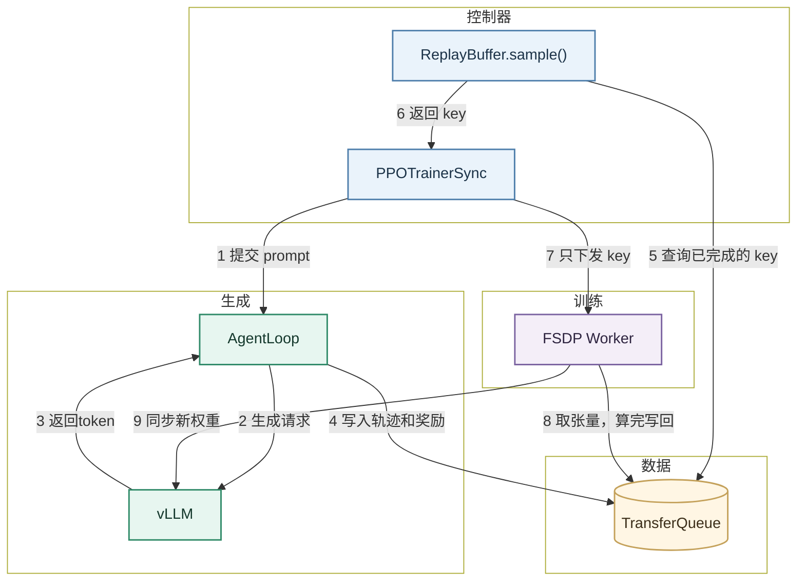
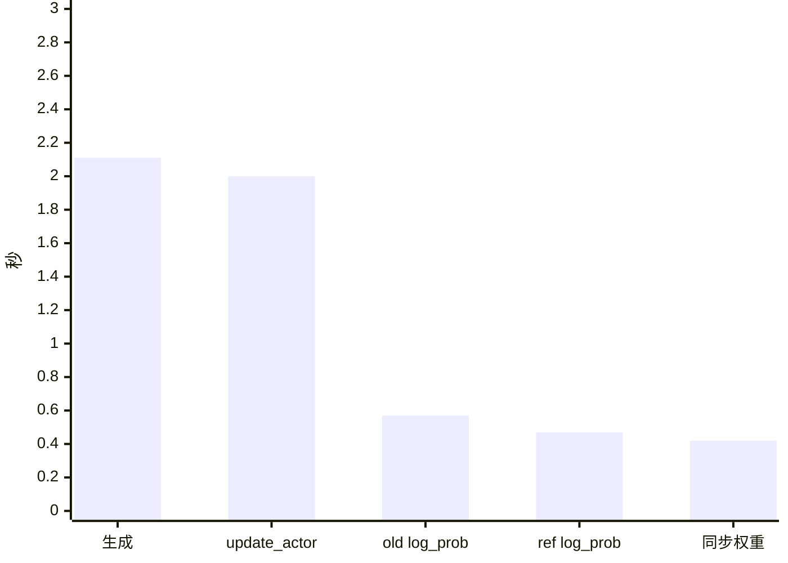
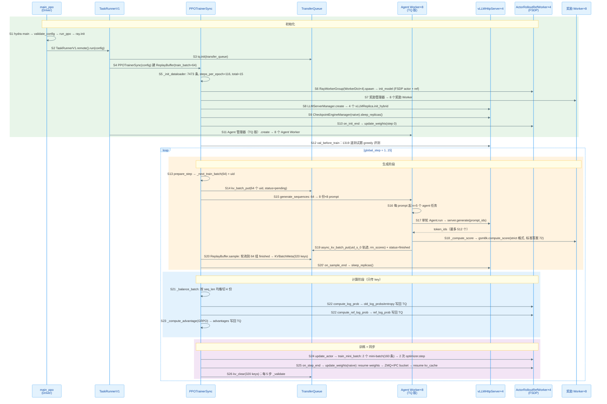

> 代码版本：`verl@8e48d72d`（2026-10-29，0.10.0.dev0）。运行环境：4 × H100 NVL 94GB，`torch 2.13.0+cu130`、`vllm 0.32.0`、`TransferQueue 0.1.11`。文中数值都来自本机跑通的 GRPO 例子，代码行号对应上述 commit。

## verl Overview

verl（Volcano Engine RL）是字节 Seed 开源的大模型强化学习框架：用模型生成回答，给回答打分，再用强化学习更新模型参数，如此循环。

入门时先记住三个角色：

| 角色   | 代码里的名字                         | 职责                          |
| ------ | ------------------------------------ | ----------------------------- |
| 控制器 | `TaskRunnerV1` 里的 `PPOTrainerSync` | 按顺序下命令，不碰张量        |
| 生成端 | `AgentLoop` + vLLM                   | 生成回答、打分，把结果写入 TQ |
| 训练端 | 4 个 `ActorRolloutRefWorker`（FSDP） | 按 key 从 TQ 取张量，更新模型 |

它们之间靠 **TransferQueue（TQ）** 传数据。TQ 是按 key 存取的分布式存储：控制器手里只有 key 列表（`KVBatchMeta`），Worker 用 key 自己取张量、算完写回，所以大张量不经过控制器。



下面按默认的 `sync` 模式解释图中 9 个步骤，数值取自后文 GRPO 例子的第 1 步。

- **1 提交 prompt**：控制器从 dataloader 取 64 个 prompt，给每个分配 uid，在 TQ 里登记为 `pending`，再平分给 8 个 `AgentLoopWorkerTQ`，每个 8 个。这个调用不等结果，马上返回。
  - prompt：一道待回答的题目，这里是一道 GSM8K 数学题。
  - uid：每个 prompt 的唯一编号，后面用它把同一题的回答分到一组。
  - `AgentLoopWorkerTQ`：生成阶段的执行者，例子里有 8 个，每个收到 8 个 prompt。

    下图是一个 prompt 的处理过程，方框里标出了状态变化：

    ```mermaid
    flowchart LR
      A["接任务<br/>状态 pending"] --> B["改状态<br/>状态 running"]
      B --> C["并发生成<br/>5 条回答"]
      C --> D["打分"]
      D --> E["写入 TQ"]
      E --> F["标记完成<br/>状态 finished"]
      classDef wait fill:#FFF6E4,stroke:#C4A15A,stroke-width:1.6px,color:#3C2F1A
      classDef work fill:#EAF3FB,stroke:#4E7EAB,stroke-width:1.6px,color:#1C3348
      classDef done fill:#E7F6F0,stroke:#2F8A68,stroke-width:1.6px,color:#14382C
      class A wait
      class B,C,D,E work
      class F done
    ```

    - 接任务：`generate_sequences`（`agent_loop_tq.py:61`）为每个 prompt 创建后台任务后立即返回，所以控制器不用等。
    - 改状态：`_run_prompt`（`agent_loop_tq.py:112`）把这个 prompt 标为 `running`。
    - 并发生成：每个 prompt 起 5 个 `_run_agent_loop` 任务，一个 Worker 共 8 × 5 = 40 个。每个任务由 `SingleTurnAgentLoop` 把 prompt 转成 token，发给请求最少的 vLLM，再等回答。
    - 打分：`_compute_score`（`agent_loop.py:998`）交给一个 `RewardLoopWorker` 计算。
    - 写入 TQ：`_agent_loop_postprocess`（`agent_loop_tq.py:155`）拼好 `input_ids`、`rm_scores` 等字段，按 `<uid>_<i>_0` 写入。
    - 标记完成：5 条都写完后，`_run_prompt`（`agent_loop_tq.py:148`）把 prompt 标为 `finished`，`ReplayBuffer` 这时才能选中它。

- **2 生成请求**：每个 prompt 起 5 个异步任务，共 64 × 5 = 320 条回答。每个任务把 prompt 转成 token，发给 4 个 vLLM 之一，temperature=1.0，最多生成 512 个 token。
  - `n=5`：同一道题生成 5 条回答，GRPO 要在这 5 条之间比较好坏。
  
  - temperature：采样的随机程度。logit 先除以 T 再做 softmax，T 越小分布越尖，越大越平。为 1.0 时 5 条回答才会各不相同。vLLM 里只有请求里设置了 `logprobs` 参数，才会额外计算被选中 token 的 logprob 并返回，默认不算。训练真正用的 logprob：生成结束后，actor 会用训练模型把 320 条回答重新跑一遍前向，自己计算 old log_prob；ref 模型也算一遍 ref log_prob。这两步一定会发生，PPO ratio 和 KL 都依赖它们。

    ```text
    hidden → RMSNorm → LM head → logit → 除以 T → softmax → 概率  → 抽 token
                                         					└→ 取对数 → logprob 
    ```
    
    -   RMSNorm：把 hidden 的整体大小缩放到稳定范围，不改变方向。
    -   LM head：给词表里每个 token 打一个分数，也就是 logit。
    -   除以 T：调整 logit 之间的差距。T 越小分布越尖，越大越平。
    -   softmax：把分数变成加起来等于 1 的概率。
    -   logprob：被抽中 token 的概率取对数。verl 后面算 PPO ratio 和 KL 用的都是它。
    
    ```python
    import torch
    
    # 1. 最后一层输出的 hidden（简化为 4 维，真实是 896 维）
    hidden = torch.tensor([1.0, -2.0, 3.0, 0.0])
    
    # 2. RMSNorm：除以均方根，再乘可学习的 weight
    rms = hidden.pow(2).mean().sqrt()            # sqrt((1+4+9+0)/4) = 1.87
    normed = hidden / rms * torch.ones(4)         # [0.53, -1.07, 1.60, 0.00]
    
    # 3. LM head：映射到词表（简化为 3 个 token，真实是 151936 个）
    #    3 个候选是下一个 token 可能的词：Natalia、First、In（题目以 Natalia 开头）
    W = torch.tensor([[ 1.0, 0.5, 0.0],
                      [-0.5, 0.0, 0.0],
                      [ 0.6, 0.0, 0.0],
                      [ 0.0, 0.0, 1.0]])
    logit = normed @ W                            # [2.0, 0.27, 0.0]  (Natalia, First, In)
    
    # 4. 除以温度 T
    T = 1.0
    scaled = logit / T                            # [2.0, 0.27, 0.0]
    
    # T     scaled              prob                   logprob(Natalia)
    # 0.5   [4.00, 0.54, 0.00]  [0.953, 0.030, 0.017]  -0.05
    # 1.0   [2.00, 0.27, 0.00]  [0.762, 0.135, 0.103]  -0.27
    # 2.0   [1.00, 0.14, 0.00]  [0.559, 0.235, 0.206]  -0.58
    # T→0   greedy：每一步只选 logit 最高的 token，不再随机
    # T 越大，logit 之间的差距被缩得越小，各候选的概率越接近，抽样越随机；T 越小，差距被放得越大，概率越集中在 logit 最高的 token 上。
    
    # 5. softmax → 概率
    prob = torch.softmax(scaled, dim=-1)          # [0.762, 0.135, 0.103]
    
    # 6. 按概率抽一个 token
    token = torch.multinomial(prob, 1)            # 例如抽到 0 → "Natalia"
    
    # 7. 取对数 → logprob（只保留被抽中的那个）
    logprob = torch.log(prob)[token]              # ln(0.762) = -0.27
    ```
    
    - T训练用 1.0：5 条回答要有好有坏，advantage 才不全是 0。T=0 时 5 条回答完全相同，分数也相同，减去平均后全是 0，梯度为 0。只有回答有差别，模型才知道哪种回答更好。
    - T验证用 0：greedy，结果稳定可复现。每题都选最有把握的回答，同一个模型每次测都得到同样的分数，不同步数之间可以直接比较。
    - actor 重算 old log_prob 时同样先执行 `logits.div_(temperature)`，否则 PPO ratio 会有偏差。
  
- **3 返回 token**：vLLM 返回生成的 token 和 logprob。第 1 步平均每条回答 311 个 token，6%–15% 写满 512 个 token 被截断。
  
  - logprob：模型生成这个 token 的对数概率。
  
- **4 写入轨迹和奖励**：AgentLoop 先打分，答对得 1.0，否则 0，第 1 步 320 条（320 就是 64 × 5，这一步总共的回答条数）里只有 3 条得分。然后把结果写入 TQ，5 条都写完后，这个 prompt 的状态改为 `finished`。
  
  - 轨迹：一次生成的完整记录，包括 prompt、回答、分数和 logprob。每条回答作为一条轨迹写入 TransferQueue，key 形如 `<uid>_<i>_0` 。
      -   `uid`：这道题的编号
      -   `i`：0–4，第几条回答
      -   `_0`：轨迹编号，单轮对话固定为 0
  - 轨迹里的 logprob 是 vLLM 返回的那份，而且可能根本没有。它不是 PPO 用的 old log_prob。之后由 FSDP 补进去：old log_prob、ref log_prob、advantage。
  
- **5 查询已完成的 key**：`ReplayBuffer` 每 2 s 查询一次 TQ，直到 64 个 prompt 的 5 条回答都是 `finished`。
  - 轮询：TQ 不会主动通知写完了，所以只能定时去查。
  
- **6 返回 key**：`ReplayBuffer` 把 320 个 key 交给控制器，随后 vLLM 进入 sleep，把显存让给训练。
  
  -   `ReplayBuffer` 不是一个独立的进程，而是控制器（`PPOTrainerSync`）里的一个 Python 对象。控制器调用 `replay_buffer.sample()`，函数返回 `KVBatchMeta`，整个过程不经过网络，也不搬运张量。
  
      ```python
      控制器进程（PPOTrainerSync）
        └─ batch = self.replay_buffer.sample()        ← 普通函数调用，会阻塞等待
              ├─ 循环：查询 TQ 元数据 → 不够 64 组 → 等 2 s → 再查
              ├─ 够了：按 global_steps 排序，取 64 个 uid
              └─ _materialize_batch：把 64 个 uid 展开成 320 个 key
           返回 KVBatchMeta(keys=320 个, tags=[...])   ← 只有名字和长度这类标签
        └─ on_sample_end → sleep_replicas()           ← vLLM 释放显存
      ```
  
  - `KVBatchMeta`：控制器拿到的 batch，只有 key 和 `seq_len` 这类标签，没有张量。
  - sleep：vLLM 进程不退出，只释放显存。共卡时训练和生成不能同时占满显存。
  
- **7 只下发 key**：控制器按序列长度把 320 个 key 均衡分成 4 份，每卡 80 条，再调用 Worker 计算。
  - 均衡分配：让每张卡的总 token 数接近，避免都在等最慢的卡。用的是 Karmarkar-Karp 算法（`verl/utils/seqlen_balancing.py` 的 `get_seqlen_balanced_partitions`），在每卡条数相同的前提下，先把最长的几条分到不同的卡，再用短的去填补差距。

    ```text
    8 条分给 2 卡，每卡 4 条，seq_len：[500, 480, 400, 350, 300, 200, 150, 100]，理想每卡 1240
    
    按顺序切        卡0 500+480+400+350 = 1730   卡1 750        差 980
    轮流分          卡0 500+400+300+150 = 1350   卡1 1130       差 220
    Karmarkar-Karp  卡0 500+350+200+150 = 1200   卡1 1280       差 80
    ```

    本例是 320 条分到 4 卡、每卡 80 条，`seq_len` 直接从 tag 读取，只在控制器上处理 320 个整数，耗时可以忽略。
  - Worker：即 `ActorRolloutRefWorker`，每卡 1 个进程，用 FSDP 加载要训练的模型和冻结的 ref 模型，参数切成 4 份，每卡存 1/4。

    ```text
    每张卡上的 ActorRolloutRefWorker 进程
    ├─ actor：FSDP，参数、梯度、优化器状态切成 4 份，每卡存 1/4
    └─ ref：  FSDP，只做前向，param_offload=True，平时放 CPU，用时再搬上 GPU
    （同一张卡上还有 vLLM，与 FSDP 共卡，最多占 50% 显存）
    ```

    - 平时：每卡只存 1/4 参数，显存约为完整存放的四分之一。
    - 计算某一层时：all-gather 从 4 张卡拼出这一层的完整参数，算完立刻释放。
    - 反向之后：reduce-scatter 梯度，每卡只保留并更新自己负责的 1/4。
  - 320 条在后续计算中的划分：

    | 划分 | 大小 | 原因 | 改了会怎样 |
    | --- | --- | --- | --- |
    | 按组 | 64 组 × 5 条 | 同一题的回答之间比较，算 advantage | 不能改，这是 GRPO 的定义 |
    | 按卡 | 4 卡 × 80 条，按长度均衡 | 并行加速，每卡同时算完 | 只影响速度 |
    | mini-batch | 160 条（32 题 × 5），共 2 批 | 每批 `optimizer.step` 一次，数据用 2 次，ratio 不会偏离太远 | 影响训练效果，需要调参 |
    | micro-batch | 每卡 8 条，5 次累加 | 显存放不下全部，分批前向和反向，梯度累加后才更新 | 只影响速度和显存 |
  
- **8 取张量，算完写回**：Worker 用 key 从 TQ 取回张量，依次算 old log_prob、ref log_prob，控制器算 GRPO 优势，最后 Worker 更新模型，共 2 次 `optimizer.step`。
  
  -   从 TQ 取回张量：大张量由 FSDP Worker 自己取，控制器只取算优势用的分数和 uid，下发和返回的都只有 key。
  
      | 调用                 | 谁去 TQ 取  | 取什么                       | 写回什么            |
      | -------------------- | ----------- | ---------------------------- | ------------------- |
      | compute_log_prob     | FSDP Worker | input_ids、attention_mask 等 | old_log_probs       |
      | compute_ref_log_prob | FSDP Worker | 同上                         | ref_log_prob        |
      | compute_advantage    | 控制器      | 分数、uid（小）              | advantages          |
      | update_actor         | FSDP Worker | 以上全部                     | 不写回，只返回 loss |
  
  - old log_prob：当前模型算出的概率，更新时用来限制模型变化幅度。
  - ref log_prob：冻结的参考模型算出的概率，用于 KL loss，防止模型偏离太远。
  - GRPO 优势：同一题的 5 条回答做组内归一化，比同组平均好的为正，差的为负。计算量很小，所以由控制器完成。
  
- **9 同步新权重**：唤醒 vLLM 的权重显存，把新权重发过去，再恢复 KV cache，约 0.42 s。最后清掉 TQ 里的 320 个 key，回到第 1 步。
  - 如何同步：每张卡上的 FSDP 把权重直接交给同卡的 vLLM，4 张卡同时进行。
  
    ```python
    await self.rollout.resume(tags=["weights"])           # 1. 唤醒 vLLM 的权重显存，KV cache 仍在休眠
    params = self.actor.engine.get_per_tensor_param()     # 2. FSDP all-gather 出完整参数，逐个转成 HF 格式
    await self.rollout.update_weights(params)             # 3. 按 2 GB 打包，CUDA IPC 句柄经 ZMQ 发给同卡 vLLM 加载
    torch.distributed.barrier()                           # 4. 等 4 张卡都完成
    await self.rollout.resume(tags=["kv_cache"])          # 5. 恢复 KV cache，准备下一步生成
    ```

    本例模型是 Qwen2.5-0.5B-Instruct，约 0.49B 参数 × 2 字节（bf16）≈ 0.99 GB，小于 2 GB，1 个包就够，传输约 0.14 s，加上唤醒共约 0.42 s。
  - CUDA IPC：同一张卡上的进程直接共享显存，不用经过 CPU 拷贝。FSDP 和 vLLM 是两个进程，本来看不到对方的显存，IPC 让 FSDP 把一块显存"借"给 vLLM。

    ```text
    FSDP 进程                                    vLLM 进程（同一张卡）
    1. 新权重在显存地址 A
    2. cudaIpcGetMemHandle(A) → 句柄（64 字节）
    3. 句柄经 ZMQ 发过去 ──────────────────────→ 4. cudaIpcOpenMemHandle(句柄) → 映射到同一块显存
                                                 5. 直接读这块显存，拷进自己的模型参数
    ```

    - 句柄：很小的"钥匙"，ZMQ 传的是钥匙，不是 0.99 GB 的权重。
    - 不经过 CPU：权重一直在 GPU 上，只有最后一次同卡显存内拷贝，所以约 0.14 s 就够。
    - 限制：只能在同一张卡上用，跨卡或跨机器要改用 NCCL 广播等方式。

<br />
<br />

## 代码在哪里

```text
verl/
├── trainer/main_ppo.py              # 入口
├── trainer/config/ppo_trainer.yaml  # 默认配置
├── trainer/ppo/
│   ├── v1/trainer_base.py           # 主循环 fit / step / _step_once
│   ├── v1/trainer_sync.py           # sync 模式的钩子
│   ├── v1/replay_buffer.py          # 从 TQ 选 batch
│   ├── v1/agent_loop_tq.py          # 生成结果写入 TQ
│   └── core_algos.py                # 优势估计、policy loss、KL
├── experimental/agent_loop/         # SingleTurnAgentLoop 等
├── experimental/reward_loop/        # 奖励计算
├── workers/engine_workers.py        # ActorRolloutRefWorker
├── checkpoint_engine/               # 训练到推理的权重同步
└── utils/reward_score/gsm8k.py      # 例子用的 GSM8K 奖励
```

<br />
<br />

## 安装

### 更新代码

`origin` 是自己的 fork，最新代码在官方仓库，所以先把官方仓库加成 `upstream`：

```bash
git remote add upstream https://github.com/verl-project/verl.git   # 只需第一次
git fetch upstream
git checkout main
git rebase --autostash upstream/main     # 未提交的改动自动收起，做完再放回
```

- `--autostash`：有未提交的改动时，rebase 会拒绝执行；加上它就自动 stash 和 pop。
- 冲突：两边改了同一处时照样会冲突，改好后 `git add`，再 `git rebase --continue`。

### 安装

官方推荐用 uv，仓库自带 `uv.lock`：

```bash
uv sync --python 3.12 --locked --extra fsdp --extra vllm --extra test
source .venv/bin/activate
```

- `uv sync`：把 `.venv` 同步成和 `uv.lock` 完全一致，按顺序做这些事：

  | 步骤 | 做什么 |
  | --- | --- |
  | 1. 检查 lock | 确认 `uv.lock` 和 `pyproject.toml` 一致，不一致就报错退出 |
  | 2. 准备 Python | `.venv` 不是 3.12 或解释器失效时删掉重建，必要时 uv 自己下载 3.12 |
  | 3. 选包 | 从 lock 里挑出基础依赖，加上三个 extra 需要的包 |
  | 4. 下载 | wheel 缓存到 `~/.cache/uv`，已有的跳过 |
  | 5. 安装 | 装进 `.venv`，优先从缓存硬链接，第二次很快 |
  | 6. 装 verl 本身 | 可编辑模式，`.venv` 里只放一个指向源码的链接 |
  | 7. 删多余的包 | lock 里没有的包会被卸载，比如手动 `pip install` 的 |

- `--python 3.12`：指定 Python 版本。
- `--locked`：严格按 lock 安装，不会悄悄改写 `uv.lock`。
- `--extra`：fsdp 装 torch、flash-attn，vllm 装 vllm、transformers，test 装 pytest 和 pre-commit。
- `source .venv/bin/activate`：`uv sync` 不会激活环境，要自己激活。
- 不需要编译：verl 是纯 Python，以可编辑模式安装，改代码立即生效；torch、vllm、flash-attn 都是预编译的 wheel。verl 里少量 Triton kernel 在第一次运行时自动编译，默认配置用不到。

### 检查安装

更新代码后，先检查环境要不要同步（只检查，不改环境）：

```bash
uv sync --check --locked --extra fsdp --extra vllm --extra test
```

确认关键包能导入、GPU 可用：

```bash
python -c "import torch, vllm, flash_attn, transformers; print(torch.__version__, vllm.__version__, transformers.__version__, torch.cuda.is_available())"
```


# 提PR

<br />
<br />

## 提 PR 流程

规则以官方的 `CONTRIBUTING.md`、`AGENTS.md` 和 `.github/PULL_REQUEST_TEMPLATE.md` 为准。

### 1. 建分支

```bash
git fetch upstream
git checkout -b fix/<主题> upstream/main    # bug 用 fix/，功能用 feat/，性能用 perf/
```

动手前先查重，已有 open PR 修同一个问题就不要再开：

```text
https://github.com/verl-project/verl/pulls?q=is%3Apr+<关键词>
```

### 2. 测试

```bash
pre-commit install                           # 只需第一次，之后每次 commit 自动检查
pre-commit run --all-files                   # 检查所有文件
python -m pytest tests/<目录>/test_xxx.py -v  # 跑相关测试
```

- pre-commit：ruff、mypy、license、配置生成等检查，CI 必须通过。
- 测试位置：和源码目录对应，`verl/models/...` 的测试放 `tests/models/...`。只用 CPU 的测试文件名以 `_on_cpu.py` 结尾。
- 修复前后各跑一次：修复前失败、修复后通过，才能证明测试有效。

### 3. 提交

```bash
git add <文件>                            # 不要 git add .
git commit -s -m "[模块] 类型: <描述>"     # -s 自动加 Signed-off-by，-m 写提交标题
git push -u origin fix/<主题>
```

commit 标题和 PR 标题用同一套格式，CI 会检查：

```text
[模块] 类型: 描述

[model] fix: restore per-sequence conv in Qwen3.5 GDN under packed micro-batches
[BREAKING][fsdp, megatron] feat: dynamic batching
```

- 模块：`fsdp`、`megatron`、`vllm`、`sglang`、`rollout`、`trainer`、`worker`、`model`、`algo`、`reward`、`data`、`cfg`、`doc`、`ci`、`perf`、`misc` 等，多个用逗号分隔。
- 类型：`feat`、`fix`、`refactor`、`chore`、`test`。
- 破坏 API：开头加 `[BREAKING]`。
- 签名：配置 `commit.gpgsign=true` 和 SSH 签名密钥，并把密钥加到 GitHub 的 Signing keys，提交才会显示 Verified。提交邮箱也必须是 GitHub 账号里已验证的。

### 4. 开 PR

在自己的 fork 上点 Compare & pull request，目标选 `verl-project/verl:main`。正文照抄 PR 模板的各节：

```markdown
### What does this PR do?

Fixes #<issue>. <一两句话：问题是什么、怎么修。>

### Checklist Before Starting

- [x] Search for similar PRs. Paste at least one query link here: <查重链接>
- [x] Format the PR title as `[{modules}] {type}: {description}`

### Test

<测试命令和结果：修复前失败，修复后通过>

### API and Usage Example

No API change.

### Design & Code Changes

- `verl/xxx.py`: <改了什么、为什么>

### Checklist Before Submitting

- [x] Read the Contribute Guide.
- [x] Apply pre-commit checks.
- [x] Add unit or end-to-end test(s) to the CI workflow.
```

- 占位文字：CI 会比对正文前 5 行，没改模板的占位文字就会失败。
- 勾选框：只勾真正做过的项。
- 换行：每段、每个列表项写成一行，GitHub 会把段内换行显示成空格。
- AI 协助：按 `AGENTS.md`，要说明不是重复 PR、写出测试命令和结果，并声明用了 AI。
- 跑 CI：PR 开好后，到 Slack 的 `ci-request` 频道请维护者批准运行。

### 5. 更新 PR

**情况 1：改代码或回应 review（最常见）**

```bash
git checkout fix/<主题>
# 修改代码
pre-commit run --all-files
git add <文件>
git commit -s -m "[model] fix: address review comments"
git push                       # 普通推送，PR 自动出现新提交
```

**情况 2：上游 main 更新了，需要同步或解决冲突**

```bash
git fetch upstream
git rebase upstream/main       # 把你的提交搬到 upstream 最新代码后面
git push --force-with-lease    # rebase 改写了历史，必须强制推送
```

- 没有冲突：rebase 自动完成，不用 add，也不用 commit，直接 push。
- 有冲突：rebase 会暂停。编辑冲突文件，删掉 `<<<<<<<`、`=======`、`>>>>>>>` 标记，然后：

  ```bash
  git add <文件>              # 标记冲突已解决
  git rebase --continue       # 继续 rebase，不用 commit
  git push --force-with-lease
  ```
- 想放弃：`git rebase --abort`，回到 rebase 之前的状态。

<br />
<br />

## 跑通第一个例子：GRPO

用 Qwen2.5-0.5B-Instruct 学做 GSM8K 数学题，4 张卡，FSDP 和 vLLM 共卡，共 15 步。配置是 Hydra，所有字段都能用 `a.b.c=value` 覆盖，默认值在 `ppo_trainer.yaml`。

### 1. 准备数据

下载 GSM8K，转成 verl 读取的 parquet：

```bash
python examples/data_preprocess/gsm8k.py --local_save_dir rl_study/data/verl_gsm8k
```

### 2. 启动训练

```bash
# 参数写成 bash 数组，每个参数后面都能加注释（反斜杠续行的写法里不能在行尾加注释）
D=/data/home/xli49/lxy/rl_study/data/verl_gsm8k          # GSM8K parquet 所在目录
ARGS=(
    # ---- 算法 ----
    algorithm.adv_estimator=grpo                         # 优势估计器用 GRPO：组内 (r-μ)/(σ+1e-6)，不需要 critic
    algorithm.use_kl_in_reward=False                     # KL 不加进奖励（改为下面 actor 的 KL loss）

    # ---- 数据 ----
    data.train_files=$D/train.parquet                    # 训练集 7473 题
    data.val_files=$D/test.parquet                       # 验证集 1319 题
    data.train_batch_size=64                             # 每步 64 个 prompt；× n=5 → 每步 320 条回答
    data.max_prompt_length=512                           # prompt 最长 512 token
    data.max_response_length=512                         # 回答最长 512 token，超出截断
    data.filter_overlong_prompts=True                    # 预先过滤超过 512 token 的 prompt
    data.truncation=error                                # 仍有超长 prompt 时直接报错，而不是悄悄截断

    # ---- 模型 ----
    actor_rollout_ref.model.path=Qwen/Qwen2.5-0.5B-Instruct   # actor、rollout、ref 共用的初始权重
    actor_rollout_ref.model.use_remove_padding=True      # 去掉 padding、把序列拼成一条（flash-attn varlen），省算力
    actor_rollout_ref.model.enable_gradient_checkpointing=True  # 重算激活，省显存

    # ---- actor 训练 ----
    actor_rollout_ref.actor.optim.lr=1e-6                # 学习率
    actor_rollout_ref.actor.ppo_mini_batch_size=32       # 每次 optimizer.step 用 32 个 prompt（×5 = 160 条）→ 每步 320/160 = 2 次 step
    actor_rollout_ref.actor.ppo_micro_batch_size_per_gpu=8   # 每卡 micro-batch 8 条：每卡每个 mini-batch 160/4 = 40 条 → 5 个 micro 做梯度累积
    actor_rollout_ref.actor.use_kl_loss=True             # 把与 ref 的 KL 作为 loss 项
    actor_rollout_ref.actor.kl_loss_coef=0.001           # KL loss 系数
    actor_rollout_ref.actor.kl_loss_type=low_var_kl      # KL 估计方式：low_var_kl（k3 的截断版）
    actor_rollout_ref.actor.entropy_coeff=0              # 不加熵奖励

    # ---- rollout（vLLM）----
    actor_rollout_ref.rollout.name=vllm                  # 推理引擎用 vLLM
    actor_rollout_ref.rollout.tensor_model_parallel_size=1   # TP=1 → 4 张卡起 4 个独立的 vLLM 副本
    actor_rollout_ref.rollout.gpu_memory_utilization=0.5     # vLLM 最多占每卡 50% 显存（与 FSDP 共卡）
    actor_rollout_ref.rollout.n=5                        # 每个 prompt 采样 5 条回答（GRPO 的组大小）
    actor_rollout_ref.rollout.log_prob_micro_batch_size_per_gpu=16   # 算 old_log_prob 时每卡 micro 16 条：每卡 80 条 → 5 个 micro

    # ---- ref 模型 ----
    actor_rollout_ref.ref.log_prob_micro_batch_size_per_gpu=16   # 算 ref_log_prob 时每卡 micro 16 条
    actor_rollout_ref.ref.fsdp_config.param_offload=True     # ref 参数平时放 CPU，用时再搬上 GPU

    # ---- trainer ----
    trainer.critic_warmup=0                              # GRPO 没有 critic，不需要预热
    trainer.logger='["console"]'                         # 指标只打到控制台（日志里的 "step:N - key:value ..."）
    trainer.n_gpus_per_node=4                            # 每节点 4 张卡
    trainer.nnodes=1                                     # 单节点
    trainer.save_freq=-1                                 # 不保存 checkpoint
    trainer.test_freq=5                                  # 每 5 步验证一次（另外训练前默认先验证一次）
    trainer.total_training_steps=15                      # 只跑 15 步（完整一个 epoch 是 7473 // 64 = 116 步）
    trainer.total_epochs=1                               # 1 个 epoch

    # ---- Ray ----
    ray_kwargs.ray_init.runtime_env.py_executable=null   # 已在 .venv 里，Ray worker 直接用当前 python，不需要 uv run 包一层
)
python3 -m verl.trainer.main_ppo "${ARGS[@]}"
```

### 3. 关键配置

先记住这几个：

| 配置                                                   | 含义                     | 取值         |
| ------------------------------------------------------ | ------------------------ | ------------ |
| `algorithm.adv_estimator`                              | 优势估计器               | grpo         |
| `data.train_batch_size`                                | 每步 prompt 数           | 64           |
| `actor_rollout_ref.rollout.n`                          | 每个 prompt 采样几条回答 | 5            |
| `actor_rollout_ref.actor.ppo_mini_batch_size`          | 每次更新用的 prompt 数   | 32           |
| `actor_rollout_ref.actor.ppo_micro_batch_size_per_gpu` | 每卡 micro batch         | 8            |
| `actor_rollout_ref.rollout.gpu_memory_utilization`     | vLLM 显存比例            | 0.5          |
| `trainer.v1.trainer_mode`                              | 运行模式                 | sync（默认） |

### 4. 结果分析

总耗时 350 s，其中启动和初始验证约 4 分钟，15 步训练约 1 分 45 秒。

| step | 训练平均得分 | 验证准确率      | 平均回答长度 |
| ---- | ------------ | --------------- | ------------ |
| 1    | 0.009        | 0.08%（训练前） | 311          |
| 5    | 0.019        | 1.7%            | 303          |
| 10   | 0.125        | 21.5%           | 298          |
| 15   | 0.238        | 37.2%           | 289          |

起点接近 0，是因为 GSM8K 奖励要求严格输出 `#### 数字`，而模型默认用 `\boxed{}` 或自然语言作答，所以前 15 步主要在学格式。

每步约 5.7 s，构成如下：



生成几乎恒为 2.11 s，这不是真实生成时间：`ReplayBuffer` 每 2 s 查询一次 TQ，实际生成不到 2 s，第二次查询时才发现写完了。第 1 步的 old log_prob 约 4.3 s，是首次 warm-up。

<br />
<br />

## 一步训练时序图

整个训练分成两段：

- 启动（S1–S12，只执行一次）：读配置、启动 Ray，创建 TQ、FSDP Worker、vLLM 和 Agent Worker，把初始权重同步给 vLLM，再在测试集上验证一次。
- 每步循环（S13–S26）：取 64 道题（换新题） → vLLM 每题生成 5 条并打分 → 凑齐 320 条后 vLLM sleep → 算 old / ref log_prob 和 GRPO 优势 → 2 次 `optimizer.step` → 新权重同步给 vLLM → 清理 TQ，每 5 步验证一次。

图中编号 S1–S26 和下一节的代码一一对应。图中简称与源码类名的对应：

| 图中简称 | 源码 |
| --- | --- |
| Agent Worker（TQ 版） | `AgentLoopWorkerTQ` |
| Agent 管理器（TQ 版） | `AgentLoopManagerTQ` |
| 奖励 Worker | `RewardLoopWorker` |
| 奖励管理器 | `RewardLoopManager` |
| 单轮 Agent | `SingleTurnAgentLoop` |
| agent 任务 | `_run_agent_loop` |




<br />
<br />

## 代码逐步详解（带入数值）

每一步都按同样的顺序讲：**做什么 → 代码 → 带入数值 → 这一步的结果**。编号和上面的时序图一一对应。

例子的配置：

- `train_batch_size=64`：每步 64 道题。
- `rollout.n=5`：每题生成 5 条回答，共 320 条。
- `ppo_mini_batch_size=32`：每次更新用 32 道题（160 条），每步更新 2 次。
- `ppo_micro_batch_size_per_gpu=8`：训练时每卡一次算 8 条。
- `log_prob_micro_batch_size_per_gpu=16`：算 logprob 时每卡一次算 16 条。
- 4 张 GPU，vLLM TP=1：每卡一个独立的 vLLM。
- `total_training_steps=15`：只跑 15 步。
- `test_freq=5`：每 5 步验证一次。

### 第一阶段：启动（S1–S11，只执行一次）

#### S1: 解析配置，启动 Ray

**目的**：读取配置并检查，然后启动 Ray。

代码位置：`main_ppo.py:170`

```python
@hydra.main(config_path="config", config_name="ppo_trainer", version_base=None)  # 读 ppo_trainer.yaml，命令行参数覆盖默认值

def main(config):  # 训练入口
    auto_set_device(config)  # 根据环境自动选择 cuda / npu
    validate_config(config=config, use_reference_policy=need_reference_policy(config), use_critic=need_critic(config))  # 检查配置是否合法；开了 KL loss → 需要 ref 模型；GRPO → 不需要 critic
    if config.trainer.use_v1:  # 走 V1 训练器
        run_ppo(config, task_runner_class=TaskRunnerV1)  # ray.init，再交给 TaskRunnerV1
```

**带入数值**：

- `use_kl_loss=True`，所以需要参考模型。
- `adv_estimator=grpo`，所以不需要 critic。
- `use_v1` 默认是 True，走 V1 Trainer。

**结果**：配置检查通过，`run_ppo` 调用 `ray.init`。

<br />

#### S2: 创建 TaskRunnerV1

**目的**：在 Ray 上创建控制器进程，让它执行 `run`。

代码位置：`main_ppo.py:35`

```python
runner = task_runner_class.remote()  # 创建 TaskRunnerV1 这个 Ray actor（只用 CPU）

ray.get(runner.run.remote(config))  # 让它执行 run()，driver 阻塞等到训练结束
```

**结果**：`TaskRunnerV1` 作为 Ray actor 运行，只用 CPU，后面的步骤都由它驱动。

<br />

#### S3: 启动 TransferQueue

**目的**：启动存放训练数据的 TQ。

代码位置：`main_ppo.py:137`

```python
import transfer_queue as tq

config.transfer_queue.enable = True  # 打开 TQ

OmegaConf.resolve(config)  # 展开配置里的 ${...} 引用

tq.init(config.transfer_queue)  # 启动 TQ 的 controller 和 storage
```

**结果**：TQ 的 controller 和 storage 已启动，这时里面还没有数据。

<br />

#### S4: 创建 PPOTrainerSync 和 ReplayBuffer

**目的**：按 `trainer_mode` 选择训练器类，并创建 ReplayBuffer。

代码位置：`main_ppo.py:137`、`trainer_base.py:140`

```python
trainer_cls = get_trainer_cls(config.trainer.v1.trainer_mode)  # sync → PPOTrainerSync

self.trainer = trainer_cls(config=config)  # 创建训练器
```

```python
sampler_cls = ReplayBuffer  # 从 TQ 选 batch 的组件

replay_buffer_kwargs.update(train_batch_size=64, gen_batch_size=64, max_inflight_gen_batches=1)  # 每步训练 64 组；每次提交 64 个 prompt 去生成；同时只有 1 批在生成（sync）
```

**带入数值**：

- `trainer_mode=sync`，所以选 `PPOTrainerSync`。
- `gen_batch_size` 没有配置，默认等于 `train_batch_size`，即 64。

**结果**：训练器和 ReplayBuffer 创建完成。接下来 `self.trainer.init()` 执行 S5–S10。

<br />

#### S5: 加载数据

**目的**：读取数据集，创建 dataloader，算出总步数。

代码位置：`trainer_base.py:709`

```python
self.train_dataset = create_rl_dataset(train.parquet, ...)  # 读 7473 道训练题

self.train_dataloader = StatefulDataLoader(dataset, batch_size=64, drop_last=True, collate_fn=collate_fn, sampler=随机)  # 每次取 64 道，丢掉不满一批的尾巴；打乱顺序

self.val_dataloader = StatefulDataLoader(val_dataset, batch_size=len(val))  # 1319 道测试题一次全取

self.steps_per_epoch = 7473 // 64  # 116 步一个 epoch
```

**带入数值**：

- 训练集 7473 题，验证集 1319 题。
- 一个 epoch 是 7473 // 64 = 116 步。
- `total_training_steps=15` 覆盖了 116，所以只跑 15 步。

每条样本里有：

- `raw_prompt`：题目，结尾要求在 `####` 后写答案。
- `reward_model`：`{"style": "rule", "ground_truth": "72"}`。
- `data_source`：`"openai/gsm8k"`，用来选奖励函数。

**结果**：数据就绪，总步数定为 15。

<br />

#### S6: 创建 Worker，加载模型

**目的**：在 4 张卡上各创建 1 个 Worker，加载要训练的模型和参考模型。

代码位置：`trainer_base.py:789`、`:310`、`:330`

```python
resource_pool_spec = {"global_pool": [4] * 1}  # 1 个节点 × 4 张卡

actor_rollout_cls = RayClassWithInitArgs(cls=ActorRolloutRefWorker, config=config.actor_rollout_ref, role="actor_rollout_ref")  # Worker 类；同一进程里放 actor 和 ref

worker_dict_cls = create_colocated_worker_cls(class_dict={"actor_rollout_ref": actor_rollout_cls})  # 多个角色合进一个进程

wg_dict = RayWorkerGroup(resource_pool=resource_pool, ray_cls_with_init=worker_dict_cls, device_name="cuda")  # 每卡起 1 个进程，共 4 个

self.actor_rollout_wg.init_model()  # 4 个进程各自用 FSDP 加载 actor 和 ref
```

**带入数值**：

- 资源池 1 个节点、4 张卡，创建 4 个 Worker 进程。
- 每个 Worker 里有 actor 和 ref 两个 `TrainingWorker`，各加载一次权重。
- Qwen2.5-0.5B 共 290 个参数张量，日志显示 `Loading weights: 290/290`。
- ref 的 `param_offload=True`，平时放在 CPU。

**结果**：FSDP 模型加载完成，`actor_rollout_wg` 可以接收命令了。

<br />

#### S7: 创建奖励 Worker

**目的**：创建打分用的 Worker，并确定奖励函数。

代码位置：`trainer_base.py:343`、`reward_score/gsm8k.py:52`

```python
self.reward_loop_manager = RewardLoopManager(config=self.config, rm_resource_pool=None)  # 规则打分，不需要 GPU
```

```python
answer = extract_solution(solution_str, method="strict")  # parser：从回答里找 "#### 数字"

return score(1.0) if answer == ground_truth else format_score(0.0)  # 和标准答案相同得 1，否则 0
```

**带入数值**：

- 创建 8 个 `RewardLoopWorker`。
- `data_source="openai/gsm8k"`，所以用 GSM8K 的奖励函数。
- `strict` 模式只认 `#### 数字`。比如回答结尾是 `#### 72`，标准答案是 72，得 1.0；否则得 0。

**结果**：打分的 Worker 就绪。

<br />

#### S8: 启动 vLLM

**目的**：在 4 张卡上启动 vLLM，和 Worker 共卡。

代码位置：`llm_server.py:442`

```python
rollout_world_size = 1 * 1 * 1  # TP × DP × PP = 1，一个 vLLM 只占 1 张卡

world_size = self.worker_group.world_size  # 4 张卡

num_replicas = world_size // rollout_world_size  # 4 个 vLLM 副本

self.rollout_replicas = [vLLMReplica(replica_rank=i, ...) for i in range(num_replicas)]  # 每卡创建 1 个 vLLM 副本

await asyncio.gather(*[server.init_hybrid(self.worker_group) ...])  # hybrid：vLLM 和 FSDP 共卡
```

**带入数值**：

- TP=1，每个副本占 1 张卡。
- 4 // 1 = 4，共 4 个 vLLM 副本。
- `gpu_memory_utilization=0.5`，每个 vLLM 最多占一半显存。
- `enable_sleep_mode=True`，这样才能 sleep 和唤醒。

**结果**：4 个 `vLLMHttpServer` 已启动，但里面还不是训练用的权重。

<br />

#### S9: 让 vLLM 先 sleep

**目的**：创建权重同步管理器，让 vLLM 释放显存。

代码位置：`trainer_base.py:392`

```python
checkpoint_engine_config.backend = "naive"  # 同卡 CUDA IPC 传权重

self.checkpoint_manager = CheckpointEngineManager(config, actor_wg=self.actor_rollout_wg, replicas=self.rollout_replicas)  # 负责 FSDP → vLLM 同步

self.checkpoint_manager.sleep_replicas()  # vLLM 先休眠，让出显存
```

**带入数值**：

- sync 模式共卡，后端用 `naive`。
- 4 个 vLLM 全部 sleep，释放权重和 KV cache。

**结果**：显存空出来，等待写入 Worker 的权重。

<br />

#### S10: 首次同步权重

**目的**：把 FSDP 模型的权重发给 vLLM，保证生成和训练用同一份权重。

代码位置：`trainer_sync.py:31`

```python
self.checkpoint_manager.update_weights(self.global_steps)  # step 0：把初始权重同步给 vLLM
```

**带入数值**：

- 没有 checkpoint，所以 `global_steps=0`。
- 首次同步耗时 1.59 s，之后每步纯传输约 0.14 s。

**结果**：vLLM 和 FSDP 的权重一致。传输方式和 S25 相同。

<br />

#### S11: 创建 AgentLoop Worker

**目的**：创建负责调用 vLLM 的 Worker。

代码位置：`main_ppo.py:115`、`agent_loop_tq.py:235`

```python
self.agent_loop_manager = AgentLoopManagerTQ.create(config, llm_client=trainer.get_llm_client(), teacher_client=None, reward_loop_worker_handles=...)  # 创建 8 个 AgentLoopWorkerTQ；用来调用 4 个 vLLM；不用蒸馏；生成完直接打分
```

**带入数值**：`num_workers=8`，创建 8 个 `AgentLoopWorkerTQ`，都是只用 CPU 的 Ray actor。

**结果**：所有组件就绪，接下来进入 `fit()`。

### 第二阶段：训练前验证（S12）

<br />

#### S12: 测一次起点

**目的**：用还没训练的模型做一遍测试题，得到基线。

代码位置：`trainer_base.py:413`

**带入数值**：

- 1319 道测试题，提交到 `partition_id="val"`。
- 验证时 temperature=0，n=1，每题只答一次。
- 准确率是 0.08%。

**结果**：有了对比的起点，开始训练循环。

### 第三阶段：生成（S13–S20，每步一次）

下面以第 1 步为例。

<br />

#### S13: 取 64 个 prompt，分配 uid

**目的**：从 dataloader 取一批题目，给每题一个唯一编号。

代码位置：`trainer_base.py:1476`、`:1480`

```python
batch = self._next_train_batch()  # 从 dataloader 取 64 道新题

batch_dict["uid"] = [uuid4() for _ in range(64)]  # 每道题一个唯一编号

tu.assign_non_tensor_data(batch, "global_steps", self.global_steps)  # 记下属于第几步
```

**带入数值**：取 64 题，`global_steps=1`。GRPO 后面要靠 uid 分组。

**结果**：64 个带 uid 的 prompt。

<br />

#### S14: 在 TQ 登记状态

**目的**：在 TQ 登记这 64 个 uid，状态是 `pending`。

代码位置：`trainer_base.py:1497`

```python
tags = [{"is_prompt": True, "status": "pending", "global_steps": 1}] * 64  # 64 个 prompt 状态都是 pending

tq.kv_batch_put(keys=list(batch["uid"]), partition_id="train", tags=tags)  # 以 uid 为 key 登记到 TQ
```

**带入数值**：64 个 key。sync 模式这里只登记 tag，不存 prompt 张量。

**结果**：TQ 里有 64 条 `pending` 记录。

<br />

#### S15: 把 prompt 分给 8 个 Worker

**目的**：平分 prompt，提交后立即返回。

代码位置：`agent_loop_tq.py:248`

```python
chunkes = prompts.chunk(8)  # 64 个 prompt 切成 8 份，每份 8 个

ray.get([worker.generate_sequences.remote(chunk) for worker, chunk in zip(workers, chunkes)])  # 每个 AgentLoopWorkerTQ 接一份；只等提交完成，不等生成结果
```

**带入数值**：64 / 8 = 每个 Worker 8 个 prompt。

`worker.generate_sequences` 只创建异步任务就返回，所以这里的 `ray.get` 几乎立刻结束，并不等生成完。

**结果**：8 个 Worker 在后台开始工作，控制器继续往下走。

<br />

#### S16: 每个 prompt 起 5 个任务

**目的**：同一个 prompt 并发生成 5 条回答。

代码位置：`agent_loop_tq.py:61`、`:112`

```python
sampling_params = dict(temperature=1.0, top_p=1.0, top_k=-1, repetition_penalty=1.0, logprobs=True)  # 按原始分布采样，不截断候选；不惩罚重复；返回每个 token 的 logprob
```

```python
await tq.async_kv_put(key=uid, partition_id="train", tag={"status": "running"})  # 状态改为 running

tasks = [asyncio.create_task(self._run_agent_loop(..., session_id=i, **prompt)) for i in range(5)]  # 同一道题起 5 个任务；session_id 0–4

session_errors = await _settle_session_tasks(tasks)  # 等 5 个都结束
```

**带入数值**：

- 每个 Worker：8 × 5 = 40 个任务。
- 全部 Worker：40 × 8 = 320 个任务。
- 状态从 `pending` 变为 `running`。

**结果**：320 个异步任务开始运行。

<br />

#### S17: 调用 vLLM 生成

**目的**：把 prompt 转成 token，发给 vLLM，拿回回答。

代码位置：`single_turn_agent_loop.py`

```python
prompt_ids = await self.ct_build_initial_tokens(messages)  # 套聊天模板，转成 token id

output = await self.server_manager.generate(request_id=uuid4().hex, prompt_ids=prompt_ids, sampling_params=sampling_params)  # 发给请求最少的 vLLM

return AgentLoopOutput(prompt_ids=prompt_ids, response_ids=token_ids[:512], response_mask=[1]*len, response_logprobs=log_probs, ...)  # 回答最多 512 token；单轮：回答全部参与 loss
```

**带入数值**：

- Natalia 那道题的 prompt 是 83 个 token。
- 这条回答 236 个 token，最多 512 个。
- 请求发给 4 个 vLLM 中当前请求最少的一个。

**结果**：得到回答的 token 和 logprob。

<br />

#### S18: 打分

**目的**：把回答解码，和标准答案比较。

代码位置：`agent_loop.py:998`

```python
await self._compute_score(outputs, kwargs=kwargs)  # 交给 RewardLoopWorker，用 gsm8k 规则打分
```

**带入数值**：

- 调用 `gsm8k.compute_score(回答, "72")`。
- 回答结尾是 `#### 72`，得 1.0；否则得 0。
- 第 1 步 320 条里只有 3 条得分，平均 0.009。

`rm_scores` 是 token 级的张量，分数放在回答的最后一个 token 上。

**结果**：每条回答都有了分数。

<br />

#### S19: 写入 TQ

**目的**：把轨迹和分数写入 TQ，5 条都写完后把状态改为 `finished`。

代码位置：`agent_loop_tq.py:155`

```python
input_ids = cat(prompt_ids, response_ids)  # prompt + 回答拼成一条序列

keys.append(f"{uid}_{session_id}_0")  # 第几条回答，最后的 0 表示单轮

tags.append({"status": "success", "prompt_len": 83, "response_len": 236, "seq_len": 319, "global_steps": 1, "min_global_steps": 0, "max_global_steps": 0})  # 长度写进 tag，后面均衡分配用；用哪一步的权重生成的

await tq.async_kv_batch_put(keys=keys, fields=list_of_dict_to_tensordict(fields), tags=tags, partition_id="train")  # 张量写进 TQ
```

```python
await tq.async_kv_put(key=uid, partition_id="train", tag={"status": "finished"})  # 5 条都写完，这组可以被选中
```

**带入数值**：

- 序列长度：83 + 236 = 319。
- key 形如 `3f2a..._2_0`，表示这个 uid 的第 2 条回答。

**结果**：TQ 里逐渐写满 320 条轨迹，64 个 uid 都变成 `finished`。

<br />

#### S20: 凑齐 64 组，让 vLLM sleep

**目的**：控制器定时查询 TQ，凑齐后拿到 key，再让 vLLM 让出显存。

代码位置：`replay_buffer.py:422`

```python
while True:  # 轮询，直到凑齐
    self._sync_metadata_from_transfer_queue()  # 拉取 TQ 的 tag，不取张量
    sampleable_keys = self._sampleable_terminal_keys(...)  # 状态是 finished 的组
    has_enough_samples = len(sampleable_keys) >= 64  # 够 64 组了吗
    if has_enough_samples:
        selected_prompt_uids = sorted(sampleable_keys, key=global_steps)[:64]  # 旧的优先，取 64 组
        break
    self._wait_for_next_poll(...)  # 不够就等 2 s 再查

return self._materialize_batch("train", selected_prompt_uids, snapshot)  # 64 个 uid 展开成 320 个 key
```

**带入数值**：

- 第 1 次查询时还没写完，等 2 s。
- 第 2 次查询时 64 组都完成了，所以 `gen` 约 2.11 s。
- 返回 64 × 5 = 320 个 key，没有张量。

拿到 key 后执行 S20'：`on_sample_end` 调用 `sleep_replicas()`，vLLM 释放权重和 KV cache。

**结果**：控制器拿到 `KVBatchMeta`，显存让给训练。

### 第四阶段：计算（S21–S23，每步一次）

这个阶段的调用都只传 key。

<br />

#### S21: 把 320 条分给 4 张卡

**目的**：按序列长度均衡分配，避免有的卡算得特别慢。

代码位置：`trainer_base.py:1609`

```python
dp_size = 4  # 4 张卡

batch = upsample_batch_to_divisible_size(batch, multiple, eos)  # 补齐到能被 4 整除（320 已经能整除）

global_seqlen_lst = [tag["seq_len"] for tag in batch.tags]  # 每条的长度，直接从 tag 读

workload_lst = calculate_workload(global_seqlen_lst)  # 长度换算成计算量

global_partition_lst = get_seqlen_balanced_partitions(workload_lst, k_partitions=4, equal_size=True)  # Karmarkar-Karp，每卡 80 条

batch.reorder([j for partition in global_partition_lst for j in partition])  # 按分组重排 key
```

**带入数值**：320 能被 4 整除，不用补数据，每卡 320 / 4 = 80 条。

**结果**：key 重新排序。下发时按顺序等分给 4 个 Worker。

<br />

#### S22: 算 old 和 ref log_prob

**目的**：算出两个概率，给后面的 loss 用。

- `old_log_probs`：当前模型的概率，是 PPO ratio 的分母。
- `ref_log_prob`：冻结的参考模型的概率，用于 KL loss。

代码位置：`trainer_base.py:1635`

```python
batch.extra_info.update({"calculate_entropy": True, "compute_loss": False, "temperature": 1.0})  # 顺便算熵，只前向不算 loss；和采样时同一个温度

output = self.actor_rollout_wg.compute_log_prob(batch)  # 4 个 Worker 各自从 TQ 取数据前向

data = tq.kv_batch_get(keys=batch.keys, select_fields=["entropy", "log_probs", "response_mask", "responses", "rollout_log_probs"])  # 取回结果

data["old_log_probs"] = response_from_nested(data.pop("log_probs"), data["response_mask"])  # 只保留回答部分，改名 old

tq.kv_batch_put(keys=batch.keys, fields=data.select("old_log_probs", "entropy"))  # 写回 TQ
```

**带入数值**：

- 每卡 80 条，micro batch 16，分 5 次前向。
- old log_prob 约 0.57 s，ref log_prob 约 0.47 s。
- ref 模型平时放在 CPU，用时才搬上 GPU。

**结果**：TQ 里每条数据多了 `old_log_probs`、`entropy` 和 `ref_log_prob`。

<br />

#### S23: 算 GRPO 优势

**目的**：同一个 prompt 的 5 条回答互相比较，比同组平均好的优势为正，差的为负。

代码位置：`trainer_base.py:1744`、`core_algos.py:268`

```python
scores = token_level_rewards.sum(dim=-1)  # 每条回答一个总分（0 或 1）

for i in range(320):  # 遍历 320 条回答
    id2score[index[i]].append(scores[i])  # 按 uid 分组，每组 5 个分数

id2mean[uid] = mean(5 个分数)  # 组内平均

id2std[uid] = std(5 个分数)  # 组内标准差

scores[i] = (scores[i] - id2mean) / (id2std + 1e-6)  # 比平均好为正，差为负；1e-6 防止除以 0

return scores.unsqueeze(-1) * response_mask  # 同一条回答的每个 token 用同一个优势
```

**带入数值**：一组 5 条的得分是 `[1, 1, 0, 1, 0]`：

- 平均值 μ = 0.6，标准差 σ = 0.548。
- 答对：(1 − 0.6) / 0.548 = +0.730。
- 答错：(0 − 0.6) / 0.548 = −1.095。
- 全对或全错的组，优势为 0。

这一步由控制器自己算，约 0.1 s。

**结果**：TQ 里多了 `advantages` 和 `returns`。

### 第五阶段：训练和同步（S24–S26，每步一次）

<br />

#### S24: 更新模型

**目的**：用优势更新模型，这是模型真正变化的地方。

代码位置：`trainer_base.py:1828`、`engine_workers.py:275`、`losses.py:57`

```python
ppo_mini_batch_size = 32 * 5  # 每个 mini-batch 160 条

output = self.actor_rollout_wg.update_actor(batch)  # 4 个 Worker 一起训练
```

```python
batch_size_per_dp = 80  # 每卡 80 条

mini_batch_size_per_gpu = 160 // 4  # 每卡每个 mini-batch 40 条

dataloader = tu.make_iterator(data, mini_batch_size=40, epochs=1, seed=42 + dp_rank)  # 80 / 40 = 2 个 mini-batch，数据只用 1 轮

for batch_idx, mini_batch_td in enumerate(dataloader):  # 循环 2 次
    actor_output = self.train_batch(mini_batch_td)  # 5 个 micro 累加梯度，再 optimizer.step 一次
```

```python
pg_loss, pg_metrics = policy_loss_fn(old_log_prob, log_prob, advantages, response_mask, loss_agg_mode="token-mean", config)  # PPO-clip：ratio = exp(new - old)，限制在 [0.8, 1.2]

policy_loss = pg_loss  # 先放策略 loss

kld = kl_penalty(logprob=log_prob, ref_logprob=ref_log_prob, kl_penalty="low_var_kl")  # 每个 token 和 ref 的 KL

kl_loss = agg_loss(kld, response_mask, "token-mean", **global_batch_info)  # 对所有有效 token 求平均

policy_loss += kl_loss * 0.001  # 乘以 kl_loss_coef 加进总 loss
```

**带入数值**：

- 每次更新用 32 个 prompt，32 × 5 = 160 条，每卡 40 条。
- 每卡 80 条，分成 2 个 mini batch，所以一步做 2 次 `optimizer.step`。
- 每个 mini batch 40 条，micro batch 8，做 5 次梯度累积。
- 约 2.0 s。第 1 步 `pg_loss=0.00112`、`kl_loss=0.00028`、`grad_norm=0.254`。

**结果**：FSDP 里的模型已经更新，但 vLLM 里还是旧权重。

<br />

#### S25: 同步权重

**目的**：把新权重发给 vLLM。

代码位置：`trainer_sync.py:35`、`engine_workers.py:780`

```python
await self.rollout.resume(tags=["weights"])  # 唤醒 vLLM 的权重显存

per_tensor_param, peft_config = self.actor.engine.get_per_tensor_param(...)  # FSDP 逐个生成 HF 格式参数

await self.rollout.update_weights(per_tensor_param, global_steps=...)  # 2 GB 一包，CUDA IPC 发给同卡 vLLM

await asyncio.to_thread(torch.distributed.barrier)  # 等 4 张卡都完成

await self.rollout.resume(tags=["kv_cache"])  # 恢复 KV cache，准备下一步生成
```

按顺序是：

1. 恢复 vLLM 的权重显存。
2. FSDP 逐个生成 HF 格式的参数。
3. 按 2 GB 打包，CUDA IPC 句柄经 ZMQ 发给同卡 vLLM，由 vLLM 加载。
4. 等 4 个 Worker 都完成。
5. 恢复 KV cache，准备下一步生成。

**带入数值**：模型约 0.99 GB，1 个 bucket 就够。纯传输约 0.14 s，含唤醒共约 0.42 s。

**结果**：vLLM 用上新权重，下一步用新模型生成。

<br />

#### S26: 验证、记录、清理

**目的**：按频率验证，记录指标，清掉这一步的数据。

代码位置：`trainer_base.py:452`

```python
self._validate()  # 每 5 步验证一次（step 5、10、15）

tq.kv_clear(keys=batch.keys, partition_id="train")  # 删掉这一步的 320 条轨迹

self.logger.log(metrics)  # 打印指标

self.global_steps += 1  # 进入下一步
```

**带入数值**：

- `test_freq=5`，第 5、10、15 步验证，准确率分别是 1.7%、21.5%、37.2%。
- `kv_clear` 每步都做，清掉 320 个 key。

**结果**：第 1–14 步回到 S13；第 15 步后训练结束。

<br />
<br />


## 常见问题

- **`_run_agent_loop` 为什么有 5 个？** `n=5`，同一个 prompt 生成 5 条回答，GRPO 要在组内比较。
- **`PPOTrainerSync.train()` 在哪？** 没有这个方法。入口是继承来的 `fit()`。
- **`ReplayBuffer` 为什么要轮询？** 生成提交后不等结果，TQ 也不会主动通知，只能定时查询。
- **batch 配置报错？** `ppo_mini_batch_size × n` 要能被并行度整除，`train_batch_size` 要能被 `ppo_mini_batch_size` 整除。
- **回答长度差异大？** 用 `use_dynamic_bsz=True` 加 `ppo_max_token_len_per_gpu` 按 token 数打包。

<br />
<br />

## 后续

1. 换成 PPO：把 `adv_estimator` 改成 `gae`，对比 critic 的作用。
2. 试 `colocate_async` 和 `separate_async`，看生成和训练怎么重叠。
3. 写自己的奖励：`reward.custom_reward_function.path=xx.py`，函数签名是 `compute_score(data_source, solution_str, ground_truth, extra_info)`。
4. 对比其他框架：[开源 LLM 强化学习框架](/posts/llm-rl-frameworks/)。
