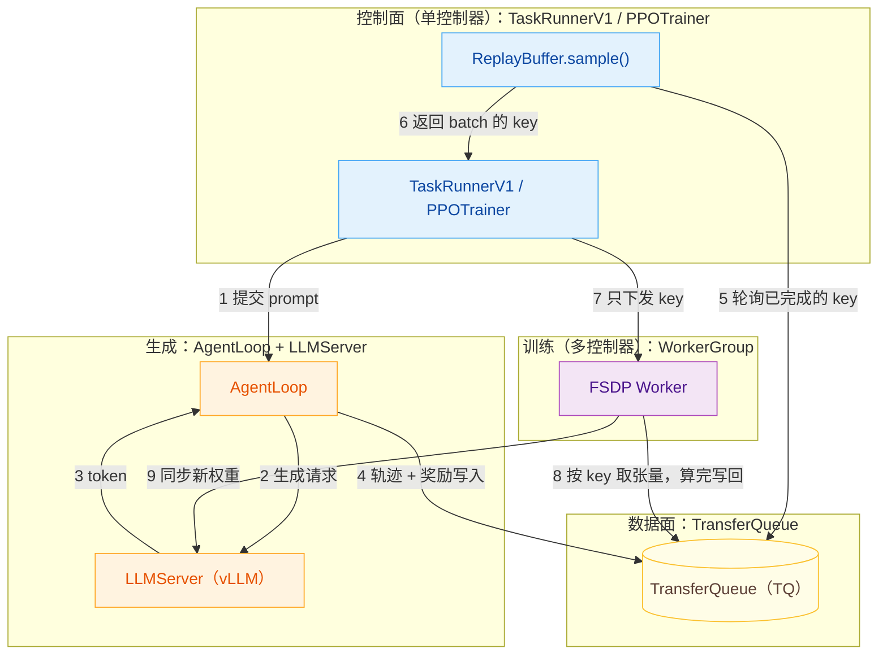
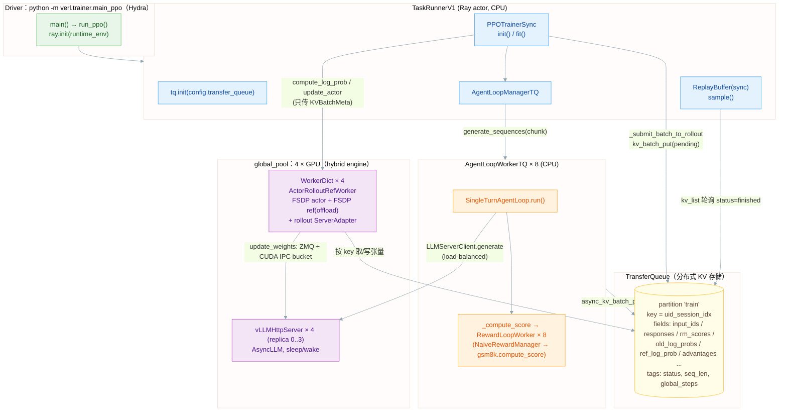
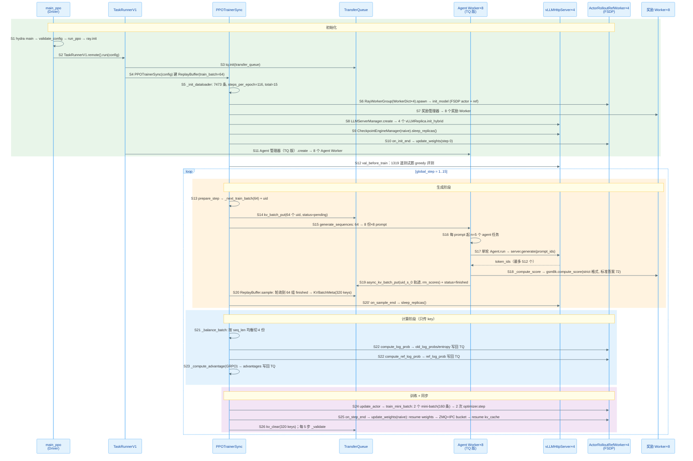

> 代码版本：`verl@8e48d72d`（2026-10-29，`verl/version/version` = 0.10.0.dev0），路径 `/data/home/xli49/lxy/verl`
> 运行环境：4 × H100 NVL 94GB；`uv sync --extra fsdp --extra vllm` ⇒ `torch 2.13.0+cu130`、`vllm 0.32.0`、`flash-attn 2.8.3`、`ray`、`TransferQueue 0.1.11`
> 本文的 “数值” 全部来自本机跑通的例 1（GRPO）配置；代码行号对应上述 commit。

---

## Overview

verl（Volcano Engine RL）是字节 Seed 开源的 **HybridFlow** 框架（<u>用于训练大语言模型的分布式强化学习框架：一边生成回答、一边获得奖励、一边通过强化学习更新模型参数的训练系统</u>）：**单控制器（TaskRunner/PPOTrainer）+ 多控制器 WorkerGroup（FSDP/Megatron SPMD）**。
当前主线已经是 **V1 Trainer**：

* 数据面换成了 **TransferQueue（TQ）**——控制器只传 `KVBatchMeta`（key 列表），Worker 自己从 TQ 取张量、算完写回 TQ；
* rollout 换成了 **AgentLoop + LLMServer（vLLM/SGLang HTTP server）**——生成是 “fire-and-forget” 的异步任务，生成完的轨迹直接写进 TQ；
* 训练循环由 **ReplayBuffer.sample()** 驱动：从 TQ 里挑出已完成的 prompt 组成一个 batch。
* 同一套代码通过 `trainer.v1.trainer_mode = sync | colocate_async | separate_async` 支持同步、共置异步、分离异步三种模式（三种模式本机都跑了，同脚本同超参的对照见 4.4 / 4.5）。三种 `trainer_mode` 共用下面这套结构，区别只在生成和训练怎么交错：

```
sync：生成一批 → 推理引擎让出显存 → 训练 → 同步权重，严格交替。

colocate_async：仍然共卡，但多预取一批 prompt，没写完的请求先中断、下一步续写。

separate_async：推理单独占卡，生成和训练同时进行，权重经 NCCL 等 checkpoint engine 同步。
```



**每一步带入数值**（以例 1 GRPO 第 1 步为例：64 个 prompt × n=5、4 张卡、4 个 vLLM、8 个 AgentLoopWorkerTQ）：

1. **提交 prompt**：`PPOTrainer.prepare_step` 从 dataloader 取 64 个 prompt，每个分配一个 uid，先在 TQ 里登记为 `pending`（64 个 uid）；再调用 `AgentLoopManagerTQ.generate_sequences`，把 64 个 prompt 平分给 8 个 AgentLoopWorkerTQ（`AgentLoopWorkerTQ` <u>是独立的 Ray Actor 进程，负责并发调用 vLLM 生成回答、计算奖励，并将结果写入 TransferQueue</u>），每个 8 个。这个调用只是创建异步任务，几乎立即返回。
2. **生成请求**：每个 prompt 起 n=5 个 `_run_agent_loop` 任务（<u>5 个 asyncio 异步任务（Task），同一个 prompt 并发生成 5 条回答，每条回答由一个独立的异步任务负责</u>），共 64 × 5 = 320 条。`SingleTurnAgentLoop` （<u>给它一个 Prompt，它调用一次 vLLM/SGLang 生成回答，然后整理生成的 Token，返回一条可用于强化学习训练的轨迹。</u>）把 prompt 转成 token id（Natalia 那题 83 个 token），发给 4 个 vLLMHttpServer 之一；采样参数 temperature=1.0、最多 512 个 token。
3. **token**：vLLM 返回生成的 token id 和 logprob。例如一条回答 236 个 token，第 1 步平均 311 个 token，6%–15% 写满 512 被截断。
4. **轨迹 + 奖励写入**：AgentLoopWorkerTQ （`AgentLoopManagerTQ` <u>负责创建和管理多个</u> `AgentLoopWorkerTQ`<u>，并将 Prompt 分发给它们执行</u>）先让 RewardLoopWorker （`RewardLoopWorker` <u>是 verl 中负责**奖励计算（Reward Computation）**的 Worker，根据模型生成的回答和标准答案计算奖励分数（Reward Score）</u>）打分：`gsm8k.compute_score` （<u>GSM8K（Grade School Math 8K</u>））严格匹配 `#### 72` （<u>在 GSM8K 中，标准答案通常使用</u> `####` <u>标记最终数值答案</u>）这种格式，答对得 1.0，否则 0。第 1 步 320 条里只有 3 条得分（平均 0.009）。随后把 prompt、response、rm_scores、rollout_log_probs 写进 TQ，key 形如 `<uid>_<i>_0`（i = 0..4），状态改为 `finished`。（<u>TQ 按照 Key-Value（键值对）格式存储数据，每条生成轨迹对应一个唯一 Key，Value 包含 Prompt、Response、Reward 和 Log Probability 等 Tensor</u>）
5. **轮询已完成的 key**：`ReplayBuffer.sample` （<u>从 TransferQueue（TQ）中筛选已经生成完成的 Prompt 组，凑成一个训练 Batch，并返回数据的 Key 列表，而不是直接搬运 Tensor</u>）每 2 s（`poll_interval=2.0`）查一次 TQ，直到 64 个 prompt 的 5 条回答都是 `finished`。生成本身不到 2 s，所以第一次查时还没写完、第二次查时已全部完成，日志里每步的 `gen` 几乎恒为 2.11 s。
6. **返回 batch 的 key**：返回 `KVBatchMeta(partition_id="train", keys=320 个, tags=[{prompt_len: 83, response_len: 236, seq_len: 319, ...}, ...])`，只有元数据、没有张量。随后 `on_sample_end` 让 4 个 vLLM sleep，把显存让给 FSDP 训练。
7. **只下发 key**：`_balance_batch` 按 `seq_len` 把 320 个 key 均衡分成 4 份（每卡 80 条），然后控制器依次调用 Worker 的 `compute_log_prob`、`compute_ref_log_prob`、`update_actor`，传过去的都只是 key。
   * **FSDP Worker** ：图里的 FSDP Worker 就是 `ActorRolloutRefWorker`（`verl/workers/engine_workers.py:485`）。4 张卡上各有 1 个，都是 Ray actor 进程，合起来叫 `actor_rollout_wg`（WorkerGroup，在 `trainer_base.py:329` 创建）。每个进程外面套着一层 `WorkerDict`（把同一组卡上的所有角色装进一个进程的外壳，例 1 里只装了这一个角色），日志里看到的就是这个名字。
   * **注意两个 "actor" 不是一回事**：Ray actor 指一个进程（见[框架对比](/posts/llm-rl-frameworks-comparison/#06-ray-actor) 0.6 节）；PPO 的 actor 指正在训练的策略模型。`ActorRolloutRefWorker` 是一个 Ray actor 进程，它里面的 `self.actor` 才是 PPO 的 actor。每个 Worker 进程里一层套一层：
     ```
     ActorRolloutRefWorker（Ray actor 进程，1 张 GPU）      ← 图里的 "FSDP Worker"
     ├── self.actor  : TrainingWorker              ← PPO 的 actor，要训练的 Qwen2.5-0.5B-Instruct
     │   └── self.engine : FSDPEngine（transformer_impl.py:106）
     │       ├── module    : 用 FSDP 包住的 HF 模型，每卡存 1/4 参数
     │       └── optimizer : AdamW，每卡存 1/4 梯度和 Adam 状态
     ├── self.ref    : TrainingWorker                      ← 参考模型，冻结，只做前向
     │   └── self.engine : FSDPEngine（只有 1/4 参数，没有梯度和优化器；param_offload=True，平时在 CPU）
     └── self.rollout: ServerAdapter                       ← 同卡 vLLM 的客户端，负责 sleep/wake 和发权重
     ```

     `TrainingWorker` 和 `FSDPEngine` 都只是这个进程里的普通 Python 对象，不是单独的进程。4 个 Worker 进程里各有一份同样的结构，4 个 `FSDPEngine` 通过 NCCL 组成一个 FSDP 组，合起来才是完整的模型。
   * 控制器调用 `actor_rollout_wg.compute_log_prob(batch)`，WorkerGroup 会把这次调用发给 4 个 Worker，每个 Worker 拿到属于自己的 80 个 key。这就是"多控制器"：4 个进程各算各的，靠 NCCL 同步梯度。
   * 3 个方法都很短：`compute_log_prob` → `self.actor.infer_batch`，`compute_ref_log_prob` → `self.ref.infer_batch`，`update_actor` → `self.actor.train_mini_batch`（`engine_workers.py:749-768`）。
8. **按 key 取张量，算完写回**：每个 `ActorRolloutRefWorker` 从 TQ 取自己那 80 条的张量。取数和写回不在这 3 个方法里：`@register` 会给它们自动套上 `tqbridge`（`decorator.py:425`、`transferqueue_utils.py:347`）。调用前，`tqbridge` 按 key 把张量从 TQ 读成 `TensorDict`；调用后，再把输出写回 TQ，返回给控制器的仍然只是 `KVBatchMeta`。
   * old_log_prob：每卡 80 条按 micro 16 分 5 次 forward，写回 `old_log_probs`、`entropy`（约 0.57 s）。ref_log_prob 同理写回 `ref_log_prob`（约 0.47 s）。
   * advantage：控制器从 TQ 读回 `uid` 和 `rm_scores`，做 GRPO 组内归一化后写回 `advantages`。例如一组 5 条得分 `[1,1,0,1,0]` → 答对 +0.730、答错 −1.095；全对或全错的组优势为 0。
   * update_actor：每 32 个 prompt（160 条）做一次更新，一步 2 次 optimizer.step；每卡每次 40 条，按 micro 8 分 5 次梯度累积（约 2.0 s）。第 1 步 `pg_loss=0.00112`、`kl_loss=0.00028`、`grad_norm=0.254`。
9. **同步新权重**：`on_step_end` → 4 个 `ActorRolloutRefWorker.update_weights(naive)`（`engine_workers.py:785`）：先只唤醒 vLLM 的权重显存，FSDP 把参数逐个转成 HF 格式，按 2 GB 打包，通过 CUDA IPC 交给同卡的 vLLM 加载（纯传输约 0.14 s，含唤醒与同步共约 0.42 s）；再恢复 KV cache。最后 `tq.kv_clear` 清掉这一步的 320 个 key，进入下一步，回到第 1 步。

整步约 5.7 s：生成约 2.1 s、old/ref log_prob 约 1.0 s、update_actor 约 2.0 s、同步权重约 0.4 s。15 步后验证集准确率从 0.08% 升到 37.2%。

### 六个自问

见[框架对比](/posts/llm-rl-frameworks-comparison/#07-六个自问看懂任意框架的架构) 0.7 节，以例 1 为例：

1. **谁指挥？**

   整个训练由一个控制器指挥：`TaskRunnerV1` 这个 Ray actor 进程（只用 CPU）里的 `PPOTrainerSync` 对象。它不碰任何张量，只负责按顺序下命令：
   * 提交 prompt
   * 等数据凑齐
   * 让 Worker 计算
   * 同步权重

     三种 `trainer_mode` 共用同一个主循环 `fit()`，区别只在几个钩子里，例如同步模式在 `on_step_end` 里同步权重。例 1 共跑 15 步，每 5 步验证一次。
   * 启动：`main`（`trainer/main_ppo.py:171`）→ `run_ppo`（`:35`）→ `TaskRunnerV1.run`（`:137`）。`run` 依次调用：
     * `PPOTrainer.init`（`trainer/ppo/v1/trainer_base.py:215`）：建好 Worker、vLLM、权重同步器和打分 Worker。
     * `TaskRunnerV1.init_agent_loop_manager`（`main_ppo.py:115`）
     * `PPOTrainer.fit`（`trainer_base.py:413`）
   * 每一步：`PPOTrainer.step`（`:534`）→ `PPOTrainer._step_once`（`:563`）。
   * 同步模式的差异：`PPOTrainerSync`（`trainer/ppo/v1/trainer_sync.py:25`）只重写了 `on_init_end`（`:31`）、`on_step_end`（`:35`）、`on_sample_end`（`:40`）三个钩子。
2. **数据存在哪？**

   所有张量都存在 **TransferQueue（TQ）** 里，这是 verl 独有的"数据面"。
   * TQ 是一个按 key 存取的分布式存储，每条回答一个 key，形如 `<uid>_<i>_0`。每步有 64 × 5 = 320 个 key，值包括 prompt、response、奖励、logprob、优势等张量。
   * 控制器手里只有 `KVBatchMeta`，也就是 key 列表加上 seq_len 之类的小标签。下发给 Worker 的也只是 key，Worker 自己去 TQ 取张量、算完写回。
   * 这样控制器不会成为搬运大张量的瓶颈。
   * 每个 prompt 还有一个状态，按 `pending` → `running` → `finished` 变化，ReplayBuffer 就是看这个状态判断数据有没有写完。

     代码位置：
   * 初始化：`tq.init`（`main_ppo.py:153`）。
   * 登记 prompt：`PPOTrainer._submit_batch_to_rollout`（`trainer_base.py:1497`）用 `tq.kv_batch_put` 登记 64 个 uid，状态为 `pending`。
   * 写入轨迹：`AgentLoopWorkerTQ._agent_loop_postprocess`（`trainer/ppo/v1/agent_loop_tq.py:155`）调用 `tq.async_kv_batch_put`（`:227`）。
   * Worker 读写：Worker 方法外层的 `tqbridge`（`utils/transferqueue_utils.py:347`）按 key 读张量、写结果。
   * 清理：每步末尾 `PPOTrainer.fit` 调用 `tq.kv_clear`（`trainer_base.py:512`），清掉这 320 个 key。
3. **数据从哪来？**

   数据由 AgentLoop 调用 vLLM 生成，生成后立即打分并写入 TQ。
   * 控制器提交 64 个 prompt 后**不等结果**（fire-and-forget），马上返回。
   * `AgentLoopManagerTQ` 把它们平分给 8 个 `AgentLoopWorkerTQ`（Ray actor，只用 CPU），每个 Worker 8 个 prompt。
   * Worker 为每个 prompt 起 5 个协程，同时生成 5 条回答，所以每个 Worker 有 40 个协程。
   * 每个协程把 prompt 转成 token，经负载均衡发给 4 个 vLLM 中当前请求最少的一个，采样 temperature=1.0，最多生成 512 个 token。
   * 生成完由 `RewardLoopWorker` 按 GSM8K 严格格式打分，答对得 1，答错得 0。第 1 步 320 条里只有 3 条得分。
   * 打完分写入 TQ，并把这个 prompt 的状态标为 `finished`。

     调用链：
   * 派发：`PPOTrainer.prepare_step`（`trainer_base.py:1526`）→ `_add_batch_to_generate`（`:1521`）→ `_submit_batch_to_rollout`（`:1497`）→ `AgentLoopManagerTQ.generate_sequences`（`agent_loop_tq.py:248`，`chunk(8)`）。
   * 生成：`AgentLoopWorkerTQ.generate_sequences`（`:61`）→ `_run_prompt`（`:112`，状态改为 `running`）→ 5 个 `AgentLoopWorker._run_agent_loop`（`experimental/agent_loop/agent_loop.py:692`）→ `SingleTurnAgentLoop.run`（`experimental/agent_loop/single_turn_agent_loop.py:38`）→ `LLMServerClient.generate`（`workers/rollout/llm_server.py:99`）。
   * 打分：`AgentLoopWorker._compute_score`（`agent_loop.py:998`）→ `RewardLoopWorker.compute_score`（`experimental/reward_loop/reward_loop.py:145`）→ `gsm8k.compute_score`。
   * 写回：`_agent_loop_postprocess` 写入 TQ，`_run_prompt` 把状态改为 `finished`（`agent_loop_tq.py:148`）。
4. **训练怎么拿到数据？**

   因为生成是异步提交的，控制器不知道数据什么时候写完，所以由 `ReplayBuffer` **定时查询** TQ。
   * 每 2 s 读一次所有 key 的状态，直到凑齐 64 个"5 条回答都已 finished"的 prompt，然后把这 320 个 key 交给控制器。
   * 例 1 的生成不到 2 s 就结束了：第 1 次查询时还没写完，第 2 次查询时已经齐了，所以每步的 `gen` 几乎恒为 2.11 s。
   * 拿到数据后，同步模式会让 vLLM sleep，把显存让给接下来的训练。

     代码位置：
   * 入口：`PPOTrainer._step_once` 调用 `ReplayBuffer.sample`（`trainer/ppo/v1/replay_buffer.py:422`）。
   * 循环查询：
     * `_sync_metadata_from_transfer_queue`（`:201`，用 `tq.kv_list` 读回状态）
     * `_sampleable_terminal_keys`（`:336`）找出已完成的组
     * 不够就 `_wait_for_next_poll`（`:408`，`sleep(2.0)`）后再查
   * 凑齐后：`_select_prompt_uids`（`:383`）→ `_materialize_batch`（`:394`），返回 `KVBatchMeta`。
   * 让出显存：`PPOTrainerSync.on_sample_end` → `CheckpointEngineManager.sleep_replicas`（`checkpoint_engine/base.py:467`）。
5. **谁来算？**

   GPU 上的计算全部由 4 个 `ActorRolloutRefWorker`（每卡 1 个 Ray actor）完成，模型用 FSDP 切成 4 份，每卡存 1/4。每个 Worker 里装着三样东西：
   * `self.actor`：类型是 `TrainingWorker`，即要训练的策略模型。
   * `self.ref`：也是 `TrainingWorker`，即冻结的参考模型，只做前向。
   * `self.rollout`：类型是 `ServerAdapter`，是同卡 vLLM 的客户端，不是 vLLM 本身。

     控制器先按序列长度把 320 条均衡分成每卡 80 条，然后依次下发 4 个任务：
   * 用当前策略模型算 old logprob（约 0.57 s），作为 PPO ratio 的分母。
   * 用冻结的参考模型算 ref logprob（约 0.47 s），用于 KL loss。
   * 由控制器自己算 GRPO 优势：同一个 prompt 的 5 条回答做组内归一化，例如得分 `[1,1,0,1,0]` 得到答对 +0.730、答错 −1.095。这一步计算量很小，所以不交给 Worker。
   * 更新策略模型：320 条分成 2 个 mini-batch，做 2 次 `optimizer.step`（约 2.0 s）。

     调用链：
   * 分配：`_balance_batch`（`trainer_base.py:1609`）。
   * old logprob：`_compute_old_log_prob`（`:1635`）→ `ActorRolloutRefWorker.compute_log_prob`（`workers/engine_workers.py:756`）→ `TrainingWorker.infer_batch`（`:431`）。
   * ref logprob：`_compute_ref_log_prob`（`:1696`）→ `ActorRolloutRefWorker.compute_ref_log_prob`（`:749`）→ `self.ref.infer_batch`。
   * 优势：`_compute_advantage`（`:1744`）→ `compute_grpo_outcome_advantage`（`trainer/ppo/core_algos.py:268`）。
   * 更新：`_update_actor`（`:1828`）→ `ActorRolloutRefWorker.update_actor`（`engine_workers.py:766`）→ `TrainingWorker.train_mini_batch`（`:276`）。
6. **权重怎么回去？**

   训练完成后，vLLM 里还是旧权重，要把新权重同步过去，下一步才能用新策略生成。例 1 里训练和 vLLM 在同一张卡上，所以走 **CUDA IPC**，不用拷贝：
   * 先唤醒 vLLM 的权重显存。
   * FSDP 把 4 份分片拼成完整的 HF 格式参数，拷进一块 2 GB 的显存"桶"。
   * vLLM 进程用 IPC 句柄直接读取这块显存，并装进自己的模型。
   * 最后恢复 KV cache。

     纯传输约 0.14 s，含唤醒共约 0.42 s。分卡的 `separate_async` 模式下，改用 NCCL 等 checkpoint engine 传权重。

     调用链：
   * 入口：`PPOTrainerSync.on_step_end` → `CheckpointEngineManager.update_weights`（`checkpoint_engine/base.py:510`，backend 为 `naive`）→ `ActorRolloutRefWorker.update_weights`（`engine_workers.py:785`）。
   * 发送方：`ServerAdapter.update_weights`（`workers/rollout/vllm_rollout/vllm_rollout.py:210`）→ `BucketedWeightSender.async_send_weights`（`bucketed_weight_transfer.py:102`）。
   * 接收方：`vLLMColocateWorkerExtension.update_weights_from_ipc`（`vllm_rollout/utils.py:150`）→ `BucketedWeightReceiver.receive_weights`（`bucketed_weight_transfer.py:269`）→ 模型的 `load_weights`。

### Questions

* **n=5 个** `_run_agent_loop` **是什么？** 同一个 prompt 并发生成 5 条回答，每条是一个协程，共 320 个。
* **Manager 和 Worker 什么关系？** 1 个 Manager 负责切分派发；8 个 Worker（Ray actor）负责执行。
* **ReplayBuffer 为什么轮询？** 生成提交后不等结果，TQ 也不会通知，只能定时查询。代价是 `gen` 被抬到约 2.11 s。
* `**PPOTrainerSync.train()` 是什么？** 没有 `train()`。入口是继承来的 `fit()`；`PPOTrainerSync` 只重写了 3 个钩子。
* **vLLM 返回 token 和 logprob 有什么用？** token 用来打分和训练；logprob 在例 1 里只用于监控训推差异。
* `ReplayBuffer.sample()` **在哪？** `replay_buffer.py:422`，是控制器进程里的普通对象。
* **FSDP Worker 和 actor 什么关系？** FSDP Worker 是 Ray actor 进程 `ActorRolloutRefWorker`，里面的 `self.actor` 才是 PPO 策略模型。
* **"三种 trainer_mode 共用同一个主循环** `fit()`**"，主循环是什么？** 就是 `PPOTrainer.fit`（`trainer_base.py:413`）里的 `while` 循环，每转一圈是一个训练步（例 1 共 15 圈）。`PPOTrainerSync`、`PPOTrainerColocateAsync`、`PPOTrainerSeparateAsync` 都没有重写 `fit`，用的是同一份代码：
  ```python
  def fit(self, agent_loop_manager):                  # trainer_base.py:413
      self._validate()                                # 训练前先验证一次
      self.on_train_begin()                           # 钩子
      while self.global_steps <= self.total_training_steps:      # 主循环，1..15
          self.on_step_begin()                        # 钩子
          batch = self.step(...)                      # prepare_step 提交 prompt → _step_once
          self._save_checkpoint()                     # 按 save_freq
          self.on_step_end()                          # 钩子
          self._validate()                            # 按 test_freq
          tq.kv_clear(batch.keys)
          self.logger.log(metrics)
          self.global_steps += 1

  def step(self, metrics, timing_raw):
      sample_batch_size = train_batch_size // self.parameter_sync_step   # sync：64 // 1 = 64
      self.prepare_step()                                                # 提交 64 个 prompt 去生成，不等结果
      for trigger_idx in range(self.parameter_sync_step):                # sync：只循环 1 次
          batch = self._step_once(iter_metrics, timing_raw, sample_batch_size)   # ← 在这里
          combined_keys.extend(batch.keys)
      return KVBatchMeta(keys=combined_keys, ...)                        # 320 个 key

  def _step_once(self):                               # :563
      self.on_sample_begin()                          # 钩子
      batch = self.replay_buffer.sample(...)
      self.on_sample_end()                            # 钩子
      # _balance_batch → old_log_prob → ref_log_prob → advantage → update_actor
  ```
* **"区别只在几个钩子里"，钩子是什么意思？** 主循环 `fit()` 的流程是固定的，但它在几个固定的时间点调用 `self.on_xxx()`，例如"取完数据后"调用 `on_sample_end`，"一步结束时"调用 `on_step_end`。这些方法在基类里是空的，子类重写哪个，那个时间点就执行子类写的代码。这些预留的方法就叫钩子。最小例子：
  ```python
  class PPOTrainer:                      # 基类：流程写死
      def fit(self):
          for step in range(15):
              batch = self.replay_buffer.sample()
              self.on_sample_end()       # 时间点 A：取完数据
              self.train(batch)
              self.on_step_end()         # 时间点 B：一步结束
      def on_sample_end(self): return    # 默认什么都不做
      def on_step_end(self): return

  class PPOTrainerSync(PPOTrainer):      # 子类：只填时间点要做的事
      def on_sample_end(self): vllm.sleep()        # A：让 vLLM 让出显存
      def on_step_end(self): update_weights()      # B：把新权重发给 vLLM

  PPOTrainerSync().fit()   # fit 是基类的，但 self.on_step_end() 会调用到子类的版本
  ```

  三种模式就是三个子类，在同样的时间点做不同的事：
  * 时间点"训练开始前"（`on_train_begin`）：
    * sync 什么都不做。
    * 两种 async 都多提交 1 个 batch，让训练时手里总有现成的数据。
  * 时间点 A"取完数据后"（`on_sample_end`）：
    * sync 让 vLLM sleep。
    * colocate_async 先打断还没写完的请求，再让 vLLM sleep。
  * 时间点 B"一步结束时"（`on_step_end`）：
    * sync 同步权重。
    * colocate_async 同步权重后，让刚才被打断的请求接着写。
    * separate_async 用 NCCL 把权重发到另外 2 张推理卡。
* **为什么这么多钩子？** 每个钩子对应一个时间点，三种模式需要介入的时间点不一样。基类一共定义了 9 个钩子（`trainer_base.py:617-690`），默认都是空的：
  | 钩子 | 时间点 | sync | colocate_async | separate_async |
  |---|---|---|---|---|
  | `on_init_end` | 初始化完成后 | ✅ 先同步一次权重 | ✅ 同左 | ✅ 同左 |
  | `on_train_begin` | 进入主循环前 | — | ✅ 预取 1 个 batch | ✅ 预取 1 个 batch |
  | `on_step_begin` | 每步开始 | — | — | ✅ 把借出去的卡收回来训练 |
  | `on_sample_begin` | 取数据前 | — | — | ✅ 开始计时 |
  | `on_sample_end` | 取完数据后 | ✅ vLLM sleep | ✅ abort + sleep | ✅ 记录等了多久 |
  | `on_step_end` | 每步结束 | ✅ 同步权重 | ✅ 同步权重 + 恢复请求 | ✅ abort + NCCL 广播 + 恢复 + 调整借卡策略 |
  | `on_validate_begin` | 验证前 | — | — | ✅ 把卡切到推理用途做验证 |
  | `on_validate_end` | 验证后 | — | — | — |
  | `on_train_end` | 训练结束 | — | — | — |
  * sync 只用了 3 个钩子，colocate_async 用了 4 个，它们只需要在"取完数据"和"一步结束"两个时间点处理 vLLM 的显存和权重。
  * separate_async 用了 7 个，多出来的几乎都是为了"借卡"（`hybrid_rollout.enable_switch`）：
    * 训练卡在等数据时先借给推理用。
    * `on_step_begin` 把卡收回来训练。
    * `on_sample_begin` / `on_sample_end` 统计等了多久。
    * `on_step_end` 根据等待时间调整下一次什么时候还卡。
  * 暂时没有模式用到的钩子（如 `on_train_end`）也保留着，方便以后加新模式或自定义 trainer，不需要改主循环。不重写时，调用它就是一次空函数调用，没有成本。
* **GSM8K 在 verl 里是怎么用的？** GSM8K 是 OpenAI 发布的小学数学应用题数据集，训练集 7473 题，测试集 1319 题。每道题的标准解答最后一行写成 `#### 72` 这样的格式，后面是最终答案。例 1 用它训练和验证，整个流程分 3 步：
  * **预处理**：`examples/data_preprocess/gsm8k.py` 把数据集转成 parquet 文件，每条做 3 件事：
    * 在题目后面追加一句 `Let's think step by step and output the final answer after "####".`（`:57`），要求模型也用 `####` 给出答案。
    * 从标准解答里抽出最终数字，作为 `reward_model.ground_truth`，例如 `"72"`。
    * 把 `data_source` 设为 `openai/gsm8k`（`:47`），后面按它选打分函数。
  * **选打分函数**：`RewardLoopWorker` 调用 `default_compute_score`（`verl/utils/reward_score/__init__.py:19`），看到 `data_source == "openai/gsm8k"`（`:44`）后，转给 `gsm8k.compute_score`（`gsm8k.py:52`）。
  * **打分**：`extract_solution`（`gsm8k.py:20`）只看回答的最后 300 个字符，用正则 `#### (-?[0-9.,]+)` 找最后一个匹配，去掉逗号后和标准答案比较。完全相同得 1 分，否则得 0 分；格式不对（找不到 `####`）也是 0 分。
  * **为什么一开始几乎是 0 分**：Qwen2.5-0.5B-Instruct 很少按 `#### 72` 的格式写答案，即使算对了，正则也找不到答案。所以训练前验证集准确率只有 0.08%（1/1319），第 1 步 320 条回答里只有 3 条得分。RL 先学会的其实是"按格式写答案"，15 步后验证集准确率升到 37.2%。
* **AgentLoop 是怎么调用 vLLM 生成的？** 走的是 **Ray 远程调用**，不是 HTTP。AgentLoop 把 token id 直接交给 vLLM 进程里的 `AsyncLLM` 引擎，拿回 token id 和 logprob。以 Natalia 那道题为例，一条回答经过 5 层：
  1. **拼 prompt**：`SingleTurnAgentLoop.run`（`experimental/agent_loop/single_turn_agent_loop.py:38`）调用 `ct_build_initial_tokens`，套上 chat template 并分词，得到 83 个 token 的 `prompt_ids`。然后调用 `self.server_manager.generate(...)`。
  2. **选一个 vLLM**：`server_manager` 是 `LLMServerClient`（`workers/rollout/llm_server.py:43`）。它的 `generate`（`:99`）先问全局负载均衡器 `GlobalRequestLoadBalancer.acquire_server`（`workers/rollout/router.py:170`，本身也是一个 Ray actor），从 4 个 vLLM 里选当前在途请求最少的那个。同一个 `request_id` 的多轮请求会固定发到同一个 vLLM，以便复用前缀缓存。
  3. **远程调用**：`await server.generate.remote(prompt_ids=..., sampling_params=...)`。`server` 是 `vLLMHttpServer`（`workers/rollout/vllm_rollout/vllm_async_server.py:103`）这个 Ray actor 的句柄。它虽然叫 HttpServer，也确实另外起了一个 OpenAI 兼容的 HTTP 服务，但 AgentLoop 走的是 Ray RPC，直接传 token id。
  4. **交给 vLLM 引擎**：`vLLMHttpServer.generate`（`:590`）做三件事：
     * 把采样参数组装成 vLLM 的 `SamplingParams`（temperature=1.0，max_tokens=512，logprobs=True）。
     * 把 prompt 包装成 `TokensPrompt(prompt_token_ids=...)`。
     * 调用 `self.engine.add_request`（`:1282`，`engine` 是 vLLM 的 `AsyncLLM`），然后等这个请求生成完。vLLM 内部用 continuous batching，把同时在途的几十条请求合在一起算。
  5. **返回**：从 vLLM 的 `RequestOutput` 里取出 token id 和每个 token 的 logprob，包装成 `TokenOutput` 返回。`LLMServerClient` 通知负载均衡器"这个 vLLM 少了一个在途请求"（`_release_server`）。`SingleTurnAgentLoop` 把回答截到 512 个 token 以内，组装成 `AgentLoopOutput`。
  * **为什么传 token id 而不是文本**：生成和训练使用完全相同的 token 序列，避免"文本 → 重新分词"切出不同的 token，导致训练的 logprob 和生成时对不上。
* **TQ 里的 prompt、response、奖励、logprob、优势这些张量是谁写的？怎么写的？** 一共有 3 个写入方（控制器、`AgentLoopWorkerTQ`、`tqbridge`），按时间顺序依次往同一个 key 上补字段。写入都用 `kv_batch_put(keys, fields, tags)`：同一个 key 再次写入时，只新增或覆盖这次给出的字段，已有的字段保留。以第 1 步的一个 key `<uid>_2_0` 为例：
  1. **控制器登记**：控制器 `self.trainer` 在 `_submit_batch_to_rollout`（`trainer_base.py:1497`）里只登记每个 prompt 的 uid 和 tag `{"status": "pending"}`，不写张量（sync 模式）。相当于先在仓库里开好空格子。
  2. **AgentLoopWorkerTQ 写生成结果**：每条回答生成完后，`_agent_loop_postprocess`（`agent_loop_tq.py:155`）把它整理成张量，再用 `tq.async_kv_batch_put`（`:227`）写入。写入的字段有 `prompts`（83 个 token）、`responses`（236 个）、`input_ids`（319 个）、`attention_mask`、`position_ids`、`response_mask` / `loss_mask`（236 个 1）、`rollout_log_probs`（236 个 float），以及 `rm_scores`（236 位，除最后一位是 1.0 外都是 0）。同时打上 tag `prompt_len=83, response_len=236, seq_len=319`。
  3. **tqbridge 写 logprob**：控制器调用 `compute_log_prob` 后，`ActorRolloutRefWorker` 外层的 `tqbridge` 在 `_async_update_meta_with_output`（`utils/transferqueue_utils.py:184`）里把返回的 `log_probs`、`entropy` 写回 TQ。这两个字段按整条序列（319 位）存放，只是临时字段。
  4. **控制器写 old_log_probs**：`_compute_old_log_prob`（`trainer_base.py:1635`）读回第 3 步的 `log_probs`，只截取 response 那 236 位，写成 `old_log_probs` 和 `entropy`。
  5. **tqbridge 再写一次，控制器写 ref_log_prob**：`_compute_ref_log_prob`（`:1696`）让 ref 模型做前向。结果先由 `tqbridge` 写成 `log_probs`，覆盖第 3 步的值；控制器再截取 response 部分，写成 `ref_log_prob`。
  6. **控制器写优势**：`_compute_advantage`（`:1744`）读回 `uid`、`response_mask`、`rm_scores`、`old_log_probs`、`ref_log_prob`，算出 GRPO 优势后写回 `advantages` 和 `returns`。同一条回答的 236 位数值相同，例如都是 +0.730。
* **"控制器手里只有** `KVBatchMeta`**"指的是什么？** `KVBatchMeta` 是 TransferQueue 定义的一个 dataclass（`transfer_queue/metadata.py:880`），相当于一张"取货单"：上面只写了要处理哪些 key、每个 key 的几个小标签，没有任何张量。`ReplayBuffer.sample` 返回给控制器的就是它，控制器调用 Worker 时（例如 `actor_rollout_wg.compute_log_prob(batch)`）传过去的也是它。真正的张量（每步约 320 × 319 个 token，以及各种 logprob）始终放在 TQ 里，由 Worker 的 `tqbridge` 按 key 自己去取。这样控制器进程不需要搬运大张量，也就不会成为瓶颈。它有 5 个字段：
  * `keys`：key 列表，例 1 每步 320 个。
  * `tags`：每个 key 一个小字典，和 `keys` 一一对应。
  * `partition_id`：`"train"` 或 `"val"`，区分训练数据和验证数据。
  * `fields`：可选，要读哪些字段。
  * `extra_info`：整批共用的参数，由控制器在调用 Worker 前填入，例如 `temperature=1.0`、mini-batch 大小等。
* **"key 列表加上 seq_len 之类的小标签"长什么样子？** 第 1 步 `ReplayBuffer._materialize_batch`（`replay_buffer.py:394`）返回的对象大致如下（uid 是 `uuid4` 随机生成的，其余数值取自 Natalia 那题）：
  ```python
  KVBatchMeta(
      partition_id="train",
      keys=[
          "3f2a8c1e-7b4d-4e0a-9c55-1d2e3f4a5b6c_0_0",   # {uid}_{第几条回答}_{第几段输出}
          "3f2a8c1e-7b4d-4e0a-9c55-1d2e3f4a5b6c_1_0",
          ...                                            # 同一题的 5 条：_0_0 … _4_0
          "a91d0f72-..._4_0",                            # 共 64 题 × 5 = 320 个
      ],
      tags=[
          {"status": "success", "prompt_len": 83, "response_len": 236, "seq_len": 319,
           "global_steps": 1, "min_global_steps": 0, "max_global_steps": 0},
          {"status": "success", "prompt_len": 83, "response_len": 512, "seq_len": 595, ...},   # 这条写满 512，被截断
          ...                                            # 320 个，和 keys 一一对应
      ],
      extra_info={},                                     # 之后由控制器填入 temperature 等参数
  )
  ```
  * 这些 tag 由 `AgentLoopWorkerTQ._agent_loop_postprocess`（`agent_loop_tq.py:155`）在写入轨迹时一并写进去。
  * `seq_len`：`_balance_batch`（`trainer_base.py:1609`）按它把 320 条分给 4 张卡，让每张卡的总 token 数接近。
  * `global_steps`：这道题是第几步提交的。
  * `min_global_steps` / `max_global_steps`：生成这条回答时用的权重版本。
  * `ReplayBufferAsync` 根据后面三个算 staleness，决定哪些太旧要丢弃（sync 模式下这三个值恒为 1 / 0 / 0）。
* **文档里反复说的"控制器"是谁？** 是 `TaskRunnerV1` 这个 Ray actor 进程里的 `self.trainer`，也就是一个 `PPOTrainerSync` 对象。从启动开始一共三层：
  ```
  driver 进程：python3 -m verl.trainer.main_ppo
  └── main → run_ppo（main_ppo.py:35）：ray.init()；runner = TaskRunnerV1.remote()；ray.get(runner.run.remote(config))
      │                                 └ driver 只负责启动，然后一直阻塞，等训练结束
      ▼
  TaskRunnerV1（Ray actor 进程，main_ppo.py:107，只用 CPU，不占 GPU）
  └── self.trainer = PPOTrainerSync(config)        ← 这就是"控制器"
  ```
  * **它手里有什么**：控制器不持有模型和张量，只持有其他组件的句柄和少量状态：
    * `actor_rollout_wg`：4 个 `ActorRolloutRefWorker` 的句柄。
    * `agent_loop_manager`：1 个 `AgentLoopManagerTQ`，它手里还有 8 个 Worker 的句柄。
    * `replay_buffer`、`checkpoint_manager`（管 vLLM 的 sleep / wake 和权重同步）、`reward_loop_manager`。
    * dataloader（7473 题）、logger、`global_steps`。
  * **它做什么**：
    * 按 `fit()` 的顺序下命令：提交 prompt、取 batch、调 Worker、同步权重、验证、打日志。
    * 做几件计算量很小的事：按 `seq_len` 分配数据（`_balance_batch`）、算 GRPO 优势。
  * **它不做什么**：不跑模型，不碰 GPU，不搬大张量。手里的数据只有 `KVBatchMeta`。
  * **为什么叫"单控制器"**：整个 RL 流程（生成 → 打分 → logprob → 优势 → 更新 → 同步）写在这一个进程的一段普通 Python 代码里（`fit()`），读代码就能看清全貌。相对地，4 个 FSDP Worker 是"多控制器"：4 个进程各自运行同一份代码，每个进程处理自己的 1/4 数据，彼此靠 NCCL 同步。verl 论文（HybridFlow）把这种组合称为"单控制器 + 多控制器"的混合架构。
  * **和其他框架对比**：slime / vime 没有这样的 trainer 对象，driver 脚本 `train.py` 里的 for 循环就是控制器；prime-rl 没有统一的控制器，orchestrator 和 trainer 各自运行。
* **verl 里有几种 LoopWorker？** 有 3 种。每种都是只用 CPU 的 Ray actor，并且各配一个 Manager 负责创建和派发：
  * `AgentLoopWorker`（`experimental/agent_loop/agent_loop.py:511`），由 `AgentLoopManager`（`:1204`）管理：
    * 旧版 trainer `RayPPOTrainer`（`trainer/ppo/ray_trainer.py:960`）用的生成 Worker。
    * 它的 `generate_sequences` 会用 `asyncio.gather` 等所有回答生成完，再把整批张量（`DataProto`）返回给控制器，所以控制器手里有张量。
    * 例 1 不直接用它，但它是下面 TQ 版的父类。
  * `AgentLoopWorkerTQ`（`trainer/ppo/v1/agent_loop_tq.py:55`），由 `AgentLoopManagerTQ`（`:235`）管理：
    * V1 trainer 用的生成 Worker，继承 `AgentLoopWorker`，复用了 `_run_agent_loop`、`_compute_score` 等方法。
    * 区别是 `generate_sequences` 只创建异步任务就立即返回，结果由 `_agent_loop_postprocess` 写进 TQ，控制器手里只有 key。
    * 例 1 有 8 个（`rollout.agent.num_workers=8`），每个同时挂 40 个协程。
  * `RewardLoopWorker`（`experimental/reward_loop/reward_loop.py:93`），由 `RewardLoopManager`（`:273`，在 `trainer_base.py:348` 创建）管理：
    * 专门打分的 Worker。例 1 有 8 个（`reward.num_workers` 默认 8）。
    * 生成 Worker 的 `_compute_score`（`agent_loop.py:998`）每打一条分，就随机挑一个 RewardLoopWorker 远程调用。
    * 它内部是 `NaiveRewardManager.run_single` → `default_compute_score` → `gsm8k.compute_score`。
    * 单独放在别的进程里，是因为打分可能很慢（例如跑代码沙箱、请求奖励模型），放在生成 Worker 的事件循环里会拖慢生成。
  * 关系：`AgentLoopWorkerTQ` 是 `AgentLoopWorker` 的子类；两种生成 Worker 都调用 `RewardLoopWorker` 打分。例 1 一共起了 8 + 8 = 16 个这类 CPU 进程。`SingleTurnAgentLoop` 不是 Worker，它是每条回答新建一个的普通对象，运行在生成 Worker 进程里。
* **"随后** `on_sample_end` **让 4 个 vLLM sleep，把显存让给 FSDP 训练"是什么意思？**
  * **为什么要让**：例 1 每张卡上同时住着一个 FSDP Worker 和一个 vLLM。vLLM 启动时按 `gpu_memory_utilization=0.5` 预占约一半显存（0.5 × 93.3 GB ≈ 47 GB，按配置估算），其中权重约 1 GB，其余几乎都是 KV cache。数据取到手后，接下来约 3 s 是 FSDP 计算 logprob 和更新参数，vLLM 用不上，这 47 GB 就先还给训练。
  * **sleep 做什么**：vLLM 进程不退出，只释放显存。例 1 用 level 2：权重和 KV cache 都直接丢弃，不备份到 CPU，因为训练完反正要把新权重灌进来（`_resolve_sleep_level`，`vllm_async_server.py:1511`）。level 1 会把权重拷到 CPU，LoRA 或 MTP 场景才用。
  * **调用链**（一次调用通知到 4 个 vLLM）：
    ```
    PPOTrainer._step_once：replay_buffer.sample() 返回 320 个 key 之后
    └── self.on_sample_end()                                   # PPOTrainerSync，trainer_sync.py:40
        └── checkpoint_manager.sleep_replicas()                # checkpoint_engine/base.py:467
            └── asyncio.gather(*[r.sleep() for r in replicas]) # 4 个 vLLMReplica 并发
                └── server.sleep.remote()                      # replica.py:268 → 每个 vLLMHttpServer（Ray actor）
                    └── vLLMHttpServer.sleep                   # vllm_async_server.py:948，HYBRID 模式
                        └── _sleep_hybrid → self.engine.sleep(level=2)   # :1546，AsyncLLM 释放权重和 KV cache
    ```
  * **什么时候醒**：一步结束时，`on_step_end` → `update_weights` 里分两次唤醒（`engine_workers.py:785` 起）：
    * 先 `resume(tags=["weights"])`，只要回约 1 GB 的权重显存。
    * 用 CUDA IPC 把新权重灌进去。
    * 再 `resume(tags=["kv_cache"])`，要回 KV cache。
    * 分两次是为了避开显存峰值：灌权重时 KV cache 还没分配，不会和 FSDP 拼出来的完整参数挤在一起。
  * **其他模式**：colocate_async 在 sleep 前先 abort 还没写完的请求。separate_async 的 vLLM 单独占卡，不和训练抢显存，所以不 sleep（standalone 模式直接跳过）。
* **每种 Worker 都是进程吗？哪些是进程、哪些只是对象？** 判断方法很简单：被 `ray.remote` 包装、用 `.remote()` 创建的是 **Ray actor，每个都是一个独立进程**；其余都是寄居在某个进程里的普通 Python 对象。例 1 的进程如下：
  * **是进程**：
    * driver 进程：1 个，只负责启动，然后阻塞等待。
    * `TaskRunnerV1`：1 个，即控制器所在进程，只用 CPU。
    * `ActorRolloutRefWorker`：4 个，每卡 1 个，日志里显示为 `WorkerDict`。
    * `vLLMHttpServer`：4 个，每卡 1 个。它内部的 vLLM 还会用 multiprocessing 起子进程来运行引擎和 GPU 计算（`distributed_executor_backend="mp"`，`vllm_async_server.py:350`）。
    * `AgentLoopWorkerTQ`：8 个，只用 CPU。
    * `RewardLoopWorker`：8 个，只用 CPU。
    * `GlobalRequestLoadBalancer`：1 个，只用 CPU。
    * TransferQueue 自身的存储和控制 actor：若干个，由 `tq.init` 创建。
  * **只是对象**（不是进程）：
    * 在控制器进程里：`PPOTrainerSync`、`ReplayBuffer`，以及所有的 `XxxManager`（`AgentLoopManagerTQ`、`RewardLoopManager`、`LLMServerManager`、`CheckpointEngineManager`）和 `vLLMReplica`。Manager 只负责创建 Worker 并持有它们的句柄。
    * 在 `ActorRolloutRefWorker` 进程里：`TrainingWorker`、`FSDPEngine`、`ServerAdapter`。
    * 在 `AgentLoopWorkerTQ` 进程里：`SingleTurnAgentLoop`（每条回答一个）和 `LLMServerClient`。
  * 所以名字里带 Worker 的不一定是进程（如 `TrainingWorker`），带 Manager 的都不是进程。
* **架构图里的"生成：AgentLoop + LLMServer"是什么？** 是负责生成数据的子系统，分成两半，各管一件事：
  * **AgentLoop（CPU，决定问什么）**：
    * 包括 `AgentLoopManagerTQ` 和 8 个 `AgentLoopWorkerTQ`，以及其中的 `SingleTurnAgentLoop`。
    * 负责把 prompt 拼成 token、决定调用几轮（单轮，或多轮带工具调用）、找 RewardLoopWorker 打分、把结果写进 TQ。
    * 它不碰 GPU。
  * **LLMServer（GPU，只负责生成）**：
    * 4 个 `vLLMReplica`，每个对应一个 `vLLMHttpServer` 进程，里面是 vLLM 的 `AsyncLLM`。
    * 只做一件事：输入 token id，输出 token id 和 logprob（`generate`，`vllm_async_server.py:590`）。
    * 另外还接受 sleep / wake_up / 更新权重这类管理命令。
  * **两半怎么连**：`LLMServerClient` 加上 `GlobalRequestLoadBalancer`。
    * `PPOTrainer.init` 时，`LLMServerManager.create(worker_group=actor_rollout_wg)`（`trainer_base.py:373`）在训练 Worker 的 4 张卡上启动 4 个 vLLM（hybrid 共卡）和负载均衡器。
    * 然后 `get_client()` 拿到 `LLMServerClient`，在 `init_agent_loop_manager`（`main_ppo.py:115`）里交给 `AgentLoopManagerTQ`。
    * 之后每个 AgentLoop Worker 都通过这个 client 发请求。
  * **为什么拆成两半**：
    * 换推理引擎（vLLM ↔ SGLang）时，只换 LLMServer，AgentLoop 不用动。
    * 换交互方式（单轮 ↔ 多轮工具调用，`single_turn_agent` ↔ `tool_agent`）时，只换 AgentLoop，LLMServer 不用动。
    * 等工具返回或等打分时，只占用 CPU 上的协程，不会让 GPU 上的 vLLM 闲着排队。
* **"`_balance_batch` 按 `seq_len` 把 320 个 key 均衡分成 4 份（每卡 80 条）"是什么意思？** 生成完以后，320 条回答长短不一。训练时 4 张卡要一起做 all-gather / reduce-scatter，最慢的那张卡决定整步耗时，所以要让每张卡分到的总 token 数差不多。`_balance_batch` 不搬数据，只是把 key 的顺序重新排一遍；之后 Worker 的分发逻辑按顺序把 key 切成连续的 4 段，排好的顺序就决定了每张卡拿到哪 80 条。它在主循环里的位置是算完奖励、算 `old_log_prob` 之前（`_step_once`，`trainer_base.py:583`）。具体分 5 步（基类 `PPOTrainer._balance_batch`，`trainer_base.py:1609`，三种 trainer_mode 共用），前 5 步在这个方法里，后 2 步是效果和后续：
  1. **查 DP 大小**：从 `actor_rollout_wg` 的分发信息里拿到 actor 有几个 DP rank，例 1 是 4。
  2. **凑整**：`_get_required_batch_multiple`（`:1590`）要求条数是 lcm(dp=4, `ppo_mini_batch_size` × n = 32 × 5 = 160) = 160 的倍数。320 正好是倍数，所以 `upsample_batch_to_divisible_size`（`trainer/ppo/padding_utils.py:153`）不补空样本。
  3. **算工作量**：从每个 key 的 tag 里取出 `seq_len`（例如 319），再用 `calculate_workload`（`utils/seqlen_balancing.py:27`）换算成近似计算量 `24576 × seq_len + seq_len²`。加平方项是因为 attention 的开销随长度平方增长；例 1 的序列只有几百个 token，这一项占比很小，结果几乎就是按长度分。
  4. **分组**：`get_seqlen_balanced_partitions(..., k_partitions=4, equal_size=True)`（`:213`）用 Karmarkar-Karp 差分法（`karmarkar_karp`，`:49`）把 320 条分成 4 组。`equal_size=True` 保证每组正好 80 条，因为后面每张卡还要按相同条数切 mini-batch。
  5. **重排并记录指标**：`batch.reorder(...)` 把 4 组的下标依次拼起来，得到新的 key 顺序。`log_seqlen_unbalance`（`:257`）记录分组前后每组的总 token 数。
  6. **看效果**：例 1 第 1 步的日志（`global_seqlen/`*）：320 条一共约 134074 个 token，平均每条约 419 个。
     * 如果不重排、直接按原顺序切成 4 段，最少的一段是 21535 个 token，最多的是 47874，相差 26339，最慢的卡要多算一倍以上。
     * 重排后 4 张卡分别是 33518 或 33519 个 token，几乎完全一样。
  7. **真正切分**：发生在调用 `compute_log_prob` 等方法时：`BatchData.chunk`（`protocol.py:1268`）把 `KVBatchMeta` 转成 `BatchMeta` 后，按顺序切成 4 份发给 4 个 Worker。之后 `old_log_prob`、`ref_log_prob`、`update_actor` 都沿用这个顺序。
* **"为了共用一张卡，它们被包在 `WorkerDict` 里"对吗？** 只对一半。`WorkerDict` 确实是"同一组卡上的多个角色合进一个进程"的外壳，但在例 1 里它只装了一个角色，actor、ref、rollout 共用一张卡靠的是 `ActorRolloutRefWorker` 自己。
  1. **WorkerDict 是怎么来的**：`PPOTrainer._init_workers` 把每个资源池里要放的角色收集成 `class_dict`（`{"角色名": 类和参数}`），然后对每个资源池调用 `create_colocated_worker_cls(class_dict)`（`trainer_base.py:310`）。这个函数（`single_controller/ray/base.py:1012`）现场定义一个类 `WorkerDict`（`:1032`），在它的 `__init__` 里把 `class_dict` 里每个角色类都**直接实例化**（不用 `.remote()`），存进 `self.worker_dict`。最后 `ray.remote(WorkerDict)`，所以每张卡上只起 **1 个 Ray actor 进程**，进程名就是 `WorkerDict`，里面装着各个角色对象。
  2. **方法怎么转过去**：`_bind_workers_method_to_parent`（`base.py:944`）把每个角色里用 `@register` 标过的方法，加上"角色名_"前缀挂到 `WorkerDict` 上，例如 `actor_rollout_ref_compute_log_prob`，调用时转给 `self.worker_dict["actor_rollout_ref"].compute_log_prob`。随后 `wg_dict.spawn(prefix_set=...)`（`trainer_base.py:316`，`base.py:742`）为每个角色各生成一个 WorkerGroup，再把前缀去掉（`_rebind_actor_methods`，`base.py:754`）。所以控制器写的是 `self.actor_rollout_wg.compute_log_prob(batch)`，看不到前缀。
  3. **例 1（GRPO）里装了什么**：日志打印的是 `create worker group dict_keys(['actor_rollout_ref'])`，只有一个角色。4 个 `WorkerDict` 进程里各装 1 个 `ActorRolloutRefWorker`。actor、ref、rollout 三者共卡，是因为它们本来就是这个类里的三个成员（`self.actor`、`self.ref`、`self.rollout`），跟 `WorkerDict` 无关；vLLM 本身则是同卡上另一个进程 `vLLMHttpServer`，靠 sleep/wake 让出显存。
  4. **例 2（PPO）里装了什么**：日志是 `dict_keys(['actor_rollout', 'critic'])`。这时 `WorkerDict` 才真正起"合并"作用：每张卡的同一个进程里同时有 actor_rollout Worker 和 critic Worker，二者共用这张卡和这个进程。控制器拿到的 `actor_rollout_wg` 和 `critic_wg` 其实指向同一批 4 个进程，只是方法不同。
  5. **为什么要合进一个进程**：如果每个角色各起一个进程，同一张卡上就有多个 CUDA 上下文，各自占一份显存，彼此也不能直接共享 GPU 张量。合进一个进程后只有一个 CUDA 上下文，角色之间切换（例如训练完 actor 再训练 critic）只是普通的 Python 调用。源码注释标明这种做法 deprecated，以后会换成 `FusedWorker`（`create_colocated_worker_cls_fused`，`base.py:1131`），思路相同。

---

## 1. 目录结构速览

```

verl/
├── verl/trainer/main_ppo.py               # 入口：hydra → run_ppo → TaskRunnerV1
├── verl/trainer/config/ppo_trainer.yaml   # 默认配置（_generated_ppo_trainer.yaml 是展开后的全量配置）
├── verl/trainer/ppo/
│   ├── v1/trainer_base.py                 # PPOTrainer(V1)：_setup / fit / step / _step_once / 各计算阶段
│   ├── v1/trainer_sync.py                 # PPOTrainerSync：on_init_end/on_sample_end/on_step_end 钩子
│   ├── v1/trainer_colocate_async.py / trainer_separate_async.py
│   ├── v1/replay_buffer.py                # ReplayBuffer(sync) / ReplayBufferAsync：从 TQ 选 batch
│   ├── v1/agent_loop_tq.py                # AgentLoopManagerTQ / AgentLoopWorkerTQ：生成结果写 TQ
│   └── core_algos.py                      # 优势估计器、policy loss、KL
├── verl/experimental/agent_loop/          # AgentLoopWorker、SingleTurnAgentLoop、ToolAgentLoop
├── verl/experimental/reward_loop/         # RewardLoopManager / RewardLoopWorker / reward_manager(naive, dapo, ...)
├── verl/workers/engine_workers.py         # ActorRolloutRefWorker / TrainingWorker（训练引擎包装）
├── verl/workers/engine/fsdp|megatron/...  # 训练引擎实现
├── verl/workers/rollout/                  # LLMServerManager / vLLMReplica / vLLMHttpServer
├── verl/checkpoint_engine/                # 训练→推理权重同步（naive / nccl / nixl / mooncake ...）
├── verl/single_controller/                # RayWorkerGroup、@register 分发、ResourcePool
└── verl/utils/reward_score/gsm8k.py       # 例子里用到的 GSM8K 规则奖励

```

---

## 2. 编译安装

### 2.1 官方方式

* **Docker**：`verlai/verl:vllm024.dev2`（`docker/Dockerfile.stable.vllm`）或 `docker/Dockerfile.uv.cu130`。
* **uv（推荐，仓库自带 uv.lock）**：

```bash
cd verl
uv sync --extra fsdp --extra vllm        # 或 python manage_envs.py sync fsdp vllm
# 启动脚本默认用：uv run --frozen --all-packages --extra vllm --extra fsdp python3 -m verl.trainer.main_ppo ...
```

`pyproject.toml` 用 `[tool.uv].conflicts` 把 vllm / sglang / megatron / trtllm 等互斥后端放进同一个 lock，统一 `torch 2.13.0`（cu130）。

### 2.2 本机实际步骤（已验证）

宿主机是 RHEL9（glibc 2.34），而 lock 里的 `vllm-router` 等 wheel 只发布了 `manylinux_2_35`，因此在 `pytorch-26.08` 容器（Ubuntu 24.04 / glibc 2.39）里建 venv，容器只当 “OS 底座”：

```bash
# rl_study/scripts/inbox.sh：apptainer exec --nv，去掉容器自带的 PYTHONPATH/PIP_CONSTRAINT/LD_LIBRARY_PATH
scripts/inbox.sh 'cd /data/home/xli49/lxy/verl && uv venv --python /usr/bin/python3.12 .venv && uv sync --extra fsdp --extra vllm'
# 预编译字节码（容器默认 PYTHONDONTWRITEBYTECODE=1，NFS 上冷启动很慢）
scripts/inbox.sh 'cd /data/home/xli49/lxy/verl && .venv/bin/python -m compileall -q -j16 .venv/lib/python3.12/site-packages verl'
# 数据
scripts/inbox.sh 'cd /data/home/xli49/lxy/verl && .venv/bin/python examples/data_preprocess/gsm8k.py --local_save_dir rl_study/data/verl_gsm8k'
```

### 2.3 踩坑

| 现象 | 原因 | 解决 |
|---|---|---|
| `uv pip install -e .[vllm]` 后 flash-attn 报 `undefined symbol ...cow...` | setup.py 的 extras 与 pyproject 的 uv 配置不一致，被升级到 torch 2.13，而 flash-attn wheel 是按 torch 2.11 编的 | 直接用官方 `uv sync --extra fsdp --extra vllm`（lock 里 flash-attn 与 torch 匹配） |
| `manylinux_2_35` wheel 装不上 | 宿主 glibc 2.34 | 容器内建 venv（见上），并用容器自己的 `/usr/bin/python3.12`（否则 uv 会复用宿主机缓存的解释器平台信息） |
| 首次启动卡在 import | `PYTHONDONTWRITEBYTECODE=1` + NFS | `compileall` 预编译 |

---

## 3. 接口总览

### 3.1 入口

```bash
python3 -m verl.trainer.main_ppo  <hydra overrides...>        # RL（PPO/GRPO/DAPO/...）
python3 -m verl.trainer.sft_trainer <overrides>               # SFT（engine 版）
python3 -m verl.trainer.main_generation_server ...            # 离线生成
python3 -m verl.trainer.main_eval ...                         # 评测
```

配置是 **Hydra + OmegaConf**，默认 `verl/trainer/config/ppo_trainer.yaml`，所有字段都可以 `a.b.c=value` 覆盖；`_generated_ppo_trainer.yaml` 是展开后的全部字段。

### 3.2 关键配置（例 1 取值）

| 配置 | 含义 | 例 1 |
|---|---|---|
| `algorithm.adv_estimator` | `gae/grpo/rloo/reinforce_plus_plus/remax/opo/gpg/...` | grpo |
| `data.train_batch_size` | **每步 prompt 数** | 64 |
| `actor_rollout_ref.rollout.n` | 每个 prompt 采样数 | 5 |
| `actor_rollout_ref.actor.ppo_mini_batch_size` | 每次 optimizer.step 的 prompt 数（内部 ×n） | 32 → 160 条 |
| `actor_rollout_ref.actor.ppo_micro_batch_size_per_gpu` | 每卡 micro batch | 8 |
| `actor_rollout_ref.actor.use_kl_loss / kl_loss_coef / kl_loss_type` | KL 作为 loss | True / 0.001 / low_var_kl |
| `actor_rollout_ref.rollout.name` | vllm / sglang / trtllm | vllm |
| `actor_rollout_ref.rollout.tensor_model_parallel_size` | 推理 TP（决定 replica 数 = GPU 数 / TP） | 1 ⇒ 4 个 replica |
| `actor_rollout_ref.rollout.gpu_memory_utilization` | vLLM 显存比例 | 0.5 |
| `actor_rollout_ref.ref.fsdp_config.param_offload` | ref 参数常驻 CPU | True |
| `data.max_prompt_length / max_response_length` | | 512 / 512 |
| `trainer.n_gpus_per_node / nnodes` | 资源池 | 4 / 1 |
| `trainer.total_training_steps / test_freq / save_freq` | | 15 / 5 / -1 |
| `trainer.v1.trainer_mode` | sync / colocate_async / separate_async | sync（默认） |
| `actor_rollout_ref.rollout.agent.num_workers` | AgentLoopWorker 数 | 8（默认） |
| `reward.num_workers` | RewardLoopWorker 数 | 8（默认） |
| `actor_rollout_ref.rollout.checkpoint_engine.update_weights_bucket_megabytes` | 权重同步 bucket 大小 | 2048（默认） |

### 3.3 扩展点

| 扩展 | 方式 |
|---|---|
| 自定义奖励 | `reward.custom_reward_function.path=xx.py reward.custom_reward_function.name=compute_score`，签名 `compute_score(data_source, solution_str, ground_truth, extra_info)` |
| 自定义 Agent（多轮/工具） | 继承 `AgentLoopBase` 并 `@register("my_agent")`；数据里放 `agent_name` 列，或 `rollout.agent.default_agent_loop=my_agent` |
| 自定义采样策略 | `trainer.v1.sampler.custom_sampler.{path,name}` 继承 `ReplayBuffer` |
| 自定义 AgentLoopManager | `rollout.agent.agent_loop_manager_class=pkg.Cls` |
| 新训练后端 | `verl/workers/engine/*`（FSDP / Megatron / VeOmni / TorchTitan / AutoModel） |
| 新权重同步后端 | `CheckpointEngineRegistry.register("xxx")` |

---

## 4. Examples 实测

### 4.1 例 1：GRPO（Qwen2.5-0.5B-Instruct，FSDP + vLLM hybrid，4 卡）——第 6/7 节主线

脚本 `rl_study/scripts/verl_ex1_grpo.sh`（容器内 `scripts/inbox.sh` 调用）：

```bash
# 参数写成 bash 数组，每个参数后面都能加注释（反斜杠续行的写法里不能在行尾加注释）
D=/data/home/xli49/lxy/rl_study/data/verl_gsm8k          # GSM8K parquet 所在目录
ARGS=(
    # ---- 算法 ----
    algorithm.adv_estimator=grpo                         # 优势估计器用 GRPO：组内 (r-μ)/(σ+1e-6)，不需要 critic
    algorithm.use_kl_in_reward=False                     # KL 不加进奖励（改为下面 actor 的 KL loss）

    # ---- 数据 ----
    data.train_files=$D/train.parquet                    # 训练集 7473 题
    data.val_files=$D/test.parquet                       # 验证集 1319 题
    data.train_batch_size=64                             # 每步 64 个 prompt；× n=5 → 每步 320 条回答
    data.max_prompt_length=512                           # prompt 最长 512 token
    data.max_response_length=512                         # 回答最长 512 token，超出截断
    data.filter_overlong_prompts=True                    # 预先过滤超过 512 token 的 prompt
    data.truncation=error                                # 仍有超长 prompt 时直接报错，而不是悄悄截断

    # ---- 模型 ----
    actor_rollout_ref.model.path=Qwen/Qwen2.5-0.5B-Instruct   # actor、rollout、ref 共用的初始权重
    actor_rollout_ref.model.use_remove_padding=True      # 去掉 padding、把序列拼成一条（flash-attn varlen），省算力
    actor_rollout_ref.model.enable_gradient_checkpointing=True  # 重算激活，省显存

    # ---- actor 训练 ----
    actor_rollout_ref.actor.optim.lr=1e-6                # 学习率
    actor_rollout_ref.actor.ppo_mini_batch_size=32       # 每次 optimizer.step 用 32 个 prompt（×5 = 160 条）→ 每步 320/160 = 2 次 step
    actor_rollout_ref.actor.ppo_micro_batch_size_per_gpu=8   # 每卡 micro-batch 8 条：每卡每个 mini-batch 160/4 = 40 条 → 5 个 micro 做梯度累积
    actor_rollout_ref.actor.use_kl_loss=True             # 把与 ref 的 KL 作为 loss 项
    actor_rollout_ref.actor.kl_loss_coef=0.001           # KL loss 系数
    actor_rollout_ref.actor.kl_loss_type=low_var_kl      # KL 估计方式：low_var_kl（k3 的截断版）
    actor_rollout_ref.actor.entropy_coeff=0              # 不加熵奖励

    # ---- rollout（vLLM）----
    actor_rollout_ref.rollout.name=vllm                  # 推理引擎用 vLLM
    actor_rollout_ref.rollout.tensor_model_parallel_size=1   # TP=1 → 4 张卡起 4 个独立的 vLLM 副本
    actor_rollout_ref.rollout.gpu_memory_utilization=0.5     # vLLM 最多占每卡 50% 显存（与 FSDP 共卡）
    actor_rollout_ref.rollout.n=5                        # 每个 prompt 采样 5 条回答（GRPO 的组大小）
    actor_rollout_ref.rollout.log_prob_micro_batch_size_per_gpu=16   # 算 old_log_prob 时每卡 micro 16 条：每卡 80 条 → 5 个 micro

    # ---- ref 模型 ----
    actor_rollout_ref.ref.log_prob_micro_batch_size_per_gpu=16   # 算 ref_log_prob 时每卡 micro 16 条
    actor_rollout_ref.ref.fsdp_config.param_offload=True     # ref 参数平时放 CPU，用时再搬上 GPU

    # ---- trainer ----
    trainer.critic_warmup=0                              # GRPO 没有 critic，不需要预热
    trainer.logger='["console"]'                         # 指标只打到控制台（日志里的 "step:N - key:value ..."）
    trainer.n_gpus_per_node=4                            # 每节点 4 张卡
    trainer.nnodes=1                                     # 单节点
    trainer.save_freq=-1                                 # 不保存 checkpoint
    trainer.test_freq=5                                  # 每 5 步验证一次（另外训练前默认先验证一次）
    trainer.total_training_steps=15                      # 只跑 15 步（完整一个 epoch 是 7473 // 64 = 116 步）
    trainer.total_epochs=1                               # 1 个 epoch

    # ---- Ray ----
    ray_kwargs.ray_init.runtime_env.py_executable=null   # 已在 .venv 里，Ray worker 直接用当前 python，不需要 uv run 包一层
)
python3 -m verl.trainer.main_ppo "${ARGS[@]}"
```

数据：`examples/data_preprocess/gsm8k.py` 生成的 parquet（prompt 后缀 *Let's think step by step and output the final answer after "####".*，`reward_model.ground_truth="72"`）。

**实测**（总耗时 350 s，其中启动 + 初始验证约 4 min，15 步训练约 1 min 45 s；指标来自 TaskRunner 的 Ray worker 日志 `logs/verl_ex1_grpo.taskrunner_worker.log`，提取脚本 `scripts/extract_verl.py`）：

关键日志：

```
train dataset size: 7473, val dataset size: 1319
Total training steps: 15
LLMServerManager: ['172.30.200.9:44233', '172.30.200.9:45163', '172.30.200.9:43079', '172.30.200.9:33353']   ← 4 个 vLLM replica
update_weights done, time cost: 1.59s   (首次)  /  0.14s (之后每步)
```

逐步指标（列名：score=critic/score/mean，len=response_length/mean，clip=response_length/clip_ratio；val_acc=val-core/openai/gsm8k/acc/mean@1；timing 单位 s）：

| step | score | len | clip | entropy | pg_loss | kl_loss | pg_clipfrac | grad_norm | lr | val_acc | gen | old_log_prob | ref | adv | update_actor | update_weights | step | throughput |
|---|---|---|---|---|---|---|---|---|---|---|---|---|---|---|---|---|---|---|
| 0 | - | - | - | - | - | - | - | - | - | 0.0007582 | - | - | - | - | - | - | - | - |
| 1 | 0.009375 | 311.3 | 0.1125 | 0.5222 | 0.001116 | 0.0002799 | 5.904e-05 | 0.254 | 1e-06 | - | 2.116 | 4.288 | 1.039 | 0.0984 | 4.198 | 0.4083 | 12.3 | 2725 |
| 2 | 0.01562 | 303.5 | 0.08125 | 0.468 | -0.002541 | 0.0005319 | 6.735e-05 | 0.2862 | 1e-06 | - | 2.119 | 0.5844 | 0.4679 | 0.0953 | 2.039 | 0.4263 | 5.77 | 5646 |
| 3 | 0.01562 | 310.9 | 0.1156 | 0.4869 | 0.0003466 | 0.000716 | 2.388e-05 | 0.2602 | 1e-06 | - | 2.115 | 0.5778 | 0.4721 | 0.09607 | 2.043 | 0.4191 | 5.764 | 5737 |
| 4 | 0.0375 | 329.8 | 0.1344 | 0.5336 | 0.001579 | 0.001244 | 0 | 0.3899 | 1e-06 | - | 2.11 | 0.5909 | 0.4833 | 0.09785 | 2.862 | 0.4145 | 6.601 | 5362 |
| 5 | 0.01875 | 302.5 | 0.075 | 0.4992 | 0.006886 | 0.001728 | 2.7e-05 | 0.3109 | 1e-06 | 0.01744 | 2.114 | 1.009 | 0.4692 | 0.09608 | 2.006 | 0.4218 | 6.155 | 5287 |
| 6 | 0.06875 | 320.2 | 0.1562 | 0.5995 | 0.00422 | 0.004407 | 0.0001533 | 0.5418 | 1e-06 | - | 2.124 | 0.5741 | 0.4756 | 0.09524 | 1.992 | 0.4193 | 5.72 | 5966 |
| 7 | 0.1094 | 284.7 | 0.1219 | 0.5199 | -0.01414 | 0.01133 | 0.0002603 | 0.7586 | 1e-06 | - | 2.112 | 0.5683 | 0.4729 | 0.0964 | 1.993 | 0.4164 | 5.699 | 5427 |
| 8 | 0.1125 | 282.4 | 0.09063 | 0.5719 | -0.01087 | 0.01366 | 0.000135 | 0.818 | 1e-06 | - | 2.114 | 1.208 | 0.878 | 0.09542 | 2.403 | 0.4174 | 7.156 | 4336 |
| 9 | 0.1156 | 269.6 | 0.0625 | 0.5706 | 0.005929 | 0.01611 | 0.0003105 | 0.8274 | 1e-06 | - | 2.111 | 0.5638 | 0.4648 | 0.09582 | 1.99 | 0.415 | 5.681 | 5260 |
| 10 | 0.125 | 297.6 | 0.09063 | 0.6107 | 0.004968 | 0.01535 | 0.0001936 | 0.7975 | 1e-06 | 0.2153 | 2.117 | 0.5744 | 0.4727 | 0.09663 | 2.003 | 0.4152 | 5.717 | 5603 |
| 11 | 0.1437 | 293.1 | 0.1063 | 0.6365 | -0.01033 | 0.01985 | 0.0003042 | 0.9464 | 1e-06 | - | 2.122 | 0.569 | 0.4674 | 0.09717 | 3.649 | 0.4196 | 7.366 | 4292 |
| 12 | 0.1531 | 284.6 | 0.0625 | 0.592 | 0.002343 | 0.02254 | 0.0003905 | 0.8793 | 1e-06 | - | 2.112 | 0.5678 | 0.6166 | 0.09604 | 1.986 | 0.4194 | 5.84 | 5351 |
| 13 | 0.1719 | 295.5 | 0.1187 | 0.6541 | -0.007156 | 0.02781 | 0.0002741 | 0.9252 | 1e-06 | - | 2.113 | 0.5645 | 0.4676 | 0.09666 | 1.99 | 0.4311 | 5.703 | 5582 |
| 14 | 0.2688 | 266.3 | 0.0625 | 0.552 | 0.006668 | 0.03115 | 0.0006492 | 1.144 | 1e-06 | - | 2.116 | 0.5595 | 0.4625 | 0.09554 | 1.977 | 0.431 | 5.681 | 5210 |
| 15 | 0.2375 | 288.5 | 0.09063 | 0.5901 | 0.01135 | 0.02961 | 0.0004032 | 0.9375 | 1e-06 | 0.3715 | 2.117 | 1.34 | 0.8317 | 0.09957 | 2.349 | 0.4165 | 7.192 | 4366 |

结论：

* **val acc：0.08% → 1.7%（step 5）→ 21.5%（step 10）→ 37.2%（step 15）**；train score 0.009 → 0.27。起点几乎为 0 的原因：GSM8K 奖励是 *strict* 模式，必须输出 `#### 数字`，Instruct 模型默认用 `\boxed{}` 或自然语言 —— 前 15 步主要在“学格式”，这正是 verl 官方 quickstart 的典型曲线。
* 每步 ≈ 5.7 s：`gen 2.1 s` —— 注意它几乎恒等于 2.11 s：这是 `ReplayBuffer.sample` 的轮询粒度（`replay_buffer.py:144 poll_interval=2.0`，第一次检查时还没生成完 → `time.sleep(2.0)` → 第二次检查已全部 finished），真实生成时间 < 2 s（320 条 × ≤512 token，4 个带 CUDA Graph 的 vLLM）、`old_log_prob 0.57 s`、`ref 0.47 s`、`update_actor 2.0 s`、`update_weights 0.42 s`（其中 worker 侧真正的权重传输 0.14 s，日志 `update_weights done, time cost: 0.14s`）。第 1 步的 old_log_prob 4.3 s 是 FSDP/CUDA 首次 warm-up。
* `actor/kl_loss`（low_var_kl）从 2.8e-4 增长到 3e-2，`pg_clipfrac` ~1e-4 量级；`response_length/clip_ratio` 6%–15% 的响应被 512 截断。
* `training/rollout_probs_diff_mean = 0.0043`、`rollout_actor_probs_pearson_corr = 0.9995`：vLLM 与 FSDP 计算的概率高度一致（S22 中 `calculate_debug_metrics` 打印）。
* 吞吐 `perf/throughput ≈ 5300 tokens/s/GPU`。

### 4.2 例 2：PPO（GAE + critic，n=1，无 ref）

脚本 `scripts/verl_ex2_ppo.sh`：`algorithm.adv_estimator=gae`，`critic.model.path=Qwen2.5-0.5B-Instruct`（critic 与 actor 同为 0.5B），`train_batch_size=128`、`rollout.n=1`、`ppo_mini_batch_size=64`、`actor.use_kl_loss=False`、`algorithm.use_kl_in_reward=False`（⇒ `need_reference_policy=False`，**不建 ref**），`critic.optim.lr=1e-5`、20 步、`test_freq=10`。

与例 1 的代码差异（第 7 节）：

* S6：`_init_resource_pool_mgr` 中 `role = Role.ActorRollout`（无 ref），并 `role_worker_mapping[Role.Critic] = ray.remote(TrainingWorker)`；`_setup` 里 `critic_wg.reset()` + `set_loss_fn(value_loss)`（`trainer_base.py:320-326`）。
* S22：多一步 `_compute_values`（`:1722`）→ `critic_wg.infer_batch` 写回 `values`。
* S23：`compute_advantage_for_multi_trajectories(adv_estimator="gae")` → `core_algos.compute_gae_advantage_return`（γ=1.0、λ=1.0 默认）+ 白化。
* S24 前：`_update_critic`（`:1805`）→ `critic_wg.train_mini_batch`，loss = `value_loss`（clipped value loss，`cliprange_value=0.5`）。

实测（总 246 s；`logs/verl_ex2_ppo.taskrunner_worker.log`）：

| step | score | len | pg_loss | pg_clipfrac | grad_norm | vf_loss | vf_clipfrac | vpred_mean | grad_norm | val_acc | gen | old_log_prob | ref | values | update_critic | update_actor | update_weights | step |
|---|---|---|---|---|---|---|---|---|---|---|---|---|---|---|---|---|---|---|
| 0 | - | - | - | - | - | - | - | - | - | 0.0007582 | - | - | - | - | - | - | - | - |
| 1 | 0 | 315.7 | -0.02272 | 0.0007265 | 1.937 | 10.01 | 0.2166 | 0.2647 | 645.9 | - | 2.096 | 1.385 | - | 0.3552 | 0.7207 | 0.9541 | 0.3663 | 6.133 |
| 2 | 0 | 327.9 | -0.01704 | 0.000482 | 2.039 | 6.587 | 0.1996 | 0.3022 | 482.9 | - | 2.088 | 0.3232 | - | 0.1855 | 0.5077 | 0.876 | 0.3604 | 4.457 |
| 3 | 0 | 324.9 | 0.002459 | 0.0007479 | 2.166 | 3.315 | 0.1626 | -0.1535 | 137.6 | - | 2.096 | 0.3211 | - | 0.1811 | 0.5113 | 2.08 | 0.3659 | 5.667 |
| 5 | 0.007812 | 302.6 | 0.01817 | 0.0006478 | 2.206 | 1.27 | 0.06592 | 0.399 | 117.2 | - | 2.094 | 0.3194 | - | 0.1775 | 0.4994 | 0.8579 | 0.3688 | 4.428 |
| 8 | 0.02344 | 308.4 | 0.01409 | 0.0008306 | 2.297 | 0.301 | 0.0897 | 0.1276 | 67.53 | - | 2.089 | 0.3156 | - | 0.1767 | 0.509 | 0.8362 | 0.364 | 4.402 |
| 10 | 0.05469 | 269.3 | 0.05002 | 0.0008454 | 2.201 | 0.1107 | 0.01546 | 0.05491 | 35.52 | 0.003791 | 2.087 | 0.3129 | - | 0.1805 | 0.4951 | 0.8498 | 0.3564 | 4.397 |
| 12 | 0.02344 | 300.4 | 0.01824 | 0.0009371 | 2.218 | 0.2895 | 0.01103 | 0.6858 | 209 | - | 2.092 | 0.3093 | - | 0.1739 | 0.5017 | 0.8518 | 0.362 | 4.401 |
| 15 | 0.0625 | 262.1 | -0.07616 | 0.0006833 | 2.6 | 0.0794 | 0 | -0.1726 | 70.68 | - | 2.09 | 0.7146 | - | 0.1818 | 1.334 | 0.8427 | 0.3594 | 5.633 |
| 18 | 0.0625 | 247.6 | 0.01499 | 0.001074 | 2.521 | 0.04613 | 0 | 0.1462 | 24.64 | - | 2.087 | 0.3105 | - | 0.1758 | 0.494 | 0.8313 | 0.3562 | 4.368 |
| 20 | 0.07031 | 238.7 | 0.05984 | 0.001055 | 2.691 | 0.0474 | 0 | 0.17 | 28.18 | 0.08415 | 2.087 | 0.3059 | - | 0.174 | 0.9191 | 0.8305 | 0.7773 | 5.204 |

观察：

* **critic 从零开始学**：`critic/vf_loss` 10.0 → 0.05、`vf_clipfrac` 0.22 → 0、critic grad_norm 646 → 28（随机初始化的 value head 一开始预测很离谱）。
* 严格 `####` 奖励 + n=1 时信号很稀疏（每步只有 0–13 条正样本），val acc 0.08% → 0.38%（step 10）→ **8.4%（step 20）**，明显慢于例 1 GRPO（n=5）的 37%（15 步）——GRPO 的组内对比在稀疏奖励下更有效。
* 单步 ≈4.4 s（无 ref，n=1 只生成 128 条）：gen 2.09 s（同样是 2 s 轮询粒度）、values 0.18 s、update_critic 0.50 s、update_actor 0.84 s、update_weights 0.36 s。

### 4.3 例 3：SFT（FSDP engine + Ulysses 序列并行 SP=2，torchrun 4 卡）

```bash
cd verl && source .venv/bin/activate
python examples/data_preprocess/gsm8k_multiturn_sft.py --local_save_dir rl_study/data/verl_gsm8k_sft     # messages 格式
torchrun --standalone --nnodes=1 --nproc_per_node=4 -m verl.trainer.sft_trainer \
    data.train_files=$D/train.parquet data.val_files=$D/test.parquet data.messages_key=messages data.micro_batch_size_per_gpu=4 \
    optim.lr=1e-5 engine=fsdp engine.ulysses_sequence_parallel_size=2 \
    model.path=Qwen/Qwen2.5-0.5B-Instruct model.use_remove_padding=true \
    trainer.logger='["console"]' trainer.total_epochs=1 trainer.total_training_steps=60 trainer.test_freq=30 trainer.save_freq=-1
```

* 不用 Ray：`verl/trainer/sft_trainer.py:461 main`（hydra，配置 `sft_trainer_engine.yaml`）→ `SFTTrainer`：`_build_engine`（与 RL 共用的 FSDP engine）→ `fit()`（`:308`）：每个 step 一次 `training_client.train_batch(data)`，没有 PPO 式的 mini-batch 循环。
* 4 卡、`ulysses_sequence_parallel_size=2` ⇒ DP=2 × SP=2；默认 `data.train_batch_size=256`（全局）⇒ 一个 epoch = 7473 // 256 = **29 步**（`total_training_steps=60` 被 1 个 epoch 截断）。

实测（总 70 s，训练 ≈35 s，≈1.1 s/step，MFU ≈11.5%）：

| step | train/loss | grad_norm | lr | mfu | global_tokens | val/loss |
|---|---|---|---|---|---|---|
| 1 | 0.6949 | 22.88 | 1e-05 | 0.03692 | 5.808e+04 | - |
| 2 | 0.5581 | 14.89 | 1e-05 | 0.1155 | 6.011e+04 | - |
| 3 | 0.4912 | 6.216 | 1e-05 | 0.1142 | 5.78e+04 | - |
| 5 | 0.4544 | 4.849 | 1e-05 | 0.1142 | 5.742e+04 | - |
| 10 | 0.4132 | 1.975 | 1e-05 | 0.116 | 5.728e+04 | - |
| 15 | 0.4283 | 1.759 | 1e-05 | 0.117 | 5.814e+04 | - |
| 20 | 0.3995 | 1.65 | 1e-05 | 0.1152 | 5.731e+04 | - |
| 25 | 0.4163 | 1.585 | 1e-05 | 0.1145 | 5.802e+04 | - |
| 29 | 0.3959 | 1.532 | 1e-05 | 0.12 | 6.008e+04 | - |

loss 0.695 → 0.396（GSM8K 的参考解对 Instruct 模型来说分布很接近，下降很快）；每步全局 ~58k token。

### 4.4 例 4：GRPO + `trainer_mode=colocate_async`（共卡 + 1 个预取 batch + partial rollout）

与例 1 **完全相同的脚本和超参**，只多一个 Hydra 覆盖：

```bash
bash rl_study/scripts/verl_ex1_grpo.sh trainer.v1.trainer_mode=colocate_async \
     trainer.experiment_name=grpo_colocate_async trainer.default_local_dir=rl_study/runs/verl/grpo_colocate_async
```

**代码差异**：V1 trainer 用 `@register_trainer(name)` 注册多种模式，主循环 `fit()` / `step()` / `_step_once()`（`trainer_base.py:413` / `:534` / `:563`）三种模式共用，差别只在 hook：

| hook | `sync`（`trainer_sync.py`） | `colocate_async`（`trainer_colocate_async.py`） |
|---|---|---|
| LLM client | `LLMServerClient` | `get_llm_client`（`:26`）→ `FullyAsyncLLMServerClient`（`llm_server.py:172`）：被 abort 的请求以 `prompt_ids + 已生成 token` 重新提交续写，对 AgentLoop 透明 |
| ReplayBuffer | `ReplayBuffer`（`trainer_base.py:154`） | `ReplayBufferAsync`（`replay_buffer.py:514`）：允许取上一版本权重生成的组；`max_off_policy_threshold=8`、`strategy=drop` 时丢弃过旧的组并 `refill_fn` 补发 |
| `on_train_begin` | — | `_add_async_warmup_batches(1)`（`:34` → `trainer_base.py:625`）：**训练开始前多提交 1 个 batch（64 prompt）** ⇒ 始终有 2 个 batch 在飞 |
| `on_sample_end` | `sleep_replicas()` | `abort_replicas()` + `sleep_replicas()`（`:44`）：先打断还没生成完的请求，再释放权重/KV cache |
| `on_step_end` | `update_weights()` | `update_weights()` + `resume_generation_replicas()`（`:37`）：权重更新后立刻恢复被打断的请求 |

**带入数值的时间线**（`train_batch_size=64`，`n=5`，ReplayBuffer 轮询间隔 `poll_interval=2.0`，`replay_buffer.py:409`）：

```
on_train_begin : 提交 W  (64 prompt × 5 = 320 条，权重 v0)                  # 预取 batch
step 1 : prepare_step 提交 B1 → sample 第一次轮询不够 → sleep 2 s → W、B1 都已完成
         取走 64 组 (staleness = (1-1)-0 = 0)，剩下 64 组已完成的留在 buffer   # gen ≈ 2.15 s
         on_sample_end: abort(没有未完成请求) + sleep → 训练 → on_step_end: 权重 v1 + resume
step 2 : prepare_step 提交 B2 → buffer 里已有 64 组（v0 生成）→ 立即返回          # gen ≈ 0.15 s, staleness = (2-1)-0 = 1
         on_sample_end: abort B2（刚提交，几乎还没出 token）→ 训练 → 权重 v2 → resume B2
step 3 : 提交 B3 → 等 2 s → B2、B3 都由 v2 生成完 → 取 64 组                     # gen ≈ 2.15 s, staleness 0
...    : 奇偶交替
```

实测（总 240 s；逐步指标 `logs/56_verl_ex4_colocate_async.taskrunner_worker.log`，表 `results/verl_ex4_colocate_async.md`）：

| step | score | resp_len | pg_loss | kl_loss | grad_norm | staleness | spans | gen s | step s | 例 1 同步 gen s | 例 1 step s |
|---|---|---|---|---|---|---|---|---|---|---|---|
| 1 | 0.0063 | 302.7 | 0.00186 | 0.00027 | 0.165 | 0 | 1 | 2.150 | 7.78 | 2.116 | 12.30 |
| 2 | 0.0156 | 301.0 | 0.00264 | 0.00056 | 0.334 | **1** | 1 | **0.145** | 4.60 | 2.119 | 5.77 |
| 3 | 0.0281 | 317.2 | −0.00083 | 0.00075 | 0.415 | 0 | 1 | 2.157 | 5.88 | 2.115 | 5.76 |
| 4 | 0.0250 | 319.3 | 0.00089 | 0.00150 | 0.396 | **1** | 1 | **0.152** | 3.88 | 2.110 | 6.60 |
| 5 | 0.0344 | 304.9 | 0.00150 | 0.00269 | 0.480 | 0 | 1 | 2.159 | 7.51 | 2.114 | 6.16 |
| 10 | 0.1094 | 292.3 | −0.00556 | 0.01435 | 0.695 | **1** | 1 | **0.148** | 3.84 | 2.117 | 5.72 |
| 11 | 0.1250 | 281.6 | −0.00636 | 0.01811 | 0.851 | 0 | 1 | **0.168** | 4.64 | 2.122 | 7.37 |
| 12 | 0.2125 | 291.0 | −0.00821 | 0.01996 | 0.966 | 0 | 1 | 2.158 | 6.69 | 2.112 | 5.84 |
| 13 | 0.1906 | 281.3 | 0.00777 | 0.02661 | 1.030 | **1** | 1 | **0.153** | 3.80 | 2.113 | 5.70 |
| 14 | 0.2969 | 268.6 | −0.00418 | 0.03602 | 1.131 | 0 | 1 | 2.159 | 5.79 | 2.116 | 5.68 |
| 15 | 0.2906 | 282.7 | 0.00331 | 0.03446 | 1.028 | **1** | 1 | **0.158** | 5.18 | 2.117 | 7.19 |

| 指标 | 例 1 `sync` | 例 4 `colocate_async` |
|---|---|---|
| 15 步 `timing_s/gen` 合计 | 31.7 s | **16.3 s**（−49%） |
| 15 步 `timing_s/step` 合计 | 98.3 s | **80.7 s**（−18%） |
| 平均 `perf/throughput`（token/s/GPU） | 5077 | **6276** |
| val acc（step 0 → 5 → 10 → 15） | 0.08% → 1.7% → 21.5% → 37.2% | 0.0% → 1.6% → 17.4% → 41.9% |

观察：

* **staleness 0/1 奇偶交替**正是上面时间线的结果；`trajectory_staleness = (global_steps-1) - max_global_steps`（`trainer_base.py:1984`），`spans`（一条轨迹跨了几个权重版本）始终 = 1、`response/aborted_ratio` = 0 ⇒ 0.5B 模型在 2 s 轮询窗口内总能生成完，**partial rollout 的 “续写” 路径这次没有真正触发**（被 abort 的 batch 在 abort 时还没产出 token）。模型更大 / 响应更长时才会出现 `spans=2`。
* 省下的时间全部来自 `gen`：偶数步不必等 2 s 轮询。训练类耗时（old_log_prob、ref、update_actor ≈ 0.57 / 0.47 / 2.0 s）两种模式一样。
* step 11 是例外（staleness 0 但 gen 只有 0.17 s）：step 10 是验证步（`test_freq=5`），`on_step_end` 已 resume，验证期间 vLLM 醒着，把 step 10 被 abort 的 B10 用 v10 权重生成完了，step 11 直接取走（`(11-1)-10=0`）；之后从 step 12 起奇偶相位对调。
* 引入 1 步 off-policy 后，训练侧重算的 old_log_prob 与 rollout 时的概率差更大：`training/rollout_probs_diff_max` 在 staleness=1 的 7 步（2,4,6,8,10,13,15）平均 **0.31**，staleness=0 的 8 步平均 **0.18**（后者只剩 vLLM/FSDP 数值差异）。15 步内效果与同步版相当（两次单跑的 val 差异在噪声范围内）。

### 4.5 例 5：GRPO + `trainer_mode=separate_async`（2 卡 FSDP 训练 + 2 卡独立 vLLM，NCCL checkpoint engine）

仍是例 1 的脚本，覆盖（`queue/done/60_verl_ex5_separate_async.job`）：

```bash
bash rl_study/scripts/verl_ex1_grpo.sh trainer.v1.trainer_mode=separate_async \
  trainer.v1.separate_async.parameter_sync_step=2 \        # 断言 train_batch_size(64) == parameter_sync_step × ppo_mini_batch_size(32)
  trainer.n_gpus_per_node=2 \                              # 训练（actor + ref）只用 2 卡
  actor_rollout_ref.rollout.nnodes=1 actor_rollout_ref.rollout.n_gpus_per_node=2 \   # 独立的 rollout 资源池 2 卡
  actor_rollout_ref.rollout.checkpoint_engine.backend=nccl \                        # separate 模式禁止 naive（trainer_separate_async.py:69-71）
  actor_rollout_ref.rollout.calculate_log_probs=True
```

**代码差异**（`verl/trainer/ppo/v1/trainer_separate_async.py`，`@register_trainer("separate_async")`）：

| 位置                                  | 行为（带入本例数值）                                                                                                                                                                                                                                                                                                                                                                      |
| ----------------------------------- | ------------------------------------------------------------------------------------------------------------------------------------------------------------------------------------------------------------------------------------------------------------------------------------------------------------------------------------------------------------------------------- |
| `__init__`（`:56-`）                  | 校验 `64 == 2 × 32`、rollout 资源 > 0、checkpoint engine ≠ naive                                                                                                                                                                                                                                                                                                                      |
| `step()`（`trainer_base.py:534`）     | `sample_batch_size = 64 // parameter_sync_step(2) = 32`：**一个 global step = 2 次** `_step_once`（各取 32 组 × 5 = 160 条，各自 old_log_prob → ref → adv → update_actor），之后才同步一次权重                                                                                                                                                                                                         |
| `_compute_old_log_prob`（`:201-225`） | Decoupled PPO：第 0 次 local step 前 `save_model_to_cpu(0)` 把 π_old 存到 CPU；第 1 次 local step 先存当前权重、`restore_model_from_cpu(0)` 恢复 π_old 算 old_log_prob、再换回——保证同一个同步周期里 2 个 mini-batch 用同一个 π_old                                                                                                                                                                                    |
| `on_step_end`（`:340-`）              | `standalone_checkpoint_manager.update_weights(global_steps)` → `checkpoint_engine/base.py:510-560`：① `abort_replicas()` 打断在飞请求（partial rollout）② `release_kv_cache_replicas()`（权重留在原地）③ `build_process_group`（trainer rank0 + 2 个 rollout worker 的 NCCL 组，每次同步都重建）④ actor 侧按 2048 MB bucket 广播、rollout 侧接收 load ⑤ finalize ⑥ `resume_kv_cache` ⑦ `resume_generation_replicas()` |
| ReplayBuffer                        | `ReplayBufferAsync` + `num_warmup_batches=1`（同例 4）：训练端始终比生成端多看见 1 个现成的 batch                                                                                                                                                                                                                                                                                                    |
| 吞吐分母                                | `_get_n_gpus_for_throughput`（`:409-415`）= 训练 2 + rollout 2 = 4                                                                                                                                                                                                                                                                                                                  |

实测（总 312 s；表 `results/verl_ex5_separate_async.md`）：

| step | score | resp_len | pg_loss | kl_loss | grad_norm | staleness | gen s | old_log_prob s | ref s | update_actor s | update_weights s | step s |
|---|---|---|---|---|---|---|---|---|---|---|---|---|
| 1 | 0.0063 | 319.3 | 0.00190 | 0.00027 | 0.126 | 0 | 2.020 | 2.75 | 2.31 | 3.91 | 0.471 | 11.71 |
| 2 | 0.0000 | 300.0 | 0.00000 | 0.00054 | 0.0002 | 1 | 0.025 | 1.97 | 0.85 | 3.63 | 0.461 | 7.15 |
| 5 | 0.0094 | 316.6 | 0.00294 | 0.00128 | 0.139 | 1 | 0.028 | 1.42 | 0.85 | 4.15 | 0.458 | 7.14 |
| 8 | 0.0438 | 314.9 | 0.01081 | 0.00484 | 0.384 | 1 | 0.026 | 1.34 | 1.46 | 3.64 | 0.446 | 7.15 |
| 10 | 0.0813 | 304.7 | 0.01868 | 0.01137 | 0.531 | 1 | 0.027 | 1.35 | 0.85 | 3.57 | 0.445 | 6.45 |
| 12 | 0.1000 | 286.1 | 0.00789 | 0.01808 | 0.579 | 1 | 0.028 | 1.32 | 1.26 | 3.86 | 0.448 | 7.15 |
| 14 | 0.1781 | 248.4 | −0.00446 | 0.03286 | 0.897 | 1 | 0.030 | 1.53 | 0.91 | 3.95 | 0.445 | 7.09 |
| 15 | 0.1594 | 273.9 | 0.01114 | 0.03212 | 0.765 | 1 | 0.027 | 1.27 | 0.88 | 4.10 | 0.447 | 6.94 |

val acc：0.08%（step 0）→ 0.6%（5）→ 13.3%（10）→ **30.3%（15）**。

三种模式对照（同脚本、同超参、各跑 1 次）：

| | 例 1 `sync`（4 卡共置） | 例 4 `colocate_async`（4 卡共置） | 例 5 `separate_async`（2 训 + 2 推） |
|---|---|---|---|
| 15 步 step 合计 | 98.3 s | **80.7 s** | 109.3 s |
| 稳态单步（中位数） | ≈5.7 s | 3.8 / 6 s 交替 | ≈7.0 s |
| gen（等数据） | 2.1 s（每步） | 2.15 / 0.15 s 交替 | **0.03 s** |
| update_actor | ≈2.0 s | ≈2.0 s | ≈3.9 s（每卡数据翻倍，2 次 local update） |
| old_log_prob | ≈0.57 s | ≈0.57 s | ≈1.36 s（含 π_old 的 CPU 存取） |
| update_weights | 0.42 s（naive IPC） | 0.43 s | 0.45 s（NCCL：abort + 建组 + 广播 + resume） |
| staleness | 0 | 0/1 交替 | 恒为 1 |
| 平均 `perf/throughput`（token/s/GPU） | 5077 | 6276 | 4500 |
| val acc @15 | 37.2% | 41.9% | 30.3% |

观察：

* **瓶颈换边了**：2 卡 vLLM 生成一个 batch（320 条）只要 ~2 s，而 2 卡训练一步要 ~7 s，所以 `gen` 几乎为 0、rollout 卡大部分时间空闲（每步只 `prepare_step` 提交 1 个新 batch）。这正是 `hybrid_rollout.enable_switch` 想解决的反方向问题（训练卡闲时借给 rollout）；本例训练才是瓶颈，应该把更多卡给训练或增大 `parameter_sync_step`。
* `staleness` 恒为 1 而 `spans` 恒为 1、`aborted_ratio=0`：预取的那个 batch 在下一次权重同步前就已生成完，abort 时没有在飞请求，所以 partial rollout 没有被触发；off-policy 只来自 “用上一版权重生成”。
* val 30.3% 低于另外两种模式，但三者都是单次短跑，且 separate 模式每个 global step 做 2 次 local update（与 sync 的 2 个 mini-batch 等价），差异不足以下结论。

---

## 5. 整体架构图



| 组件                | 通俗理解     | 实际作用                  |
| ----------------- | -------- | --------------------- |
| PPOTrainer        | 总指挥      | 决定什么时候生成、训练和更新参数      |
| WorkerGroup       | GPU 工作团队 | 执行分布式模型计算             |
| TransferQueue（TQ） | 数据仓库     | 存储、传递生成轨迹和训练 Tensor   |
| KVBatchMeta       | 取货单      | 告诉 Worker 要处理哪些数据     |
| AgentLoop         | 生成任务调度器  | 管理模型生成、工具调用等过程        |
| LLMServer         | 模型推理服务器  | 通过 vLLM / SGLang 执行生成 |
| ReplayBuffer      | 经验样本管理器  | 挑选已经生成完成、符合条件的训练样本    |

**设计要点**

1. **控制流与数据流分离**：控制器 `PPOTrainer` 只拿到 `KVBatchMeta(partition_id, keys, tags)`；`compute_log_prob(batch)` 这类 worker 调用在 Worker 侧被 `transferqueue_utils` 转成真实 `TensorDict`（`_async_meta_to_realdata`），结果再 `async_put` 回 TQ。controller 内存里从不出现大张量。
2. **生成是事件驱动的**：`generate_sequences` 只是把任务丢进 `AgentLoopWorkerTQ` 的 asyncio 事件循环（fire-and-forget），每个 prompt 组生成并打分完就写进 TQ，`ReplayBuffer.sample` 轮询 TQ 的 tag（`status=finished`）凑够 64 个 prompt 组就返回。
3. **Hybrid Engine**：同一张卡上的 `WorkerDict`（FSDP 训练）与 `vLLMHttpServer`（推理）通过 vLLM sleep/wake 时分复用显存；sync 模式下权重同步走 `naive` 后端（同卡 CUDA IPC bucket）。

---

## 6. 详细时序图（例 1 GRPO，S1–S26 与第 7 节对应）



> 图中简称与源码类名的对应：Agent Worker（TQ 版）= `AgentLoopWorkerTQ`，Agent 管理器（TQ 版）= `AgentLoopManagerTQ`，奖励 Worker = `RewardLoopWorker`，奖励管理器 = `RewardLoopManager`，单轮 Agent = `SingleTurnAgentLoop`，agent 任务 = `_run_agent_loop`。（图里避开了 “loop” 这个词：它是时序图的关键字，部分预览器会因此报语法错误。）

---

## 7. 代码逐步详解（带入数值）

> 例 1 配置：`train_batch_size=64`、`rollout.n=5`、`ppo_mini_batch_size=32`、`ppo_micro_batch_size_per_gpu=8`、`log_prob_micro_batch_size_per_gpu=16`、`max_prompt_length=max_response_length=512`、4 GPU、vLLM TP=1、`total_training_steps=15`、`test_freq=5`。

### S1 入口 `main` → `run_ppo`

`verl/trainer/main_ppo.py:170-188`

```python
@hydra.main(config_path="config", config_name="ppo_trainer", version_base=None)
def main(config):
    auto_set_device(config)                                   # 检测到 CUDA → trainer.device=cuda
    validate_config(config=config, use_reference_policy=need_reference_policy(config),  # use_kl_loss=True → 需要 ref
                    use_critic=need_critic(config))           # grpo → 不需要 critic（日志：Disabled critic as adv_estimator != gae）
    if config.trainer.use_v1:                                 # 默认 True
        run_ppo(config, task_runner_class=TaskRunnerV1)
```

`run_ppo`（`:35-104`）：组装 `runtime_env`（`get_ppo_ray_runtime_env`：TOKENIZERS_PARALLELISM、NCCL_DEBUG、VLLM_LOGGING_LEVEL…），`ray.init(**ray_init_kwargs)`（`:78`），然后 `runner = task_runner_class.remote()`、`ray.get(runner.run.remote(config))`。

### S2–S4 `TaskRunnerV1.run`

`main_ppo.py:137-167`

```python
import transfer_queue as tq
trainer_cls = get_trainer_cls(config.trainer.v1.trainer_mode)   # "sync" → PPOTrainerSync（@register_trainer("sync")）
config.transfer_queue.enable = True
OmegaConf.resolve(config)
tq.init(config.transfer_queue)                                    # S3：启动 TQ 的 controller/storage（Ray actor）
self.trainer = trainer_cls(config=config)                         # S4
self.trainer.init()                                               # S5–S10
self.init_agent_loop_manager()                                    # S11
self.trainer.fit(self.agent_loop_manager)                         # S12–S26
```

`PPOTrainer.__init__`（`v1/trainer_base.py:121-138`）→ `_build_replay_buffer`（`:140`）：sync 模式下

```python
sampler_cls = ReplayBuffer                         # sync；异步模式用 ReplayBufferAsync
replay_buffer_kwargs.update(train_batch_size=64,
                            gen_batch_size=64,     # data.gen_batch_size 为空 → 等于 train_batch_size
                            max_inflight_gen_batches=1)
```

### S5 数据

`trainer_base.py:709-787 _init_dataloader`

```python
self.train_dataset = create_rl_dataset(train.parquet, ...)    # RLHFDataset：7473 条（filter_overlong_prompts 后不变）
gen_batch_size = 64
self.train_dataloader = StatefulDataLoader(dataset, batch_size=64, drop_last=True, collate_fn=collate_fn, sampler=随机)
self.val_dataloader   = StatefulDataLoader(val_dataset, batch_size=len(val)=1319)     # 一次性全量验证
self.steps_per_epoch = 7473 // 64 = 116
total_training_steps = 116 × 1 = 116 → 被 trainer.total_training_steps=15 覆盖 → 15
optim_total_training_steps = 15 × parameter_sync_step(1) = 15   # 写入 actor.optim.total_training_steps
```

每条样本经 `RLHFDataset.__getitem__` 得到 `raw_prompt=[{"role":"user","content":"... Let's think step by step and output the final answer after \"####\"."}]`、`reward_model={"style":"rule","ground_truth":"72"}`、`data_source="openai/gsm8k"`、`index` 等。

### S6 资源池 & WorkerGroup

`trainer_base.py:789-850 _init_resource_pool_mgr`：

```python
role = Role.ActorRolloutRef           # 需要 ref 且不是 LoRA → actor/rollout/ref 融合在同一个 worker
self.role_worker_mapping[role] = ray.remote(ActorRolloutRefWorker)
resource_pool_spec = {"global_pool": [4] * 1}                     # 一个 4 GPU 的池
```

`_setup`（`:227-395`）：

```python
actor_rollout_cls = RayClassWithInitArgs(cls=ActorRolloutRefWorker, config=config.actor_rollout_ref, role="actor_rollout_ref")
worker_dict_cls = create_colocated_worker_cls(class_dict={"actor_rollout_ref": actor_rollout_cls})  # :310
wg_dict = RayWorkerGroup(resource_pool=resource_pool, ray_cls_with_init=worker_dict_cls, device_name="cuda")
spawn_wg = wg_dict.spawn(prefix_set={"actor_rollout_ref"})        # 4 个 WorkerDict 进程，每 GPU 一个
self.actor_rollout_wg = all_wg["actor_rollout_ref"]
self.actor_rollout_wg.init_model()                               # :330，ONE_TO_ALL：4 个 rank 同时执行
```

`ActorRolloutRefWorker.init_model`（`engine_workers.py:576-744`）：构建 ref（`ref.log_prob_micro_batch_size_per_gpu=16`，`param_offload=True`）和 actor 两个 `TrainingWorker`，各自持有 FSDP engine（`verl/workers/engine/fsdp/transformer_impl.py`）；actor 绑定 `ppo_loss`。每个 rank 都会为 actor、ref 各加载一次 HF 权重（日志 `Loading weights: 290/290`，Qwen2.5-0.5B 共 290 个参数张量，tie_word_embeddings 所以没有独立 lm_head）。

### S7 奖励

`trainer_base.py:343-351` → `experimental/reward_loop/reward_loop.py:273`

```python
self.reward_loop_manager = RewardLoopManager(config=self.config, rm_resource_pool=None)  # reward_model.enable=False
# reward_loop_worker_handles: 规则奖励 → 返回 8 个 RewardLoopWorker（可与 rollout 并行打分）
```

奖励函数解析：`data_source == "openai/gsm8k"` → `verl/utils/reward_score/gsm8k.py:52 compute_score`：

```python
answer = extract_solution(solution_str, method="strict")     # 正则 "#### (\-?[0-9\.\,]+)" 取最后一个
return score(1.0) if answer == ground_truth else format_score(0.0)
```

### S8 LLM Server（vLLM）

`trainer_base.py:372-377` → `workers/rollout/llm_server.py:442 _initialize_llm_servers`

```python
rollout_world_size = tp(1) * dp(1) * pp(1) = 1
world_size = self.worker_group.world_size = 4
num_replicas = 4 // 1 = 4
self.rollout_replicas = [vLLMReplica(replica_rank=i, ...) for i in range(4)]
await asyncio.gather(*[server.init_hybrid(self.worker_group) ...])   # 每个 replica 绑定 1 个 WorkerDict（同卡）
```

`replica.py:126 init_hybrid` → `launch_servers()` → 每个 replica 起一个 `vLLMHttpServer` Ray actor（`vllm_async_server.py:103`），内部 `AsyncLLM.from_vllm_config(...)` + OpenAI 兼容 FastAPI（`build_app`），`enable_sleep_mode=True`，`gpu_memory_utilization=0.5`，`override_generation_config={'temperature':1.0,'top_p':1,'max_new_tokens':512}`。

### S9–S10 权重同步管理器 + 首次同步

```python
checkpoint_engine_config.backend = "naive"                      # sync 训练强制 naive（同卡）
self.checkpoint_manager = CheckpointEngineManager(config, actor_wg=self.actor_rollout_wg, replicas=4 个)
self.checkpoint_manager.sleep_replicas()                         # :392 先让 vLLM 睡眠（释放权重 + KV）
self._load_checkpoint()                                          # 无 ckpt → global_steps=0
# PPOTrainerSync.on_init_end（trainer_sync.py:31）
self.checkpoint_manager.update_weights(self.global_steps)       # 把 FSDP 的 HF 权重灌进 vLLM（详见 S25）
```

### S11 AgentLoopManagerTQ

`main_ppo.py:115-135` → `v1/agent_loop_tq.py:235-246`（`AgentLoopManagerTQ.create`）

```python
self.agent_loop_manager = AgentLoopManagerTQ.create(config, llm_client=trainer.get_llm_client(),
                                                    teacher_client=None, reward_loop_worker_handles=8 个)
# _init_agent_loop_workers（agent_loop.py:1239）：num_workers=8 → 8 个 AgentLoopWorkerTQ（Ray actor，节点亲和）
```

### S12 训练前验证

`fit`（`trainer_base.py:413-436`）：`val_before_train=True` → `_validate()`：把 1319 道测试题提交到 `partition_id="val"`，`val_kwargs`：temperature=0、n=1；结果日志 `Initial validation metrics: {...}`。

### S13–S15 提交一个 batch 去生成

`step()`（`:534`）→ `prepare_step()`（`:1526`）→ `_add_batch_to_generate()`（`:1521`）：

```python
batch = self._next_train_batch()                     # :1480 → 1 次 dataloader fetch = 64 条
batch_dict["uid"] = [uuid4() for _ in range(64)]     # :1476 每个 prompt 一个 uid（GRPO 分组依据）
tu.assign_non_tensor_data(batch, "global_steps", self.global_steps)
# _submit_batch_to_rollout（:1497）
tags = [{"is_prompt": True, "status": "pending", "global_steps": 1}] * 64
tq.kv_batch_put(keys=list(batch["uid"]), partition_id="train", tags=tags)    # sync 模式只登记 tag，不存 prompt 张量
self.agent_loop_manager.generate_sequences(batch)
```

`AgentLoopManagerTQ.generate_sequences`（`agent_loop_tq.py:248-262`）：

```python
chunkes = prompts.chunk(8)                                       # 64 → 8 块 × 8 个 prompt
ray.get([worker.generate_sequences.remote(chunk) for worker, chunk in zip(8 workers, chunkes)])
# 注意：worker.generate_sequences 只是创建 asyncio 任务就返回 → 这里的 ray.get 几乎立即结束
```

### S16–S19 AgentLoopWorkerTQ：生成 + 打分 + 写 TQ

`agent_loop_tq.py:61-110 AgentLoopWorkerTQ.generate_sequences`：

```python
sampling_params = dict(temperature=1.0, top_p=1.0, top_k=-1, repetition_penalty=1.0, logprobs=True)  # calculate_log_probs=True
batch["agent_name"] = "single_turn_agent"                          # 默认 agent loop
for i in range(8):                                                 # 每个 prompt 一个后台任务
    task = asyncio.create_task(self._run_prompt(prompt_i, sampling_params, trajectory=...))
```

`_run_prompt`（`:112-153`）：

```python
await tq.async_kv_put(key=uid, partition_id="train", tag={"status": "running"})
n = 5
tasks = [asyncio.create_task(self._run_agent_loop(..., session_id=i, **prompt)) for i in range(5)]
session_errors = await _settle_session_tasks(tasks)
await tq.async_kv_put(key=uid, partition_id="train", tag={"status": "finished"})   # 5 条全部写完才标记
```

`_run_agent_loop`（`agent_loop.py:692`）→ `SingleTurnAgentLoop.run`（`single_turn_agent_loop.py`）：

```python
prompt_ids = await self.ct_build_initial_tokens(messages)          # apply_chat_template → Natalia 这题 83 token（本步实测 prompt_length/mean=107.7）
output = await self.server_manager.generate(request_id=uuid4().hex, prompt_ids=prompt_ids,
                                            sampling_params=sampling_params)   # LLMServerClient：按负载选 4 个 server 之一
# llm_server.py:99 generate → server.generate.remote(...) → vLLM AsyncLLM 生成 → TokenOutput(token_ids, log_probs)
return AgentLoopOutput(prompt_ids=prompt_ids, response_ids=token_ids[:512], response_mask=[1]*len,
                       response_logprobs=log_probs, num_turns=2, ...)
```

`_agent_loop_postprocess`（TQ 版，`agent_loop_tq.py:155-232`）：

```python
await self._compute_score(outputs, kwargs=kwargs)        # S18：agent_loop.py:998 → 随机选 1 个 RewardLoopWorker
# RewardLoopWorker.compute_score → NaiveRewardManager.run_single → gsm8k.compute_score(decode(response), "72")
#   例：response 末尾 "#### 72" → reward_score = 1.0
input_ids = cat(prompt_ids, response_ids)                # 例：83 + 236 = 319
field.update(loss_mask=response_mask, input_ids=input_ids, position_ids=...)
keys.append(f"{uid}_{session_id}_0")                     # 例：'3f2a..._2_0'
tags.append({"status": "success", "prompt_len": 83, "response_len": 236, "seq_len": 319,
             "global_steps": 1, "min_global_steps": 0, "max_global_steps": 0})
await tq.async_kv_batch_put(keys=keys, fields=list_of_dict_to_tensordict(fields), tags=tags, partition_id="train")
```

**rm_scores** 是 token 级张量：`reward_score` 放在最后一个 response token 上（与 OpenRLHF 相同）。

### S20 ReplayBuffer.sample：凑够 64 组

`_step_once`（`trainer_base.py:563-575`）→ `ReplayBuffer.sample`（`replay_buffer.py:422-511`）：

```python
while True:
    self._sync_metadata_from_transfer_queue()                    # tq.kv_list("train") → pending/running/finished 集合
    sampleable_keys = self._sampleable_terminal_keys(...)        # status=finished 的 prompt uid
    has_enough_samples = len(sampleable_keys) >= 64
    if has_enough_samples: 
        selected_prompt_uids = sorted(sampleable_keys, key=global_steps)[:64]; break
    self._wait_for_next_poll(...)                                # sleep(poll_interval)
return self._materialize_batch("train", selected_prompt_uids, snapshot)
# → KVBatchMeta(partition_id="train", keys=[uid_0_0, uid_1_0, ..., uid_4_0]×64 = 320 个, tags=[...])
```

随后 `PPOTrainerSync.on_sample_end` → `checkpoint_manager.sleep_replicas()`：vLLM 释放权重与 KV cache，把显存还给 FSDP。

### S21 `_balance_batch`

`trainer_base.py:1609-1633`

```python
dp_size = 4
batch = upsample_batch_to_divisible_size(batch, multiple, eos)   # 320 已经能被 4 整除 → 不补
global_seqlen_lst = [tag["seq_len"] for tag in batch.tags]       # 320 个长度
workload_lst = calculate_workload(global_seqlen_lst)
global_partition_lst = get_seqlen_balanced_partitions(workload_lst, k_partitions=4, equal_size=True)  # 每份 80 条
batch.reorder([j for partition in global_partition_lst for j in partition])
metrics.update(log_seqlen_unbalance(...))                         # global_seqlen/min, max, balanced_max ...
```

之后 `compute_log_prob` 的 nd-dispatch 会按顺序把 320 个 key 等分给 4 个 DP rank（每 rank 80 条）。

### S22 old_log_prob / ref_log_prob

`trainer_base.py:1635-1694`

```python
batch.extra_info.update({"calculate_entropy": True, "compute_loss": False, "temperature": 1.0})
output = self.actor_rollout_wg.compute_log_prob(batch)
# engine_workers.py:756：@register(make_nd_compute_dataproto_dispatch_fn(mesh_name="actor"))
#   Worker 侧：KVBatchMeta → tq_client.async_get_data → TensorDict(80 条, nested input_ids)
#   self.actor.infer_batch(data)：micro=16（log_prob_micro_batch_size_per_gpu）→ 5 个 micro-batch → FSDP forward
#   输出 log_probs / entropy 写回 TQ（_async_update_meta_with_output）
data = tq.kv_batch_get(keys=batch.keys, select_fields=["entropy","log_probs","response_mask","responses","rollout_log_probs"])
data["old_log_probs"] = response_from_nested(data.pop("log_probs"), data["response_mask"])
tq.kv_batch_put(keys=batch.keys, fields=data.select("old_log_probs", "entropy"))
metrics["actor/entropy"] = agg_loss(entropy, response_mask, "token-mean")
metrics.update(calculate_debug_metrics(data))                       # training/rollout_probs_diff_*（vLLM vs FSDP）
```

`_compute_ref_log_prob`（`:1696`）同理调用 `ref_policy_wg.compute_ref_log_prob`，写回 `ref_log_prob`（ref 参数在 CPU，用时搬上 GPU）。

### S23 GRPO 优势

`trainer_base.py:1744-1803`

```python
data = tq.kv_batch_get(keys, select_fields=["uid","response_mask","rm_scores","rollout_log_probs","old_log_probs","ref_log_prob","values"])
data.batch["token_level_rewards"] = data.batch["token_level_scores"] = rm_scores   # use_kl_in_reward=False
data = compute_advantage_for_multi_trajectories(data, adv_estimator="grpo", num_repeat=5, norm_adv_by_std_in_grpo=True)
```

→ `core_algos.py:268 compute_grpo_outcome_advantage`：

```python
scores = token_level_rewards.sum(dim=-1)            # [320]，每条 0/1
for i in range(320): id2score[index[i]].append(scores[i])   # index = uid，5 条一组
id2mean[uid] = mean(5 个分数); id2std[uid] = std(5 个分数)  # torch.std 无偏
scores[i] = (scores[i] - id2mean) / (id2std + 1e-6)
# 例：一组 [1,1,0,1,0] → μ=0.6, σ=0.548 → 1→+0.730, 0→−1.095；全对/全错组 → 0
return scores.unsqueeze(-1) * response_mask          # 每个 response token 同一个优势
```

写回 TQ 的是 nested 张量 `advantages / returns`。

### S24 `update_actor`

`trainer_base.py:1828-1871`

```python
ppo_mini_batch_size = 32 * 5 = 160                    # prompt 数 × n
extra_info = {"global_batch_size": 160, "mini_batch_size": 160, "epochs": 1, "seed": 42, "temperature": 1.0, ...}
output = self.actor_rollout_wg.update_actor(batch)    # engine_workers.py:766 → TrainingWorker.train_mini_batch
```

`TrainingWorker.train_mini_batch`（`engine_workers.py:275-372`）在每个 rank 上：

```python
batch_size_per_dp = 80
mini_batch_size_per_gpu = 160 // dp(4) = 40
dataloader = tu.make_iterator(data, mini_batch_size=40, epochs=1, seed=42 + dp_rank)   # 80/40 = 2 个 mini-batch
for batch_idx, mini_batch_td in enumerate(dataloader):           # 2 次
    global_token_num = all_gather(每条 token 数)                   # 用于 MFU 与 loss 归一化
    actor_output = self.train_batch(mini_batch_td)               # 内部按 micro=8 → 5 个 micro-batch 梯度累计 → optimizer.step
# lr_scheduler 只在最后一个 mini-batch 后 step（update_lr_scheduler = batch_idx == total-1）
```

每个 micro-batch 的 loss = `ppo_loss`（`workers/utils/losses.py:57-185`）：

```python
log_prob = no_padding_2_padding(model_output["log_probs"], data)        # 当前策略（FSDP forward，remove_padding）
pg_loss, pg_metrics = policy_loss_fn(old_log_prob, log_prob, advantages, response_mask,
                                     loss_agg_mode="token-mean", config)  # loss_mode="vanilla"：PPO-clip(0.2, 0.2)
policy_loss = pg_loss
if entropy is not None: policy_loss -= entropy_coeff(0) * entropy_loss
if config.use_kl_loss:                                                    # True
    kld = kl_penalty(logprob=log_prob, ref_logprob=ref_log_prob, kl_penalty="low_var_kl")   # k3 的截断版
    kl_loss = agg_loss(kld, response_mask, "token-mean", **global_batch_info)              # 用全局 token 数归一
    policy_loss += kl_loss * 0.001
# 例 1 第 1 步日志：actor/pg_loss=0.00112, actor/kl_loss=0.00028, actor/pg_clipfrac=5.9e-5, actor/grad_norm=0.254
```

### S25 权重同步（naive）

`PPOTrainerSync.on_step_end`（`trainer_sync.py:35-38`）→ `CheckpointEngineManager.update_weights`（`checkpoint_engine/base.py:510`）：

```python
if self.backend == "naive":
    ray.get(self.actor_wg.update_weights(global_steps=global_steps, mode="naive"))
```

`ActorRolloutRefWorker.update_weights`（`engine_workers.py:780-885`）：

```python
await self.rollout.resume(tags=["weights"])                    # 1) vLLM 重新映射权重显存
per_tensor_param, peft_config = self.actor.engine.get_per_tensor_param(...)  # 2) FSDP 逐 tensor 生成 HF 权重（生成器）
await self.rollout.update_weights(per_tensor_param, global_steps=...)
#    vllm_rollout.py:210：BucketedWeightSender(zmq_handle, bucket_size_mb=2048) → 按 2GB 打包，CUDA IPC 句柄经 ZMQ 发给同卡 vLLM worker
#    vLLM worker 侧 update_weights_from_ipc → model.load_weights；完毕后 server.clear_kv_cache()、set_global_steps
await asyncio.to_thread(torch.distributed.barrier)
await self.rollout.resume(tags=["kv_cache"])                   # 4) 恢复 KV cache，准备下一步生成
```

### S26 收尾

`fit`（`:452-531`）：每 5 步 `_validate()`，`_compute_metrics` 汇总 `timing_s/*`、`response_length/*`、`critic/score/mean` 等后 `logger.log`，最后 `tq.kv_clear(keys=batch.keys, partition_id="train")` 释放这一步的 320 条轨迹。

---

## 7.5 关键数据结构：`KVBatchMeta` 与 TransferQueue 里的字段

```python
KVBatchMeta(                         # controller 手里唯一的 “batch”：只有元数据
    partition_id="train",
    keys=["<uid>_0_0", "<uid>_1_0", ..., "<uid>_4_0", ...],   # 64 个 prompt × n=5 = 320 个 key（S20）
    tags=[{"status": "success", "prompt_len": 83, "response_len": 236, "seq_len": 319,
           "global_steps": 1, "min_global_steps": 0, "max_global_steps": 0}, ...],
    extra_info={"temperature": 1.0, "calculate_entropy": True, ...})     # 随调用下发给 worker 的非张量参数
```

TransferQueue（`partition "train"`）中每个 key 对应的字段随流水线逐步增加：

| 写入阶段 | 字段 |
|---|---|
| S19 AgentLoopWorkerTQ | `prompts, responses, response_mask(=loss_mask), input_ids, position_ids, attention_mask, rm_scores, rollout_log_probs, reward_extra_info, uid, data_source, ...`（nested tensor，每条长度不同） |
| S22 compute_log_prob | `log_probs → old_log_probs`、`entropy` |
| S22 compute_ref_log_prob | `ref_log_prob` |
| （GAE）compute_values | `values` |
| S23 compute_advantage | `advantages, returns` |
| S26 | `kv_clear` 删除 |

Worker 侧通过 `verl/utils/transferqueue_utils.py:_async_meta_to_realdata` 把 `KVBatchMeta` 换成 `TensorDict`（`tq_client.async_get_data(meta)`），结果再由 `_async_update_meta_with_output` 写回，所以 **controller 进程的内存里从不出现 320×(prompt+response) 的大张量**。

## 8. 数据流动总表（例 1 单步）

| 阶段 | 位置 | 数量/形状 |
|---|---|---|
| dataloader | controller | 64 prompt |
| TQ prompt 登记 | partition train | 64 个 uid（tag pending→running→finished） |
| AgentLoopWorker | 8 个 worker | 每个 8 prompt × n=5 = 40 条请求 |
| vLLM | 4 replica | 共 320 条生成（≤512 token） |
| TQ 轨迹 | key `uid_s_0` | 320 条：input_ids/responses/rm_scores/rollout_log_probs |
| sample | KVBatchMeta | 320 keys |
| balance | 4 DP rank | 每 rank 80 条 |
| log_prob | micro 16 | 每 rank 5 个 micro |
| update_actor | mini 160（每 rank 40），micro 8 | 每 rank 2 mini × 5 micro；2 次 optimizer.step |
| weight sync | bucket 2048 MB | 0.5B bf16 ≈ 0.99 GB → 1 个 bucket |

---

## 9. 常见问题 / 调参建议

1. `ppo_mini_batch_size × n` 必须能被 `dp_size` 整除，`train_batch_size` 必须能被 `ppo_mini_batch_size` 整除。
2. `use_dynamic_bsz=True` + `ppo_max_token_len_per_gpu` 可以按 token 数打包，长尾响应场景吞吐更好（官方 Qwen3-4B 示例即如此）。
3. 想要 “生成与训练重叠”：`trainer.v1.trainer_mode=colocate_async`（共卡、partial rollout）或 `separate_async` + `actor_rollout_ref.hybrid_engine=False`（推理独立占卡，权重走 NCCL/NIXL checkpoint engine）。
4. 训推不一致：`algorithm.rollout_correction.*`（TIS/MIS、bypass_mode）；`calculate_log_probs=True` 时会打印 `training/rollout_probs_diff_*`。
5. DAPO 动态采样：`algorithm.filter_groups.enable=True metric=acc`，ReplayBuffer 会丢弃全对/全错组并按 `max_inflight_gen_batches` 补发。
