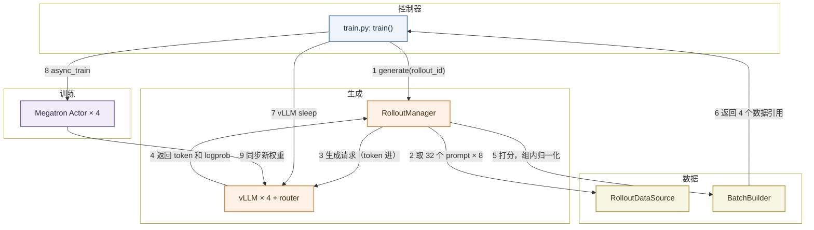
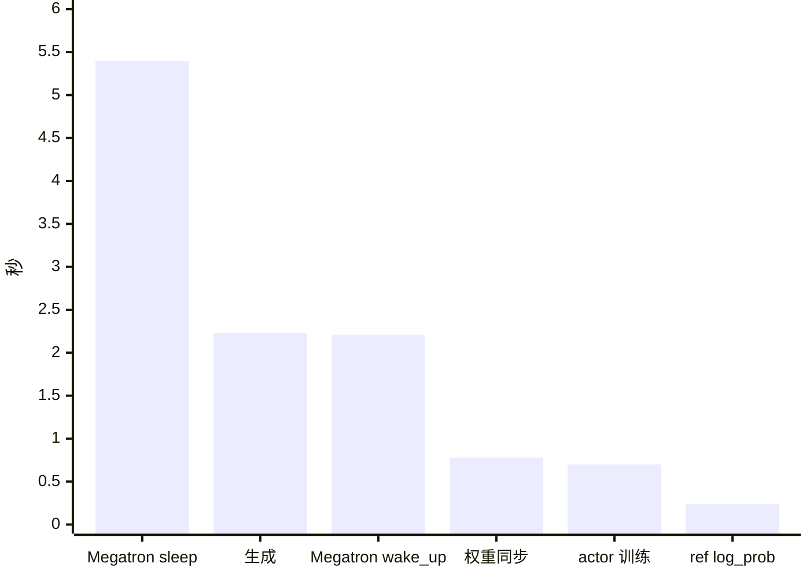
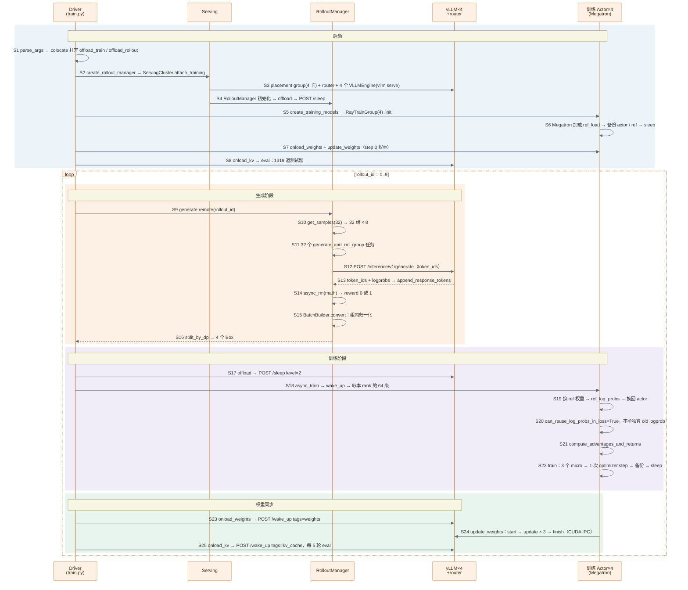

> 代码版本：`vime@d7e40fe8`（2026-10-14，0.3.x）。运行环境：4 × H100 NVL 94GB，官方镜像 `vllm/vime:slime-58b0878679de-vime-4ad3486cb740`（转成 Apptainer SIF），内含 `vllm 0.31.1rc1.dev23`（打了 vime 的补丁）、`torch 2.13.0+cu130`、Megatron-LM。文中数值都来自本机跑通的 GRPO 例子，代码行号对应上述 commit。

## 架构

vime 是 vLLM 社区维护的大模型强化学习框架，从 slime 派生而来：训练用 Megatron，生成用 vLLM。它和 slime 的主循环几乎逐行相同，区别集中在推理那一侧。

入门时先记住三个角色：

| 角色   | 代码里的名字                                         | 职责                            |
| ------ | ---------------------------------------------------- | ------------------------------- |
| 控制器 | `train.py` 里的 `train()` 函数                       | 按顺序下命令，不碰张量          |
| 生成端 | `RolloutManager` + 4 个 `VLLMEngine` + vllm-router   | 生成回答、打分、整理成训练数据  |
| 训练端 | 4 个 `MegatronTrainRayActor`                         | 取数据、更新模型、把新权重发回去 |

它们之间靠 **Ray object store** 传数据。`RolloutManager` 把整理好的数据切成 4 份，各自 `ray.put` 进 object store，控制器手里只有 4 个引用（`Box`），再原样转给 4 个训练 actor，大张量不经过控制器。



下面解释图中 9 个步骤，数值取自后文 GRPO 例子的第 1 轮（rollout 0），耗时取第 2–10 轮的中位数。

- **1 generate(rollout_id)**：`train()` 调用 `ray.get(rollout_manager.generate.remote(rollout_id))`，一直阻塞到这一轮的数据全部准备好。例子共跑 10 轮（`--num-rollout 10`）。

    - `train()`：Ray driver 进程里的普通函数，不是 Ray actor。用 `python3 train.py` 启动的主进程就是 driver，它第一次调用 Ray 时在本机起一个 Ray 集群，之后由它创建和调用所有 actor。verl 的控制器 `TaskRunnerV1` 是 Ray actor，vime 和 slime 则把控制逻辑直接写在 driver 里。

    - `.remote()` 和 `ray.get`：`.remote(rollout_id)` 把"执行 `generate`"这条命令发到 `RolloutManager` 的进程，立刻返回一个占位符 `ObjectRef`。外层的 `ray.get` 让 driver 停下来，等 `generate` 跑完再取回结果。

        ```text
        driver 进程                               RolloutManager 进程
        ref = rollout_manager.generate.remote(0) ──→ 开始执行 generate(0)
        ray.get(ref)   ← 阻塞                         ……生成、打分、整理……
                       ← 拿到返回值 ←──────────────── return [Box, Box, Box, Box]
        ```

    - 为什么必须等：下一步要让 vLLM sleep、把显存让给训练，所以这个例子里生成和训练是串行的。

    - 训练前评测：进入主循环前先在 GSM8K 测试集 1319 题上做一次 greedy 评测，准确率 55.1%。

- **2 取 32 个 prompt × 8**：`RolloutDataSource.get_samples(32)` 从打乱后的训练集（7473 题）里取 32 个 prompt，每个深拷贝 8 份，一共 256 个 `Sample`。

    - `Sample`：一条回答的全部信息，包括 prompt、生成的 token、奖励、logprob 和状态，定义在 `vime/utils/types.py`。

    - `group_index`：同一个 prompt 的 8 份共用一个编号，后面 GRPO 按它分组。

    - chat template：prompt 套了 Qwen3 的聊天模板，并关掉思考（`enable_thinking=false`）。模板会留一段空的 `<think>\n\n</think>`。Natalia 那道题的 prompt 是 66 个 token，256 条平均约 84 个。

        ```text
        <|im_start|>user
        Natalia sold clips to 48 of her friends ... within \boxed{}.<|im_end|>
        <|im_start|>assistant
        <think>

        </think>

        ```

- **3 生成请求（token 进）**：每组起一个异步任务，组内 8 条各发一个请求，256 条同时发出。请求经 vllm-router 分给 4 个 vLLM，temperature=1.0，最多生成 1024 个 token。

    - token 进：请求体直接是 token id，不是文本，避免"解码再分词后 token 对不上"。

        ```json
        POST http://<router>/inference/v1/generate
        {"token_ids": [151644, 872, 198, ...],
         "sampling_params": {"max_tokens": 1024, "temperature": 1.0, "top_p": 1.0, "top_k": -1, "logprobs": 1}}
        ```

    - 并发上限：`--vllm-server-concurrency` 默认 512，乘以 4 个引擎是 2048。256 条远没到上限。

    - vllm-router：Rust 写的 HTTP 网关，策略是 `cache_aware`，前缀相同的请求尽量发到同一个引擎。同组 8 条共用一个 prompt，所以第 1 轮前缀缓存命中率就有 72%，之后稳定在 77% 左右。

        ```text
        同组 8 条请求 → 都发到引擎 2
        第 1 条：84 个 prompt token 全部计算，KV 写入缓存
        第 2–8 条：前缀命中，直接复用 KV，几乎不用再算 prompt
        ```

    - `VLLMEngine`：每个引擎是一个 Ray actor，它在子进程里跑原生的 `vllm serve`，占 1 张卡、最多 50% 显存，KV cache 能放 40.9 万个 token（43.7 GiB）。

- **4 返回 token 和 logprob**：vLLM 用连续批处理一边解码一边接新请求，每条写完就单独返回。返回体里直接有生成的 token id 和每个 token 的 logprob，存进 `sample.tokens` 和 `rollout_log_probs`。

    - 连续批处理（continuous batching）：不等整批都写完，谁先写完谁先返回，空出来的位置马上接新请求。

    - 第 1 轮 256 条回答平均 225 个 token（最短 90，最长 828），没有一条写满 1024。整轮生成约 2.2 s，由最长的那几条决定。

    - logprob：vLLM 采样时算出的对数概率。这个例子只用它做"训推一致性"监控，训练用的是 Megatron 自己算的 logprob（见第 8 步）。

- **5 打分，组内归一化**：每条回答返回后立刻打分，答对 1、答错 0。256 条都回来后，`BatchBuilder` 按组做 GRPO 归一化。第 1 轮平均奖励 0.586。

    - 打分：`--rm-type math` 取回答里最后一个 `\boxed{}`，和标准答案比较。

    - 组内归一化：每组先减平均，再除以标准差（加 1e-6）。

        ```text
        一组 8 个得分：[1, 1, 1, 0, 1, 1, 0, 1]
        平均 μ = 0.75，标准差 σ = 0.463
        答对：(1 − 0.75) / 0.463 = +0.540
        答错：(0 − 0.75) / 0.463 = −1.620
        ```

    - 全对或全错的组：标准差为 0，优势全是 0，等于不参与训练。第 1 轮 32 组里有 14 组是这样（9 组全对、5 组全错），112 条样本白生成了。

- **6 返回 4 个数据引用**：`split_by_dp` 按长度把 256 条均衡分给 4 个训练 rank，每个 64 条，再各自 `ray.put` 进 object store，返回 4 个 `Box`。

    - DP rank：数据并行的编号。例子里 TP=PP=CP=1，所以 4 张卡就是 4 个 DP rank，各算一份数据。

    - micro-batch：每个 rank 约 64 × 309 ≈ 19,800 个 token，按每卡最多 9216 个 token（`--max-tokens-per-gpu`）切成 3 个 micro-batch。

        ```text
        rank 0 的 64 条，按 token 数打包，每包 ≤ 9216
        micro 0：约 21 条，≈ 6,600 token
        micro 1：约 21 条，≈ 6,600 token
        micro 2：约 22 条，≈ 6,600 token
        ```

    - `Box`：只是包了一层 `ObjectRef` 的小对象。driver 拿到的是 4 张"取货单"，数据本身留在 object store。

- **7 vLLM sleep**：driver 让 4 个 vLLM 进入 sleep，每个约 0.1 s 释放约 45.7 GiB 显存。

    - sleep：vLLM 进程不退出，只释放显存。vime 发的是 `POST /sleep?level=2&mode=keep`。

        | level | 权重           | KV cache | 适合                       |
        | ----- | -------------- | -------- | -------------------------- |
        | 1     | 备份到 CPU     | 丢弃     | 醒来后还用旧权重           |
        | 2     | 直接丢弃       | 丢弃     | 醒来后马上要装新权重（RL） |

        RL 每轮都要装新权重，旧权重留着没用，所以用 level 2，省掉一次 CPU 拷贝。

- **8 async_train**：driver 把第 i 个引用交给第 i 个训练 actor。每个 actor 先把训练状态搬回 GPU，再算 ref logprob、算优势、训练，整轮只做 1 次 `optimizer.step`，最后把训练状态搬走、释放显存。

    - 搬回 GPU（`wake_up`）：`torch_memory_saver.resume()` 把上一轮暂停时搬走的参数、梯度和优化器状态放回 GPU，再重建 NCCL 通信组，约 2.2 s。

    - ref logprob：ref 模型不单独占进程。它的权重以备份形式放在 CPU，计算时拷进同一个 Megatron 模型，算完再换回 actor 权重。

        ```text
        CPU 上的备份：actor 权重、ref 权重（初始都是 Qwen3-0.6B）
        GPU 上只有一个 Megatron 模型
        ├─ 换成 ref 权重 → 前向 → ref_log_probs（约 0.24 s）
        └─ 换回 actor 权重 → 训练
        ```

        例子的 `--kl-loss-coef 0`，ref logprob 只用来监控 KL，不进 loss。

    - 不单独算 old logprob：`global_batch_size=256` 等于这一轮的全部样本，只有 1 次 `optimizer.step`，所以 old 策略就是当前策略，训练前向算出的 logprob 直接当 old logprob，ratio 恒为 1。

    - 训练：3 个 micro-batch 前向、反向、累加梯度，然后 1 次 `optimizer.step`，约 0.70 s，单卡约 104 TFLOPS。

    - 搬走（`sleep`）：先把新的 actor 权重备份到 CPU（第 9 步就从这份备份里读），再 `torch_memory_saver.pause()` 释放显存、销毁 NCCL 组，约 5.4 s。这是每轮最大的一块固定开销。

- **9 同步新权重**：先唤醒 vLLM 的权重显存，再把新权重发过去，最后恢复 KV cache，权重同步本身约 0.78 s。每 5 轮评测一次。

    - 如何同步：每张卡上的 Megatron 把权重转成 HF 格式，打包成一块连续显存，通过 CUDA IPC 把"钥匙"交给同卡的 vLLM。

        ```text
        POST /wake_up?tags=weights          # 1. 只分配权重显存，KV cache 还在睡
        POST /pause + /reset_prefix_cache   # 2. 暂停生成，清掉旧权重算出的前缀缓存（这时本来就没有请求）
        POST /start_weight_update           # 3. 通知 vLLM 准备接收
        POST /update_weights × 3            # 4. 每桶一次：512 MB 打包 + CUDA IPC 句柄
        POST /finish_weight_update          # 5. vLLM 收尾，记下新版本号
        POST /resume                        # 6. 恢复生成
        POST /wake_up?tags=kv_cache         # 7. 恢复 KV cache，下一轮可以生成
        ```

        Qwen3-0.6B 约 1.2 GB，每桶 512 MB，所以每个引擎分 3 桶。

    - CUDA IPC：同一张卡上的两个进程共享一块显存。Megatron 进程把显存地址做成一个小句柄，经 HTTP 发给 vLLM，vLLM 打开句柄后直接读这块显存，不经过 CPU。

    - 和 slime 的差别：slime 只调一次 SGLang 的 `update_weights_from_tensor`，约 0.26 s；vime 走 vLLM 原生的三段式接口（start → 每桶 update → finish），请求更多，约 0.78 s。

<br />
<br />

## 代码在哪里

```text
vime/
├── train.py                                   # 入口和主循环（不到 100 行）
├── scripts/models/qwen3-0.6B.sh               # 模型结构参数 MODEL_ARGS
├── tools/convert_hf_to_torch_dist.py          # HF → Megatron 检查点
├── vime/utils/arguments.py                    # 参数解析和校验
├── vime/ray/
│   ├── placement_group.py                     # 分配 GPU，创建 RolloutManager 和训练 actor
│   ├── rollout.py                             # RolloutManager：generate / eval / offload
│   └── actor_group.py                         # RayTrainGroup：把命令发给 4 个训练 actor
├── vime/rollout/
│   ├── vllm_rollout.py                        # 默认生成函数：并发请求 vLLM、打分
│   └── rm_hub/                                # 规则奖励：math / dapo / f1 ...
├── vime/data/
│   ├── data_source.py                         # 读 prompt，按组复制
│   └── batch_builder.py                       # 组内归一化、转成训练数据、按 DP 切分
├── vime/backends/vllm_utils/
│   ├── vllm_engine.py                         # VLLMEngine：启动 vllm serve，sleep / wake_up / 权重接口
│   └── engine_group.py                        # 多个引擎的统一控制
└── vime/backends/megatron_utils/
    ├── actor.py                               # MegatronTrainRayActor：train / sleep / wake_up
    ├── model.py                               # forward_only / train / train_one_step
    ├── loss.py                                # logprob、优势、policy loss
    └── update_weight/                         # 训练到推理的权重同步
```

<br />
<br />

## 安装

### 更新代码

`origin` 是自己的 fork，最新代码在官方仓库，所以先把官方仓库加成 `upstream`：

```bash
git remote add upstream https://github.com/vllm-project/vime.git   # 只需第一次
git fetch upstream
git checkout main
git rebase --autostash upstream/main     # 未提交的改动自动收起，做完再放回
```

- `--autostash`：有未提交的改动时，rebase 会拒绝执行；加上它就自动 stash 和 pop。
- 冲突：两边改了同一处时照样会冲突，改好后 `git add`，再 `git rebase --continue`。

### 安装

vime 依赖打了补丁的 vLLM、Megatron-LM 和 TransformerEngine，自己编译很慢，官方推荐直接用 Docker 镜像：

```bash
docker pull vllm/vime:latest
docker run --rm -it --gpus all --ipc=host --shm-size=16g \
  --ulimit memlock=-1 --ulimit stack=67108864 \
  -v $PWD:/root/vime -w /root/vime vllm/vime:latest bash
pip install -e . --no-deps               # 镜像里已有全部依赖，只把源码装成可编辑模式
```

- `--ipc=host`、`--shm-size=16g`：Ray object store 和 CUDA IPC 都要用共享内存，默认的 64 MB 不够。
- `-v $PWD:/root/vime`：把本地源码挂到镜像里 vime 的安装位置，改代码立即生效。
- `--no-deps`：不让 pip 动镜像里已经配好的 vLLM、torch 版本。

本机没有 Docker，用 Apptainer 把镜像转成 SIF 文件，再用同样的方式挂载源码：

```bash
apptainer pull rl_study/sif/vime-4ad3486c.sif docker://vllm/vime:slime-58b0878679de-vime-4ad3486cb740
apptainer exec --nv --writable-tmpfs \
  --bind /data/home --bind /tmp --bind /data/home/xli49/lxy/vime:/root/vime \
  rl_study/sif/vime-4ad3486c.sif bash        # rl_study/scripts/vimebox.sh 就是这条命令
```

- 镜像标签要和代码版本对上：标签里的 `vime-4ad3486cb740` 是镜像对应的 vime commit。旧的 `vime-latest.sif`（10-01）里的 vLLM 没有 `/health_generate` 接口，新代码启动时会一直卡在健康检查。
- `--nv`：把宿主机的 NVIDIA 驱动挂进容器。
- `--writable-tmpfs`：允许在容器里临时写文件，退出后丢弃。

### 检查安装

进入容器后，确认关键包能导入、GPU 可用：

```bash
python -c "import torch, vllm, megatron.core, transformer_engine; print(torch.__version__, vllm.__version__, torch.cuda.is_available())"
pip show vime | grep Location          # 应指向 /root/vime，说明用的是挂载进来的源码
```

<br />
<br />

## 提 PR 流程

规则以官方的 `CONTRIBUTING.md` 为准，PR 标题、签名和 AI 协助的要求都沿用 vLLM 的规范。

### 1. 建分支

```bash
git fetch upstream
git checkout -b fix/<主题> upstream/main    # bug 用 fix/，功能用 feature/，文档用 docs/
```

- 新功能先开 Issue：和维护者讨论清楚问题、设计和验证方法，再写代码。
- 大改动先开 Issue：除测试和配置外超过 500 行的改动，要先讨论设计。

动手前先查重，已有 open PR 修同一个问题就不要再开：

```text
https://github.com/vllm-project/vime/pulls?q=is%3Apr+<关键词>
```

### 2. 测试

```bash
pre-commit install                                                 # 只需第一次
pre-commit run --all-files --show-diff-on-failure --color=always   # ruff、isort 等检查
pytest tests/<相关文件>.py -v                                       # 跑相关测试
```

- pre-commit：在 pre-commit.ci 上自动运行，不通过不能合并。
- GPU 测试：PR 的 GPU 测试跑在 Buildkite 上，说明在 `.buildkite/README.md`。
- 修复前后各跑一次：修复前失败、修复后通过，才能证明测试有效。

### 3. 提交

```bash
git add <文件>                                  # 不要 git add .
git commit -s -m "[Bugfix][Rollout] <描述>"      # -s 自动加 Signed-off-by
git push -u origin fix/<主题>
```

PR 标题以分类前缀开头，跨多个模块就叠加多个：

```text
[Bugfix][Rollout] keep sample cursor across dataset epochs
[Training] add Qwen3-Omni multimodal RL support
```

- `[Bugfix]`：修 bug。
- `[Training]`：Megatron 训练循环、权重同步、训练端逻辑。
- `[Rollout]`：vLLM 生成、router、推理集成。
- `[Core]`：数据缓冲、Ray actor、公共参数等框架编排。
- `[Example]`：`examples/` 或 `scripts/` 下的脚本。
- `[Doc]`、`[CI/Build]`、`[Hardware][Ascend]`、`[Misc]`：文档、CI、硬件相关、其他（少用）。
- 签名（DCO）：每个 commit 都要有 `Signed-off-by:`，用 `git commit -s` 自动加。

### 4. 开 PR

在自己的 fork 上点 Compare & pull request，目标选 `vllm-project/vime:main`。仓库没有 PR 模板，正文按 CONTRIBUTING 的要求写清楚这几项：

```markdown
## What

Fixes #<issue>. <一两句话：问题是什么。>

## Why / How

<为什么会出错，怎么修。>

## Verification

- GPU: 4 × H100, vLLM <版本>
- `pytest tests/test_xxx.py -v`：修复前失败，修复后通过
- <训练日志或最小复现命令>

## AI assistance

This PR was written with help from <工具>. I reviewed every changed line and ran the tests above.
```

- AI 协助：不能提交"纯 agent 写的 PR"，提交人要读过所有改动、亲自验证；PR 正文要声明，commit 里加 `Co-authored-by:` 标注。
- 不做零碎 PR：单个错别字、孤立的风格清理这类改动要合并成一个有明确范围的 PR。
- 文档：改了用户可见的行为或参数，要同时更新 `docs/` 的英文和中文版。

### 5. 更新 PR

**情况 1：改代码或回应 review（最常见）**

```bash
git checkout fix/<主题>
# 修改代码
pre-commit run --all-files
git add <文件>
git commit -s -m "[Bugfix][Rollout] address review comments"
git push                       # 普通推送，PR 自动出现新提交
```

**情况 2：上游 main 更新了，需要同步或解决冲突**

```bash
git fetch upstream
git rebase upstream/main       # 把你的提交搬到 upstream 最新代码后面
git push --force-with-lease    # rebase 改写了历史，必须强制推送
```

- 没有冲突：rebase 自动完成，直接 push。
- 有冲突：编辑冲突文件，删掉 `<<<<<<<`、`=======`、`>>>>>>>` 标记，`git add <文件>`，再 `git rebase --continue`。
- 想放弃：`git rebase --abort`，回到 rebase 之前的状态。

<br />
<br />

## 跑通第一个例子：GRPO

用 Qwen3-0.6B 学做 GSM8K 数学题，4 张卡，Megatron 和 vLLM 共卡，共 10 轮。配置全是命令行参数：Megatron 的参数原样传入，vLLM 的参数加 `--vllm-` 前缀，vime 自己的参数在 `vime/utils/arguments.py`。

### 1. 准备数据和模型

下载 GSM8K，转成每行一个 JSON 的 jsonl 文件：

```bash
python rl_study/scripts/prep_gsm8k_jsonl.py      # 写出 gsm8k_train.jsonl（7473 行）和 gsm8k_test.jsonl（1319 行）
```

每行的格式：

```json
{"prompt": [{"role": "user", "content": "Natalia sold clips ... output the final answer within \\boxed{}."}], "label": "72"}
```

- `prompt`：聊天消息列表，`--apply-chat-template` 会把它套上模板。
- 结尾的 `\boxed{}` 提示：让模型把答案写进 `\boxed{}`，`math` 奖励函数从这里取答案。
- `label`：标准答案，只保留数字。

Megatron 训练端读的是 Megatron 自己的检查点格式，所以要先把 HF 权重转一次（容器里执行）：

```bash
cd /root/vime && source scripts/models/qwen3-0.6B.sh       # 载入 MODEL_ARGS：28 层、hidden 1024、GQA 8 组等
PYTHONPATH=/root/Megatron-LM python3 tools/convert_hf_to_torch_dist.py \
    ${MODEL_ARGS[@]} \
    --hf-checkpoint $HF_QWEN3_0_6B \
    --save rl_study/ckpt/vime_qwen3-0.6B_torch_dist
```

- `MODEL_ARGS`：Megatron 不读 HF 的 `config.json`，模型结构要用参数写出来，每个模型一个脚本。
- `torch_dist`：Megatron 的分布式检查点格式，加载时可以按任意 TP/PP 切分。
- `--hf-checkpoint`：训练时仍然要给，vLLM 用它加载权重，tokenizer 也从这里读。

### 2. 启动训练

```bash
source scripts/models/qwen3-0.6B.sh
HF=/data/home/xli49/.cache/huggingface/hub/models--Qwen--Qwen3-0.6B/snapshots/c1899de2...
D=/data/home/xli49/lxy/rl_study/data
ARGS=(
    # ---- 放置 ----
    --actor-num-nodes 1 --actor-num-gpus-per-node 4      # 训练用 1 个节点 4 张卡
    --colocate                                           # 训练和 vLLM 共用这 4 张卡，自动打开 offload_train / offload_rollout
    --rollout-num-gpus-per-engine 1                      # 每个 vLLM 占 1 张卡 → 4 个引擎
    --vllm-gpu-memory-utilization 0.5                    # 每个 vLLM 最多占 50% 显存

    # ---- 模型 ----
    "${MODEL_ARGS[@]}"                                   # Megatron 模型结构
    --hf-checkpoint $HF                                  # vLLM 权重和 tokenizer
    --ref-load rl_study/ckpt/vime_qwen3-0.6B_torch_dist  # Megatron 初始权重；没有 --load 时 actor 也从这里加载
    --save rl_study/runs/vime/grpo_colocate --save-interval 1000   # 实际上不保存

    # ---- 数据 ----
    --prompt-data $D/gsm8k_train.jsonl                   # 训练集 7473 题
    --input-key prompt --label-key label                 # jsonl 里 prompt 和答案的字段名
    --apply-chat-template                                # 套 Qwen3 聊天模板
    --apply-chat-template-kwargs '{"enable_thinking": false}'   # 关掉思考，模板里留空的 <think></think>
    --rollout-shuffle                                    # 每个 epoch 打乱顺序
    --rm-type math                                       # 奖励：取最后一个 \boxed{} 和答案比较

    # ---- 生成 ----
    --num-rollout 10                                     # 共 10 轮
    --rollout-batch-size 32                              # 每轮 32 个 prompt
    --n-samples-per-prompt 8                             # 每个 prompt 生成 8 条 → 每轮 256 条
    --rollout-max-response-len 1024                      # 回答最长 1024 token
    --rollout-temperature 1                              # 训练采样温度

    # ---- 评测 ----
    --eval-interval 5                                    # 每 5 轮评测一次（训练前也评测一次）
    --eval-prompt-data gsm8k $D/gsm8k_test.jsonl         # 测试集 1319 题，名字叫 gsm8k
    --n-samples-per-eval-prompt 1 --eval-max-response-len 1024 --eval-top-p 1

    # ---- 训练批次 ----
    --global-batch-size 256                              # 每次 optimizer.step 用 256 条 → 每轮 256/256 = 1 次 step
    --balance-data                                       # 按 token 数把样本均衡分给 4 个 DP rank
    --use-dynamic-batch-size --max-tokens-per-gpu 9216   # 按 token 数打包 micro-batch，每包最多 9216 个 token
    --tensor-model-parallel-size 1 --pipeline-model-parallel-size 1 --context-parallel-size 1   # 不切模型 → DP = 4

    # ---- 算法 ----
    --advantage-estimator grpo                           # 组内 (r − μ) / (σ + 1e-6)，不需要 critic
    --use-kl-loss --kl-loss-coef 0.00 --kl-loss-type low_var_kl   # 算 ref logprob 做监控，但 KL 不进 loss
    --entropy-coef 0.00                                  # 不加熵奖励
    --eps-clip 0.2 --eps-clip-high 0.28                  # PPO clip：ratio 限制在 [0.8, 1.28]

    # ---- 优化器 ----
    --optimizer adam --lr 1e-6 --lr-decay-style constant
    --weight-decay 0.1 --adam-beta1 0.9 --adam-beta2 0.98

    # ---- 数值 ----
    --attention-dropout 0.0 --hidden-dropout 0.0         # RL 训练关掉 dropout
    --accumulate-allreduce-grads-in-fp32 --attention-softmax-in-fp32
    --attention-backend flash
)
python3 train.py "${ARGS[@]}"
```

- `PYTHONPATH=/root/Megatron-LM`：Megatron 不是 pip 包，要把源码目录加进路径。
- `NCCL_CUMEM_ENABLE=0`：关掉 NCCL 的 cuMem 显存分配。vime 启动 vLLM 子进程时也默认设成 0（`vllm_engine.py:68`），脚本里显式写上，让训练进程保持一致。
- 完整脚本在 `rl_study/scripts/vime_ex1_grpo_colocate.sh`，用 `rl_study/scripts/vimebox.sh` 在容器里运行。

### 3. 关键配置

先记住这几个：

| 配置                            | 含义                         | 取值           |
| ------------------------------- | ---------------------------- | -------------- |
| `--colocate`                    | 训练和推理共卡               | 开             |
| `--rollout-batch-size`          | 每轮 prompt 数               | 32             |
| `--n-samples-per-prompt`        | 每个 prompt 采样几条         | 8              |
| `--global-batch-size`           | 每次 `optimizer.step` 的条数 | 256（每轮 1 次） |
| `--max-tokens-per-gpu`          | 每个 micro-batch 的 token 上限 | 9216          |
| `--vllm-gpu-memory-utilization` | vLLM 显存比例                | 0.5            |
| `--advantage-estimator`         | 优势估计器                   | grpo           |

### 4. 结果分析

总耗时约 5 分 53 秒，其中启动 4 个 vLLM、加载 Megatron 和训练前评测约 3 分钟，10 轮训练约 2 分 30 秒。

| rollout | 训练平均得分 | 验证准确率       | 平均回答长度 |
| ------- | ------------ | ---------------- | ------------ |
| 0       | 0.586        | 55.1%（训练前）  | 225          |
| 4       | 0.621        | 58.2%            | 245          |
| 9       | 0.598        | 56.3%            | 243          |

- 起点就有 55%：Qwen3-0.6B 本来就习惯把答案写进 `\boxed{}`，不需要像 verl 例子那样先学格式。
- 10 轮看不出趋势：每轮只有 32 道题，训练得分的波动（0.48–0.72）比 10 轮的提升大。短跑只能用来看机制。
- `pg_loss` 约 1e-9、`ppo_kl=0`、`clipfrac=0`：每轮只有 1 次 step，ratio 恒为 1；组内归一化后每组优势之和为 0，所以 loss 的数值接近 0。但梯度不是 0，`grad_norm` 约 0.83。
- `train-rollout logp abs diff` 约 0.011：Megatron 和 vLLM 对同一个 token 算出的 logprob 平均差 0.011，用来监控训推一致性。

每轮约 13.6 s，构成如下：



- 训练本身只有约 1 s，显存搬进搬出（sleep + wake_up）约 7.6 s，是共卡的固定开销。0.6B 模型太小，这部分开销反而占了大头。
- 剩下约 2 s 是 vLLM 的 sleep / wake_up、数据整理和 Ray 调度。
- 第 1 轮的 ref logprob 3.5 s、训练 4.1 s，是首次 warm-up。

<br />
<br />

## 一轮训练时序图

整个训练分成两段：

- 启动（S1–S8，只执行一次）：解析参数，分配 GPU，启动 router 和 4 个 vLLM，创建 `RolloutManager` 和 4 个训练 actor，把初始权重同步给 vLLM，再在测试集上评测一次。
- 每轮循环（S9–S25）：取 32 道题 × 8 → vLLM 生成并打分 → 组内归一化、切成 4 份 → vLLM sleep → Megatron wake_up → ref logprob、优势、1 次 `optimizer.step` → Megatron sleep → 新权重同步给 vLLM → 恢复 KV cache，每 5 轮评测一次。

图中编号 S1–S25 和下一节的代码一一对应。图中简称与源码的对应：

| 图中简称      | 源码                              |
| ------------- | --------------------------------- |
| Driver        | `train.py` 的 `main()` / `train()` |
| Serving       | `ServingCluster`（detached actor） |
| 训练 Actor    | `MegatronTrainRayActor`           |
| 训练组        | `RayTrainGroup`                   |
| 权重同步器    | `UpdateWeightFromTensor`          |



<br />
<br />

## 代码逐步详解（带入数值）

每一步都按同样的顺序讲：**做什么 → 代码 → 带入数值 → 这一步的结果**。编号和上面的时序图一一对应。

例子的配置：

- `rollout_batch_size=32`：每轮 32 道题。
- `n_samples_per_prompt=8`：每题生成 8 条回答，共 256 条。
- `global_batch_size=256`：每轮只做 1 次 `optimizer.step`。
- `max_tokens_per_gpu=9216`：每个 micro-batch 最多 9216 个 token。
- 4 张 GPU，`--colocate`，TP=PP=CP=1：Megatron 是 DP=4，每卡一个 vLLM。
- `num_rollout=10`：只跑 10 轮。
- `eval_interval=5`：每 5 轮评测一次。

### 第一阶段：启动（S1–S8，只执行一次）

#### S1: 解析参数

**目的**：解析 Megatron、vLLM 和 vime 三类参数，补齐默认值。

代码位置：`train.py:131`、`vime/utils/arguments.py:2243`

```python
args, restore_plan = parse_args(return_restore_plan=True)  # 先用 Megatron 的 parser，再加 --vllm-* 和 vime 自己的参数
```

```python
if args.colocate:  # 共卡
    args.offload_rollout = True  # 训练时 vLLM 让出显存
    args.offload_train = True  # 生成时 Megatron 让出显存

if args.over_sampling_batch_size is None:
    args.over_sampling_batch_size = args.rollout_batch_size  # 每次从数据集取多少组，默认等于每轮 prompt 数
```

**带入数值**：

- `--colocate`，所以 `offload_rollout` 和 `offload_train` 都是 True。
- `rollout_num_gpus` 没给，默认等于训练卡数 4；每个引擎 1 张卡，所以 4 个引擎。
- `over_sampling_batch_size` 没给，等于 32，一次正好取 32 组，不多取。

**结果**：参数确定，交给 `main()`。

<br />

#### S2: 创建 ServingCluster 和 RolloutManager

**目的**：创建管理推理服务的 `ServingCluster`，再由它创建 `RolloutManager`。

代码位置：`train.py:110`、`placement_group.py:293`、`:310`

```python
startup = create_rollout_manager(args, restore_plan=restore_plan)  # 创建或复用推理服务和 RolloutManager

train(startup.args, startup.placements, startup.manager, ...)  # 进入训练
```

```python
serving = ServingCluster.options(name=..., lifetime="detached", get_if_exists=True).remote(args, restore_plan)  # detached：driver 退出后也可以保留，用于故障恢复

deployment = ray.get(serving.attach_training.remote(args, job_id))  # 分配 GPU，启动 router 和 vLLM（S3）

manager = RolloutManager.options(name=name, lifetime="detached", ...).remote(args, placements["rollout"], serving=serving, deployment=deployment)  # 创建 RolloutManager（S4）
```

**带入数值**：本机单节点，第一次启动，`get_if_exists` 找不到旧的 `ServingCluster`，新建一个。

**结果**：推理服务开始启动，driver 拿到 `RolloutManager` 的句柄。

<br />

#### S3: 分配 GPU，启动 router 和 vLLM

**目的**：用 Ray placement group 占住 4 张卡，启动 vllm-router 和 4 个 vLLM。

代码位置：`placement_group.py:123`、`vllm_engine.py:41`、`:123`

```python
num_gpus, rollout_offset = _get_placement_group_layout(args)  # 共卡：返回 (max(4, 4), 0) = (4, 0)

pg, actor_pg_reordered_bundle_indices, actor_pg_reordered_gpu_ids = _create_placement_group(num_gpus)  # 一个 placement group，4 个 bundle

rollout_pg_reordered_bundle_indices = actor_pg_reordered_bundle_indices[rollout_offset:]  # offset 为 0：vLLM 和训练用同样的 4 张卡
```

```python
p = multiprocessing.Process(target=_run_vllm_server, args=(kwargs, env))  # 在子进程里跑 vllm serve
p.start()

_wait_server_healthy(base_url=f"http://{host}:{port}", ...)  # 每 2 s 请求一次 /health_generate，直到返回 200
```

```python
ServeSubcommand.cmd(args)  # 子进程里：调用 vLLM 自己的 serve 命令，和命令行 vllm serve 完全一样
```

**带入数值**：

- placement group 有 4 个 bundle，对应 GPU 0–3。
- router 在 `127.0.0.1:3972` 启动，端口每次随机。
- 每个 vLLM：`gpu_memory_utilization=0.5`，KV cache 43.72 GiB，40.9 万个 token。
- 子进程环境里设了 `VLLM_SERVER_DEV_MODE=1`：打开 `/sleep`、`/wake_up`、权重更新这些开发接口。

**结果**：4 个 vLLM 已启动并注册到 router，里面是 HF 的初始权重。

<br />

#### S4: 初始化 RolloutManager，让 vLLM 先 sleep

**目的**：准备数据源、生成函数和 `BatchBuilder`，然后让 vLLM 释放显存，给 Megatron 加载模型腾地方。

代码位置：`rollout.py:44`、`:456`、`vllm_engine.py:371`

```python
self.data_source = data_source_cls(args)  # 默认 RolloutDataSourceWithBuffer：读 jsonl，套聊天模板

self.generate_rollout = load_function(self.args.rollout_function_path)  # 默认 vime.rollout.vllm_rollout.generate_rollout

self.eval_generate_rollout = load_function(self.args.eval_function_path)  # 没指定时和生成函数相同，以 evaluation=True 调用

self.batch_builder = BatchBuilder(args, controller=self.controller)  # 样本 → 训练数据
```

```python
requests.post(f"http://{host}:{port}/sleep", params={"level": 2, "mode": "keep"})  # 权重和 KV cache 都丢弃
```

**带入数值**：

- 训练集 7473 条，评测集 1319 条。
- `offload_rollout=True`，所以创建完立刻 sleep。

**结果**：`RolloutManager` 就绪，4 个 vLLM 在 sleep。

<br />

#### S5: 创建训练 actor

**目的**：在同样的 4 张卡上创建 4 个 `MegatronTrainRayActor`。

代码位置：`train.py:16`、`placement_group.py:203`、`:180`、`:167`

```python
actor_model = allocate_train_group(args=actor_args, num_nodes=1, num_gpus_per_node=4, pg=pgs["actor"], with_ref=actor_args.kl_coef != 0 or actor_args.use_kl_loss)  # 开了 KL loss 就要 ref

actor_start_rollout_ids = actor_model.create(rollout_manager=rollout_manager)  # 4 个 actor 各自执行 init（S6）
```

```python
return RayTrainGroup(..., num_gpus_per_actor=0.4, ...)  # allocate_train_group 内部：每个 actor 只向 Ray 申请 0.4 张卡，剩下的留给同卡的 vLLM
```

**带入数值**：

- 4 个 actor，各占 1 张卡的 0.4。这个数字只是给 Ray 记账，实际显存靠 sleep / wake_up 轮流使用。
- `use_kl_loss=True`，所以 `with_ref=True`，即使 `kl_loss_coef=0` 也要加载 ref。

**结果**：4 个训练进程开始初始化。

<br />

#### S6: 加载 Megatron 模型，备份权重，sleep

**目的**：加载模型和优化器，把 actor 和 ref 权重各备份一份到 CPU，然后释放显存。

代码位置：`actor.py:60`、`:127`、`:177`

```python
self.model, self.optimizer, self.opt_param_scheduler, loaded_rollout_id = initialize_model_and_optimizer(args, role)  # 没有 --load，从 --ref-load 加载

self.weights_backuper = TensorBackuper(...)  # CPU 上存多份权重的工具

self.weights_backuper.backup("actor")  # 备份 actor 权重

self.load_other_checkpoint("ref", args.ref_load)  # 再读一次 ref_load，备份成 ref

self.weight_updater = create_weight_updater(...)  # 共卡 → UpdateWeightFromTensor

self.sleep()  # offload_train：释放显存
```

```python
destroy_process_groups()  # 销毁 NCCL 通信组，它们也占显存

torch_memory_saver.pause()  # 把参数、梯度、优化器状态搬走，释放显存
```

**带入数值**：

- 初始时 actor 和 ref 是同一份 Qwen3-0.6B 权重。
- 0.6B × 2 字节（bf16）≈ 1.2 GB 一份，CPU 上两份。

**结果**：Megatron 模型已加载并 sleep，CPU 上有 actor 和 ref 两份备份。

<br />

#### S7: 首次同步权重

**目的**：把 Megatron 的权重发给 vLLM，保证生成和训练用同一份权重。

代码位置：`train.py:19`、`:22`

```python
ray.get(rollout_manager.onload_weights.remote())  # vLLM 先分配权重显存

actor_model.update_weights()  # 把初始权重同步给 vLLM，过程和 S24 相同
```

**带入数值**：权重版本从 0 变为 1。这时权重和 vLLM 自己从 HF 加载的完全一样，但仍然要同步一次，顺便提前检查传输链路。

**结果**：vLLM 和 Megatron 的权重一致。

<br />

#### S8: 恢复 KV cache，训练前评测

**目的**：恢复 vLLM 的 KV cache，用还没训练的模型做一遍测试题，得到基线。

代码位置：`train.py:31`、`:49`

```python
ray.get(rollout_manager.onload_kv.remote())  # POST /wake_up?tags=kv_cache

if args.eval_interval is not None and rollout_id == 0 and not args.skip_eval_before_train:
    ray.get(rollout_manager.eval.remote(rollout_id))  # 训练前评测
```

**带入数值**：

- 1319 道测试题，每题 1 条，`top_p=1`。
- 准确率 55.12%，平均回答 245 个 token，vLLM 约 10 s 跑完。

**结果**：有了对比的起点，进入主循环。

### 第二阶段：生成（S9–S16，每轮一次）

下面以第 1 轮（rollout 0）为例。

<br />

#### S9: driver 发起生成

**目的**：让 `RolloutManager` 生成这一轮的数据，driver 等它返回。

代码位置：`train.py:51`、`rollout.py:322`、`:340`、`:508`

```python
rollout_data_ref = ray.get(rollout_manager.generate.remote(rollout_id))  # 阻塞到 256 条全部生成、打分、整理完
```

```python
data, metrics = self._get_rollout_data(rollout_id=rollout_id)  # 调用生成函数（S10–S14）

data = self.batch_builder.convert(data)  # 组内归一化，转成训练数据（S15）

return self.batch_builder.split_by_dp(data)  # 切成 4 份，返回 4 个 Box（S16）
```

**带入数值**：`rollout_id=0`，调用链是 `generate` → `_generate` → `_get_rollout_data` → `call_rollout_fn` → `vllm_rollout.generate_rollout`。

**结果**：`RolloutManager` 开始干活，driver 在 `ray.get` 上等待。

<br />

#### S10: 取 32 个 prompt，每个复制 8 份

**目的**：从数据集取一批题目，每题复制 8 份，同组共用一个编号。

代码位置：`data_source.py:103`

```python
prompt_samples.extend(self.dataset.samples[self.sample_offset : self.sample_offset + count])  # 按顺序取 32 个；每个 epoch 开头会打乱

for prompt_sample in prompt_samples:  # 32 个 prompt
    for _ in range(self.args.n_samples_per_prompt):  # 每个复制 8 份
        sample = copy.deepcopy(prompt_sample)
        sample.group_index = self.sample_group_index  # 同组同编号，GRPO 按它分组
        sample.index = self.sample_index  # 全局递增编号
        self.sample_index += 1
        group.append(sample)
    self.sample_group_index += 1
```

**带入数值**：

- 返回 32 组 × 8 = 256 个 `Sample`。
- 第 1 轮 `group_index` 是 0–31，`index` 是 0–255。

**结果**：256 个待生成的 `Sample`，状态都是 `PENDING`。

<br />

#### S11: 提交 32 个并发任务

**目的**：每组起一个异步任务，组内 8 条各起一个子任务，全部同时运行。

代码位置：`vllm_rollout.py:775`、`:144`、`:683`、`:592`

```python
state = GenerateState(args)  # 单例：tokenizer、并发信号量、采样参数

while len(data) < target_data_size:  # 要凑够 32 组
    while state.remaining_batch_size < target_data_size:
        samples = data_source(args.over_sampling_batch_size)  # 取 32 组（S10）
        state.submit_generate_tasks(samples)  # 每组一个 generate_and_rm_group 任务
    done, state.pendings = await asyncio.wait(state.pendings, return_when=asyncio.FIRST_COMPLETED)  # 有一组完成就收一组
```

```python
self.semaphore = asyncio.Semaphore(args.vllm_server_concurrency * get_rollout_num_engines(args))  # 512 × 4 = 2048

self.sampling_params = dict(temperature=1.0, top_p=1.0, top_k=-1, max_new_tokens=1024, no_stop_trim=True, ...)  # 按原始分布采样
```

```python
for idx, sample in enumerate(group):  # 组内 8 条
    tasks.append(asyncio.create_task(generate_and_rm(args, sample, current_sampling_params, evaluation=evaluation)))  # 每条：生成 + 打分
```

**带入数值**：

- 32 个组任务，256 个子任务。
- 256 < 2048，信号量不会挡住任何请求，256 条同时发出。

**结果**：256 个协程在 `RolloutManager` 进程里并发运行。

<br />

#### S12: 发请求给 vLLM

**目的**：把 prompt 转成 token，发给 router，再由 router 转给某个 vLLM。

代码位置：`vllm_rollout.py:391`、`:215`

```python
prompt_ids = _prepare_prompt_ids(sample, state.tokenizer, state.processor)  # 套聊天模板，转成 token id

sampling_params["max_new_tokens"] -= sample.response_length  # 已经生成过的部分要扣掉（续写时用），这里是 1024 − 0

inference_sampling_params = _build_inference_sampling_params(sampling_params, logprobs=1)  # 转成 vLLM 的字段名：max_new_tokens → max_tokens

payload = {"model": args.hf_checkpoint, "token_ids": list(prompt_ids), "sampling_params": inference_sampling_params}

output = await post(f"{base}/inference/v1/generate", payload)  # base 是 router 的地址
```

**带入数值**：

- Natalia 那道题的 prompt 是 66 个 token，256 条平均 84 个。
- `logprobs=1`：每个位置返回采样到的 token 的 logprob，外加 1 个候选；vime 只用采样到的那个。
- router 按前缀把同组请求送到同一个引擎，第 1 轮前缀缓存命中率 72%，平均每条 84 个 prompt token 里有 61 个直接复用。

**结果**：请求进入 vLLM 的调度队列。

<br />

#### S13: 取回 token 和 logprob

**目的**：从 vLLM 的返回体里取出生成的 token 和 logprob，追加到 `Sample`。

代码位置：`vllm_rollout.py:245`、`:475`

```python
choice = output["choices"][0]

token_ids = choice.get("token_ids")  # 生成的 token id

content = choice["logprobs"]["content"]  # 每个 token 一项

return token_ids, [float(item["logprob"]) for item in content]  # 两者按位置对齐
```

```python
sample.append_response_tokens(args, tokens=new_response_tokens, log_probs=new_response_log_probs, trainable=True, meta_info=meta_info, text=text)  # tokens 追加回答，loss_mask 追加 1，rollout_log_probs 追加 logprob
```

**带入数值**：

- 第 1 轮平均回答 225 个 token，中位数 200，最长 828，没有写满 1024 的。
- 单条请求从发出到收回平均 0.50 s，最长 1.50 s。
- 一条 225 个 token 的回答：`tokens` 长 84 + 225 = 309，`loss_mask` 是 225 个 1，`rollout_log_probs` 长 225。

**结果**：`Sample` 的状态变为 `COMPLETED`（写满上限则是 `TRUNCATED`）。

<br />

#### S14: 打分

**目的**：从回答里取出答案，和标准答案比较。

代码位置：`rm_hub/__init__.py:55`、`:81`

```python
sample.reward = await async_rm(args, sample)  # generate_and_rm 末尾，生成完立刻打分
```

```python
elif rm_type == "math":
    return 1 if grade_answer_verl(response, label) else 0  # 取最后一个 \boxed{...}，先字符串比较，再用 sympy 判等
```

**带入数值**：

- 回答结尾是 `\boxed{72}`，标准答案 `72`，得 1。
- 第 1 轮 256 条平均 0.586。
- 不要用 `--rm-type boxed_math`：它先取出 `\boxed{}` 里的内容，再交给 `grade_answer_verl` 又找一次 `\boxed{}`，永远找不到，所有奖励都是 0。

**结果**：每条 `Sample` 都有了 0 或 1 的 `reward`。

<br />

#### S15: 组内归一化，转成训练数据

**目的**：同一个 prompt 的 8 条互相比较，再把 `Sample` 对象转成按字段组织的字典。

代码位置：`batch_builder.py:210`、`:259`

```python
raw_rewards = [sample.get_reward_value(self.args) for sample in samples]  # 256 个 0 或 1

for positions in groups.values():  # 按 group_index 分组，32 组
    centered = rewards[positions] - rewards[positions].mean()  # 减组均值
    if self.args.advantage_estimator in ["grpo", "gspo", "cispo"] and self.args.grpo_std_normalization and len(positions) > 1:
        centered = centered / (centered.std() + 1e-6)  # 除以组标准差；1e-6 防止除以 0
    rewards[positions] = centered
```

**带入数值**：一组 8 条的得分是 `[1, 1, 1, 0, 1, 1, 0, 1]`：

- 平均值 μ = 0.75，标准差 σ = 0.463。
- 答对：(1 − 0.75) / 0.463 = +0.540。
- 答错：(0 − 0.75) / 0.463 = −1.620。
- 第 1 轮 32 组里 9 组全对、5 组全错，这 14 组的 112 条优势都是 0。

`convert` 再把结果组装成字典：`tokens`、`response_lengths`、`rewards`（归一化后）、`raw_reward`、`loss_masks`、`rollout_log_probs` 等，每个字段是长度 256 的列表。

**结果**：一份按字段组织的训练数据，奖励已经是归一化后的值。

<br />

#### S16: 切成 4 份，返回引用

**目的**：按 token 数把 256 条均衡分给 4 个 DP rank，并算好每个 rank 的 micro-batch 划分。

代码位置：`batch_builder.py:448`、`:530`

```python
schedule = build_dp_schedule(..., global_batch_size=256)  # --balance-data：按 token 数均衡分配；--use-dynamic-batch-size：按 token 数切 micro-batch

result.append(Box(ray.put(value)))  # 每个 rank 一份，放进 object store
```

**带入数值**：

- 每个 rank 64 条，约 64 × 309 ≈ 19,800 个 token。
- 19,800 / 9216 向上取整 = 3，每个 rank 3 个 micro-batch，`num_microbatches=[3]`。
- `global_batch_sizes=[256]`：只有 1 个 step。

**结果**：driver 的 `ray.get` 返回 4 个 `Box`。这一轮生成约 2.6 s（之后中位数 2.2 s）。

### 第三阶段：训练（S17–S22，每轮一次）

<br />

#### S17: vLLM sleep

**目的**：让 4 个 vLLM 释放显存，给 Megatron 用。

代码位置：`train.py:54`、`rollout.py:456`、`engine_group.py:407`、`vllm_engine.py:371`

```python
ray.get(rollout_manager.offload.remote())  # driver 发起
```

```python
requests.post(f"http://{host}:{port}/sleep", params={"level": 2, "mode": "keep"})  # 每个引擎一次
```

**带入数值**：

- 每个引擎约 0.1 s 睡着，释放约 45.7 GiB。
- `mode=keep`：如果还有请求在跑，原地暂停而不是中止。共卡时这一刻本来就没有请求。

**结果**：4 张卡的显存空出来。

<br />

#### S18: 唤醒 Megatron，取数据

**目的**：driver 把 4 个引用交给 4 个训练 actor，每个 actor 把训练状态搬回 GPU，再取自己那份数据。

代码位置：`train.py:67`、`actor_group.py:148`、`actor.py:395`、`:197`、`:218`

```python
ray.get(actor_model.async_train(rollout_id, rollout_data_ref))  # 4 个 actor 同时训练，driver 等全部完成
```

```python
if self.args.offload_train:
    self.wake_up()  # torch_memory_saver.resume() + 重建 NCCL 组 + 换回 actor 权重

rollout_data = self._get_rollout_data(rollout_data_ref)  # 按自己的 DP rank 取出那一份，张量搬上 GPU

self.train_actor(rollout_id, rollout_data)  # S19–S22

self.sleep()  # 训练完释放显存
```

**带入数值**：

- 每个 actor 拿到 64 条。4 个 Box 都发给了每个 actor，但每个只 `ray.get` 自己那一个。
- `wake_up` 约 2.2 s，取数据约 0.02 s。

**结果**：模型、优化器和数据都在 GPU 上了。

<br />

#### S19: 算 ref logprob

**目的**：把 ref 权重换进模型，前向一遍算出每个 token 的 ref logprob，再换回 actor 权重。

代码位置：`actor.py:459`、`:288`、`:377`

```python
if "ref" in self.weights_backuper.backup_tags:  # with_ref=True
    self._switch_model("ref")  # CPU 上的 ref 备份拷进模型参数
    rollout_data.update(self.compute_log_prob(data_iterator, num_microbatches, store_prefix="ref_"))  # 只前向，结果存成 ref_log_probs

self._switch_model("actor")  # 换回 actor 权重
```

```python
self.weights_backuper.restore(target_tag)  # _switch_model 的全部工作：把备份逐个拷进参数
```

**带入数值**：

- 每个 rank 3 个 micro-batch，前向约 0.24 s。
- 第 1 轮 ref 和 actor 权重相同，KL 是 0；之后 actor 变了，KL 才大于 0。
- `kl_loss_coef=0`，ref logprob 只用于日志。

**结果**：`rollout_data` 里多了 `ref_log_probs`。

<br />

#### S20: 判断能不能复用 logprob

**目的**：如果一轮只做 1 次 step，old logprob 就等于训练前向的 logprob，可以省一次前向。

代码位置：`actor.py:483`、`loss.py:1172`

```python
can_reuse_log_probs_in_loss = (
    len(num_microbatches) == 1  # 只有 1 个 step
    and self.args.loss_type == "policy_loss"
    and self.args.kl_coef == 0  # 奖励里不加 KL
    and not self.args.use_rollout_logprobs  # 不用 vLLM 的 logprob 当 old
    and not self.args.use_critic  # 没有 critic
    ...
)
```

```python
old_log_probs = [log_prob.detach() for log_prob in log_probs]  # policy_loss_function 里：没有现成的 old，就用当前前向的结果
```

**带入数值**：`num_microbatches=[3]`，长度 1；`kl_coef=0`；GRPO 没有 critic。所以 `can_reuse_log_probs_in_loss=True`，ratio = exp(log_prob − old_log_prob) = 1。

**结果**：跳过 old logprob 的前向，每轮省约 0.24 s。

<br />

#### S21: 算优势

**目的**：把 S15 的归一化奖励铺到这条回答的每个 token 上。

代码位置：`actor.py:525`、`loss.py:720`、`:779`

```python
elif args.advantage_estimator in ["grpo", "gspo", "cispo"]:
    rewards = torch.tensor(rewards)  # 已经是组归一化后的值
    returns = get_grpo_returns(rewards, kl)  # 每条回答：长度 = 回答长度，每个位置都等于这条的奖励
    advantages = [r for r in returns]  # GRPO 里优势就是 returns
```

**带入数值**：一条奖励为 +0.540、长 225 个 token 的回答，优势是 225 个 0.540。

**结果**：`rollout_data` 里多了 `advantages` 和 `returns`。

<br />

#### S22: 训练，备份，sleep

**目的**：用优势更新模型，这是模型真正变化的地方；然后备份新权重、释放显存。

代码位置：`actor.py:550`、`model.py:763`、`:520`、`loss.py:1118`、`actor.py:577`

```python
with timer("actor_train"):
    train(rollout_id, self.model, self.optimizer, self.opt_param_scheduler, data_iterator, num_microbatches, global_batch_sizes)  # 遍历每个 step，本例 1 个
```

```python
optimizer.zero_grad()

losses_reduced = forward_backward_func(forward_step_func=forward_step, data_iterator=data_iterator, num_microbatches=3, ...)  # 3 个 micro-batch 前向 + 反向，梯度累加

update_successful, grad_norm, num_zeros_in_grad = optimizer.step()  # 1 次更新

opt_param_scheduler.step(increment=256)  # 学习率调度按样本数前进
```

```python
ppo_kl = old_log_probs - log_probs  # 本例全是 0

ratio = (-ppo_kl).exp()  # 本例全是 1

pg_losses1 = -ratio * advantages

pg_losses2 = -ratio.clamp(1 - 0.2, 1 + 0.28) * advantages  # clip-higher：上界放宽到 1.28，鼓励探索

pg_losses = torch.maximum(pg_losses1, pg_losses2)  # 取更保守的那个
```

```python
self.weights_backuper.backup("actor")  # 新 actor 权重写回 CPU 备份，S24 从这里读
```

**带入数值**：

- 每个 rank 64 条，3 个 micro-batch，1 次 `optimizer.step`。
- 训练约 0.70 s，单卡约 104 TFLOPS。
- 第 1 轮 `pg_loss` 约 9e-9、`grad_norm=0.825`、`entropy=0.335`。
- 之后的 `sleep` 约 5.4 s。

**结果**：Megatron 里的模型已经更新，CPU 上有新的 actor 备份，GPU 显存已释放。vLLM 里还是旧权重。

### 第四阶段：同步权重（S23–S25，每轮一次）

<br />

#### S23: 唤醒 vLLM 的权重显存

**目的**：只给 vLLM 分配权重的显存，KV cache 先不恢复，留出空间给权重传输用的缓冲。

代码位置：`train.py:88`、`rollout.py:468`、`vllm_engine.py:380`

```python
ray.get(rollout_manager.onload_weights.remote())  # driver 发起

requests.post(f"http://{host}:{port}/wake_up", params=[("tags", "weights")])  # 每个引擎一次
```

**带入数值**：约 0.14 s。

**结果**：vLLM 的权重显存已分配，等待写入新权重。

<br />

#### S24: 同步新权重

**目的**：把 Megatron 的新权重发给同卡的 vLLM。

代码位置：`train.py:90`、`actor_group.py:178`、`actor.py:624`、`update_weight_from_tensor.py:356`、`:202`

```python
self.weight_version += 1  # 版本号加 1

flush_cache = should_flush_cache(self.args.flush_cache_interval, self.weight_version, ...)  # 默认每次都清前缀缓存

engine.pause_generation.remote(mode="abort" if flush_cache else "in_place")  # 0 号 rank 让所有引擎暂停生成

engine.flush_cache.remote()  # 清掉前缀缓存，旧权重算出的 KV 不能再用

trainer.send_weights()  # vLLM 原生的权重传输：start → 每桶 update → finish

engine.continue_generation.remote()  # 恢复生成
```

```python
trainer = WeightTransferTrainerFactory.trainer_init(IPCTrainerInitInfo(rank=dist.get_rank(), packed=True, packed_buffer_size_bytes=512 MB), client=VimeRayWeightSyncClient(...), source=self._source)  # 连接时创建；source 负责把 Megatron 权重转成 HF 格式
```

按顺序是：

1. 暂停生成，清前缀缓存。
2. `POST /start_weight_update`：通知 vLLM 准备接收。
3. 从 CPU 备份读出 actor 权重，转成 HF 的名字和形状（比如把 Megatron 合在一起的 qkv 拆开），按 512 MB 打包成一块连续显存。
4. 用 `reduce_tensor` 生成这块显存的 CUDA IPC 句柄，`POST /update_weights` 交给同卡的 vLLM，vLLM 打开句柄、直接读这块显存，调用 `load_weights` 装进模型。
5. 重复 3–4 直到所有桶发完。
6. `POST /finish_weight_update`：vLLM 收尾，记下新版本号。
7. 恢复生成。

**带入数值**：

- 模型约 1.2 GB，每桶 512 MB，每个引擎 3 桶，4 个引擎同时进行。
- 整个同步约 0.78 s。
- `flush_cache_interval` 默认 1，所以每次都用 `abort` 模式暂停。共卡时没有在跑的请求，没有影响；fully-async 时会把正在生成的请求打断。

**结果**：vLLM 用上了新权重。

<br />

#### S25: 恢复 KV cache，评测

**目的**：恢复 KV cache，按频率评测，进入下一轮。

代码位置：`train.py:97`、`:99`

```python
ray.get(rollout_manager.onload_kv.remote())  # POST /wake_up?tags=kv_cache

if should_run_periodic_action(rollout_id, args.eval_interval, num_rollout_per_epoch):
    ray.get(rollout_manager.eval.remote(rollout_id))  # (rollout_id + 1) % 5 == 0 时评测
```

**带入数值**：

- `eval_interval=5`，rollout 4 和 rollout 9 之后评测，准确率 58.2% 和 56.3%。
- 每轮 step 约 13.6 s，其中训练 actor 等待（`train_wait`）约 12.6 s。

**结果**：rollout 0–8 回到 S9；rollout 9 后训练结束。

<br />
<br />

## 常见问题

- **vime 和 slime 有什么区别？** 训练端和主循环几乎一样，`train.py` 只差一两行。区别在推理端：vLLM 代替 SGLang，vllm-router 代替 SGLang router，`--vllm-*` 代替 `--sglang-*`，权重同步走 vLLM 原生的三段式接口。
- **启动后一直卡在 `/health_generate`？** 镜像里的 vLLM 太旧，没有这个接口。换成和代码 commit 对应的镜像。
- **所有奖励都是 0？** 检查 `--rm-type`。`boxed_math` 会提取两次 `\boxed{}`，GSM8K 这种数据要用 `math`。
- **`pg_loss` 一直约等于 0 正常吗？** 正常。每轮只有 1 次 step，ratio 恒为 1，组内优势之和为 0；看 `grad_norm` 是否大于 0。
- **每轮大部分时间不在训练？** 共卡时 Megatron 的 sleep + wake_up 约 7.6 s，小模型下这部分是大头。可以试训推分离：2 卡训练 + 2 卡生成，不用搬显存。
- **fully-async 时评测报错？** 加 `--eval-function-path vime.rollout.vllm_rollout.generate_rollout --skip-eval-before-train`，fully-async 的生成函数不支持评测模式。

<br />
<br />

## 后续

1. 训推分离：把 `--colocate` 换成 `--actor-num-gpus-per-node 2 --rollout-num-gpus 2`，权重同步改走 NCCL 广播，对比每轮耗时。
2. fully-async：`--rollout-function-path vime.rollout.fully_async_rollout.generate_rollout_fully_async`，看后台生成怎么跨轮次进行。
3. 写自己的奖励：`--custom-rm-path xx.rm`，函数签名是 `async def rm(args, sample) -> float`。
4. 对比 SGLang 版：[slime 入门笔记](/posts/slime-study-notes/) 用完全相同的超参，可以直接比较两个推理后端。
5. 对比其他框架：[开源 LLM 强化学习框架](/posts/llm-rl-frameworks/)。
