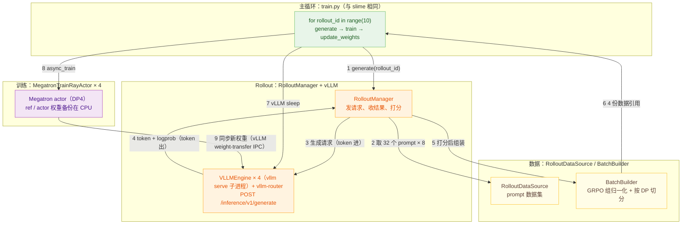

> 代码版本：`vime@d7e40fe8`（2026-10-14，pip 版本 0.3.x），路径 `/data/home/xli49/lxy/vime`，上游 `vllm-project/vime`
> 运行环境：官方镜像 `vllm/vime:slime-58b0878679de-vime-4ad3486cb740`（镜像对应 vime `4ad3486c`，是 HEAD 的父提交，只差 1 个 ROCm CI 提交；转为 Apptainer SIF）：`vllm 0.31.1rc1.dev23`（打了 vime 的 patch 集）、`torch 2.13.0+cu130`、Megatron-LM（`/root/Megatron-LM`）、Rust `vllm-router`
> 本文 “数值” 来自本机跑通的例 1（GRPO colocate，与 slime 例 1 完全相同的超参）；代码行号对应上述 commit。

---

## Overview

**vime = slime 的训练框架 + vLLM 推理后端**。仓库结构、`train.py` 主循环、`RolloutManager / BatchBuilder / MegatronTrainRayActor` 与 slime 几乎逐行对应（`diff` 两个 `train.py` 只差 1 行），区别集中在推理侧：

| 维度       | slime                                                                      | vime                                                                                                                                                                         |
| -------- | -------------------------------------------------------------------------- | ---------------------------------------------------------------------------------------------------------------------------------------------------------------------------- |
| 推理引擎     | SGLang（Ray actor 内起 sglang server）                                         | **vLLM**：`VLLMEngine`（Ray actor）在子进程里跑 `vllm serve`（`ServeSubcommand.cmd`）                                                                                                   |
| 网关       | SGLang Model Gateway / sglang-router                                       | **vllm-router**（Rust）                                                                                                                                                        |
| 生成接口     | `POST /generate {input_ids, sampling_params, return_logprob}`              | `POST /inference/v1/generate {token_ids, sampling_params:{max_tokens, logprobs:1, ...}}`（token-in-token-out）                                                                 |
| 显存让出     | `release_memory_occupation / resume_memory_occupation`（torch_memory_saver） | `POST /sleep?level=2&mode=keep` / `POST /wake_up?tags=weights` / `?tags=kv_cache`（vLLM sleep mode）                                                                           |
| 权重同步（共置） | `update_weights_from_tensor`（flattened bucket 序列化）                         | **vLLM 原生 weight-transfer IPC engine**：`/init_weight_transfer_engine` → `/start_weight_update` → `/update_weights`（packed tensor + CUDA IPC 句柄）× N → `/finish_weight_update` |
| 参数透传前缀   | `--sglang-*`                                                               | `--vllm-*`（如 `--vllm-gpu-memory-utilization`）                                                                                                                                |
| 健康检查     | `/health`                                                                  | `/health_generate`（需 vime 的 vLLM patch）                                                                                                                                      |

所以阅读 vime 时可以把 slime 文档 的训练侧（S5–S6、S17–S22）直接复用，本文重点讲 vLLM 相关的部分，并给出完整时序。

**每一步带入数值**（例 1：Qwen3-0.6B、GSM8K、32 个 prompt × 8 条、4 张 H100 上 Megatron 训练和 4 个 vLLM 共用；数字取第 1 轮，耗时取第 2–10 轮的中位数）：

1. **generate(rollout_id)：主循环发起一轮**
   * `train.py` 里的 `train()` 是 Ray driver 进程里的普通函数（不是 Ray actor），负责按顺序下命令。例 1 跑 10 轮（`--num-rollout 10`），每轮第一件事是 `ray.get(rollout_manager.generate.remote(rollout_id))`，一直阻塞到这一轮的数据全部准备好。
     * **`train()` 是 Ray driver 进程里的普通函数（不是 Ray actor）**：Ray driver 就是用 `python3 train.py` 启动的那个主进程，它第一次调用 Ray 接口时自动在本机起了一个 Ray 集群（日志里的 "Started a local Ray instance"），之后由它创建、调用所有 actor。Ray actor 是被 `@ray.remote` 包装的类，Ray 给每个实例单独起一个进程，别的进程只能拿着它的句柄用 `.remote()` 远程调用（见[框架对比](/posts/llm-rl-frameworks-comparison/#06-ray-actor) 0.6 节）。`train()` 没有被 `@ray.remote` 包装，只是 driver 进程里一个普通的 Python 函数：不占 GPU，自己不做计算，手里只有 1 个 `RolloutManager` 和 4 个 `MegatronTrainRayActor` 的句柄，按顺序 `.remote()` 下命令、`ray.get` 等结果。driver 一退出（训练结束或 Ctrl-C），本机 Ray 集群和所有 actor 都会被清理掉。verl 的控制器 `TaskRunnerV1`、OpenRLHF 的 `PPOTrainer` 都是 Ray actor，vime 和 slime 则把控制逻辑直接写在 driver 里。
     * **`ray.get(rollout_manager.generate.remote(rollout_id))`**：`rollout_manager` 是 `RolloutManager` actor 的句柄。`.remote(rollout_id)` 把"执行 `generate(rollout_id)`"这条命令发到 actor 进程，立刻返回一个 `ObjectRef`（结果的占位符），不等它跑完。外层的 `ray.get` 让 driver 阻塞，直到 `generate` 跑完（第 2–6 步都在 `RolloutManager` 和 4 个 vLLM 里完成）再取回返回值。返回值 `rollout_data_ref` 不是数据本身，而是 4 个 `Box`，每个包着第 6 步 `ray.put` 得到的 `ObjectRef`，对应一个 DP rank 的那份数据，第 8 步原样转给训练 actor。这里必须等生成完：下一步要让 vLLM 休眠、把显存让给训练，所以例 1 里生成和训练是串行的。
   * `RolloutManager`是一个 Ray actor，管"生成 + 打分 + 整理数据"这一整段。调用链：`RolloutManager.generate` → `_generate` → `_get_rollout_data` → `call_rollout_fn` → `generate_rollout`。
   * 进入主循环之前还做过一次训练前评测：GSM8K 测试集 1319 题，greedy、每题 1 条，准确率 0.5512，vLLM 约 10 s 跑完。之后每 5 轮评测一次。
2. **取 32 个 prompt，每个复制 8 份**
   * `RolloutDataSourceWithBuffer.get_samples`从打乱后的 GSM8K 训练集（7473 题）里取 32 个 prompt，每个用 `copy.deepcopy` 复制 8 份，一共 256 个 `Sample`。同一个 prompt 的 8 份共用一个 `group_index`，后面 GRPO 按它分组。
   * prompt 套了 Qwen3 的 chat template，并关掉 thinking（`enable_thinking=false`，模板里会留一段空的 `<think>\n\n</think>`）。Natalia 那题的 prompt 是 66 个 token，256 条平均约 84 个。
   * 每次取多少由 `--over-sampling-batch-size` 决定，例 1 没设，默认等于 `rollout_batch_size=32`，所以一次正好取 32 组、不多取。
3. **发生成请求：token 进，经 vllm-router 分给 4 个 vLLM**
   * `generate_rollout_async`为每组起一个异步任务 `generate_and_rm_group`，组内 8 条各起一个 `generate_and_rm`，再调 `generate`真正发请求。并发上限是 `--vllm-server-concurrency`（默认 512）× 4 个引擎 = 2048（`GenerateState`），256 条远没到上限，所以全部同时发出。
   * 请求体是 token id，不是文本：`POST http://<router>/inference/v1/generate`，`{"token_ids": [...], "sampling_params": {...}}`。采样参数由 `_build_inference_sampling_params`组装：`max_tokens=1024`、`temperature=1.0`、`top_p=1.0`、`top_k=-1`、`logprobs=1`。`logprobs=1` 表示每个 token 除了采样到的那个，还附带 1 个候选的 logprob（vime 实际只用采样 token 的那个）。
   * vllm-router 是 Rust 写的 HTTP 网关，策略是 `cache_aware`：前缀相同的请求尽量发到同一个引擎。同组 8 条共用同一个 prompt，所以 vLLM 的前缀缓存命中率第 1 轮就有 72%（平均每条 84 个 prompt token 里有 61 个直接复用 KV cache），之后稳定在约 78%。
   * 每个 vLLM 引擎是一个 Ray actor `VLLMEngine`，它在子进程里跑原生的 `vllm serve`（一个 API server 进程 + 一个 EngineCore 进程），每个占 1 张卡、显存比例 0.5，KV cache 约 40.9 万 token（43.7 GiB）。
4. **vLLM 返回 token 和 logprob**
   * vLLM 用连续批处理（continuous batching）一边解码一边接新请求，每条回答写完就单独返回，不用等整批。返回体里直接有 `choices[0].token_ids` 和逐 token 的 `logprobs.content[*].logprob`，`_inference_generate_tokens_and_logprobs`把它们取出来，`sample.append_response_tokens` 存进 `sample.tokens` 和 `rollout_log_probs`。因为直接拿到 token id，不需要再分词，也不会出现"解码再分词后 token 对不上"的问题。
   * 第 1 轮 256 条回答平均 225 个 token（中位数 200，最短 90，最长 828），没有一条写满 1024。单条请求从发出到收回平均 0.50 s、最长 1.50 s，每条请求的 decode 速度约 450 tok/s。
   * 整轮生成 2.63 s（第 2 轮起中位数 2.23 s），由最长的那几条决定。
5. **打分，再做 GRPO 组内归一化**
   * 每条回答返回后立刻打分：`async_rm`按 `--rm-type math` 调 `grade_answer_verl`，取回答里最后一个 `\boxed{}` 和标准答案比较，答对 1、答错 0。第 1 轮平均奖励 0.586。
   * 256 条都回来后，`RolloutManager` 用 `BatchBuilder`把它们整理成训练数据。`_post_process_rewards`按组做 GRPO 归一化：先减组均值，再除以组标准差（加 1e-6）。例如一组 8 个得分 `[1,1,1,0,1,1,0,1]`：μ=0.75、σ=0.463，答对得 +0.540、答错得 −1.620。
   * 全对或全错的组标准差为 0，优势全是 0，等于不参与训练。第 1 轮 32 组里有 14 组是这样（9 组全对、5 组全错），即 112 条样本白生成了。
   * `BatchBuilder.convert`再把 `Sample` 对象转成按字段组织的字典：`tokens`、`loss_masks`（prompt 部分为 0、回答部分为 1）、`rewards`、`rollout_log_probs` 等。
6. **按长度均衡切成 4 份，只交出引用**
   * `BatchBuilder.split_by_dp`调用 `build_dp_schedule`：先把样本装进不超过 `--max-tokens-per-gpu 9216` 个 token 的 micro-batch，再用 `get_seqlen_balanced_partitions` 按 token 数把 micro-batch 均衡分给 4 个 DP rank（`--balance-data`）。每个 rank 64 条、约 64 × 309 ≈ 19,800 个 token，切成 3 个 micro-batch。
   * 每份数据 `ray.put` 进 Ray object store，`generate.remote` 返回给主循环的只是 4 个引用（`Box`）。数据本身不经过 driver。
7. **vLLM 休眠，Megatron 唤醒：把显存让给训练**
   * 主循环调用 `RolloutManager.offload` → `RolloutServer.offload` → `ServerGroup.offload` → `VLLMEngine.release_memory_occupation`，发 `POST /sleep?level=2&mode=keep`。level 2 表示权重和 KV cache 都直接丢弃、不备份到 CPU（下一轮的新权重反正要从训练侧重新传过来）。每个引擎约 0.1 s 就"睡着"，释放约 45.7 GiB 显存。
   * 训练侧 4 个 `MegatronTrainRayActor`（每卡 1 个）在 `MegatronTrainRayActor.train`开头调 `wake_up`：用 `torch_memory_saver.resume()`把上一轮暂停时搬走的参数、梯度和优化器状态放回 GPU，约 2.2 s。
8. **训练：ref logprob → 优势 → 1 次 optimizer.step**
   * `RayTrainGroup.async_train`把第 i 个引用交给第 i 个训练 actor，每个 actor 用 `_get_rollout_data`从 object store 取自己那 64 条，然后进入 `train_actor`。
     * **第 i 个引用交给第 i 个训练 actor**：第 6 步切好的 4 份数据都存在 Ray object store 里，主循环手里只有 4 张"取货单"（Ray 引用），按 DP rank 排好顺序。`async_train` 把这 4 张取货单整份发给 4 个训练 actor，每个 actor 再按自己的 DP rank（例 1 就是 0–3 号 GPU）只取出对应的那一份，另外 3 份不会被拉取。数据直接从 object store 送到训练进程，不经过主循环。
   * **ref logprob**：ref 模型不单独占进程，它的权重以备份形式放在 CPU。`_switch_model("ref")`把 ref 权重拷进模型，`compute_log_prob`前向算出每个 token 的 ref logprob（约 0.24 s），再 `_switch_model("actor")`换回 actor 权重。例 1 的 `--kl-loss-coef 0`，ref logprob 只用来监控 KL。
   * **不单独算 old logprob**：global batch 256 等于这一轮的全部样本，所以每轮只做 1 次 `optimizer.step`；这时 old 策略就是当前策略，训练前向算出来的 logprob 直接当 old logprob 用，ratio 恒为 1（`can_reuse_log_probs_in_loss`）。
   * **优势和 loss**：`compute_advantages_and_returns`把第 5 步的归一化得分铺到这条回答的每个 token 上；`train`按 3 个 micro-batch 前向、反向，`loss_function` → `policy_loss_function`算 PPO-clip loss（`--eps-clip 0.2`、`--eps-clip-high 0.28`）。训练约 0.70 s，单卡约 104 TFLOPS。
   * 训练完把新的 actor 权重备份一份（`weights_backuper.backup("actor")`，第 9 步发权重就从这份备份里读），然后 `sleep`：`torch_memory_saver.pause()`把训练状态搬走、释放显存，约 5.4 s。这是每轮里最大的一块固定开销。
9. **把新权重同步给 vLLM**
   * 先唤醒 vLLM 的权重显存：`RolloutManager.onload_weights` → `VLLMEngine.resume_memory_occupation`，发 `POST /wake_up?tags=weights`，约 0.14 s。这时只分配权重的显存，KV cache 还没恢复。
   * 再发权重：`RayTrainGroup.update_weights` → `MegatronTrainRayActor.update_weights` → `UpdateWeightFromTensor.update_weights`，分 4 段：
     * 暂停生成（`pause_generation`）。默认 `--flush-cache-interval 1`，所以每次都用 `abort` 模式，并清空前缀缓存。共置时这一刻本来就没有在跑的请求。
     * `POST /start_weight_update`。
     * 把 Megatron 权重转成 HF 格式，按 512 MB 一桶打包成一块连续显存（`_build_packed_ipc_update_info`），附上 CUDA IPC 句柄，经 `_send_to_colocated_engine`交给同卡的 vLLM：`VLLMEngine.update_weights`发 `POST /update_weights`。0.6B 模型约 1.2 GB，每个引擎 3 桶，4 个引擎一共 12 次请求。vLLM 拿到句柄后零拷贝读取同一块显存，`load_weights` 装进模型。
     * `POST /finish_weight_update`，然后恢复生成（`continue_generation`）。
   * 整个权重同步约 0.78 s，比 slime 的 0.26 s 慢：vime 走 HTTP 三段式（start → 每桶一次 update → finish），slime 只需一次 `update_weights_from_tensor` 调用。
   * 最后恢复 KV cache：`RolloutManager.onload_kv`，发 `POST /wake_up?tags=kv_cache`，下一轮就能生成了。

