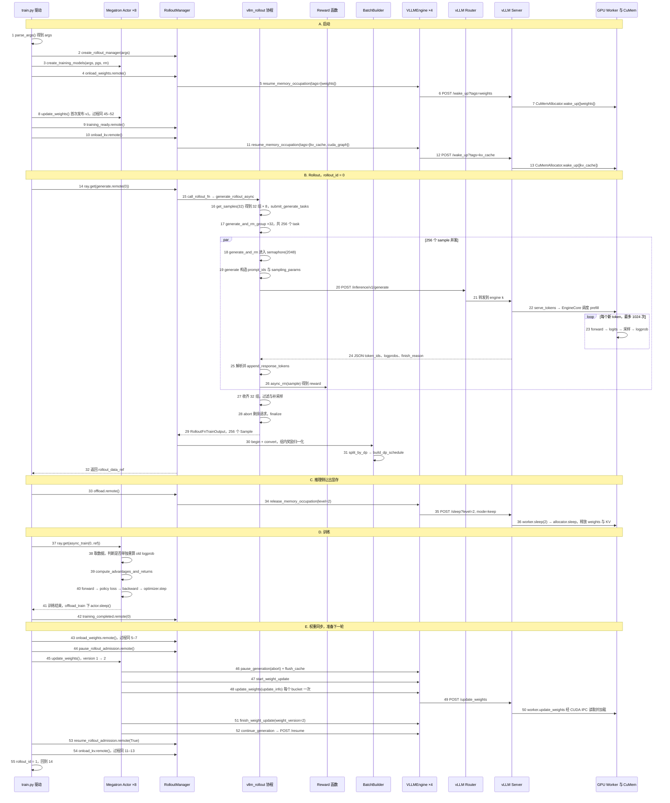

本篇分三部分：

1. 一张完整时序图（每个箭头带编号）；
2. 完整的可调用接口表和参数表；
3. 按时序编号逐步讲解：代入数值、贴代码、给代码位置。

代码位置以当前机器 checkout 为准（行号会随提交变化，定位时优先用函数名）：

| 简写 | 路径 | 版本 |
|---|---|---|
| `vime/` | /data/home/xli49/lxy/vime | `d7e40fe8` |
| `vllm/` | /data/home/xli49/lxy/vllm | `36d4ef654a` |

## 0. 本篇使用的场景

整篇只走一条主路径：**colocate、同步训练、纯文本、GRPO、dense 模型**。

```text
硬件            8 张 GPU，训练和推理共用（--colocate）
训练侧          Megatron TP=2 → DP=4，共 8 个 actor 进程
推理侧          rollout_num_gpus=8，每个 engine 2 卡 → 4 个 vLLM engine
数据            32 个 prompt × 每个 8 个 sample = 256 个 sample
长度            prompt ≤ 512，response ≤ 1024，context ≤ 4096
训练 batch      global_batch_size = 256，micro_batch_size = 8，每轮 1 个训练 step
权重版本        启动后为 1，rollout 0 训练完后为 2
```

不展开的分支：fully-async、partial rollout 续写、多模态、critic、disk 权重同步、容错恢复。

## 1. 完整时序图



一轮训练的总时间可以按阶段拆开：

```text
T_step = T_rollout(14–32) + T_offload(33–36) + T_train(37–42)
       + T_onload_weights(43) + T_weight_sync(44–53) + T_onload_kv(54)
```

## 2. 接口表与参数表

### 2.1 可调用接口表

“步骤”列对应时序图编号。

#### vime 驱动与 Ray 控制面

| 接口 | 类型 | 位置 | 关键参数 | 返回 | 步骤 |
|---|---|---|---|---|---|
| `parse_args(add_custom_arguments=None, *, return_restore_plan=False)` | Python | `vime/vime/utils/arguments.py:1833` | 命令行 | `(args, restore_plan)` | 1 |
| `create_rollout_manager(args, *, restore_plan=None)` | Python | `vime/vime/ray/placement_group.py:293` | `args` | `startup`（`.manager`、`.placements`、`.num_rollout_per_epoch`） | 2 |
| `create_training_models(args, pgs, rollout_manager, actor_cls=None)` | Python | `vime/vime/ray/placement_group.py:203` | placement groups | `(actor_model, critic_model)` | 3 |
| `RolloutManager.onload_weights()` | Ray remote | `vime/vime/ray/rollout.py:468` → `engine_group.py:421` | — | 各 engine 的 HTTP 结果 | 4, 43 |
| `RolloutManager.training_ready()` | Ray remote | `vime/vime/ray/rollout.py:259` | — | `None` | 9 |
| `RolloutManager.onload_kv()` | Ray remote | `vime/vime/ray/rollout.py:472` → `engine_group.py:430` | — | 各 engine 的 HTTP 结果 | 10, 54 |
| `RolloutManager.generate(rollout_id)` | Ray remote | `vime/vime/ray/rollout.py:322` | `rollout_id=0` | `rollout_data_ref` | 14 |
| `RolloutManager._generate(rollout_id, start_time)` | Python | `vime/vime/ray/rollout.py:340` | — | `split_by_dp` 结果 | 15, 30–32 |
| `RolloutManager.offload()` | Ray remote | `vime/vime/ray/rollout.py:456` → `engine_group.py:407` | — | — | 33–34 |
| `RolloutManager.training_completed(rollout_id)` | Ray remote | `vime/vime/ray/rollout.py:435` | `0` | — | 42 |
| `RolloutManager.pause_rollout_admission()` | Ray remote | `vime/vime/ray/rollout.py:170` | — | `was_paused`（同步模式恒为 `True`） | 44 |
| `RolloutManager.resume_rollout_admission(was_paused)` | Ray remote | `vime/vime/ray/rollout.py:175` | `True` | — | 53 |
| `EngineGroup.offload(level)` | Python | `vime/vime/backends/vllm_utils/engine_group.py:273` | `level=2` | Ray refs | 34 |
| `EngineGroup.onload(tags)` | Python | `vime/vime/backends/vllm_utils/engine_group.py:283` | `[weights]` 或 `[kv_cache, cuda_graph]` | Ray refs | 5, 11 |

#### vime rollout 协程（运行在 RolloutManager 进程内）

| 接口 | 位置 | 关键参数 | 返回 | 步骤 |
|---|---|---|---|---|
| `call_rollout_fn(fn, *args, evaluation, **kwargs)` | `vime/vime/rollout/base_types.py:28` | `generate_rollout` | `RolloutFnTrainOutput` | 15 |
| `generate_rollout(args, rollout_id, data_source, evaluation=False)` | `vime/vime/rollout/vllm_rollout.py:1052` | — | `RolloutFnTrainOutput` | 15 |
| `generate_rollout_async(args, rollout_id, data_source)` | `vime/vime/rollout/vllm_rollout.py:775` | `data_source.get_samples` | `(output, aborted_samples)` | 16, 27–28 |
| `RolloutDataSource.get_samples(num_samples)` | `vime/vime/data/data_source.py:103` | `32` | `list[list[Sample]]`，32×8 | 16 |
| `GenerateState(args)` | `vime/vime/rollout/vllm_rollout.py:144` | — | 单例：tokenizer、semaphore、sampling_params | 16, 18 |
| `GenerateState.submit_generate_tasks(samples)` | `vime/vime/rollout/vllm_rollout.py:199` | 32 个 group | — | 16 |
| `generate_and_rm_group(args, group, sampling_params, evaluation=False)` | `vime/vime/rollout/vllm_rollout.py:683` | 8 个 sample | `list[Sample]` | 17, 26 |
| `generate_and_rm(args, sample, sampling_params, evaluation=False)` | `vime/vime/rollout/vllm_rollout.py:592` | 1 个 sample | `Sample` | 18, 26 |
| `generate(args, sample, sampling_params)` | `vime/vime/rollout/vllm_rollout.py:391` | 1 个 sample | `Sample` | 19–25 |
| `_build_inference_sampling_params(sampling_params, logprobs=1)` | `vime/vime/rollout/vllm_rollout.py:215` | `logprobs=1` | vLLM `sampling_params` dict | 19 |
| `_inference_generate_tokens_and_logprobs(choice)` | `vime/vime/rollout/vllm_rollout.py:245` | `choices[0]` | `(tokens, log_probs)` | 25 |
| `_inference_generate_meta_info(output)` | `vime/vime/rollout/vllm_rollout.py:515` | 响应 JSON | `meta_info` dict | 25 |
| `Sample.append_response_tokens(args, *, tokens, log_probs, trainable, meta_info, text)` | `vime/vime/utils/types.py:271` | 3 个 token | — | 25 |
| `async_rm(args, sample)` | `vime/vime/rollout/rm_hub/__init__.py:55` | 1 个 sample | `reward` | 26 |
| `batched_async_rm(args, samples)` | `vime/vime/rollout/rm_hub/__init__.py:99` | 一组（`--group-rm`） | `list[reward]` | 26 |
| `abort(args, rollout_id)` | `vime/vime/rollout/vllm_rollout.py:725` | — | 未完成 group | 28 |

#### vime 数据转换

| 接口 | 位置 | 输入 | 输出 | 步骤 |
|---|---|---|---|---|
| `BatchBuilder.begin(samples, *, replay=False)` | `vime/vime/data/batch_builder.py:48` | 32 组 | 缓存命中则直接返回 | 30 |
| `BatchBuilder._post_process_rewards(samples)` | `vime/vime/data/batch_builder.py:210` | 256 个 reward | `(raw_rewards, rewards)` | 30 |
| `BatchBuilder.convert(samples)` | `vime/vime/data/batch_builder.py:259` | 256 个 Sample | 列式 dict（tokens、rewards、loss_masks…） | 30 |
| `BatchBuilder.split_by_dp(data)` | `vime/vime/data/batch_builder.py:448` | 列式 dict | 各 DP rank 的 ref | 31 |
| `build_dp_schedule(args, cfg, total_lengths, *, global_batch_size, rollout_indices)` | `vime/vime/utils/dp_schedule.py:82` | 256 个长度 | partitions、micro-batch 下标 | 31 |

#### Megatron 训练与权重发布

| 接口 | 位置 | 关键参数 | 步骤 |
|---|---|---|---|
| `RayTrainGroup.async_train(rollout_id, rollout_data_ref, external_data=None)` | `vime/vime/ray/actor_group.py:148` | `0, ref` | 37 |
| `MegatronTrainRayActor.train(rollout_id, rollout_data_ref, external_data=None)` | `vime/vime/backends/megatron_utils/actor.py:395` | — | 37, 41 |
| `MegatronTrainRayActor.train_actor(rollout_id, rollout_data, external_data=None)` | `vime/vime/backends/megatron_utils/actor.py:445` | — | 38–40 |
| `MegatronTrainRayActor.compute_log_prob(data_iterator, num_microbatches, store_prefix)` | `vime/vime/backends/megatron_utils/actor.py:377` | `store_prefix=""` | 38 |
| `compute_advantages_and_returns(args, rollout_data)` | `vime/vime/backends/megatron_utils/loss.py:720` | — | 39 |
| `get_grpo_returns(rewards, kl)` | `vime/vime/utils/ppo_utils.py:533` | — | 39 |
| `policy_loss_function(args, batch, logits, ...)` | `vime/vime/backends/megatron_utils/loss.py:1118` | — | 40 |
| `compute_policy_loss(ppo_kl, advantages, eps_clip, eps_clip_high, eps_clip_c=None)` | `vime/vime/utils/ppo_utils.py:297` | `0.2, 0.2` | 40 |
| `RayTrainGroup.update_weights()` | `vime/vime/ray/actor_group.py:178` | — | 8, 45 |
| `MegatronTrainRayActor.update_weights()` | `vime/vime/backends/megatron_utils/actor.py:624` | — | 45 |
| `UpdateWeightFromTensor.update_weights()` | `vime/vime/backends/megatron_utils/update_weight/update_weight_from_tensor.py:356` | colocate 时被选中 | 45–52 |
| `IPCWeightTransferTrainer.send_weights()` | `vllm/vllm/distributed/weight_transfer/ipc_engine.py:318` | — | 47–51 |
| `VimeRayWeightSyncClient.start/update/finish_weight_update` | `vime/vime/backends/megatron_utils/update_weight/common.py:265–280` | — | 47, 48, 51 |

#### VLLMEngine（Ray actor，HTTP 客户端）

| 接口 | 位置 | 发出的 HTTP 请求 | 步骤 |
|---|---|---|---|
| `release_memory_occupation(level=2)` | `vime/vime/backends/vllm_utils/vllm_engine.py:371` | `POST /sleep?level=2&mode=keep` | 35 |
| `resume_memory_occupation(tags)` | `vime/vime/backends/vllm_utils/vllm_engine.py:380` | `POST /wake_up?tags=...` | 6, 12 |
| `pause_generation(mode="abort")` | `vime/vime/backends/vllm_utils/vllm_engine.py:497` | `POST /pause?mode=abort&clear_cache=false` | 46 |
| `flush_cache()` | `vime/vime/backends/vllm_utils/vllm_engine.py:302` | `POST /reset_prefix_cache?reset_running_requests=true&reset_external=true` | 46 |
| `start_weight_update()` | `vime/vime/backends/vllm_utils/vllm_engine.py:396` | `POST /start_weight_update` | 47 |
| `update_weights(update_info)` | `vime/vime/backends/vllm_utils/vllm_engine.py:284` | `POST /update_weights` | 48–49 |
| `finish_weight_update(weight_version)` | `vime/vime/backends/vllm_utils/vllm_engine.py:402` | `POST /finish_weight_update` | 51 |
| `continue_generation()` | `vime/vime/backends/vllm_utils/vllm_engine.py:508` | `POST /resume` | 52 |

#### vLLM HTTP 端点

| 端点 | 位置 | 请求参数 | 下游调用 | 步骤 |
|---|---|---|---|---|
| `POST /inference/v1/generate` | `vllm/vllm/entrypoints/scale_out/token_in_token_out/api_router.py:46` | body：`model`、`token_ids`、`sampling_params` | `ServingTokens.serve_tokens`（`serving.py:185`） | 20–24 |
| `POST /sleep` | `vllm/vllm/entrypoints/serve/dev/sleep/api_router.py:26` | query：`level`(0–2)、`mode` | `AsyncLLM.sleep` | 35 |
| `POST /wake_up` | `vllm/vllm/entrypoints/serve/dev/sleep/api_router.py:44` | query：可重复的 `tags` | `AsyncLLM.wake_up` | 6, 12 |
| `POST /pause` | `vllm/vllm/entrypoints/rl/online/api_router.py:31` | query：`mode`、`clear_cache` | `AsyncLLM.pause_generation` | 46 |
| `POST /reset_prefix_cache` | `vllm/vllm/entrypoints/serve/dev/cache/api_router.py:20` | query：`reset_running_requests`、`reset_external` | 清 prefix cache | 46 |
| `POST /start_weight_update` | `vllm/vllm/entrypoints/rl/online/api_router.py:181` | — | `AsyncLLM.start_weight_update` | 47 |
| `POST /update_weights` | `vllm/vllm/entrypoints/rl/online/api_router.py:195` | body：`update_info` | `AsyncLLM.update_weights` | 49 |
| `POST /finish_weight_update` | `vllm/vllm/entrypoints/rl/online/api_router.py:207` | body：`weight_version` | `AsyncLLM.finish_weight_update` | 51 |
| `POST /resume` | `vllm/vllm/entrypoints/rl/online/api_router.py:78` | — | `AsyncLLM.resume_generation` | 52 |

#### vLLM 引擎内部

| 接口 | 位置 | 作用 | 步骤 |
|---|---|---|---|
| `ServingTokens._create_tokens_logprobs(token_ids, top_logprobs)` | `vllm/vllm/entrypoints/scale_out/token_in_token_out/serving.py:880` | 生成每 token 的 `logprobs.content` | 24 |
| `AsyncLLM.sleep(level, mode)` / `wake_up(tags)` | `vllm/vllm/v1/engine/async_llm.py:1198` / `1213` | 转发到 EngineCore | 7, 13, 36 |
| `EngineCore.sleep(level, mode)` / `wake_up(tags)` | `vllm/vllm/v1/engine/core.py:1019` / `1061` | 先暂停调度，再交给 executor | 7, 13, 36 |
| `Worker.sleep(level)` / `wake_up(tags)` | `vllm/vllm/v1/worker/gpu_worker.py:301` / `341` | 调用 sleep-mode backend | 7, 13, 36 |
| `CuMemBackend.suspend(level)` / `resume(tags)` | `vllm/vllm/device_allocator/sleep_mode_backend.py:127` / `139` | 决定哪些 tag 备份到 CPU | 7, 13, 36 |
| `CuMemAllocator.sleep(offload_tags)` | `vllm/vllm/device_allocator/cumem.py:233` | 备份或丢弃各 allocation | 36 |
| `CuMemAllocator.wake_up(tags)` | `vllm/vllm/device_allocator/cumem.py:331` | 重新 create + map | 7, 13 |
| `AsyncLLM.start_weight_update` / `update_weights` / `finish_weight_update` | `vllm/vllm/v1/engine/async_llm.py:1420` / `1428` / `1439` | `collective_rpc` 到所有 worker | 47, 50, 51 |
| `Worker.start_weight_update` / `update_weights` / `finish_weight_update` | `vllm/vllm/v1/worker/gpu_worker.py:1545` / `1595` / `1636` | 在 worker 上接收并加载权重 | 47, 50, 51 |

### 2.2 参数表

“本文取值”是第 0 节场景用的值；“默认”是不传参数时的值。

| 参数 | 本文取值 | 默认 | 首个生效位置 | 改变什么 | 步骤 |
|---|---:|---|---|---|---|
| `--colocate` | 开 | 关 | `arguments.py:72`；`vllm_engine.py:762` | 训练和推理共用 GPU；权重同步走 IPC；强制打开两个 offload | 全程 |
| `--offload-rollout` | 开 | colocate 时为开 | `train.py:18,30,53,87,96`；`vllm_engine.py:752` | 是否执行 onload/offload；开启 vLLM sleep mode | 4–13, 33–36, 43, 54 |
| `--offload-train` | 开 | colocate 时为开 | `actor.py:399,411` | 训练前后 Megatron 唤醒或睡眠 | 37, 41 |
| `--num-rollout` | 100 | 由数据集大小推算 | `train.py:47` | 外层循环次数 | 14, 53 |
| `--rollout-batch-size` | 32 | 必填 | `vllm_rollout.py:803` | `target_data_size`，每轮收齐多少个 group | 16, 27 |
| `--n-samples-per-prompt` | 8 | 1 | `data_source.py:123`；`vllm_rollout.py:833` | 每个 prompt 复制成几个 sample | 16, 27, 30 |
| `--over-sampling-batch-size` | 32 | 等于 rollout_batch_size（`arguments.py:2295`） | `vllm_rollout.py:816` | 每次从数据源取多少个 prompt | 16 |
| `--rollout-max-prompt-len` | 512 | 不限 | `data_source.py:88` | 构建数据集时过滤超长 prompt | 16 |
| `--rollout-max-response-len` | 1024 | 无 | `vllm_rollout.py:163` → `218` | 请求里的 `max_tokens` | 19, 23 |
| `--rollout-max-context-len` | 4096 | 无 | `vllm_engine.py:756–760` | vLLM `max_model_len` | 2 |
| `--rollout-temperature` | 1.0 | 1.0 | `vllm_rollout.py:160` | 采样温度，必须 > 0 | 19, 23 |
| `--rollout-top-p` | 1.0 | 1.0 | `vllm_rollout.py:161`、`419` | 采样 top-p；同时影响 `logprobs` 的取值 | 19, 23 |
| `--rollout-top-k` | -1 | -1 | `vllm_rollout.py:162`、`223–225` | 采样 top-k，-1 表示不限 | 19, 23 |
| `--rollout-stop` | 不设 | 无 | `vllm_rollout.py:164`、`226–229` | 停止字符串 | 19, 23 |
| `--rollout-stop-token-ids` | 不设 | 无 | `vllm_rollout.py:165`、`230–231` | 停止 token | 19, 23 |
| `--vllm-server-concurrency` | 512 | 512 | `vllm_rollout.py:155–157` | semaphore = 512 × engine 数 | 18 |
| `rollout_num_gpus` / `rollout_num_gpus_per_engine` | 8 / 2 | — | `http_utils.py:228–237` | engine 数 = 8 // 2 = 4 | 2, 18 |
| `--group-rm` | 关 | 关 | `vllm_rollout.py:653`、`716` | reward 按 sample 算还是按组算 | 26 |
| `--dynamic-sampling-filter-path` | 不设 | 无 | `vllm_rollout.py:796`、`837` | 是否丢弃 group 并补采样 | 27 |
| `--partial-rollout` | 关 | 关 | `vllm_rollout.py:599`、`755` | 被 abort 的半成品是否放回数据源 | 18, 28 |
| `--advantage-estimator` | grpo | grpo | `batch_builder.py:216`；`loss.py:779` | 优势估计方法 | 30, 39 |
| `--disable-rewards-normalization` | 不传 | 归一化开启 | `batch_builder.py:217` | 是否减去组均值 | 30 |
| `--disable-grpo-std-normalization` | 不传 | 除以 std 开启 | `batch_builder.py:250` | 是否再除以组标准差 | 30 |
| `--global-batch-size` | 256 | 由 num_steps_per_rollout 推导 | `arguments.py:2281–2289`；`batch_builder.py:464` | 每个 optimizer step 消费多少 sample | 31 |
| `--num-steps-per-rollout` | 1 | 无 | `arguments.py:2281–2289` | 256 // N 推出 global_batch_size | 31, 38 |
| `--micro-batch-size` | 8 | 1 | `dp_schedule.py:163` | 每次 forward 处理几条 sample | 31, 40 |
| `--use-rollout-logprobs` | 关 | 关 | `actor.py:487,495`；`loss.py:1151` | old logprob 用 vLLM 返回的还是 Megatron 算的 | 38, 40 |
| `--kl-coef` | 0.0 | 0.0 | `actor.py:486`；`loss.py:759` | 是否需要 ref logprob 和 KL 项 | 38, 39 |
| `--eps-clip` / `--eps-clip-high` | 0.2 / 0.2 | 0.2 / 等于 eps_clip（`arguments.py:2173`） | `ppo_utils.py:306` | ratio 的截断区间 [0.8, 1.2] | 40 |
| `--flush-cache-interval` | 1 | 1 | `update_weight_from_tensor.py:361–372` | 每次同步是否 abort 请求并清 prefix cache | 46 |

## 3. 按时序逐步讲解

每一步都按“作用 → 数值 → 代码 → 位置”的顺序讲。

### A. 启动（步骤 1–13）

#### 步骤 1：`parse_args()` 生成 args

**作用**：把命令行字符串变成 `args` Namespace，并推导出依赖其他参数的值。后面所有函数都通过 `args.xxx` 读配置。

**数值**：

```text
--rollout-batch-size 32        → args.rollout_batch_size = 32
--n-samples-per-prompt 8       → args.n_samples_per_prompt = 8
--num-steps-per-rollout 1      → args.global_batch_size = 32 × 8 // 1 = 256
--eps-clip 0.2（不传 high）     → args.eps_clip_high = 0.2
（不传 over-sampling）          → args.over_sampling_batch_size = 32
```

**代码**（推导 global_batch_size）：

```python
if args.num_steps_per_rollout is not None:
    global_batch_size = args.rollout_batch_size * args.n_samples_per_prompt // args.num_steps_per_rollout
    ...
    args.global_batch_size = global_batch_size
```

**位置**：`vime/vime/utils/arguments.py:1833`（`parse_args`），`2173`（eps_clip_high），`2281–2289`（global_batch_size），`2295–2296`（over_sampling）。

#### 步骤 2：`create_rollout_manager()` 建资源和 vLLM engine

**作用**：创建 Ray placement group，启动 4 个 vLLM server 进程（每个占 2 卡），在 Router 上注册，再创建 `RolloutManager` actor。vLLM 启动参数在 `_compute_server_args` 中生成。

**数值**：

```text
engine 数        = rollout_num_gpus // rollout_num_gpus_per_engine = 8 // 2 = 4
max_model_len    = rollout_max_context_len = 4096
enable_sleep_mode = True（因为 offload_rollout）
weight_transfer  = {"backend": "ipc"}（因为 colocate）
```

**代码**：

```python
if args.offload_rollout and not getattr(args, "vllm_enable_sleep_mode", False):
    kwargs["enable_sleep_mode"] = True
...
    kwargs["max_model_len"] = args.rollout_max_context_len

if args.colocate:
    kwargs["weight_transfer_config"] = {"backend": "ipc"}
```

**位置**：`vime/train.py:110`；`vime/vime/ray/placement_group.py:293`；`vime/vime/backends/vllm_utils/vllm_engine.py:752–765`；`vime/vime/utils/http_utils.py:228–237`。

#### 步骤 3：`create_training_models()` 建 Megatron actor

**作用**：在同一组 GPU 上创建 8 个 `MegatronTrainRayActor`，加载 checkpoint，构建 optimizer 和权重更新器。colocate 下选择 `UpdateWeightFromTensor`（IPC 传输）。

**数值**：8 个 actor，TP=2 → DP=4。

**代码**：

```python
actor_model, critic_model = create_training_models(args, pgs, rollout_manager)
```

```python
elif args.colocate:
    from .update_weight_from_tensor import UpdateWeightFromTensor
    update_weight_cls = UpdateWeightFromTensor
```

**位置**：`vime/train.py:16`；`vime/vime/ray/placement_group.py:203`；`vime/vime/backends/megatron_utils/update_weight/__init__.py:35–38`。

#### 步骤 4–7：`onload_weights()` 恢复 vLLM 的权重显存

**作用**：colocate 下 engine 在 Megatron 初始化期间处于睡眠状态。推送权重前，先把 vLLM 的 `weights` allocation 重新映射回 GPU。此时显存里还没有正确的权重内容，内容由步骤 8 写入。

**数值**：`tags=["weights"]` → `POST /wake_up?tags=weights`，4 个 engine 并发执行。`CuMemAllocator.wake_up` 会顺带恢复所有非可延迟 tag（`runtime`、`cudagraph`），因为只有 `weights` 和 `kv_cache` 属于 `DEFERRABLE_TAGS`。

**代码**：

```python
# train.py
if args.offload_rollout and not release_train:
    ray.get(rollout_manager.onload_weights.remote())

# engine_group.py
handles.extend(g.onload(tags=[GPU_MEMORY_TYPE_WEIGHTS]))

# vllm_engine.py
wake_params = [("tags", t) for t in tags] if tags else None
requests.post(f"http://{self.server_host}:{self.server_port}/wake_up", params=wake_params)

# vllm cumem.py
if tags is None or data.tag in tags or data.tag not in DEFERRABLE_TAGS:
    create_and_map(handle)
    data.is_asleep = False
```

**位置**：`vime/train.py:18–19` → `vime/vime/ray/rollout.py:468` → `vime/vime/backends/vllm_utils/engine_group.py:421–428` → `vime/vime/backends/vllm_utils/vllm_engine.py:380–387` → `vllm/vllm/entrypoints/serve/dev/sleep/api_router.py:44` → `vllm/vllm/v1/worker/gpu_worker.py:341` → `vllm/vllm/device_allocator/sleep_mode_backend.py:139` → `vllm/vllm/device_allocator/cumem.py:331–351`。

#### 步骤 8：首次 `update_weights()`

**作用**：把 Megatron 刚加载的权重推给 4 个 engine，`weight_version` 从 0 变为 1。由于这是首次发布，`should_flush_cache` 返回 True，因此会 abort 请求并清 cache。具体流程与步骤 45–52 相同。

**数值**：`weight_version = 0 + 1 = 1`；`should_flush_cache(1, 1, 0)` 中 `1 == 0 + 1` 成立，返回 True。

**代码**：

```python
# Always push actor weights to rollout once weights are loaded.
actor_model.update_weights()
```

**位置**：`vime/train.py:22`；`vime/vime/utils/weight_sync.py`（`should_flush_cache`）。

#### 步骤 9：`training_ready()`

**作用**：通知 RolloutManager 权重已经装好，允许在故障恢复中被暂停的 producer 继续运行。正常首次启动时 `_recovery_admission_was_paused` 为 None，这一步什么也不做。

**代码**：

```python
def training_ready(self):
    if self._recovery_admission_was_paused is not None:
        self.resume_rollout_admission(self._recovery_admission_was_paused)
        self._recovery_admission_was_paused = None
```

**位置**：`vime/train.py:25`；`vime/vime/ray/rollout.py:259–264`。

#### 步骤 10–13：`onload_kv()` 恢复 KV cache

**作用**：在第一次 rollout 前把 KV cache allocation 映射回 GPU。vime 传入的 tags 是 `[kv_cache, cuda_graph]`，但 `_normalize_vllm_wake_tags` 只保留 vLLM 认识的 `weights` 和 `kv_cache`，所以实际请求是 `tags=kv_cache`。cudagraph 内存已经在步骤 7 随非可延迟 tag 一起恢复。

**数值**：如果单个 engine 的 KV cache 为 18 GiB，`wake_up` 后这 18 GiB 被重新 `cuMemCreate → cuMemMap → cuMemSetAccess`，其内容为空（KV 不需要保留）。

**代码**：

```python
# engine_group.py
handles.extend(g.onload(tags=[GPU_MEMORY_TYPE_KV_CACHE, GPU_MEMORY_TYPE_CUDA_GRAPH]))

# vllm_engine.py
_VLLM_WAKE_TAGS = frozenset({"weights", "kv_cache"})
normalized = [t for t in tags if t in _VLLM_WAKE_TAGS]
```

**位置**：`vime/train.py:30–31` → `vime/vime/ray/rollout.py:472` → `vime/vime/backends/vllm_utils/engine_group.py:430–435` → `vime/vime/backends/vllm_utils/vllm_engine.py:23, 380–387, 558–565` → `vllm/vllm/device_allocator/cumem.py:331–351`；C++ 实现在 `vllm/csrc/cumem_allocator.cpp`。

### B. Rollout（步骤 14–32）

#### 步骤 14：`ray.get(generate.remote(0))`

**作用**：driver 在这里阻塞，直到 RolloutManager 返回已经转换并切好 DP 的训练数据引用。

**数值**：`rollout_id = 0`。`rollout_id` 只是轮次编号，不决定 sample 数量。

**代码**：

```python
for rollout_id in range(args.start_rollout_id, args.num_rollout):
    ...
    rollout_data_ref = ray.get(rollout_manager.generate.remote(rollout_id))
```

```python
def generate(self, rollout_id):
    self.rollout_id = rollout_id
    self.batch_builder.rollout_id = rollout_id
    set_current_rollout_id(rollout_id)
    self.health_monitoring_resume()
    result = self._generate(rollout_id, start_time)
```

**位置**：`vime/train.py:47, 51`；`vime/vime/ray/rollout.py:322–338`。

#### 步骤 15：`call_rollout_fn` → `generate_rollout_async`

**作用**：`_generate` 调用 `_get_rollout_data`，后者用 `call_rollout_fn` 执行配置的 rollout 函数（默认 `vllm_rollout.generate_rollout`）。该函数用 `run()` 把异步函数 `generate_rollout_async` 跑完。

**代码**：

```python
# rollout.py
data = call_rollout_fn(self.generate_rollout, self.args, rollout_id, self.data_source, evaluation=False)

# vllm_rollout.py
output, aborted_samples = run(generate_rollout_async(args, rollout_id, data_source.get_samples))
if aborted_samples:
    data_source.add_samples(aborted_samples)
```

**位置**：`vime/vime/ray/rollout.py:360, 550`；`vime/vime/rollout/vllm_rollout.py:1052–1073`。

#### 步骤 16：取 prompt，复制成 group，提交 group task

**作用**：从数据源取 32 个 prompt，每个 deep-copy 8 份组成一个 group，并给每个 sample 编号 `group_index` 和 `index`。然后每个 group 被包装成一个 asyncio task。

**数值**：

```text
target_data_size = 32
get_samples(32)  → 32 个 group × 8 个 sample = 256 个 Sample
group_index      = 0..31
index            = 0..255
remaining_batch_size: 0 → 32
```

**代码**：

```python
# data_source.py
for prompt_sample in prompt_samples:
    group = []
    for _ in range(self.args.n_samples_per_prompt):
        sample = copy.deepcopy(prompt_sample)
        sample.group_index = self.sample_group_index
        sample.index = self.sample_index
        self.sample_index += 1
        group.append(sample)
    self.sample_group_index += 1
    samples.append(group)

# vllm_rollout.py
target_data_size = args.rollout_batch_size
while len(data) < target_data_size:
    while state.remaining_batch_size < target_data_size:
        samples = data_source(args.over_sampling_batch_size)
        state.submit_generate_tasks(samples)
```

```python
def submit_generate_tasks(self, samples):
    for group in samples:
        self.pendings.add(asyncio.create_task(
            generate_and_rm_group(self.args, group,
                                  sampling_params=self.sampling_params.copy(), evaluation=False)))
    self.remaining_batch_size += len(samples)
```

**位置**：`vime/vime/data/data_source.py:103–131`（prompt 长度过滤在 `84–97` 构建 Dataset 时完成）；`vime/vime/rollout/vllm_rollout.py:803–819, 199–212`。

#### 步骤 17：`generate_and_rm_group` 拆成 8 个 sample task

**作用**：给每个 sample 一个 `session_id`（Router 使用 consistent_hash 策略时作为路由键），每个 sample 复制一份独立的 `sampling_params`，然后 `gather` 等 8 个 task 全部结束。

**数值**：每组 8 个 task，32 组共 256 个 task。一个 group 的完成时间等于组内最慢 sample 的完成时间。

**代码**：

```python
for sample in group:
    if sample.session_id is None:
        sample.session_id = str(uuid.uuid4())

tasks = []
for idx, sample in enumerate(group):
    current_sampling_params = sampling_params.copy()
    tasks.append(asyncio.create_task(
        generate_and_rm(args, sample, current_sampling_params, evaluation=evaluation)))

group = await asyncio.gather(*tasks)
```

**位置**：`vime/vime/rollout/vllm_rollout.py:683–713`。

#### 步骤 18：`generate_and_rm` 进入并发控制

**作用**：已完成的 sample 直接返回；否则进入 semaphore、经过 pacer，在 DP rank 计数中登记，再调用 `generate()`。`_run_server_abort_generate` 统计进行中的请求数，供步骤 28 的 abort 使用。

**数值**：

```text
semaphore 上限 = vllm_server_concurrency × engine 数 = 512 × 4 = 2048
本轮请求数     = 256 < 2048 → 256 个请求同时在途，平均每个 engine 约 64 个
```

**代码**：

```python
# GenerateState.__init__
self.semaphore = asyncio.Semaphore(
    concurrency if concurrency is not None else args.vllm_server_concurrency * get_rollout_num_engines(args)
)

# generate_and_rm
async with state.semaphore:
    await state.generation_pacer.wait()
    if state.aborted:
        sample.status = Sample.Status.ABORTED
        return sample
    with state.dp_rank_context() as _:
        generate_func = load_function(custom_func_path) if custom_func_path is not None else generate
        generate_call = generate_func(args, sample, sampling_params)
        sample = await _run_server_abort_generate(state, generate_call)
```

**位置**：`vime/vime/rollout/vllm_rollout.py:155–157, 592–646, 580–588`。

#### 步骤 19：`generate()` 构造 prompt_ids 和 sampling_params

**作用**：tokenize prompt，扣除已有 response 长度，确定 `logprobs` 数量，再把 vime 的参数名转换成 vLLM 的参数名。

**数值**（以一个 200-token prompt 的新 sample 为例）：

```text
prompt_ids                    长度 200（上限 512）
max_new_tokens                = 1024 - response_length(0) = 1024
logprobs                      = 1（未启用 score centering）
prompt + response 上限        = 200 + 1024 = 1224 ≤ max_model_len 4096
```

转换前后的参数：

```python
# GenerateState.sampling_params（来自 args）
{"temperature": 1.0, "top_p": 1.0, "top_k": -1, "max_new_tokens": 1024,
 "stop": None, "stop_token_ids": None, "skip_special_tokens": False,
 "no_stop_trim": True, "spaces_between_special_tokens": False}

# _build_inference_sampling_params 之后
{"max_tokens": 1024, "temperature": 1.0, "top_p": 1.0, "logprobs": 1,
 "top_k": -1, "skip_special_tokens": False, "spaces_between_special_tokens": False}
```

`stop` 和 `stop_token_ids` 为空时不会写入请求，`top_k=-1` 会写入请求。

**代码**：

```python
prompt_ids = _prepare_prompt_ids(sample, state.tokenizer, state.processor)
sampling_params["max_new_tokens"] -= sample.response_length
if sampling_params["max_new_tokens"] == 0:
    sample.status = Sample.Status.TRUNCATED
    return sample

logprobs = args.score_centering_top_k + 1 if score_centering and args.rollout_top_p == 1 else 1
inference_sampling_params = _build_inference_sampling_params(sampling_params, logprobs)
```

```python
sp = {
    "max_tokens": sampling_params["max_new_tokens"],
    "temperature": sampling_params["temperature"],
    "top_p": sampling_params["top_p"],
    "logprobs": logprobs,
}
tk = sampling_params.get("top_k")
if tk is not None and (tk > 0 or tk == -1):
    sp["top_k"] = tk
```

**位置**：`vime/vime/rollout/vllm_rollout.py:159–169`（默认参数），`391–420`（`generate` 前半段），`215–242`（参数转换），`62`（`_prepare_prompt_ids`）。

#### 步骤 20：`POST /inference/v1/generate`

**作用**：把 token 化后的 prompt 和采样参数发给 Router。这里发送的是 token_ids 而不是文本，因此 vLLM 不会重新 tokenize。

**数值**：256 个请求，每个都是如下结构：

```json
{
  "model": "/path/to/Qwen3-4B",
  "token_ids": [151644, 872, 198, "...共 200 个"],
  "sampling_params": {
    "max_tokens": 1024, "temperature": 1.0, "top_p": 1.0,
    "logprobs": 1, "top_k": -1,
    "skip_special_tokens": false, "spaces_between_special_tokens": false
  }
}
```

**代码**：

```python
url = f"{base}/inference/v1/generate"
payload = {
    "model": args.hf_checkpoint,
    "token_ids": list(prompt_ids),
    "sampling_params": inference_sampling_params,
}
output = await post(url, payload, headers=headers)
```

**位置**：`vime/vime/rollout/vllm_rollout.py:397, 436–441, 462–471`。

#### 步骤 21：Router 转发到某个 engine

**作用**：Router 按自身策略（例如负载均衡，或使用 `x-session-id` 的 consistent_hash）选择 4 个 engine 之一转发。vime 只在 `router_policy == "consistent_hash"` 时才设置该请求头。

**数值**：256 个请求分到 engine 0–3，每个约 64 个。

**位置**：请求头逻辑在 `vime/vime/rollout/vllm_rollout.py:436–440`；Router 是独立进程，不在本仓库的主路径内。

#### 步骤 22：vLLM 接收请求并调度 prefill

**作用**：`serve_tokens` 校验模型名和 `n ≤ max_num_seqs`，把请求交给 `AsyncLLM`；EngineCore scheduler 把它放进批次并分配 KV block，然后执行 prefill。

**数值**：prefill 处理 200 个 prompt token，按 block 写入 KV cache。

**代码**：

```python
@router.post("/inference/v1/generate", ...)
async def generate(request: GenerateRequest, raw_request: Request):
    handler = generate_tokens(raw_request)
    generator = await handler.serve_tokens(request, raw_request)
    ...
    elif isinstance(generator, GenerateResponseBase):
        return JSONResponse(content=generator.model_dump())
```

**位置**：`vllm/vllm/entrypoints/scale_out/token_in_token_out/api_router.py:46–73`；`vllm/vllm/entrypoints/scale_out/token_in_token_out/serving.py:185`（`serve_tokens`），`425`（`serve_tokens_full_generator`）。

#### 步骤 23：逐 token decode

**作用**：每一步做 forward → logits → temperature/top-k/top-p → 采样一个 token，同时记录该 token 的 logprob。遇到 EOS、stop 条件或达到 `max_tokens` 时结束。

**数值**：

```text
单个 sample 最多 1024 个 decode step
256 个 sample 的 response token 上限 = 256 × 1024 = 262,144
logprobs=1 → 每个位置返回被采样 token 的 logprob，外加 top-1
```

**位置**：vLLM v1 engine core 与 model runner（`vllm/vllm/v1/engine/core.py`、`vllm/vllm/v1/worker/gpu_model_runner.py`），属于通用推理路径，本篇不展开。

#### 步骤 24：vLLM 构造响应 JSON

**作用**：`_create_tokens_logprobs` 为每个生成的 token 写一个 `content` 项。被采样的 token 若不在 top-k 映射里，logprob 写成哨兵值 `-9999.0`。

**数值**（示例：生成 3 个 token 后遇到 EOS）：

```json
{
  "choices": [{
    "token_ids": [101, 202, 151645],
    "logprobs": {"content": [
      {"token_id": 101,    "logprob": -0.42, "top_logprobs": [...]},
      {"token_id": 202,    "logprob": -1.10, "top_logprobs": [...]},
      {"token_id": 151645, "logprob": -0.08, "top_logprobs": [...]}
    ]},
    "finish_reason": "stop"
  }],
  "usage": {"prompt_tokens": 200, "completion_tokens": 3},
  "weight_version": "1"
}
```

`weight_version` 为 `"1"`，说明 rollout 0 使用的是步骤 8 发布的权重。

**代码**：

```python
for i, token_id in enumerate(token_ids):
    step_top_logprobs = top_logprobs[i]
    if step_top_logprobs is None or step_top_logprobs.get(token_id) is None:
        logprobs_content.append(GenerateLogProbsContent(token_id=token_id, logprob=-9999.0))
    else:
        step_token = step_top_logprobs[token_id]
        logprobs_content.append(GenerateLogProbsContent(
            token_id=token_id, logprob=_clamp_logprob(step_token.logprob), ...))
```

**位置**：`vllm/vllm/entrypoints/scale_out/token_in_token_out/serving.py:880–926`（logprobs），`593–648`（usage 等公共字段）。

#### 步骤 25：解析响应，写回 Sample

**作用**：把 `token_ids` 和 `logprobs.content` 按位置 zip 成两个等长列表；解析 `finish_reason`、`usage` 和 `weight_version`；decode 出文本；最后调用 `append_response_tokens`，它会同时扩展 `tokens`、`response_length`、`loss_mask` 和 `rollout_log_probs`。

**数值**：

```text
new_response_tokens    = [101, 202, 151645]
new_response_log_probs = [-0.42, -1.10, -0.08]
meta_info              = {finish_reason: {type: stop}, weight_version: "1",
                          prompt_tokens: 200, completion_tokens: 3, cached_tokens: 0}
sample.tokens          长度 200 → 203
sample.response_length = 3
sample.loss_mask       = [1, 1, 1]
sample.rollout_log_probs = [-0.42, -1.10, -0.08]
```

两个列表长度不同时，`zip(strict=False)` 会截断到较短的一方；`append_response_tokens` 也会检查两者长度必须相等。

**代码**：

```python
choice = output["choices"][0]
new_response_tokens, new_response_log_probs = _inference_generate_tokens_and_logprobs(choice)
meta_info = _inference_generate_meta_info(output)
text = state.tokenizer.decode(new_response_tokens, skip_special_tokens=skip_decode) if new_response_tokens else ""
sample.append_response_tokens(args, tokens=new_response_tokens, log_probs=new_response_log_probs,
                              trainable=True, meta_info=meta_info, text=text)
```

```python
def _inference_generate_tokens_and_logprobs(choice):
    token_ids = choice.get("token_ids")
    ...
    content = logprobs.get("content") if isinstance(logprobs, dict) else []
    pairs = list(zip(token_ids, content, strict=False))
    return [token_id for token_id, _ in pairs], [float(item["logprob"]) for _, item in pairs]
```

**位置**：`vime/vime/rollout/vllm_rollout.py:475–507`（解析主体），`245–255`（tokens/logprobs），`515–558`（meta_info）；`vime/vime/utils/types.py:271`（`append_response_tokens`）。

#### 步骤 26：计算 reward

**作用**：先执行 rollout sample hooks。未开启 `--group-rm` 时，每个 sample 生成完立刻单独调用 `async_rm`；开启时，在 `generate_and_rm_group` 收齐 8 个后调用一次 `batched_async_rm`。

**数值**（第 0 组的 8 个 reward）：

```python
rewards = [1, 0, 0, 1, 1, 0, 1, 0]
```

**代码**：

```python
sample = await apply_rollout_sample_hooks(args, sample, evaluation=evaluation)
if args.group_rm:
    return sample
...
if sample.reward is None:
    sample.reward = await async_rm(args, sample)
```

**位置**：`vime/vime/rollout/vllm_rollout.py:649–675`（单个 sample），`715–720`（group_rm）；`vime/vime/rollout/rm_hub/__init__.py:55, 99`。

#### 步骤 27：收齐 32 个 group

**作用**：用 `asyncio.wait(FIRST_COMPLETED)` 逐个回收 group，检查每组恰好 8 个，再交给 dynamic filter；被丢弃的组会让 `remaining_batch_size` 减 1，外层 while 循环于是再取新 prompt 补采样。

**数值**：未配置 filter 时，32 个 group 全部保留，`len(data)` 从 0 增长到 32，进度条走到 32 × 8 = 256。假设配置了 `check_reward_nonzero_std`，全对或全错的组（例如 `[1,1,1,1,1,1,1,1]`）会被丢弃，需要再取 32 个 prompt 补充。

**代码**：

```python
done, state.pendings = await asyncio.wait(state.pendings, return_when=asyncio.FIRST_COMPLETED)
for task in done:
    group = task.result()
    assert len(group) == args.n_samples_per_prompt
    dynamic_filter_output = call_dynamic_filter(dynamic_filter, args, group)
    if should_drop_dynamic_filter_output(...):
        state.remaining_batch_size -= 1
        continue
    if len(data) < target_data_size:
        data.append(group)
        pbar.update(args.n_samples_per_prompt)
```

**位置**：`vime/vime/rollout/vllm_rollout.py:812–862`。

#### 步骤 28：abort 剩余请求，finalize

**作用**：收够 32 组后，可能还有补采样产生的多余请求在跑。`abort()` 设置 `state.aborted`，向所有 worker 发 abort，并等待 pending task 结束。没有开启 partial rollout 时，这些结果直接丢弃。最后 `state.reset()`，并用 `finalize_rollout_groups` 打包输出。

**数值**：无过滤时 pending 为空，`aborted_samples = []`；`assert len(data) == 32`。

**代码**：

```python
aborted_samples = await abort(args, rollout_id)
assert len(data) == args.rollout_batch_size
state.reset()
output = await asyncio.to_thread(finalize_rollout_groups, args, rollout_id, data, metric_gatherer.collect(), controller=controller)
return output, aborted_samples
```

**位置**：`vime/vime/rollout/vllm_rollout.py:869–896`（收尾），`725–772`（`abort`）。

#### 步骤 29：rollout 函数返回 RolloutManager

**作用**：`RolloutFnTrainOutput.samples` 带回 32 组共 256 个 Sample，`metrics` 带回过滤统计。`_generate` 随后记录 rollout 日志。

**位置**：`vime/vime/ray/rollout.py:360, 379–381`。

#### 步骤 30：`begin` + `convert`，做 GRPO 组内归一化

**作用**：`convert` 把 `list[Sample]` 变成列式训练数据（tokens、rewards、loss_masks、response_lengths、rollout_log_probs……）。其中的 `_post_process_rewards` **在这里**完成 GRPO 的组内归一化：先减组均值，再除以组标准差（`torch.std`，默认无偏，即 n−1）。

**数值**（第 0 组）：

```text
raw rewards = [1, 0, 0, 1, 1, 0, 1, 0]
mean        = 0.5
centered    = [+0.5, -0.5, -0.5, +0.5, +0.5, -0.5, +0.5, -0.5]
std (n-1)   = sqrt(8 × 0.25 / 7) = 0.5345
advantage   = centered / (0.5345 + 1e-6) ≈ [+0.9354, -0.9354, -0.9354, +0.9354, ...]
```

如果一组 reward 全是 1，那么 centered 全为 0，这一组对梯度没有贡献。dynamic filter 丢弃这类组正是为此。

**代码**：

```python
for positions in groups.values():
    centered = rewards[positions] - rewards[positions].mean()
    if (self.args.advantage_estimator in ["grpo", "gspo", "cispo"]
            and self.args.grpo_std_normalization and len(positions) > 1):
        centered = centered / (centered.std() + 1e-6)
    rewards[positions] = centered
return raw_rewards, rewards[sample_rollouts].tolist()
```

**位置**：`vime/vime/ray/rollout.py:385–390`；`vime/vime/data/batch_builder.py:210–257`（归一化），`259`（`convert`）。

#### 步骤 31：`split_by_dp` 生成训练调度

**作用**：根据 `total_lengths` 把 256 条 sample 分成训练 step 和 micro-batch，再分配到各个 DP rank。

**数值**：

```text
num_steps        = 256 // global_batch_size(256) = 1
每个 step 的 mbs = 256 / micro_batch_size(8) = 32 个 micro-batch
每个 DP rank     = 32 / DP(4) = 8 个 micro-batch
num_microbatches = [8]（列表长度 1，步骤 38 会用到）
```

如果改成 `--num-steps-per-rollout 4`：`global_batch_size = 64`，`num_steps = 4`，`num_microbatches = [2, 2, 2, 2]`。

**代码**：

```python
partitions, micro_batch_indices, num_microbatches, global_batch_sizes = build_dp_schedule(
    self.args, self.train_parallel_config, total_lengths,
    global_batch_size=self.args.global_batch_size,
    rollout_indices=data["rollout_ids"],
)
```

```python
num_steps = len(rollout_ids) // global_batch_size
...
K = len(step_mbs)
num_mbs_per_rank = K // dp_size
num_microbatches.append(num_mbs_per_rank)
```

**位置**：`vime/vime/data/batch_builder.py:448–466`；`vime/vime/utils/dp_schedule.py:82, 135–189`。

#### 步骤 32：返回 `rollout_data_ref`

**作用**：driver 的 `ray.get` 返回，拿到的是 Ray object 引用，数据本体还在对象存储中，训练 actor 会按自己的 DP partition 去取。

**位置**：`vime/vime/ray/rollout.py:395`；`vime/train.py:51`。

### C. 推理侧让出显存（步骤 33–36）

#### 步骤 33–34：`offload()` → `release_memory_occupation(level=2)`

**作用**：先暂停健康检查，然后对每个需要 offload 的 engine 发 sleep。需要接收权重更新的 engine 用 level 2（权重可以丢弃，之后由训练侧重新推送）。

**数值**：`level = 2 if self.update_weights else 1` → 2；4 个 engine 并发执行。

**代码**：

```python
# train.py
if args.offload_rollout:
    ray.get(rollout_manager.offload.remote())

# rollout.py
self.health_monitoring_pause()
for srv in self.servers.values():
    srv.offload()

# engine_group.py
handles.extend(g.offload(level=2 if self.update_weights else 1))
```

**位置**：`vime/train.py:53–54`；`vime/vime/ray/rollout.py:456–462`；`vime/vime/backends/vllm_utils/engine_group.py:407–412, 273–281`。

#### 步骤 35：`POST /sleep?level=2&mode=keep`

**作用**：`mode=keep` 表示 scheduler 中的请求被冻结而不是 abort。rollout 已经结束，此时通常没有在途请求。

**代码**：

```python
response = requests.post(
    f"http://{self.server_host}:{self.server_port}/sleep", params={"level": level, "mode": "keep"}
)
```

```python
@router.post("/sleep")
async def sleep(raw_request, level: int = 1, mode: PauseMode = "abort"):
    await engine_client(raw_request).sleep(level, mode)
    return JSONResponse(content={"status": "sleeping", "level": level})
```

**位置**：`vime/vime/backends/vllm_utils/vllm_engine.py:371–378`；`vllm/vllm/entrypoints/serve/dev/sleep/api_router.py:26–34`。

#### 步骤 36：EngineCore → Worker → CuMemAllocator 释放显存

**作用**：EngineCore 先 `pause_scheduler` 并清 prefix cache，再让 executor 调用 `worker.sleep(2)`。level 2 下，worker 先把 model buffers 备份到 CPU，然后 `CuMemBackend.suspend(2)` 只把 `runtime` 和 `cudagraph` 备份到 CPU，**weights 和 kv_cache 直接 unmap 并 release**。

**数值**：

```text
offload_tags (level 2) = ("runtime", "cudagraph")   → 拷到 pinned CPU 内存
weights                → 丢弃（约 8 GB，Qwen3-4B bf16，TP=2 时每卡约 4 GB）
kv_cache               → 丢弃（例如每卡 18 GiB）
日志：CuMemAllocator: sleep freed X GiB ..., of which Y GiB is backed up in CPU
```

这些显存随后被 Megatron 在步骤 37 使用。

**代码**：

```python
# core.py
clear_prefix_cache = level >= 1
pause_future = self.pause_scheduler(mode=mode, clear_cache=clear_prefix_cache)
...
model_executor.sleep(level)

# sleep_mode_backend.py
offload_tags = ("runtime", "cudagraph")
if level == 1:
    offload_tags = ("weights", *offload_tags)
allocator.sleep(offload_tags=offload_tags)

# cumem.py
if data.tag in offload_tags:
    ... cudaMemcpy(cpu_ptr, ptr, size_in_bytes)
unmap_and_release(handle)
data.is_asleep = True
```

**位置**：`vllm/vllm/v1/engine/async_llm.py:1198`；`vllm/vllm/v1/engine/core.py:1019–1059`；`vllm/vllm/v1/worker/gpu_worker.py:301–339`；`vllm/vllm/device_allocator/sleep_mode_backend.py:127–137`；`vllm/vllm/device_allocator/cumem.py:233–298`。

### D. 训练（步骤 37–42）

#### 步骤 37：`async_train(0, ref)` → `actor.train`

**作用**：对 8 个 actor 各发一次 `train.remote`。actor 先 `wake_up()`（offload_train 时把 Megatron 的权重和 optimizer 状态恢复到 GPU），再按 DP partition 取出自己的数据。

**数值**：每个 DP rank 拿到 256 / 4 = 64 条 sample（8 个 micro-batch × 8 条）。

**代码**：

```python
# actor_group.py
return [actor.train.remote(rollout_id, rollout_data_ref, external_data=external_data)
        for actor in self._actor_handlers]

# actor.py
if self.args.offload_train:
    self.wake_up()
with timer("data_preprocess"):
    rollout_data = self._get_rollout_data(rollout_data_ref)
self.train_actor(rollout_id, rollout_data, external_data=external_data)
```

**位置**：`vime/train.py:67`；`vime/vime/ray/actor_group.py:148–166`；`vime/vime/backends/megatron_utils/actor.py:395–415, 218`。

#### 步骤 38：是否单独重算 old logprob

**作用**：old logprob 是 PPO ratio 的分母。代码判断能否“在 loss 中复用”：如果只有一个训练 step、没有 KL、也不用 rollout logprob，那么训练 forward 时策略还没有更新，当前 logprob 就等于 old logprob，可以省掉一次完整的 forward。

**数值**：

```text
len(num_microbatches) = len([8]) = 1    ✓
loss_type = policy_loss                 ✓
kl_coef = 0                             ✓
use_rollout_logprobs = False            ✓
get_mismatch_metrics / use_critic / use_opd = False  ✓
advantage_estimator = grpo（≠ gspo）     ✓
→ can_reuse_log_probs_in_loss = True → 跳过 compute_log_prob
```

如果改成 `--num-steps-per-rollout 4`（`num_microbatches = [2,2,2,2]`），条件不成立，会先用当前权重对 256 条 sample 做一次 `compute_log_prob`，结果存为 `rollout_data["log_probs"]`，作为 4 个 step 共用的 old logprob。

**代码**：

```python
can_reuse_log_probs_in_loss = (
    len(num_microbatches) == 1
    and self.args.loss_type == "policy_loss"
    and self.args.kl_coef == 0
    and not self.args.use_rollout_logprobs
    and not self.args.get_mismatch_metrics
    and not self.args.use_critic
    and not self.args.use_opd
    and (not self.args.use_routing_replay or self.args.use_rollout_routing_replay)
    and self.args.advantage_estimator != "gspo"
)
if (not self.args.use_rollout_logprobs or self.args.get_mismatch_metrics) and not can_reuse_log_probs_in_loss:
    rollout_data.update(self.compute_log_prob(data_iterator, num_microbatches, store_prefix=""))
```

**位置**：`vime/vime/backends/megatron_utils/actor.py:482–511`。

#### 步骤 39：`compute_advantages_and_returns`

**作用**：对 GRPO 来说，这一步只是把步骤 30 已经归一化好的 sample 级 reward 广播到每个 response token 上。`kl_coef=0` 时 `kl` 只用来提供每条 sample 的形状。

**数值**：sample_0 有 3 个 response token，归一化 reward 为 +0.9354：

```python
advantages[0] = returns[0] = [0.9354, 0.9354, 0.9354]
```

**代码**：

```python
elif args.advantage_estimator in ["grpo", "gspo", "cispo"]:
    rewards = torch.tensor(rewards, dtype=torch.float32, device=kl[0].device)
    returns = get_grpo_returns(rewards, kl)
    advantages = [r for r in returns]
```

```python
def get_grpo_returns(rewards, kl):
    returns = []
    for i in range(len(rewards)):
        returns.append(torch.ones_like(kl[i]) * rewards[i])
    return returns
```

**位置**：`vime/vime/backends/megatron_utils/actor.py:525`；`vime/vime/backends/megatron_utils/loss.py:720–783`；`vime/vime/utils/ppo_utils.py:533–540`。

#### 步骤 40：forward → policy loss → backward → optimizer.step

**作用**：Megatron 对每个 micro-batch 做 forward 得到 logits，`policy_loss_function` 从中取出 response token 的 logprob，构造 `ppo_kl = old − current`，再交给 `compute_policy_loss`。8 个 micro-batch 的梯度累加后执行一次 optimizer.step。

`compute_policy_loss` 的公式：

```text
ratio = exp(-ppo_kl) = exp(current - old)
loss  = max(-ratio × A, -clip(ratio, 1-ε, 1+ε_high) × A)
      = -min(ratio × A, clip(ratio) × A)
```

**数值 1**（本场景：可复用 → old = current.detach()）：

```text
ppo_kl = 0 → ratio = 1
A = +0.9354 → loss_token = -0.9354（提高该 token 的概率）
A = -0.9354 → loss_token = +0.9354（降低该 token 的概率）
```

ratio 恒为 1 时，梯度仍然非零，因为 `current` 带梯度，而 `old` 是 detach 过的常数。

**数值 2**（`num_steps_per_rollout=4` 的第 2 个 step，策略已被第 1 步更新过）：

| current | old | ppo_kl | ratio | A | −ratio·A | −clip·A | loss | 是否被截断 |
|---:|---:|---:|---:|---:|---:|---:|---:|---|
| −0.50 | −0.40 | 0.10 | 0.9048 | +0.9354 | −0.8464 | −0.8464 | −0.8464 | 否 |
| −0.14 | −0.40 | −0.26 | 1.2969 | +0.9354 | −1.2131 | −1.1225 | −1.1225 | 是，上限 1.2 |
| −0.76 | −0.40 | 0.36 | 0.6977 | −0.9354 | +0.6526 | +0.7483 | +0.7483 | 是，下限 0.8 |

截断后梯度为 0，即这个 token 在本步不再继续推动策略。

**代码**：

```python
# loss.py
old_log_probs = batch["rollout_log_probs"] if args.use_rollout_logprobs else batch.get("log_probs")
...
log_probs = log_probs_and_entropy["log_probs"]
if not args.use_rollout_logprobs and not old_log_probs:
    old_log_probs = [log_prob.detach() for log_prob in log_probs]
...
ppo_kl = old_log_probs - log_probs
pg_loss, pg_clipfrac = compute_policy_loss(ppo_kl, advantages, args.eps_clip, args.eps_clip_high, eps_clip_c=args.eps_clip_c)

# ppo_utils.py
ratio = (-ppo_kl).exp()
pg_losses1 = -ratio * advantages
pg_losses2 = -ratio.clamp(1 - eps_clip, 1 + eps_clip_high) * advantages
clip_pg_losses1 = torch.maximum(pg_losses1, pg_losses2)
```

loss 只在 `loss_mask=1` 的 token 上聚合；prompt 部分和 partial rollout 中被 mask 的部分不参与。

**位置**：`vime/vime/backends/megatron_utils/actor.py:550–559`（调用 `train`）；`vime/vime/backends/megatron_utils/loss.py:1118`（`policy_loss_function`），`1151–1172`（old/current），`1217–1233`（ppo_kl 与调用）；`vime/vime/utils/ppo_utils.py:297–320`。

#### 步骤 41：训练结束，actor 睡眠

**作用**：备份最新 actor 权重到 CPU（`weights_backuper.backup("actor")`，供后续 IPC 发送使用）。offload_train 下删除 rollout 数据并 `sleep()`，把 Megatron 显存让回给 vLLM。

**代码**：

```python
self.weights_backuper.backup("actor")
...
if self.args.offload_train:
    del rollout_data
    self.sleep()
```

**位置**：`vime/vime/backends/megatron_utils/actor.py:577, 411–413`。

#### 步骤 42：`training_completed(0)`

**作用**：通知 BatchBuilder 这一轮数据已被消费，释放队列容量。这一步不代表已有 checkpoint；checkpoint 由 `save_interval` 控制，在 `train.py:73–84` 单独处理。

**位置**：`vime/train.py:71`；`vime/vime/ray/rollout.py:435–436`。

### E. 权重同步与下一轮准备（步骤 43–55）

#### 步骤 43：`onload_weights()`

**作用**：与步骤 4–7 相同。vLLM 的 weights allocation 被重新映射（内容为空），等待步骤 50 写入新权重。

**位置**：`vime/train.py:86–88`。`offload_train(actor_trains)` 在这一步之前调用，非 offload 模式下会做 `clear_memory()`。

#### 步骤 44：`pause_rollout_admission()`

**作用**：fully-async 模式下暂停后台 producer，防止新请求在新旧权重混用时进入。同步模式没有 `fully_async` consumer，因此直接返回 `True`。

**数值**：`was_paused = True`。

**代码**：

```python
def pause_rollout_admission(self):
    worker = getattr(self.data_source, "consumers", {}).get("fully_async")
    return worker.pause(drain=False) if worker is not None else True
```

**位置**：`vime/train.py:89`；`vime/vime/ray/rollout.py:170–173`。

#### 步骤 45：`update_weights()`，版本 1 → 2

**作用**：driver 让 8 个 actor 同时执行 `update_weights`。actor 先检查是否需要恢复或替换 engine，拿到可更新 engine 列表，然后交给 `UpdateWeightFromTensor.update_weights()`。

**数值**：`self.weight_version += 1` → 2；`should_flush_cache(1, 2, 0)`：`(2 - 1) % 1 == 0`，返回 True。

**代码**：

```python
# actor_group.py
ray.get([actor.update_weights.remote() for actor in self._actor_handlers])

# actor.py
rollout_engines, rollout_engine_lock, num_new_engines, ... = ray.get(
    self.rollout_manager.get_updatable_engines_and_lock.remote())
...
self.weight_updater.update_weights()

# update_weight_from_tensor.py
self.weight_version += 1
flush_cache = should_flush_cache(self.args.flush_cache_interval, self.weight_version, ...)
```

**位置**：`vime/train.py:90`；`vime/vime/ray/actor_group.py:178–181`；`vime/vime/backends/megatron_utils/actor.py:624–684`；`vime/vime/backends/megatron_utils/update_weight/update_weight_from_tensor.py:356–363`。

#### 步骤 46：`pause_generation(abort)` + `flush_cache`

**作用**：由 rank 0 对 4 个 engine 发 `/pause`。因为 flush_cache=True，模式为 `abort`：在途请求被中止，新请求返回 503，然后 `/reset_prefix_cache` 清空 prefix cache 和运行中的请求。这样旧权重算出的 KV 不会在新权重下被复用。

**数值**：`POST /pause?mode=abort&clear_cache=false`，随后 `POST /reset_prefix_cache?reset_running_requests=true&reset_external=true`（失败时每秒重试，最多 60 次）。

**代码**：

```python
if self.rank == 0:
    ray.get([engine.pause_generation.remote(mode="abort" if flush_cache else "in_place")
             for engine in self._all_rollout_engines])
    if flush_cache:
        ray.get([engine.flush_cache.remote() for engine in self._all_rollout_engines])
dist.barrier(group=get_gloo_group())
```

**位置**：`vime/vime/backends/megatron_utils/update_weight/update_weight_from_tensor.py:364–379`；`vime/vime/backends/vllm_utils/vllm_engine.py:497–506, 302–322`；`vllm/vllm/entrypoints/rl/online/api_router.py:31–75`。

#### 步骤 47：`start_weight_update`

**作用**：dense 模型走 vLLM 自带的 `IPCWeightTransferTrainer.send_weights()`：发送方 rank 先通过客户端 `VimeRayWeightSyncClient` 让每个 engine 开启一次权重更新会话。

**代码**：

```python
# vllm ipc_engine.py
def send_weights(self):
    if self.is_sender:
        self.client.start_weight_update()
    weight_refs = self._send(source)
    if self.is_sender:
        self.client.finish_weight_update()

# vime common.py
def start_weight_update(self):
    ray.get([getattr(engine, method).remote() for engine in self.engines])
```

**位置**：`vime/vime/backends/megatron_utils/update_weight/update_weight_from_tensor.py:384–387`（`trainer.send_weights()`），`196–214`（构造 IPC trainer）；`vllm/vllm/distributed/weight_transfer/ipc_engine.py:318–329`；`vime/vime/backends/megatron_utils/update_weight/common.py:265–269`；`vllm/vllm/entrypoints/rl/online/api_router.py:181`；`vllm/vllm/v1/worker/gpu_worker.py:1545`。

#### 步骤 48–50：按 bucket 发送 IPC 句柄，vLLM 加载

**作用**：Megatron 把参数从 Megatron 格式转换成 HF 名称，打包进 packed buffer，为每块显存生成 CUDA IPC handle。vime 客户端把 `ipc_handles` 用 cloudpickle + base64 编码后通过 HTTP 发出；vLLM worker 在同一张 GPU 上打开 IPC handle，直接读取 Megatron 的显存并 `load_weights`，不经过网络拷贝。

**数值**：Qwen3-4B bf16 约 8 GB 参数，按 `packed_buffer_size_bytes` 切成 N 个 bucket，每个 bucket 发一次 `POST /update_weights`；4 个 engine 并发接收。

**代码**：

```python
# vllm ipc_engine.py
update_info = IPCWeightTransferUpdateInfo(names=..., dtype_names=..., shapes=..., ipc_handles=ipc_handles)
self.client.update_weights(asdict(update_info))

# vime vllm_engine.py
ipc_handles = worker_payload.pop("ipc_handles", None)
if ipc_handles is not None:
    worker_payload["ipc_handles_pickled"] = base64.b64encode(cloudpickle.dumps(ipc_handles)).decode("utf-8")
return self._make_request("update_weights", {"update_info": payload})

# vllm async_llm.py
await self.collective_rpc("update_weights", kwargs={"update_info": request.update_info})
```

**位置**：`vllm/vllm/distributed/weight_transfer/ipc_engine.py:455–472`；`vime/vime/backends/megatron_utils/update_weight/common.py:271–274`；`vime/vime/backends/vllm_utils/vllm_engine.py:284–300`；`vllm/vllm/entrypoints/rl/online/api_router.py:195–204`；`vllm/vllm/v1/engine/async_llm.py:1428–1437`；`vllm/vllm/v1/worker/gpu_worker.py:1595`。

#### 步骤 51：`finish_weight_update(weight_version=2)`

**作用**：结束更新会话，并把 engine 的 `weight_version` 设为 `"2"`。下一轮响应 JSON 中的 `weight_version` 就会是 `"2"`。

**代码**：

```python
# vime vllm_engine.py
payload = {} if weight_version is None else {"weight_version": str(weight_version)}
result = self._make_request("finish_weight_update", payload)

# vllm async_llm.py
await self.collective_rpc("finish_weight_update")
if weight_version is not None:
    await self.update_weight_version(weight_version)
```

**位置**：`vime/vime/backends/megatron_utils/update_weight/common.py:276–280`；`vime/vime/backends/vllm_utils/vllm_engine.py:402–407`；`vllm/vllm/entrypoints/rl/online/api_router.py:207–214`；`vllm/vllm/v1/engine/async_llm.py:1439–1443`；`vllm/vllm/v1/worker/gpu_worker.py:1636`。

#### 步骤 52：`continue_generation` → `POST /resume`

**作用**：解除步骤 46 的暂停，engine 重新接受生成请求。

**代码**：

```python
ray.get([engine.continue_generation.remote() for engine in self._all_rollout_engines])
```

**位置**：`vime/vime/backends/megatron_utils/update_weight/update_weight_from_tensor.py:411`；`vime/vime/backends/vllm_utils/vllm_engine.py:508–513`；`vllm/vllm/entrypoints/rl/online/api_router.py:78–94`。

#### 步骤 53：`resume_rollout_admission(True)`

**作用**：只有还有下一轮时才调用。`was_paused=True` 表示之前没有真正暂停任何东西，所以这里同样是空操作。最后一轮跳过这一步，让最终 eval 直接使用同步好的 engine。

**代码**：

```python
if rollout_id + 1 < args.num_rollout:
    ray.get(rollout_manager.resume_rollout_admission.remote(was_paused))
```

**位置**：`vime/train.py:93–94`；`vime/vime/ray/rollout.py:175–177`。

#### 步骤 54：`onload_kv()`

**作用**：与步骤 10–13 相同。KV cache 重新映射，下一轮 decode 可以使用。

**位置**：`vime/train.py:96–97`。

#### 步骤 55：进入下一轮

**作用**：`rollout_id = 1`，回到步骤 14。如果命中 `eval_interval`，会先在 `train.py:99–100` 跑一次 eval。

**数值**：

```text
rollout 0：weight v1 生成 256 个 sample → 训练 → 发布 v2
rollout 1：weight v2 生成 256 个 sample → 训练 → 发布 v3
...
rollout 99：发布 v101 后跳过 resume_rollout_admission，循环结束
```

## 4. 查看源码的命令

```bash
# 训练主循环（步骤 1–55 的骨架）
nl -ba /data/home/xli49/lxy/vime/train.py | sed -n '13,100p'

# rollout：参数构造、请求、解析、分组、收集（步骤 16–28）
nl -ba /data/home/xli49/lxy/vime/vime/rollout/vllm_rollout.py \
  | sed -n '144,255p;391,507p;592,722p;775,896p'

# GRPO 组内归一化（步骤 30）
nl -ba /data/home/xli49/lxy/vime/vime/data/batch_builder.py | sed -n '210,257p'

# old logprob 与 loss（步骤 38–40）
nl -ba /data/home/xli49/lxy/vime/vime/backends/megatron_utils/actor.py | sed -n '445,560p'
nl -ba /data/home/xli49/lxy/vime/vime/backends/megatron_utils/loss.py | sed -n '1148,1233p'

# 权重同步（步骤 45–52）
nl -ba /data/home/xli49/lxy/vime/vime/backends/megatron_utils/update_weight/update_weight_from_tensor.py \
  | sed -n '356,427p'

# 显存 sleep / wake（步骤 7、13、36）
nl -ba /data/home/xli49/lxy/vllm/vllm/device_allocator/cumem.py | sed -n '233,365p'
```
