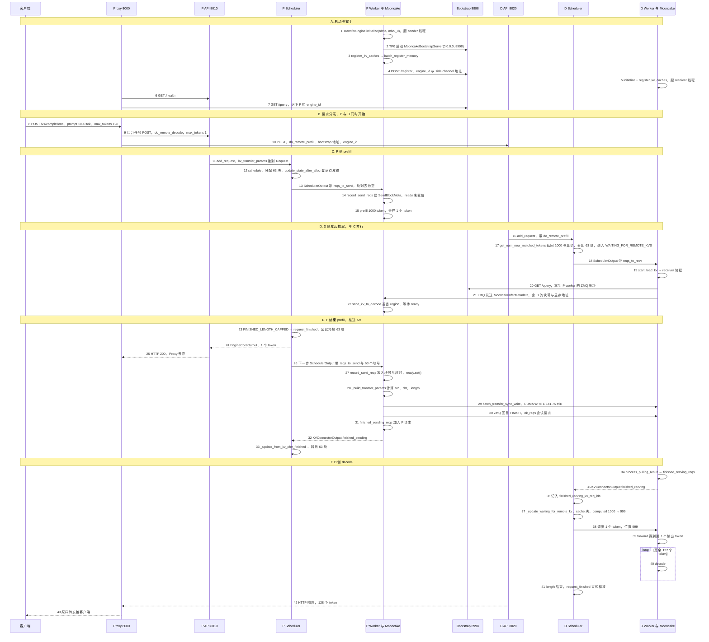

本篇分三部分：

1. 一张完整时序图（每个箭头带编号）；
2. 完整的可调用接口表和参数表；
3. 按时序编号逐步讲解：代入数值、贴代码、给代码位置。

代码位置以当前机器 checkout 为准（行号会随提交变化，定位时优先用函数名）：

| 简写 | 路径 | 版本 |
|---|---|---|
| `vllm/` | /data/home/xli49/lxy/vllm | `36d4ef654a` |

文中的 `mooncake_connector.py` 都指 `vllm/vllm/distributed/kv_transfer/kv_connector/v1/mooncake/mooncake_connector.py`，`scheduler.py` 指 `vllm/vllm/v1/core/sched/scheduler.py`，`proxy.py` 指 `vllm/examples/disaggregated/mooncake_connector/mooncake_connector_proxy.py`。

## 0. 本篇使用的场景

整篇只走一条主路径：**1P1D、单机两卡、TP=1、RDMA、dense 模型、非流式、一个请求**。

```text
模型            Qwen/Qwen3-8B（36 层，8 个 KV head，head_dim 128，bf16）
P（prefill）    GPU 0，HTTP 端口 8010，bootstrap 端口 8998，kv_role=kv_producer
D（decode）     GPU 2，HTTP 端口 8020，kv_role=kv_consumer
Proxy           端口 8000，mooncake_connector_proxy.py
传输            MooncakeConnector，mooncake_protocol=rdma，网卡 mlx5_0（400 Gb/s IB）
block_size      16
请求            POST /v1/completions，prompt 1000 个 token，max_tokens=128，greedy
```

由此得到的几个固定数值，后文会反复用到：

```text
每 token 的 KV 字节   = 2(K,V) × 36 层 × 8 head × 128 × 2 B = 147,456 B = 144 KiB
每 block 的 KV 字节   = 16 × 144 KiB = 2.25 MiB
prompt 占用的 block   = ceil(1000 / 16) = 63（62 个满块 + 1 个 8-token 尾块）
本次要传的 KV         = 63 × 2.25 MiB = 141.75 MiB
400 Gb/s 理论下限     ≈ 148.6 MB / 50 GB/s ≈ 3 ms
```

不展开的分支：NIXL 等其他 connector、P/D 异构 TP、PP、DP、MLA、Mamba/SWA、prefix cache 部分命中、传输失败重算、streaming。

## 1. 完整时序图



步骤 21–22 和 23–27 的先后不固定。图中画的是常见情况：D 的拉取请求先到，P 在 `ready` 上等待。如果 P 先完成，那么步骤 27 先执行，D 的请求到达时 `ready` 已经置位，不需要等待。两种顺序走的都是同一段代码（见步骤 22）。

一个请求的 TTFT 可以拆成：

```text
TTFT ≈ Proxy 转发 + P 排队与 prefill(11–15) + P 下一步调度(23–27)
     + RDMA 传输(28–30) + D 收到完成通知(34–37) + D 1-token 前向(38–39)
```

## 2. 接口表与参数表

### 2.1 可调用接口表

“步骤”列对应时序图编号。

#### Proxy（示例代理）

| 接口 | 位置 | 关键参数 | 作用 | 步骤 |
|---|---|---|---|---|
| `get_prefiller_info(prefill_clients, ready)` | `proxy.py:38` | — | 等 P 健康后查 bootstrap，记录 `dp_engine_id` | 6–7 |
| `_handle_completions(api, request)` | `proxy.py:311` | `/v1/completions` | 生成 request_id，分别发给 P 和 D | 8–10 |
| `send_request_to_service(client_info, dp_rank, endpoint, req_data, request_id)` | `proxy.py:250` | `do_remote_decode=True` | 改写成 `max_tokens=1`，`stream=False`，发给 P | 9, 25 |
| `stream_service_response(...)` | `proxy.py:281` | `do_remote_prefill=True` | 带上 P 的地址发给 D，把响应流转给客户端 | 10, 42–43 |

#### vLLM HTTP 端点

| 端点 | 所在进程 | 位置 | 请求参数 | 步骤 |
|---|---|---|---|---|
| `POST /v1/completions` | P、D API server | `vllm/vllm/entrypoints/openai/completion/protocol.py:248`（字段），`400–403`（放进 extra_args） | body 中的 `kv_transfer_params` | 9, 10 |
| `GET /health` | P API server | vLLM 通用端点 | — | 6 |
| `POST /register` | P 的 bootstrap 线程 | `vllm/vllm/distributed/kv_transfer/kv_connector/v1/mooncake/mooncake_utils.py:55, 127` | `RegisterWorkerPayload` | 4 |
| `GET /query` | P 的 bootstrap 线程 | `mooncake_utils.py:56` | — | 7, 20 |

#### 调度器框架钩子（所有 connector 共用）

| 接口 | 位置 | 调用的 connector 方法 | 步骤 |
|---|---|---|---|
| `Scheduler.add_request(request)` | `scheduler.py:2929` | `on_new_request` | 11, 16 |
| `Scheduler.schedule()`，waiting 队列部分 | `scheduler.py:1138–1142` | `get_num_new_matched_tokens` | 12, 17 |
| `Scheduler.schedule()`，分配之后 | `scheduler.py:1482–1486` | `update_state_after_alloc` | 12, 17 |
| `Scheduler.schedule()`，异步加载分支 | `scheduler.py:1514–1545` | —（置 `WAITING_FOR_REMOTE_KVS`） | 17 |
| `Scheduler.schedule()`，末尾 | `scheduler.py:1756–1758` | `build_connector_meta` | 13, 18, 26 |
| `Scheduler.update_from_output()` | `scheduler.py:2471–2488` | 经 `_free_request` | 23, 41 |
| `Scheduler._free_request(request)` | `scheduler.py:3029` | 经 `_connector_finished` | 23, 41 |
| `Scheduler._connector_finished(request)` | `scheduler.py:3347` | `request_finished_all_groups` | 23, 41 |
| `Scheduler._update_from_kv_xfer_finished(output)` | `scheduler.py:3554` | `update_connector_output` | 33, 36 |
| `Scheduler._handle_blocked_waiting_request(request)` | `scheduler.py:3517` | — | 37 |
| `Scheduler._update_waiting_for_remote_kv(request)` | `scheduler.py:3465` | — | 37 |
| `Scheduler.has_requests()` | `scheduler.py:3165` | `has_pending_push_work` | 26 |

#### Worker 框架钩子（所有 connector 共用）

| 接口 | 位置 | 调用的 connector 方法 | 步骤 |
|---|---|---|---|
| `ensure_kv_transfer_initialized(vllm_config)` | `vllm/vllm/distributed/kv_transfer/kv_transfer_state.py:73` | `create_connector(role=WORKER)` | 1, 5 |
| `GPUModelRunner` 初始化 KV cache | `vllm/vllm/v1/worker/gpu_model_runner.py:7054` | `register_kv_caches` | 3, 5 |
| `KVConnectorModelRunnerMixin._get_kv_connector_output(...)` | `vllm/vllm/v1/worker/kv_connector_model_runner_mixin.py:67` | `bind_connector_metadata`、`start_load_kv`、`wait_for_save`、`get_transfer_results`、`clear_connector_metadata` | 14, 19, 32, 35 |
| `kv_connector_no_forward(...)` | `kv_connector_model_runner_mixin.py:25`；`gpu_model_runner.py:3971` | 同上，但不做前向 | 26–27 |
| `KVOutputAggregator.aggregate(outputs)` | `vllm/vllm/distributed/kv_transfer/kv_connector/utils.py:64–102` | 所有 TP rank 都报告完成后才算完成 | 32, 35 |

#### MooncakeConnector：调度器侧（`MooncakeConnectorScheduler`）

| 接口 | 位置 | P 侧行为 | D 侧行为 | 步骤 |
|---|---|---|---|---|
| `on_new_request(request)` | `mooncake_connector.py:1052` | dense 模型不做事 | 不做事 | 11, 16 |
| `get_num_new_matched_tokens(request, num_computed_tokens)` | `mooncake_connector.py:1061` | `(0, False)` | `(1000, True)` | 12, 17 |
| `update_state_after_alloc(request, blocks, num_external_tokens)` | `mooncake_connector.py:1102` | `_reqs_need_send[id] = (req, [])` | `_reqs_need_recv[id] = (req, 块号)` | 12, 17 |
| `build_connector_meta(scheduler_output)` | `mooncake_connector.py:1151` | 生成 `reqs_to_send` | 生成 `reqs_to_recv` | 13, 18, 26 |
| `request_finished(request, block_ids)` | `mooncake_connector.py:1183` | 返回 `(True, None)`，延迟释放 | 返回 `(False, None)` | 23, 41 |
| `MooncakeConnectorMetadata.add_new_req(...)` | `mooncake_connector.py:715` | 写 `reqs_to_send` | 写 `reqs_to_recv` | 13, 18, 26 |

#### MooncakeConnector：worker 侧（`MooncakeConnectorWorker`）

| 接口 | 位置 | 运行在 | 步骤 |
|---|---|---|---|
| `__init__(vllm_config, engine_id, kv_cache_config)` | `mooncake_connector.py:1241` | worker 主线程 | 1, 5 |
| `register_kv_caches(kv_caches)` | `mooncake_connector.py:2085` | worker 主线程 | 3, 5 |
| `_mooncake_sender_listener(ready_event)` | `mooncake_connector.py:1518` | P 的 sender_loop | 4, 21 |
| `register_worker_with_bootstrap()` | `mooncake_connector.py:1468` | P 的 sender_loop | 4 |
| `start_load_kv(metadata)` | `mooncake_connector.py:2742` | worker 主线程，投递到两个 loop | 14, 19, 27 |
| `record_send_reqs(metadata)` | `mooncake_connector.py:2714` | P 的 sender_loop | 14, 27 |
| `_start_load_kv(reqs_to_recv)` | `mooncake_connector.py:2703` | D 的 receiver_loop | 19 |
| `handle_new_engine_id(remote_engine_id, pull_metas)` | `mooncake_connector.py:2680` | D 的 receiver_loop | 20 |
| `_connect_to_prefiller_bootstrap(addr)` | `mooncake_connector.py:2596` | D 的 receiver_loop | 20 |
| `receive_kv(remote_engine_id, pull_metas)` | `mooncake_connector.py:2646` | D 的 receiver_loop | 21 |
| `receive_kv_from_single_worker(worker_addr, pull_metas)` | `mooncake_connector.py:2439` | D 的 receiver_loop | 21, 30, 34 |
| `_build_pull_metadata(pull_metas, *, include_layout)` | `mooncake_connector.py:2916` | D 的 receiver_loop | 21 |
| `send_kv_to_decode(identity, sock, meta)` | `mooncake_connector.py:1577` | P 的 sender_loop | 22, 28–31 |
| `_build_transfer_params(ready_reqs, meta, local_regions, remote_regions)` | `mooncake_connector.py:1841` | P 的 sender_loop | 28 |
| `_send_blocks(remote_session, src_ptrs, dst_ptrs, lengths)` | `mooncake_connector.py:2054` | P 的 sender 线程池 | 29 |
| `process_pulling_result(response, pull_metas)` | `mooncake_connector.py:2577` | D 的 receiver_loop | 34 |
| `get_finished()` | `mooncake_connector.py:2379` | worker 主线程 | 32, 35 |
| `get_transfer_results()` | `mooncake_connector.py:2410` | worker 主线程 | 32, 35 |
| `fetch_finished_sending_reqs()` | `mooncake_connector.py:2350` | P 的 sender_loop，同时处理超时 | 32 |
| `MooncakeBootstrapServer(host, port)` | `mooncake_utils.py:35` | P 的 TP0 进程，独立线程 | 2, 4, 7, 20 |
| `should_launch_bootstrap_server(vllm_config)` | `mooncake_connector.py:3089` | — | 2 |
| `get_mooncake_bootstrap_addr(vllm_config)` | `mooncake_connector.py:3111` | — | 2, 4 |

#### 跨进程消息

| 消息 | 位置 | 方向 | 关键字段 | 步骤 |
|---|---|---|---|---|
| `kv_transfer_params`（HTTP body） | `proxy.py:255–259, 295–301` | Proxy → P/D | 见 2.3 | 9, 10 |
| `RegisterWorkerPayload` | `mooncake_utils.py:20` | P worker → bootstrap | `engine_id, dp_rank, tp_rank, pp_rank, addr` | 4 |
| `EngineEntry`（`/query` 响应） | `mooncake_utils.py:29` | bootstrap → Proxy/D | `{dp_rank: {engine_id, worker_addr: {tp: {pp: addr}}}}` | 7, 20 |
| `MooncakeXferMetadata` | `mooncake_connector.py:627` | D → P（ZMQ DEALER→ROUTER） | `req_blocks, kv_caches_base_addr, block_lens, layout_id, remote_hostname, remote_port` | 21 |
| `MooncakeXferResponse` | `mooncake_connector.py:666` | P → D（ZMQ） | `status`（FINISH/CONTINUE/ERROR/LAYOUT_MISS）、`ok_reqs, err_reqs` | 30 |
| `KVConnectorOutput` | `kv_connector_model_runner_mixin.py:97–104` | worker → scheduler | `finished_sending, finished_recving, failed_recving, invalid_block_ids` | 32, 35 |

### 2.2 参数表

“本文取值”是第 0 节场景用的值；“默认”是不设置时的值。

#### `--kv-transfer-config`（`KVTransferConfig`，`vllm/vllm/config/kv_transfer.py`）

| 字段 | 本文取值 | 默认 | 生效位置 | 改变什么 | 步骤 |
|---|---|---|---|---|---|
| `kv_connector` | `MooncakeConnector` | 无 | `kv_connector/factory.py:231` | 选择 connector 类 | 1, 5 |
| `kv_role` | P：`kv_producer`，D：`kv_consumer` | 无 | `mooncake_connector.py:951–956, 1262–1263` | P 只起 sender 和 bootstrap，D 只起 receiver；`kv_both` 两者都起 | 1, 5 |
| `engine_id` | 不设（自动 uuid） | `uuid4()`（`kv_transfer.py:111–112`） | `/register` 与 `remote_engine_id` | D 用它定位 P | 4, 7, 10 |
| `kv_load_failure_policy` | `fail` | `fail` | 调度器的加载失败处理 | 失败时报错还是本地重算 | 34 |
| `kv_connector_extra_config.mooncake_protocol` | `rdma` | `rdma` | `mooncake_connector.py:1271–1282` | TransferEngine 协议 | 1 |
| `kv_connector_extra_config.device_name` | `mlx5_0` | `""` | `mooncake_connector.py:1274–1282` | RDMA 网卡 | 1 |
| `kv_connector_extra_config.num_workers` | 10 | 10 | `mooncake_connector.py:1264–1270` | P 发送线程池大小；协程数 = 2 × 10 | 22, 29 |
| `kv_connector_extra_config.bootstrap_server_address` | 不设 | 无 | `mooncake_connector.py:3089–3126` | 设置后不在本机起 bootstrap，改为注册到该地址 | 2, 4 |

#### 环境变量

| 变量 | 本文取值 | 默认 | 生效位置 | 改变什么 | 步骤 |
|---|---|---|---|---|---|
| `VLLM_MOONCAKE_BOOTSTRAP_PORT` | 8998 | 8998 | `mooncake_connector.py:3137` | bootstrap 端口 | 2, 4 |
| `VLLM_MOONCAKE_ABORT_REQUEST_TIMEOUT` | 480 | 480 秒 | `mooncake_connector.py:1685, 2357–2372, 2472, 2722` | P 持有待发送块的最长时间；D 等 P 回复的超时 | 22, 27 |
| `VLLM_MOONCAKE_CONNECTOR_TIMEOUT` | 30 | 30 秒 | `mooncake_connector.py:1479, 2601` | `/register` 与 `/query` 的 HTTP 超时 | 4, 20 |

#### vLLM serve 参数

| 参数 | 本文取值 | 默认 | 生效位置 | 改变什么 | 步骤 |
|---|---|---|---|---|---|
| `--block-size` | 16 | 依后端而定 | KV cache 分配 | 1000 token 占 63 块；每次传输的粒度 | 12, 17, 28 |
| `--tensor-parallel-size` | 1 | 1 | `TransferTopology`；`KVOutputAggregator` | TP>1 时每个 rank 分别收发，聚合器要收齐所有 rank 才算完成 | 21, 32, 35 |
| `--max-num-batched-tokens` | ≥ 1000 | 依场景而定 | P 调度 | 1000 token 能否一步 prefill 完 | 15 |
| `--port` | P 8010，D 8020 | 8000 | API server | — | 9, 10 |

#### Proxy 参数（`proxy.py:136–173`）

| 参数 | 本文取值 | 作用 | 步骤 |
|---|---|---|---|
| `--port` | 8000 | Proxy 监听端口 | 8 |
| `--prefill URL [BOOTSTRAP_PORT]` | `http://127.0.0.1:8010 8998` | P 地址与 bootstrap 端口，不写端口时用 8998 | 6, 7, 10 |
| `--decode URL` | `http://127.0.0.1:8020` | D 地址 | 10 |

### 2.3 `kv_transfer_params` 字段表

这是 Proxy 写进请求体、由 connector 读取的唯一协议。

| 字段 | 发给 P | 发给 D | 读取位置 | 含义 |
|---|---|---|---|---|
| `do_remote_decode` | `True` | `False` | `mooncake_connector.py:1143, 1214` | 本请求的 KV 由别人来 decode，P 结束后要发送 |
| `do_remote_prefill` | `False` | `True` | `mooncake_connector.py:1089, 1117, 1202` | 本请求的 KV 要从远端拉；登记后被改为 `False`，保证只拉一次 |
| `transfer_id` | `xfer-<uuid>` | `xfer-<uuid>`（相同） | `mooncake_connector.py:722, 1145, 1199` | P、D 两边 request_id 不同，靠它配对 |
| `remote_bootstrap_addr` | — | `http://127.0.0.1:8998` | `mooncake_connector.py:729, 2685` | D 去哪里查 P 的 worker 地址 |
| `remote_engine_id` | — | P 的 engine_id | `mooncake_connector.py:724, 2706` | D 拉哪个 P engine 的 KV |

## 3. 按时序逐步讲解

每一步都按“作用 → 数值 → 代码 → 位置”的顺序讲。

### A. 启动与握手（步骤 1–7）

#### 步骤 1：P worker 初始化 Mooncake TransferEngine

**作用**：`ensure_kv_transfer_initialized` 按 `kv_connector` 创建 WORKER 角色的 connector，构造出 `MooncakeConnectorWorker`。它初始化 TransferEngine，P 侧另起一个 `sender_loop` 线程，后续所有发送逻辑都在这个事件循环里运行。调度器进程里同时会创建 SCHEDULER 角色的实例（`scheduler.py:179–181`），对应 `MooncakeConnectorScheduler`。

**数值**：

```text
engine.initialize(hostname="10.0.0.1", "P2PHANDSHAKE", "rdma", "mlx5_0")
num_sender_workers = 10，num_sender_tasks = 20
rpc_port = engine.get_rpc_port()，例如 15432（D 之后用它作为 RDMA 会话地址）
```

**代码**：

```python
self.engine = TransferEngine()
self.hostname = get_ip()
...
ret_value = self.engine.initialize(self.hostname, "P2PHANDSHAKE", protocol, device_name)
if ret_value != 0:
    raise RuntimeError("Mooncake Transfer Engine initialization failed.")
self.rpc_port = self.engine.get_rpc_port()
...
if not self.is_kv_consumer:
    self.sender_worker_queue = asyncio.Queue[tuple[bytes, bytes]]()
    self.sender_loop = asyncio.new_event_loop()
    self._sender_listener_t = threading.Thread(target=_async_loop, args=(self.sender_loop,), daemon=True)
    self._sender_listener_t.start()
```

**位置**：`vllm/vllm/distributed/kv_transfer/kv_transfer_state.py:73–88`；`mooncake_connector.py:1241–1286, 1353–1360`。

#### 步骤 2：P 的 TP0（张量并行组中的 Rank 0） 启动 bootstrap server

**作用**：bootstrap 是一个很小的 FastAPI 服务，用于登记“engine_id → 各 TP/PP rank 的 ZMQ 地址”。只有 TP0/PP0（并且是第一个 DP engine）会启动它；设置了 `bootstrap_server_address` 时则不在本机启动。

**数值**：`should_launch_bootstrap_server` 中 tp_rank=0、pp_rank=0、data_parallel_index=0，返回 True。端口取 `VLLM_MOONCAKE_BOOTSTRAP_PORT=8998`。

**代码**：

```python
if should_launch_bootstrap_server(vllm_config):
    _, port = get_mooncake_bootstrap_addr(vllm_config)
    self.bootstrap_server = MooncakeBootstrapServer("0.0.0.0", port)
    self.bootstrap_server.start()
```

```python
def _register_routes(self):
    self.app.post("/register")(self.register_worker)
    self.app.get("/query", response_model=dict[int, EngineEntry])(self.query)
```

**位置**：`mooncake_connector.py:1362–1366, 3089–3138`；`mooncake_utils.py:35–108`。

#### 步骤 3：注册 KV cache 显存

**作用**：KV cache 分配好以后，model runner 调用 `register_kv_caches`。Mooncake 记录每一层的 base 地址和 block 长度，用 `batch_register_memory` 把整块 KV 显存注册给 RDMA 网卡，让对端可以直接读写。同时生成一个随机的 `layout_id`，之后用来复用对端缓存的布局。非 MLA 模型会把 KV 布局设为 `LBHNC`，以便支持异构 TP。

**数值**：Qwen3-8B 有 36 层。每层每个 block 的 K、V 共 2 × 16 × 8 × 128 × 2 B = 64 KiB，36 层合计 2.25 MiB 每 block。如果 GPU 上分到 N 个 block，注册的总显存约为 N × 2.25 MiB。

**代码**：

```python
self._kv_layout_id = secrets.randbits(63) | 1
...
ret_value = self.engine.batch_register_memory(kv_data_ptrs, kv_data_lens)
if ret_value != 0:
    raise RuntimeError("Mooncake batch memory registration failed.")
self.device_kv_caches = kv_caches
# No need to launch server for D node.
if self.is_kv_consumer:
    return
```

**位置**：`vllm/vllm/v1/worker/gpu_model_runner.py:7054`；`mooncake_connector.py:2085–2301`（`register_kv_caches`），`766–781`（`LBHNC`）。没有加载 `nvidia_peermem` 时，`batch_register_memory` 这一步会失败（`Bad address`）。

#### 步骤 4：P worker 登记到 bootstrap

**作用**：P 在 `sender_loop` 中启动 `_mooncake_sender_listener`：绑定一个随机端口的 ZMQ ROUTER（side channel），把地址 POST 到 bootstrap，再启动 20 个 `_sender_worker` 协程消费请求队列。`register_kv_caches` 会阻塞，直到 listener 置位 `ready_event`。

**数值**：

```json
POST http://10.0.0.1:8998/register
{"engine_id": "6c1f...e2", "dp_rank": 0, "tp_rank": 0, "pp_rank": 0,
 "addr": "tcp://10.0.0.1:41235"}
```

**代码**：

```python
sock = self.async_zmq_ctx.socket(zmq.ROUTER)
self.side_channel_port = sock.bind_to_random_port(f"tcp://{self.hostname}")
await self.register_worker_with_bootstrap()
sender_tasks = [asyncio.create_task(self._sender_worker(sock)) for _ in range(self.num_sender_tasks)]
ready_event.set()
while True:
    identity, metadata_bytes = await sock.recv_multipart()
    await self.sender_worker_queue.put((identity, metadata_bytes))
```

**位置**：`mooncake_connector.py:2303–2320`（启动 listener 并等待），`1518–1543`（listener），`1468–1516`（`/register`，失败时指数退避重试）；`mooncake_utils.py:127`（`register_worker`）。

#### 步骤 5：D worker 初始化

**作用**：与步骤 1、3 相同，但 D 是 `kv_consumer`：不起 sender 线程，不起 bootstrap，也不向任何地方登记。只起一个 `receiver_loop` 线程，并把自己的 KV 显存注册给网卡，让 P 可以 RDMA WRITE 进来。

**代码**：

```python
if not self.is_kv_producer:
    self.receiver_loop = asyncio.new_event_loop()
    self._mooncake_receiver_t = threading.Thread(target=_async_loop, args=(self.receiver_loop,), daemon=True)
    self._mooncake_receiver_t.start()
```

**位置**：`mooncake_connector.py:1368–1374, 2299–2301`。

#### 步骤 6–7：Proxy 等 P 就绪，查询 engine_id

**作用**：Proxy 启动时在后台轮询 P 的 `/health`，通过后再查 bootstrap 的 `/query`，记下每个 DP rank 的 engine_id。在 `ready` 置位之前，Proxy 对所有请求返回 503。

**数值**：

```json
GET http://127.0.0.1:8998/query
{"0": {"engine_id": "6c1f...e2", "worker_addr": {"0": {"0": "tcp://10.0.0.1:41235"}}}}
```

Proxy 得到 `dp_engine_id = {0: "6c1f...e2"}`，`dp_size = 1`。

**代码**：

```python
response = await prefill_client["client"].get("/health")
...
response = await prefill_client["client"].get(prefill_client["bootstrap_addr"] + "/query")
data = response.json()
for dp_rank, dp_entry in data.items():
    prefill_client["dp_engine_id"][int(dp_rank)] = dp_entry["engine_id"]
```

**位置**：`proxy.py:38–62, 111`。

### B. 请求分发（步骤 8–10）

#### 步骤 8：客户端请求到达 Proxy

**数值**：

```json
POST http://127.0.0.1:8000/v1/completions
{"model": "Qwen/Qwen3-8B", "prompt": "...1000 个 token...", "max_tokens": 128, "temperature": 0}
```

Proxy 生成 `request_id = "3f2a9c1e-..."`，并按 round-robin 选出 P（dp_rank 0）和 D。

**位置**：`proxy.py:311–329`。

#### 步骤 9：发给 P，只做 prefill

**作用**：用 `asyncio.create_task` 在后台发出，不等待返回。请求体被改写：强制 `max_tokens=1`、非流式，并带上 `do_remote_decode=True`。

**数值**：

```json
POST http://127.0.0.1:8010/v1/completions
X-Request-Id: 3f2a9c1e-...
{"model": "Qwen/Qwen3-8B", "prompt": "...", "max_tokens": 1, "stream": false, "temperature": 0,
 "kv_transfer_params": {"do_remote_decode": true, "do_remote_prefill": false,
                        "transfer_id": "xfer-3f2a9c1e-..."}}
```

**代码**：

```python
req_data["kv_transfer_params"] = {
    "do_remote_decode": True,
    "do_remote_prefill": False,
    "transfer_id": f"xfer-{request_id}",
}
req_data["stream"] = False
req_data["max_tokens"] = 1
```

**位置**：`proxy.py:250–278, 323–327`。

#### 步骤 10：同时发给 D，负责 decode

**作用**：D 的请求和 P 的请求同时发出，Proxy 不等 P 完成。请求保留原始 `max_tokens=128`，并带上 P 的 bootstrap 地址和 engine_id，D 靠这两项找到 P。

**数值**：

```json
POST http://127.0.0.1:8020/v1/completions
{"model": "Qwen/Qwen3-8B", "prompt": "...", "max_tokens": 128, "temperature": 0,
 "kv_transfer_params": {"do_remote_decode": false, "do_remote_prefill": true,
                        "remote_bootstrap_addr": "http://127.0.0.1:8998",
                        "remote_engine_id": "6c1f...e2",
                        "transfer_id": "xfer-3f2a9c1e-..."}}
```

**代码**：

```python
req_data["kv_transfer_params"] = {
    "do_remote_decode": False,
    "do_remote_prefill": True,
    "remote_bootstrap_addr": prefill_client_info["bootstrap_addr"],
    "remote_engine_id": prefill_client_info["dp_engine_id"][prefill_dp_rank],
    "transfer_id": f"xfer-{request_id}",
}
async with decode_client_info["client"].stream("POST", endpoint, json=req_data, headers=headers) as response:
    ...
```

**位置**：`proxy.py:281–308, 329–346`。

### C. P 侧 prefill（步骤 11–15）

#### 步骤 11：`kv_transfer_params` 进入 Request

**作用**：OpenAI 协议层把 `kv_transfer_params` 放进 `SamplingParams.extra_args`，`Request` 构造时再取出来挂到 `request.kv_transfer_params`。`add_request` 把请求放进 waiting 队列，并调用 `connector.on_new_request`（dense 模型在这里什么也不做，只有 Mamba/SWA 会截掉最后一个 prompt token）。

**代码**：

```python
# completion/protocol.py
if self.kv_transfer_params:
    extra_args["kv_transfer_params"] = self.kv_transfer_params

# v1/request.py
if sampling_params.extra_args is not None:
    self.kv_transfer_params = sampling_params.extra_args.get("kv_transfer_params")

# scheduler.py
if self.connector is not None:
    self.connector.on_new_request(request)
```

**位置**：`vllm/vllm/entrypoints/openai/completion/protocol.py:248, 400–403`；`vllm/vllm/v1/request.py:119–122`；`scheduler.py:2952–2958`；`mooncake_connector.py:1052–1059`。

#### 步骤 12：P 调度，登记“待发送”

**作用**：P 是 producer，`get_num_new_matched_tokens` 返回 `(0, False)`，因此按普通请求在本地 prefill。分配 block 后，`update_state_after_alloc` 发现 `do_remote_decode=True`，把请求登记到 `_reqs_need_send`。此时块号列表是空的，作用只是让 worker 提前建好一个等待对象。

**数值**：

```text
get_num_new_matched_tokens(req, 0) → (0, False)
本地分配 ceil(1000 / 16) = 63 个 block，例如 P 的块号 [17, 18, ..., 79]
_reqs_need_send["cmpl-p..."] = (req, [])
```

**代码**：

```python
elif params.get("do_remote_decode"):
    assert not self.is_kv_consumer
    if not params.get("transfer_id"):
        logger.warning("Missing transfer_id in kv_transfer_params from router!")
    else:
        # Add an empty list to worker to create event.
        self._reqs_need_send[request.request_id] = (request, [])
```

**位置**：`scheduler.py:1138–1142, 1482–1486`；`mooncake_connector.py:1061–1100, 1143–1149`。

#### 步骤 13：`build_connector_meta` 随 SchedulerOutput 下发

**作用**：每次 `schedule()` 结束时都会调用 `build_connector_meta`，把本步积累的登记打包成 `MooncakeConnectorMetadata`，随 `SchedulerOutput` 发给 worker，然后清空调度器侧的暂存。

**数值**：`meta.reqs_to_send = {"cmpl-p...": ("xfer-3f2a...", [])}`。

**代码**：

```python
if not self.is_kv_consumer:
    for req_id, (req, block_ids) in self._reqs_need_send.items():
        meta.add_new_req(request_id=req_id, local_block_ids=block_ids,
                         kv_transfer_params=req.kv_transfer_params, load_remote_cache=False)
    self._reqs_need_send.clear()
    meta.reqs_not_processed = self._reqs_not_processed
    self._reqs_not_processed = set()
```

**位置**：`scheduler.py:1756–1758`；`mooncake_connector.py:1151–1181, 715–733`。

#### 步骤 14：worker 建 `SendBlockMeta`

**作用**：model runner 进入前向时，`_get_kv_connector_output` 先 `bind_connector_metadata`，再调用 `start_load_kv`。Mooncake 把 `record_send_reqs` 投递到 sender_loop。块号为空，表示“请求已开始但还没结束”，于是只创建一个 `ready` 尚未置位的 `SendBlockMeta`；如果 D 的拉取请求已经先到并建过占位，就直接沿用。

**代码**：

```python
def start_load_kv(self, metadata):
    ...
    if not self.is_kv_consumer and (metadata.reqs_to_send or metadata.reqs_not_processed):
        asyncio.run_coroutine_threadsafe(self.record_send_reqs(metadata), self.sender_loop)

async def record_send_reqs(self, metadata):
    for p_req_id, (transfer_id, block_ids) in metadata.reqs_to_send.items():
        if block_ids:
            ...
        else:
            if transfer_id not in self.reqs_need_send:
                self.reqs_need_send[transfer_id] = SendBlockMeta(
                    p_req_id=p_req_id, transfer_id=transfer_id, local_block_ids=[], ready=asyncio.Event())
```

**位置**：`kv_connector_model_runner_mixin.py:67–90`；`mooncake_connector.py:2742–2753, 2714–2736`。`SendBlockMeta` 以 `transfer_id` 为键，因为 D 只知道 transfer_id，不知道 P 的 request_id。

#### 步骤 15：P 做 prefill 并采样 1 个 token

**作用**：普通前向。1000 个 prompt token 的 KV 写入 P 的 63 个 block，再采样一个 token。

**数值**：`max_num_batched_tokens ≥ 1000` 时一步完成；否则按 chunked prefill 分多步，每步重复步骤 12–14 中的调度部分（`update_state_after_alloc` 只在首次分配时登记一次）。

**位置**：`vllm/vllm/v1/worker/gpu_model_runner.py:4168–4175`。Mooncake 的 `save_kv_layer`、`wait_for_save` 都是空实现（`mooncake_connector.py:892–903`），前向期间没有逐层发送。

### D. D 侧发起拉取（步骤 16–22，与 C 并行）

#### 步骤 16：D 收到请求

**作用**：与步骤 11 相同，`request.kv_transfer_params` 中 `do_remote_prefill=True`。调度器把请求标记为 `KV_FETCH_WAITING_TO_START`，用于统计。

**位置**：`scheduler.py:2952–2958`。

#### 步骤 17：D 调度，进入 `WAITING_FOR_REMOTE_KVS`

**作用**：这是 D 侧最关键的一步。`get_num_new_matched_tokens` 返回“剩下的 prompt 全部从远端异步加载”。调度器为这 1000 个外部 token 分配 block，但不安排任何计算（`num_new_tokens = 0`），并把请求状态设为 `WAITING_FOR_REMOTE_KVS`。`update_state_after_alloc` 把新分配的块号登记到 `_reqs_need_recv`，然后把 `do_remote_prefill` 改为 False，保证只触发一次传输。

**数值**：

```text
本地 prefix 命中 = 0
get_num_new_matched_tokens(req, 0) → (1000 - 0, True) = (1000, True)
num_new_tokens = 0（本步不计算）
分配 63 个 block，例如 D 的块号 [512, 513, ..., 574]
request.num_computed_tokens = 1000（KV 还没到，这个值暂时不被使用）
request.status = WAITING_FOR_REMOTE_KVS
_reqs_need_recv["cmpl-d..."] = (req, [[512, ..., 574]])
params["do_remote_prefill"] = False
```

**代码**：

```python
# mooncake_connector.py
if params.get("do_remote_prefill"):
    assert not self.is_kv_producer
    token_ids = request.prompt_token_ids or []
    count = self._get_remote_prefill_token_count(len(token_ids)) - (num_computed_tokens)
    if count > 0:
        return count, True

# update_state_after_alloc
unhashed_block_ids = (blocks.get_unhashed_block_ids_all_groups() if num_external_tokens > 0 else ())
local_block_ids = self.get_sw_clipped_blocks(unhashed_block_ids)
self._reqs_need_recv[request.request_id] = (request, local_block_ids)
params["do_remote_prefill"] = False

# scheduler.py
if load_kv_async:
    assert num_external_computed_tokens > 0
    num_new_tokens = 0
...
if load_kv_async:
    request.status = RequestStatus.WAITING_FOR_REMOTE_KVS
    request.num_computed_tokens = num_computed_tokens
    skip_request(request_queue)
    continue
```

**位置**：`mooncake_connector.py:1061–1100, 1117–1141`；`scheduler.py:1138–1142, 1286–1289, 1482–1486, 1514–1545`。

#### 步骤 18：`build_connector_meta` 下发 `reqs_to_recv`

**数值**：

```python
meta.reqs_to_recv = {
    "6c1f...e2": {
        "cmpl-d...": PullReqMeta(
            d_req_id="cmpl-d...", transfer_id="xfer-3f2a...",
            local_block_ids=[[512, ..., 574]],
            remote_engine_id="6c1f...e2",
            remote_bootstrap_addr="http://127.0.0.1:8998"),
    }
}
```

按 P 的 engine_id 分组，同一个 P 的多个请求可以合并成一次拉取。

**位置**：`mooncake_connector.py:1158–1166, 723–731`。

#### 步骤 19：D worker 启动接收协程

**作用**：D 这一步没有任何 token 需要计算，因此 model runner 走 `kv_connector_no_forward`，只执行 connector 生命周期。`start_load_kv` 把 `_start_load_kv` 投递到 receiver_loop 后立即返回，不阻塞 worker。

**代码**：

```python
if not self.is_kv_producer and metadata.reqs_to_recv:
    asyncio.run_coroutine_threadsafe(self._start_load_kv(metadata.reqs_to_recv), self.receiver_loop)

async def _start_load_kv(self, reqs_to_recv):
    for remote_engine_id, pull_metas in reqs_to_recv.items():
        if remote_engine_id not in self._remote_agents:
            asyncio.create_task(self.handle_new_engine_id(remote_engine_id, pull_metas))
        else:
            self.receive_kv(remote_engine_id, pull_metas)
```

**位置**：`gpu_model_runner.py:3971`；`kv_connector_model_runner_mixin.py:25–37`；`mooncake_connector.py:2742–2746, 2703–2712`。

#### 步骤 20：首次见到这个 P，查询 bootstrap

**作用**：D 第一次遇到某个 `remote_engine_id` 时，向 `remote_bootstrap_addr/query` 查询这个 engine 每个 TP/PP rank 的 ZMQ 地址，缓存在 `_remote_agents` 中。同一地址的并发查询共用一个 `asyncio.Event`，只发一次请求。之后同一个 P 的请求直接跳过这一步。

**数值**：`_remote_agents["6c1f...e2"] = {0: {0: "tcp://10.0.0.1:41235"}}`，`_tp_size["6c1f...e2"] = 1`。

**代码**：

```python
response = await client.get(url)          # url = remote_bootstrap_addr + "/query"
data = response.json()
for _, dp_entry in data.items():
    remote_engine_id = dp_entry["engine_id"]
    self._remote_agents[remote_engine_id] = {
        int(tp_rank): {int(pp_rank): worker_addr for pp_rank, worker_addr in tp_entry.items()}
        for tp_rank, tp_entry in dp_entry["worker_addr"].items()
    }
    self._tp_size[remote_engine_id] = len(dp_entry["worker_addr"])
```

**位置**：`mooncake_connector.py:2680–2701, 2596–2644`。

#### 步骤 21：D 把“写到哪里”告诉 P

**作用**：`receive_kv` 按 TP 映射选出要配对的 P rank（TP 相同时为 1 对 1），为每个 P worker 建一个协程。协程用 ZMQ DEALER 连接 P 的 ROUTER，发送 `MooncakeXferMetadata`。消息中包含 D 的块号、每层 KV 的显存 base 地址和 block 长度，P 由此计算出 RDMA WRITE 的目标地址。首次连接时会带上完整布局；P 确认缓存后，后续消息只带 `layout_id` 和块号，体积小很多。

**数值**：

```python
MooncakeXferMetadata(
    remote_hostname="10.0.0.2", remote_port=<D 的 rpc_port>,
    remote_tp_size=1, remote_tp_rank=0, remote_pp_size=1,
    layout_id=0x5d3...b1,
    req_blocks={"cmpl-d...": ("xfer-3f2a...", [[512, ..., 574]])},
    kv_caches_base_addr=[...每个注册 region 的 base 地址...],
    block_lens=[...], kv_block_lens=[...],
)
pull_meta.pull_tasks_count = 1（只配对 1 个 P worker）
ZMQ 接收超时 = (480 + 60) s
```

**代码**：

```python
# receive_kv
for pull_meta in pull_metas.values():
    pull_meta.pull_tasks_count = count
for worker_addr in worker_addrs:
    asyncio.create_task(self.receive_kv_from_single_worker(worker_addr, pull_metas))

# receive_kv_from_single_worker
metadata = self._build_pull_metadata(pull_metas, include_layout=include_layout)
encoded_data = self._encoder.encode(metadata)
with make_zmq_socket(self.async_zmq_ctx, worker_addr, zmq.DEALER, bind=False, linger=0) as sock:
    sock.setsockopt(zmq.RCVTIMEO, (envs.VLLM_MOONCAKE_ABORT_REQUEST_TIMEOUT + 60) * 1000)
    await sock.send(encoded_data)
```

**位置**：`mooncake_connector.py:2646–2678, 2439–2474, 2916–2957, 627–651`。

#### 步骤 22：P 准备 region 并等待 `ready`

**作用**：P 的 listener 把消息放进队列，某个 `_sender_worker` 取出后调用 `send_kv_to_decode`。它先校验 TP/PP 配对，计算本地与远端的 region 对应关系（相同 `layout_id` 的结果会被缓存），然后按 `transfer_id` 找到 `SendBlockMeta`（步骤 14 建的；若还不存在就新建一个占位），再在 `ready` 上等待。

**数值**：如果 P 的 prefill 还要 50 ms，这个协程就在 `asyncio.wait` 中挂起 50 ms，期间不占用发送线程。等待上限是 `VLLM_MOONCAKE_ABORT_REQUEST_TIMEOUT = 480` 秒，超时后以 FINISH + `err_reqs` 回复。

**代码**：

```python
for d_req_id, (transfer_id, _) in meta.req_blocks.items():
    if transfer_id not in self.reqs_need_send:
        # This req is not enqueued in P side yet, create it here.
        self.reqs_need_send[transfer_id] = SendBlockMeta(
            p_req_id="", transfer_id=transfer_id, local_block_ids=[], ready=asyncio.Event())
    send_meta = self.reqs_need_send[transfer_id]
    pending_reqs[d_req_id] = send_meta
...
done, pending = await asyncio.wait(wait_tasks, timeout=envs.VLLM_MOONCAKE_ABORT_REQUEST_TIMEOUT,
                                   return_when=asyncio.FIRST_COMPLETED)
```

**位置**：`mooncake_connector.py:1555–1561, 1577–1703`。

### E. P 结束 prefill，推送 KV（步骤 23–33）

#### 步骤 23：P 请求结束，延迟释放 block

**作用**：P 采样出 1 个 token 后达到 `max_tokens=1`，状态变为 `FINISHED_LENGTH_CAPPED`。`_free_request` → `_connector_finished` → `request_finished_all_groups`。Mooncake 返回 `delay_free_blocks=True`：block 暂不归还，并把 63 个块号登记到 `_reqs_need_send`。

**数值**：

```text
request.status = FINISHED_LENGTH_CAPPED
block_ids = ([17, ..., 79],)，63 个
request_finished → (True, None)
_reqs_need_send["cmpl-p..."] = (req, [[17, ..., 79]])
_free_blocks 不执行，63 个 block 仍被占用
```

**代码**：

```python
if request.status != RequestStatus.FINISHED_LENGTH_CAPPED:
    # Also include the case of a P/D Prefill request with immediate block free (eg abort).
    self._reqs_not_processed.add(params["transfer_id"])
    return False, None

delay_free_blocks = any(len(group) > 0 for group in block_ids)
if delay_free_blocks:
    self._reqs_need_send[request.request_id] = (request, self.get_sw_clipped_blocks(block_ids))
return delay_free_blocks, None
```

```python
# scheduler._free_request
delay_free_blocks |= connector_delay_free_blocks
if not delay_free_blocks:
    self._free_blocks(request)
```

**位置**：`scheduler.py:2471–2477, 3029–3060, 3347–3400`；`mooncake_connector.py:1183–1235`。

注意：按代码，只有 `FINISHED_LENGTH_CAPPED` 会发送。如果 P 采样出的第 1 个 token 恰好是 EOS 或 stop token，状态会是 `FINISHED_STOPPED`（`vllm/vllm/v1/core/sched/utils.py:105–118` 先检查 stop，再检查长度），请求会走 `_reqs_not_processed` 分支，不发送。D 端那次拉取只能等到步骤 22 的超时。

#### 步骤 24–25：P 返回 1 个 token，Proxy 丢弃

**作用**：`EngineCoreOutput` 携带 1 个 token 和 `finish_reason="length"` 返回 API server，后者回复 HTTP 200。Proxy 在后台任务里只检查状态码，然后关闭连接，不读取内容。此时 P 的请求对外已经完成，但 KV block 还没有释放。

**代码**：

```python
response = await client_info["client"].post(endpoint, json=req_data, headers=headers)
response.raise_for_status()
# CRITICAL: Release connection back to pool
await response.aclose()
```

**位置**：`scheduler.py:2510–2535`；`proxy.py:272–278`。

#### 步骤 26：P 再跑一步，下发 63 个块号

**作用**：P 的 `self.requests` 中仍保留着这个已结束的请求（等待延迟释放），所以 `has_requests()` 为真，引擎会继续调度。即使没有新请求，这一步也会走 `kv_connector_no_forward`，把带 63 个块号的 `reqs_to_send` 下发给 worker。

**数值**：`meta.reqs_to_send = {"cmpl-p...": ("xfer-3f2a...", [[17, ..., 79]])}`。

**代码**：

```python
def has_finished_requests(self) -> bool:
    # Finished requests waiting on delayed connector cleanup remain in
    # self.requests after they have been removed from scheduling queues.
    num_running, num_waiting = self.get_request_counts()
    return len(self.requests) > (num_running + num_waiting)
```

**位置**：`scheduler.py:3155–3180, 1756–1758`；`gpu_model_runner.py:3971`。

#### 步骤 27：`record_send_reqs` 置位 `ready`

**作用**：块号非空，说明请求已经走过 `request_finished`。于是把 P 的 request_id、块号和过期时间写入 `SendBlockMeta`，并 `ready.set()`。步骤 22 中挂起的协程被唤醒。

**数值**：`expire_time = now + 480 s`。如果 480 秒内 D 一直没来拉取，`fetch_finished_sending_reqs` 会把它当作已完成，强制释放 P 的 block，避免泄漏。

**代码**：

```python
if block_ids:
    # Already gone through request_finished()
    send_meta = self.reqs_need_send[transfer_id]
    send_meta.p_req_id = p_req_id
    send_meta.local_block_ids = block_ids
    send_meta.expire_time = time.perf_counter() + envs.VLLM_MOONCAKE_ABORT_REQUEST_TIMEOUT
    send_meta.ready.set()
```

**位置**：`mooncake_connector.py:2714–2724, 2350–2377`。

#### 步骤 28：计算 src、dst、length

**作用**：对每个 region（层，或者 K/V），用“块号 × block_len + base 地址 + 偏移”分别算出 P 端源地址和 D 端目标地址。如果两边的块号都是连续的，就把一段连续块合并成一个大描述符，减少 RDMA 请求数。

**数值**：

```text
P 块号 17..79 连续，D 块号 512..574 连续 → 每个 region 合并成 1 个描述符
单个描述符长度 = 63 × 该 region 每块字节数
src = 17  × block_len + P_base + src_offset
dst = 512 × block_len + D_base + dst_offset
所有描述符合计 63 × 2.25 MiB = 141.75 MiB
```

块号不连续（例如 D 的空闲块比较零散）时，按连续段拆分，描述符数随之增加。

**代码**：

```python
if can_coalesce:
    local_ids = local_ids[run_starts]
    remote_ids = remote_ids[run_starts]
    lengths.extend((run_lens * transfer_len).tolist())
else:
    lengths.extend([transfer_len] * len(local_ids))
src_ptrs.extend((local_ids * local_region.block_len + (local_region.base_addr + src_region_offset)).tolist())
dst_ptrs.extend((remote_ids * remote_region.block_len + (remote_region.base_addr + dst_region_offset)).tolist())
```

**位置**：`mooncake_connector.py:1730–1741, 1841–2046`（`_build_transfer_params`），`153`（`_contiguous_runs`），`315`（`_can_coalesce_block_transfers`）。

#### 步骤 29：RDMA WRITE

**作用**：在 sender 线程池里调用 `batch_transfer_sync_write`，由 P 直接把 KV 写进 D 的显存（GPUDirect RDMA）。这是 P-push 模式：D 只提供地址，数据由 P 发起写入。

**数值**：141.75 MiB；400 Gb/s 下理论下限约 3 ms。成功时 P 侧记录 `duration`、`total_bytes`、`num_descs`；D 侧只记录失败。

**代码**：

```python
ret_value = self.engine.batch_transfer_sync_write(remote_session, src_ptrs, dst_ptrs, lengths)
if ret_value == 0:
    self.xfer_stats.record_transfer(duration_s=duration, total_bytes=sum(lengths), num_descs=len(src_ptrs))
```

**位置**：`mooncake_connector.py:1749–1758, 2054–2083, 905–916`（统计口径说明）。

#### 步骤 30–31：回复 D，标记 P 侧发送完成

**作用**：全部请求都处理完后，状态为 FINISH，`ok_reqs` 中是 D 的 request_id。`sent == need_send` 时从 `reqs_need_send` 删除，并把 **P 的** request_id 放进 `finished_sending_reqs`。

**数值**：TP=1 时 `need_send = 1`，发送一次即完成。回复为 `MooncakeXferResponse(status=FINISH, ok_reqs=["cmpl-d..."], layout_id=0x5d3...b1)`。

**代码**：

```python
send_meta.sent += 1
if (send_meta.sent == send_meta.need_send
        and self.reqs_need_send.pop(send_meta.transfer_id, None) is not None):
    self.finished_sending_reqs.add(send_meta.p_req_id)

response = MooncakeXferResponse(status=response_status,
                                ok_reqs=[d_req_id for d_req_id, _ in ok_ready_reqs] or None, ...)
await sock.send_multipart((identity, self._encoder.encode(response)))
```

**位置**：`mooncake_connector.py:1773–1793, 666–676`。

#### 步骤 32–33：P 调度器释放 63 个 block

**作用**：P worker 在下一次执行时，通过 `get_transfer_results` → `get_finished` 从 sender_loop 取走 `finished_sending_reqs`，放进 `KVConnectorOutput`。多 TP 时 `KVOutputAggregator` 要收齐每个 rank 的报告才算完成。调度器在 `update_from_output` 末尾调用 `_update_from_kv_xfer_finished`，执行 `_free_blocks`。

**数值**：`finished_sending = {"cmpl-p..."}`；P 的 63 个 block 被归还给空闲池（如果开启了 prefix cache，内容仍可被后续请求命中）。

**代码**：

```python
# worker mixin
transfer_results = kv_connector.get_transfer_results(scheduler_output.finished_req_ids)
output.finished_sending = transfer_results.finished_sending
output.finished_recving = transfer_results.finished_recving

# scheduler
for req_id in kv_connector_output.finished_sending or ():
    self._free_blocks(self.requests[req_id])
```

**位置**：`kv_connector_model_runner_mixin.py:94–100`；`mooncake_connector.py:2379–2430`；`vllm/vllm/distributed/kv_transfer/kv_connector/utils.py:82–102`；`scheduler.py:2581–2583, 3577–3580`。

### F. D 侧 decode（步骤 34–43）

#### 步骤 34：D 收到 FINISH

**作用**：D 的接收协程收到回复，`process_pulling_result` 处理 `ok_reqs`。当 `pull_tasks_count` 减到 0 时（所有配对的 P worker 都已完成），把 D 的 request_id 放进 `finished_recving_reqs`。如果收到 ERROR 或 `err_reqs`，则走 `_handle_failed_recv`，请求进入 `failed_recving`，并按 `kv_load_failure_policy` 处理。

**代码**：

```python
def _complete_pull_task(self, pull_meta):
    if pull_meta.pull_tasks_count > 0:
        pull_meta.pull_tasks_count -= 1
    if pull_meta.pull_tasks_count == 0 and any(pull_meta.local_block_ids):
        self.finished_recving_reqs.add(pull_meta.d_req_id)
```

**位置**：`mooncake_connector.py:2476–2512, 2577–2594, 2560–2565, 2522`。

#### 步骤 35–36：D 调度器得知 KV 已到

**作用**：D worker 下一次执行时，`get_finished` 从 receiver_loop 取走 `finished_recving_reqs`。调度器检查到请求仍处于 `WAITING_FOR_REMOTE_KVS`，于是把它加入 `finished_recving_kv_req_ids`，等待下一次 `schedule()` 处理。

**代码**：

```python
for req_id in kv_connector_output.finished_recving or ():
    req = self.requests[req_id]
    if req.status == RequestStatus.WAITING_FOR_REMOTE_KVS:
        self.finished_recving_kv_req_ids.add(req_id)
        self._set_kv_fetch_stage(req, KV_FETCH_COMPLETED_WAITING)
```

**位置**：`mooncake_connector.py:2384–2397`；`scheduler.py:3554–3576`。

#### 步骤 37：解除等待，留 1 个 token 重算

**作用**：下一次 `schedule()` 遍历 waiting 队列时，`_handle_blocked_waiting_request` 发现 KV 已就绪，调用 `_update_waiting_for_remote_kv`：先 `cache_blocks`（让这 63 个 block 进入 D 的 prefix cache），再把 `num_computed_tokens` 从 1000 回退到 999，最后把状态改回 `WAITING`。回退 1 个 token 是因为 D 需要拿到最后一个 prompt token 的 logits 才能采样第一个输出 token，而 P 产生的那一个 token 已被 Proxy 丢弃。

**数值**：

```text
cache_blocks(request, 1000)
num_computed_tokens == num_tokens == 1000 → num_computed_tokens = 999
status: WAITING_FOR_REMOTE_KVS → WAITING
```

**代码**：

```python
if request_id not in self.finished_recving_kv_req_ids:
    return False
self._update_waiting_for_remote_kv(request)
request.status = RequestStatus.WAITING
...
self.kv_cache_manager.cache_blocks(request, request.num_computed_tokens)
...
elif request.num_computed_tokens == request.num_tokens:
    request.num_computed_tokens = request.num_tokens - 1
self.finished_recving_kv_req_ids.remove(request.request_id)
```

**位置**：`scheduler.py:3517–3531, 3465–3515`。

#### 步骤 38–39：D 计算 1 个 token，产出首 token

**作用**：请求以普通方式调度，只需计算 1 个新 token（位置 999）。前 999 个位置的 KV 已经由 P 写入，attention 直接读取这些 block。这一步的输出就是客户端看到的第一个 token。

**数值**：`num_new_tokens = 1000 - 999 = 1`；本步 attention 读取 1000 个位置的 KV。

**位置**：`scheduler.py` 的普通 waiting → running 路径；`gpu_model_runner.py:4168–4175`。

#### 步骤 40：其余 127 个 token 的 decode

**作用**：与普通单机 decode 完全相同，每步 1 个 token。KV block 按需追加：1000 + 128 = 1128 个 token，需要 ceil(1128 / 16) = 71 个 block，比传输时多 8 个。

**数值**：127 个 decode step；最终 `num_output_tokens = 128`。

#### 步骤 41：D 请求结束，立即释放

**作用**：达到 `max_tokens=128` 后状态为 `FINISHED_LENGTH_CAPPED`。此时 `do_remote_prefill` 已在步骤 17 被改为 False，`do_remote_decode` 也为 False，所以 `request_finished` 返回 `(False, None)`，71 个 block 立即释放（并保留在 prefix cache 中）。

**代码**：

```python
if params.get("do_remote_prefill"):
    ...      # 已在步骤 17 改为 False，不进入此分支
if not params.get("do_remote_decode"):
    return False, None
```

**位置**：`mooncake_connector.py:1202–1215`；`scheduler.py:3056–3058`。

#### 步骤 42–43：响应回到客户端

**作用**：D 的 API server 返回普通的 completion 响应，Proxy 用 `aiter_bytes` 原样转发。客户端只看到一个普通的 OpenAI 响应。

**数值**：

```json
{"choices": [{"text": "...", "finish_reason": "length"}],
 "usage": {"prompt_tokens": 1000, "completion_tokens": 128}}
```

**位置**：`proxy.py:303–308, 332–346`。

## 4. 一个请求在两端的状态对照

| 时刻 | P 上的请求 | P 的 63 个 block | D 上的请求 | D 的 block |
|---|---|---|---|---|
| 步骤 12 | RUNNING | 已分配 | — | — |
| 步骤 17 | RUNNING | 已分配 | WAITING_FOR_REMOTE_KVS | 63 个已分配，内容为空 |
| 步骤 23 | FINISHED_LENGTH_CAPPED | 延迟释放 | WAITING_FOR_REMOTE_KVS | 同上 |
| 步骤 29 | 已结束 | 正在被读 | WAITING_FOR_REMOTE_KVS | 正在被写 |
| 步骤 33 | 从 `self.requests` 移除 | 释放 | WAITING_FOR_REMOTE_KVS | 内容已就绪 |
| 步骤 37 | — | — | WAITING，computed=999 | 已进入 prefix cache |
| 步骤 41 | — | — | FINISHED_LENGTH_CAPPED | 71 个，立即释放 |

## 5. 查看源码的命令

```bash
cd /data/home/xli49/lxy/vllm
F=vllm/distributed/kv_transfer/kv_connector/v1/mooncake/mooncake_connector.py

# Proxy 如何改写 P、D 请求（步骤 8–10）
nl -ba examples/disaggregated/mooncake_connector/mooncake_connector_proxy.py | sed -n '250,346p'

# Mooncake 调度器侧四个钩子（步骤 12、17、23）
nl -ba $F | sed -n '1061,1235p'

# P 发送：登记、等待、计算地址、RDMA（步骤 14、22、27–31）
nl -ba $F | sed -n '2714,2753p;1577,1793p;2054,2083p'

# D 接收：bootstrap 查询、发送元数据、处理结果（步骤 19–21、34）
nl -ba $F | sed -n '2439,2520p;2577,2712p'

# 调度器框架：异步加载、延迟释放、传输完成（步骤 17、23、33、37）
nl -ba vllm/v1/core/sched/scheduler.py | sed -n '1514,1545p;3029,3060p;3465,3580p'

# worker 框架：connector 生命周期（步骤 14、19、32、35）
nl -ba vllm/v1/worker/kv_connector_model_runner_mixin.py | sed -n '20,110p'
```
