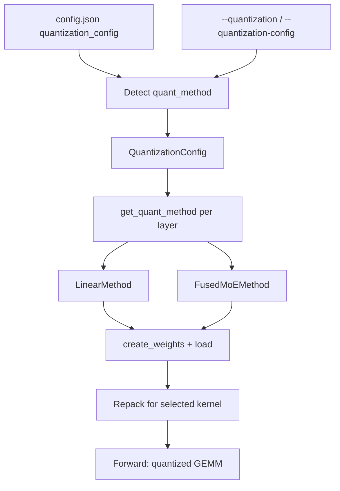

vLLM serves models with low-precision weights, activations and KV cache by giving each layer its own quantize method. On Llama-3.1, FP8 W8A8 is effectively lossless and INT4 W4A16 cuts the cost per query by 2–3× in low-batch serving [[1]](https://arxiv.org/abs/2411.02355).

## Key points

- **There are three ways to quantize.**
  - **Checkpoint quantization**: vLLM reads `quantization_config` from `config.json` and detects the format automatically. Formats include compressed-tensors, GPTQ, AWQ, ModelOpt and Quark. GGUF and bitsandbytes now live in separate plugins (`vllm-gguf-plugin`, `vllm-bnb-plugin`), and GGUF loads from a `.gguf` file rather than `config.json` [[8]](https://docs.vllm.ai/en/latest/features/quantization/gguf/).
  - **Online quantization**: `--quantization fp8_per_tensor` and similar options quantize BF16 weights while the model loads. No calibration data is needed.
  - **KV-cache quantization**: `--kv-cache-dtype fp8` stores the KV cache in FP8.

  All three can be used together.
- **Naming**: `WxAy` means x-bit weights and y-bit activations.
  - **Weight-only** formats (W4A16, W8A16) are fastest when decode is memory-bound, which is the case at small batch sizes.
  - **W8A8** formats (FP8, INT8) also speed up the matrix multiply, so they work best at high batch sizes and for prefill.
- **The recommended way to produce checkpoints** is [LLM Compressor](https://github.com/vllm-project/llm-compressor). It saves `compressed-tensors` checkpoints, which vLLM loads with no extra flags [[2]](https://docs.vllm.ai/en/latest/features/quantization/).
- **Kernels are chosen separately from the format.** vLLM picks a GEMM backend at startup and logs `Selected <kernel> for <module>`. Choices include Marlin, CUTLASS, DeepGEMM, FlashInfer, Triton, Humming and a PyTorch fallback. Two flags override the choice:
  - `--linear-backend` for dense linear layers.
  - `--moe-backend` for MoE experts [[3]](https://docs.vllm.ai/en/latest/features/quantization/llm_compressor/fp8/).
- **GPU generation decides what you can run.**
  - FP8 W8A8 needs SM 8.9 or newer (Ada, Hopper, Blackwell).
  - Turing and Ampere GPUs fall back to FP8 Marlin W8A16, which keeps FP8 weights but computes in 16-bit.
  - MXFP8 W8A8 needs SM 100 or newer (Blackwell) [[3]](https://docs.vllm.ai/en/latest/features/quantization/llm_compressor/fp8/) [[4]](https://docs.vllm.ai/en/latest/features/quantization/online/).

## Formats compared

| Format | Weights / activations | How to get it | Hardware | Best for |
|---|---|---|---|---|
| FP8 W8A8 (`fp8`, compressed-tensors) | FP8 E4M3 / FP8 dynamic per-token | LLM Compressor `FP8_DYNAMIC` (no data needed) or online `fp8_per_*` | SM ≥ 8.9; W8A16 Marlin on SM 7.5–8.6 | Default choice on Hopper; high-throughput serving |
| INT8 W8A8 | INT8 / INT8 | LLM Compressor (SmoothQuant + GPTQ) | Turing+, x86/Arm CPU | Ampere GPUs and CPUs without FP8 |
| INT4 W4A16 (GPTQ, AWQ, compressed-tensors) | INT4 with group scales / BF16 | GPTQ or AWQ with calibration data | Turing+ through Marlin | Low-batch, latency-bound serving; fitting large models on fewer GPUs |
| MXFP8 | FP8 with E8M0 scales per 1×32 block | Online `mxfp8`, ModelOpt | Blackwell for W8A8, otherwise W8A16 | Blackwell |
| MXFP4 / NVFP4 | FP4 E2M1 with block scales | Checkpoint (gpt-oss, ModelOpt, Quark) or online `mxfp4` | Blackwell, AMD (via Quark), Marlin fallback | MoE experts, very large models |
| TorchAO, INC | Different for each | The library's own tools | See the support matrix [[2]](https://docs.vllm.ai/en/latest/features/quantization/) | Reusing existing community checkpoints |
| GGUF, bitsandbytes (plugins) | GGUF k-quants; bnb NF4/INT8 | `.gguf` files; bnb in-flight or pre-quantized | Install `vllm-gguf-plugin` / `vllm-bnb-plugin` | llama.cpp checkpoints; quick memory savings |
| FP8 KV cache | KV cache in FP8 (E4M3/E5M2) | `--kv-cache-dtype fp8`; calibrated scales from LLM Compressor | CUDA and ROCm | Long context; more concurrent sequences |

## How it works

vLLM decides how to quantize each layer separately. A **`QuantizationConfig`** object decides the method for each layer by returning a `LinearMethod` or `FusedMoEMethod`. That method then creates the packed weights, repacks them for the chosen kernel after loading, and runs the kernel in the forward pass.



- **Detection**:
  - `ModelConfig._verify_quantization` reads `quant_method` from `config.json`.
  - It then asks each method's `override_quantization_method` hook, in a fixed order, whether that method should handle the checkpoint. The first method to say yes wins. This is how a plain `"gptq"` checkpoint gets routed to the faster GPTQ/Marlin path.
  - If you pass a `--quantization` value that conflicts with the checkpoint, vLLM raises an error.
- **Methods available on main**:
  - Checkpoint methods: `awq`, `gptq` (plus `auto_*` and `*_marlin` aliases), `fp8`, `compressed-tensors`, `modelopt`, `modelopt_fp4`, `modelopt_mxfp8`, `modelopt_mixed`, `quark`, `moe_wna16`, `experts_int8`, `mxfp4`, `gpt_oss_mxfp4`, `deepseek_v4_fp8`, `humming`, `torchao`, `inc`.
  - Deprecated: `fbgemm_fp8` and `fp_quant`.
- **Online shorthands**: these quantize a BF16 model while it loads.

  | Shorthand | Weights | Activations | Applies to |
  |---|---|---|---|
  | `fp8_per_tensor` | FP8, one scale per tensor | FP8, dynamic | Linear + MoE |
  | `fp8_per_block` | FP8, one scale per 128×128 block | FP8, one scale per 1×128 block | Linear + MoE |
  | `fp8_per_channel` | FP8, one scale per output channel | FP8, per token | Linear + MoE |
  | `mxfp8` | MXFP8, 1×32 blocks | MXFP8 | Linear + MoE |
  | `mxfp4` | MXFP4, 1×32 blocks | Depends on the backend | Linear + MoE |
  | `int8_per_channel_weight_only` | INT8, one scale per channel | BF16 | MoE only |
  | `nvfp4_per_token` | NVFP4 | Per token | MoE only (Blackwell + FlashInfer TRTLLM) |

  `--quantization online` with no shorthand means "use only what `--quantization-config` specifies" [[4]](https://docs.vllm.ai/en/latest/features/quantization/online/).
- **Per-layer control with `--quantization-config`**:
  - `linear` and `moe` set separate schemes for dense and MoE layers.
  - `ignore` lists layers to skip. It accepts exact names, `re:` regexes and fnmatch patterns.
  - `targets` maps layer patterns to shorthands. It cannot be combined with `linear` or `moe`.
- **Re-quantization**: an online method can also convert some already-quantized layers to another format at load time. Two examples:
  - ModelOpt MXFP8 linear layers to `fp8_per_channel`.
  - NVFP4 MoE layers to `mxfp4`.

  Online methods can also quantize layers that a checkpoint left in BF16 [[4]](https://docs.vllm.ai/en/latest/features/quantization/online/).
- **KV cache**: E4M3 and E5M2 store keys and values in FP8.
  - Scales are either one per tensor or one per attention head. Per-head scales work only with the FlashAttention backend and need LLM Compressor calibration.
  - Without calibration, every scale is 1.0.
  - With FA3 attention, the query is also quantized to FP8.
  - `--kv-cache-dtype-skip-layers` keeps sensitive layers in the native dtype, for example `sliding_window` [[5]](https://docs.vllm.ai/en/latest/features/quantization/quantized_kvcache/).

## Usage

Serve a checkpoint that is already quantized. vLLM detects the format, so no flag is needed:

```bash
vllm serve RedHatAI/Meta-Llama-3.1-8B-Instruct-FP8
```

Quantize a BF16 model to FP8 while it loads, and store the KV cache in FP8:

```bash
vllm serve meta-llama/Llama-3.1-8B-Instruct \
  --quantization fp8_per_block \
  --kv-cache-dtype fp8
```

Use different schemes per layer kind and skip some layers (Python API):

```python
from vllm import LLM

llm = LLM(
    "Qwen/Qwen3.5-35B-A3B",
    quantization="fp8_per_tensor",
    quantization_config={
        "moe": "fp8_per_block",
        "ignore": ["re:.*[qkv]_proj"],
    },
)
```

Produce an FP8 checkpoint with LLM Compressor. Weights are rounded to nearest with one scale per channel, and activations are scaled per token at run time, so no calibration data is needed [[3]](https://docs.vllm.ai/en/latest/features/quantization/llm_compressor/fp8/):

```python
from llmcompressor import oneshot
from llmcompressor.modifiers.quantization import QuantizationModifier

recipe = QuantizationModifier(targets="Linear", scheme="FP8_DYNAMIC", ignore=["lm_head"])
oneshot(model=model, recipe=recipe)
model.save_pretrained("Llama-3-8B-Instruct-FP8-Dynamic", save_compressed=True)
```

Write your own method without changing vLLM. Subclass `QuantizationConfig`, decorate it, and return per-layer methods from `get_quant_method` [[2]](https://docs.vllm.ai/en/latest/features/quantization/):

```python
from vllm.model_executor.layers.quantization import register_quantization_config
from vllm.model_executor.layers.quantization.base_config import QuantizationConfig

@register_quantization_config("my_quant")
class MyQuantConfig(QuantizationConfig):
    ...  # get_name, get_min_capability, from_config, get_quant_method, ...
```

## Numbers

Setup: Llama-3.1 Instruct, quantized with LLM Compressor and served with vLLM 0.6.4.post1. The paper ran more than 500k evaluations [[1]](https://arxiv.org/abs/2411.02355).

**Quality.** Higher Arena-Hard scores are better. The 95% confidence intervals of all formats overlap.

| Model | BF16 | FP8 W8A8 | INT8 W8A8 | INT4 W4A16 |
|---|---|---|---|---|
| 8B | 25.8 | 26.8 | 27.2 | 24.0 |
| 70B | 57.0 | 57.7 | 56.3 | 57.0 |
| 405B | 67.4 | 66.9 | 64.6 | 66.5 |

**Speed.** Synchronous code completion, latency in seconds:

| Model / GPUs | BF16 latency | INT4 W4A16 latency | Cost-per-query reduction |
|---|---|---|---|
| 8B, 1×A6000 | 24.5 | 9.7 | 2.39× |
| 70B, 4×A6000 | 61.7 | 39.2 | 2.96× |
| 405B, 16×H100 → 4×H100 | 50.6 | 37.5 | 5.15× |

- At high batch sizes (asynchronous serving), **W8A8 gives the best throughput**: up to 3.04× for 405B FP8 on 16×H100 [[1]](https://arxiv.org/abs/2411.02355).
- **The Marlin INT4 kernel** speeds up a single layer by close to the ideal 4× up to batch size 16–32. End to end in vLLM it reaches up to 2.8× [[6]](https://arxiv.org/abs/2408.11743).

## Pitfalls

- **Weight-only speedups fade as the batch grows.** At large batch sizes the GEMM is limited by compute rather than memory, so W4A16 gains less. Use W8A8 for throughput-bound serving.
- **Online quantization saves memory but not accuracy.** No calibration is done, so for INT4 or INT8 W8A8 use a calibrated checkpoint (GPTQ/AWQ/SmoothQuant).
- **The global `ignore` list only applies to online quantization.** Checkpoint methods use only the ignore list stored in their own `config.json`.
- **A `--quantization` value that conflicts with the checkpoint is an error, not an override.** Leave it unset for pre-quantized models.
- **Silent hangs with block FP8.** Try `VLLM_USE_DEEP_GEMM=0` or `--linear-backend cutlass` [[3]](https://docs.vllm.ai/en/latest/features/quantization/llm_compressor/fp8/).
- **FP8 KV cache without calibrated scales** uses a scale of 1.0, which can lose accuracy. Calibrate with LLM Compressor, or skip sensitive layers.
- **Keep separate environments.** LLM Compressor and vLLM may conflict when installed together [[3]](https://docs.vllm.ai/en/latest/features/quantization/llm_compressor/fp8/).

## References

1. [Kurtic et al., "Give Me BF16 or Give Me Death"? Accuracy-Performance Trade-Offs in LLM Quantization (arXiv 2411.02355)](https://arxiv.org/abs/2411.02355)
2. [vLLM docs: Quantization (supported formats, hardware matrix, plugins)](https://docs.vllm.ai/en/latest/features/quantization/)
3. [vLLM docs: FP8 W8A8 with LLM Compressor](https://docs.vllm.ai/en/latest/features/quantization/llm_compressor/fp8/)
4. [vLLM docs: Online Quantization](https://docs.vllm.ai/en/latest/features/quantization/online/)
5. [vLLM docs: Quantized KV Cache](https://docs.vllm.ai/en/latest/features/quantization/quantized_kvcache/)
6. [Frantar et al., MARLIN: Mixed-Precision Auto-Regressive Parallel Inference on LLMs (arXiv 2408.11743)](https://arxiv.org/abs/2408.11743)
7. [vLLM source: vllm/model_executor/layers/quantization](https://github.com/vllm-project/vllm/tree/main/vllm/model_executor/layers/quantization)
8. [vLLM docs: GGUF (vllm-gguf-plugin)](https://docs.vllm.ai/en/latest/features/quantization/gguf/)
