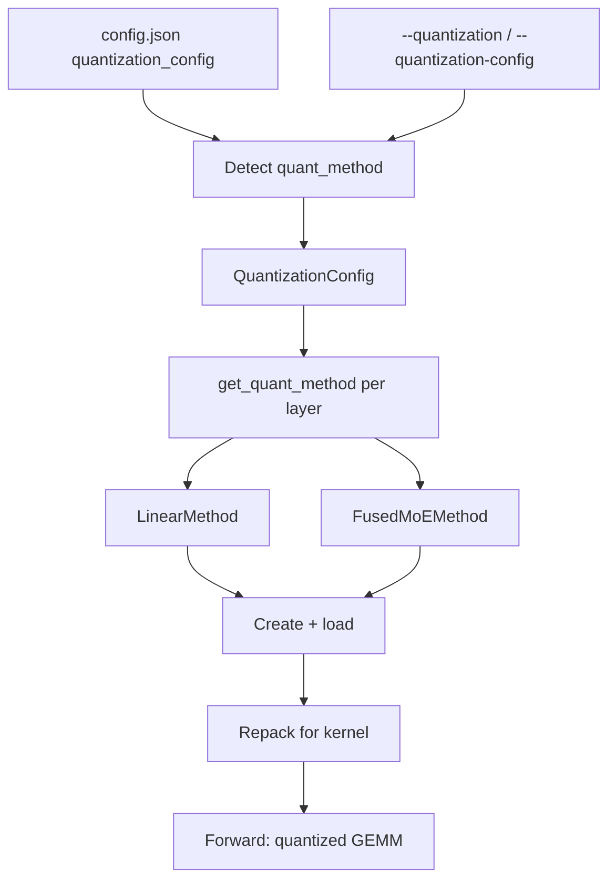

**One layer, one method.** Weights, activations, KV cache: vLLM can shrink all three. FP8 W8A8: almost no loss. INT4 W4A16 at small batch: 2–3× cheaper per query [[1]](https://arxiv.org/abs/2411.02355).

## Key points

**Remember four lines: three paths, two batch sizes, GPU sets the limit, kernel is a separate choice.**

- **Three paths. Mix them freely.**
  - **Load it**: a pre-quantized checkpoint. vLLM reads `quantization_config` in `config.json` and finds the format by itself. compressed-tensors, GPTQ, AWQ, ModelOpt, Quark. GGUF and bitsandbytes are plugins now (`vllm-gguf-plugin`, `vllm-bnb-plugin`); GGUF loads from a `.gguf` file, not `config.json` [[8]](https://docs.vllm.ai/en/latest/features/quantization/gguf/).
  - **Quantize on load**: `--quantization fp8_per_tensor` and friends. BF16 in, FP8 out. No calibration data.
  - **Shrink the KV cache**: `--kv-cache-dtype fp8`.
- **Two batch sizes, two answers.** `WxAy` = x-bit weights, y-bit activations.
  - **Small batch: shrink weights only** (W4A16, W8A16). Decode waits on memory. Smaller weights, faster reads.
  - **Big batch: shrink both** (W8A8: FP8, INT8). Compute is the bottleneck. The GEMM itself must get faster.
- **Make your own checkpoint: use LLM Compressor.** It saves compressed-tensors. vLLM loads it, no flags [[2]](https://docs.vllm.ai/en/latest/features/quantization/).
- **Kernel is a separate choice.** Format is one thing, kernel is another. vLLM picks the GEMM backend at startup and logs `Selected <kernel> for <module>`. Candidates: Marlin, CUTLASS, DeepGEMM, FlashInfer, Triton, Humming, PyTorch fallback [[3]](https://docs.vllm.ai/en/latest/features/quantization/llm_compressor/fp8/). To force one:
  - dense layers: `--linear-backend`;
  - MoE experts: `--moe-backend`.
- **GPU sets the limit.**
  - FP8 W8A8: SM 8.9+ (Ada, Hopper, Blackwell).
  - Turing, Ampere: FP8 falls back to Marlin W8A16. FP8 weights, 16-bit math.
  - MXFP8 W8A8: SM 100+ (Blackwell) [[3]](https://docs.vllm.ai/en/latest/features/quantization/llm_compressor/fp8/) [[4]](https://docs.vllm.ai/en/latest/features/quantization/online/).

## Formats compared

| Format | Weights / activations | How to get it | Hardware | Use it for |
|---|---|---|---|---|
| FP8 W8A8 (`fp8`, compressed-tensors) | FP8 E4M3 / FP8 dynamic per-token | LLM Compressor `FP8_DYNAMIC` (no data) or online `fp8_per_*` | SM ≥ 8.9; W8A16 Marlin on SM 7.5–8.6 | Default on Hopper; high throughput |
| INT8 W8A8 | INT8 / INT8 | LLM Compressor (SmoothQuant + GPTQ) | Turing+, x86/Arm CPU | Ampere and CPUs, no FP8 |
| INT4 W4A16 (GPTQ, AWQ, compressed-tensors) | INT4, group scales / BF16 | GPTQ or AWQ, needs calibration data | Turing+ via Marlin | Low latency, small batch; big model on fewer GPUs |
| MXFP8 | FP8, one E8M0 scale per 1×32 block | Online `mxfp8`, ModelOpt | Blackwell for W8A8, else W8A16 | Blackwell |
| MXFP4 / NVFP4 | FP4 E2M1, block scales | Checkpoint (gpt-oss, ModelOpt, Quark) or online `mxfp4` | Blackwell, AMD (Quark), Marlin fallback | MoE experts, very large models |
| TorchAO, INC | Varies | Their own tools | See support matrix [[2]](https://docs.vllm.ai/en/latest/features/quantization/) | Reuse community checkpoints |
| GGUF, bitsandbytes (plugins) | GGUF k-quants; bnb NF4/INT8 | `.gguf` files; bnb on load or pre-quantized | Install `vllm-gguf-plugin` / `vllm-bnb-plugin` | llama.cpp models; quick memory savings |
| FP8 KV cache | KV cache in FP8 (E4M3/E5M2) | `--kv-cache-dtype fp8`; calibrated scales from LLM Compressor | CUDA, ROCm | Long context; more concurrent requests |

## How it works

**Assign per layer. Then three steps: create, repack, run.**

A **`QuantizationConfig`** gives each layer a method: `LinearMethod` or `FusedMoEMethod`. The method does three jobs:

1. **Create**: make the packed weight tensors and load the data.
2. **Repack**: after loading, reorder weights into the layout the kernel wants.
3. **Run**: call the quantized GEMM in forward.



- **Detection: ask in order, first yes wins.**
  - `ModelConfig._verify_quantization` reads `quant_method` from `config.json`.
  - It asks each method's `override_quantization_method`, in a fixed order: "Do you take this checkpoint?" First yes wins. This is how a plain `"gptq"` checkpoint lands on the faster GPTQ/Marlin path.
  - `--quantization` conflicts with the checkpoint? Error, not override.
- **Methods on main:**
  - Checkpoint: `awq`, `gptq` (plus `auto_*`, `*_marlin` aliases), `fp8`, `compressed-tensors`, `modelopt`, `modelopt_fp4`, `modelopt_mxfp8`, `modelopt_mixed`, `quark`, `moe_wna16`, `experts_int8`, `mxfp4`, `gpt_oss_mxfp4`, `deepseek_v4_fp8`, `humming`, `torchao`, `inc`.
  - Deprecated: `fbgemm_fp8`, `fp_quant`.
- **Online shorthands: BF16 in, quantized out.**

  | Shorthand | Weights | Activations | Applies to |
  |---|---|---|---|
  | `fp8_per_tensor` | FP8, one scale per tensor | FP8, dynamic | Linear + MoE |
  | `fp8_per_block` | FP8, one scale per 128×128 block | FP8, one scale per 1×128 block | Linear + MoE |
  | `fp8_per_channel` | FP8, one scale per output channel | FP8, per token | Linear + MoE |
  | `mxfp8` | MXFP8, 1×32 blocks | MXFP8 | Linear + MoE |
  | `mxfp4` | MXFP4, 1×32 blocks | Depends on backend | Linear + MoE |
  | `int8_per_channel_weight_only` | INT8, one scale per channel | BF16 | MoE only |
  | `nvfp4_per_token` | NVFP4 | Per token | MoE only (Blackwell + FlashInfer TRTLLM) |

  `--quantization online` with no shorthand = "follow `--quantization-config` only" [[4]](https://docs.vllm.ai/en/latest/features/quantization/online/).
- **Per-layer control, `--quantization-config`: split, skip, target.**
  - **Split**: `linear` and `moe` get separate schemes.
  - **Skip**: `ignore` lists layers to leave alone. Exact names, `re:` regex, fnmatch patterns.
  - **Target**: `targets` maps layer patterns to shorthands. Not together with `linear` / `moe`.
- **Re-quantize: one format in, another out.**
  - ModelOpt MXFP8 linear → `fp8_per_channel`.
  - NVFP4 MoE → `mxfp4`.

  Layers the checkpoint left in BF16? Online methods can quantize them too [[4]](https://docs.vllm.ai/en/latest/features/quantization/online/).
- **KV cache: no calibration, scale = 1.0.**
  - Two FP8 formats: E4M3, E5M2.
  - Scales: one per tensor, or one per attention head. Per-head needs the FlashAttention backend and LLM Compressor calibration.
  - With FA3, the query goes FP8 too.
  - `--kv-cache-dtype-skip-layers` keeps sensitive layers at full precision, e.g. `sliding_window` [[5]](https://docs.vllm.ai/en/latest/features/quantization/quantized_kvcache/).

## Usage

**Serve a quantized checkpoint.** Auto-detected. No flags.

```bash
vllm serve RedHatAI/Meta-Llama-3.1-8B-Instruct-FP8
```

**FP8 on load, FP8 KV cache.**

```bash
vllm serve meta-llama/Llama-3.1-8B-Instruct \
  --quantization fp8_per_block \
  --kv-cache-dtype fp8
```

**Split by layer kind, skip some layers** (Python API):

```python
from vllm import LLM

llm = LLM(
    "Qwen/Qwen3.5-35B-A3B",
    quantization="fp8_per_tensor",
    quantization_config={
        "moe": "fp8_per_block",
        "ignore": ["re:.*[qkv]_proj"],
    },
)
```

**Make an FP8 checkpoint with LLM Compressor.** Weights: round-to-nearest, per channel. Activations: per token, at run time. So: no calibration data [[3]](https://docs.vllm.ai/en/latest/features/quantization/llm_compressor/fp8/).

```python
from llmcompressor import oneshot
from llmcompressor.modifiers.quantization import QuantizationModifier

recipe = QuantizationModifier(targets="Linear", scheme="FP8_DYNAMIC", ignore=["lm_head"])
oneshot(model=model, recipe=recipe)
model.save_pretrained("Llama-3-8B-Instruct-FP8-Dynamic", save_compressed=True)
```

**Write your own method, no vLLM changes.** Subclass `QuantizationConfig`, add the decorator, return a method per layer from `get_quant_method` [[2]](https://docs.vllm.ai/en/latest/features/quantization/).

```python
from vllm.model_executor.layers.quantization import register_quantization_config
from vllm.model_executor.layers.quantization.base_config import QuantizationConfig

@register_quantization_config("my_quant")
class MyQuantConfig(QuantizationConfig):
    ...  # get_name, get_min_capability, from_config, get_quant_method, ...
```

## Numbers

**8-bit: almost lossless. 4-bit: cheapest at small batch. Big batch: W8A8 wins.**

Setup: Llama-3.1 Instruct, quantized with LLM Compressor, served on vLLM 0.6.4.post1, 500k+ evaluations [[1]](https://arxiv.org/abs/2411.02355).

**Quality.** Arena-Hard, higher is better. All 95% confidence intervals overlap.

| Model | BF16 | FP8 W8A8 | INT8 W8A8 | INT4 W4A16 |
|---|---|---|---|---|
| 8B | 25.8 | 26.8 | 27.2 | 24.0 |
| 70B | 57.0 | 57.7 | 56.3 | 57.0 |
| 405B | 67.4 | 66.9 | 64.6 | 66.5 |

**Speed.** Synchronous code completion, latency in seconds.

| Model / GPUs | BF16 latency | INT4 W4A16 latency | Cost per query, down by |
|---|---|---|---|
| 8B, 1×A6000 | 24.5 | 9.7 | 2.39× |
| 70B, 4×A6000 | 61.7 | 39.2 | 2.96× |
| 405B, 16×H100 → 4×H100 | 50.6 | 37.5 | 5.15× |

- **Big batch (async serving): W8A8 has the best throughput.** Up to 3.04×, 405B FP8 on 16×H100 [[1]](https://arxiv.org/abs/2411.02355).
- **Marlin INT4 kernel**: one layer, close to the ideal 4×, up to batch 16–32. End to end in vLLM: up to 2.8× [[6]](https://arxiv.org/abs/2408.11743).

## Qwen3-8B demo

**INT4: 2.6× faster at batch 1, 1.3 points lost. Batch 64: only 1.3×.**

Setup: one RTX A5000 (24 GB, SM 8.6, Ampere). vLLM 0.29.1 dev, LLM Compressor 0.15.0. Input 512 tokens, output 128, `vllm bench latency`. GSM8K 5-shot with `lm_eval`.

**Step 1: quantize.** GPTQ W4A16, 512 calibration samples. About 20 minutes on one A5000. 16 GB in, 5.4 GB out.

```python
recipe = GPTQModifier(targets="Linear", scheme="W4A16", ignore=["lm_head"])
oneshot(model=model, dataset=ds, recipe=recipe,
        max_seq_length=2048, num_calibration_samples=512)
model.save_pretrained("Qwen3-8B-W4A16-G128", save_compressed=True)
```

**Step 2: serve.** No flags. vLLM reads `quant_method: compressed-tensors` from `config.json`.

```bash
vllm serve ./Qwen3-8B-W4A16-G128
```

**Step 3: compare.**

| | BF16 | Online FP8 (`fp8_per_tensor`) | INT4 W4A16 (GPTQ) |
|---|---|---|---|
| Kernel | BF16 GEMM | Marlin W8A16 (weight-only fallback) | compressed-tensors W4A16 |
| Weight memory | 15.27 GiB | 8.8 GiB | **5.68 GiB** |
| GSM8K (strict) | 87.3% | 86.7% (−0.6) | 86.0% (−1.3) |
| Latency, batch 1 | 3.17 s | 1.91 s (1.66×) | **1.24 s (2.55×)** |
| Latency, batch 16 | 4.89 s | 3.72 s (1.32×) | 2.95 s (1.66×) |
| Latency, batch 64 | 12.02 s | 10.15 s (1.18×) | 9.44 s (1.27×) |

- **Small batch: shrink weights, win big.** Batch 1, INT4: 2.55×. Decode is memory-bound.
- **Big batch: gains fade.** Batch 64: 1.27×. Now compute-bound, and on Ampere W4A16 and W8A16 still do 16-bit math.
- **8-bit: almost lossless. 4-bit: a little loss.** FP8 −0.6, INT4 −1.3. GSM8K stderr is about ±0.9.
- **GPU sets the limit.** `fp8_per_channel` fails on A5000: it needs FP8 activations, SM 8.9+. `fp8_per_tensor` falls back to Marlin W8A16 and runs.

## Pitfalls

- **`fp8_per_channel` on Ampere = error.** It needs per-token FP8 activations (SM 8.9+). Use `fp8_per_tensor` to get the W8A16 fallback.
- **Weight-only gains fade as batch grows.** Big batch = compute-bound. W4A16 helps less. Throughput? Use W8A8.
- **Online quantization saves memory, not accuracy.** No calibration. INT4 or INT8 W8A8? Use a calibrated checkpoint (GPTQ / AWQ / SmoothQuant).
- **Global `ignore` is online-only.** Checkpoint methods follow their own `config.json` ignore list.
- **`--quantization` vs. checkpoint conflict = error, not override.** Pre-quantized model? Leave the flag out.
- **Block FP8 hangs, no error?** Try `VLLM_USE_DEEP_GEMM=0` or `--linear-backend cutlass` [[3]](https://docs.vllm.ai/en/latest/features/quantization/llm_compressor/fp8/).
- **FP8 KV cache, no calibration = scale 1.0.** Accuracy may drop. Calibrate with LLM Compressor, or skip sensitive layers.
- **Two tools, two environments.** LLM Compressor and vLLM may conflict in one env [[3]](https://docs.vllm.ai/en/latest/features/quantization/llm_compressor/fp8/).

## References

1. [Kurtic et al., "Give Me BF16 or Give Me Death"? Accuracy-Performance Trade-Offs in LLM Quantization (arXiv 2411.02355)](https://arxiv.org/abs/2411.02355)
2. [vLLM docs: Quantization (supported formats, hardware matrix, plugins)](https://docs.vllm.ai/en/latest/features/quantization/)
3. [vLLM docs: FP8 W8A8 with LLM Compressor](https://docs.vllm.ai/en/latest/features/quantization/llm_compressor/fp8/)
4. [vLLM docs: Online Quantization](https://docs.vllm.ai/en/latest/features/quantization/online/)
5. [vLLM docs: Quantized KV Cache](https://docs.vllm.ai/en/latest/features/quantization/quantized_kvcache/)
6. [Frantar et al., MARLIN: Mixed-Precision Auto-Regressive Parallel Inference on LLMs (arXiv 2408.11743)](https://arxiv.org/abs/2408.11743)
7. [vLLM source: vllm/model_executor/layers/quantization](https://github.com/vllm-project/vllm/tree/main/vllm/model_executor/layers/quantization)
8. [vLLM docs: GGUF (vllm-gguf-plugin)](https://docs.vllm.ai/en/latest/features/quantization/gguf/)
