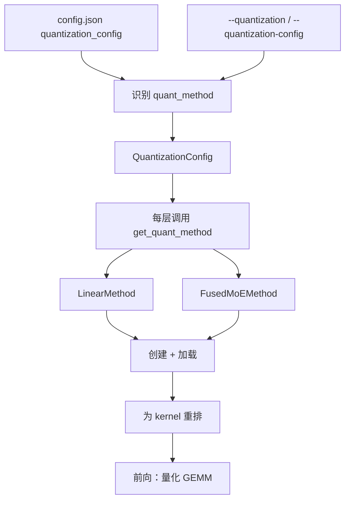

**一层，一个方法。** 权重、激活、KV cache，三样 vLLM 都能压缩。FP8 W8A8：几乎无损。小 batch 下 INT4 W4A16：每次请求的成本降低 2–3 倍 [[1]](https://arxiv.org/abs/2411.02355)。

## 要点

**记住四句话：三条路径，两种 batch，GPU 决定上限，kernel 单独选。**

- **三条路径，可以随意组合。**
  - **直接加载**：预先量化好的 checkpoint。vLLM 读取 `config.json` 里的 `quantization_config`，自己识别格式。支持 compressed-tensors、GPTQ、AWQ、ModelOpt、Quark。GGUF 和 bitsandbytes 现在是插件（`vllm-gguf-plugin`、`vllm-bnb-plugin`）；GGUF 从 `.gguf` 文件加载，不读 `config.json` [[8]](https://docs.vllm.ai/en/latest/features/quantization/gguf/)。
  - **加载时量化**：`--quantization fp8_per_tensor` 等参数。输入 BF16，输出 FP8。不需要校准数据。
  - **压缩 KV cache**：`--kv-cache-dtype fp8`。
- **两种 batch，两种答案。** `WxAy` = x 位权重，y 位激活。
  - **小 batch：只压缩权重**（W4A16、W8A16）。decode 在等显存读取。权重越小，读得越快。
  - **大 batch：两个都压缩**（W8A8：FP8、INT8）。瓶颈在计算，GEMM 本身必须变快。
- **自己做 checkpoint：用 LLM Compressor。** 它保存为 compressed-tensors 格式，vLLM 直接加载，不用加参数 [[2]](https://docs.vllm.ai/en/latest/features/quantization/)。
- **kernel 是单独的选择。** 格式是一回事，kernel 是另一回事。vLLM 启动时选定 GEMM 后端，并打印日志 `Selected <kernel> for <module>`。候选：Marlin、CUTLASS、DeepGEMM、FlashInfer、Triton、Humming，以及 PyTorch 兜底 [[3]](https://docs.vllm.ai/en/latest/features/quantization/llm_compressor/fp8/)。强制指定：
  - dense 层：`--linear-backend`；
  - MoE expert：`--moe-backend`。
- **GPU 决定上限。**
  - FP8 W8A8：SM 8.9+（Ada、Hopper、Blackwell）。
  - Turing、Ampere：FP8 退回到 Marlin W8A16，权重是 FP8，计算用 16 位。
  - MXFP8 W8A8：SM 100+（Blackwell）[[3]](https://docs.vllm.ai/en/latest/features/quantization/llm_compressor/fp8/) [[4]](https://docs.vllm.ai/en/latest/features/quantization/online/)。

## 格式对比

| 格式 | 权重 / 激活 | 怎么得到 | 硬件 | 适用场景 |
|---|---|---|---|---|
| FP8 W8A8（`fp8`、compressed-tensors） | FP8 E4M3 / FP8 按 token 动态 | LLM Compressor `FP8_DYNAMIC`（无需数据）或在线 `fp8_per_*` | SM ≥ 8.9；SM 7.5–8.6 上为 W8A16 Marlin | Hopper 上的默认选择；高吞吐 |
| INT8 W8A8 | INT8 / INT8 | LLM Compressor（SmoothQuant + GPTQ） | Turing+，x86/Arm CPU | 没有 FP8 的 Ampere 和 CPU |
| INT4 W4A16（GPTQ、AWQ、compressed-tensors） | INT4，分组 scale / BF16 | GPTQ 或 AWQ，需要校准数据 | Turing+，走 Marlin | 低延迟、小 batch；用更少的 GPU 跑大模型 |
| MXFP8 | FP8，每 1×32 块一个 E8M0 scale | 在线 `mxfp8`、ModelOpt | Blackwell 上为 W8A8，其他为 W8A16 | Blackwell |
| MXFP4 / NVFP4 | FP4 E2M1，块 scale | checkpoint（gpt-oss、ModelOpt、Quark）或在线 `mxfp4` | Blackwell、AMD（Quark），Marlin 兜底 | MoE expert，超大模型 |
| TorchAO、INC | 各不相同 | 各自的工具 | 见支持矩阵 [[2]](https://docs.vllm.ai/en/latest/features/quantization/) | 复用社区 checkpoint |
| GGUF、bitsandbytes（插件） | GGUF k-quants；bnb NF4/INT8 | `.gguf` 文件；bnb 加载时量化或预量化 | 安装 `vllm-gguf-plugin` / `vllm-bnb-plugin` | llama.cpp 模型；快速省显存 |
| FP8 KV cache | KV cache 用 FP8（E4M3/E5M2） | `--kv-cache-dtype fp8`；用 LLM Compressor 校准 scale | CUDA、ROCm | 长上下文；更多并发请求 |

## 原理

**按层分配方法，然后三步：创建、重排、运行。**

**`QuantizationConfig`** 给每一层指定一个方法：`LinearMethod` 或 `FusedMoEMethod`。方法负责三件事：

1. **创建**：建好打包后的权重张量，加载数据。
2. **重排**：加载完成后，把权重重新排成 kernel 需要的布局。
3. **运行**：在前向中调用量化 GEMM。



- **识别：按顺序询问，第一个说“是”的胜出。**
  - `ModelConfig._verify_quantization` 从 `config.json` 读取 `quant_method`。
  - 它按固定顺序询问每个方法的 `override_quantization_method`：“这个 checkpoint 你接不接？”第一个接的胜出。普通的 `"gptq"` checkpoint 就是这样被分到更快的 GPTQ/Marlin 路径上的。
  - `--quantization` 和 checkpoint 冲突？直接报错，不会覆盖。
- **main 分支上的方法：**
  - checkpoint 类：`awq`、`gptq`（以及 `auto_*`、`*_marlin` 别名）、`fp8`、`compressed-tensors`、`modelopt`、`modelopt_fp4`、`modelopt_mxfp8`、`modelopt_mixed`、`quark`、`moe_wna16`、`experts_int8`、`mxfp4`、`gpt_oss_mxfp4`、`deepseek_v4_fp8`、`humming`、`torchao`、`inc`。
  - 已弃用：`fbgemm_fp8`、`fp_quant`。
- **在线量化简写：输入 BF16，输出量化结果。**

  | 简写 | 权重 | 激活 | 作用范围 |
  |---|---|---|---|
  | `fp8_per_tensor` | FP8，每个张量一个 scale | FP8，动态 | Linear + MoE |
  | `fp8_per_block` | FP8，每 128×128 块一个 scale | FP8，每 1×128 块一个 scale | Linear + MoE |
  | `fp8_per_channel` | FP8，每个输出通道一个 scale | FP8，按 token | Linear + MoE |
  | `mxfp8` | MXFP8，1×32 块 | MXFP8 | Linear + MoE |
  | `mxfp4` | MXFP4，1×32 块 | 取决于后端 | Linear + MoE |
  | `int8_per_channel_weight_only` | INT8，每通道一个 scale | BF16 | 仅 MoE |
  | `nvfp4_per_token` | NVFP4 | 按 token | 仅 MoE（Blackwell + FlashInfer TRTLLM） |

  `--quantization online` 不带简写 = “只按 `--quantization-config` 来” [[4]](https://docs.vllm.ai/en/latest/features/quantization/online/)。
- **按层控制，`--quantization-config`：分开、跳过、指定。**
  - **分开**：`linear` 和 `moe` 用各自的方案。
  - **跳过**：`ignore` 列出不量化的层。支持精确名称、`re:` 正则、fnmatch 通配。
  - **指定**：`targets` 把层名模式映射到简写。不能和 `linear` / `moe` 同时用。
- **重新量化：输入一种格式，输出另一种。**
  - ModelOpt MXFP8 linear → `fp8_per_channel`。
  - NVFP4 MoE → `mxfp4`。

  checkpoint 里留成 BF16 的层？在线方法也能把它们量化 [[4]](https://docs.vllm.ai/en/latest/features/quantization/online/)。
- **KV cache：不校准时 scale = 1.0。**
  - 两种 FP8 格式：E4M3、E5M2。
  - scale：每个张量一个，或每个 attention head 一个。按 head 需要 FlashAttention 后端和 LLM Compressor 校准。
  - 用 FA3 时，query 也会转成 FP8。
  - `--kv-cache-dtype-skip-layers` 让敏感的层保持全精度，比如 `sliding_window` [[5]](https://docs.vllm.ai/en/latest/features/quantization/quantized_kvcache/)。

## 用法

**部署量化 checkpoint。** 自动识别，不用加参数。

```bash
vllm serve RedHatAI/Meta-Llama-3.1-8B-Instruct-FP8
```

**加载时转 FP8，KV cache 也用 FP8。**

```bash
vllm serve meta-llama/Llama-3.1-8B-Instruct \
  --quantization fp8_per_block \
  --kv-cache-dtype fp8
```

**按层类型分开，跳过部分层**（Python API）：

```python
from vllm import LLM

llm = LLM(
    "Qwen/Qwen3.5-35B-A3B",
    quantization="fp8_per_tensor",
    quantization_config={
        "moe": "fp8_per_block",
        "ignore": ["re:.*[qkv]_proj"],
    },
)
```

**用 LLM Compressor 做 FP8 checkpoint。** 权重：就近取整，按通道。激活：运行时按 token。所以不需要校准数据 [[3]](https://docs.vllm.ai/en/latest/features/quantization/llm_compressor/fp8/)。

```python
from llmcompressor import oneshot
from llmcompressor.modifiers.quantization import QuantizationModifier

recipe = QuantizationModifier(targets="Linear", scheme="FP8_DYNAMIC", ignore=["lm_head"])
oneshot(model=model, recipe=recipe)
model.save_pretrained("Llama-3-8B-Instruct-FP8-Dynamic", save_compressed=True)
```

**自己写量化方法，不用改 vLLM。** 继承 `QuantizationConfig`，加上装饰器，在 `get_quant_method` 里为每层返回一个方法 [[2]](https://docs.vllm.ai/en/latest/features/quantization/)。

```python
from vllm.model_executor.layers.quantization import register_quantization_config
from vllm.model_executor.layers.quantization.base_config import QuantizationConfig

@register_quantization_config("my_quant")
class MyQuantConfig(QuantizationConfig):
    ...  # get_name、get_min_capability、from_config、get_quant_method 等
```

## 数据

**8 位：几乎无损。4 位：小 batch 下最省。大 batch：W8A8 最好。**

设置：Llama-3.1 Instruct，用 LLM Compressor 量化，在 vLLM 0.6.4.post1 上部署，超过 50 万次评测 [[1]](https://arxiv.org/abs/2411.02355)。

**质量。** Arena-Hard，越高越好。所有 95% 置信区间都有重叠。

| 模型 | BF16 | FP8 W8A8 | INT8 W8A8 | INT4 W4A16 |
|---|---|---|---|---|
| 8B | 25.8 | 26.8 | 27.2 | 24.0 |
| 70B | 57.0 | 57.7 | 56.3 | 57.0 |
| 405B | 67.4 | 66.9 | 64.6 | 66.5 |

**速度。** 同步代码补全，延迟单位为秒。

| 模型 / GPU | BF16 延迟 | INT4 W4A16 延迟 | 每次请求成本降低 |
|---|---|---|---|
| 8B，1×A6000 | 24.5 | 9.7 | 2.39× |
| 70B，4×A6000 | 61.7 | 39.2 | 2.96× |
| 405B，16×H100 → 4×H100 | 50.6 | 37.5 | 5.15× |

- **大 batch（异步服务）：W8A8 吞吐最高。** 最高 3.04 倍，405B FP8 跑在 16×H100 上 [[1]](https://arxiv.org/abs/2411.02355)。
- **Marlin INT4 kernel**：单层接近理想的 4 倍，batch 可到 16–32。在 vLLM 里端到端最高 2.8 倍 [[6]](https://arxiv.org/abs/2408.11743)。

## Qwen3-8B 实测

**INT4：batch 1 快 2.6 倍，掉 1.3 分。batch 64：只快 1.3 倍。**

设置：一张 RTX A5000（24 GB，SM 8.6，Ampere）。vLLM 0.29.1 dev，LLM Compressor 0.15.0。输入 512 token，输出 128，用 `vllm bench latency` 测。GSM8K 5-shot 用 `lm_eval` 测。

**第一步：量化。** GPTQ W4A16，512 条校准样本。在一张 A5000 上大约 20 分钟。16 GB 进，5.4 GB 出。

```python
recipe = GPTQModifier(targets="Linear", scheme="W4A16", ignore=["lm_head"])
oneshot(model=model, dataset=ds, recipe=recipe,
        max_seq_length=2048, num_calibration_samples=512)
model.save_pretrained("Qwen3-8B-W4A16-G128", save_compressed=True)
```

**第二步：部署。** 不用加参数，vLLM 会从 `config.json` 读到 `quant_method: compressed-tensors`。

```bash
vllm serve ./Qwen3-8B-W4A16-G128
```

**第三步：对比。**

| | BF16 | 在线 FP8（`fp8_per_tensor`） | INT4 W4A16（GPTQ） |
|---|---|---|---|
| Kernel | BF16 GEMM | Marlin W8A16（只量化权重的兜底） | compressed-tensors W4A16 |
| 权重显存 | 15.27 GiB | 8.8 GiB | **5.68 GiB** |
| GSM8K（strict） | 87.3% | 86.7%（−0.6） | 86.0%（−1.3） |
| 延迟，batch 1 | 3.17 s | 1.91 s（1.66×） | **1.24 s（2.55×）** |
| 延迟，batch 16 | 4.89 s | 3.72 s（1.32×） | 2.95 s（1.66×） |
| 延迟，batch 64 | 12.02 s | 10.15 s（1.18×） | 9.44 s（1.27×） |

- **小 batch：压缩权重，收益最大。** batch 1，INT4：2.55 倍。decode 受显存带宽限制。
- **大 batch：收益变小。** batch 64：1.27 倍。这时受计算限制，而在 Ampere 上 W4A16 和 W8A16 仍然用 16 位计算。
- **8 位：几乎无损。4 位：略有损失。** FP8 −0.6，INT4 −1.3。GSM8K 的标准误约 ±0.9。
- **GPU 决定上限。** `fp8_per_channel` 在 A5000 上报错：它需要 FP8 激活，即 SM 8.9+。`fp8_per_tensor` 会退回 Marlin W8A16，可以运行。

## 注意事项

- **在 Ampere 上用 `fp8_per_channel` = 报错。** 它需要按 token 的 FP8 激活（SM 8.9+）。改用 `fp8_per_tensor`，走 W8A16 兜底。
- **只量化权重的收益随 batch 增大而变小。** 大 batch = 受计算限制，W4A16 帮助变小。要吞吐？用 W8A8。
- **在线量化省的是显存，不保精度。** 没有校准。要 INT4 或 INT8 W8A8？用校准过的 checkpoint（GPTQ / AWQ / SmoothQuant）。
- **全局 `ignore` 只对在线量化生效。** checkpoint 方法按它自己 `config.json` 里的 ignore 列表来。
- **`--quantization` 与 checkpoint 冲突 = 报错，不会覆盖。** 预量化的模型？不要加这个参数。
- **Block FP8 卡住、没有报错？** 试试 `VLLM_USE_DEEP_GEMM=0` 或 `--linear-backend cutlass` [[3]](https://docs.vllm.ai/en/latest/features/quantization/llm_compressor/fp8/)。
- **FP8 KV cache 不校准 = scale 1.0。** 精度可能下降。用 LLM Compressor 校准，或跳过敏感的层。
- **两个工具，两个环境。** LLM Compressor 和 vLLM 装在同一个环境里可能冲突 [[3]](https://docs.vllm.ai/en/latest/features/quantization/llm_compressor/fp8/)。

## 参考资料

1. [Kurtic et al., "Give Me BF16 or Give Me Death"? Accuracy-Performance Trade-Offs in LLM Quantization (arXiv 2411.02355)](https://arxiv.org/abs/2411.02355)
2. [vLLM docs: Quantization (supported formats, hardware matrix, plugins)](https://docs.vllm.ai/en/latest/features/quantization/)
3. [vLLM docs: FP8 W8A8 with LLM Compressor](https://docs.vllm.ai/en/latest/features/quantization/llm_compressor/fp8/)
4. [vLLM docs: Online Quantization](https://docs.vllm.ai/en/latest/features/quantization/online/)
5. [vLLM docs: Quantized KV Cache](https://docs.vllm.ai/en/latest/features/quantization/quantized_kvcache/)
6. [Frantar et al., MARLIN: Mixed-Precision Auto-Regressive Parallel Inference on LLMs (arXiv 2408.11743)](https://arxiv.org/abs/2408.11743)
7. [vLLM source: vllm/model_executor/layers/quantization](https://github.com/vllm-project/vllm/tree/main/vllm/model_executor/layers/quantization)
8. [vLLM docs: GGUF (vllm-gguf-plugin)](https://docs.vllm.ai/en/latest/features/quantization/gguf/)
