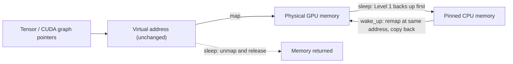

Sleep Mode keeps the vLLM process alive and hands back only the physical GPU memory used by weights and KV cache; on wake-up it remaps memory at the same virtual addresses, cutting a model switch from tens of seconds to under a second [[1]](https://docs.vllm.ai/en/latest/features/sleep_mode/)[[2]](https://vllm.ai/blog/sleep-mode).

## Key points

- **No process restart**: CUDA initialization, CUDA graph capture, and kernel compilation don't have to be redone. That setup — not just loading weights — is what makes a restart slow [[2]](https://vllm.ai/blog/sleep-mode).
- **Return the memory, keep the addresses**: on sleep, the GPU memory goes back to the device, but the addresses the program recorded stay the same; on wake-up, memory is allocated again at those same addresses. Pointers held by the model and by CUDA graphs never change, so everything works immediately.
- **Level 0**: pauses scheduling only; frees nothing by itself. Combined with `release_kv_cache_memory()`, it drops the KV cache while keeping weights on the GPU (newer versions only) [[1]](https://docs.vllm.ai/en/latest/features/sleep_mode/).
- **Level 1**: copies weights to CPU and drops the KV cache. Fastest wake-up, but needs enough CPU RAM.
- **Level 2**: drops both weights and KV cache. Saves CPU RAM; weights must be reloaded after wake-up. Built for RLHF weight updates.
- **Levels 1 and 2 always lose the KV cache.**

## Level 0 / 1 / 2

| | Level 0 | Level 1 | Level 2 |
|---|---|---|---|
| What it does | Pause scheduling | Offload | Discard |
| Weights | Stay on GPU | Backed up to pinned CPU memory | Discarded |
| KV cache | Stays on GPU; can be freed with `release_kv_cache_memory()` | Discarded | Discarded |
| After wake-up | Ready; if KV was freed, `wake_up(tags=["kv_cache"])` | Ready | `reload_weights` + `reset_prefix_cache` |
| CPU memory | None | ≈ size of weights | MBs |
| Use for | Temporarily freeing KV cache memory | Rotating between models | RLHF weight updates, low CPU RAM |

## How it works

`CuMemAllocator` takes over PyTorch allocations and uses CUDA virtual memory to separate **virtual addresses** from **physical memory** [[3]](https://github.com/vllm-project/vllm/blob/main/vllm/device_allocator/cumem.py):



- Allocations are pooled by tag: `weights`, `kv_cache`, `cudagraph`.
- `sleep(offload_tags)`: allocations whose tag is listed are copied to CPU first, then **all** are unmapped. The only difference between Level 1 and Level 2 is whether `weights` is in `offload_tags` [[3]](https://github.com/vllm-project/vllm/blob/main/vllm/device_allocator/cumem.py)[[4]](https://docs.vllm.ai/en/latest/api/vllm/device_allocator/sleep_mode_backend/).
- `wake_up(tags)`: remaps at the original addresses and copies back anything that was backed up. Tags can be woken separately.

## Usage

```python
llm = LLM("Qwen/Qwen3-0.6B", enable_sleep_mode=True)

llm.sleep(level=1)
llm.wake_up()

# Level 0: pause, then free only the KV cache; weights stay on GPU
llm.sleep(level=0, mode="keep")
llm.release_kv_cache_memory()
llm.wake_up(tags=["kv_cache"])

# Level 2: wake in stages to keep peak memory low during a weight update
llm.sleep(level=2)
llm.wake_up(tags=["weights"])
llm.collective_rpc("reload_weights")
llm.wake_up(tags=["kv_cache"])
```

Online serving [[1]](https://docs.vllm.ai/en/latest/features/sleep_mode/):

```bash
VLLM_SERVER_DEV_MODE=1 vllm serve Qwen/Qwen3-0.6B --enable-sleep-mode
curl -X POST 'localhost:8000/sleep?level=1'
curl -X POST 'localhost:8000/wake_up'
```

`VLLM_SERVER_DEV_MODE=1` enables development endpoints — don't expose them publicly.

## Speedup

A100, TP=1, vLLM 0.11.0, switching between Qwen3-0.6B and Phi-3-vision 5 times [[2]](https://vllm.ai/blog/sleep-mode):

| | No sleep | Level 1 | Level 2 |
|---|---|---|---|
| Total time | 357.1s | 112.6s | 124.6s |
| Per switch | 37.6–58.1s | 0.26–0.82s | 0.85–2.58s |

Level 2 still reads weights from disk; it's faster because it skips process startup, graph capture, and kernel compilation.

## Pitfalls

- **Warm up before sleeping**, or the first inference after every wake-up is 5–7× slower [[2]](https://vllm.ai/blog/sleep-mode).
- Call `release_kv_cache_memory()` only **after** the Level 0 pause completes; requests kept with `mode="keep"` are recomputed after wake-up [[1]](https://docs.vllm.ai/en/latest/features/sleep_mode/).
- Level 0 and `release_kv_cache_memory()` only appear in newer docs; older versions (e.g. v0.10) have only Levels 1 and 2.
- CUDA graph memory is discarded and recaptured by default; `--sleep-mode-offload-cudagraph` backs it up instead, at about 3% decode latency at batch size 1 [[1]](https://docs.vllm.ai/en/latest/features/sleep_mode/).
- Platforms: CUDA and ROCm [[1]](https://docs.vllm.ai/en/latest/features/sleep_mode/).

## References

1. [vLLM Docs — Sleep Mode](https://docs.vllm.ai/en/latest/features/sleep_mode/)
2. [vLLM Blog — Zero-Reload Model Switching with vLLM Sleep Mode](https://vllm.ai/blog/sleep-mode)
3. [vLLM source — `vllm/device_allocator/cumem.py`](https://github.com/vllm-project/vllm/blob/main/vllm/device_allocator/cumem.py)
4. [vLLM API Docs — sleep mode backend](https://docs.vllm.ai/en/latest/api/vllm/device_allocator/sleep_mode_backend/)
