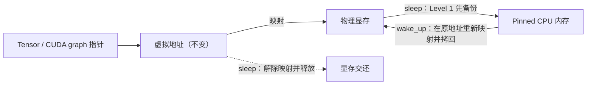

Sleep Mode 让 vLLM 进程保持存活，只把权重和 KV cache 占用的物理显存交还给 GPU；唤醒时在原来的虚拟地址上重新映射显存，把一次模型切换从几十秒缩短到一秒以内 [[1]](https://docs.vllm.ai/en/latest/features/sleep_mode/)[[2]](https://vllm.ai/blog/sleep-mode)。

## 要点

- **不重启进程**：CUDA 初始化、CUDA graph 捕获、kernel 编译都不用重做。重启慢，慢的正是这些准备工作，而不只是加载权重 [[2]](https://vllm.ai/blog/sleep-mode)。
- **交还显存，保留地址**：sleep 时显存还给设备，但程序记录的地址不变；唤醒时在同样的地址上重新分配显存。模型和 CUDA graph 持有的指针始终不变，所以唤醒后立刻可用。
- **Level 0**：只暂停调度，本身不释放任何显存。配合 `release_kv_cache_memory()` 可以丢掉 KV cache、把权重留在 GPU 上（仅新版本支持）[[1]](https://docs.vllm.ai/en/latest/features/sleep_mode/)。
- **Level 1**：权重拷到 CPU，KV cache 丢弃。唤醒最快，但需要足够的 CPU 内存。
- **Level 2**：权重和 KV cache 都丢弃。省 CPU 内存，唤醒后要重新加载权重。为 RLHF 权重更新设计。
- **Level 1 和 Level 2 都会丢掉 KV cache。**

## Level 0 / 1 / 2

| | Level 0 | Level 1 | Level 2 |
|---|---|---|---|
| 做什么 | 暂停调度 | 卸载 | 丢弃 |
| 权重 | 留在 GPU | 备份到 pinned CPU 内存 | 丢弃 |
| KV cache | 留在 GPU；可用 `release_kv_cache_memory()` 释放 | 丢弃 | 丢弃 |
| 唤醒后 | 直接可用；若释放过 KV，需 `wake_up(tags=["kv_cache"])` | 直接可用 | `reload_weights` + `reset_prefix_cache` |
| CPU 内存 | 不占 | ≈ 权重大小 | 几 MB |
| 适用场景 | 临时腾出 KV cache 显存 | 多个模型轮换 | RLHF 权重更新、CPU 内存紧张 |

## 原理

`CuMemAllocator` 接管 PyTorch 的显存分配，用 CUDA 虚拟内存把**虚拟地址**和**物理显存**分开 [[3]](https://github.com/vllm-project/vllm/blob/main/vllm/device_allocator/cumem.py)：



- 分配按 tag 分池管理：`weights`、`kv_cache`、`cudagraph`。
- `sleep(offload_tags)`：tag 在列表里的分配先拷到 CPU，然后**全部**解除映射。Level 1 和 Level 2 的唯一区别，就是 `offload_tags` 里有没有 `weights` [[3]](https://github.com/vllm-project/vllm/blob/main/vllm/device_allocator/cumem.py)[[4]](https://docs.vllm.ai/en/latest/api/vllm/device_allocator/sleep_mode_backend/)。
- `wake_up(tags)`：在原地址重新映射，并把备份过的内容拷回。不同 tag 可以分开唤醒。

## 用法

```python
llm = LLM("Qwen/Qwen3-0.6B", enable_sleep_mode=True)

llm.sleep(level=1)
llm.wake_up()

# Level 0：先暂停，再只释放 KV cache；权重留在 GPU
llm.sleep(level=0, mode="keep")
llm.release_kv_cache_memory()
llm.wake_up(tags=["kv_cache"])

# Level 2：分阶段唤醒，降低权重更新时的显存峰值
llm.sleep(level=2)
llm.wake_up(tags=["weights"])
llm.collective_rpc("reload_weights")
llm.wake_up(tags=["kv_cache"])
```

在线服务 [[1]](https://docs.vllm.ai/en/latest/features/sleep_mode/)：

```bash
VLLM_SERVER_DEV_MODE=1 vllm serve Qwen/Qwen3-0.6B --enable-sleep-mode
curl -X POST 'localhost:8000/sleep?level=1'
curl -X POST 'localhost:8000/wake_up'
```

`VLLM_SERVER_DEV_MODE=1` 会打开开发用的接口，不要暴露到公网。

## 加速效果

A100，TP=1，vLLM 0.11.0，在 Qwen3-0.6B 和 Phi-3-vision 之间切换 5 次 [[2]](https://vllm.ai/blog/sleep-mode)：

| | 不用 sleep | Level 1 | Level 2 |
|---|---|---|---|
| 总耗时 | 357.1s | 112.6s | 124.6s |
| 每次切换 | 37.6–58.1s | 0.26–0.82s | 0.85–2.58s |

Level 2 仍然要从磁盘读权重；它快，是因为省掉了进程启动、graph 捕获和 kernel 编译。

## 注意事项

- **sleep 之前先预热**，否则每次唤醒后的第一次推理会慢 5–7 倍 [[2]](https://vllm.ai/blog/sleep-mode)。
- `release_kv_cache_memory()` 要等 Level 0 的暂停**完成之后**再调用；用 `mode="keep"` 保留的请求会在唤醒后重新计算 [[1]](https://docs.vllm.ai/en/latest/features/sleep_mode/)。
- Level 0 和 `release_kv_cache_memory()` 只出现在较新的文档里；旧版本（如 v0.10）只有 Level 1 和 Level 2。
- CUDA graph 的显存默认会被丢弃、唤醒后重新捕获；加 `--sleep-mode-offload-cudagraph` 改为备份，代价是 batch size 为 1 时 decode 延迟增加约 3% [[1]](https://docs.vllm.ai/en/latest/features/sleep_mode/)。
- 支持的平台：CUDA 和 ROCm [[1]](https://docs.vllm.ai/en/latest/features/sleep_mode/)。

## 参考资料

1. [vLLM Docs — Sleep Mode](https://docs.vllm.ai/en/latest/features/sleep_mode/)
2. [vLLM Blog — Zero-Reload Model Switching with vLLM Sleep Mode](https://vllm.ai/blog/sleep-mode)
3. [vLLM source — `vllm/device_allocator/cumem.py`](https://github.com/vllm-project/vllm/blob/main/vllm/device_allocator/cumem.py)
4. [vLLM API Docs — sleep mode backend](https://docs.vllm.ai/en/latest/api/vllm/device_allocator/sleep_mode_backend/)
