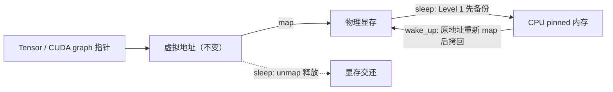

Sleep Mode 让 vLLM 进程不退出，只把权重和 KV cache 占的物理显存交出去；唤醒时在原虚拟地址上重新映射，切换从几十秒降到亚秒级 [1][2]。

## Table of contents

## 核心要点

- **保留**：进程、CUDA context、分配器、CUDA graph、JIT kernel 缓存。这些正是冷启动慢的原因 [2]。
- **释放**：物理显存。虚拟地址不变，所以 tensor 指针和 CUDA graph 唤醒后直接可用。
- **Level 0**：只暂停调度，不释放显存。配合 `release_kv_cache_memory()` 可以只丢 KV cache、保留权重（较新版本才有）[1]。
- **Level 1**：权重拷到 CPU，丢 KV cache。唤醒最快，但要够大的 CPU 内存。
- **Level 2**：权重和 KV cache 都丢。省 CPU 内存，唤醒后要重新加载权重。适合 RLHF 更新权重。
- **Level 1/2 都会丢 KV cache**。

## Level 0 / 1 / 2

| | Level 0 | Level 1 | Level 2 |
|---|---|---|---|
| 作用 | 暂停调度 | 卸载 | 丢弃 |
| 权重 | 留在 GPU | 备份到 CPU pinned 内存 | 丢弃 |
| KV cache | 留在 GPU；可再调 `release_kv_cache_memory()` 释放 | 丢弃 | 丢弃 |
| 唤醒后 | 直接可用；释放过 KV 的需 `wake_up(tags=["kv_cache"])` | 直接可用 | `reload_weights` + `reset_prefix_cache` |
| CPU 内存 | 无 | ≈ 权重大小 | MB 级 |
| 用途 | 暂时腾出 KV cache 显存 | 多模型轮换 | RLHF 权重更新、CPU 内存不足 |

## 原理

`CuMemAllocator` 接管 PyTorch 分配，用 CUDA 虚拟内存把**虚拟地址**和**物理显存**拆开 [3]：



- 分配按 tag 分池：`weights`、`kv_cache`、`cudagraph`。
- `sleep(offload_tags)`：tag 在列表里的先拷到 CPU，然后**全部** unmap。Level 1 和 Level 2 的唯一区别是 `offload_tags` 里有没有 `weights` [3][4]。
- `wake_up(tags)`：在原地址重新 map，有备份的拷回。可以按 tag 分开唤醒。

## 用法

```python
llm = LLM("Qwen/Qwen3-0.6B", enable_sleep_mode=True)

llm.sleep(level=1)
llm.wake_up()

# Level 0：暂停后只释放 KV cache，权重留在 GPU
llm.sleep(level=0, mode="keep")
llm.release_kv_cache_memory()
llm.wake_up(tags=["kv_cache"])

# Level 2：分阶段唤醒，压低权重更新时的显存峰值
llm.sleep(level=2)
llm.wake_up(tags=["weights"])
llm.collective_rpc("reload_weights")
llm.wake_up(tags=["kv_cache"])
```

在线服务 [1]：

```bash
VLLM_SERVER_DEV_MODE=1 vllm serve Qwen/Qwen3-0.6B --enable-sleep-mode
curl -X POST 'localhost:8000/sleep?level=1'
curl -X POST 'localhost:8000/wake_up'
```

`VLLM_SERVER_DEV_MODE=1` 打开的是开发接口，不要暴露到公网。

## 收益

A100、TP=1、vLLM 0.11.0，Qwen3-0.6B 与 Phi-3-vision 轮换 5 次 [2]：

| | 不用 Sleep | Level 1 | Level 2 |
|---|---|---|---|
| 总耗时 | 357.1s | 112.6s | 124.6s |
| 单次切换 | 37.6–58.1s | 0.26–0.82s | 0.85–2.58s |

Level 2 也要从磁盘读权重，快在跳过了进程启动、graph 捕获和 kernel 编译。

## 坑

- **先 warm-up 再睡**，否则每次唤醒后首次推理慢 5–7 倍 [2]。
- `release_kv_cache_memory()` 必须在 Level 0 暂停**完成后**调用；`mode="keep"` 保留的请求唤醒后会重新计算 [1]。
- Level 0 和 `release_kv_cache_memory()` 只在较新的文档里出现，旧版本（如 v0.10）只有 Level 1/2。
- CUDA graph 显存默认丢弃后重新捕获；`--sleep-mode-offload-cudagraph` 改为备份，batch size 1 时 decode 慢约 3% [1]。
- 平台：CUDA、ROCm [1]。

## References

1. [vLLM Docs — Sleep Mode](https://docs.vllm.ai/en/latest/features/sleep_mode/)
2. [vLLM Blog — Zero-Reload Model Switching with vLLM Sleep Mode](https://vllm.ai/blog/sleep-mode)
3. [vLLM 源码 — `vllm/device_allocator/cumem.py`](https://github.com/vllm-project/vllm/blob/main/vllm/device_allocator/cumem.py)
4. [vLLM API Docs — sleep mode backend](https://docs.vllm.ai/en/latest/api/vllm/device_allocator/sleep_mode_backend/)
