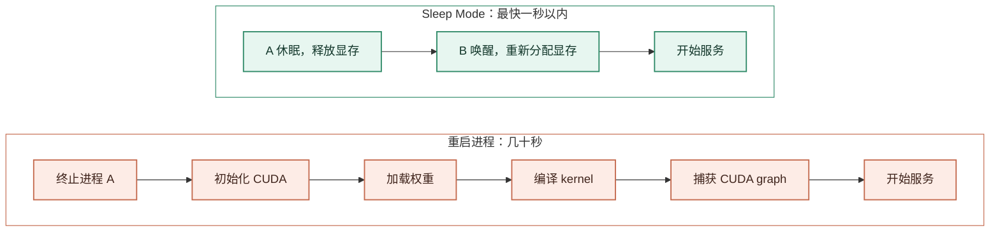
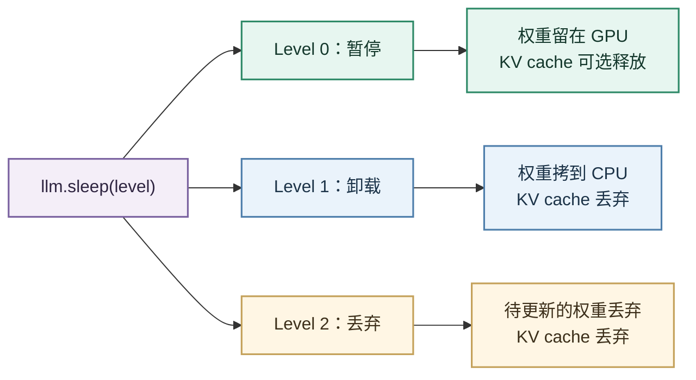
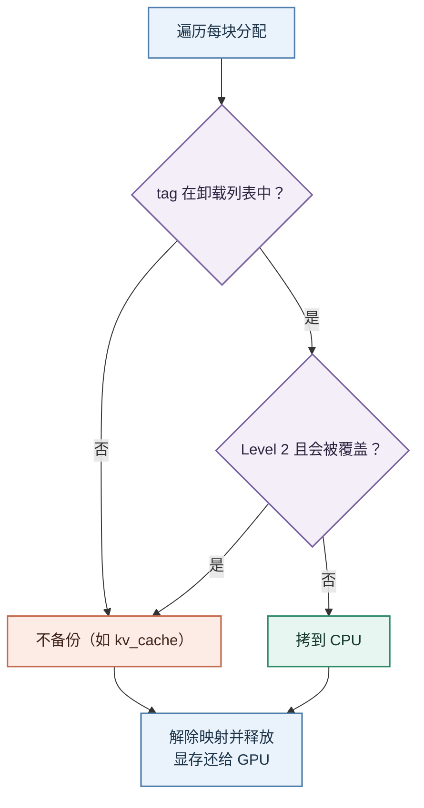
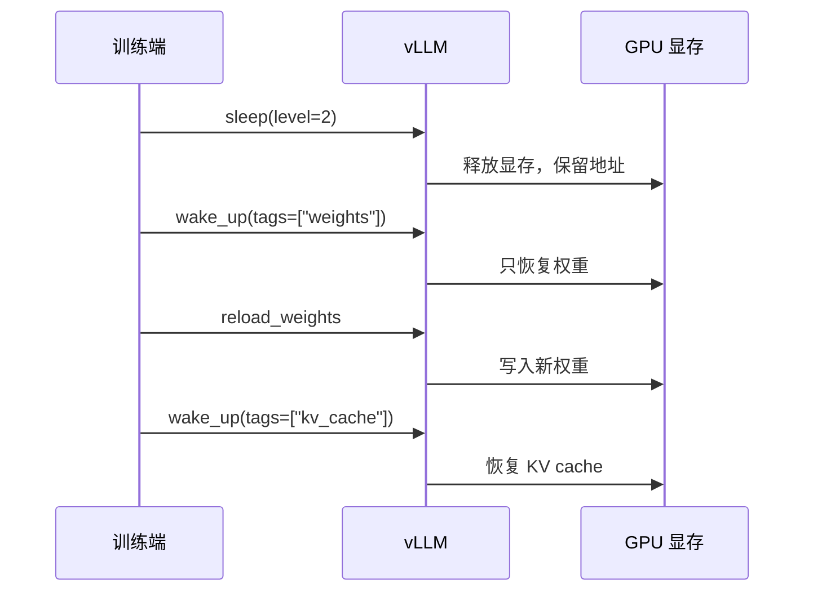
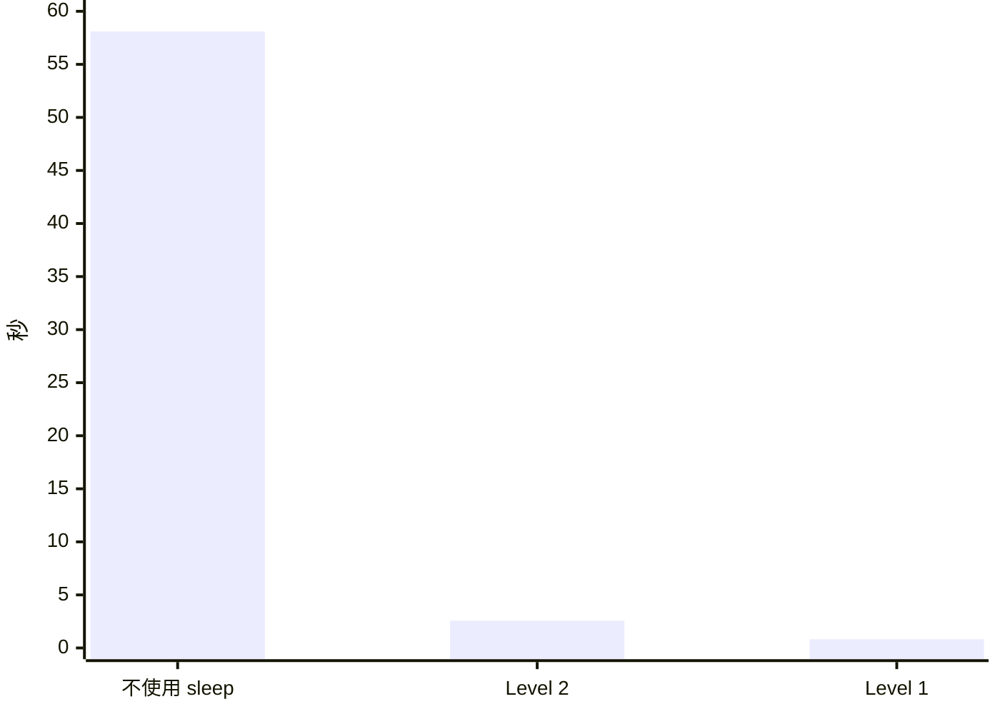

> Sleep Mode 在不停止 vLLM 进程的情况下释放权重和 KV cache 占用的显存，并在唤醒时重新映射到原来的虚拟地址，把模型切换时间从几十秒缩短到最快一秒以内 [[1]](https://docs.vllm.ai/en/latest/features/sleep_mode/)[[2]](https://vllm.ai/blog/sleep-mode)。

## 背景

假设一张 GPU 要轮流服务两个模型，但显存放不下两个模型。如果每次切换都重启 vLLM 进程，代价很高，而且加载权重只占其中一部分 [[2]](https://vllm.ai/blog/sleep-mode)。



## 休眠级别

级别越高，释放的状态越多，唤醒也越慢。



| 级别    | 唤醒代价               | 典型场景                    |
| ------- | ---------------------- | --------------------------- |
| Level 0 | 几乎为零               | 暂停调度，或释放 KV cache   |
| Level 1 | 较低，权重从 CPU 拷回  | 多模型切换，CPU 内存充足    |
| Level 2 | 较高，需要重新加载权重 | RLHF 权重更新，CPU 内存紧张 |

Level 1 和 Level 2 都不备份 KV cache。它的内容可以重新计算，由后续请求重新填充。

## 实现：`CuMemAllocator`

### 代码结构

sleep 的调用链涉及以下文件（vLLM `main` 分支，2026 年 11 月）：

```text
vllm/
├── entrypoints/
│   └── llm.py                     # 用户接口：LLM.sleep() / wake_up()
├── v1/
│   ├── engine/core.py             # 引擎层转发
│   ├── executor/abstract.py       # 分发给各个 worker
│   └── worker/gpu_worker.py       # 确定 Level 2 可丢弃的权重
└── device_allocator/
    ├── sleep_mode_backend.py      # 决定备份哪些 tag
    └── cumem.py                   # CuMemAllocator：释放并重新映射显存
```

### 分离虚拟地址和物理显存

PyTorch 默认的分配器把虚拟地址和物理显存绑定在一起。调用 `cudaFree` 后地址随之失效，引用这些地址的模型参数和 KV cache 张量都要重新创建。

`CuMemAllocator` 使用 CUDA 虚拟内存管理（VMM）API 分别管理两者，因此可以释放物理显存，同时保留虚拟地址范围 [[3]](https://github.com/vllm-project/vllm/blob/main/vllm/device_allocator/cumem.py)：


虚拟地址不变，已有指针就始终有效。相关的 API 如下：

| 操作               | CUDA API                      |
| ------------------ | ----------------------------- |
| 预留虚拟地址       | `cuMemAddressReserve`         |
| 分配物理显存       | `cuMemCreate`                 |
| 映射到虚拟地址     | `cuMemMap`                    |
| 开启访问权限       | `cuMemSetAccess`              |
| 解除映射并释放显存 | `cuMemUnmap` + `cuMemRelease` |

### 接入 PyTorch 与 tag

`CuMemAllocator` 通过 PyTorch 的 `CUDAPluggableAllocator` 接入，替换分配和释放回调。在 `use_memory_pool(tag=...)` 内分配的显存，都记录在对应的 tag 下：

```python
allocator = CuMemAllocator.get_instance()

with allocator.use_memory_pool(tag="weights"):
    load_model()            # 记录在 "weights" 下

with allocator.use_memory_pool(tag="kv_cache"):
    allocate_kv_cache()     # 记录在 "kv_cache" 下
```

tag 决定休眠时备份哪些分配，也让各组显存可以在唤醒时分别恢复。

### `sleep`

在 `main` 分支上，后端固定卸载 `("weights", "runtime", "cudagraph")` 这几个 tag。Level 2 时，worker 还会传入权重更新要覆盖的参数地址，这些分配不做备份 [[3]](https://github.com/vllm-project/vllm/blob/main/vllm/device_allocator/cumem.py)[[4]](https://docs.vllm.ai/en/latest/api/vllm/device_allocator/sleep_mode_backend/)。



因此 Level 2 并不会丢弃全部模型状态。权重更新不会改写的数据（如 buffer）仍然会备份。`--sleep-preserve-parameter-names` 可以额外保留指定参数，例如 `'draft.*'` 保留 draft 模型的权重。

早期版本只靠 tag 列表区分这两个级别：Level 1 传 `offload_tags=("weights",)`，Level 2 传 `offload_tags=()`。

### `wake_up(tags)`

1. 对指定的 tag（默认全部）重新分配物理显存，并映射到**原来的虚拟地址**。
2. 有 CPU 备份的分配，把内容拷回 GPU。
3. 没有备份的分配，内容是未定义的，需要由调用方重新填充。

分阶段唤醒对 RLHF 尤其有用：更新权重时不分配 KV cache，可以降低显存峰值。



## 用法

```python
llm = LLM("Qwen/Qwen3-0.6B", enable_sleep_mode=True)

llm.sleep(level=1)
llm.wake_up()

# Level 0：先暂停，再只释放 KV cache；权重留在 GPU
llm.sleep(level=0, mode="keep")
llm.release_kv_cache_memory()
llm.wake_up(tags=["kv_cache"])

# Level 2：分阶段唤醒，降低权重更新时的显存峰值
llm.sleep(level=2)
llm.wake_up(tags=["weights"])
llm.collective_rpc("reload_weights")
llm.wake_up(tags=["kv_cache"])
```

在 OpenAI 兼容服务中使用 [[1]](https://docs.vllm.ai/en/latest/features/sleep_mode/)，先启动服务：

```bash
VLLM_SERVER_DEV_MODE=1 vllm serve Qwen/Qwen3-0.6B --enable-sleep-mode
```

进入休眠：

```bash
curl -X POST 'localhost:8000/sleep?level=1'
```

唤醒：

```bash
curl -X POST 'localhost:8000/wake_up'
```

`VLLM_SERVER_DEV_MODE=1` 会开启开发用接口，不要暴露在不可信的网络中。

## 性能

测试环境为 A100、TP=1、vLLM 0.11.0，在 Qwen3-0.6B 和 Phi-3-vision 之间切换 5 次 [[2]](https://vllm.ai/blog/sleep-mode)：

|          | 不使用 sleep | Level 1    | Level 2    |
| -------- | ------------ | ---------- | ---------- |
| 总耗时   | 357.1s       | 112.6s     | 124.6s     |
| 每次切换 | 37.6–58.1s   | 0.26–0.82s | 0.85–2.58s |

每次切换的最长耗时：



Level 2 仍要从磁盘读取权重，它的优势来自省去进程启动、graph 捕获和 kernel 编译。

## 注意事项

- 休眠前先完成预热，否则每次唤醒后的第一次推理会慢 5–7 倍 [[2]](https://vllm.ai/blog/sleep-mode)。
- `release_kv_cache_memory()` 要在 Level 0 暂停完成后调用。用 `mode="keep"` 保留的请求会在唤醒后重新计算 [[1]](https://docs.vllm.ai/en/latest/features/sleep_mode/)。
- Level 0 和 `release_kv_cache_memory()` 只出现在较新版本的文档中。v0.10 等旧版本只支持 Level 1 和 Level 2。
- 文档称 CUDA graph 显存默认丢弃、唤醒后重新捕获；使用 `--sleep-mode-offload-cudagraph` 可改为备份，代价是 batch size 为 1 时 decode 延迟增加约 3% [[1]](https://docs.vllm.ai/en/latest/features/sleep_mode/)。但 `main` 分支的 `CuMemBackend` 已把 `cudagraph` 列入卸载 tag，行为可能因版本而异。
- 支持的平台：CUDA 和 ROCm [[1]](https://docs.vllm.ai/en/latest/features/sleep_mode/)。

## 参考资料

1. [vLLM Docs — Sleep Mode](https://docs.vllm.ai/en/latest/features/sleep_mode/)
2. [vLLM Blog — Zero-Reload Model Switching with vLLM Sleep Mode](https://vllm.ai/blog/sleep-mode)
3. [vLLM source — `vllm/device_allocator/cumem.py`](https://github.com/vllm-project/vllm/blob/main/vllm/device_allocator/cumem.py)
4. [vLLM API Docs — sleep mode backend](https://docs.vllm.ai/en/latest/api/vllm/device_allocator/sleep_mode_backend/)
